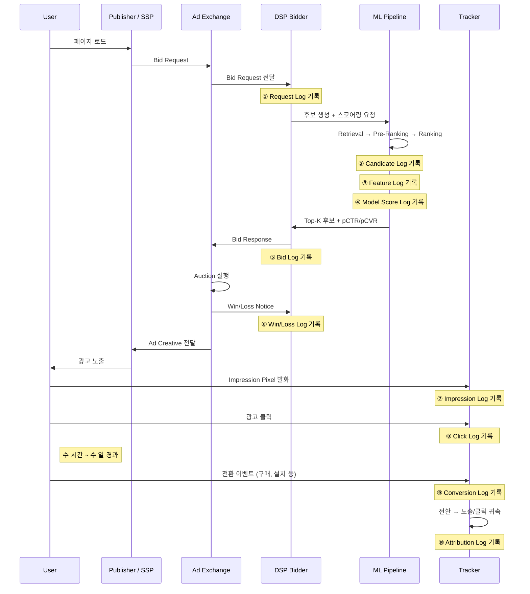
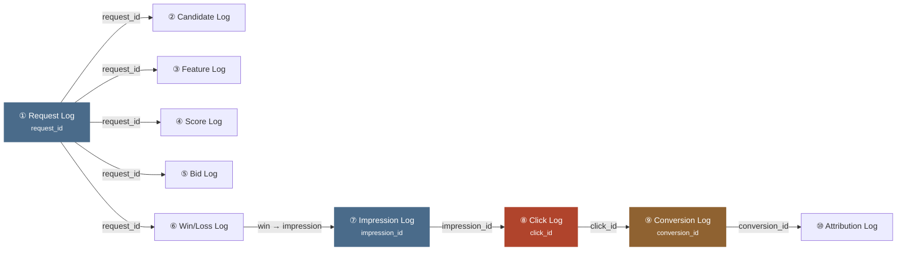

pCTR 모델을 학습시키려면 먼저 노출(impression) 로그(log)부터 열어 봐야 합니다. pCTR 은 광고가 한 번 노출됐을 때 클릭될 확률을 모델이 예측한 값입니다. 로그는 시스템이 겪은 일을 시각과 함께 한 줄씩 적어 둔 기록이며 노출 로그에는 광고가 화면에 뜰 때마다 한 줄이 쌓입니다. 그렇다면 그 노출 로그는 **정확히 언제, 어디서, 어떤 필드로** 기록되었을까요? 요청(Request) 로그와 candidate 로그, 클릭(click) 로그에도 같은 물음을 던질 수 있습니다. 광고 시스템에 ad 요청(request)이 하나 들어오면 그 요청은 시스템을 지나는 동안 **적어도 10종의 로그**를 남깁니다. 이 글은 그 로그 10개를 생기는 순서대로 따라가면서 각 로그가 언제 기록되는지와 어떤 과정을 거쳐 ML 학습 데이터로 합쳐지는지를 하나씩 살펴봅니다.

> 다른 세 글은 이 글이 다루는 로그를 짧게만 다룹니다. [생태계 전체 지도](post.html?id=adtech-ecosystem-map)는 로그의 흐름을 "피드백 루프"라는 한 줄로 줄여 말합니다. [광고 서빙 흐름(Ad Serving Flow)](post.html?id=ad-serving-flow)은 입찰 요청(Bid Request)이 들어와 광고가 노출되기까지만 따라갑니다. [피처 스토어(Feature Store)](post.html?id=feature-store-serving)는 로그를 "이벤트 로그" 하나로 뭉뚱그려 부릅니다. 이 글은 세 글이 모두 건너뛴 **로그 자체**를 자세히 들여다봅니다.
>
> [로그 시스템 설계](post.html?id=ad-log-system)는 같은 로그를 다루는 형제 글이지만 맡은 몫이 다릅니다. 로그 시스템 설계 편은 로그를 잃지 않고 옮기는 인프라를 다룹니다. 이 글은 어떤 로그가 왜 남는지와 그 안에 무엇이 담기는지를 설명합니다.

---

## 1. 로그 파이프라인 전체 흐름

**ad 요청 하나는 시스템을 지나는 동안 단계마다 로그를 남기며 그 수는 모두 10개입니다. 앞의 5개는 요청을 받은 뒤 0~10ms 안에 다 기록되지만 마지막 2개는 며칠 뒤에야 도착합니다.**

광고 시스템은 요청 하나를 처리하면서 여러 단계를 거칩니다. 요청을 받으면 후보 광고를 고르고 광고마다 값을 매겨 입찰하며 경매 결과를 들은 뒤 광고를 화면에 띄웁니다. 그다음에는 클릭을 받고 며칠 뒤에는 전환까지 받습니다. 전환(conversion)은 구매나 가입, 앱 설치처럼 광고주가 바란 행동이 실제로 일어난 사건입니다. 단계마다 그때 무슨 일이 있었는지를 적어 두어야 나중에 되짚어 볼 수 있으므로 로그도 10개나 필요합니다. 한 단계라도 기록을 빠뜨리면 그 구간에서 일어난 일은 영원히 확인할 수 없습니다.

로그가 도착하는 시각의 폭도 함께 기억해 둘 만합니다. 아래 표의 「요청 대비 지연」 열을 보면 요청 로그부터 입찰 로그까지 앞의 5개는 요청을 받고 0~10ms 안에 모두 기록됩니다. 반면 마지막 2개인 전환 로그와 어트리뷰션 로그(전환 한 건을 어느 노출이나 클릭의 공로로 돌릴지 정한 결과를 남기는 로그)는 수 시간에서 며칠 뒤에야 도착합니다. 같은 요청 하나를 설명하는 로그들인데도 도착 시각은 100만 배 이상 벌어집니다.

아래 카드에서는 요청 하나가 남기는 로그를 시간 순서대로 보면 됩니다.

<div class="demo-embed-wrap">
<iframe class="demo-embed" src="demo-training-cards.html?embed=1&card=tenlogs" height="480" loading="lazy" title="요청 하나가 남기는 로그"></iframe>
<a class="demo-embed-open" href="demo-training-cards.html" target="_blank" rel="noopener">↗ 카드 여섯 장 전체로 열기</a>
</div>

카드 아래 순서도는 같은 흐름을 메시지 단위로 그립니다. 순서도에 나오는 매체(Publisher)는 광고 지면(광고가 실리는 화면 속 영역)을 가진 사이트나 앱이고 SSP 는 매체를 대신해 지면을 파는 플랫폼입니다. 광고 거래소(Ad Exchange)는 지면 하나가 열릴 때마다 경매를 열어 여러 DSP 의 입찰을 받는 곳입니다. DSP 는 광고주를 대신해 입찰 요청마다 입찰할지와 얼마를 부를지를 정하는 플랫폼이며 DSP 입찰 서버(DSP Bidder)가 그 결정을 내려 응답을 보냅니다. 트래커(Tracker)는 노출, 클릭, 전환처럼 유저가 일으킨 이벤트를 받아 기록하는 서버입니다.



순서도의 Note 줄은 로그 ①부터 ⑩까지가 기록되는 곳을 표시합니다. ①, ⑤, ⑥ 은 DSP 입찰 서버(BID) 옆에, ②, ③, ④ 는 ML 파이프라인(ML) 옆에, ⑦부터 ⑩까지는 트래커(TRK) 옆에 적혀 있습니다. 트래커 옆의 4개 가운데 「수 시간 ~ 수 일 경과」 표시 뒤에 오는 ⑨ 와 ⑩ 만 한참 뒤에 생깁니다.

### 로그 10개 요약

아래 표는 로그 10개를 한 줄에 하나씩 놓고 무엇이 기록의 계기가 되는지(트리거 시점), 누가 남기는지(기록 주체), 요청을 받은 뒤 얼마 만에 생기는지(요청 대비 지연), 주로 어디에 쓰이는지(주요 소비자)를 보여 줍니다.

| # | 로그(Log) | 트리거 시점 | 기록 주체 | 요청 대비 지연 | 주요 소비자 |
|---|-----|-----------|----------|-------------|-----------|
| ① | **요청 로그(Request Log)** | 입찰 요청 수신 즉시 | DSP 입찰 서버(DSP Bidder) | 0ms | QPS 모니터링, 잇는 키(JOIN key) |
| ② | **후보 로그(Candidate Log)** | 후보 생성, 필터 완료 | 랭킹 파이프라인(Ranking Pipeline) | ~1-2ms | 후보 생성(Retrieval) recall 분석 |
| ③ | **피처 로그(Feature Log)** | 피처 벡터(Feature Vector) 조합 완료 | 피처 게이트웨이(Feature Gateway) | ~2-3ms | 학습과 서빙의 피처 어긋남(Training-Serving Skew) 감지 |
| ④ | **모델 점수 로그(Model Score Log)** | 모델 추론 완료 | 모델 서버(Model Server) | ~5-8ms | Calibration 모니터링 |
| ⑤ | **입찰 로그(Bid Log)** | 입찰 응답(Bid Response) 전송 | DSP 입찰 서버 | ~10ms | 입찰 전략 분석 |
| ⑥ | **낙찰과 패찰 로그(Win/Loss Log)** | 경매 결과 수신 | 광고 거래소(Ad Exchange) → DSP | ~50-100ms | Bid Shading 학습 |
| ⑦ | **노출 로그(Impression Log)** | 광고 렌더링 확인 | 클라이언트 SDK(Client SDK) / 픽셀(Pixel) | ~200ms-1s | pCTR 학습 (샘플) |
| ⑧ | **클릭 로그(Click Log)** | 유저 클릭 | 클릭 트래커(Click Tracker) | 수 초~수 분 | pCTR 학습 (라벨) |
| ⑨ | **전환 로그(Conversion Log)** | 전환 이벤트 발생 | 광고주 SDK(Advertiser SDK) → Postback | 수 시간~수 일 | pCVR 학습 (라벨) |
| ⑩ | **어트리뷰션 로그(Attribution Log)** | 전환 귀속 처리 완료 | 어트리뷰션 엔진(Attribution Engine) | 수 시간~수 일 | ROAS 정산 |

표의 주요 소비자 열에 나오는 이름 가운데 「잇는 키」와 「학습과 서빙의 피처 어긋남」은 여기서 풀어 둡니다. JOIN 은 두 표에서 같은 키 값을 가진 행끼리 이어 붙이는 연산이며 잇는 키(JOIN key)는 그때 기준으로 삼는 칼럼입니다. 피처(feature)는 모델에 넣는 입력 변수이고 서빙(serving)은 학습을 마친 모델이 실제 요청에 점수를 매기는 일입니다. 학습과 서빙의 피처 어긋남(Training-Serving Skew)은 모델이 학습할 때 본 피처 값과 실제로 서빙할 때 받은 피처 값이 서로 다른 상태를 말합니다. 주요 소비자 열의 나머지 이름(Calibration, Bid Shading, ROAS 정산 등)은 각 로그를 자세히 보는 2절과 3절에서 차례로 풉니다.

---

## 2. 핵심 로그 6개(Core 6 Logs) — 입찰부터 전환까지

**광고 서빙 파이프라인의 핵심 로그는 요청, 후보, 노출, 클릭, 전환, 낙찰과 패찰 로그 6개입니다. 요청을 받는 순간(0ms)에 남는 요청 로그부터 수 시간~수 일 뒤에 오는 전환 로그까지 기록되는 때가 서로 다릅니다.**

도입에서 물은 대로 노출 로그가 언제, 어디서, 어떤 필드로 기록되는지 알려면 로그를 하나씩 열어 봐야 합니다. 아래 그림은 6개가 기록되는 순간과 남기는 주체를 단계별로 보여 줍니다. 그림에서 낙찰과 패찰 로그는 맨 끝(6번)에 놓였지만 시각으로는 입찰 응답 뒤 ~50-100ms 에 와서 노출보다 앞섭니다.

<div class="chart-steps">
  <div style="font-size:0.85rem; font-weight:700; color:var(--text-primary); margin-bottom:12px;">광고 서빙 로그 파이프라인(Ad Serving Log Pipeline) — 시간순으로 봅니다.</div>
  <div class="chart-step">
    <div class="chart-step-indicator">
      <div class="chart-step-dot green">1</div>
      <div class="chart-step-line"></div>
    </div>
    <div class="chart-step-content">
      <div class="chart-step-title">요청 로그 — 입찰 요청 수신 즉시 (0ms)</div>
      <div class="chart-step-desc">입찰 요청을 받는 순간 기록됩니다. DSP 입찰 서버가 Exchange로부터 요청을 받자마자 남깁니다. 모든 후속 로그를 잇는 키(request_id)가 여기서 생성됩니다.</div>
      <span class="chart-step-badge green">DSP 입찰 서버, 0ms</span>
    </div>
  </div>
  <div class="chart-step">
    <div class="chart-step-indicator">
      <div class="chart-step-dot green">2</div>
      <div class="chart-step-line"></div>
    </div>
    <div class="chart-step-content">
      <div class="chart-step-title">후보 로그 — 후보 깔때기</div>
      <div class="chart-step-desc">후보 생성 → 앞단 랭킹(Pre-Ranking) 직후(~1-2ms). 상위 N개 후보가 확정된 시점입니다. 각 단계에서 몇 개가 탈락했는지 추적합니다.</div>
      <span class="chart-step-badge green">랭킹 파이프라인, ~2ms</span>
    </div>
  </div>
  <div class="chart-step">
    <div class="chart-step-indicator">
      <div class="chart-step-dot blue">3</div>
      <div class="chart-step-line"></div>
    </div>
    <div class="chart-step-content">
      <div class="chart-step-title">노출 로그 — 렌더링 확인</div>
      <div class="chart-step-desc">광고가 실제로 그려진 순간(~200ms-1s). 유저 화면에 뜬 것을 노출 픽셀(Impression Pixel) 또는 클라이언트 SDK가 알립니다. pCTR 학습 데이터의 한 행이 여기서 탄생합니다.</div>
      <span class="chart-step-badge blue">클라이언트 SDK / 픽셀, ~1s</span>
    </div>
  </div>
  <div class="chart-step">
    <div class="chart-step-indicator">
      <div class="chart-step-dot orange">4</div>
      <div class="chart-step-line"></div>
    </div>
    <div class="chart-step-content">
      <div class="chart-step-title">클릭 로그 — 유저 클릭</div>
      <div class="chart-step-desc">유저가 광고를 누른 순간(수 초~수 분). 클릭 트래커가 redirect URL 또는 JS 이벤트로 잡습니다. pCTR 학습의 라벨(y=1)이 됩니다.</div>
      <span class="chart-step-badge orange">클릭 트래커, 수 초</span>
    </div>
  </div>
  <div class="chart-step">
    <div class="chart-step-indicator">
      <div class="chart-step-dot pink">5</div>
      <div class="chart-step-line"></div>
    </div>
    <div class="chart-step-content">
      <div class="chart-step-title">전환 로그 — 전환 이벤트</div>
      <div class="chart-step-desc">구매, 가입, 설치가 일어난 순간(수 시간~수 일). 광고주 사이트에서 발생합니다. 광고주 SDK 또는 Server-to-Server Postback으로 DSP에 전달됩니다.</div>
      <span class="chart-step-badge pink">Advertiser → DSP, 수 시간~수 일</span>
    </div>
  </div>
  <div class="chart-step">
    <div class="chart-step-indicator">
      <div class="chart-step-dot blue">6</div>
    </div>
    <div class="chart-step-content">
      <div class="chart-step-title">낙찰과 패찰 로그 — 경매 결과</div>
      <div class="chart-step-desc">낙찰, 패찰을 Exchange가 알려줍니다. 입찰 응답 전송 후 ~50-100ms 안에 옵니다. 낙찰이면 낙찰가(clearing price)가 담기고, 패찰이면 가격이 안 보입니다(Right-Censored).</div>
      <span class="chart-step-badge blue">Exchange → DSP, ~100ms</span>
    </div>
  </div>
</div>

이제 6개를 차례로 열어 보면서 로그마다 언제 누가 남기는지, 어떤 필드가 담기는지, 그 필드를 어디에 쓰는지를 확인합니다.

### 2.1 요청 로그 — 모든 로그의 시작점

**요청 로그는 DSP 입찰 서버가 입찰 요청을 받는 바로 그 순간(0ms)에 남습니다. 뒤에 오는 모든 로그를 이 요청과 이어 주는 키 request_id 가 여기서 처음 생깁니다.**

**기록 시점**: 광고 거래소가 보낸 입찰 요청이 DSP 입찰 서버에 도착하는 **바로 그 순간**(0ms)입니다. 입찰 요청(Bid Request)은 매체의 지면 하나에 광고를 띄울 기회가 생겼을 때 거래소가 DSP 에 보내는 메시지입니다. 이 메시지에는 아래 표처럼 유저, 지면, 위치, 기기 정보가 담겨 옵니다. 시스템은 이 요청을 처리할지 판단하기도 전에 로그부터 남깁니다.

**기록 주체**: DSP 입찰 서버입니다. 외부 요청을 가장 먼저 받는 관문인 API Gateway 나 광고 서버의 맨 앞 계층이 이 로그를 남깁니다.

**주요 필드**:

| 필드 | 설명 | 예시 |
|------|------|------|
| `request_id` | 이 요청의 고유 식별자 — **모든 후속 로그의 잇는 키** | `req-a1b2c3d4` |
| `timestamp` | 수신 시각 (ms 정밀도) | `2026-04-12T09:31:22.417Z` |
| `user_id` / `device_id` | 유저 식별자 (3rd-party cookie 또는 ADID/IDFA) | `did-xyz789` |
| `publisher_id` | 매체 식별자 | `pub-news-kr` |
| `slot_id` / `slot_size` | 광고 지면 정보 | `slot-top-banner`, `300x250` |
| `geo_country` / `geo_region` | 유저 위치 | `KR`, `Seoul` |
| `device_type` / `os` | 디바이스 정보 | `mobile`, `iOS 18` |
| `bid_floor` | Exchange가 설정한 최저 입찰가 | `$0.50` |
| `exchange_id` | 어떤 Exchange에서 온 요청인지 | `google-adx` |

표의 request_id 는 이 요청 하나에만 붙는 고유 식별자이며 뒤에 오는 로그를 이 요청에 이어 붙이는 키로 쓰입니다. user_id 와 device_id 에는 3rd-party cookie(유저가 방문한 사이트가 아닌 다른 도메인이 심은 쿠키)나 ADID, IDFA(안드로이드와 iOS 가 앱에 주는 광고 식별자) 같은 유저 식별자가 들어갑니다. bid_floor 는 거래소가 이 지면에 정해 둔 최저 입찰가로 예시에서는 `$0.50` 입니다.

**쓰이는 곳**:

- **QPS(초당 요청 수) 모니터링**: 1초에 쌓이는 요청 로그 수가 시스템이 받는 부하를 그대로 나타냅니다.
- **로그 체인을 잇는 키**: 여기서 생긴 `request_id` 는 이후의 모든 로그를 하나의 체인으로 잇는 키입니다.
- **예산 페이싱(Budget Pacing)의 분모**: 예산 페이싱은 하루 예산이 일찍 바닥나지 않도록 입찰 속도를 조절하는 일입니다. 전체 요청 가운데 몇 건에 입찰했는지 비율을 계산할 때 요청 로그 수가 분모로 들어갑니다.
- **트래픽 분석**: Exchange별, 매체별, 시간대별로 요청이 얼마나 들어오는지 분포를 봅니다.

> 입찰 요청에 담기는 필드와 구조는 [광고 서빙 흐름](post.html?id=ad-serving-flow)에서 자세히 다룹니다.

### 2.2 후보 로그 — 후보 깔때기(funnel)의 기록

**후보 로그는 광고 수천 개가 단계를 지나며 수백 개로 줄어드는 깔때기에서 단계마다 들어온 후보 수, 남은 후보 수, 탈락 사유를 남깁니다.**

**기록 시점**: [단계별 랭킹 파이프라인(Multi-Stage Ranking Pipeline)](post.html?id=model-serving-architecture)에서 **상위 후보가 확정되는 순간**입니다. 단계별 랭킹 파이프라인은 가벼운 단계로 후보를 먼저 크게 줄이고 무거운 모델은 남은 후보에만 쓰는 구조입니다. 첫 단계인 후보 생성(Retrieval)이 전체 광고 풀에서 광고 수천 개를 꺼내면 다음 단계인 앞단 랭킹(Pre-Ranking)이 그 가운데 수백 개만 남깁니다. 두 단계가 끝나는 요청 뒤 ~1-2ms 지점에서 후보 로그가 기록됩니다.

**기록 주체**: DSP 랭킹 파이프라인(DSP Ranking Pipeline)의 후보 생성 모듈과 앞단 랭킹 모듈입니다.

**주요 필드**:

| 필드 | 설명 | 예시 |
|------|------|------|
| `request_id` | 요청 로그와 잇기 | `req-a1b2c3d4` |
| `stage` | 파이프라인 단계 | `retrieval`, `pre_ranking`, `ranking` |
| `candidates_in` | 이 단계 진입 후보 수 | `3,200` |
| `candidates_out` | 이 단계 통과 후보 수 | `200` |
| `top_candidates[]` | 통과한 후보 목록 (ad_id, score) | `[{ad_id: "ad-001", score: 0.82}, ...]` |
| `filter_reasons` | 탈락 사유 집계 | `{budget_exhausted: 1200, target_mismatch: 800}` |
| `latency_ms` | 이 단계 처리 시간 | `0.8` |

표의 예시 값을 차례로 읽으면 이 단계(stage)에 후보 3,200개가 들어와(candidates_in) 200개가 통과했고(candidates_out) 처리에 0.8ms 가 걸렸습니다(latency_ms). filter_reasons 에는 탈락 사유별 개수가 집계됩니다. 예시의 `{budget_exhausted: 1200, target_mismatch: 800}` 은 예산이 바닥나 빠진 후보가 1200, 타겟 조건이 맞지 않아 빠진 후보가 800 이라는 뜻입니다.

**쓰이는 곳**:

- **후보 생성 Recall 분석**: Recall 은 찾아야 할 것 가운데 실제로 찾아낸 비율입니다. 여기서는 최종적으로 낙찰된 광고가 맨 처음 후보 생성 단계의 후보 목록에 들어 있었는지를 확인합니다.
- **Funnel Dropout 분석**: 단계마다 후보의 몇 %가 탈락하는지를 세어 보면 필터 조건이 지나치게 공격적이지는 않은지 알 수 있습니다.
- **앞단 랭킹 ↔ Ranking 일관성**: 앞단 랭킹에서 상위권이던 광고가 마지막 Ranking 단계(무거운 모델로 최종 순서를 정하는 단계)에서도 상위권에 남는지를 봅니다.

> 후보 로그는 교과서 대부분이 다루지 않는 로그이지만 **실무에서는 모델을 개선할 첫 단서가 이 로그에 있습니다.** 좋은 광고가 왜 노출되지 않았는지를 따질 때 그 답을 찾는 일도 후보 로그의 `filter_reasons` 를 여는 데서 시작합니다.

### 2.3 노출 로그 — pCTR 학습 데이터의 출발점

**노출 로그는 광고가 유저 화면에 실제로 그려진 순간에 남고 노출 로그 한 행이 pCTR 학습 데이터 한 행이 됩니다. 요청이 100건 들어와도 노출 로그에는 경매에서 이긴 비율에 따라 10~30건만 남습니다.**

**기록 시점**: 광고가 유저 화면에 **실제로 렌더링된 순간**입니다. 렌더링(rendering)은 광고가 화면에 실제로 그려지는 일입니다. 서버가 그 순간을 알아내는 방식은 픽셀과 SDK 2가지입니다. 광고가 보였다고 인정하는 업계 기준으로는 Viewability 가 있습니다.

- **픽셀 방식**: 광고 소재(Creative) 안에 1x1 크기의 투명 이미지(tracking pixel)를 넣어 둡니다. 브라우저가 이 이미지를 불러오는 순간 서버로 요청이 가고 서버가 그 요청을 받아 노출을 기록합니다.
- **SDK 방식**: SDK 는 앱 안에 넣어 쓰는 기능 모음(라이브러리)입니다. 모바일 앱 안의 광고 SDK 가 광고가 다 그려진 것을 감지하면 노출 이벤트를 서버로 보냅니다.
- **Viewability 기준**: Viewability 는 광고가 유저 눈에 실제로 보일 수 있는 상태였는지를 따지는 기준입니다. 광고 업계 표준 단체인 IAB 의 표준으로는 광고 영역의 50% 이상이 1초 이상(영상은 2초) 화면에 보여야 합니다.

**기록 주체**: 앱의 Client-side SDK 나 픽셀 트래커(Tracker)가 이벤트를 보내면 DSP 의 노출(Impression) Tracking 서버가 받아서 남깁니다.

**주요 필드**:

| 필드 | 설명 | 예시 |
|------|------|------|
| `impression_id` | 이 노출의 고유 식별자 — 클릭과 전환 로그(Click/Conversion Log)의 잇는 키 | `imp-e5f6g7h8` |
| `request_id` | 요청 로그와 잇기 | `req-a1b2c3d4` |
| `user_id` | 유저 식별자 | `did-xyz789` |
| `ad_id` / `campaign_id` | 노출된 광고와 캠페인 | `ad-001`, `camp-42` |
| `creative_id` | 어떤 소재가 노출되었는지 | `cr-banner-v3` |
| `position` | 광고 위치 (슬롯 내 순서) | `1` |
| `win_price` | 실제 지불 가격 (clearing price) | `$0.83` |
| `viewability` | 실제 조회 가능 여부 | `viewable`, `not_viewable` |
| `exchange_id` | 어떤 Exchange를 통해 낙찰되었는지 | `google-adx` |

impression_id 는 이 노출 한 건에 붙는 고유 식별자이며 뒤에서 클릭 로그와 전환 로그를 이 노출에 이어 붙이는 키가 됩니다. win_price 는 경매에서 이겨 실제로 낸 가격(clearing price)입니다. viewability 에는 위 Viewability 기준을 충족했는지가 viewable 이나 not_viewable 로 찍힙니다.

**쓰이는 곳**:

- **pCTR 학습 데이터의 한 행**: 노출 1건이 학습 샘플 1건입니다. 그 노출에 클릭(Click)이 있으면 y=1, 없으면 y=0 이 라벨로 붙습니다.
- **CTR 계산의 분모**: CTR(Click-Through Rate)은 노출 가운데 클릭이 일어난 비율입니다. CTR = 클릭 수 / 노출 수 로 계산하므로 노출 로그의 행 수가 분모가 됩니다.
- **Frequency Cap**: 한 유저에게 같은 광고를 너무 자주 보여 주지 않도록 정한 노출 횟수 상한입니다. 이 유저가 이 광고를 몇 번 봤는지를 노출 로그로 셉니다.
- **CPM 과금**: CPM 은 노출 수를 기준으로 광고비를 매기는 과금 방식이라 노출 로그 한 행이 과금의 트리거가 됩니다.

> 노출 로그의 **모든 행은 "이전 모델이 노출하기로 결정한 광고"에서만 생깁니다.** 여기서 이전 모델은 이 로그가 쌓이는 동안 실제로 광고를 고르던 모델입니다. 그 모델이 고르지 않아 노출되지 않은 광고는 클릭되었을지 아닐지를 영원히 알 수 없습니다. Selection Bias(선택 편향)는 데이터가 무작위로 모이지 않고 어떤 선택을 거친 것만 남아서 생기는 치우침입니다. 이전 모델이 고른 광고만 데이터에 남는 이 구조가 Selection Bias 의 근원입니다. [안 눌린 로그를 줄여 생기는 편향(Negative Sampling Bias) 포스트](post.html?id=negative-sampling-bias)에서 다룬 문제도 여기서 시작됩니다.

**구분할 것**: 노출 로그와 요청 로그는 같지 않습니다. 요청이 100건 들어와도 경매에서 이기고 화면에 실제로 노출된 건만 노출 로그에 남는데 그 수는 낙찰률(Win Rate, 입찰한 경매 가운데 이긴 비율)에 따라 10~30건입니다. 100건에서 그 10~30건을 뺀 나머지 70~90건의 요청은 패찰되어 노출을 남기지 않습니다.

### 2.4 클릭 로그 — pCTR 라벨의 출처

**클릭 로그는 유저가 광고를 누른 순간에 남습니다. 노출 로그에 이어 붙이면 클릭이 있는 노출에 pCTR 학습의 양성 라벨(y=1)이 붙습니다.**

**기록 시점**: 유저가 광고를 **클릭하는 순간**입니다. 클릭은 노출 뒤 수 초에서 수 분 안에 일어납니다.

**남기는 방식**:

- **Redirect 방식**: redirect 는 접속한 주소에서 다른 주소로 자동으로 넘겨 보내는 동작입니다. 유저가 광고를 누르면 브라우저는 먼저 DSP 의 클릭 Tracking URL 로 redirect 됩니다. 클릭 Tracking 서버가 로그를 기록한 다음 유저를 광고주 랜딩 페이지(광고를 누르면 열리는 광고주의 페이지)로 다시 redirect 합니다.
- **JS Event 방식**: 광고 안의 JavaScript 가 클릭 이벤트를 감지해 비동기로(응답을 기다리지 않고) 클릭 트래커에 보냅니다.

**기록 주체**: DSP 클릭 트래커입니다. Redirect 서버나 Client-side Event Collector(브라우저와 앱에서 보낸 이벤트를 모으는 수집 서버)가 이 일을 맡습니다.

**주요 필드**:

| 필드 | 설명 | 예시 |
|------|------|------|
| `click_id` | 이 클릭의 고유 식별자 | `clk-i9j0k1l2` |
| `impression_id` | 노출 로그와 잇기 | `imp-e5f6g7h8` |
| `request_id` | 요청 로그와 잇기 | `req-a1b2c3d4` |
| `user_id` | 유저 식별자 | `did-xyz789` |
| `ad_id` | 클릭된 광고 | `ad-001` |
| `timestamp` | 클릭 시각 | `2026-04-12T09:31:25.891Z` |
| `time_since_impression_ms` | 노출 후 클릭까지 경과 시간 | `3474` (약 3.5초) |
| `is_valid` | 이상 탐지(Fraud Detection) 결과 | `true` |

time_since_impression_ms 는 노출된 뒤 클릭까지 걸린 시간이며 예시의 3474 는 약 3.5초입니다. 이상 탐지(Fraud Detection)는 사람이 아닌 프로그램이 누른 클릭이나 부정 클릭을 걸러내는 검사입니다. is_valid 에는 그 판정 결과가 담깁니다.

**쓰이는 곳**:

- **pCTR 학습 라벨**: 노출 로그에 클릭 로그를 이어 붙였을 때 클릭이 있는 노출이 y=1 인 양성 샘플(positive sample)이 됩니다.
- **CPC 과금 트리거**: CPC 는 클릭이 일어날 때 광고비를 매기는 과금 방식이라 클릭 한 건마다 과금이 일어납니다.
- **이상 탐지 입력**: 100ms 도 걸리지 않은(< 100ms) 비정상적으로 빠른 클릭이나 같은 IP 에서 되풀이되는 클릭 같은 패턴을 찾아냅니다.
- **pCVR 학습의 입력 조건**: pCVR 모델은 클릭한 유저 가운데 전환한 비율을 예측하므로 클릭 로그가 pCVR 학습 데이터의 샘플 기준이 됩니다. 클릭 로그 한 행이 pCVR 학습 데이터 한 행입니다.

### 2.5 전환 로그(Conversion Log) — 가장 늦게 도착하는 가장 중요한 라벨

**전환 로그는 유저가 광고주 사이트에서 구매, 가입, 앱 설치 같은 전환을 마친 순간에 남습니다. 그 순간이 클릭보다 수 시간~수 일 늦어서 학습 데이터를 너무 일찍 자르면 전환한 클릭이 비전환으로 잘못 들어갑니다.**

**기록 시점**: 유저가 광고주 사이트에서 **전환 이벤트**(구매, 가입, 앱 설치 등)를 끝낸 순간입니다. 이 순간은 클릭보다 **수 시간~수 일** 늦습니다.

**남기는 방식**:

- **Client-side Pixel**: 광고주 사이트의 전환 완료 페이지에 심어 둔 tracking pixel 이 호출되면서 전환이 기록됩니다.
- **Server-to-Server Postback**: 전환이 일어나면 광고주 서버가 DSP 의 API 를 직접 호출해 알립니다. 브라우저를 거치지 않고 서버끼리 주고받아서 Server-to-Server 라고 부릅니다.
- **MMP(Mobile Measurement Partner)**: 앱 설치를 추적할 때는 AppsFlyer, Adjust 같은 측정 전문 회사가 광고주와 DSP 사이를 중개합니다.

**기록 주체**: 광고주의 SDK 나 Pixel 이 보낸 전환을 DSP 의 Conversion Tracker 가 받아(Postback 수신) 남깁니다.

**주요 필드**:

| 필드 | 설명 | 예시 |
|------|------|------|
| `conversion_id` | 이 전환의 고유 식별자 | `conv-m3n4o5p6` |
| `click_id` | Click Log와 JOIN | `clk-i9j0k1l2` |
| `impression_id` | Impression Log와 JOIN (view-through attribution 시) | `imp-e5f6g7h8` |
| `user_id` | 유저 식별자 | `did-xyz789` |
| `conversion_type` | 전환 종류 | `purchase`, `signup`, `install` |
| `conversion_value` | 전환 금액 | `$49.99` |
| `timestamp` | 전환 발생 시각 | `2026-04-13T14:22:08.000Z` |
| `attribution_window` | 귀속 윈도우 | `7d_click`, `1d_view` |

click_id 는 이 전환을 클릭 로그에 이어 붙이는 키입니다. impression_id 는 클릭 없이 노출만 보고 전환한 경우를 노출에 귀속(view-through attribution)할 때 노출 로그에 이어 붙이는 키입니다. attribution_window 는 클릭이나 노출 뒤 얼마 안에 일어난 전환까지 그 광고의 몫으로 인정할지 정한 기간(귀속 윈도우)입니다. 예시의 7d_click 은 클릭 뒤 7일, 1d_view 는 노출 뒤 1일을 뜻합니다.

**쓰이는 곳**:

- **pCVR 학습 라벨**: 클릭 로그에 전환 로그를 JOIN 해서 전환이 있는 클릭에 y=1 을 붙입니다.
- **CPA 과금**: CPA 는 전환이 일어날 때 광고비를 매기는 과금 방식이라 전환 로그가 과금의 트리거가 됩니다.
- **ROAS 계산**: ROAS(Return on Ad Spend)는 쓴 광고비 대비 전환 가치이고 ROAS = conversion_value 합 / 광고비 합 으로 계산합니다.
- **광고주 리포팅**: 캠페인마다 전환 수와 전환 가치를 집계해 광고주에게 보고합니다.

아래 데모에서는 귀속 윈도우와 귀속 모델(전환의 공로를 나누는 규칙)을 바꾸면서 전환의 공로가 어느 광고에 돌아가는지 직접 눌러 볼 수 있습니다.

<a href="demo-attribution-window.html" class="btn-demo">윈도우, 모델이 공로를 어떻게 바꾸는지 직접 눌러보기 →</a>

> 전환 로그가 늦게 도착해서 생기는 문제를 지연 피드백(Delayed Feedback)이라고 부릅니다. 라벨이 되는 사건(전환)이 샘플(클릭)보다 한참 늦게 들어오는 문제입니다. 예를 들어 클릭하고 3일 뒤에 전환이 일어났는데 학습 데이터를 클릭 뒤 1일에서 잘라 만들면 그 시점에는 전환 로그가 아직 없으므로 이 클릭은 "비전환(y=0)"으로 잘못 라벨링됩니다. 이렇게 실제로는 전환했지만 비전환으로 들어간 샘플을 **가짜 음성**(Fake Negative)이라고 부르며 이런 샘플이 쌓이면 **pCVR 이 실제보다 낮게 학습되어 과소추정**됩니다. [온라인 학습(Online Learning) & 지연 피드백(Delayed Feedback) 포스트](post.html?id=online-learning-delayed-feedback)에도 같은 뼈대가 나옵니다.

### 2.6 낙찰과 패찰 로그 — 경매 결과

**낙찰과 패찰 로그는 광고 거래소가 경매 결과를 알려 오는 순간에 남습니다. 이겼을 때는 실제로 낸 가격이 찍히지만 졌을 때는 가격이 보이지 않습니다.**

**기록 시점**: 광고 거래소가 경매 결과를 DSP 에 알려 주는 순간입니다. 이 통지는 입찰 응답을 보낸 뒤 **수십 ms** 안에 옵니다.

**남기는 방식**:

- **낙찰 통지(Win Notice, nurl)**: DSP 가 경매에서 이기면 거래소가 DSP 의 낙찰 통지 주소(nurl)를 호출합니다. 이 호출에는 낙찰가(실제 지불 가격)가 함께 담겨 옵니다.
- **패찰 통지(Loss Notice)**: 일부 Exchange(OpenRTB 2.6+)는 DSP 가 졌을 때도 알려 줍니다. OpenRTB 는 거래소와 DSP 가 입찰 요청과 응답을 주고받을 때 쓰는 업계 표준 규격입니다. 다만 패찰 통지에는 낙찰가가 담기지 않습니다.

**기록 주체**: 광고 거래소가 보낸 통지를 DSP 입찰 서버의 낙찰/패찰 통지 수신 모듈이 받아서 남깁니다.

**주요 필드**:

| 필드 | 설명 | 예시 |
|------|------|------|
| `request_id` | 요청 로그와 잇기 | `req-a1b2c3d4` |
| `result` | 경매 결과 | `win` / `loss` |
| `bid_price` | DSP가 제출한 입찰가 | `$1.20` |
| `win_price` | 실제 지불 가격 (win 시에만) | `$0.83` |
| `exchange_id` | 어떤 Exchange의 경매인지 | `google-adx` |
| `auction_type` | 경매 방식 | `first_price`, `second_price` |
| `loss_reason` | 패찰 사유 (지원 시) | `bid_below_floor`, `outbid` |

win_price 에는 실제로 낸 가격(예시 `$0.83`)이 이겼을 때만 찍히고 DSP 가 부른 입찰가는 bid_price(예시 `$1.20`)에 따로 남습니다. auction_type 은 경매 방식인데 first_price 는 이긴 입찰자가 자기가 부른 입찰가를 그대로 내는 방식이고 second_price 는 2등 입찰가를 기준으로 내는 방식입니다. loss_reason 은 거래소가 지원할 때만 남으며 최저 입찰가보다 낮게 불렀는지(bid_below_floor), 다른 입찰에 밀렸는지(outbid)를 알려 줍니다.

**쓰이는 곳**:

- **Bid Shading 모델 학습**: Bid Shading 은 입찰가를 광고의 내부 가치보다 깎아서 내는 전략입니다. Bid Shading 모델은 시장 가격의 분포를 추정하는데 이 로그가 그 추정의 핵심 데이터입니다. 이겼을 때의 낙찰가가 학습 타겟이 됩니다.
- **낙찰률 계산**: 낙찰률은 win 수 / (win + loss) 수, 다시 말해 입찰한 경매 가운데 이긴 비율이며 입찰 전략이 얼마나 효율적인지 보는 지표입니다.
- **예산(Budget) 차감**: 이기면 win_price 만큼을 예산에서 뺍니다.
- **Exchange별 경쟁 분석**: 거래소마다 가격 분포와 경쟁 강도가 달라 그 차이를 이 로그로 파악합니다.

> **졌을(loss) 때는 경쟁자가 부른 가격이 관측되지 않습니다.** 내가 `$1.20` 에 입찰했다가 졌다면 이 기록으로는 낙찰가가 `$1.20` 이상이라는 사실만 알 수 있고 정확한 가격은 모릅니다. 이렇게 값이 어떤 기준 이상이라는 것만 알고 정확한 값은 모르는 데이터를 Right-Censored Data 라고 부릅니다. 낙찰과 패찰 로그는 이겼을 때만 값이 담겨 있어서 가격이 보이지 않는 패찰 데이터까지 감안해 맞추는 회귀인 censored regression(중도절단 회귀)이 필요합니다. 같은 문제는 [Bid Shading 포스트](post.html?id=bid-shading-censored)에서도 다뤘습니다.

---

## 3. 모델이 남기는 로그(ML Pipeline Logs)

**나머지 로그 4개(입찰, 피처, 모델 점수, 어트리뷰션)는 유저 행동 대신 모델 내부 상태를 기록하는 모델 파이프라인(ML Pipeline) 로그입니다. 유저 눈에는 보이지 않지만 모델의 품질을 관리하고 디버깅할 때 꼭 필요합니다.**

2절의 핵심 로그 6개가 유저 행동을 기록한다고 보면 이 절의 로그 4개는 시스템이 어떤 피처를 받아 어떤 점수와 입찰가를 냈고 전환의 공로를 어디로 돌렸는지를 기록합니다. 아래 카드 4장은 로그마다 트리거, 기록 주체, 핵심 필드, 활용을 한 장에 하나씩 보여 줍니다.

<div class="chart-cards">
  <div class="chart-card">
    <div class="chart-card-header">
      <div class="chart-card-icon green">B</div>
      <div>
        <div class="chart-card-name">입찰 로그</div>
        <div class="chart-card-subtitle">입찰 의사결정 기록</div>
      </div>
    </div>
    <div class="chart-card-body">
      <div class="chart-card-row">
        <span class="chart-card-row-label">트리거</span>
        <span class="chart-card-row-value">입찰 응답 전송 시점 (~10ms)</span>
      </div>
      <div class="chart-card-row">
        <span class="chart-card-row-label">기록 주체</span>
        <span class="chart-card-row-value">DSP 입찰 서버</span>
      </div>
      <div class="chart-card-row">
        <span class="chart-card-row-label">핵심 필드</span>
        <span class="chart-card-row-value">bid_price, true_value, shading_ratio, pacing_multiplier</span>
      </div>
      <div class="chart-card-row">
        <span class="chart-card-row-label">활용</span>
        <span class="chart-card-row-value">Auto-Bidding 성능, Shading 전략 평가, 입찰가 분포</span>
      </div>
    </div>
    <div class="chart-card-tags">
      <span class="chart-card-tag">입찰 전략</span>
      <span class="chart-card-tag">예산 페이싱</span>
    </div>
  </div>
  <div class="chart-card">
    <div class="chart-card-header">
      <div class="chart-card-icon blue">F</div>
      <div>
        <div class="chart-card-name">피처 로그</div>
        <div class="chart-card-subtitle">서빙 시점 피처 스냅샷</div>
      </div>
    </div>
    <div class="chart-card-body">
      <div class="chart-card-row">
        <span class="chart-card-row-label">트리거</span>
        <span class="chart-card-row-value">피처 벡터 조합 완료 시점 (~2-3ms)</span>
      </div>
      <div class="chart-card-row">
        <span class="chart-card-row-label">기록 주체</span>
        <span class="chart-card-row-value">피처 게이트웨이 / 피처 스토어</span>
      </div>
      <div class="chart-card-row">
        <span class="chart-card-row-label">핵심 필드</span>
        <span class="chart-card-row-value">feature_vector, feature_names, feature_source, lookup_latency_ms</span>
      </div>
      <div class="chart-card-row">
        <span class="chart-card-row-label">활용</span>
        <span class="chart-card-row-value">학습과 서빙의 피처 어긋남 감지, 피처(Feature) Drift 모니터링</span>
      </div>
    </div>
    <div class="chart-card-tags">
      <span class="chart-card-tag">피처 스토어</span>
      <span class="chart-card-tag">어긋남(Skew) 감지</span>
    </div>
  </div>
  <div class="chart-card">
    <div class="chart-card-header">
      <div class="chart-card-icon pink">M</div>
      <div>
        <div class="chart-card-name">모델 점수 로그</div>
        <div class="chart-card-subtitle">모델 추론 결과 기록</div>
      </div>
    </div>
    <div class="chart-card-body">
      <div class="chart-card-row">
        <span class="chart-card-row-label">트리거</span>
        <span class="chart-card-row-value">모델 추론 완료 시점 (~5-8ms)</span>
      </div>
      <div class="chart-card-row">
        <span class="chart-card-row-label">기록 주체</span>
        <span class="chart-card-row-value">모델 서버</span>
      </div>
      <div class="chart-card-row">
        <span class="chart-card-row-label">핵심 필드</span>
        <span class="chart-card-row-value">model_version, pctr, pcvr, inference_latency_ms, fallback_used</span>
      </div>
      <div class="chart-card-row">
        <span class="chart-card-row-label">활용</span>
        <span class="chart-card-row-value">Calibration Gap 계산, A/B 실험 분석, Latency 추적</span>
      </div>
    </div>
    <div class="chart-card-tags">
      <span class="chart-card-tag">모델 모니터링</span>
      <span class="chart-card-tag">Calibration</span>
    </div>
  </div>
  <div class="chart-card">
    <div class="chart-card-header">
      <div class="chart-card-icon orange">A</div>
      <div>
        <div class="chart-card-name">어트리뷰션 로그</div>
        <div class="chart-card-subtitle">전환 귀속 결과</div>
      </div>
    </div>
    <div class="chart-card-body">
      <div class="chart-card-row">
        <span class="chart-card-row-label">트리거</span>
        <span class="chart-card-row-value">전환 &rarr; 노출/클릭 귀속 처리 완료 (수 시간~수 일)</span>
      </div>
      <div class="chart-card-row">
        <span class="chart-card-row-label">기록 주체</span>
        <span class="chart-card-row-value">어트리뷰션 엔진</span>
      </div>
      <div class="chart-card-row">
        <span class="chart-card-row-label">핵심 필드</span>
        <span class="chart-card-row-value">conversion_id, attributed_impression_id, attribution_model, credit</span>
      </div>
      <div class="chart-card-row">
        <span class="chart-card-row-label">활용</span>
        <span class="chart-card-row-value">Multi-Touch Attribution, ROAS 정산, 캠페인 리포팅</span>
      </div>
    </div>
    <div class="chart-card-tags">
      <span class="chart-card-tag">어트리뷰션</span>
      <span class="chart-card-tag">ROAS</span>
    </div>
  </div>
</div>

카드에 처음 나오는 필드와 용어를 로그별로 풀어 둡니다.

- **입찰 로그**: true_value 는 모델의 예측으로 계산한 광고의 내부 가치이고 shading_ratio 는 실제로 부른 입찰가를 그 내부 가치로 나눈 비율입니다. pacing_multiplier 는 예산 페이싱이 입찰가에 곱하는 계수입니다. Auto-Bidding 은 광고주가 정한 목표에 맞춰 시스템이 입찰가를 자동으로 정하는 방식입니다.
- **피처 로그**: feature_vector 는 모델에 입력으로 넣는 피처 값을 순서대로 늘어놓은 숫자 목록입니다. feature_source 는 각 피처 값을 어디서 가져왔는지를, lookup_latency_ms 는 피처를 조회하는 데 걸린 시간을 적습니다. 피처(Feature) Drift 는 피처 값의 분포가 시간이 지나며 바뀌는 현상입니다. 피처 스토어(Feature Store)는 학습과 서빙에 쓸 피처를 저장해 두고 꺼내 주는 저장소입니다.
- **모델 점수 로그**: model_version 은 점수를 낸 모델의 버전, inference_latency_ms 는 추론에 걸린 시간, fallback_used 는 대체 점수를 썼는지 여부입니다. Calibration Gap 은 모델이 예측한 확률과 실제로 일어난 비율의 차이이고 A/B 실험은 유저를 무작위로 나눠 두 버전을 비교하는 실험입니다.
- **어트리뷰션 로그**: 어트리뷰션(attribution)은 전환 한 건을 어느 노출이나 클릭의 공로로 돌릴지 정하는 처리입니다. attribution_model 은 공로를 나누는 규칙이고 credit 은 그 노출이 받은 공로의 몫입니다. Multi-Touch Attribution 은 전환 하나의 공로를 여러 노출과 클릭에 나눠 주는 방식입니다.

**피처 로그**는 1절에서 풀어 둔 학습과 서빙의 피처 어긋남을 **알아채는 수단**입니다. 서빙 시점에 모델이 실제로 받은 피처 값을 기록해 두지 않으면 학습 환경의 피처와 서빙 환경의 피처를 나란히 비교할 자료가 없으므로 두 피처가 서로 다른지 확인할 방법도 없습니다. 이 어긋남은 [피처 스토어 포스트](post.html?id=feature-store-serving)에서 자세히 다뤘습니다.

**모델 점수 로그**는 fallback 이 발동했는지를 추적하는 수단입니다. 여기서 fallback 은 [모델 서빙 아키텍처(Model Serving Architecture) 포스트](post.html?id=model-serving-architecture)에서 다룬 Timeout Fallback 계층을 가리킵니다. Timeout Fallback 은 모델 추론이 제한 시간 안에 끝나지 않으면 덜 정확한 대체 점수로라도 입찰을 이어 가게 하는 방어 계층입니다. 그래서 `fallback_used=true` 가 갑자기 늘면 추론이 제때 끝나지 못한 요청이 늘었다는 뜻이므로 서빙 인프라에 문제가 생겼다는 신호로 봅니다.

---

## 4. request_id 로 잇는 로그 체인(JOIN 관계)

**로그 10개는 따로 떨어져 있지 않고 request_id 를 중심으로 한 체인으로 연결됩니다. 체인의 키는 request_id → impression_id → click_id → conversion_id 순서로 넘어가며 이 체인이 끊어지면 학습 데이터를 만들 수 없습니다.**

학습 데이터 한 줄을 만들려면 서로 다른 서버가 서로 다른 시각에 남긴 로그 여러 개를 같은 요청끼리 맞춰 붙여야 합니다. 아래 그림에서 화살표 위의 글자가 두 로그를 이어 주는 키입니다.



그림에서 요청 로그의 `request_id` 는 후보, 피처, 점수, 입찰, 낙찰과 패찰 로그 5개로 바로 이어집니다. 경매에서 이기면(win → impression) 노출 로그가 생기고 그다음부터는 키가 바뀌어 노출 로그의 `impression_id` 가 클릭 로그로, 클릭 로그의 `click_id` 가 전환 로그로, 전환 로그의 `conversion_id` 가 어트리뷰션 로그로 이어집니다. 이 가운데 키 하나라도 빠져 체인이 끊어지면 뒤에 오는 라벨을 앞의 샘플에 붙일 수 없으므로 학습 데이터를 만들 수 없습니다.

### pCTR 학습 데이터 구성 예시

아래 코드는 이 체인을 따라 노출 로그에 클릭 로그와 피처 로그를 이어 붙여 pCTR 학습 데이터를 만드는 과정을 보여 줍니다. Spark 는 대용량 데이터를 여러 서버에 나눠 처리하는 엔진입니다. 이 코드는 흐름을 보여 주려는 Spark 예시라 그대로 실행되지는 않습니다.

```python
# (Spark 예시 — 그대로 실행되지 않습니다.)
# 하는 일: 노출 로그에 클릭 로그와 피처 로그를 이어 붙여, 노출된 (user, ad) 쌍마다 서빙 시점 피처와 클릭 라벨이 한 줄인 pCTR 학습 데이터를 만든다.

import pyspark.sql.functions as F

# 1단계: 세 로그를 읽는다
# 한 줄의 학습 데이터는 Impression Log, Click Log, Feature Log 를 JOIN 해서 만든다. Impression Log 는 노출된 (user, ad) 쌍, 곧 샘플이다. Click Log 는 클릭 여부, 곧 라벨 y 다. Feature Log 는 서빙 시점의 피처, 곧 X 다.
impression = spark.read.parquet("s3://logs/impression/dt=2026-04-11")
click = spark.read.parquet("s3://logs/click/dt=2026-04-11")
feature = spark.read.parquet("s3://logs/feature/dt=2026-04-11")

# 2단계: 라벨을 붙이고 서빙 시점 피처를 잇는다
# Impression 에 Click 을 LEFT JOIN 해서 Click 이 있으면 y=1, 없으면 y=0 으로 라벨을 만든다. 결과는 노출된 모든 (user, ad) 쌍에 대해 X = feature_vector(서빙 시점 그대로), y = clicked(0 or 1) 다.
training_data = (
    impression
    .join(click, on="impression_id", how="left")
    .withColumn("label", F.when(F.col("click_id").isNotNull(), 1).otherwise(0))
    # Feature Log JOIN → 서빙 시점 피처 복원
    .join(feature, on=["request_id", "ad_id"], how="inner")
    .select(
        "request_id", "user_id", "ad_id",
        "feature_vector",   # X: 서빙 시점 그대로의 피처
        "label",            # y: 클릭 여부 (0 or 1)
        "position"          # Position Bias 보정용
    )
)
```

코드가 만드는 학습 데이터는 노출 1건이 1행입니다. 1단계에서 하루치 노출, 클릭, 피처 로그를 읽은 뒤 2단계에서 노출에 클릭을 LEFT JOIN 합니다. LEFT JOIN 은 왼쪽 표(노출)의 행을 모두 남기고 오른쪽 표(클릭)에서는 짝이 맞는 행만 붙이는 JOIN 입니다. 그래서 클릭이 없는 노출도 click_id 가 빈 채로 남아 click_id 가 있으면 label 1, 없으면 0 을 붙일 수 있습니다. 이어서 피처 로그를 request_id 와 ad_id 로 inner JOIN(양쪽 표에 모두 있는 행만 남기는 JOIN)해 서빙 시점에 모델이 실제로 받은 feature_vector 를 X 로 되살립니다. 마지막에 남기는 position 은 광고 위치(슬롯 안의 순서)로 위치에 따라 클릭률이 달라지는 Position Bias 를 보정하는 데 씁니다.

> 이렇게 이어 붙이는 구조에도 함정이 하나 있습니다. 노출 로그를 기준으로 negative sampling(라벨이 0 인 안 눌린 행 가운데 일부만 골라 남기는 일)을 하면 Class Imbalance(라벨 한쪽이 다른 쪽보다 훨씬 많은 상태) 문제가 생깁니다. CTR 이 1% 라면 노출 100건 가운데 클릭은 1건이므로 y=1 이 1%, y=0 이 99% 입니다. 이 불균형을 다루는 방법은 [안 눌린 로그를 줄여 생기는 편향 포스트](post.html?id=negative-sampling-bias)에서 다룹니다.

---

## 5. 시간 순서로 본 로그 생성 시점

**로그 10개를 생긴 시각 순서로 늘어놓으면 실시간 로그와 지연 로그의 차이가 크게 보입니다. 전환과 어트리뷰션 같은 지연 로그는 외부 이벤트에 달려 있어 언제 도착할지가 불확실하며 이 불확실성이 지연 피드백의 근본 원인입니다.**

같은 요청에서 나온 로그라도 학습 데이터를 만들려는 순간에 모두 도착해 있지는 않습니다. 아래 띠그래프는 요청을 받은 순간을 기준으로 로그 10개가 생기는 차례를 색으로 나눠 보여 줍니다. 초록은 DSP 안에서 스스로 기록하는 실시간 로그(0~10ms, 요청, 후보, 피처, 모델 점수, 입찰)입니다. 파랑은 외부 통신이 필요한 준실시간 로그(~100ms-1s, 낙찰과 패찰, 노출)이고 주황은 유저 행동에 달린 클릭(수 초~수 분), 분홍은 외부 시스템에 달린 전환과 어트리뷰션(수 시간~수 일)입니다.

<div class="chart-timeline">
  <div style="font-size:0.85rem; font-weight:700; color:var(--text-primary); margin-bottom:12px;">로그 생성 타이밍 (요청 시점 기준)</div>
  <div class="chart-timeline-bar">
    <div class="chart-timeline-segment green" style="width:8%;" title="Request Log">&#9312; REQ</div>
    <div class="chart-timeline-segment green" style="width:8%;" title="Candidate Log">&#9313; CAND</div>
    <div class="chart-timeline-segment green" style="width:8%;" title="Feature Log">&#9314; FEAT</div>
    <div class="chart-timeline-segment green" style="width:8%;" title="Model Score Log">&#9315; SCORE</div>
    <div class="chart-timeline-segment green" style="width:8%;" title="Bid Log">&#9316; BID</div>
    <div class="chart-timeline-segment blue" style="width:10%;" title="Win/Loss Log">&#9317; W/L</div>
    <div class="chart-timeline-segment blue" style="width:12%;" title="Impression Log">&#9318; IMP</div>
    <div class="chart-timeline-segment orange" style="width:14%;" title="Click Log">&#9319; CLICK</div>
    <div class="chart-timeline-segment pink" style="width:12%;" title="Conversion Log">&#9320; CONV</div>
    <div class="chart-timeline-segment pink" style="width:12%;" title="Attribution Log">&#9321; ATTR</div>
  </div>
  <div class="chart-timeline-labels">
    <span>0ms</span>
    <span>~10ms</span>
    <span>~100ms</span>
    <span>~1s</span>
    <span>수 초</span>
    <span>수 시간~수 일</span>
  </div>
  <div class="chart-timeline-legend">
    <div class="chart-timeline-legend-item">
      <div class="chart-timeline-legend-dot" style="background:rgba(75,192,192,0.7);"></div>
      <span><strong>실시간 (0~10ms)</strong> &mdash; DSP 내부에서 자체 기록. 요청, 후보(Candidate), 피처, Score, Bid</span>
    </div>
    <div class="chart-timeline-legend-item">
      <div class="chart-timeline-legend-dot" style="background:rgba(54,162,235,0.7);"></div>
      <span><strong>준실시간 (~100ms-1s)</strong> &mdash; 외부 통신 필요. 낙찰/패찰(Loss) (Exchange 통보), 노출 (픽셀 발화)</span>
    </div>
    <div class="chart-timeline-legend-item">
      <div class="chart-timeline-legend-dot" style="background:rgba(255,159,64,0.7);"></div>
      <span><strong>지연 (수 초~수 분)</strong> &mdash; 유저 행동 의존. 클릭</span>
    </div>
    <div class="chart-timeline-legend-item">
      <div class="chart-timeline-legend-dot" style="background:rgba(255,99,132,0.7);"></div>
      <span><strong>고지연 (수 시간~수 일)</strong> &mdash; 외부 시스템 의존. 전환(Conversion), Attribution</span>
    </div>
  </div>
</div>

노출과 클릭까지의 실시간 로그는 DSP 안에서 동기적으로(요청을 처리하는 흐름 안에서 바로) 기록할 수 있지만 전환과 어트리뷰션 같은 지연 로그는 DSP 밖에서 일어나는 이벤트를 기다려야 하므로 **언제 도착할지가 불확실**합니다. 클릭의 라벨이 언제 들어올지 모르는 이 불확실성이 [지연 피드백](post.html?id=online-learning-delayed-feedback) 문제의 근본 원인입니다.

---

## 6. 로그 볼륨과 저장 전략 [무대: 열린 RTB]

**요청 로그는 하루 수십억 행인데 전환 로그는 수십만 행이라 양이 1,000배 이상 차이 납니다. 그래서 양이 많은 요청, 후보 로그는 샘플링하고 한 행이 귀한 클릭, 전환 로그는 오래 보관하는 식으로 저장 전략을 로그마다 다르게 둡니다.**

이 절의 숫자는 열린 RTB(Real-Time Bidding, 남의 앱이나 웹페이지에 나갈 광고를 거래소의 실시간 입찰로 사는 시장)에서 지면을 사는 대형 DSP 를 기준으로 합니다. 로그를 전부 남겨 두면 될 것 같지만 로그마다 쌓이는 양의 차이가 매우 커서 실제로는 그렇게 할 수 없습니다.

단계를 하나 지날 때마다 사람이 떨어져 나가므로 요청 로그와 전환 로그의 하루 행 수가 1,000배 이상 벌어집니다. 요청 100건 가운데 일부만 낙찰되고 낙찰된 노출 100건 가운데 클릭은 약 1건이며 클릭 100건 가운데 구매는 5~10건입니다.

그래서 로그마다 저장하는 방식이 다릅니다. 깔때기 **위쪽의 요청, 후보 로그는 양이 많은 대신 한 행의 값어치가 낮고 아래쪽의 클릭, 전환 로그는 양이 적은 대신 한 행의 값어치가 높습니다.** 요청 로그는 전부 남기면 비용을 감당할 수 없어 샘플링(전체 행 가운데 일부만 골라 남기는 것)합니다. 반대로 전환 로그는 한 행이 곧 매출이므로 2년 이상 보관합니다.

아래 표에서 요청 로그부터 전환 로그까지 내려갈수록 하루 볼륨이 깔때기처럼 줄어듭니다. 저장소 열의 Kafka 는 로그를 실시간으로 받아 다음 시스템에 넘겨 주는 메시지 큐이고 S3 는 파일을 보관하는 객체 저장소입니다. Parquet 은 열 단위로 압축해 저장하는 파일 형식이며 Hive 는 S3 에 쌓인 파일을 표처럼 SQL 로 조회하게 해 주는 시스템입니다. 보존 기간의 hot 은 자주 읽어 빠른 저장소에 두는 기간이고 cold 는 드물게 읽어 싼 저장소로 옮겨 두는 기간입니다.

| 로그 | 일 볼륨 (대형 DSP 기준) | 저장소 | 보존 기간 | 비고 |
|-----|----------------------|--------|----------|------|
| 요청 로그 | 수십억 행 | Kafka → S3 (Parquet) | 7일 (hot) + 90일 (cold) | 전체 저장 불가 시 샘플링 |
| 후보 로그 | 수십억 행 | Kafka → S3 | 7일 (샘플링) | 전체 저장 비용 높음 |
| 피처 로그 | 수십억 행 | Kafka → S3 | 30일 | 피처 벡터 크기 주의 |
| 모델 점수 로그 | 수십억 행 | Kafka → S3 | 30일 | 경량 (숫자 몇 개) |
| 입찰 로그 | 수십억 행 | Kafka → S3 | 30일 | 입찰 건별 1행 |
| 낙찰과 패찰 로그 | 수십억 행 | Kafka → S3 + Hive | 90일 | 낙찰 + 패찰 모두 저장 |
| 노출 로그 | 수억 행 | Kafka → S3 + Hive | 1년+ | 학습 데이터 핵심 |
| 클릭 로그 | 수백만 행 | Kafka → S3 + Hive | 1년+ | CTR ~1% |
| 전환 로그 | 수십만 행 | Kafka → S3 + Hive | 2년+ | CVR ~5-10% of clicks |
| 어트리뷰션 로그 | 수십만 행 | Kafka → S3 + Hive | 2년+ | 전환과 1:1 |

보존 기간 열을 보면 7일부터 2년까지 벌어져 있습니다. 이 차이는 그 로그를 얼마나 오래 다시 볼 일이 있는지에 따라 정해집니다.

요청, 후보 로그는 대개 **어제 무슨 일이 있었는지 디버깅할 때** 열어 보므로 일주일(7일)이면 충분합니다. 반면 노출, 클릭 로그는 **모델 학습 데이터의 본체**이고 계절성(해마다 같은 때 되풀이되는 패턴)을 배우려면 적어도 작년 같은 달의 데이터가 있어야 해서 1년 이상 남깁니다.

전환 로그를 2년 동안 두는 데는 **정산 근거**라는 이유가 하나 더 있습니다. 광고주와 금액을 두고 다툼이 생기면 전환 로그가 유일한 증거가 되므로 모델에는 더 필요 없어진 데이터라도 회계를 위해 남겨 둡니다.

샘플링에는 실무의 함정이 하나 따릅니다. 요청 로그를 샘플링해 버리면 그 요청에서 학습에 쓸 후보군을 다시 만들어 낼(복원할) 방법이 사라져 나중에 "그때 왜 이 광고를 안 골랐지?"를 되짚을 수 없습니다. 행을 무작위로 버리면 같은 요청의 후보 가운데 일부만 남아 체인이 끊기므로 샘플링을 하더라도 **요청 ID 를 기준으로 일관되게** 뽑아야 합니다.

### 깔때기 통과율 계산

"1,000배 차이"가 어디서 나오는지는 단계별 통과율을 차례로 곱하면 확인할 수 있습니다. 통과율은 앞 단계의 행 가운데 다음 단계로 넘어가는 비율입니다. 아래 코드는 하루 입찰 요청 5,000,000,000건(50억 건)이 로그 7단계를 지나며 몇 행으로 줄어드는지 계산한 뒤 행 수에 행 크기와 보존일수를 곱해 로그별 저장량까지 구합니다. 통과율과 행 크기는 모두 가상 데이터입니다. 행 크기는 Parquet 압축 뒤의 대략치이며 실제 값은 회사와 리전마다 다릅니다.

```python
# 하는 일: 하루 입찰 요청 50억 건이 로그 일곱 단계를 지나며 통과율대로 줄어드는 행 수와 저장량을 구하고, 저장량이 가장 큰 로그와 가장 작은 로그를 비교한다.

# 1단계: 하루 요청 수와 로그 일곱 단계를 둔다
# 로그 볼륨이 왜 1,000배 넘게 벌어지는지 깔때기를 직접 곱해 본다. 각 단계의 통과율(가상)을 순서대로 곱하면 하루 행 수가 나온다. 행 크기(저장 단가)는 Parquet 압축 뒤의 대략치이고, 실제 값은 회사와 리전마다 다르다.
DAILY_REQUESTS = 5_000_000_000        # 하루 입찰 요청 50억 건 (대형 DSP 가정)

# (로그 이름, 이전 단계 대비 통과율, 행 1건당 크기(bytes), 보존일수)
STAGES = [
    ("Request",     1.0,      420,   7),   # 요청 그 자체 — 통과율 1.0
    ("Candidate",   1.0,      180,   7),   # 요청당 후보 여러 개지만 샘플링해 1:1로 남긴다고 가정
    ("Bid",         0.60,     260,  30),   # 40%는 입찰 자체를 포기(예산, 타겟 미스)
    ("Win",         0.08,     150,  90),   # 낙찰률 8%
    ("Impression",  0.95,     200, 365),   # 낙찰 중 5%는 실제 노출 실패
    ("Click",       0.01,     160, 365),   # CTR 1%
    ("Conversion",  0.07,     240, 730),   # 클릭 중 7% 전환
]

# 2단계: 로그마다 하루 행 수와 보존 기간 전체의 저장량을 구한다
# 앞 단계 행 수에 통과율을 곱해 행 수를 내고, 행 크기와 보존일수를 곱해 저장량을 낸다.
rows = DAILY_REQUESTS
print(f"{'로그':<12}{'하루 행 수':>18}{'요청 대비':>12}{'일 용량':>12}{'보존':>7}{'총 저장량':>13}")
first_rows = None
results = []
for name, rate, size, keep in STAGES:
    rows = int(rows * rate)
    if first_rows is None:
        first_rows = rows
    daily_gb = rows * size / 1e9                  # 하루 몇 GB인가
    total_gb = daily_gb * keep                    # 보존 기간 전체로 몇 GB인가
    ratio = first_rows / rows                     # 요청 대비 몇 분의 1인가
    results.append((name, rows, total_gb))
    # GB가 1000 을 넘으면 TB로 바꿔 읽기 쉽게 한다
    unit = f"{total_gb/1000:,.1f}TB" if total_gb >= 1000 else f"{total_gb:,.1f}GB"
    print(f"{name:<12}{rows:>18,}{'1/' + f'{ratio:,.0f}':>12}"
          f"{daily_gb:>10.1f}GB{keep:>6}일{unit:>12}")

# 3단계: 요청 대비 전환 비율과 저장량 합계를 구한다
req_rows = results[0][1]
conv_rows = results[-1][1]
print()
print(f"요청 대비 전환 로그   1 / {req_rows / conv_rows:,.0f}")
print(f"저장량 합계          {sum(t for _, _, t in results)/1000:,.1f}TB")

# 4단계: 저장량이 가장 큰 로그와 가장 작은 로그를 비교한다
big = max(results, key=lambda r: r[2])
small = min(results, key=lambda r: r[2])
print(f"저장량 1위           {big[0]} {big[2]/1000:,.1f}TB (보존 30일뿐인데도 1위)")
print(f"저장량 최소          {small[0]} {small[2]:,.1f}GB (2년 남겨도 이 정도)")
print(f"둘의 차이            {big[2]/small[2]:,.0f}배")
print()
print("→ 위쪽은 '양이 많아 못 남기고', 아래쪽은 '적어서 오래 남긴다'.")
print("→ 그래서 보존 정책이 로그마다 다르다. 한 규칙으로 통일하면 둘 다 손해다.")

# 출력:
# 2단계 뜻: 통과율을 곱할수록 행 수가 줄어 Request 5,000,000,000건이 Conversion 에서는 159,600건이 된다. 저장량은 보존이 30일인 Bid 가 23.4TB 로 가장 크다.
# 로그                      하루 행 수       요청 대비        일 용량     보존        총 저장량
# Request          5,000,000,000         1/1    2100.0GB     7일      14.7TB
# Candidate        5,000,000,000         1/1     900.0GB     7일       6.3TB
# Bid              3,000,000,000         1/2     780.0GB    30일      23.4TB
# Win                240,000,000        1/21      36.0GB    90일       3.2TB
# Impression         228,000,000        1/22      45.6GB   365일      16.6TB
# Click                2,280,000     1/2,193       0.4GB   365일     133.2GB
# Conversion             159,600    1/31,328       0.0GB   730일      28.0GB
# 3단계 뜻: 요청 31,328건에 전환이 1건꼴이고, 위 표의 로그 전부의 저장량을 다 더하면 64.4TB 다.
#
# 요청 대비 전환 로그   1 / 31,328
# 저장량 합계          64.4TB
# 4단계 뜻: 저장량 1위인 Bid 23.4TB 는 가장 작은 Conversion 28.0GB 의 837배다.
# 저장량 1위           Bid 23.4TB (보존 30일뿐인데도 1위)
# 저장량 최소          Conversion 28.0GB (2년 남겨도 이 정도)
# 둘의 차이            837배
#
# → 위쪽은 '양이 많아 못 남기고', 아래쪽은 '적어서 오래 남긴다'.
# → 그래서 보존 정책이 로그마다 다르다. 한 규칙으로 통일하면 둘 다 손해다.
```

출력의 첫 표는 통과율을 차례로 곱한 결과입니다. 하루 요청 5,000,000,000건 가운데 40% 는 예산이나 타겟이 맞지 않아 입찰을 포기하므로 통과율 0.60 을 곱하면 Bid 는 3,000,000,000건으로 줄어듭니다. 여기에 낙찰률 0.08 을 곱한 Win 이 240,000,000건이고 낙찰 가운데 5% 는 실제 노출에 실패하므로 0.95 를 곱하면 Impression 은 228,000,000건이 남습니다. Impression 에 CTR 0.01 을 곱한 Click 은 2,280,000건이고 다시 전환율 0.07 을 곱한 Conversion 은 159,600건입니다. 요청 대비 열은 요청 수를 그 로그의 행 수로 나눈 값입니다.

저장량은 하루 행 수에 행 크기와 보존일수를 곱해 구합니다. STAGES 에서 Bid 의 행 크기(바이트)는 260, 보존일수는 30 이라 하루 3,000,000,000행이면 780.0GB 가 쌓이고 30일을 남기면 23.4TB 가 됩니다. 마지막 줄들을 보면 로그 7개의 저장량을 모두 더한 값은 64.4TB 이고 가장 큰 Bid 23.4TB 는 가장 작은 Conversion 28.0GB 의 837배입니다.

출력에서 눈여겨볼 값은 2개입니다.

먼저 **요청 대비 전환 비율이 1/31,328** 입니다. 전환 한 건을 얻으려면 요청이 3만 건 넘게 필요하므로 전환 로그 한 행이 그만큼 귀하며 pCVR 모델이 늘 데이터 부족에 시달리는 까닭도 이 비율에 있습니다.

다음으로 **저장량 1위는 Bid 로그**입니다. 노출 로그는 하루 45.6GB 를 365일 남겨 16.6TB 인데 Bid 로그는 30일만 남기고도 23.4TB 로 1위입니다. Bid 로그의 하루 행 수 3,000,000,000건이 노출 로그의 228,000,000건보다 압도적으로 많아서 보존 기간이 짧아도 저장량이 더 큽니다.

이 결과에서 실무 감각이 하나 나옵니다. **비용을 줄이려면 보존 기간보다 위쪽 로그의 샘플링을 먼저 봐야 합니다.** 전환 로그 28.0GB 는 730일(2년)치라 보존을 2년에서 1년으로 줄여도 절반인 14GB 만 아껴집니다. Bid 로그 23.4TB 를 10% 만 남기도록 샘플링하면 나머지 90% 인 약 21TB 가 빠집니다. 두 절약분을 나란히 놓으면 21TB 는 14GB 의 1,500배입니다.

:::deep 더 깊이 — dataclass 로 쓴 로그 스키마 6종

앞의 표가 로그마다 "무엇을 얼마나 남기나"를 다뤘다면 여기서는 "각 행에 어떤 칼럼이 들어가나"를 봅니다. 스키마(schema)는 로그 한 행에 들어갈 칼럼의 이름과 자료형을 정한 틀이며 dataclass 는 그런 틀을 파이썬 클래스로 적게 해 주는 기능입니다. 처음 읽는다면 건너뛰어도 되지만 `request_id` 가 전환 로그를 뺀 나머지 5개 스키마에 모두 들어 있다는 점 하나는 기억해 둘 만합니다. 요청부터 클릭까지는 이 칼럼 하나로 이어지고 전환 로그는 click_id 나 impression_id 로 이어집니다.

```python
# 하는 일: 요청, 노출, 클릭, 전환, 경매 결과, 입찰 로그 6종의 칼럼을 dataclass 로 정의하고, 로그끼리 잇는 키를 칼럼 옆에 적는다.
from dataclasses import dataclass
from typing import Optional, List
from datetime import datetime

# 1단계: 요청 로그를 클래스로 만든다
# Bid Request 를 받자마자 남긴다. 여기서 생긴 request_id 가 뒤에 오는 로그를 잇는 JOIN key 다.
@dataclass
class RequestLog:
    """① Bid Request 수신 즉시 기록"""
    request_id: str               # 모든 후속 로그의 JOIN key
    timestamp: datetime
    user_id: Optional[str]        # 3rd-party cookie 또는 device_id
    device_type: str              # mobile, desktop, tablet
    os: str                       # iOS 18, Android 14
    geo_country: str
    geo_region: Optional[str]
    publisher_id: str
    slot_id: str
    slot_size: str                # "300x250", "728x90"
    bid_floor: float              # Exchange가 설정한 최저가
    exchange_id: str

# 2단계: 노출, 클릭, 전환 로그를 클래스로 만든다
# 광고가 그려질 때 노출을, 유저가 누를 때 클릭을, 전환이 일어날 때 전환을 남긴다. 클릭은 impression_id 로 노출에, 전환은 click_id 나 impression_id 로 클릭이나 노출에 이어진다.
@dataclass
class ImpressionLog:
    """⑦ 광고 렌더링 확인 시점에 기록"""
    impression_id: str            # Click/Conversion JOIN key
    request_id: str               # → RequestLog JOIN
    timestamp: datetime
    user_id: Optional[str]
    ad_id: str
    campaign_id: str
    creative_id: str
    position: int
    win_price: float              # 실제 지불 가격
    exchange_id: str
    viewability: str              # "viewable", "not_viewable", "unknown"

@dataclass
class ClickLog:
    """⑧ 유저 클릭 시점에 기록"""
    click_id: str
    impression_id: str            # → ImpressionLog JOIN
    request_id: str
    timestamp: datetime
    user_id: Optional[str]
    ad_id: str
    time_since_impression_ms: int # 노출 후 몇 ms 만에 클릭했는가
    is_valid: bool                # Fraud Detection 결과

@dataclass
class ConversionLog:
    """⑨ 전환 이벤트 발생 시점에 기록"""
    conversion_id: str
    click_id: Optional[str]       # → ClickLog JOIN (click-through)
    impression_id: Optional[str]  # → ImpressionLog JOIN (view-through)
    user_id: Optional[str]
    conversion_type: str          # purchase, signup, install
    conversion_value: float       # 전환 금액
    timestamp: datetime
    attribution_window: str       # 7d_click, 1d_view

# 3단계: 경매 결과와 입찰 로그를 클래스로 만든다
# 경매 결과를 받을 때와 입찰 응답을 보낼 때 남기고, 둘 다 request_id 로 요청 로그에 이어진다. 입찰 로그는 내부 가치(true_value)와 깎은 비율(shading_ratio)을 함께 남긴다.
@dataclass
class WinLossLog:
    """⑥ 경매 결과 수신 시점에 기록"""
    request_id: str               # → RequestLog JOIN
    result: str                   # "win" or "loss"
    bid_price: float              # DSP가 제출한 입찰가
    win_price: Optional[float]    # 실제 지불가 (win 시에만)
    exchange_id: str
    auction_type: str             # first_price, second_price
    loss_reason: Optional[str]    # outbid, bid_below_floor (loss 시)

@dataclass
class BidLog:
    """⑤ Bid Response 전송 시점에 기록"""
    request_id: str
    ad_id: str
    bid_price: float
    true_value: float             # pCTR × pCVR × ConvValue
    shading_ratio: float          # bid_price / true_value
    pctr: float
    pcvr: float
    budget_remaining: float
    pacing_multiplier: float      # Budget Pacing 계수
```

실무에서는 `BidLog` 에 `true_value` 와 `shading_ratio` 를 함께 남겨 두는 요령을 씁니다. 코드 주석대로 true_value 는 pCTR × pCVR × ConvValue 로 계산한 내부 가치이고 shading_ratio 는 bid_price / true_value 로 구한 깎은 비율입니다. 나중에 "이 입찰가가 왜 이 값이었나"를 되짚어야 할 때 두 값이 따로 남아 있어야 입찰가가 이상한 까닭이 모델(내부 가치 계산)에 있는지 입찰 전략(깎은 비율)에 있는지 나눠 볼 수 있습니다.
:::

---

## 7. 로그로 만드는 ML 학습 데이터

**모든 ML 모델의 학습 데이터는 로그를 JOIN 해서 만들기 때문에 로그의 품질이 곧 모델의 품질이며 모델 성능이 올라갈 수 있는 상한선도 로그 파이프라인의 신뢰성에 달려 있습니다.**

2절부터 4절까지 본 로그와 키가 학습 데이터로 바뀌는 과정을 한 장에 모으면 아래 그림처럼 세 층이 됩니다. 맨 위 RAW LOGS(수집) 층에는 DSP 안에서 남는 로그와 유저 행동에 따라 남는 로그가 모입니다. 가운데 학습 데이터셋(ETL) 층에서 이 로그들을 JOIN 해 라벨을 만듭니다. ETL 은 원본 데이터를 추출(Extract)해 학습에 맞게 변환(Transform)한 뒤 적재(Load)하는 작업입니다. 맨 아래 MODEL TRAINING 층에서 데이터셋마다 모델을 학습합니다. 그림의 「잇기」는 JOIN 을 가리킵니다.

<div class="chart-layer">
  <div class="chart-layer-title">RAW LOGS (수집)</div>
  <div class="chart-layer-row">
    <div class="chart-layer-group">
      <div class="chart-layer-group-label">DSP 내부 로그</div>
      <div class="chart-layer-items">
        <span class="chart-layer-item green">요청</span>
        <span class="chart-layer-item green">후보</span>
        <span class="chart-layer-item green">피처</span>
        <span class="chart-layer-item green">Score</span>
        <span class="chart-layer-item green">Bid</span>
      </div>
    </div>
    <div class="chart-layer-group">
      <div class="chart-layer-group-label">유저 행동 로그</div>
      <div class="chart-layer-items">
        <span class="chart-layer-item blue">낙찰/패찰</span>
        <span class="chart-layer-item blue">노출</span>
        <span class="chart-layer-item orange">클릭</span>
        <span class="chart-layer-item pink">전환</span>
        <span class="chart-layer-item pink">Attribution</span>
      </div>
    </div>
  </div>
  <div class="chart-layer-arrow">&#8595; 잇기 &amp; Label Generation</div>
  <div class="chart-layer-title">학습 데이터셋 (ETL)</div>
  <div class="chart-layer-row">
    <div class="chart-layer-group">
      <div class="chart-layer-group-label">pCTR 학습 데이터</div>
      <div class="chart-layer-items">
        <span class="chart-layer-item blue">노출</span>
        <span class="chart-layer-item cyan">LEFT 잇기 클릭</span>
        <span class="chart-layer-item green">+ 피처 로그</span>
      </div>
    </div>
    <div class="chart-layer-group">
      <div class="chart-layer-group-label">pCVR 학습 데이터</div>
      <div class="chart-layer-items">
        <span class="chart-layer-item orange">클릭</span>
        <span class="chart-layer-item cyan">LEFT 잇기 전환</span>
        <span class="chart-layer-item green">+ 피처 로그</span>
      </div>
    </div>
    <div class="chart-layer-group">
      <div class="chart-layer-group-label">Bid Shading 학습 데이터</div>
      <div class="chart-layer-items">
        <span class="chart-layer-item green">입찰 로그</span>
        <span class="chart-layer-item cyan">잇기 낙찰/패찰</span>
      </div>
    </div>
  </div>
  <div class="chart-layer-arrow">&#8595; 모델 학습</div>
  <div class="chart-layer-title">MODEL TRAINING</div>
  <div class="chart-layer-row">
    <div class="chart-layer-group">
      <div class="chart-layer-group-label">pCTR 모델(Model)</div>
      <div class="chart-layer-items">
        <span class="chart-layer-item pink">DeepFM(X=feature, y=클릭)</span>
      </div>
    </div>
    <div class="chart-layer-group">
      <div class="chart-layer-group-label">pCVR 모델</div>
      <div class="chart-layer-items">
        <span class="chart-layer-item pink">ESMM(X=feature, y=conversion)</span>
      </div>
    </div>
    <div class="chart-layer-group">
      <div class="chart-layer-group-label">Bid Shading 모델</div>
      <div class="chart-layer-items">
        <span class="chart-layer-item pink">censored regression(X=ctx, y=price)</span>
      </div>
    </div>
    <div class="chart-layer-group">
      <div class="chart-layer-group-label">Calibration</div>
      <div class="chart-layer-items">
        <span class="chart-layer-item pink">Platt Scaling(predicted vs actual)</span>
      </div>
    </div>
  </div>
  <div class="chart-layer-arrow">&#8595; 배포 &amp; 서빙 &rarr; 다시 로그 생성 (Feedback Loop)</div>
</div>

그림 맨 아래 층에 적힌 DeepFM 은 pCTR 모델, ESMM 은 pCVR 모델, censored regression 은 Bid Shading 모델의 예이고 Platt Scaling 은 Calibration 에 쓰는 방법의 예입니다. 학습한 모델을 배포해 서빙하면 그 모델이 고른 광고가 다시 로그를 남기므로 맨 아래 화살표처럼 피드백 루프(Feedback Loop)가 만들어집니다. 그림을 식으로 옮긴 핵심 공식은 4가지입니다.

- **pCTR 학습 데이터** = 노출 로그 `LEFT JOIN` 클릭 로그 (on impression_id) + 피처 로그 (on request_id). 노출마다 클릭이 있었는지를 라벨로 붙이고 서빙 시점의 피처를 X 로 붙입니다.
- **pCVR 학습 데이터** = 클릭 로그 `LEFT JOIN` 전환 로그 (on click_id) + 피처 로그. 클릭마다 전환이 있었는지를 라벨로 붙입니다.
- **Bid Shading 학습 데이터** = 입찰 로그 `JOIN` 낙찰과 패찰 로그 (on request_id). 입찰마다 이겼는지와 이겼을 때의 낙찰가를 붙입니다.
- **[Calibration](post.html?id=calibration)** = 모델 점수 로그의 predicted pCTR vs 노출+클릭에서 계산한 actual CTR. Calibration(보정)은 모델이 예측한 pCTR 이 실제로 관측한 CTR 과 맞는지를 보는 일입니다.

학습 데이터가 이렇게 로그에서 나오므로 로그가 틀리면 모델도 틀립니다. 노출이 중복 기록되면 CTR 의 분모인 노출 수가 커져 CTR 이 실제보다 낮게(과소추정) 계산됩니다. 클릭 fraud(부정 클릭)가 섞이면 분자인 클릭 수가 커져 pCTR 이 실제보다 높게(과대추정) 학습됩니다. 그래서 로그 파이프라인을 얼마나 믿을 수 있는지가 모델 성능이 올라갈 수 있는 **상한선**을 정합니다.

---

## 8. 실무의 로그 파이프라인 함정 [무대: 공통]

**로그 파이프라인 사고는 알람 없이 조용히 일어나고 늦게 발견됩니다. 함정마다 모델을 어느 방향으로 틀어 놓는지가 정해져 있어 그 방향을 알면 대시보드 숫자만 보고도 어느 함정인지 알아볼 수 있습니다.**

이 절의 함정은 담장 안(한 회사가 앱과 광고 서버를 모두 가진 곳)과 열린 RTB 두 무대에 공통입니다. 로그 파이프라인 사고는 하나같이 **조용합니다.** 서버가 죽으면 알람이 울리지만 로그가 두 번 찍히거나 몇 시간 늦게 도착할 때는 아무 알람도 울리지 않습니다. 파이프라인은 정상으로 보이고 대시보드도 그럴듯한 숫자를 내놓는 동안 모델만 조용히 나빠집니다.

발견도 늦는데 보통 이런 순서를 밟습니다. 먼저 며칠에서 몇 주가 그냥 지나갑니다. 그 뒤 "CTR이 왜 이렇게 낮지?"라는 질문이 나오면 며칠 동안 모델부터 의심합니다. 맨 마지막에야 로그를 열어 봅니다.

아래 카드 5장의 함정은 모두 그렇게 늦게 발견됩니다. 카드를 하나씩 볼 때는 **그 함정이 모델을 어느 방향으로 틀어 놓는지**를 함께 봅니다. 중복은 CTR 의 분모(노출 수)를 키워 확률을 **낮추고** 지연은 실제로 전환한 샘플의 라벨을 음성(y=0)으로 만들어 역시 확률을 **낮춥니다**. 카드마다 원인, 영향, 대응이 적혀 있습니다. 영향 줄의 화살표(→)를 따라가면 함정이 어떤 결과로 이어지는지 보입니다.

<div class="chart-cards">
  <div class="chart-card">
    <div class="chart-card-header">
      <div class="chart-card-icon orange">!</div>
      <div>
        <div class="chart-card-name">노출 중복 기록</div>
        <div class="chart-card-subtitle">CTR 과소추정의 원인</div>
      </div>
    </div>
    <div class="chart-card-body">
      <div class="chart-card-row">
        <span class="chart-card-row-label">원인</span>
        <span class="chart-card-row-value">SDK retry, 네트워크 타임아웃, 페이지 새로고침</span>
      </div>
      <div class="chart-card-row">
        <span class="chart-card-row-label">영향</span>
        <span class="chart-card-row-value">같은 노출이 2-3번 기록 &rarr; CTR 분모 증가 &rarr; pCTR 과소추정</span>
      </div>
      <div class="chart-card-row">
        <span class="chart-card-row-label">대응</span>
        <span class="chart-card-row-value">impression_id 기반 deduplication, 시간 윈도우 내 중복 제거</span>
      </div>
    </div>
    <div class="chart-card-tags">
      <span class="chart-card-tag">데이터 품질</span>
      <span class="chart-card-tag">CTR</span>
    </div>
  </div>
  <div class="chart-card">
    <div class="chart-card-header">
      <div class="chart-card-icon pink">!</div>
      <div>
        <div class="chart-card-name">어트리뷰션 창(Attribution Window) 오설정</div>
        <div class="chart-card-subtitle">가짜 음성 발생</div>
      </div>
    </div>
    <div class="chart-card-body">
      <div class="chart-card-row">
        <span class="chart-card-row-label">원인</span>
        <span class="chart-card-row-value">학습 데이터 생성 시점에 어트리뷰션 윈도우 밖 전환 누락</span>
      </div>
      <div class="chart-card-row">
        <span class="chart-card-row-label">영향</span>
        <span class="chart-card-row-value">실제 전환했지만 y=0으로 라벨링 &rarr; pCVR 과소추정</span>
      </div>
      <div class="chart-card-row">
        <span class="chart-card-row-label">대응</span>
        <span class="chart-card-row-value">FSIW(Feedback Shift Importance Weighting), 충분한 대기 후 라벨링</span>
      </div>
    </div>
    <div class="chart-card-tags">
      <span class="chart-card-tag">지연 피드백</span>
      <span class="chart-card-tag">pCVR</span>
    </div>
  </div>
  <div class="chart-card">
    <div class="chart-card-header">
      <div class="chart-card-icon blue">!</div>
      <div>
        <div class="chart-card-name">피처 로그 누락</div>
        <div class="chart-card-subtitle">학습과 서빙의 피처 어긋남 미감지</div>
      </div>
    </div>
    <div class="chart-card-body">
      <div class="chart-card-row">
        <span class="chart-card-row-label">원인</span>
        <span class="chart-card-row-value">피처 로그 미구현 또는 로깅 장애</span>
      </div>
      <div class="chart-card-row">
        <span class="chart-card-row-label">영향</span>
        <span class="chart-card-row-value">학습과 서빙의 피처가 달라도 감지 불가 &rarr; 원인 불명의 성능 저하</span>
      </div>
      <div class="chart-card-row">
        <span class="chart-card-row-label">대응</span>
        <span class="chart-card-row-value">서빙 시점 feature vector 전수 로깅, 주기적 분포 비교</span>
      </div>
    </div>
    <div class="chart-card-tags">
      <span class="chart-card-tag">피처 스토어</span>
      <span class="chart-card-tag">어긋남</span>
    </div>
  </div>
  <div class="chart-card">
    <div class="chart-card-header">
      <div class="chart-card-icon orange">!</div>
      <div>
        <div class="chart-card-name">낙찰과 패찰 로그 비대칭</div>
        <div class="chart-card-subtitle">Censored data(중도절단 데이터) 문제</div>
      </div>
    </div>
    <div class="chart-card-body">
      <div class="chart-card-row">
        <span class="chart-card-row-label">원인</span>
        <span class="chart-card-row-value">패찰 시 경쟁자 가격 미관측 (Right-Censored)</span>
      </div>
      <div class="chart-card-row">
        <span class="chart-card-row-label">영향</span>
        <span class="chart-card-row-value">낙찰 데이터만으로 시장 분포 추정 &rarr; 과도한 Bid Shading &rarr; 낙찰률 하락</span>
      </div>
      <div class="chart-card-row">
        <span class="chart-card-row-label">대응</span>
        <span class="chart-card-row-value">Censored Regression, Survival Analysis</span>
      </div>
    </div>
    <div class="chart-card-tags">
      <span class="chart-card-tag">Bid Shading</span>
      <span class="chart-card-tag">Censored data</span>
    </div>
  </div>
  <div class="chart-card">
    <div class="chart-card-header">
      <div class="chart-card-icon green">!</div>
      <div>
        <div class="chart-card-name">요청 로그 샘플링</div>
        <div class="chart-card-subtitle">희소 이벤트 분석 불가</div>
      </div>
    </div>
    <div class="chart-card-body">
      <div class="chart-card-row">
        <span class="chart-card-row-label">원인</span>
        <span class="chart-card-row-value">수십억 행을 전부 저장하기 어려워 1-10% 샘플링</span>
      </div>
      <div class="chart-card-row">
        <span class="chart-card-row-label">영향</span>
        <span class="chart-card-row-value">새 광고, 희소 유저 세그먼트의 요청이 샘플에서 누락 &rarr; Cold-Start 분석 불가</span>
      </div>
      <div class="chart-card-row">
        <span class="chart-card-row-label">대응</span>
        <span class="chart-card-row-value">Stratified Sampling (희소 세그먼트 오버샘플링), 집계 통계만 전수 저장</span>
      </div>
    </div>
    <div class="chart-card-tags">
      <span class="chart-card-tag">인프라</span>
      <span class="chart-card-tag">Cold-Start</span>
    </div>
  </div>
</div>

카드의 용어와 영향을 차례로 풀면 이렇습니다.

- **노출 중복 기록**: SDK retry(응답을 받지 못한 SDK 가 같은 이벤트를 다시 보내는 동작), 네트워크 타임아웃, 페이지 새로고침 때문에 같은 노출이 로그에 2-3번 기록됩니다. 클릭 수는 그대로인데 같은 노출이 2번씩 기록되면 CTR 의 분모인 노출 수가 2배가 되어 CTR 이 실제의 절반으로 계산됩니다. 대응인 deduplication 은 같은 impression_id 를 가진 행을 하나만 남기는 중복 제거이며 정해 둔 시간 윈도우 안에서 겹친 행을 지우는 방법도 함께 씁니다.
- **어트리뷰션 창(Attribution Window) 오설정**: 어트리뷰션 창은 2.5절의 귀속 윈도우(attribution_window)와 같은 말입니다. 학습 데이터를 만드는 시점에 이 윈도우 밖에 있는 전환이 빠지면 실제로 전환한 클릭이 y=0 으로 라벨링되어 pCVR 이 과소추정됩니다. 대응인 FSIW(Feedback Shift Importance Weighting)는 아직 도착하지 않은 전환 때문에 생기는 가짜 음성의 확률을 추정해 샘플 가중치로 보정하는 방법입니다. 라벨을 붙이기 전에 충분히 기다리는 방법도 있습니다.
- **피처 로그 누락**: 피처 로그를 만들지 않았거나 로깅 장애로 빠지면 학습과 서빙의 피처가 달라도 알아낼 수 없어 원인을 모르는 성능 저하로만 보입니다. 대응으로는 서빙 시점의 feature vector 를 빠짐없이(전수) 남기고 학습 데이터의 피처와 분포를 주기적으로 비교합니다.
- **낙찰과 패찰 로그 비대칭**: 2.6절에서 본 대로 졌을 때는 경쟁자 가격이 보이지 않는데(Right-Censored) 낙찰 데이터만으로 시장 가격 분포를 추정하면 Bid Shading 이 과도해져 낙찰률이 떨어집니다. Survival Analysis(생존 분석)는 관측이 중간에 끊긴 값을 함께 다루는 통계 방법이며 Censored Regression 과 함께 대응으로 씁니다.
- **요청 로그 샘플링**: 수십억 행을 다 저장하기 어려워 1-10% 만 샘플링하면 새 광고나 희소 유저 세그먼트(수가 적은 유저 그룹)의 요청이 샘플에서 빠집니다. 그러면 Cold-Start(데이터가 거의 없는 새 광고나 유저를 다루는 문제)를 분석할 수 없습니다. 대응은 희소 세그먼트를 더 많이 뽑는 Stratified Sampling(층화 샘플링, 그룹별로 나눠 따로 뽑는 방법)과 집계 통계만큼은 전부 저장하는 방법입니다.

### 로그 품질 모니터링 예시

아래 코드는 하루치 노출, 클릭, 요청 로그로 지표 3개를 측정해 로그 파이프라인이 건전한지 매일 배치로 확인하는 예시입니다. 이 코드도 Spark 예시라 그대로 실행되지는 않습니다.

```python
# (Spark 예시 — 그대로 실행되지 않습니다.)
# 하는 일: 하루치 노출, 클릭, 요청 로그로 노출 중복률, 노출 없는 클릭 비율, 요청 대비 노출 비율을 측정해서 로그 파이프라인이 건전한지 매일 배치로 본다.
import pyspark.sql.functions as F

# 1단계: 하루치 로그 셋을 읽는다
dt = "2026-04-11"
impression = spark.read.parquet(f"s3://logs/impression/dt={dt}")
click = spark.read.parquet(f"s3://logs/click/dt={dt}")
request = spark.read.parquet(f"s3://logs/request/dt={dt}")

# 2단계: 노출 중복률을 측정한다
# 전체 노출 행 가운데 같은 impression_id 로 겹쳐 남은 행의 비율이다.
total_imp = impression.count()
unique_imp = impression.select("impression_id").distinct().count()
dup_rate = 1 - unique_imp / total_imp
print(f"Impression 중복률: {dup_rate:.4%}")  # 정상: < 0.1%

# 3단계: 노출 없는 클릭(Orphan Click)의 비율을 측정한다
# 노출 로그에 짝이 없는 클릭의 비율이다.
orphan_clicks = (
    click.join(impression, on="impression_id", how="left_anti")
    .count()
)
orphan_rate = orphan_clicks / click.count()
print(f"Orphan Click 비율: {orphan_rate:.4%}")  # 정상: < 0.5%

# 4단계: 요청 대비 노출 비율을 측정한다
# 요청 가운데 노출까지 간 비율로, Win Rate 를 어림한 값이다.
req_count = request.count()
imp_count = unique_imp
win_rate_approx = imp_count / req_count
print(f"Request→Impression 전환율: {win_rate_approx:.2%}")  # 보통: 10-30%
```

코드가 찍는 세 지표와 주석에 적힌 정상 범위를 차례로 봅니다.

- **노출 중복률**(낮을수록 좋음): `1 - unique_imp / total_imp` 로 계산하며 전체 노출 행 가운데 같은 impression_id 로 겹쳐 남은 행의 비율입니다. 정상이면 0.1% 보다 작습니다.
- **Orphan Click(노출 없는 클릭) 비율**(낮을수록 좋음): 노출 로그에 짝이 없는 클릭의 비율입니다. `left_anti` JOIN 은 왼쪽 표(클릭)에서 오른쪽 표(노출)와 짝이 없는 행만 남기는 JOIN 입니다. 코드는 그렇게 남은 행 수를 전체 클릭 수로 나눕니다. 정상이면 0.5% 보다 작습니다.
- **요청 대비 노출 비율**: 중복을 뺀 노출 수(unique_imp)를 요청 수로 나눈 값입니다. 요청 가운데 노출까지 간 비율이라 Win Rate 를 어림한 값으로 봅니다. 보통 10-30% 이며 2.3절의 "요청 100건 가운데 10~30건"과 같은 범위입니다.

---

## 마무리

1. **로그는 광고 ML 의 원재료입니다.** 학습 데이터는 모두 로그를 JOIN 해서 만들어지므로 로그 스키마를 모르면 학습 데이터도 이해할 수 없습니다.

2. **`request_id` 에서 체인이 시작됩니다.** 요청부터 클릭까지는 이 키 하나로 잇고 전환은 click_id 나 impression_id 로 이어 붙입니다. 이 키가 빠지면 JOIN 을 할 수 없어 학습 데이터도 만들 수 없습니다.

3. **시간 순서를 늘 의식해야 합니다.** 요청 로그는 0ms 에 남지만 전환 로그는 수 일 뒤에 오며 이 시간 차이가 [지연 피드백](post.html?id=online-learning-delayed-feedback) 문제의 근원입니다.

4. **기록하지 않은 일은 없었던 일과 같습니다.** 후보 로그를 남기지 않으면 후보 생성(Retrieval) 단계의 recall 을 평가할 방법이 없고 피처 로그를 남기지 않으면 [학습과 서빙의 피처 어긋남](post.html?id=feature-store-serving)을 알아챌 수 없습니다.

5. **로그 품질이 모델 품질을 정합니다.** 노출 중복, 클릭 fraud, 전환 누락은 모두 학습 라벨을 오염시키므로 로그 파이프라인의 신뢰성이 모델 성능의 상한선을 결정합니다.

> 이 글의 로그 파이프라인은 광고 ML 시스템의 **데이터 기반**(data foundation)이며 그 위에 아래 세 층이 올라갑니다.
>
> - [피처 스토어](post.html?id=feature-store-serving) — 피처를 공급하는 층
> - [모델 서빙 아키텍처](post.html?id=model-serving-architecture) — 추론을 실행하는 층
> - [온라인 학습](post.html?id=online-learning-delayed-feedback) — 모델을 갱신하는 층
