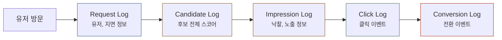
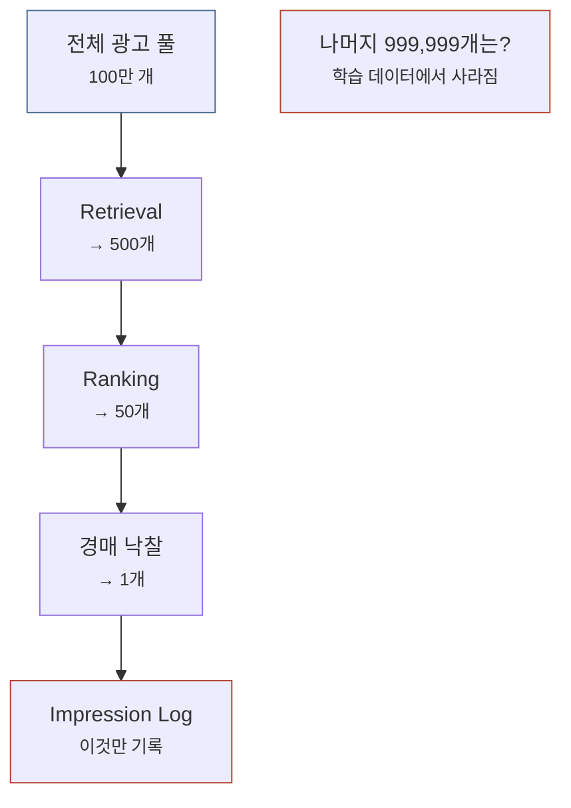
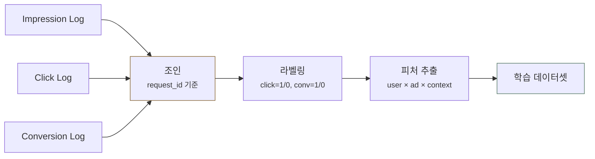
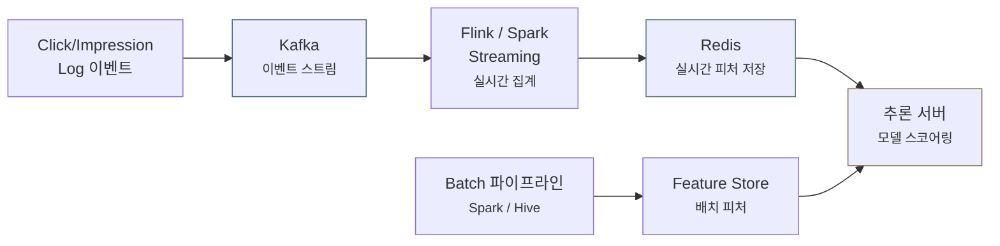
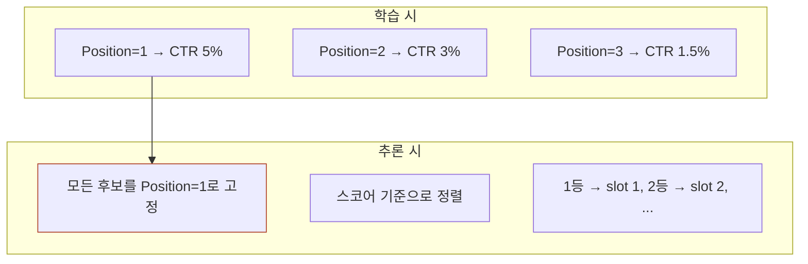

광고 시스템에서 로그는 버그를 찾을 때 열어 보는 기록으로 끝나지 않습니다. **ML 모델이 배우는 학습 데이터**이자 추론 서버가 읽어 가는 **실시간 피처의 원천**이라서 로그를 어떻게 설계하느냐가 모델 성능이 오를 수 있는 상한선을 정합니다.

이 글은 **로그 시스템을 어떻게 설계하고 운영하는지**를 수집 계층, 스키마 진화, 저장소 선택, 품질 감시의 네 가지로 나눠 다룹니다. 스키마는 로그 한 건에 어떤 필드가 어떤 타입으로 들어가는지 정해 둔 약속입니다. 스키마 진화는 필드를 추가하거나 이름과 타입을 바꾸면서 그 약속이 달라져 가는 과정을 말합니다.
로그 10종이 각각 왜 남는지와 볼륨이 얼마나 되는지는 형제 글 [광고 로그 파이프라인 완전 해부](post.html?id=ad-log-pipeline)가 맡고 있어서 두 글이 겹치는 대목은 그 글로 넘깁니다.

글의 앞쪽에서는 **후보 로그**(Candidate Log)의 역할과 **실시간 피처 파이프라인**, 광고 자리가 여러 개인 멀티슬롯 지면에서 생기는 **rank=1 추론 문제**를 봅니다. 후보 로그는 후보로 뽑힌 광고를 랭킹에서 탈락한 것까지 모두 남기는 기록입니다. 뒤쪽에서는 로그를 잃어버리지 않고 옮기는 수집 계층과 필드가 바뀌어도 어제 찍힌 로그가 깨지지 않게 하는 스키마 규칙을 다룹니다.

---

아래 표는 다섯 로그가 언제 생기고 어디에 쓰이는지 한 번에 보여 줍니다. 빈 자리(No-Fill)는 광고 요청이 들어왔는데 채울 광고가 없어 자리가 빈 채로 끝난 경우입니다. 오프라인 평가는 모델을 서비스에 내보내기 전에 쌓아 둔 로그로 성능을 확인하는 일을 말합니다. CTR(Click-Through Rate)은 노출 가운데 클릭이 난 비율이고 pCTR 은 그 비율을 모델이 미리 예측한 값입니다. pCVR 은 클릭 뒤에 전환(구매, 가입, 설치처럼 광고주가 바라는 행동)이 일어날 확률을 모델이 예측한 값입니다. ROAS(Return On Ad Spend)는 광고비 대비 매출을 뜻합니다. 라벨은 모델이 맞혀야 하는 정답 값을 가리킵니다.

| 로그 | 생성 시점 | 주요 용도 |
|------|----------|----------|
| **요청 로그(Request Log)** | 광고 요청 시 | 트래픽 분석, 빈 자리(No-Fill) 추적 |
| **후보 로그** | 랭킹 시 | 모델 학습, 오프라인 평가 |
| **노출 로그(Impression Log)** | 노출 시 | 과금, CTR 라벨링 |
| **클릭 로그(Click Log)** | 클릭 시 | pCTR 학습 라벨 |
| **전환 로그(Conversion Log)** | 전환 시 | pCVR 학습 라벨, ROAS 측정 |

---

## 1. 광고 로그의 종류

**광고 요청 하나를 처리하는 동안 요청, 후보, 노출, 클릭, 전환의 5종류 로그가 서로 다른 시점에 생깁니다. 노출에서 클릭과 전환으로 갈수록 건수는 줄고 한 건의 값은 비싸집니다.**

요청 하나의 기록이 다섯 로그에 나뉘어 남기 때문에 학습 데이터를 만들려면 흩어진 로그를 같은 요청끼리 다시 연결해야 합니다. 아래 그림은 유저가 방문한 뒤 요청 로그부터 전환 로그까지 로그가 생기는 순서를 보여 줍니다.



> [광고 로그 파이프라인](post.html?id=ad-log-pipeline)은 로그 10종을 시간 순서대로 하나씩 다루며 로그마다 어떤 필드가 있는지, 누가 기록하는지, 얼마나 늦게 도착하는지를 설명합니다. 이 글은 설계 결정에 필요한 만큼만 요약합니다.

### 요청 로그

요청 로그는 광고 요청이 들어온 순간에 남는 기록이라 어떤 광고를 보여 줄지 아직 정하지 않은 시점의 **입력 컨텍스트**(유저, 기기, 지면처럼 판단에 쓰일 상황 정보)를 담습니다. 이 요청에서 이어져 나중에 생기는 후보, 노출, 클릭, 전환 로그를 다운스트림 로그라고 부릅니다. 요청 로그는 그 모든 다운스트림 로그의 **출발점**입니다.

#### 핵심 역할

요청 로그는 트래픽을 분석하고 디버깅하는 데 쓰는 것 말고도 다음 네 가지 역할을 맡습니다.

- **`request_id` 생성**: 요청마다 붙는 고유 식별자 `request_id` 를 이 로그에서 처음 만들고 뒤의 모든 로그가 이 값으로 연결되므로 `request_id` 가 **조인 키의 출발점**이 됩니다. 조인 키는 서로 다른 로그를 같은 요청끼리 붙일 때 맞춰 보는 값입니다. 요청 로그에 `request_id` 가 없으면 로그 사이의 연결 고리가 끊어집니다.
- **빈 자리 분석의 유일한 소스**: 광고 없이 빈 응답을 돌려준 요청은 화면에 광고가 그려지지 않았으니 노출 로그(광고가 실제로 그려진 것을 남기는 기록)에 아무것도 남기지 않습니다. 그래서 요청 가운데 광고로 채워진 비율인 채움률 `Fill Rate = Impressions / Requests` 를 계산할 때 **분모**인 전체 요청 수는 요청 로그에서만 셀 수 있습니다.
- **필터링, 모니터링 기준점**: 봇 탐지, 빈도 캡(frequency capping, 한 유저에게 광고를 보여 주는 횟수의 상한), 사전 타겟팅 필터가 내린 결정과 함께 시스템 부하를 보여 주는 QPS(초당 요청 수)와 응답 시간이 남습니다.
- **상황 피처(Context Feature)의 원천**: 시간대, 지역, 디바이스처럼 요청 단위(Request-level)로 정해지는 컨텍스트가 모델을 학습할 때 상황 피처로 쓰입니다. 상황 피처는 광고가 어떤 상황에서 나갔는지 모델에 알려 주는 입력입니다.

#### 일반적인 구조

광고 요청 1건마다 한 행씩 남는 요청 로그에 무엇이 담기는지 의사코드로 보면 이렇습니다.

```python
# (의사코드 — 그대로 실행되지 않습니다.)
# 하는 일: 광고 요청 1건마다 한 건씩 남는 Request Log 가 유저 컨텍스트, 지면 정보, 요청 메타, 응답 결과를 한 행에 담는 구조만 보여 준다.
{
  "request_id": "req_abc123",           # 모든 다운스트림 로그의 조인 키
  "timestamp": "2026-04-11T14:30:00Z",

  # 유저 컨텍스트
  "user_id": "u_789",
  "device": "mobile", "os": "iOS 17.2", "browser": "Safari",
  "geo": {"country": "KR", "region": "Seoul", "city": "Gangnam"},

  # 지면 정보
  "slot_id": "slot_main_1",
  "publisher_id": "pub_news_001",
  "page_url": "https://news.example.com/tech/article-123",
  "page_category": "news/tech",
  "slot_size": "320x50", "slot_position": "above_fold",

  # 요청 메타
  "request_type": "display",            # display, video, native 등
  "frequency_cap_status": {              # 빈도 캡 상태
    "user_daily_impressions": 12,
    "user_hourly_impressions": 3
  },

  # 응답 결과
  "response_status": "filled",          # filled, no_fill, timeout, error
  "candidate_count": 47,                # 후보 광고 수
  "latency_ms": 23,                     # 응답 시간
  "filtering_reason": null               # no_fill인 경우 사유
}
```

예시 행의 응답 결과는 `response_status` filled, `candidate_count`(후보 광고 수) 47, `latency_ms`(응답 시간, ms) 23, `filtering_reason` null 입니다. 광고로 채운 요청이라서 `no_fill` 일 때만 사유가 들어가는 `filtering_reason` 이 비어 있습니다. 빈도 캡 상태(`frequency_cap_status`)에는 이 유저의 하루 노출 수와 시간당 노출 수가 각각 12, 3 으로 남습니다. 앞에서 말한 필터링, 모니터링 기준점 역할은 응답 시간과 빈도 캡 상태 같은 필드들이 맡습니다.

#### 빈 자리 분석

광고가 **왜 나오지 않았는지**는 요청 로그로만 추적할 수 있습니다. `response_status` 값에 따라 살펴볼 곳은 이렇게 다릅니다.

| response_status | 의미 | 분석 포인트 |
|----------------|------|------------|
| `filled` | 정상 노출 | — |
| `no_fill` | 후보 광고 없음 | 타겟팅이 너무 좁은지, 예산 소진 광고주가 많은지 |
| `timeout` | 응답 시간 초과 | 서버 성능, 외부 DSP 응답 지연 |
| `error` | 처리 오류 | 버그, 인프라 장애 |
| `filtered` | 봇/정책 필터링 | IVT(무효 트래픽(Invalid Traffic)) 비율 모니터링 |

표의 DSP(Demand-Side Platform)는 광고주를 대신해 광고 자리를 사는 플랫폼이고 IVT 는 봇처럼 광고 가치가 없는 무효 트래픽입니다.

> 채움률(Fill Rate)이 낮으면 광고로 채울 수 있었던 요청을 빈 채로 돌려보낸 만큼 **매출 기회를 잃습니다**. 원인을 찾으려면 `response_status` 와 `filtering_reason` 을 반드시 분석해야 합니다.

#### 볼륨

요청 로그는 들어온 요청을 빠짐없이 전수 기록하므로 **볼륨이 가장 큰** 로그입니다. 나머지 로그는 모두 요청 로그의 부분 집합입니다. 단계를 내려갈수록 깔때기처럼 건수가 줄어 전환 로그는 요청의 수만 분의 1까지 내려가는데, 이 볼륨 차이 때문에 로그마다 저장소와 보존 기간을 다르게 정합니다. 하루 행 수와 저장 용량을 직접 곱해 본 계산은 [형제 글의 깔때기 계산](post.html?id=ad-log-pipeline)에 있습니다.

### 후보 로그

후보 로그는 랭킹 단계에서 **스코어링된 모든 후보**를 기록하므로 **탈락한 광고까지 전부** 들어갑니다. 스코어링은 모델이 후보마다 스코어(점수)를 매기는 일입니다. 구조와 볼륨은 다음 절에서 자세히 봅니다.

### 노출(Impression), 클릭(Click), 전환 로그

나머지 세 로그에는 경매 결과와 유저 행동이 차례로 남습니다. 뒤로 갈수록 건수는 줄어드는 대신 한 건이 지닌 값은 비싸집니다.

| 로그 | 담기는 것 | ML에서의 쓰임 |
|------|---------|-------------|
| **노출** | 낙찰 광고와 광고주 ID, 노출 위치, 낙찰가와 과금액, viewability | pCTR 학습의 분모 |
| **클릭** | 클릭된 광고 ID, 클릭 시각, 노출~클릭 간격(dwell time) | pCTR의 positive label |
| **전환(Conversion)** | 전환 종류(purchase, sign_up, install), 금액, 클릭~전환 지연 | pCVR label, ROAS 측정 |

표에서 노출 로그의 낙찰가는 경매에서 이긴 광고가 낸 가격을, viewability 는 광고가 실제로 화면에 보였는지를 나타냅니다. pCTR 을 학습할 때는 노출 전체가 분모가 되고 그 가운데 클릭이 난 노출이 정답이 1 인 positive label 이 됩니다.

> 전환 로그(구매나 설치가 일어난 것을 남기는 기록)는 클릭하고 **수 시간~수 일**이 지나서야 도착합니다. 학습할 때 정답인 전환을 아직 다 알 수 없는 지연 피드백(Delayed Feedback) 문제가 여기서 생깁니다. 자세한 내용은 [온라인 학습(Online Learning) 과 지연 피드백](post.html?id=online-learning-delayed-feedback)에서 다룹니다.

---

## 2. 후보 로그의 구조와 볼륨

**후보 로그는 랭킹 단계에서 스코어를 받은 후보 광고 전체를 그 순간 그대로 남기므로 요청당 수십~수백 건이 쌓입니다. 이 볼륨은 흔히 샘플링, 상위 K개 저장, 보존 기간 제한, 압축으로 줄입니다.**

후보 로그는 랭킹 단계에서 **스코어링된 모든 후보 광고의 스냅샷**(어느 한 순간의 상태를 그대로 찍어 둔 기록)입니다. 노출 로그가 낙찰된 광고 하나만 기록하는 것과 달리 후보 로그는 스코어를 받은 후보 전체를 기록하므로, 낙찰되지 못한 광고가 어떤 스코어를 받았는지까지 나중에 볼 수 있습니다.

### 일반적인 구조

아래 의사코드에서는 요청 1건마다 한 건씩 남는 후보 로그의 `candidates` 목록에 스코어를 받은 후보 광고가 어떻게 들어가는지 보면 됩니다.

```python
# (의사코드 — 그대로 실행되지 않습니다.)
# 하는 일: 광고 요청 1건마다 한 건씩 남는 Candidate Log 가 점수를 받은 후보 광고 전체를 candidates 목록에 담는 구조만 보여 준다.
{
  "request_id": "req_abc123",
  "timestamp": "2026-04-11T14:30:00Z",

  # 유저 컨텍스트
  "user_id": "u_789",
  "user_features": {
    "device": "mobile", "os": "iOS", "age_bucket": "30s", "gender": "M",
    "recent_click_categories": ["tech", "sports"]
  },

  # 지면 정보
  "slot_id": "slot_main_1",
  "page_category": "news",

  # 후보 광고 리스트 (수십~수백 개)
  "candidates": [
    {
      "ad_id": "ad_001", "advertiser_id": "adv_A",
      "ad_features": {"category": "tech", "creative_type": "image"},
      "pCTR": 0.045, "pCVR": 0.012, "eCPM": 540,
      "bid_price": 500, "rank": 1, "is_winner": true
    },
    {
      "ad_id": "ad_002", "advertiser_id": "adv_B",
      "ad_features": {"category": "fashion", "creative_type": "video"},
      "pCTR": 0.032, "pCVR": 0.008, "eCPM": 380,
      "bid_price": 450, "rank": 2, "is_winner": false
    },
    # ... 수십~수백 개 후보
  ]
}
```

목록의 후보마다 광고 피처, 모델이 예측한 pCTR 과 pCVR, eCPM(노출 1000회당 기대 매출), 입찰가(`bid_price`), 순위(`rank`), 낙찰 여부(`is_winner`)가 남습니다. 예시에서 ad_001 은 pCTR 0.045 에 rank 1 이고 낙찰되었습니다(`is_winner` true). ad_002 는 pCTR 0.032 에 rank 2 이고 낙찰되지 못했습니다(`is_winner` false). 노출 로그에는 낙찰된 ad_001 만 남지만 후보 로그에는 낙찰되지 못한 ad_002 와 나머지 후보까지 모두 남습니다.

### 데이터 볼륨

후보 로그를 운영할 때 가장 어려운 문제는 **볼륨**입니다. 요청 하나를 남길 때 노출 로그는 낙찰 광고 1건만 쓰지만 후보 로그는 후보 전체인 수십~수백 건을 쓰므로, 같은 트래픽에서도 저장량이 수십~수백 배로 늘어납니다.

### 저장 전략

이 볼륨을 감당하려고 흔히 쓰는 전략은 네 가지입니다.

- **샘플링**: 전체 요청 가운데 1~10% 만 골라 기록합니다.
- **Top-K만 저장**: 스코어 상위 K개 후보와 무작위로 뽑은 일부 후보만 기록합니다.
- **TTL(Time-to-Live)**: 기록마다 살아 있을 기간을 정해 두고 7~30일이 지나면 자동으로 지웁니다.
- **압축**: 같은 열의 값을 모아 저장해 압축이 잘 되는 Parquet, ORC 같은 컬럼형 포맷을 씁니다.

---

## 3. 후보 로그 유무에 따른 차이

**후보 로그가 없으면 모델은 이미 걸러진 「좋은」 광고 사이의 미세한 차이만 배웁니다. 후보 로그가 있으면 랭킹에서 탈락한 광고까지 클릭이 없는 사례로 학습해 광고를 구분하는 힘(판별력)이 크게 올라가는 대신 저장 비용과 파이프라인 복잡도가 커집니다.**

후보 로그 도입 여부는 모델 학습 품질에 곧바로 영향을 줍니다. 아래 표는 후보 로그가 없을 때와 있을 때를 여섯 관점에서 나란히 비교합니다.

| 관점 | 후보 로그 없음 | 후보 로그 있음 |
|------|-------------------|-------------------|
| **음성 표본(Negative Sample)** | 노출 후 미클릭만 | 랭킹 탈락 광고도 negative로 |
| **Sample Selection Bias** | 심함 — 필터된 "좋은" 광고만 학습 | 완화 — 넓은 후보 분포를 학습 |
| **오프라인 평가** | 불가능 — 승자만 남아서 | 가능 — 전체 후보 replay로 새 모델 시뮬레이션 |
| **탈락 원인 분석** | 불가능 | 가능 — 피처 레벨로 "왜 졌는지" |
| **스토리지 비용** | 낮음 | 높음 (수십~수백 배) |
| **파이프라인 복잡도** | 단순 | 복잡 (조인, 샘플링 로직 필요) |

표의 음성 표본(Negative Sample)은 정답이 0 인 학습 샘플, 다시 말해 클릭이 나지 않은 사례입니다. Sample Selection Bias(표본 선택 편향)는 학습 데이터가 앞 단계에서 걸러진 「좋은」 광고로만 채워져 생기는 편향입니다. 후보 로그로 더 넓은 후보 분포를 학습하면 이 편향이 완화됩니다. 오프라인 평가 줄의 replay 는 저장해 둔 후보 전체에 새 모델을 다시 돌려 그 모델이라면 어떤 광고를 골랐을지 시뮬레이션하는 방법입니다. 승자만 남은 노출 로그에는 후보 전체가 없어서 replay 를 할 수 없습니다.

### 노출 로그만 사용할 때의 함정

그림은 광고 100만 개가 Retrieval, Ranking, 경매를 차례로 거치는 동안 노출 로그에 무엇이 남는지 보여 줍니다. Retrieval 은 관련 있을 만한 광고를 빠르게 추려 내는 후보 추출 단계입니다.



전체 광고 풀 100만 개 가운데 Retrieval 이 500개를 남기고 Ranking 이 50개로 줄인 뒤 경매에서 1개가 낙찰됩니다. 노출 로그에는 그 1개만 기록되므로 나머지 999,999개는 학습 데이터에서 사라집니다. 그래서 노출 로그만으로 학습한 모델은 **이미 경쟁력이 있는 광고들 사이의 미세한 차이**만 배우고 Retrieval 에서 걸러진 광고나 랭킹에서 탈락한 광고의 패턴은 배우지 못합니다. [Negative Sampling](post.html?id=negative-sampling-bias)에서 다룬 구조적 편향이 바로 이렇게 생깁니다.

후보 로그가 있으면 앞 예시에서 낙찰되지 못한 ad_002 처럼 탈락한 광고가 왜 탈락했는지까지 학습할 수 있어서 모델의 **판별력(discrimination)**이 크게 올라갑니다.

---

## 4. 로그 기반 학습 데이터 파이프라인

**로그는 조인과 라벨링을 거쳐야 학습 데이터가 됩니다. 전환이 클릭 뒤 수 시간~수 일 늦게 도착하므로 로그 종류를 정하는 일보다 조인을 언제 돌릴지 정하는 일이 더 어렵습니다.**

여러 로그를 같은 요청끼리 **조인**하고 정답을 매기는 **라벨링** 파이프라인을 거쳐야 로그가 모델이 배울 수 있는 행이 됩니다.

카드에서는 노출, 클릭, 전환 로그가 어디서 만나고 언제 붙는지를 보면 됩니다.

<div class="demo-embed-wrap">
<iframe class="demo-embed" src="demo-data-model-cards.html?embed=1&card=logjoin" height="480" loading="lazy" title="로그 셋이 학습 데이터가 되는 자리"></iframe>
<a class="demo-embed-open" href="demo-data-model-cards.html" target="_blank" rel="noopener">↗ 카드 여덟 장 전체로 열기</a>
</div>

그림은 세 로그를 `request_id` 기준으로 조인하고 click 과 conv(전환)에 1 이나 0 을 매긴 다음 유저와 광고와 상황(context)을 조합한 피처를 뽑아 학습 데이터셋을 만드는 순서를 보여 줍니다.



pCTR 학습 데이터는 노출 한 건에 클릭이 붙으면 `label=1`, 붙지 않으면 `label=0` 을 매겨 만들고 pCVR 학습 데이터는 같은 방식으로 클릭에 전환을 붙여 만듭니다. 후보 로그가 있으면 음성 표본이 요청당 1건에서 수십~수백 건으로 넓어집니다.

> 로그를 연결하는 조인 체인과 로그가 생기는 시간 순서, pCTR 학습 데이터를 만드는 코드는 [광고 로그 파이프라인](post.html?id=ad-log-pipeline)에 자세히 있으므로 이 글은 시스템 설계 결정만 봅니다.

### 시스템 설계 결정: 조인 시각

전환이 늦게 도착하므로 조인을 너무 일찍 돌리면 아직 전환하지 않았을 뿐인 클릭과 앞으로도 전환하지 않을 클릭을 구분할 수 없어 둘 다 `label=0` 이 됩니다. 지연 피드백 문제는 실무에서 바로 이렇게 아직 오지 않은 전환이 0 으로 매겨지는 모습으로 나타납니다.

해법은 두 가지입니다. **기다리기**는 전환 창이 닫힐 때까지 라벨링을 미루는 방법입니다. 전환 창은 클릭 뒤 전환을 기다려 주는 기간(예: 7일)입니다. 기다리면 라벨은 정확하지만 7일이 지나야 학습 데이터가 나오므로 모델은 일주일 늦은 세상을 배웁니다. **먼저 쓰고 고치기**는 전환이 아직 없는 클릭을 일단 `label=0` 으로 학습에 쓰고 늦게 도착한 전환으로 라벨을 고쳐 다시 학습하는 방법이라 데이터는 신선하지만 라벨을 두 번 만드는 파이프라인이 필요합니다.

워터마크는 데이터가 어느 시각까지의 로그로 만들어졌는지를 나타내는 기준 시각입니다. 데이터셋에 「언제까지의 로그로 만든 데이터인지」를 기록해 두지 않으면 나중에 성능이 바뀌었을 때 그 변화를 되짚어 볼 수 없으므로, 두 방법 모두 라벨링 배치(라벨을 만드는 일괄 작업)가 워터마크를 확인해야 합니다.

---

## 5. 실시간 피처 파이프라인 (Redis, Feature Store)

**로그는 실시간 피처의 원천이기도 합니다. 값이 바뀌는 속도가 피처마다 달라서 초 단위로 바뀌는 피처는 스트리밍으로 집계하고 하루에 한 번 움직이는 피처는 배치로 만든 다음, 추론할 때 갱신 주기가 다른 피처들을 모델 입력 하나로 합칩니다.**

유저가 최근에 한 행동이나 광고가 방금까지 낸 성과는 로그 이벤트를 집계한 값으로 만들어 추론 서버(요청이 올 때마다 모델로 스코어를 계산하는 서버)에 공급합니다. 값이 변하는 속도가 피처마다 달라서 갱신 주기도 다르게 둡니다. 유저의 최근 10분 클릭 수는 초 단위로 바뀌지만 과거 30일 구매 이력은 하루에 한 번만 움직입니다. 초 단위 피처를 배치로 만들면 모델이 방금 일어난 행동을 보지 못합니다. 반대로 배치 피처를 요청마다 실시간으로 계산하면 같은 값을 매번 다시 셉니다.

### 아키텍처

그림에는 경로가 두 개 있습니다. 실시간 경로에서는 클릭과 노출 로그 이벤트가 Kafka(이벤트를 들어온 순서대로 쌓아 두고 여러 시스템이 읽어 가게 하는 이벤트 스트림)로 들어간 뒤 Flink 나 Spark Streaming 같은 스트림 처리 엔진에서 실시간으로 집계되어 Redis(값을 메모리에 두어 빠르게 읽는 저장소)에 저장됩니다. 배치 경로에서는 Spark 나 Hive 로 돌리는 배치 파이프라인이 배치 피처를 만들어 피처 스토어(Feature Store, 학습과 서빙에 쓰는 피처를 모아 관리하는 저장소)에 넣습니다. 추론 서버는 두 저장소의 값을 함께 읽어 모델 스코어링에 씁니다.



### 실시간 피처 예시

피처 6개의 집계 방식, 갱신 주기, 저장소를 표로 보면 이렇습니다.

| 피처 | 집계 방식 | 갱신 주기 | 저장소 |
|------|----------|----------|-------|
| 유저 최근 10분 클릭 수 | Sliding Window Count | 초 단위 | Redis |
| 광고별 최근 1시간 CTR | Sliding Window Avg | 분 단위 | Redis |
| 유저-카테고리 관심도 | 최근 N회 클릭의 분포 | 초 단위 | Redis |
| 광고별 오늘 예산 소진율 | 누적 비용 / 일 예산 | 분 단위 | Redis |
| 유저 과거 30일 구매 이력 | Batch 집계 | 1일 1회 | 피처 스토어(Feature Store) |
| 광고 임베딩 벡터 | 모델 학습 후 추출 | 배포 시 | 피처 스토어 |

Sliding Window Count 와 Sliding Window Avg 는 지금 시각에서 정해진 길이만큼 거슬러 올라간 구간(최근 10분, 최근 1시간)을 시간에 따라 밀어 가며 그 안의 건수나 평균을 계속 새로 계산하는 집계입니다. 광고 임베딩 벡터는 광고를 숫자 벡터로 나타낸 값입니다.

### 세 갈래 피처의 결합

추론할 때는 **Batch + Streaming + Real-Time** 세 갈래 피처를 하나의 피처 벡터(Feature Vector)로 합칩니다. 피처 벡터는 모델 입력으로 들어가는 숫자들의 목록입니다. 아래 코드는 돌려도 찍는 것이 없으니 피처마다 붙은 주석의 갈래, 저장소, 갱신 주기를 보면 됩니다.

```python
# 하는 일: 세 갈래 피처가 합쳐진 피처 벡터에서 피처마다 어느 갈래에 속하고 어디서 얼마나 자주 갱신되는지 자리만 보여 주며, 돌려도 찍는 것은 없다.
feature_vector = {
    "user_30d_purchase_count": 5,        # Batch — Feature Store, 1일 1회
    "ad_embedding": [0.12, -0.34, ...],  # Batch — 모델 배포 때 갱신
    "ad_1h_ctr": 0.032,                  # Streaming — Redis, 분 단위
    "ad_budget_spent_ratio": 0.45,       # Streaming — Redis, 분 단위
    "user_10min_click_count": 3,         # Real-Time — Redis, 초 단위
}
```

예시 값으로 보면 `user_10min_click_count` 의 3 은 Redis 에서 초 단위로 갱신되는 Real-Time 피처이고 `ad_1h_ctr` 의 0.032 와 `ad_budget_spent_ratio` 의 0.45 는 Redis 에서 분 단위로 갱신되는 Streaming 피처입니다. `user_30d_purchase_count` 의 5 는 피처 스토어에서 하루에 한 번, `ad_embedding` 은 모델을 배포할 때 갱신되는 Batch(배치) 피처입니다. 한 벡터 안에 초 단위로 바뀌는 값부터 배포할 때만 바뀌는 값까지 함께 들어 있습니다.

> 로그로 만든 피처를 서빙까지 보내는 파이프라인의 전체 아키텍처는 [피처 스토어](post.html?id=feature-store-serving) 글이 자세히 다룹니다.

---

## 6. 멀티슬롯 환경의 rank=1 추론 문제

**광고 자리가 여러 개인 지면에서는 광고가 놓인 자리가 CTR 을 크게 바꾸지만 추론할 때는 아직 자리가 정해지지 않았으므로, 실무에서는 모든 후보를 1번 자리에 놓였다고 보고 스코어링하는 rank=1 고정을 가장 흔히 씁니다. 그 대가로 pCTR 이 실제 CTR 과 맞지 않는 문제 등이 따르므로 자리의 영향을 모델에서 분리하거나 rank=1 스코어에 자리별 보정 계수를 곱해 대응합니다.**

뉴스 피드에 광고가 3개 들어가는 것처럼 한 지면에 슬롯(광고가 들어가는 칸)이 여러 개면 광고가 몇 번째 **자리(Position)**에 놓였는지가 CTR 에 큰 영향을 줍니다. 광고가 놓인 자리 자체가 클릭을 늘리거나 줄이는 이 효과를 자리 편향(Position Bias)이라고 부릅니다. 이런 지면에서는 학습과 추론 사이에 근본적인 괴리가 생깁니다.

카드에서는 학습과 추론이 자리를 서로 다르게 다루는 지점을 보면 됩니다.

<div class="demo-embed-wrap">
<iframe class="demo-embed" src="demo-data-model-cards.html?embed=1&card=rank1" height="480" loading="lazy" title="자리를 모른 채 채점하는 문제"></iframe>
<a class="demo-embed-open" href="demo-data-model-cards.html" target="_blank" rel="noopener">↗ 카드 여덟 장 전체로 열기</a>
</div>

### 문제 상황

그림의 「학습 시」 상자에서는 학습 데이터의 자리별 CTR 이 1번 5%, 2번 3%, 3번 1.5% 로 서로 다릅니다. 「추론 시」 상자에서는 모든 후보를 Position=1 로 고정해 스코어링하고 스코어 순서로 정렬한 뒤 1등을 slot 1, 2등을 slot 2 에 넣습니다.



**학습 시**에는 광고가 실제로 놓였던 자리(position)가 피처로 들어가므로 모델은 1번 자리 광고의 CTR 이 높고 3번 자리 광고의 CTR 이 낮다는 차이까지 배웁니다.

**추론 시**에는 아직 자리가 정해지지 않았습니다. 누구를 1번에 놓을지 정하려면 먼저 스코어링을 해야 하는데 스코어링을 하려면 자리 피처가 있어야 해서 자리와 스코어가 **서로를 먼저 필요로 하는 순환 문제**가 생깁니다.

### rank=1 고정의 이유

실무에서 가장 흔한 해법은 **모든 후보의 자리를 1로 고정해** 스코어링하는 방법입니다. 이 방법의 이점은 세 가지입니다.

- 모든 후보가 「최고 위치에 놓였을 때의 예상 CTR」이라는 같은 기준으로 스코어링됩니다.
- 1번 자리에서 CTR 이 높은 광고는 2번 자리에서도 높을 가능성이 커서 후보 사이의 **상대적 순서는 보존**됩니다.
- 추론을 한 번만 돌려 후보 전체를 정렬할 수 있어서 **추론 비용이 최소**입니다.

### 문제점

대신 rank=1 고정에는 문제가 세 가지 따릅니다.

| 문제 | 설명 |
|------|------|
| **Calibration 깨짐** | pCTR이 전부 과대추정됨. 자리=3에 놓일 광고도 1 기준으로 예측 → eCPM 왜곡 |
| **비용 vs 정확도** | slot 1 낙찰 후 나머지를 자리=2로 재스코어링해야 맞지만, 추론 비용이 슬롯 수만큼 증가 |
| **부익부빈익빈** | 보정 없이 학습하면 "좋은 위치 → CTR 높음 → 다시 좋은 위치" 순환이 강화됨 |

표의 Calibration(보정)은 예측 확률이 실제 비율과 맞는 정도입니다. rank=1 고정에서는 자리=3 에 놓일 광고도 1번 자리 기준으로 예측하므로 pCTR 이 과대추정되고 그 pCTR 로 계산하는 eCPM 도 왜곡됩니다.

### 실무 해법

멀티슬롯의 rank=1 추론 문제를 다루는 실무 해법은 두 가지입니다.

#### 1. 자리 피처(Feature) 분리 (Examination Hypothesis)

첫째 해법은 모델 구조 안에서 **자리의 영향을 분리**하고 추론할 때는 자리 정보가 빠진 position-free 스코어를 쓰는 방법입니다. 바탕이 되는 Examination Hypothesis 는 유저가 광고를 클릭하려면 먼저 그 광고를 봐야(examine) 하고 본 광고 가운데 관련 있는 광고를 클릭한다고 보는 가정입니다. 그래서 클릭 확률을 아래처럼 두 확률의 곱으로 나눕니다.

$$P(\text{click}) = P(\text{examine} | \text{position}) \times P(\text{relevant} | \text{user, ad})$$

- $P(\text{examine} | \text{position})$ 는 광고가 그 위치에 놓였을 때 유저가 그 광고를 볼 확률이며 추론할 때는 뺍니다.
- $P(\text{relevant} | \text{user, ad})$ 는 자리와 상관없는 광고 자체의 관련성이며 추론할 때는 이 항만 씁니다.

학습할 때는 자리 정보를 넣어 두 항을 함께 맞추고 추론할 때는 자리에 기대지 않는 관련성 항만 쓰므로, 어느 자리에 놓일 광고든 같은 기준의 공정한 스코어로 비교됩니다.

:::deep 더 깊이 — IPS(Inverse Propensity Scoring)로 학습 데이터의 자리 편향 보정
IPS 는 자리마다 다른 "examination probability"(그 자리의 광고를 유저가 볼 확률)의 역수를 학습 샘플의 가중치로 써서 학습 데이터에 섞인 자리 편향을 보정합니다.

$$w_i = \frac{1}{P(\text{examine} | \text{position}_i)}$$

자리=1 은 원래 눈에 잘 띄어 볼 확률이 높으므로 그 역수인 가중치를 낮게 잡습니다.
자리=3 은 잘 안 보이는 자리라 볼 확률이 낮으므로 가중치를 높게 잡습니다. 잘 안 보이는 자리에서도 클릭이 났다면 정말 좋은 광고라는 뜻입니다.
:::

#### 2. 사후 보정 계수

둘째 해법은 rank=1 로 추론한 스코어에 자리별 보정 계수를 곱해 그 자리에서의 실제 pCTR 을 추정하는 방법입니다. 계수는 미리 통계로 뽑아 둡니다. 계수를 1번 자리 `1.0`, 2번 `0.65`, 3번 `0.40` 으로 쓴다고 하면 1번에 놓일 광고는 rank=1 스코어에 1.0 을 곱해 그대로 쓰고 3번에 놓일 광고는 0.40 을 곱해 rank=1 스코어의 40% 로 내려 잡습니다.

> 자리 편향의 이론과 보정 기법은 [자리 편향](post.html?id=position-bias-ultr) 글이 자세히 설명합니다.
> 보정(Calibration)이 깨지는 문제는 [Calibration(확률 보정): AUC가 높아도 돈을 잃는 이유](post.html?id=calibration)에서 따로 다룹니다.

---

## 7. 로그를 잃지 않고 옮기는 수집 계층 [무대: 공통]

**로그 설계의 절반은 무엇을 남길지가 아니라 남긴 로그를 잃지 않고 옮기는 일입니다. 수집 계층은 도착할 때까지 다시 보내고 같은 이벤트가 또 오면 버리는 방식으로 설계합니다. 저장한 원본은 절대 덮어쓰지 않습니다.**

광고 로그가 출발하는 곳은 세 군데이고 출발지마다 로그를 잃는 방식이 다릅니다. 클라이언트 픽셀(웹페이지에 심어 두는 작은 추적 이미지)이나 SDK(앱에 넣는 광고 라이브러리)로 들어오는 노출과 클릭은 유저가 앱을 종료하거나 광고 차단기를 쓰면 중간에 잘립니다. 자사 서버가 찍는 요청, 후보, 입찰 로그는 서버가 죽거나 큐(서버 사이에서 로그를 잠시 쌓아 두는 대기열)가 밀리면 사라집니다. 광고주 포스트백(광고주 서버가 전환이 일어났다고 알려 오는 서버 간 호출)으로 들어오는 전환은 남의 서버에 장애가 나면 흔들립니다.

세 출발지 모두 해법은 **재전송**(도착이 확인되지 않은 로그를 다시 보내는 것)입니다. 그리고 재전송에서 규칙이 하나 나옵니다. **재전송이 있는 곳에는 반드시 중복이 생깁니다.** 클라이언트가 혹시 안 갔을까 봐 노출을 한 번 더 보내면 노출 1건이 로그 2건으로 찍혀 그 노출이 CTR 의 분모에 1 이 아니라 2 로 들어갑니다. 분모만 커지므로 CTR 이 실제보다 작게 계산되고 이 데이터로 학습한 pCTR 도 실제보다 낮아집니다.

그래서 수집 계층은 재전송을 막지 않고 중복을 받는 곳에서 걸러 내도록 **최소 1회 전송(at-least-once) + 멱등키**의 조합으로 설계합니다. 최소 1회 전송은 송신 측이 로그가 도착할 때까지 보내는 방식이라 같은 로그가 두 번 이상 도착할 수 있습니다. 멱등키는 같은 이벤트라면 몇 번을 보내도 늘 같은 값이 붙는 식별자입니다. 이름의 멱등은 같은 일을 여러 번 해도 한 번 한 것과 결과가 같은 성질을 뜻합니다. 수신 측은 이미 받은 멱등키가 또 오면 그 로그를 버리므로 같은 로그가 여러 번 도착해도 한 번만 남습니다.

멱등키는 반드시 **송신 측이** 만들어야 합니다. 수신 측이 키를 붙이면 같은 로그라도 다시 보낼 때마다 새 키를 받아 서로 다른 로그로 보이므로 중복을 지울 수 없습니다. 브라우저부터 광고주 서버까지 전 구간에서 **정확히 1회(exactly-once)** 처리되도록 보장하는 일은 포기합니다. 남의 기기를 한 트랜잭션(전부 성공하거나 전부 취소되는 작업 단위)으로 묶을 수 없으므로 스트림 안쪽에서만 exactly-once 를 보장하고 그 바깥쪽에서 생기는 중복은 멱등키로 흡수합니다.

저장소도 쓰임에 따라 세 곳으로 나눕니다. **스트림**(Kafka)은 방금 들어온 로그를 며칠만 보관합니다. **원본 보관**(S3 + Parquet)에는 아무것도 고치지 않은 원본을 컬럼형 파일로 수개월~수년 동안 둡니다. **질의용**(Hive, ClickHouse)은 SQL 로 조회하는 분석용 저장소이며 집계한 결과만 올립니다. 라벨이 틀렸을 때는 원본에서 다시 만들면 되지만 원본까지 고쳐 버리면 되돌아갈 곳이 없어지므로, 원본은 절대 덮어쓰지 않습니다.

### 알람 없이 잘못 쌓이는 로그를 잡는 지표 세 가지

로그에 사고가 나도 알람은 울리지 않습니다. 서버는 살아 있고 대시보드도 그럴듯한 숫자를 보여 주는데 모델만 조용히 나빠지므로, 로그를 감시하는 지표를 따로 둡니다.

- **신선도**: 가장 늦게 도착한 로그에 찍힌 시각(워터마크)과 지금 시각의 차이입니다. 이 워터마크가 멈추면 파이프라인이 멈췄다는 뜻입니다.
- **완결성**: 같은 데이터의 행 수를 어제 센 값과 오늘 다시 센 값으로 비교합니다. 전환은 늦게 도착하므로 며칠 동안은 다시 셀 때마다 행 수가 늘어나는 것이 정상입니다.
- **중복률**: 같은 멱등키가 여러 번 들어온 비율입니다. 0.1% 를 넘으면 재전송 규칙을 가장 먼저 의심합니다.

---

## 8. 팀 간 계약인 스키마 [무대: 열린 RTB]

**스키마는 로그를 찍는 팀과 읽는 팀 사이의 계약입니다. 어제 찍힌 로그는 오늘 고칠 수 없으므로 필드 추가는 nullable(값이 비어도 되는 필드)과 기본값으로 하고 삭제와 이름 변경은 옛 필드를 한 버전 더 남기며 타입은 바꾸지 않고 새 필드를 만듭니다.**

스키마는 **로그를 찍는 팀과 읽는 팀 사이의 계약**이라서 한 팀이 로그 스키마를 자기 팀 자료구조처럼 여기고 고치면 사고가 납니다. 어제 찍힌 로그는 이미 저장소에 들어가 있어서 오늘 스키마를 바꿔도 어제 로그의 모양은 그대로 남습니다.

난이도는 무대(광고가 거래되는 환경)에 따라 다릅니다. 담장 안(닫힌 생태계, 한 회사가 DSP 부터 매체까지 모두 가진 곳)에서는 노출, 클릭, 전환이 모두 자사 서버에 남습니다. 스키마를 한 팀이 통제하고 조인 키도 내가 만든 값이라 확실하므로 필드를 바꿀 때는 사내에서 한 번 합의하면 끝납니다.

열린 RTB(Real-Time Bidding, 광고 노출 한 번마다 여러 회사가 실시간 경매로 자리를 사고파는 구조)에서는 로그가 SSP(매체를 대신해 광고 자리를 파는 플랫폼), 자사 서버, 광고주 포스트백으로 흩어져 있습니다. 스키마 합의 자체가 회사 사이의 협상이 되고 남이 보내 주는 필드는 예고 없이 바뀌므로 **내가 만드는 필드와 남이 주는 필드를 나눠 두고** 남이 주는 필드는 전부 nullable 로 둡니다.

### 필드 하나를 고친 뒤 어제 로그를 읽는 결과

아래 코드는 어제 로그(v1) 한 건과 오늘 로그 한 건을 두고 스키마를 세 가지로 고친 뒤 새 코드로 어제 로그를 읽어 어디서 오류가 나는지 확인한 다음, 규칙을 지킨 리더(로그를 읽어 들이는 함수)로 두 로그를 함께 읽어 봅니다.

```python
# 하는 일: 스키마를 세 가지로 고친 뒤 새 코드로 어제 로그를 읽어 어디서 오류가 나는지 보고, 규칙을 지킨 리더로 어제 것과 오늘 것을 함께 읽는다.

# 1단계: 어제 로그와 오늘 로그를 둔다
# 어제 찍힌 v1 로그는 저장소에 그대로 있다. 고칠 수도, 지울 수도 없다.
OLD = {"request_id": "req-1", "slot_id": "slot_A", "pctr": "0.045"}   # 어제 것
NEW = {"request_id": "req-9", "placement_id": "slot_A",               # 오늘 것
       "pctr": 0.048, "creative_type": "video"}

# 2단계: 바꾼 필드 셋을 새 코드로 어제 로그에서 읽는다
# 오늘 (A) creative_type 을 더하고, (B) slot_id 를 placement_id 로 이름을 바꾸고, (C) pctr 을 문자열에서 실수로 바꿨다. 새 코드로 어제 것을 읽는다.
CHANGES = [
    ("(A) 추가   creative_type 를 읽는다", lambda r: r["creative_type"]),
    ("(B) 이름   placement_id 를 읽는다 ", lambda r: r["placement_id"]),
    ("(C) 타입   pctr * 1000 을 계산한다", lambda r: r["pctr"] * 1000),
]
for label, read_one in CHANGES:
    try:
        got = read_one(OLD)
        # 오류가 안 나는 쪽이 더 위험하다. 문자열 * 1000 은 파이썬에서 '반복'이다
        print(f"{label} -> 오류가 안 난다. 타입 {type(got).__name__}, 길이 {len(str(got))}")
    except KeyError as err:
        print(f"{label} -> KeyError: {err}")


# 3단계: 규칙을 지킨 리더 함수를 만든다
# 이름을 바꾼 필드, 더한 필드, 타입을 바꾼 필드를 하나씩 줄 끝의 규칙대로 읽는다.
def read_safe(row):
    slot = row.get("placement_id") or row.get("slot_id")     # 옛 이름을 한 버전 더 본다
    ctype = row.get("creative_type", "unknown")              # 추가 필드는 기본값으로
    return slot, ctype, round(float(row["pctr"]) * 1000, 1)  # 타입은 읽는 쪽에서 통일


# 4단계: 규칙을 지킨 리더로 두 로그를 읽는다
print()
for row in (OLD, NEW):
    print("규칙 지킨 리더", row["request_id"], read_safe(row))
print()
print("→ 추가는 안전하다. 단 nullable + 기본값을 스키마에 같이 박아야 한다.")
print("→ 이름 변경은 삭제 + 추가다. 옛 이름을 한 버전 더 살려 둬야 한다.")
print("→ 타입 변경은 오류 없이 틀린 값을 흘려보낸다. 새 필드를 만들고 옛 필드는 그대로 둔다.")

# 출력:
# 2단계 뜻: 더한 필드와 이름을 바꾼 필드는 어제 로그에 없어 곧바로 KeyError 가 난다. 타입을 바꾼 pctr 은 오류 없이 문자열을 1000번 이어 붙여 길이가 5000 인 str 이 된다.
# (A) 추가   creative_type 를 읽는다 -> KeyError: 'creative_type'
# (B) 이름   placement_id 를 읽는다  -> KeyError: 'placement_id'
# (C) 타입   pctr * 1000 을 계산한다 -> 오류가 안 난다. 타입 str, 길이 5000
# 4단계 뜻: 규칙을 지킨 리더는 어제 것(req-1)과 오늘 것(req-9)을 모두 읽는다. 어제 것에 없는 creative_type 은 'unknown' 으로 채우고, 세 번째 값은 pctr 의 타입이 달라도 둘 다 실수 45.0 과 48.0 으로 통일된다.
#
# 규칙 지킨 리더 req-1 ('slot_A', 'unknown', 45.0)
# 규칙 지킨 리더 req-9 ('slot_A', 'video', 48.0)
#
# → 추가는 안전하다. 단 nullable + 기본값을 스키마에 같이 박아야 한다.
# → 이름 변경은 삭제 + 추가다. 옛 이름을 한 버전 더 살려 둬야 한다.
# → 타입 변경은 오류 없이 틀린 값을 흘려보낸다. 새 필드를 만들고 옛 필드는 그대로 둔다.
```

2단계 출력에서 (A) 로 추가한 `creative_type` 과 (B) 로 이름을 바꾼 `placement_id` 는 어제 로그에 아예 없으므로 `KeyError: 'creative_type'` 과 `KeyError: 'placement_id'` 가 곧바로 납니다. (C) 는 오류 없이 `타입 str, 길이 5000` 을 찍습니다. 어제 로그의 pctr 이 실수가 아니라 5글자짜리 문자열 `"0.045"` 라서 파이썬이 `* 1000` 을 곱셈이 아닌 반복으로 처리해 그 문자열을 1000번 이어 붙였으므로 5글자 × 1000 = 5000 글자짜리 문자열이 나왔습니다.

4단계 출력에서 규칙을 지킨 리더 `read_safe` 는 어제 것(req-1)을 `('slot_A', 'unknown', 45.0)` 으로, 오늘 것(req-9)을 `('slot_A', 'video', 48.0)` 으로 읽습니다. `placement_id` 가 없으면 옛 이름 `slot_id` 를 한 버전 더 보고 `creative_type` 이 없으면 기본값 `'unknown'` 으로 채웁니다. pctr 은 리더 안에서 `float` 로 바꾼 뒤 1000 을 곱하므로 문자열 `"0.045"` 와 실수 0.048 이 같은 실수 타입인 45.0 과 48.0 으로 통일됩니다.

(C) 를 특히 눈여겨봐야 합니다. 필드를 지우거나 이름을 바꾸면 그 필드를 찾는 코드가 (B) 처럼 **곧바로** `KeyError` 를 내지만 타입만 바꾸면 (C) 처럼 예외가 나지 않습니다. 그래서 5000 글자짜리 값이 그대로 피처로 들어가고 모델은 며칠이 지나서야 조용히 나빠집니다.

### 스키마 변경 규칙

앞의 세 경우를 규칙으로 옮기면 아래 표가 됩니다. 표의 세 줄은 코드의 (A), (B), (C) 와 차례로 대응합니다.

| 바꾸는 일 | 해도 되나 | 규칙 |
|----------|---------|------|
| **필드 추가** | 된다 | nullable로 넣고 기본값을 스키마에 함께 등록 |
| **삭제, 이름 변경** | 조심 | 즉시 지우지 말고 deprecated로 한 버전 더 유지 |
| **타입 변경** | 안 된다 | 새 필드를 만들고 옛 필드는 그대로 둔다 |

필드를 추가할 때 nullable 로 넣고 기본값을 스키마에 함께 등록해 두면 옛 로그를 읽어도 (A) 의 `KeyError` 가 나지 않고 4단계의 req-1 처럼 기본값 `'unknown'` 이 채워집니다. 삭제나 이름 변경은 바로 지우지 않고 deprecated(앞으로 없앨 필드라고 표시한 상태)로 한 버전 더 유지해 `read_safe` 처럼 옛 이름으로 찍힌 어제 로그도 읽을 수 있게 합니다. 타입 변경은 아예 하지 않고 새 필드를 만든 뒤 옛 필드는 그대로 둡니다.

규칙을 사람이 기억해서 지키게 두지 않으려면 **스키마 레지스트리**를 씁니다. 스키마 레지스트리는 스키마를 코드 안이 아니라 별도 저장소에 버전별로 등록해 두고 규칙을 어기는 변경은 배포할 때 막는 장치입니다. Avro 나 Protobuf 같은 직렬화 형식(데이터를 바이트로 바꿔 저장하고 전송하는 규격)을 쓰는 이유의 절반이 바로 이 스키마 레지스트리입니다.

---

## 9. 다른 회사들의 로그 수집 방식

**주요 플랫폼 다섯 곳의 수집 방식을 보면 이벤트 스트림으로 수집하고 request_id 로 조인하고 피처 스냅샷을 남기는 공통 패턴과 함께 회사마다 다르게 내린 결정이 보입니다.**

이 글에서 본 후보 로그나 실시간 피처 같은 결정이 아래 회사들의 수집 방식에서도 다시 나타납니다.

### Meta (Facebook Ads)

- **Scribe → Hive/Spark**: 광고 이벤트를 사내 수집기 **Scribe** 로 모아 데이터 레이크(가공하기 전 데이터를 한곳에 쌓아 두는 저장소)에 적재합니다.
- **Opportunity 로그(Log)**: 노출 기회(광고를 보여 줄 수 있는 순간)마다 **후보군 전체의 스코어를 기록**하는, 이 글의 후보 로그와 비슷한 로그입니다.
- **실시간 피처**: 자체 피처 스토어가 최근 N분 동안의 인게이지먼트(클릭이나 반응 같은 유저 행동)를 실시간으로 집계합니다.
- **이중 전환 수집**: 전환을 광고주 서버가 보내는 **서버사이드(CAPI)** 와 브라우저에서 보내는 **클라이언트 픽셀** 양쪽에서 받아 전환이 누락되지 않게 합니다.

### Google (DV360 / Google Ads)

- **Mesa + Dremel**: 로그를 거의 실시간(near-realtime)으로 갱신되는 웨어하우스(분석용으로 정리한 데이터 저장소) **Mesa** 에 적재하고 **Dremel(BigQuery)** 로 PB(페타바이트) 규모를 분석합니다.
- **로그가 더 세분화됨**: 로그가 `AdRequest → BidRequest → BidResponse → Impression → Click → Conversion` 으로 나뉘어 입찰 과정 자체도 별도 로그로 남습니다.
- **ColumnIO 포맷**: 자체 컬럼형 포맷으로 압축률과 쿼리 성능을 최적화합니다.
- **Data Transfer**: 광고주에게도 노출 한 건 단위(impression-level)의 로그를 제공합니다.

### Twitter(X) Ads

- 파이프라인은 **Manhattan(KV store) + Kafka + HDFS** 로 이루어집니다. Manhattan 은 키로 값을 찾는 KV 저장소이고 HDFS 는 큰 파일을 여러 서버에 나눠 저장하는 분산 파일 시스템입니다.
- 이 글의 요청 로그에 해당하는 **Ad Serving 로그**에 타임라인 위치, 트윗 컨텍스트, 팔로우 관계에서 뽑은 **팔로우 그래프 피처**를 함께 담습니다.
- 검색 인덱스인 **Earlybird** 단계의 리트리벌 로그도 따로 수집해 후보가 생성되는 과정까지 추적합니다.

### LinkedIn

- **Unified Logging Framework**: 광고 이벤트를 **Kafka → Brooklin → HDFS** 경로 하나로 통합해 수집합니다. Brooklin 은 이 경로에서 Kafka 의 이벤트를 HDFS 로 옮기는 단계입니다.
- 요청(Request) 단계에서 그 시점의 회원 피처를 **member features snapshot** 으로 따로 저장하므로 나중에 회원이 프로필을 바꿔도 학습 데이터는 흔들리지 않습니다.
- 기업을 상대로 하는 B2B 서비스라서 회사 규모, 업종, 직급 분포 같은 **company-level aggregated features**(회사 단위로 집계한 피처)가 요청 로그에 들어갑니다.

### Criteo (리타게팅 DSP)

- 리타게팅(이미 사이트에 다녀간 유저에게 다시 광고를 보여 주는 방식) DSP 인 Criteo 는 공개한 논문과 데이터셋으로 로그 구조를 가장 자세히 밝힌 회사입니다.
- **Display 로그**는 요청 + 후보(Candidate) + 노출을 로그 하나에 통합해 남깁니다. 유저의 **과거 상품 조회 시퀀스**(과거에 본 상품을 순서대로 늘어놓은 목록)가 요청 피처로 들어갑니다.
- **Criteo 1TB Dataset**: 24일 동안의 click log(익명화 피처 40개 + label)를 공개해 업계가 모델 성능을 비교하는 벤치마크가 되었습니다.

### 업계 공통 패턴

다섯 회사의 결정을 패턴별로 모으면 아래 표가 됩니다. 표의 consumer 는 Kafka 에 쌓인 이벤트를 읽어 가는 프로그램을 가리킵니다.

| 패턴 | 설명 | 사용 회사 |
|------|------|----------|
| **Event Sourcing** | 이벤트를 Kafka에 먼저 적재하고 여러 consumer가 소비 | 거의 모든 회사 |
| **Lambda Architecture** | 실시간 + 배치 이중 파이프라인으로 신선도와 안정성을 동시에 | Meta, Google, LinkedIn |
| **피처 Snapshot** | 추론 시점 피처 값을 로그에 남겨 학습 데이터를 일관되게 | Meta, LinkedIn, Criteo |
| **후보 분리 저장** | 후보군 전체 로그는 **샘플링해 별도 저장** | Meta, Google |
| **서버 + 클라이언트 이중 수집** | 노출/클릭을 양쪽에서 받아 누락 방지 | Google, Meta |

> 회사마다 로그 이름과 구조가 달라도 **이벤트 스트림으로 수집 → request_id로 조인 → 피처 스냅샷 보존**이라는 세 가지 원칙은 사실상 업계 표준입니다.

---

## 10. 정리: 모델 성능을 정하는 로그 설계

**아래 표의 다섯 가지 로그 설계 결정은 모두 모델을 건드리지 않고 내리지만 결과는 모델 성능으로 나타납니다.**

광고 시스템의 로그는 일어난 일을 적어 두는 데서 끝나는 기록이 아니라 ML 파이프라인에서 가장 먼저 내리는 설계 결정이고 그 뒤 모든 단계의 품질을 좌우합니다.

| 설계 결정 | 영향 |
|----------|------|
| **후보 로그 도입 여부** | 음성 표본 품질 → 모델 판별력 |
| **실시간 피처 파이프라인** | 피처 신선도 → 모델 예측 정확도 |
| **자리 처리 방식** | Calibration 품질 → eCPM/입찰 정확도 |
| **전환 로그 조인 타이밍** | 지연 피드백 처리 → pCVR 정확도 |
| **멱등키, 스키마 규칙** | 중복, 타입 사고 차단 → 라벨 신뢰도 |

표에서 후보 로그 도입 여부는 음성 표본의 품질을 거쳐 판별력으로, 전환 로그 조인 타이밍은 지연 피드백 처리를 거쳐 pCVR 정확도로 이어집니다. 다섯 줄이 모두 이렇게 모델 성능으로 이어지므로 로그 설계는 데이터 엔지니어링이 아닌 ML 엔지니어링의 첫 장에 놓입니다. 새 모델 구조를 추가하기 전에 지금 쓰는 로그부터 확인하는 편이 훨씬 자주 이기므로, 로그가 중복 없이 도착하는지와 스키마가 조용히 바뀌지 않았는지부터 봅니다.

[Ad Tech 개발 레이어](post.html?id=adtech-dev-layers)에서 「측정, 어트리뷰션 → 예측 모델」로 향하는 피드백 루프가 바로 이 로그 파이프라인입니다. 어트리뷰션은 전환이 어느 광고 덕분인지 나눠 매기는 일이고 피드백 루프는 측정한 결과가 다시 예측 모델의 학습으로 돌아오는 순환입니다.

> 로그 설계가 모델 성능에 주는 영향은 모델 아키텍처를 바꾸는 일만큼 크고 때로는 그보다 더 큽니다.

---

## 더 깊이 보기

- 어떤 로그가 왜 남는지, 볼륨은 얼마인지 → [광고 로그 파이프라인](post.html?id=ad-log-pipeline)
- 로그로 만든 피처를 서빙에 꽂기까지 → [Feature Store와 실시간 서빙](post.html?id=feature-store-serving)
- 추론을 어느 층에서 실행하나 → [Multi-Stage 모델 서빙](post.html?id=model-serving-architecture)
- 광고 ML 전체 지도에서 이 글의 위치 → [ML 엔지니어 트랙](ml-track.html)
