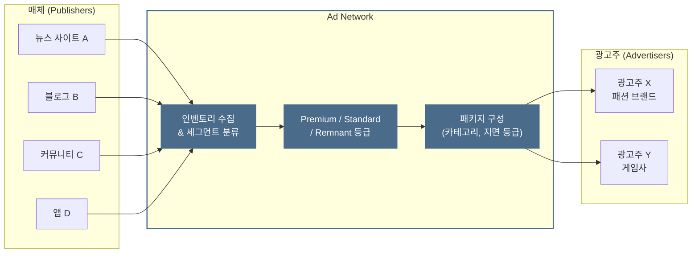
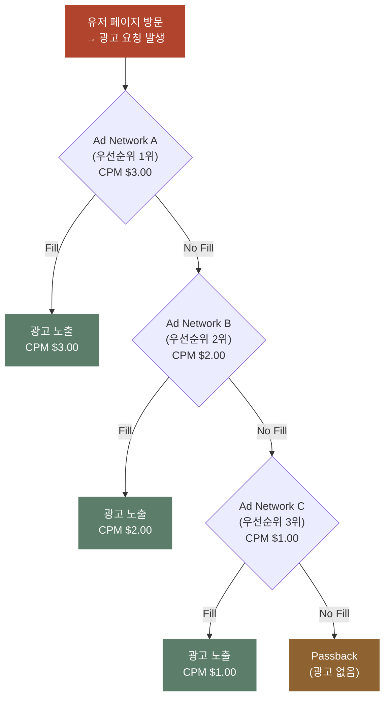
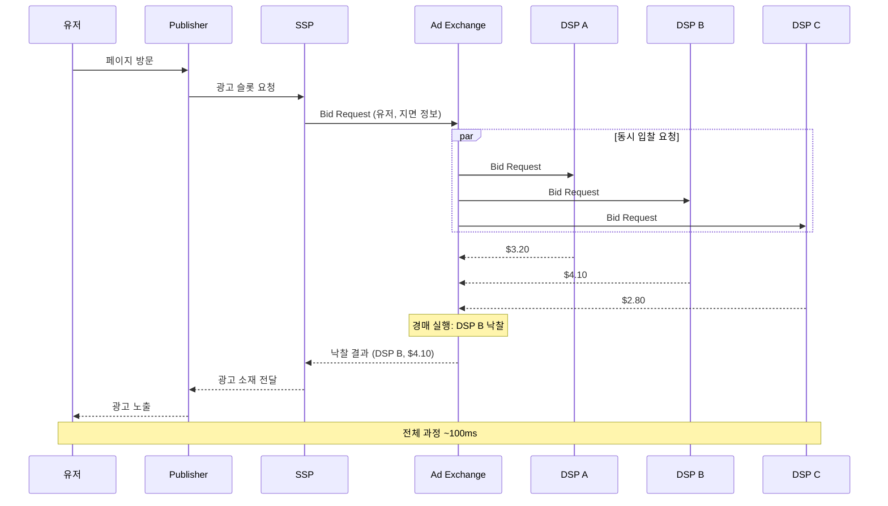
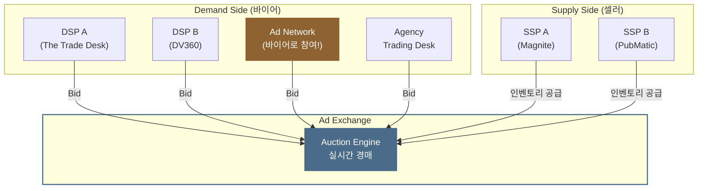
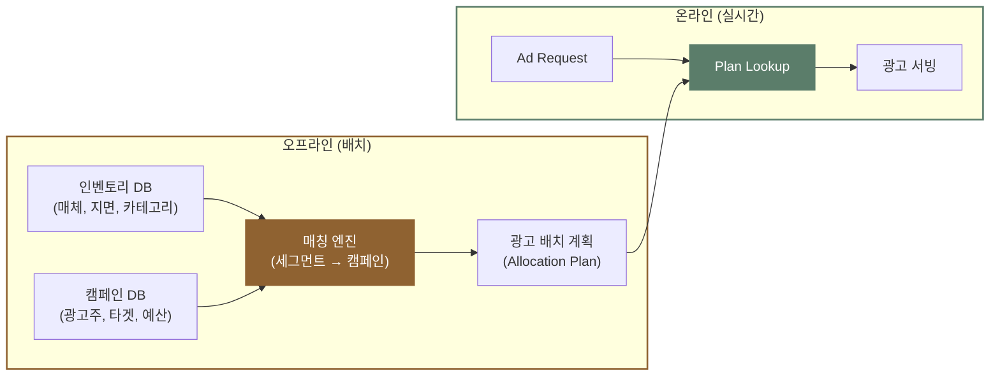
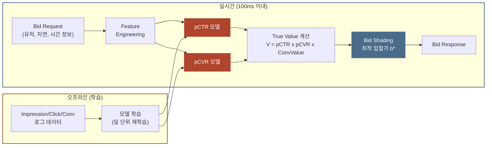
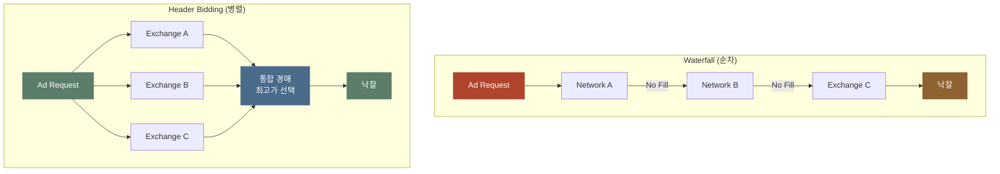
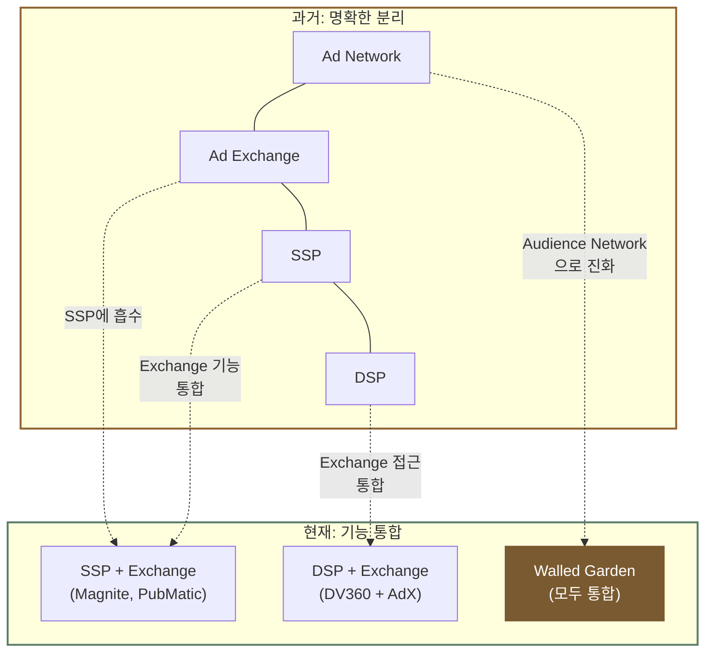

광고 기술(Ad Tech) 생태계를 처음 접하는 사람에게는 DSP, SSP, RTB, 헤더비딩(Header Bidding) 같은 약어가 한꺼번에 쏟아집니다. 하지만 이 약어들은 모두 같은 질문 하나에서 출발합니다. **"매체(Publisher)의 광고 지면을 광고주(Advertiser)에게 어떻게 연결할 것인가?"**

질문에 나오는 매체는 뉴스 사이트나 앱처럼 광고 자리를 파는 곳으로, 매체 화면에서 광고가 들어가는 자리를 광고 지면이라고 부릅니다. 광고주는 그 지면에 광고를 내고 돈을 내는 쪽입니다. DSP(Demand-Side Platform)는 광고주를 대신해 광고 자리를 사는 플랫폼이고 SSP(Supply-Side Platform)는 매체를 대신해 광고 자리를 파는 플랫폼입니다.

이 질문의 답은 시대에 따라 바뀌었습니다. 처음에는 광고 네트워크(Ad Network)가 답이었고 시간이 지나며 답이 광고 거래소(Ad Exchange)로 옮겨 갔습니다. 둘 다 매체와 광고주 사이에서 거래를 이어 주는 중개 방식입니다. 두 방식이 어떻게 다른지는 1절에서 바로 봅니다. 답이 옮겨 가는 동안 세 가지 기술이 차례로 나왔습니다. 순차 호출(Waterfall)은 매체가 광고 네트워크 여러 곳을 정해 둔 순서대로 한 곳씩 부르는 방식입니다. RTB(Real-Time Bidding)는 사용자가 페이지를 여는 짧은 시간 안에 여러 DSP 가 동시에 입찰하고 경매로 낙찰자(경매에서 이겨 그 광고 자리를 사 가는 쪽)를 정하는 실시간 입찰입니다. 헤더비딩은 매체가 여러 광고 거래소에 동시에 입찰을 요청하는 방식입니다. 이 글은 광고 네트워크에서 광고 거래소로 넘어간 전환이 왜 일어났고 무엇을 바꿨는지를 숫자로 따라갑니다.

> DSP, SSP, 광고 거래소 회사들이 정확히 어떤 일을 하는지는 [DSP, SSP, 광고 거래소](post.html?id=dsp-ssp-exchange) 글에서 자세히 봅니다. 생태계 전체를 한눈에 내려다본 그림은 [생태계 전체 지도](post.html?id=adtech-ecosystem-map) 글에 있습니다.

---

## 1. 두 방식 한눈 비교 (Executive Summary)

**광고 네트워크는 여러 매체의 지면을 묶어 미리 정한 값에 파는 중개자이고 광고 거래소는 노출 한 건마다 실시간 경매를 열어 파는 시장입니다.** 두 방식은 같은 광고 자리를 팔지만 파는 단위와 값을 정하는 방법이 다릅니다. 노출(impression)은 광고가 사용자 화면에 한 번 보이는 일입니다.

아래 표는 두 방식의 차이를 9줄로 늘어놓았는데, 줄마다 따로 외우기보다 위에서 아래로 읽으면 줄 사이의 인과가 보입니다. 「한 줄로」 다음의 세 줄, 곧 거래 단위와 가격 결정과 의사결정 속도가 원인이고 그 아래 줄은 모두 이 세 줄에서 따라 나오는 결과입니다. 광고 네트워크처럼 지면을 패키지로 묶어 거래하면 패키지 하나에 값을 미리 하나 정해 둘 수밖에 없어서 같은 패키지 안의 지면마다 가치가 달라도 그 차이를 값에 담지 못합니다. 반대로 광고 거래소처럼 노출 한 건 단위로 쪼개 팔면 값도 노출마다 새로 정할 수 있는데, 그렇게 노출마다 값을 정하는 방법이 실시간 경매입니다.

| 차원 | 광고 네트워크 | 광고 거래소 |
|------|-----------|-------------|
| **한 줄로** | 지면을 묶어 미리 정한 값으로 파는 중개자 | 노출 한 건씩 실시간 경매로 파는 장 |
| **거래 단위** | 인벤토리 패키지 (묶음) | 개별 Impression (1건씩) |
| **가격 결정** | 사전 협상 / 고정 CPM | 실시간 경매 (RTB) |
| **의사결정 속도** | 수 시간~수 일 (캠페인 단위) | 100ms 이내 (impression 단위) |
| **투명성** | 낮음 (매체, 가격 불투명) | 높음 (입찰 요청(Bid Request)에 지면 정보 포함) |
| **참여자** | Publisher ↔ Advertiser (중개) | DSP, SSP, Agency, 광고 네트워크 모두 참여 |
| **타겟팅** | 세그먼트 단위 (카테고리, 지면 등급) | 유저 단위 (실시간 피처 활용) |
| **매체 제어권** | 제한적 (Network이 가격, 배치 결정) | 높음 (최저가(Floor Price), Block List 설정 가능) |
| **등장 시기** | 1990년대 후반 | 2005년~ (Right Media) |

이 글은 표와 그림에서 광고 네트워크를 Network, 광고 거래소를 Exchange 로 줄여 적기도 합니다. 표의 인벤토리는 매체가 팔 수 있는 광고 자리 전체를 말합니다. CPM(Cost Per Mille)은 노출 1,000회당 가격이고 캠페인은 광고주가 기간과 예산을 정해 집행하는 광고 단위입니다. 입찰 요청(Bid Request)은 광고 거래소가 사는 쪽에 「이 노출을 얼마에 사겠느냐」고 보내는 메시지인데, 그 안에 지면 정보가 담겨 광고 거래소의 투명성이 높습니다. Agency 는 광고주 대신 광고를 집행하는 광고 대행사이고 세그먼트는 카테고리나 지면 등급처럼 미리 나눠 둔 그룹, 피처는 모델이 예측에 쓰는 입력값입니다.

최저가(Floor Price)는 매체가 이 값보다 낮으면 팔지 않겠다고 정해 둔 가격이고 Block List 는 매체가 자기 지면에 나오지 않게 막아 둔 광고 목록이라, 매체가 이 두 가지를 직접 정할 수 있는 광고 거래소에서 매체 제어권이 높습니다. 2절은 먼저 나온 광고 네트워크부터 봅니다.

---

## 2. 디지털 광고의 첫 중개자, 광고 네트워크

**광고 네트워크는 여러 매체의 지면을 모아 등급별 패키지로 미리 정한 값에 파는 중개자입니다. 이 글의 가상 데이터로 계산하면 값이 하나뿐인 패키지 판매도, Network 를 한 곳씩 부르는 순차 호출도 노출마다 경매로 팔 때보다 매체가 받는 돈이 적습니다.**

### 역할과 동작 원리

1990년대 후반에 웹사이트 수가 폭발적으로 늘자 매체 하나하나가 광고주를 직접 찾아다니며 영업하는 일은 더 이상 불가능해졌습니다. 이 문제를 처음 풀어 준 중개 플랫폼이 광고 네트워크입니다. 광고 네트워크가 맡은 가장 큰 역할은 여러 매체에 흩어진 인벤토리를 한곳에 모으는 인벤토리 애그리게이션(Aggregation)입니다.

아래 그림은 매체 4곳(뉴스 사이트 A, 블로그 B, 커뮤니티 C, 앱 D)의 지면이 Network 안에서 수집과 세그먼트 분류, Premium, Standard, Remnant 등급 매기기, 패키지 구성을 거쳐 광고주 X(패션 브랜드)와 광고주 Y(게임사)에게 가는 흐름입니다.



그림의 흐름을 순서대로 풀면 아래 4단계입니다.

1. **인벤토리 수집**: 여러 매체가 자기 광고 지면을 Network 에 등록합니다.
2. **세그먼트 분류**: Network 가 모은 지면을 스포츠, IT, 패션 같은 카테고리와 품질 등급으로 나누고 연령, 성별, 지역 같은 유저 인구통계로도 나눕니다. 품질 등급은 Premium(가장 좋은 자리), Standard(보통 자리), Remnant(팔리지 않고 남은 자리) 3단계입니다.
3. **패키지 판매**: 광고주가 원하는 세그먼트를 고르면 Network 가 그 세그먼트에 든 지면들에 광고를 넣습니다.
4. **가격 결정**: 값은 미리 협상해 정한 고정 CPM 또는 CPC(Cost Per Click, 클릭 1회당 가격)로 매깁니다.

### 가격 모델: 고정 가격의 한계

광고 네트워크의 값은 사전 협상으로 정해집니다. 광고주와 Network 는 캠페인을 시작하기 전에 CPM 2.00달러 같은 고정 단가에 합의하는데, 단가가 처음부터 하나로 정해져 시장이 움직여도 그대로이므로 아래 3가지 문제가 생깁니다.

- **시장 가격 미반영**: 출퇴근 시간 같은 프라임타임이든 새벽 3시든 노출 하나의 값이 같습니다.
- **수요-공급 불일치**: 팔 지면이 넘쳐도 값이 내려가지 않고 사려는 광고주끼리 경쟁이 치열해도 값이 올라가지 않습니다.
- **매체 수익 최적화 불가**: 더 비싸게 사겠다는 광고주가 있어도 매체는 이미 계약한 값에 그대로 팝니다.

값이 하나뿐일 때 매체가 실제로 얼마를 놓치는지는 다음 계산이 보여 줍니다.

### 묶어 팔 때 매체가 놓치는 금액

**지면을 한 가격에 묶어 팔면 비싼 프리미엄 지면은 제값보다 싸게 넘어가고 값싼 롱테일 지면은 팔리지 않습니다.**

아래 표는 어느 매체의 지면 5종을 적은 가상 데이터입니다. 위 두 줄인 메인 상단과 기사 상단이 프리미엄 지면으로 전체 노출의 20%(5% + 15%)를 차지하고 아래 세 줄인 기사 중간, 사이드바, 스크롤 하단이 롱테일로 노출의 80%(25% + 30% + 25%)를 차지합니다. 롱테일(long tail)은 한 건의 값은 낮지만 수가 많아 노출의 큰 몫을 차지하는 지면들을 말합니다. 표의 진짜 가치는 광고주가 그 지면의 노출에 낼 수 있는 최대 CPM 입니다. 그래서 진짜 가치보다 싸게 팔면 매체는 받을 수 있던 돈을 덜 받고 진짜 가치보다 비싸게 내놓으면 아무도 사지 않습니다.

| 지면 | 노출 비중 (전체 노출에서 차지하는 몫) | 진짜 가치(CPM, 광고주가 노출 1,000회에 낼 수 있는 최대 금액) |
|---|---|---|
| 메인 상단 | 5% | ₩4,200 |
| 기사 상단 | 15% | ₩2,400 |
| 기사 중간 | 25% | ₩1,100 |
| 사이드바 | 30% | ₩620 |
| 스크롤 하단 | 25% | ₩280 |

아래 코드는 이 지면 5종을 고정 CPM 하나로 묶어 팔 때와 노출마다 경매로 팔 때 매체가 받는 실효 CPM 을 비교하려고 돌립니다. 실효 CPM 은 팔리지 않은 노출까지 넣은 전체 노출 1,000회당 매체가 실제로 받은 돈이라 높을수록 매체가 많이 법니다. 고정가는 세 가지를 넣어 보는데 ₩620 은 사이드바, ₩1,100 은 기사 중간, ₩2,400 은 기사 상단의 진짜 가치와 같은 값입니다. 손실은 두 가지로 나눠 셉니다. 헐값 손실은 팔린 지면에서 진짜 가치와 고정가의 차이만큼 더 받을 수 있었는데 못 받은 몫입니다. 유찰 손실은 고정가가 진짜 가치보다 높아 팔리지 않은(유찰된) 지면이 가졌던 진짜 가치입니다.

```python
# 하는 일: 지면 5종을 고정 CPM 하나로 묶어 팔 때와 노출마다 경매로 팔 때의 실효 CPM 을 비교한다.
# 1단계: 가상 지면 5종을 둔다
# 가상 데이터다. 지면마다 이름, 노출 비중, 진짜 가치 CPM 을 담는다.
INV = [("메인 상단", .05, 4200), ("기사 상단", .15, 2400), ("기사 중간", .25, 1100),
       ("사이드바", .30, 620), ("스크롤 하단", .25, 280)]

# 2단계: 고정가로 묶어 팔 때를 계산하는 함수를 만든다
# 진짜 가치가 고정가 이상인 지면만 팔리고, 나머지는 유찰된다.
def bundle(price):
    """고정 CPM 하나로 묶어 팔 때의 (실효 CPM, 헐값 손실, 유찰 손실).
    진짜 가치가 그 값 이상인 지면만 팔리고, 나머지는 유찰된다."""
    rev = cheap = unsold = 0.0
    for _, share, v in INV:
        if v >= price:
            rev += share * price          # 매체가 실제로 받는 값
            cheap += share * (v - price)  # 더 받을 수 있었는데 못 받은 몫
        else:
            unsold += share * v           # 팔 수 있었는데 못 판 몫
    return rev, cheap, unsold

# 3단계: 경매와 고정가 셋, 최선의 고정가를 비교한다
# 노출마다 제 값으로 파는 경매가 쪼갰을 때의 상한이다.
auc = sum(share * v for _, share, v in INV)
print(f"노출 단위 경매   실효 CPM ₩{auc:,.0f}")
for price in (620, 1100, 2400):
    rev, cheap, unsold = bundle(price)
    print(f"고정 ₩{price:>5,}    실효 ₩{rev:>3,.0f}"
          f"  (헐값 {cheap:>3,.0f}, 유찰 {unsold:>3,.0f})  경매 대비 {rev/auc-1:+.0%}")
best = max((bundle(v)[0], v) for _, _, v in INV)
print(f"최선의 고정가 ₩{best[1]:,}조차 경매의 {best[0]/auc:.0%}밖에 못 번다")

# 출력:
# 3단계 뜻: 노출마다 제 값으로 파는 경매는 실효 CPM 이 1,101원이다. 고정가는 620원, 1,100원, 2,400원 어느 것이든 헐값이나 유찰로 잃어, 최선인 1,100원조차 경매의 45% 만 번다.
# 노출 단위 경매   실효 CPM ₩1,101
# 고정 ₩  620    실효 ₩465  (헐값 566, 유찰  70)  경매 대비 -58%
# 고정 ₩1,100    실효 ₩495  (헐값 350, 유찰 256)  경매 대비 -55%
# 고정 ₩2,400    실효 ₩480  (헐값  90, 유찰 531)  경매 대비 -56%
# 최선의 고정가 ₩1,100조차 경매의 45%밖에 못 번다
```

찍힌 값을 보면 노출마다 진짜 가치를 다 받는 경매의 실효 CPM 은 ₩1,101 입니다. 고정가는 ₩620 이면 ₩465 로 경매 대비 -58%, ₩1,100 이면 ₩495 로 -55%, ₩2,400 이면 ₩480 으로 -56% 입니다. 고정가 ₩1,100 을 따라가 보면 진짜 가치가 ₩1,100 이상인 메인 상단, 기사 상단, 기사 중간만 팔려 노출의 45%(5% + 15% + 25%)가 ₩1,100 에 팔리므로 실효 CPM 이 ₩495 입니다. 그중 메인 상단(₩4,200)과 기사 상단(₩2,400)은 진짜 가치보다 싼 ₩1,100 에 넘어가 더 받을 수 있던 몫을 잃고 진짜 가치가 ₩1,100 보다 낮은 사이드바(₩620)와 스크롤 하단(₩280)은 아예 팔리지 않으므로 헐값 손실은 350, 유찰 손실은 256 이 됩니다.

고정가를 ₩620 으로 내리면 손실이 헐값 566, 유찰 70 으로 헐값 쪽이 커지고 ₩2,400 으로 올리면 헐값 90, 유찰 531 로 유찰 쪽이 커집니다. 고정가가 하나뿐이라 두 손실을 함께 줄일 방법이 없습니다. 지면 5종의 진짜 가치를 하나씩 고정가로 넣어 보면 가장 많이 버는 값이 ₩1,100 인데, 그 ₩1,100 조차 경매가 버는 돈의 45% 만 법니다.

다만 경매의 ₩1,101 은 노출마다 진짜 가치를 다 받는다고 가정하고 수수료를 계산에서 뺀 상한이라 실제 경매에서 매체가 이만큼을 받지는 않으므로, 숫자의 크기보다 방향을 봅니다. **지면을 노출 단위로 잘게 쪼개 팔수록 매체가 받는 값은 올라갑니다.**

### 순차 호출(Waterfall)의 비효율

**매체는 여러 광고 네트워크에 함께 등록해 두고 정해 둔 순서대로 한 곳씩 불렀는데, 이 순차 호출의 비효율이 광고 거래소가 생긴 직접적인 원인입니다.**

매체는 수익을 최대한 올리려고 광고 네트워크 한 곳이 아니라 여러 곳에 동시에 등록해 둡니다. 광고 요청이 들어오면 매체는 등록한 Network 들을 미리 정한 우선순위대로 한 곳씩 부르는데, 위에서 아래로 차례로 내려가는 모양이라 이 방식을 순차 호출 또는 폭포수(Waterfall)라고 부릅니다.

아래 그림에서 Fill 은 Network 가 광고를 채워 넣었다는 뜻이고 No Fill 은 채우지 못했다는 뜻입니다. 1위 Network A(CPM 3.00달러)가 채우면 거기서 끝나고 채우지 못하면 2위 B(2.00달러), 3위 C(1.00달러)로 차례가 넘어가며 셋 다 채우지 못하면 Passback(광고 없음)으로 끝납니다.



이 방식에는 아래 4가지 문제가 있습니다. 표에서 레이턴시(latency)는 요청을 보내고 응답을 받기까지 걸리는 시간이고 마진은 Network 가 광고주에게 받은 돈과 매체에게 준 돈의 차이입니다.

| 문제 | 설명 |
|------|------|
| **순서 고정** | 우선순위는 과거 평균 CPM 기준으로 설정. 특정 impression에서 Network B가 $5.00을 지불할 의사가 있어도, Network A가 먼저 호출됨 |
| **레이턴시 누적** | Network A가 No Fill을 반환할 때까지 대기 → B 호출 → 대기... 사용자 경험 악화 |
| **가격 최적화 불가** | Network A가 Fill하면 거기서 끝. B, C가 더 높은 가격을 제시할 기회조차 없음 |
| **불투명한 마진** | Network이 매체에 $2.00을 지불하면서 광고주에게 $5.00을 청구해도, 매체는 알 수 없음 |

앞의 3가지는 순서를 미리 정해 두고 한 곳씩 묻기 때문에 생깁니다. 우선순위는 Network 들의 과거 평균 CPM 으로 정해 두므로 어떤 노출에서 B 가 5.00달러를 낼 생각이 있어도 A 가 먼저 불립니다. A 가 채우면 거래가 거기서 끝나 B 와 C 는 더 높은 값을 부를 기회조차 없습니다. A 가 No Fill 을 돌려줄 때까지 기다린 다음에야 B 를 부르므로 기다리는 시간이 쌓여 사용자 경험도 나빠집니다.

### 호출 순서에 따라 달라지는 수익

**같은 Network 5곳이 같은 값을 불러도 순차 호출로 매체가 버는 돈은 매체가 매긴 순서가 정하며 가장 좋은 순서도 동시 입찰을 이기지 못합니다.**

Network 들의 실력은 그대로 두고 부르는 순서만 바꿨을 때 매체의 수입이 얼마나 달라지는지 보려고 아래 코드를 돌립니다. 코드는 노출 2,000건 하나하나에 5곳(A~E)이 부를 값을 가상으로 미리 뽑아 두고 5곳을 부르는 순서만 5! = 120가지로 모두 바꿔 가며 순차 호출의 평균 CPM 을 동시 입찰(경매)과 비교합니다. 5곳의 평균 CPM 은 서로 비슷하지만 노출마다 값이 크게 흔들리게 만들었고 그중 D 는 표준편차(값이 평균에서 흔들리는 폭)가 1100 으로 가장 큽니다.

바닥값(FLOOR)은 1절의 최저가와 같은 뜻으로 900 이고 이 값을 못 넘는 응답은 No Fill 로 셉니다. 순차 호출은 정한 순서대로 물어 900 이상을 부른 첫 곳에 팔고 뒤 순번에는 묻지 않습니다. 동시 입찰은 5곳의 값 가운데 최고가가 900 이상이면 그 최고가에 팝니다. 마지막 줄은 실무에서 흔히 하듯 평균 CPM 1위인 A 를 맨 앞에 세운 순서 24가지의 평균입니다.

```python
# 하는 일: Ad Network 5곳을 Waterfall 로 한 곳씩 물을 때, 120가지 순서의 평균 CPM 을 동시 입찰(경매)과 비교한다.
import itertools, random
random.seed(42)

# 1단계: 바닥값과 Network 5곳의 입찰을 만든다
# 가상 데이터다. 노출 2,000건 하나하나에 다섯 곳이 부를 값을 미리 뽑아 둔다.
FLOOR = 900   # 바닥값(CPM). 이 값을 못 넘는 응답은 No Fill로 센다.
# 가상 데이터: Ad Network 5곳의 (평균 CPM, 표준편차). 평균은 비슷한데 노출마다 크게 흔들린다.
NET = {"A": (1500, 700), "B": (1400, 900), "C": (1300, 400),
       "D": (1250, 1100), "E": (1100, 600)}
# 노출 2,000건. 매 건마다 5곳이 각자 값을 부른다(음수는 0).
rounds = [{n: max(0.0, random.gauss(*p)) for n, p in NET.items()} for _ in range(2000)]

# 2단계: 두 방식의 낙찰가를 계산한다
# Waterfall 은 정한 순서로 한 곳씩 묻고, 동시 입찰은 다섯 곳의 최고가에 판다. Waterfall 은 5! = 120가지 순서를 전부 돌린다.
def waterfall(bids, order):
    """정한 순서로 한 곳씩 묻고, 바닥값을 넘는 첫 응답에서 판다. 뒤 순번은 안 묻는다."""
    for n in order:
        if bids[n] >= FLOOR:
            return bids[n]
    return 0.0   # 다섯 곳 다 못 넘기면 유찰

# 동시에 물으면 그중 최고가가 낙찰가다. '순서'라는 개념 자체가 없다.
auc = sum(t for t in (max(b.values()) for b in rounds) if t >= FLOOR) / len(rounds)
# 5! = 120가지 순서를 전부 돌린다. 같은 수요인데 순서만으로 성적이 어디까지 벌어지나?
sc = {o: sum(waterfall(b, o) for b in rounds) / len(rounds)
      for o in itertools.permutations(NET)}
hi, lo = max(sc, key=sc.get), min(sc, key=sc.get)

# 3단계: 최선과 최악의 순서, 실무 관행을 찍는다
# 실무 관행은 평균 CPM 1위인 A 를 맨 앞에 세우는 것이다.
print(f"동시 입찰(경매)   평균 CPM ₩{auc:,.0f}")
for tag, o in (("최선", hi), ("최악", lo)):
    print(f"Waterfall {tag}  ₩{sc[o]:,.0f}  ({', '.join(o)})  경매 대비 {sc[o]/auc-1:+.0%}")
# '평균 CPM 1위' A를 맨 앞에 세운 24가지 순서의 평균 — 실무 관행
print(f"A를 1순위로 세움  ₩{sum(v for o, v in sc.items() if o[0] == 'A')/24:,.0f}")

# 출력:
# 3단계 뜻: 동시 입찰의 평균 CPM 은 2,217원이다. Waterfall 은 순서만 바꿔도 1,847원에서 1,435원까지 오가고, 최선의 순서도 17% 를 덜 받는다. A 를 1순위로 세우는 관행은 1,711원이다.
# 동시 입찰(경매)   평균 CPM ₩2,217
# Waterfall 최선  ₩1,847  (D, B, A, E, C)  경매 대비 -17%
# Waterfall 최악  ₩1,435  (C, E, A, D, B)  경매 대비 -35%
# A를 1순위로 세움  ₩1,711
```

찍힌 값을 보면 동시 입찰의 평균 CPM 은 ₩2,217 입니다. 순차 호출은 순서만 바꿨는데도 가장 좋은 순서(D, B, A, E, C)의 ₩1,847 부터 가장 나쁜 순서(C, E, A, D, B)의 ₩1,435 까지 벌어집니다. 가장 나쁜 순서는 경매 대비 -35% 입니다. **가장 좋은 순서조차 동시 입찰보다 17% 덜 받습니다.** 순서를 아무리 잘 맞춰도 그 노출에서 가장 높게 부른 Network 가 뒷줄에 서 있는 노출은 남는데, 앞줄이 바닥값만 넘기면 뒷줄에는 묻지도 않으니 그런 노출에서는 가장 높은 값을 받지 못합니다.

마지막 줄은 직관과 반대입니다. 평균 CPM 1위인 A 를 맨 앞에 세운 24가지 순서의 평균은 ₩1,711 로 가장 좋은 순서의 ₩1,847 보다 낮은데, **값이 크게 흔들리는 D** 가 가끔 아주 높은 값을 불러도 D 가 뒷줄에 있으면 앞줄에서 거래가 끝나 D 가 높게 부른 그 순간을 버리기 때문입니다.

:::deep 더 깊이 — 순차 호출이 늘리는 대기 시간
순차 호출이 치르는 두 번째 대가는 시간입니다. 한 곳씩 차례로 물으면 앞 Network 의 응답을 기다린 다음에야 다음 Network 를 부르므로 응답 시간이 부른 곳 수만큼 더해집니다. 아래 코드는 이 대기 시간이 이탈(광고가 뜨기 전에 사용자가 떠나 노출이 사라지는 일)로 얼마나 바뀌는지 순차와 동시를 비교하려고 돌립니다. Network 5곳이 각각 120ms 만에 응답하고 한 곳이 노출을 채울 확률은 0.45 이며 100ms 를 더 기다릴 때마다 이탈이 +1.5%p(퍼센트포인트) 늘어난다고 가정합니다.

```python
# 하는 일: Network 5곳을 순차로 물을 때와 동시에 물을 때의 대기 시간과 사용자 이탈을 비교한다.
RESP, FILL, N = 120, 0.45, 5     # 한 곳 응답 ms, 한 곳이 채울 확률, Network 수
leave = lambda ms: 0.015 * ms / 100    # 100ms 기다릴수록 이탈 +1.5%p라는 가정
# k번째에서 채워질 확률 × 그때까지 기다린 시간을 다 더하면 평균 대기 시간이 나온다
wait = sum((1 - FILL) ** (k - 1) * FILL * k * RESP for k in range(1, N + 1))
wait += (1 - FILL) ** N * N * RESP     # 다 실패해도 기다린 시간은 그대로 쓴다
fill = 1 - (1 - FILL) ** N             # 채움 비율. 순차든 동시든 수요가 같으니 똑같다
print(f"순차 대기 {wait:.0f}ms, 이탈 {leave(wait):.1%}"
      f"   (최악 {N*RESP}ms, 이탈 {leave(N*RESP):.0%})")
print(f"동시 대기 {RESP}ms, 이탈 {leave(RESP):.1%}   채움은 양쪽 다 {fill:.1%}")
print(f"하루 1,000만 노출이면 사라지는 노출 "
      f"{(leave(wait) - leave(RESP)) * fill * 1e7:,.0f}건")

# 출력:
# 뜻: 순차로 물으면 평균 253ms 를 기다려 이탈이 3.8% 이고, 동시에 물으면 120ms 에 1.8% 다. 채움은 95.0% 로 같아서, 하루 1,000만 노출이면 189,810건이 그 차이로 사라진다.
# 순차 대기 253ms, 이탈 3.8%   (최악 600ms, 이탈 9%)
# 동시 대기 120ms, 이탈 1.8%   채움은 양쪽 다 95.0%
# 하루 1,000만 노출이면 사라지는 노출 189,810건
```

찍힌 값을 보면 순차로 물을 때 평균 대기 시간은 253ms 이고 이탈은 3.8% 입니다. 253ms 는 k번째 Network 에서 채워질 확률에 그때까지 기다린 시간을 곱해 모두 더한 평균입니다. 5곳 모두 채우지 못하면 600ms 를 다 기다리고 이때 이탈은 9% 까지 오릅니다. 동시에 물으면 응답 한 번인 120ms 만 기다리므로 이탈은 1.8% 입니다. 채움 비율(광고가 채워진 노출의 비율)은 두 방식 모두 95.0% 로 같은데, 순차든 동시든 Network 들의 수요는 같으므로 두 방식은 대기 시간만 다릅니다. 이탈 차이(3.8% 대 1.8%)에 채움 비율(95.0%)과 하루 노출 1,000만 건을 반올림하기 전 값으로 곱하면 189,810건, 약 19만 건이 대기 시간 차이 때문에 사라집니다. 다만 100ms 마다 +1.5%p 라는 이탈 계수는 가정한 값입니다.
:::

3절은 이 순차 호출을 동시 경매로 바꾼 광고 거래소를 봅니다.

---

## 3. 실시간 경매 시장, 광고 거래소

**광고 거래소는 모든 바이어(사려는 쪽 참가자)에게 동시에 입찰 기회를 주고 경매로 최고가를 고르는 시장입니다. 이 경매에는 광고 네트워크도 바이어로 참여합니다.**

### 역할과 동작 원리

2절의 순차 호출에서 매체는 Network 를 차례로 불러 처음으로 채워 준 응답을 받아들였습니다. 광고 거래소는 이 방식을 바꿔 모든 바이어에게 한꺼번에 입찰 기회를 주고 들어온 값 가운데 가장 높은 값을 경매로 고릅니다. 광고 거래소를 움직이는 중심 기술은 RTB(Real-Time Bidding)로, 사용자가 페이지를 여는 100ms 안에 DSP 수십~수백 곳이 동시에 입찰하고 경매로 낙찰자를 정합니다.

아래 그림은 사용자의 페이지 방문부터 광고 노출까지 약 100ms 동안 오가는 메시지입니다. 매체(Publisher)가 SSP 를 거쳐 광고 거래소에 입찰 요청을 보내면 광고 거래소는 DSP A, B, C 에 같은 요청을 동시에 보내고 세 곳이 부른 3.20달러, 4.10달러, 2.80달러 가운데 가장 높은 4.10달러를 부른 B 가 낙찰됩니다.



### 순차 호출과 다른 점

순차 호출에서는 Network A 가 거절해야 비로소 B 에게 차례가 갔지만 광고 거래소에서는 모든 바이어가 같은 순간에 입찰합니다. 그래서 아래 3가지가 달라집니다.

- **가격 발견(Price Discovery)**: 지금 이 노출을 사려는 수요와 팔려는 공급이 그 자리에서 값에 반영됩니다. 가격 발견은 이렇게 시장에서 값이 정해지는 과정을 부르는 이름입니다.
- **매체 수익 극대화**: 매체는 가장 높은 값을 부른 바이어에게 팝니다.
- **광고주 효율 극대화**: 특정 사용자나 지면을 높게 치는 광고주만 그 노출에 높게 입찰합니다.

2절 코드의 동시 입찰도 노출마다 5곳에 한꺼번에 묻고 가장 높게 부른 곳을 골랐습니다.

### 참여자의 확장

광고 거래소의 큰 특징 하나는 DSP 만이 아니라 광고 네트워크도 바이어로 경매에 참여할 수 있다는 점입니다. 아래 그림에서 사는 쪽(Demand Side)에는 DSP A(The Trade Desk), DSP B(DV360), 광고 네트워크, 광고 대행사의 트레이딩 데스크(Agency Trading Desk)가 입찰합니다. 파는 쪽(Supply Side)에서는 SSP A(Magnite)와 SSP B(PubMatic)가 인벤토리를 공급합니다.



Network 는 자기와 거래하는 광고주들의 수요를 모아 광고 거래소에서 입찰하고 광고 거래소는 Network 에 더 넓은 인벤토리를 열어 주므로, 두 곳은 경쟁하는 사이가 아니라 서로 보완하는 사이입니다.

### 경매 메커니즘: 1st Price vs 2nd Price

광고 거래소가 처음 생겼을 무렵의 표준은 2nd Price 경매(2등 가격 경매)였습니다. 2nd Price 경매에서 낙찰자는 자기가 부른 값이 아니라 2등이 부른 값에 0.01달러를 더한 금액을 냅니다. 참 가치(True Value)는 2절의 진짜 가치처럼 광고주가 그 노출에 낼 수 있는 최대 금액인데, 내는 돈이 2등 값으로 정해지므로 광고주는 참 가치를 그대로 부르면 됩니다. 참 가치를 그대로 부르는 이 전략을 Truthful Bidding 이라고 부릅니다.

하지만 2017년 이후 경매가 1st Price 경매(낙찰자가 자기가 부른 값을 그대로 내는 방식)로 바뀌면서 DSP 는 [Bid Shading](post.html?id=bid-shading-censored)이라는 최적화 기법을 들여와야 했습니다. Bid Shading 은 아래 표처럼 입찰가 b 를 참 가치 V 보다 낮게 부르는 기법입니다. 2nd Price 의 Truthful Bidding 은 b 를 V 와 같게 부릅니다. 두 경매 규칙이 어떻게 다른지는 [2등 가격 경매](post.html?id=second-price-auction) 글이 자세히 다룹니다.

| 경매 방식 | 지불 금액 (낙찰자가 내는 값) | DSP 전략 | 시기 |
|-----------|----------|----------|------|
| 2nd Price | 2등 가격 + $0.01 | Truthful Bidding ($b = V$) | ~2017 |
| 1st Price | 내 입찰이 그대로 | Bid Shading ($b < V$) | 2017~ |

---

## 4. 기술 아키텍처 비교

**광고 네트워크는 매칭을 미리 계산해 두고 요청이 오면 조회만 하는 배치 구조이고 광고 거래소에서 입찰하는 DSP 는 입찰 요청마다 100ms 안에 ML 모델로 예측해 값을 정하는 실시간 구조입니다.**

### 시스템 설계의 차이

두 방식은 시스템 설계의 바탕(패러다임)부터 다릅니다. 아래 표에서 광고 네트워크는 수천~수만 노출을 캠페인 단위로 한꺼번에 정하고 광고 거래소는 노출 1건마다 정합니다.

| 차원 | Ad Network | Ad Exchange |
|------|-----------|-------------|
| **처리 모드** | 배치(Batch) | 실시간 스트리밍(Real-Time) |
| **의사결정 단위** | 캠페인 단위 (수천~수만 impression 묶음) | Impression 단위 (1건) |
| **레이턴시 요구** | 수 초~수 분 (비동기) | 100ms 이내 (동기) |
| **프로토콜** | 자체 API (비표준) | OpenRTB 표준 프로토콜 |
| **ML 모델 역할** | 제한적 (세그먼트 분류 정도) | 핵심 (pCTR, pCVR, Bid Shading) |
| **데이터 활용** | 사전 집계된 세그먼트 | 실시간 유저, 컨텍스트 피처 |
| **확장 과제** | 매체 온보딩 | 수십만 QPS 처리, 10ms 추론 |

처리 모드 줄의 배치(Batch)는 모아 둔 데이터를 한꺼번에 처리하는 방식이고 실시간 스트리밍(Real-Time)은 요청이 들어오는 대로 바로 처리하는 방식입니다. 레이턴시 요구 줄에서 비동기는 요청한 쪽이 결과를 기다리지 않는 방식, 동기는 결과가 올 때까지 기다리는 방식이라 사용자가 페이지를 여는 동안 답해야 하는 광고 거래소는 100ms 이내의 동기 처리를 요구합니다. 프로토콜 줄의 OpenRTB 는 입찰 요청과 응답의 형식을 정한 표준 프로토콜(통신 규약)입니다.

ML 모델 역할 줄의 pCTR 은 광고를 보고 클릭할 확률의 예측값이고 pCVR 은 클릭 뒤 구매 같은 전환으로 이어질 확률의 예측값입니다. 확장 과제 줄의 매체 온보딩은 새 매체를 시스템에 연결하는 일이고 QPS 는 초당 요청 수, 추론은 학습한 모델로 예측값을 계산하는 일입니다.

### Ad Network: 배치 매칭 아키텍처

광고 네트워크의 중심 로직은 오프라인 매칭입니다. 오프라인은 사용자 요청과 상관없이 미리 돌려 두는 계산이라는 뜻입니다. 아래 그림의 오프라인(배치) 부분에서 매칭 엔진이 인벤토리 DB(매체, 지면, 카테고리)와 캠페인 DB(광고주, 타겟, 예산)를 맞춰 광고 배치 계획(Allocation Plan)을 미리 만들어 두면, 온라인(실시간) 부분은 광고 요청(Ad Request)이 올 때 그 계획을 찾아보는 Plan Lookup 만 하고 광고를 내보냅니다.



- 매칭은 **미리 계산**합니다. "스포츠 카테고리 Premium 지면 → 나이키 캠페인" 같은 규칙을 요청이 오기 전에 정해 둡니다.
- 요청이 들어온 순간에는 **단순 Lookup(조회)** 만 합니다. 미리 계산해 둔 배치 결과를 찾아 그대로 광고를 내보냅니다(서빙).
- 사용자 한 명 한 명을 실시간으로 예측할 필요가 없어 ML 모델의 역할이 제한적입니다.

### 광고 거래소: 실시간 추론 아키텍처

광고 거래소에서 입찰하는 DSP 의 아키텍처는 실시간 ML 추론을 중심으로 돌아갑니다. 아래 그림의 실시간 구간(100ms 이내)에서는 입찰 요청에 담긴 사용자, 지면, 시간 정보가 피처 엔지니어링(Feature Engineering, 원본 정보를 모델 입력값으로 바꾸는 일)을 거쳐 pCTR 모델과 pCVR 모델로 들어갑니다. 두 예측값에 전환 가치(ConvValue, 전환 한 번이 광고주에게 주는 가치)를 곱하면 참 가치 V 가 나오고 여기에 Bid Shading 을 적용해 최적 입찰가 b* 를 정한 뒤 입찰 응답(Bid Response)을 보냅니다. 오프라인 학습 구간에서는 노출, 클릭, 전환 로그로 두 모델을 하루 단위로 다시 학습합니다.



- **입찰 요청마다 ML 추론**: 사용자 특성, 지면 특성, 시간대 같은 입력으로 요청이 올 때마다 pCTR 과 pCVR 을 예측합니다.
- **개인화된 입찰**: 같은 지면이라도 보는 사용자가 다르면 다른 값을 부릅니다.
- **모델 서빙 인프라**: [10ms 안에 수백 개 광고를 스코어링](post.html?id=model-serving-architecture)해야 해서 GPU 추론, 모델 경량화, Feature Store 같은 고도화된 ML 인프라가 필요합니다. 스코어링은 광고마다 예측 점수를 매기는 일, 모델 경량화는 모델을 작고 빠르게 줄이는 일이고 Feature Store 는 서빙할 때 꺼내 쓸 피처를 모아 두는 저장소입니다.

5절은 두 구조가 어떤 순서로 등장했는지 연도로 따라갑니다.

---

## 5. 순차 호출에서 헤더비딩까지의 역사 [무대: 열린 RTB]

**광고 네트워크에서 광고 거래소, OpenRTB 표준, 헤더비딩, 1st Price 전환으로 이어진 역사에서 헤더비딩은 순차 호출을 병렬 호출로 바꿔 광고 네트워크와 광고 거래소의 기술적 경계를 흐리게 했습니다.**

열린 RTB 는 매체, SSP, 광고 거래소, DSP 를 서로 다른 회사가 맡고 OpenRTB 같은 공개 규격으로 경매를 주고받는 시장을 이 블로그에서 부르는 이름입니다.

### 타임라인

아래 표는 연도별 사건과 그 사건의 의미를 적었습니다.

| 연도 | 사건 | 의미 |
|------|------|------|
| **1996** | DoubleClick 설립 | 최초의 대형 광고 네트워크. 배너 광고 서빙 + 리포팅 |
| **2005** | Right Media 출시 | **최초의 광고 거래소**. Impression 단위 실시간 거래 도입 |
| **2007** | DoubleClick 광고 거래소 출시. 같은 해 Google 이 DoubleClick 인수를 발표(2008년 완료) | 검색 광고를 넘어 디스플레이 광고 시장 진입 |
| **2009** | Google AdX 로 재출시 | 세계 최대 Exchange. RTB 프로토콜 표준화 선도 |
| **2010** | OpenRTB 1.0 표준 발표 | 입찰 요청/Response 포맷 표준화 → DSP-Exchange 연동 비용 감소 |
| **2014** | 헤더비딩 등장 | 순차 호출 우회. 모든 Exchange에 동시 입찰 요청 |
| **2017~** | 1st 가격 경매 전환 | AppNexus, Index Exchange, Google AdX 순차 전환 |
| **2019** | Google Open 입찰 | Server-to-Server 헤더비딩. 레이턴시 최적화 |
| **현재** | SSP-Exchange 경계 소멸 | Magnite, PubMatic 등 SSP가 Exchange 기능 통합 |

2010년 OpenRTB 1.0 은 입찰 요청과 응답(Response)의 형식을 표준으로 정해 DSP 와 광고 거래소를 연결하는 비용을 줄였습니다. 2014년 헤더비딩은 순차 호출을 우회해 모든 Exchange 에 동시에 입찰을 요청했습니다. 3절의 Bid Shading 은 2017년부터 이어진 1st Price 전환과 함께 필요해졌습니다. 2019년 행의 Server-to-Server 는 서버와 서버가 직접 주고받는다는 뜻입니다.

### 순차 호출을 없앤 전환점, 헤더비딩

순차 호출 방식의 근본적인 문제는 Network 를 한 곳씩 차례로 부른다는 점이었습니다. 헤더비딩은 이 차례 호출을 여러 곳에 한꺼번에 묻는 병렬 호출로 바꿨습니다.

아래 그림의 Waterfall (순차) 상자는 Network A 와 Network B 가 차례로 채우지 못해(No Fill) Exchange C 까지 내려가 낙찰되는 흐름이고 Header Bidding (병렬) 상자는 Exchange A, B, C 에 동시에 요청을 보내 돌아온 값 가운데 최고가를 골라 낙찰시키는 흐름입니다.



헤더비딩은 아래 표의 5가지를 바꿨습니다.

| 효과 | 순차 호출 | 헤더비딩 |
|------|-----------|----------------|
| **입찰 기회** | 순차 (앞 Network이 거절해야 다음으로) | 동시 (모든 Exchange가 동시 입찰) |
| **가격 발견** | 불완전 (첫 Fill에서 종료) | 완전 (전체 시장 수요 반영) |
| **매체 수익** | 과소 (잠재적 최고가 미발견) | 극대화 (최고 입찰이 선택) |
| **레이턴시** | 순차 누적 (최악 N x timeout) | 병렬 (최대 1 x timeout) |
| **Network/Exchange 구분** | 명확 (순서대로 호출) | 모호 (모두 같은 경매에 참여) |

레이턴시 행의 timeout 은 응답을 기다려 주는 최대 시간입니다. 순차 호출은 N 곳을 차례로 기다려 최악이면 N x timeout 이 걸리지만 헤더비딩은 모두 동시에 기다리므로 길어야 timeout 한 번입니다. 2절 더 깊이 상자의 계산도 같은 모양이라 5곳을 한 곳씩 다 기다린 최악은 600ms 였고 동시에 물으면 120ms 였습니다.

표에서 눈여겨볼 줄은 마지막 행입니다. 헤더비딩 뒤로 광고 네트워크와 광고 거래소는 순서대로 불리는 대신 같은 경매에 똑같이 바이어로 참여하므로 둘의 기술적 경계가 희미해졌습니다.

### 순차 호출이 없던 담장 안 [무대: 닫힌 생태계]

**위 타임라인은 열린 RTB 의 역사이고 네이버, 카카오 같은 담장 안에는 순차 호출이 없었습니다.**

닫힌 생태계(Walled Garden)는 DSP, 광고 거래소, 광고 네트워크, 매체의 역할을 한 회사가 모두 자기 안에서 운영하는 곳으로 네이버와 카카오가 여기에 듭니다. 네이버와 카카오는 지면도 광고주도 자기 것이라 지면 판매를 맡길 Network 가 따로 없었습니다. Network 가 없으니 Network 를 부를 순서를 정할 일도 없어서 순차 호출도, 순차 호출을 우회하려고 나온 [헤더비딩](post.html?id=header-bidding)도 필요하지 않았습니다.

---

## 6. 경계가 사라진 현대 생태계

**지금은 SSP 와 광고 거래소의 경계가 사실상 사라졌습니다. 광고 네트워크는 사라지지 않고 모습만 바뀌었습니다.**

### SSP 와 Exchange 의 경계

SSP 는 매체 편에서 지면을 파는 플랫폼이고 광고 거래소는 경매가 열리는 시장이라 두 곳은 원래 다른 역할이었습니다. 그런데 지금은 한 회사가 두 역할을 함께 맡아 둘 사이의 경계가 사실상 사라졌습니다. 아래 3곳이 그 예입니다.

- **Magnite**(옛 이름 Rubicon Project)는 SSP 로 시작했지만 지금은 자체 Exchange 를 운영합니다.
- **PubMatic** 은 SSP 와 Exchange 를 한 플랫폼에 합쳤습니다.
- **Google Ad Manager** 는 Exchange 인 AdX 와 광고 서버(Ad Server, 지면에 어떤 광고를 넣을지 정하는 서버)인 DFP 를 하나로 합쳤습니다.

그래서 매체 입장에서는 SSP 에 연동하는 작업과 Exchange 에 인벤토리를 올리는 작업이 사실상 같은 작업이 되었습니다.

### 광고 네트워크의 현대적 형태

전통적인 광고 네트워크는 없어지지 않고 아래 3가지 형태로 모습을 바꿨습니다.

| 유형 | 예시 | 특징 |
|------|------|------|
| **Audience Network** | Meta Audience Network, TikTok for Business | 자사 광고주 수요를 외부 매체에 확장. Network의 핵심 역할(수요 애그리게이션) 유지 |
| **Vertical Network** | Criteo (리타겟팅 특화), AdMob (모바일 특화) | 특정 도메인에 특화된 수요와 인벤토리 매칭 |
| **닫힌 생태계(Walled Garden)** | Google, Meta, Amazon, 네이버, 카카오 | DSP + Exchange + Network + Publisher를 모두 자사 내에서 운영. [닫힌 생태계 상세 분석](post.html?id=walled-garden) 참고 |

Audience Network 는 자기 플랫폼 광고주의 수요를 외부 매체로 넓혀 그 매체의 지면에 광고를 내보내는 형태로, Network 가 원래 하던 수요 애그리게이션(광고주 수요를 모으는 일)을 그대로 합니다. Vertical Network 는 리타겟팅(이미 사이트에 다녀간 사람에게 다시 광고를 보여 주는 방식)이나 모바일처럼 한 분야에 맞춘 수요와 인벤토리를 연결합니다. 닫힌 생태계는 5절에서 본 대로 DSP, Exchange, Network, 매체를 모두 자기 회사 안에서 운영합니다.

### 통합의 흐름

아래 그림은 과거에 따로따로였던 Ad Network, Ad Exchange, SSP, DSP 가 지금 어떻게 합쳐졌는지 보여 줍니다. Ad Network 는 Audience Network 로 바뀌어 Walled Garden 쪽으로 이어지고 Ad Exchange 는 SSP 에 흡수됩니다. SSP 는 Exchange 기능을 합쳐 Magnite, PubMatic 같은 SSP + Exchange 가 되었고 DSP 는 Exchange 접근을 합쳐 DV360 + AdX 같은 조합이 되었습니다.



---

## 7. 엔지니어가 알아야 할 실무 차이

**광고 네트워크 구조와 광고 거래소 구조는 지금도 함께 쓰여서 트래픽(들어오는 광고 요청)이 어느 쪽에서 왔는지에 따라 모델 학습 데이터와 입찰 최적화와 피처 엔지니어링이 달라집니다.**

광고 네트워크와 광고 거래소의 차이는 지나간 역사 이야기로 끝나지 않습니다. 두 구조가 지금도 함께 쓰이므로 엔지니어가 시스템을 설계할 때 직접 영향을 받습니다. Network 를 거쳐 들어온 트래픽은 Network 경유 트래픽, 광고 거래소(RTB)에서 들어온 트래픽은 Exchange 트래픽이라고 부릅니다.

### pCTR/pCVR 모델 학습 데이터의 차이

아래 표는 두 트래픽이 모델 학습에 주는 정보를 비교합니다.

| 차원 | Network 경유 트래픽 | Exchange(RTB) 트래픽 |
|------|---------------------|---------------------|
| **입찰 요청 정보** | 제한적 (카테고리, 사이즈 정도) | 풍부 (URL, 유저 ID, 디바이스, 위치 등) |
| **가격 피드백** | 고정 가격 (시장 가격 정보 없음) | Winning Price, Clearing Price 관측 가능 |
| **유저 피처** | 세그먼트 레벨 (25-34세 남성) | 유저 레벨 (실시간 브라우징 이력) |
| **모델 학습 영향** | Feature sparse → 모델 정확도 한계 | Feature rich → 개인화 정밀 예측 가능 |

Network 경유 트래픽은 입찰 요청에 카테고리와 사이즈 정도만 담기고 사용자도 25-34세 남성 같은 세그먼트로만 보여 피처가 희소(sparse)합니다. Exchange 트래픽에는 URL, 유저 ID, 디바이스, 위치와 실시간 브라우징 이력까지 담겨 피처가 풍부합니다. 그래서 Network 경유 트래픽으로 학습한 모델은 정확도에 한계가 있고 Exchange 트래픽으로는 사용자 한 명 단위의 정밀한 예측을 할 수 있습니다. 가격 피드백 행은 거래가 끝난 뒤 시장 가격을 알 수 있는지를 말합니다. Network 경유 트래픽은 값이 고정이라 시장 가격 정보가 없고 Exchange 트래픽에서는 Winning Price 와 Clearing Price(경매에서 실제로 낙찰된 값)를 볼 수 있습니다.

두 트래픽의 피처가 이렇게 다르므로 같은 pCTR 모델이라도 두 트래픽을 나눠서 학습하거나 트래픽이 어디서 왔는지(트래픽 소스)를 피처로 넣어야 합니다.

### Bid Optimization의 적용 범위

입찰 최적화(Bid Optimization)를 쓸 수 있는 범위도 트래픽에 따라 다릅니다.

- **Exchange 트래픽**: Bid Shading, Budget Pacing(하루 예산을 시간에 맞춰 나눠 쓰는 기법), Auto-Bidding(목표에 맞춰 입찰가를 자동으로 정하는 기법) 같은 입찰 최적화 기법을 모두 적용할 수 있습니다. 시장 가격 분포를 학습해 최적 입찰가를 찾습니다.
- **Network 트래픽**: 값이 미리 고정되어 있어 입찰가를 낮춰 부르는 Bid Shading 은 의미가 없습니다. 대신 「어떤 Network 에 예산을 얼마나 나눠 줄까」를 고르는 일이 최적화 대상이 됩니다. 이 문제를 Allocation(배분) 문제라고 부릅니다.

### 피처 엔지니어링(Feature Engineering) 전략

Exchange(RTB) 트래픽에서는 입찰 요청에 담겨 오는 실시간 피처를 모델에 넣을 수 있습니다. 실시간 피처는 요청이 들어온 그 순간의 정보로, 아래 4가지 컨텍스트(맥락 정보)로 나뉩니다.

- **유저 컨텍스트**: 사용자의 디바이스, OS, 브라우저와 IP 주소로 알아낸 위치
- **지면 컨텍스트**: 지면의 URL, 도메인, 카테고리, 광고 사이즈와 광고 위치. 위치는 스크롤하지 않아도 보이는 첫 화면 안(above fold)인지 스크롤해야 보이는 아래(below fold)인지를 말합니다.
- **시간 컨텍스트**: 요청이 들어온 시간대, 요일과 계절성(계절에 따라 되풀이되는 변화)
- **경매 컨텍스트**: 어느 광고 거래소에서 온 요청인지 가리키는 Exchange ID, 1절에서 본 최저가(Floor Price), 경매 유형(1st Price 인지 2nd Price 인지)

pCTR 모델이 얼마나 정확한지는 이 피처들에 달려 있습니다. pCTR 이 정확해야 4절의 참 가치 V(pCTR × pCVR × 전환 가치)가 정확해지고 참 가치가 정확한지에 입찰 최적화의 성패가 달려 있습니다. 그래서 **Exchange → 풍부한 피처 → 정확한 모델 → 효율적 입찰**로 이어지는 선순환 구조가 만들어집니다.

---

## 마무리

1. **광고 네트워크는 지면을 패키지로 묶어 파는 중개자이고 광고 거래소는 노출(impression) 한 건 단위로 실시간 경매를 여는 시장입니다.** 두 방식은 거래 단위와 값을 정하는 방법부터 다릅니다.

2. **광고 거래소가 등장한 직접적인 원인은 순차 호출의 비효율입니다.** 순차 호출은 가격 발견을 방해하며 매체에게도 광고주에게도 불리합니다.

3. **헤더비딩이 광고 네트워크와 광고 거래소 사이의 경계를 허물었습니다.** 모든 바이어가 같은 경매에 참여하게 되면서 Network 와 Exchange 를 기술로 구분하기 어려워졌습니다.

4. **현대 Ad Tech 은 여러 역할이 하나로 합쳐지는 통합의 시대입니다.** SSP 가 Exchange 를 흡수하고 닫힌 생태계는 모든 역할을 한 회사 안에 합칩니다. 그래도 배치 매칭과 실시간 경매라는 두 구조의 설계 철학은 여전히 시스템 아키텍처의 바탕입니다.

5. **트래픽이 Network 에서 왔는지 Exchange 에서 왔는지에 따라 엔지니어가 할 일이 달라집니다.** 학습 데이터의 성질, 입찰 최적화 전략, 피처 엔지니어링 전략이 모두 트래픽 소스를 따라 바뀝니다.

---

## 더 깊이 보기

- [헤더비딩](post.html?id=header-bidding) — Waterfall 다음 이야기
- [2등 가격 경매](post.html?id=second-price-auction) — 경매 규칙 자체
- [ML 엔지니어 트랙](ml-track.html) — pCTR, pCVR부터 서빙까지

### 참고 자료

- Mintegral. (2023). *Ad Tech 101: 광고 네트워크 vs. 광고 거래소*. YouTube.
- IAB Tech Lab. *OpenRTB Specification*. https://iabtechlab.com/standards/openrtb/
- Google Ad Manager Help. *How 광고 거래소 works*.
- Prebid.org. *헤더비딩 Overview*.
