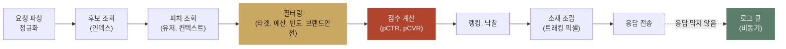
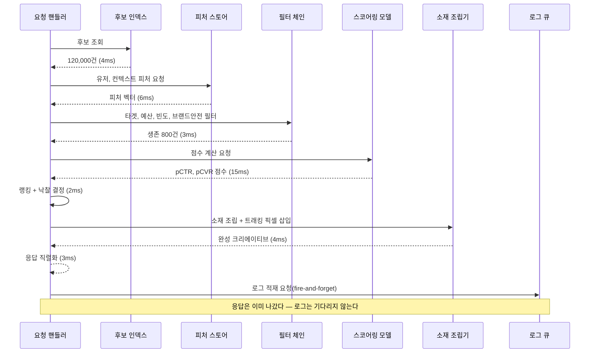

지하철에 탄 민지가 웹툰 앱을 켭니다. 회차와 회차 사이에 있는 광고 한 칸이 잠깐 하얗게 비어 있다가 신발 광고로 채워집니다.

하얀 칸이 광고로 채워지기까지 걸리는 시간은 짧지만 그 사이에 서버 코드는 여러 단계를 순서대로 지나갑니다.

[DSP, SSP, 광고 거래소(Ad Exchange)](post.html?id=dsp-ssp-exchange) 글에서는 이 요청을 어느 회사들이 처리하는지를 봤습니다. 광고를 사는 쪽(DSP), 광고 자리를 파는 쪽(SSP), 둘 사이에서 경매를 여는 곳(Exchange)이 서로 다른 회사로 나왔습니다. 그 글은 회사 사이를 오가는 0.1초와 수수료도 계산했습니다.

이 글은 보는 각도를 완전히 바꿔 회사 이름은 잠시 잊고 **요청 한 건이 코드 한 줄 한 줄을 지나가는 길**을 그대로 따라가 봅니다.

이 글의 뼈대는 다섯 동작입니다. 서버는 이번 요청에 낼 수 있는 광고인 후보를 찾은 다음 맞지 않는 후보를 거르고 남은 후보에 점수를 매겨 순위를 정합니다. 그다음 이긴 광고를 조립해 내보내고 마지막으로 방금 벌어진 일을 기록에 남깁니다.

> 한 줄 요약: 광고 요청 1건은 서버 코드 안에서 **요청 파싱 → 후보 조회 → 피처 조회 → 필터링 → 점수 계산 → 랭킹과 낙찰 → 소재 조립 → 응답 전송** 순서로 여덟 단계를 지납니다. 요청 파싱은 요청을 읽는 단계, 피처 조회는 점수 계산 모델에 넣을 값을 가져오는 단계, 필터링은 지금 낼 수 없는 광고를 지우는 단계, 소재 조립은 이긴 광고를 화면에 띄울 모양으로 만드는 단계입니다. 기록을 남기는 로그 적재는 이 순서에 들지 않고 응답을 보낸 뒤 따로 처리합니다. 단계마다 쓸 수 있는 시간인 지연 예산이 정해져 있습니다. 전체 제한 시간(이 글에서는 45ms)을 넘기면 응답은 나가지 못합니다. 필터링에서 한 번 걸러진 후보는 뒤의 랭킹(순위 매기기)이 아무리 좋아도 다시 돌아오지 못합니다. 이 글의 예시에서는 후보 12만 건 가운데 필터링을 지난 800건만 랭킹까지 갑니다.

---

## 1. 요청 한 건이 지나가는 여덟 단계

**광고 요청 1건이 들어오면 서버는 거의 바뀌지 않는 정해진 순서대로 여덟 단계를 처리합니다.**

광고 요청은 앱이나 웹페이지가 광고 칸 하나를 채울 광고를 달라고 서버에 보내는 요청으로, 민지의 웹툰 앱이 회차 사이의 하얀 칸을 채우려고 보낸 것도 광고 요청 1건입니다. 요청을 받은 서버는 후보를 찾아 거른 다음 점수를 매겨 순위를 정하고 이긴 광고를 조립해 내보냅니다.

뒤 단계로 갈수록 하는 일이 무거워지므로 이 순서는 거의 바뀌지 않습니다. 뒤쪽의 점수 계산 모델은 광고마다 클릭 확률 같은 점수를 예측하는 무거운 모델입니다. 지연 예산은 요청 하나를 처리하는 데 쓰도록 정해 둔 시간으로, 여덟 단계가 이 시간을 나눠 씁니다. 후보 12만 건 전부에 점수 계산 모델을 돌리면 지연 예산이 남아나지 않으므로 서버는 먼저 싼 작업으로 후보를 크게 줄이고 남은 소수에만 비싼 계산을 씁니다. 이 글 전체가 이 원칙 하나를 따라갑니다.

아래 그림에는 여덟 단계를 코드 모듈(한 가지 일을 맡은 코드 단위) 하나씩으로 그렸습니다. 화살표를 왼쪽부터 따라가면 요청이 들어와 응답이 나가기까지의 경로가 보입니다. 맨 끝에서 점선으로 빠지는 로그 큐(로그를 들어온 순서대로 넣어 두었다가 꺼내 처리하는 대기열)는 10, 11절에서 따로 설명합니다.



그림의 여덟 단계 가운데 후보 조회, 필터링, 점수 계산, 랭킹과 낙찰, 소재 조립은 2절부터 5절에서 하나씩 다룹니다. 나머지 세 단계는 여기서 짧게 풉니다. 요청 파싱은 요청에 담긴 지면(광고가 들어갈 자리), 기기 같은 값을 읽어 냅니다. 정규화는 읽어 낸 값의 형식을 하나로 맞춥니다. 피처(feature)는 점수 계산 모델에 넣는 입력값입니다. 피처 조회는 그 가운데 이 유저의 값과 지금 요청의 상황(컨텍스트) 값을 가져오는 단계입니다. 응답 전송은 완성된 광고를 네트워크로 보낼 수 있는 데이터 형식으로 바꾼 뒤(직렬화) 요청을 보낸 곳에 돌려줍니다.

필터링은 후보 수를, 점수 계산은 계산 시간을 가장 크게 좌우하므로 그림에서 두 상자에 색을 칠했습니다. 필터링은 3절, 점수 계산은 4절에서 다루고 7절의 지연 예산 표에서 두 단계를 다시 봅니다.

로그를 쓰는 일은 응답을 막으면 안 되므로 로그 큐로 가는 화살표만 점선으로 그렸습니다. 로그 큐 상자의 「비동기」는 응답이 로그 쓰기를 기다리지 않는다는 뜻입니다. 왜 기다리면 안 되는지는 10절에서 자세히 다룹니다.

---

## 2. 후보 조회 — 12만 건이 나오는 곳

**요청이 들어오면 서버는 캠페인을 하나하나 확인하지 않고 미리 만들어 둔 색인(인덱스)에서 낼 수 있는 광고부터 찾습니다.**

이 단계를 후보 조회(Candidate Retrieval)라고 부릅니다. 캠페인은 광고주가 예산과 광고를 보여 줄 조건을 정해 등록한 광고 단위입니다. 색인은 보통 이 지면, 이 연령대, 이 관심사처럼 조건마다 그 조건에 걸리는 캠페인 ID 를 미리 모아 둔 표입니다.

색인이 있으면 서버는 광고주의 전체 캠페인을 하나씩 검사하지 않고 조건별로 미리 모아 둔 ID 목록을 그대로 꺼내면 됩니다. 요청이 들어오면 그 요청의 지면으로 색인을 조회해 이 지면에 걸 수 있는 캠페인 ID 목록을 바로 받습니다.

이 글은 이 조회로 후보 **120,000건**이 나왔다고 가정합니다. 120,000건은 광고주들의 전체 캠페인 수가 아니라 이 지면 카테고리에 노출(광고가 화면에 한 번 뜨는 일)할 수 있다는 대략적인 조건으로 한 번 걸러진 뒤의 수입니다. 진짜 필터링은 다음 단계인 3절에서 시작합니다. 색인 조회에서 타겟 조건까지 맞춰 4,200건을 바로 꺼내는 것으로 묶어 설명하기도 합니다.

색인 조회는 점수를 매기지도 예산을 확인하지도 않습니다. 이 조건에 등록된 캠페인이 무엇인지 찾아 돌려주기만 하므로 무거운 계산이 전혀 없어 빠릅니다. 그래서 7절의 지연 예산 표에서 후보 조회는 4ms(밀리초, 1초의 천분의 1)로 같은 표의 점수 계산 15ms 보다 짧습니다. 무거운 일은 이렇게 뒤 단계로 미뤄 둡니다.

---

## 3. 필터링 — 한 번 지우면 돌아오지 못하는 후보

**필터링은 후보 가운데 지금 낼 수 없는 광고를 지웁니다. 여기서 지워진 후보는 절대 돌아오지 못합니다.**

뒤에 오는 랭킹은 필터링을 통과한 후보만 받으므로 랭킹 모델이 아무리 정교해도 필터링에서 이미 사라진 광고를 다시 불러올 방법은 없습니다. 필터는 보통 아래 순서로 걸립니다.

- ① **타겟 조건**은 이번 요청의 지면, 지역, 연령, 세그먼트(관심사나 행동처럼 미리 정한 조건으로 유저를 나눈 그룹)가 캠페인이 원하는 조건과 맞는지 봅니다.
- ② **예산 소진 제외**는 오늘 예산을 이미 다 쓴 캠페인을 뺍니다.
- ③ **빈도 제한(frequency cap)**은 이 유저가 이 광고를 이미 정해진 횟수만큼 봤으면 그 광고를 후보에서 지웁니다.
- ④ **브랜드 안전(brand safety)**은 이 지면의 콘텐츠 카테고리와 충돌하는 광고를 걸러 냅니다.

네 필터를 2절의 12만 건에 차례로 적용하면 후보가 단계마다 줄어듭니다. 위가 넓고 아래로 갈수록 좁아지는 이 모양을 깔때기(funnel)라고 부릅니다. 아래 카드와 표의 숫자는 설명을 위해 만든 이 글의 가데이터(가상 데이터)입니다. 카드에서는 줄마다 앞 단계에서 몇 % 가 남았는지와 남은 건수를 보면 됩니다.

<div class="demo-embed-wrap">
<iframe class="demo-embed" src="demo-targeting-cards.html?embed=1&card=funnel" height="480" loading="lazy" title="후보 12만 건이 800건으로 줄어드는 순서"></iframe>
<a class="demo-embed-open" href="demo-targeting-cards.html" target="_blank" rel="noopener">↗ 카드 아홉 장 전체로 열기</a>
</div>

같은 숫자를 표로 적으면 아래와 같습니다. 「이 단계 통과율」은 앞 단계에서 넘어온 후보 가운데 이 필터를 통과한 비율이라 높을수록 후보를 많이 남깁니다. 「최초 대비 누적 생존율」은 처음 120,000건 가운데 그 단계까지 남은 비율입니다.

| 단계 | 남은 후보 수 | 이 단계 통과율 | 최초 대비 누적 생존율 |
|---|---|---|---|
| 시작(색인 조회 직후) | 120,000건 | — | 100% |
| ① 타겟 조건 통과 | 4,200건 | 3.5% | 3.50% |
| ② 예산 소진 제외 통과 | 2,310건 | 55.0% | 1.93% |
| ③ 빈도 제한 통과 | 1,155건 | 50.0% | 0.96% |
| ④ 브랜드 안전 통과(= 랭킹 대상) | 800건 | 69.3% | 0.67% |
| 최종 응답(랭킹 1위) | 1건 | — | 0.0008% |

표를 위에서부터 따라가면 타겟 조건이 120,000건 가운데 3.5% 인 4,200건을 남깁니다. 이어서 예산 소진 제외가 4,200건의 55.0% 인 2,310건을, 빈도 제한이 2,310건의 50.0% 인 1,155건을, 브랜드 안전이 1,155건의 69.3% 인 800건을 남깁니다. 그래서 마지막 800건은 처음 120,000건의 0.67% 입니다. 랭킹 1위로 응답에 나가는 1건은 0.0008% 입니다.

가장 크게 줄어드는 곳은 ① 타겟 조건으로, 12만 건 가운데 이 유저와 이 지면 조건에 맞는 캠페인이 3.5% 밖에 남지 않습니다. 나머지는 처음부터 이 자리를 원하지 않은 캠페인입니다. 반대로 ④ 브랜드 안전은 이미 좁혀진 1,155건 가운데서도 69.3% 를 남기므로 상대적으로 순한 필터에 속합니다. 타겟 조건이 어디에 적혀 있다가 유저 정보와 어디서 만나는지는 [타겟팅 기초](post.html?id=targeting-basics) 글이 다룹니다.

처음 120,000건 가운데 랭킹 대상인 800건에 들지 못한 후보는 119,200건입니다. 랭킹은 이 800건 안에서만 순서를 정하므로 119,200건 안에 아무리 좋은 광고가 있었어도 그 광고는 이미 경쟁에서 빠졌습니다. 그래서 필터링은 랭킹보다 먼저 승부를 정하고 그 영향도 랭킹보다 큽니다.

---

## 4. 점수 계산과 랭킹 — 살아남은 후보의 순서

**필터를 통과한 800건에 하나씩 점수를 매기고 그 점수로 순위를 정하는 단계입니다.**

3절까지는 낼 수 없는 광고를 걸러 냈습니다. 여기서부터는 남은 광고 가운데 가장 좋은 광고 하나를 고릅니다.

점수는 보통 예상 클릭률(pCTR)과 예상 전환율(pCVR), 그리고 입찰가를 함께 써서 만듭니다. pCTR 은 이 유저가 이 광고를 누를 확률을 모델이 예측한 값입니다. pCVR 은 구매 같은 전환이 일어날 확률이고 모델이 같은 방식으로 예측합니다. 입찰가는 광고주가 이 광고에 내겠다고 부른 값입니다.

세 값을 어떻게 조합해 점수를 내고 그 점수를 어떻게 순위로 바꾸는지는 이 글에서 다루지 않습니다. 시장별 계산 기준은 [eCPM과 광고 랭킹](post.html?id=ecpm-ranking) 글이, 800건을 몇 ms 안에 스코어링(점수 계산)하는 방법은 [광고 모델 서빙 아키텍처](post.html?id=model-serving-architecture) 글이 다룹니다. 이 글은 그 계산이 파이프라인(요청이 차례로 지나가는 단계 전체)의 어디에 놓이는지만 봅니다.

점수 계산이 필터링 뒤에 오는 까닭은 7절의 지연 예산 표가 보여 줍니다. 이 표에서 점수 계산은 15ms 로 여덟 단계 가운데 가장 무거운 한 줄인데, 필터링이 먼저 후보를 800건까지 줄여 놓았기 때문에 이 무거운 계산을 감당할 수 있습니다. 필터링 없이 12만 건 전부에 같은 모델을 돌렸다면 점수 계산 한 단계만으로 지연 예산을 다 써 버릴 수밖에 없었습니다.

순위를 정한 뒤에는 탐색(exploration)을 조금 섞는 경우도 있습니다. 탐색은 점수가 아직 확실하지 않은 신규 캠페인에 가끔 노출 기회를 주는 방식으로, 자세한 기법은 [UCB 계열](post.html?id=ucb-family) 글에서 따로 다룹니다. 이 글에서는 순위가 이 단계에서 정해진다는 데까지만 기억해 두면 됩니다.

---

## 5. 낙찰과 소재 조립 — 광고가 완성되는 단계

**순위가 정해지면 1등이 이 자리를 가져갑니다. 그다음 서버는 그 광고를 실제로 내보낼 수 있는 모습으로 조립합니다.**

4절의 점수 계산이 어느 광고가 이겼는지를 정했다면 이 단계는 이긴 광고가 화면에서 실제로 어떤 모습일지를 만듭니다.

이긴 광고가 이 자리를 사 가는 것을 낙찰이라고 합니다. 낙찰가(이긴 광고가 실제로 내는 값)는 경매 방식에 따라 달라서 1등이 자기가 부른 값을 그대로 낼 수도 있고 2등이 부른 값에 맞춰 낼 수도 있습니다. 이 계산은 [DSP, SSP, 광고 거래소](post.html?id=dsp-ssp-exchange) 글과 [2등 가격 경매](post.html?id=second-price-auction) 글에서 이미 다뤘습니다. 여기서는 되풀이하지 않습니다.

소재 조립은 낙찰가를 정하는 일과 다릅니다. 소재(크리에이티브)는 유저 화면에 실제로 뜨는 광고 이미지와 문구를 말합니다. 소재 조립에서는 광고 이미지와 문구 템플릿에 이 유저와 이 자리에 맞는 값을 채워 넣습니다. 상품 이미지를 유저가 최근 본 상품으로 바꾸는 동적 크리에이티브가 대표적입니다.

조립하면서 서버는 **트래킹 픽셀**도 심습니다. 트래킹 픽셀은 이 광고가 화면에 그려졌는지 확인할 아주 작은 이미지 요청 하나입니다. 클릭했을 때 어디를 거쳐 갈지 정하는 리디렉션 주소도 이때 함께 넣는데, 리디렉션(redirect)은 브라우저를 다른 주소로 넘기는 동작입니다.

응답은 이 조립까지 끝난 뒤에야 완성되어 나갈 수 있습니다. 트래킹 픽셀과 클릭 리디렉션이 하는 일은 11절에서 이어서 자세히 봅니다. 여기서는 이미지, 문구, 픽셀, 링크가 소재 하나에 한 번에 조립된다는 점만 기억해 두면 됩니다.

---

## 6. 파이썬으로 본 깔때기와 필터 순서별 비용

**3절의 깔때기를 코드로 옮겨 필터 순서를 바꿔 보면 마지막에 남는 후보 수는 순서와 상관없이 같지만 처리 비용은 최대 9배 가까이 벌어집니다.**

3절의 표는 네 필터를 정해진 순서로 걸었습니다. 마지막에 남는 후보만 보면 어떤 순서로 걸어도 상관없어 보입니다. 그런데 필터마다 후보 1건을 검사하는 비용이 다르면 순서에 따라 처리 비용이 바뀝니다. 이 절은 그 차이를 코드로 계산합니다.

필터 순서를 바꿨을 때 마지막에 남는 후보 수와 처리 비용이 각각 어떻게 되는지 보려고 아래 코드를 돌립니다. 코드는 표준 라이브러리만 쓰며 필터마다 통과율과 후보 1건 검사 비용을 정해 둔 뒤 필터를 차례로 적용하면서 남은 후보 수와 누적 비용을 함께 따라갑니다. 통과율은 3절 표와 같은 값입니다. 코드는 필터끼리 서로 영향을 주지 않는다(독립)고 가정합니다.

1건 검사 비용은 예산 소진 제외 8ns(카운터 비교), 타겟 조건 10ns(색인, 비트마스크 조회), 빈도 제한 25ns(캐시 조회), 브랜드 안전 80ns(카테고리 매칭)입니다. 괄호 안은 코드 주석에 적힌 검사 방식입니다. 주석은 카운터 비교에 「가장 싸다」, 카테고리 매칭에 「가장 비싸다」라고 적었습니다. 비트마스크는 여러 조건을 비트 하나씩으로 나타낸 값입니다. 캐시는 자주 쓰는 값을 빠르게 다시 쓰려고 복사해 두는 저장소입니다. 비용 자체는 필터끼리 비교하려고 정한 상대적인 예시 값입니다. ns(나노초)는 ms 의 백만분의 1이라 코드는 ns 로 쌓은 비용을 `1e6` 으로 나눠 ms 로 찍습니다.

실제 순서는 싼 필터 2개(타겟 조건, 예산 소진 제외)를 앞에 두고 가장 비싼 브랜드 안전을 맨 뒤에 둡니다. (a) 는 이 실제 순서에서 단계마다 남은 후보 수를 찍습니다. (b) 는 순서를 거꾸로 뒤집었을 때의 최종 후보 수와 비용을 실제 순서와 나란히 찍습니다.

```python
# 하는 일: 광고 요청 1건의 후보가 필터 네 개를 지나며 줄어드는 과정을 보고, 필터 순서를 바꾸면 처리 비용(=지연)이 어떻게 달라지는지 비교한다.

# 1단계: 후보 수와 필터 네 개를 둔다
# 본문의 여덟 단계 코드 경로 가운데 필터링 단계다. 후보 수, 통과율, 비용은 이 글의 가데이터 표와 맞춘 예시값이고, 표준 라이브러리만 쓴다.
CANDIDATES_START = 120_000

# (필터 이름, 통과율, 후보 1건 검사 비용ns) — 순서는 실제 파이프라인 순서.
# 통과율은 '독립'이라고 가정한다: 각 필터는 다른 필터와 무관하게 후보를 받아들이거나 뺀다.
# 비용(ns)은 필터 하나가 후보 1건을 검사하는 데 드는 상대적 비용의 예시치다.
PIPELINE = [
    ("타겟 조건(세그먼트, 지면, 연령)", 0.035,     10),  # 인덱스/비트마스크 조회 — 싸다
    ("예산 소진 제외",               0.55,       8),  # 카운터 비교 — 가장 싸다
    ("빈도 제한",                    0.50,      25),  # 캐시 조회 — 중간
    ("브랜드 안전",                  800 / 1155, 80),  # 카테고리 매칭 — 가장 비싸다
]


# 2단계: 필터를 차례로 적용하는 함수를 만든다
# 필터마다 지금 남은 후보 전부를 검사하므로, 비용은 남은 후보 수에 1건 검사 비용을 곱해 쌓인다.
def run_funnel(pipeline, start):
    """단계를 순서대로 적용해 (단계별 남은 후보 수, 총 검사 비용ns)을 반환한다."""
    remaining = start
    counts = [remaining]
    total_cost_ns = 0
    for _name, rate, cost_ns in pipeline:
        total_cost_ns += remaining * cost_ns  # 이 단계는 '지금 남은 후보 전부'를 검사해야 한다
        remaining = round(remaining * rate)
        counts.append(remaining)
    return counts, total_cost_ns


# 3단계: 실제 순서로 후보 수 변화를 본다
# 싼 필터 둘을 앞에 두고, 가장 비싼 브랜드 안전을 맨 뒤에 둔다.
counts, cost_actual = run_funnel(PIPELINE, CANDIDATES_START)
print("(a) 실제 순서 — 단계별 남은 후보 수")
labels = ["시작(전체 캠페인 후보)"] + [name for name, _r, _c in PIPELINE]
for label, n in zip(labels, counts):
    print(f"    {label:<28} {n:>7,}건")

# 4단계: 순서를 뒤집어 비용을 비교한다
# 비싼 필터를 먼저 두면, 필터가 독립이라 최종 생존자는 같아도 처리 비용은 달라진다.
reversed_pipeline = list(reversed(PIPELINE))
counts_rev, cost_reversed = run_funnel(reversed_pipeline, CANDIDATES_START)

print("\n(b) 필터 순서 비교 — 최종 생존자는 같아도 비용은 다르다")
print(f"    실제 순서(싼 필터 먼저)    최종 {counts[-1]:>4,}건   비용 {cost_actual/1e6:6.3f}ms")
print(f"    거꾸로 순서(비싼 필터 먼저) 최종 {counts_rev[-1]:>4,}건   비용 {cost_reversed/1e6:6.3f}ms")
print(f"    비용 배율: {cost_reversed/cost_actual:.2f}배")

# 검산: 필터가 독립이라면 최종 생존자 수는 순서와 무관해야 한다(반올림 오차 정도만 허용)
assert abs(counts[-1] - counts_rev[-1]) <= 1

# 출력:
# 3단계 뜻: 타겟 조건이 120,000건을 4,200건으로 가장 크게 줄이고, 브랜드 안전까지 지나면 800건이 남는다.
# (a) 실제 순서 — 단계별 남은 후보 수
#     시작(전체 캠페인 후보)                120,000건
#     타겟 조건(세그먼트, 지면, 연령)            4,200건
#     예산 소진 제외                       2,310건
#     빈도 제한                          1,155건
#     브랜드 안전                           800건
# 4단계 뜻: 순서를 뒤집어도 최종 800건은 같지만, 비싼 필터가 후보를 전부 검사해 비용이 1.384ms 에서 12.239ms 로 8.84배가 된다.
#
# (b) 필터 순서 비교 — 최종 생존자는 같아도 비용은 다르다
#     실제 순서(싼 필터 먼저)    최종  800건   비용  1.384ms
#     거꾸로 순서(비싼 필터 먼저) 최종  800건   비용 12.239ms
#     비용 배율: 8.84배
```

찍힌 (a) 를 보면 후보는 120,000건에서 4,200건, 2,310건, 1,155건을 거쳐 800건으로 줄어 3절의 표와 같습니다. 코드 첫 줄 주석대로 처리 비용은 지연과 같은 뜻이라 작을수록 좋습니다. (b) 에서는 순서를 거꾸로 해도 최종 800건은 같지만 비용이 실제 순서의 1.384ms 에서 거꾸로 순서의 12.239ms 로 늘어 비용 배율이 8.84배입니다. 마지막 `assert` 줄은 필터가 독립이면 최종 생존자 수가 순서와 무관해야 한다는 검산인데, 두 순서 모두 800건이라 통과합니다.

`run_funnel` 안의 비용 계산 줄 `total_cost_ns += remaining * cost_ns` 가 이 차이를 만듭니다. 어떤 필터든 지금 남아 있는 후보 전부를 검사해야 하므로 필터 하나의 비용은 그 필터를 만났을 때 남은 후보 수에 1건 검사 비용을 곱한 값입니다. 그래서 비용은 그 필터 앞에서 후보가 얼마나 줄어 있었는지에 따라 정해집니다.

가장 비싼 브랜드 안전 하나로 따라가 보면, 실제 순서에서는 브랜드 안전을 만날 때 후보가 이미 1,155건까지 줄어 있어 비싼 단가 80ns 를 1,155건에만 곱하므로 총량이 작습니다. 거꾸로 순서에서는 브랜드 안전이 맨 앞에서 12만 건 전부를 검사하는데, 같은 80ns 라도 대상이 1,155건의 100배가 넘는 120,000건이라 비용이 크게 늘어납니다. 싼 필터를 먼저 걸어 후보를 줄이는 순서는 취향이 아니라 이 곱셈으로 정해집니다.

---

## 7. 지연 예산 — 여덟 단계가 나눠 쓰는 45ms

**이 글의 파이프라인에는 전체 45ms 라는 타임아웃(넘기면 응답을 내지 못하는 제한 시간)이 걸려 있습니다. 여덟 단계가 이 45ms 를 나눠 씁니다.**

단계마다 몇 ms 를 쓰는지 적어 보면 45ms 가운데 얼마가 남는지와 어느 단계가 가장 많이 쓰는지가 보입니다. 아래 표도 이 글의 가데이터입니다. 단계마다 쓰는 시간과 그 단계까지의 누적 시간, 타임아웃까지 남은 여유를 함께 적었습니다.

| # | 단계 | 이 단계(ms) | 누적(ms) | 타임아웃까지 남은 여유(ms) |
|---|---|---|---|---|
| 1 | 요청 파싱, 정규화 | 1 | 1 | 44 |
| 2 | 후보 조회(2절) | 4 | 5 | 40 |
| 3 | 피처 조회(유저, 컨텍스트) | 6 | 11 | 34 |
| 4 | 필터링(3절) | 3 | 14 | 31 |
| 5 | 점수 계산(4절) | 15 | 29 | 16 |
| 6 | 랭킹, 낙찰 결정(4, 5절) | 2 | 31 | 14 |
| 7 | 소재 조립(5절) | 4 | 35 | 10 |
| 8 | 응답 직렬화, 전송 | 3 | 38 | 7 |

표의 누적 열을 따라 내려가면 1ms 에서 시작해 5ms, 11ms, 14ms, 29ms, 31ms, 35ms 를 거쳐 38ms 까지 늘어나 여덟 단계가 45ms 가운데 38ms 를 쓰고 7ms 가 남습니다. 안전 마진은 예상보다 느려질 때를 대비해 남겨 둔 여유입니다. 이 7ms 가 이 시스템의 진짜 안전 마진이라 트래픽이 몰려 어느 한 단계가 조금 느려져도 이 여유 안에서는 버틸 수 있습니다.

가장 큰 몫은 5번 점수 계산의 15ms 로, 여덟 단계가 쓴 38ms 가운데 거의 40% 를 이 한 줄이 가져갑니다. 3절에서 필터링이 후보를 800건까지 줄여 놓지 않았다면 이 15ms 안에 모델을 다 돌릴 수 없었으므로, 4번 필터링이 3ms 로 작아 보여도 그 3ms 가 뒤따르는 15ms 를 가능하게 만듭니다.

6절의 파이썬 결과를 이 표의 필터링 줄과 비교하면, 실제 순서의 1.384ms 는 표가 필터링에 배정한 3ms 안에 여유 있게 들어옵니다. 그런데 순서를 거꾸로 한 12.239ms 는 필터링 한 단계만으로 3ms 예산의 4배를 넘습니다.

이 초과가 요청 전체에 주는 영향도 계산할 수 있습니다. 필터링을 뺀 나머지 일곱 단계의 합은 1+4+6+15+2+4+3 으로 35ms 입니다. 여기에 필터링 자리의 3ms 대신 거꾸로 순서의 12.239ms 를 더하면 47.239ms 가 되어 **45ms 타임아웃을 2.2ms 넘깁니다.** 필터 순서 하나가 틀렸을 뿐인데 이 요청은 응답을 내지 못하고 타임아웃으로 실패합니다. 그때까지 계산한 점수와 조립한 소재도 전부 버려집니다.

같은 흐름을 모듈 사이의 호출 순서로 다시 그리면 아래와 같습니다. 위에 있는 호출일수록 먼저 일어납니다. 화살표 옆 괄호 안의 숫자는 그 단계가 쓴 시간입니다. 요청 핸들러(요청을 받아 각 모듈을 차례로 부르는 코드)가 모듈마다 요청을 보내고 결과를 받습니다. 피처 스토어는 피처를 저장해 두는 저장소, 필터 체인은 네 필터를 차례로 연결한 코드, 스코어링 모델은 4절의 점수 계산 모델입니다. 맨 끝의 로그 적재 요청은 fire-and-forget(보내 놓고 결과를 기다리지 않는 방식)이라 응답은 로그를 기다리지 않고 먼저 나갑니다.



---

## 8. 열린 RTB 에서 지연 예산이 늘 빠듯한 까닭 [무대: 열린 RTB]

**광고 요청이 여러 회사를 거치는 구조에서는 이 글의 45ms 도 전체 시간의 일부일 뿐입니다.**

열린 RTB(Real-Time Bidding)는 광고를 사는 DSP, 경매를 여는 광고 거래소, 광고 자리를 파는 SSP 가 서로 다른 회사로 나뉘어 노출 한 건마다 실시간으로 경매를 여는 구조입니다. 이 글의 여덟 단계는 그 가운데 한 회사, 예를 들어 DSP 안에서 벌어지는 일인데 요청이 그 회사에 도착하고 응답이 그 회사를 떠나는 데에도 시간이 듭니다.

[DSP, SSP, 광고 거래소](post.html?id=dsp-ssp-exchange) 글의 타임라인 표에서 DSP 응답은 한 줄뿐이었습니다. 15ms 에 시작해 65ms 에 끝나는 50ms 짜리 블랙박스(안에서 무슨 일이 일어나는지는 보지 않고 들어가고 나오는 것만 본 상자)였습니다. 이 글은 그 블랙박스를 열어 그 안에 든 여덟 단계를 보여 줍니다. 다만 열린 RTB 에서 6번 단계가 고르는 것은 이 DSP 가 거래소에 낼 입찰 1건입니다. 여러 DSP 의 입찰을 비교해 낙찰자와 낙찰가를 정하는 일은 그 뒤 거래소 안에서 일어납니다.

그 50ms 가운데 일부는 Exchange 가 요청을 보내고 DSP 가 응답을 돌려주는 데 드는 물리적인 이동 시간, 곧 순수한 네트워크 왕복입니다. 이 글의 45ms 는 그 왕복을 빼고 DSP 내부 계산에 쓸 수 있는 몫으로 보면 됩니다. 회사가 따로 있으면 지연 예산은 이렇게 내부 계산 몫과 회사 사이 이동 몫으로 나뉩니다.

그런데 타임아웃은 어느 쪽 사정도 봐주지 않습니다. Exchange 의 콜아웃 타임아웃은 Exchange 가 DSP 에 입찰 요청을 보낸 뒤 응답을 기다려 주는 최대 시간입니다. 이 시간이 지나면 Exchange 는 DSP 가 왜 늦었는지 묻지 않고 그 DSP 를 이번 경매에서 뺍니다. 그래서 7절의 필터 순서 실수처럼 DSP 내부 사정으로 예산을 넘겨도 결과는 똑같습니다. 이 노출을 낙찰받을 기회가 사라지고 그만큼의 매출도 함께 사라집니다.

---

## 9. 닫힌 생태계에서 모든 지연이 내 책임이 되는 까닭 [무대: 닫힌 생태계]

**네이버, 카카오 같은 닫힌 생태계에서는 여덟 단계가 모두 한 회사 안에서, 심지어 같은 데이터센터 안에서 일어납니다.**

닫힌 생태계(Walled Garden)는 한 회사가 광고를 사는 쪽과 경매, 광고 자리를 전부 가진 구조로, 담장 안이라고도 부릅니다. 후보와 유저 프로필, 소재 카탈로그(소재를 모아 둔 목록)가 모두 같은 저장소에 있습니다. 회사와 회사 사이를 오가는 네트워크 홉(요청이 다른 서버로 한 번 건너가는 구간)도 없습니다.

그래서 8절에서 본 내부 계산 몫과 이동 몫의 구분이 여기서는 의미가 없습니다. 회사 안의 홉은 짧아 이동에 쓰는 시간이 거의 없으므로 지연 예산 거의 전부를 계산에 쓸 수 있습니다. 이론적으로는 그만큼 더 무거운 모델을 더 많은 후보에 돌릴 여유가 생깁니다.

그렇다고 닫힌 생태계가 마냥 편하지는 않은데, 모든 지연이 온전히 내 책임이 되기 때문입니다. 열린 RTB 에서는 네트워크가 느렸다거나 상대 회사 서버가 늦었다는 변명이 통하지만 닫힌 생태계에는 그런 변명이 없습니다. 점수 계산이 느리면 원인은 우리 팀이 짠 모델에 있습니다. 필터링이 느리면 원인은 우리 팀이 만든 색인에 있습니다.

그래서 역설적으로 지연을 줄이라는 최적화 압력은 담장 안에서 더 세게 걸립니다. 탓할 대상이 없으므로 45ms 안에 끝내는 일은 오로지 엔지니어링 실력에 달려 있습니다. 10절에서 볼 타임아웃, 캐시, 비동기 로깅은 두 무대 모두에 필요하지만 닫힌 생태계에서는 이 장치들을 두지 않았을 때 핑계를 댈 곳이 없습니다.

---

## 10. 실전에서 지연 예산을 지키는 방법

**트래픽이 늘고 모델이 무거워지면 처리 시간이 눈에 띄지 않게 예산을 넘기기 시작하므로 지연 예산은 한 번 계산하고 끝낼 수 있는 숫자가 아닙니다.**

그래서 예산을 지키는 별도의 기법이 필요합니다. 가장 기본 원칙은 한 단계 때문에 요청 전체가 실패하지 않게 하는 데 있습니다. 점수 계산 모델 하나가 느려졌다는 이유로 요청 전체가 45ms 를 넘기면 그 요청은 전부 버려지므로, 무슨 일이 있어도 45ms 안에 무엇이든 응답하게 만드는 장치를 처음부터 두어야 합니다.

이런 장치는 평소에는 아무 일도 하지 않다가 트래픽이 몰리는 순간에만 작동해서 대개 눈에 잘 띄지 않습니다. 그래서 실무자가 아니면 왜 이런 코드가 있는지 이해하기 어렵습니다. 아래 심화 박스에서 대표적인 장치 세 가지를 설명합니다.

:::deep 더 깊이 — 예산을 지키는 세 가지 장치
**타임아웃과 부분 응답.** 점수 계산이 배정된 15ms 를 넘기면 전체를 실패로 처리하는 대신 그때까지 계산이 끝난 후보만으로 랭킹을 진행하는 경우가 많은데, 800건 가운데 500건만 점수가 나왔어도 그 500건 가운데 1등을 내보내는 편이 아무것도 내보내지 않는 것보다 낫기 때문입니다. 이 방식을 부분 응답(partial response)이라고 부릅니다. 부분 응답은 모든 후보를 다 본 답보다 제때 도착한 답을 먼저 챙깁니다.

**캐시 계층.** 7절 표의 피처 조회(6ms)가 가져오는 값 가운데에는 요청마다 새로 계산할 필요가 없는 값이 많습니다. 같은 유저의 세그먼트 정보는 몇 분 안에는 거의 바뀌지 않으므로 유저나 세그먼트 단위로 결과를 짧은 시간 동안 캐시에 저장해 두고 다시 씁니다. 이 저장 기간을 TTL(Time To Live)이라고 합니다. 캐시가 있으면 피처 조회가 6ms 에서 1ms 이하로 줄어드는 경우도 흔합니다. 다만 캐시에 남은 값이 오래되었으면 응답은 빨라도 그 값은 틀립니다. TTL 이 길수록 캐시를 오래 쓰지만 그만큼 오래된 값을 쓸 위험도 커집니다. 그래서 TTL 을 얼마로 잡을지는 늘 트레이드오프(하나를 얻으면 다른 하나를 잃는 관계)입니다.

**비동기 로깅.** 1절 그림에서 로그 큐로 가는 화살표가 점선이었던 까닭을 여기서 설명합니다. 이번 요청과 후보, 점수, 낙찰 기록을 디스크나 로그 시스템에 쓰는 일은 이 유저에게 응답하는 일과 아무 상관이 없습니다. 그런데 이 쓰기를 응답 전에 동기(쓰기가 끝날 때까지 응답이 기다리는 방식)로 처리하면 로그 시스템이 잠깐 느려지는 순간 모든 광고 요청이 함께 느려집니다. 그래서 응답을 먼저 내보내고 로그는 큐에 넣어 두었다가 별도 프로세스(따로 실행되는 프로그램)가 나중에 처리합니다. 이처럼 응답이 로그 쓰기를 기다리지 않는 방식이 비동기입니다. 이 로그가 다음 날 학습 데이터가 되는 과정은 11절에서 이어집니다.
:::

---

## 11. 트래킹과 로그 — 노출 뒤에 남는 일

**응답을 내보낸 뒤에도 그 광고가 정말 화면에 보였는지, 눌렸는지를 확인하는 일이 남아 있습니다.** 이 확인 기록은 다음 날 점수 계산 모델을 다시 학습시키는 재료가 됩니다.

서버가 응답을 보낸 시점과 유저 눈에 실제로 보인 시점이 다르므로 먼저 노출을 어느 시점으로 칠지부터 정해야 합니다. 5절에서 만든 응답이 나갔다고 해서 광고가 화면에 보였다는 보장은 없습니다. 서버는 데이터를 보냈을 뿐입니다. 화면에 얼마나 그려졌는지는 클라이언트(유저 기기의 브라우저나 앱)가 따로 측정합니다. 업계에서 흔히 쓰는 MRC(Media Rating Council) 표준은 광고 면적의 절반 이상이 1초 이상 화면에 보일 때를 뷰어블 노출(실제로 볼 수 있었던 노출)로 칩니다. 서버가 응답을 보낸 이벤트와 클라이언트가 뷰어빌리티 픽셀(광고가 화면에 얼마나 보였는지 알리는 신호)을 보내는 이벤트는 서로 다른 사건으로, 일어나는 시간도 위치도 따로입니다.

클릭도 비슷합니다. 유저가 광고를 누르면 곧바로 광고주 페이지로 가지 않고 먼저 트래킹 서버가 만든 리디렉션 주소를 한 번 거칩니다. 이 주소가 클릭했다는 사실을 로그에 남긴 다음 진짜 랜딩 페이지(광고주가 보여 주려는 페이지)로 302 리디렉션(다른 주소로 가라고 알려 주는 HTTP 응답)을 보냅니다. 측정업체가 하나 더 끼어 있으면 리디렉션도 한 번 더 늘어납니다. 5절에서 소재에 심은 트래킹 픽셀과 리디렉션 주소가 바로 이 경로를 만드는 부품입니다.

요청, 노출, 클릭 로그는 이렇게 쌓였다가 그날 밤 배치(모아 둔 데이터를 한꺼번에 처리하는 작업)로 정리됩니다. 정리된 기록에는 어떤 후보가 필터링에서 걸러졌는지, 어떤 후보가 점수는 높았지만 낙찰에는 실패했는지, 실제로 클릭까지 이어진 노출이 무엇이었는지가 함께 남아 내일 점수 계산 모델을 다시 학습시키는 데이터가 됩니다. 로그 한 건에서 실제로 몇 종류의 기록이 만들어지는지는 [광고 시스템 로그 파이프라인](post.html?id=ad-log-pipeline) 글이 다룹니다. request log(요청 로그)부터 candidate log(후보 로그)까지 로그 구조를 나누는 방법은 [광고 로그 시스템 설계](post.html?id=ad-log-system) 글에 있습니다.

---

## 12. 한눈 정리

| 단계 | 이 글에서 본 숫자 | 핵심 |
|---|---|---|
| 후보 조회 | 120,000건 | 색인 조회, 무거운 계산 없음 |
| 필터링 | 120,000 → 800건(0.67%) | 여기서 걸러지면 랭킹도 못 구함 |
| 점수 계산 | 지연 예산 15ms(8단계 중 최대) | 800건까지 줄였기에 감당 가능 |
| 필터 순서 | 1.384ms vs 12.239ms(8.84배) | 최종 결과는 같아도 비용은 다름 |
| 지연 예산 | 총 45ms, 사용 38ms, 여유 7ms | 순서 실수 하나로 47.2ms까지 초과 가능 |
| 뷰어블 노출 | 광고 면적 절반 이상 1초 이상(MRC 기준) | 서버 응답과 실제로 보임은 다른 사건 |
| 비동기 로깅 | 응답 후 큐잉, fire-and-forget | 로그가 응답 지연을 잡아먹으면 안 됨 |

표에서 숫자 하나만 기억한다면 필터 순서의 **8.84배**입니다. 후보 집합도 최종 낙찰자도 그대로인 채 필터 순서만 바꿨는데 처리 비용이 거의 9배 벌어졌습니다. 그 차이가 7절에서 요청이 45ms 타임아웃을 넘기느냐까지 정했습니다. 좋은 랭킹 모델보다 이 순서를 먼저 챙겨야 합니다.

---

## 13. 헷갈리기 쉬운 점

- **필터링에서 놓친 광고는 랭킹으로 복구하지 못합니다.** 랭킹은 필터를 통과한 800건만 받으므로 3절에서 119,200건이 걸러진 순간 그 안에 아무리 좋은 광고가 있었어도 결과는 이미 정해졌습니다.
- **필터 순서는 결과가 아니라 비용을 바꿉니다.** 마지막에 남는 후보 수는 순서와 상관없지만(6절) 처리 비용은 순서에 따라 최대 8.84배 차이가 납니다.
- **타임아웃은 느린 응답이 아니라 응답 없음입니다.** 7절에서 47.2ms 가 걸린 요청은 45ms 를 넘긴 순간 아무것도 내보내지 못하고 그때까지 계산한 점수와 조립한 소재도 전부 버립니다.
- **서버의 응답 전송과 광고가 실제로 보인 일은 서로 다른 사건입니다.** 11절에서 본 것처럼 서버가 응답을 보낸 기록과 클라이언트가 뷰어빌리티 픽셀을 보낸 기록은 시점도 주체도 다릅니다.
- **로그를 동기로 쓰면 광고 응답 자체가 느려집니다.** 로그 시스템이 잠깐 느려지는 순간 모든 광고 요청이 함께 느려지므로 거의 모든 시스템이 로그 적재를 비동기로 뺍니다(10절).
- **닫힌 생태계라고 지연이 공짜는 아닙니다.** 회사 사이를 오가는 네트워크 홉은 줄지만(9절) 그만큼 지연을 남 탓으로 돌릴 핑계도 함께 사라집니다.

---

## 더 깊이 보기

- 이 요청을 처리하는 회사들, 0.1초 타임라인과 수수료 → [DSP, SSP, Ad Exchange](post.html?id=dsp-ssp-exchange)
- 점수를 순위로 바꾸는 시장별 기준 → [eCPM과 광고 랭킹](post.html?id=ecpm-ranking)
- 800건을 몇 ms 안에 스코어링하는 아키텍처 → [광고 모델 서빙 아키텍처](post.html?id=model-serving-architecture)
- 낙찰가는 왜 부른 값 그대로가 아닌가 → [2등 가격 경매](post.html?id=second-price-auction)
- 순위에 탐색을 섞는 법 → [UCB 계열](post.html?id=ucb-family)
- 로그 한 건에서 몇 종류가 만들어지나 → [광고 시스템 로그 파이프라인](post.html?id=ad-log-pipeline)
- 로그 구조를 request부터 candidate까지 → [광고 로그 시스템 설계](post.html?id=ad-log-system)
- 광고 ML 전체 지도에서 이 글의 위치 → [ML 엔지니어 트랙](ml-track.html)
