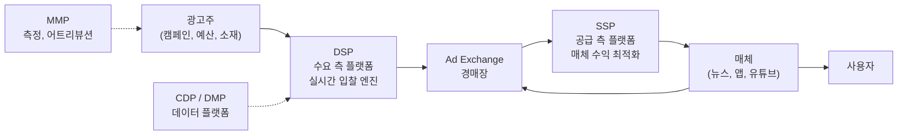

광고 기술(Ad Tech)을 처음 공부하면 낯선 용어가 수십 개씩 한꺼번에 나와서 어디부터 봐야 할지 막막합니다. 이 글은 광고를 한 번도 다뤄 보지 않은 **완전 초보자**를 독자로 두고 30분 안에 광고 시스템 전체의 지도를 머릿속에 그릴 수 있도록 썼습니다. 설명에는 수식 대신 **숫자 예시**만 씁니다. 끝까지 읽고 나면 이 블로그에 있는 다른 글 150편 남짓이 그 지도의 어느 자리를 다루는지 보일 겁니다.

> 이 글은 다른 글로 가는 길을 안내하는 허브입니다. 1절부터 6절까지 각 절 끝에 "더 깊이 보기" 링크를 모아 두었으니 궁금한 주제가 생기면 그 링크를 따라 바로 넘어가면 됩니다.

---

## 0. 광고 시스템이 복잡한 까닭

**광고 시스템이 복잡한 원인은 기술이 아니라 이해관계에 있습니다. 광고주, 매체, 사용자가 원하는 것이 늘 같지 않은데 광고 시스템은 그 세 바람을 노출 하나마다 실시간 경매로 맞춥니다.**

예전에는 광고를 사람이 사고팔았습니다. 신문사 영업사원이 광고주에게 전화를 걸어 며칠에 걸쳐 가격을 흥정하고 계약서에 도장을 찍으면 한 지면(광고를 싣는 자리)에 광고 하나가 한 달 단위로 실렸습니다.

지금은 여러분이 인스타그램 피드를 내리는 순간마다 이 흥정이 새로 열립니다. 사람 대신 기계가 노출 하나마다 매번 흥정해 0.1초 안에 끝냅니다. 사람이 전화로 하루에 몇 건 하던 흥정을 기계가 전 세계에서 쉬지 않고 되풀이하므로 광고 시장이 이렇게 복잡해졌습니다.

광고가 사용자 화면에 한 번 뜨는 일을 광고 노출(Impression)이라고 부릅니다. 노출 한 번에는 보통 **세 이해관계자**가 얽혀 있습니다.

| 주체 | 원하는 것 | 대표 지표 |
|---|---|---|
| **광고주**(Advertiser) — 예: 쿠팡, 배민 | 돈을 쓴 만큼 매출, 설치, 가입이 발생 | ROAS(광고수익률), CPA(전환당 비용) |
| **매체사**(Publisher) — 예: 유튜브, 뉴스 사이트, 게임 앱 | 같은 지면에서 최대한 많은 수익 | eCPM(1000회 노출당 매출) |
| **사용자**(User) — 여러분과 저 | 관련 있고 방해되지 않는 경험 | 클릭률, 이탈률 |

표의 대표 지표는 각 주체가 무엇으로 성과를 보는지 보여 줍니다. 전환은 광고를 본 사람이 구매, 설치, 가입처럼 광고주가 바라던 행동을 하는 일입니다. 광고주가 보는 ROAS 는 광고비 1원당 매출이라 클수록 좋습니다. CPA 는 전환 1건을 얻는 데 든 비용이므로 낮을수록 광고주에게 유리합니다. 매체가 보는 eCPM 은 노출 1,000회로 버는 돈이라 높을수록 매체에 유리합니다(2.3절에서 자세히 다룹니다). 사용자 칸의 클릭률은 노출 가운데 클릭이 나온 비율이고 이탈률은 보던 화면이나 서비스를 떠나는 비율입니다.

세 주체의 바람은 늘 같지 않습니다. 광고주는 노출을 싸게 사려 하고 매체는 비싸게 팔려 하며 사용자는 될 수 있으면 광고를 피하려 합니다. 광고 시스템을 한 문장으로 말하면 이 세 이해관계를 100ms(0.1초) 안에 맞추는 **실시간 경매 시장**입니다.

숫자로 보면 이렇습니다. 매체는 노출 1,000회에 3,000원을 받고 싶어 하고 광고주는 같은 1,000회에 2,000원만 쓰고 싶어 해서 두 값 사이에 1,000원의 차이가 있습니다. 사용자는 처음부터 광고가 없기를 바랍니다. 광고 한 장이 화면에 뜨려면 이 세 바람 사이 어딘가에서 타협이 일어나야 합니다. 그 타협은 여러분이 피드를 내리는 바로 그 순간에 사람이 아니라 기계가 대신 합니다. 지금부터 볼 시스템은 모두 이 타협을 하려고 존재합니다.

---

## 1. 광고 생태계 한 장 요약 — 5분

**광고 하나가 사용자 화면에 닿기까지 광고주, 광고주를 대신해 입찰하는 프로그램(DSP), 경매장(광고 거래소), 매체를 대신해 경매를 여는 프로그램(SSP), 매체가 차례로 이어져 있습니다. 이 사슬을 여러 회사가 나눠 맡는 세계와 한 회사가 모두 가진 세계가 따로 있습니다.**

이 블로그의 다른 글이 어느 자리의 이야기인지 알려면 광고가 지나는 길 전체부터 알아야 합니다. 아래 그림에 광고 하나가 광고주에게서 사용자 화면에 닿기까지 지나는 회사들을 순서대로 놓았습니다. 점선으로 이어진 CDP/DMP 와 MMP 는 그 길 옆에서 데이터를 공급하거나 성과를 측정하는 곳입니다.



그림의 상자가 하는 일을 하나씩 풀면 이렇습니다.

- **광고주(Advertiser)**: 돈을 내고 광고를 거는 회사나 사람입니다. 광고주가 플랫폼에 하는 주문은 "이런 사람에게, 이 예산으로, 이 소재를 보여 주세요" 한 줄로 줄일 수 있습니다. 소재는 광고에 쓰는 이미지나 문구입니다.
- **DSP(Demand-Side Platform, 수요 측 플랫폼)**: 광고주를 대신해 **경매에 참가하고 입찰가를 정하는** 프로그램입니다. 광고 자리를 사려는 광고주가 수요라서 Demand 라는 이름이 붙었습니다. DSP 의 예로는 네이버 GFA, 카카오모먼트, Google DV360, The Trade Desk 가 있습니다.
- **광고 거래소(Ad Exchange)**: 수많은 DSP 의 입찰을 한곳에서 받아 **1등을 고르는 경매장**입니다. 줄여서 Exchange 라고도 부릅니다.
- **SSP(Supply-Side Platform, 공급 측 플랫폼)**: 매체를 대신해 **경매를 운영**하고 매체가 버는 돈이 가장 많아지도록 최적화하는 프로그램입니다. 광고 자리를 내놓는 매체가 공급이라 Supply 라는 이름이 붙었습니다. SSP 의 예로는 Google Ad Manager, Magnite, PubMatic 이 있습니다.
- **매체(Publisher)**: 광고 지면을 가진 앱이나 웹사이트로, 0절 표의 매체사와 같은 곳입니다.
- **사용자(User)**: 사슬의 끝에서 광고를 보는 사람입니다.
- **CDP(Customer Data Platform)**: 광고주가 자기 서비스에서 직접 쌓은 **1st-party 데이터**(내 회원 DB)를 모으는 곳입니다.
- **DMP(Data Management Platform)**: 외부 데이터 브로커에게서 오는 **3rd-party 데이터**를 모으는 곳입니다. 쿠키는 웹사이트가 브라우저에 남겨 두는 작은 기록 파일입니다. 3rd-party 데이터는 쿠키에 기반한 것이 많아서(5.3절) 쿠키 없이 광고를 돌리는 방식으로 옮겨 가는 쿠키리스 전환이 진행되면서 DMP 의 영향력이 줄고 있습니다.
- **MMP(Mobile Measurement Partner)**: 광고가 실제로 앱 설치나 전환으로 이어졌는지 추적하는 측정 회사로, AppsFlyer 와 Adjust 가 대표적입니다.

이 상자들은 이런 순서로 움직입니다. 광고 요청이 하나 생기면 SSP 가 경매를 열고 광고 거래소는 연결된 DSP 수백 곳에 "얼마 내실래요?"라고 100ms 안에 묻습니다. 가장 높게 쓴 DSP 의 소재가 사용자 화면에 뜨기까지 이 모든 일이 사용자가 앱을 여는 바로 그 순간에 일어납니다.

### 사슬의 첫째 버전: 여러 회사가 차례로 넘겨 주는 세계 [무대: 열린 RTB]

**위 그림은 광고주, DSP, 광고 거래소, SSP, 매체를 서로 다른 회사가 맡아 차례로 넘겨 주는 세계의 그림입니다.**

이 블로그의 글은 대부분 이 그림을 전제로 쓰였습니다. 이 세계에서는 DSP 를 만드는 회사, 광고 거래소를 운영하는 회사, SSP 를 운영하는 회사가 각각 달라서 광고 하나가 사용자에게 닿기까지 회사 경계를 네 번 넘습니다. 광고주에서 DSP 로, DSP 에서 광고 거래소로, 광고 거래소에서 SSP 로, SSP 에서 매체로 넘어가는 네 번입니다.

이 세계를 여는 표준 규격이 **OpenRTB** 입니다. OpenRTB 는 광고 자리를 팔겠다는 요청과 얼마에 사겠다는 응답의 형식을 정한 공개 규격입니다. 이 규격을 따라 여러 회사가 이어진 세계 전체를 **열린 RTB** 라고 부릅니다. RTB 는 2.1절에서 자세히 볼 실시간 입찰(Real-Time Bidding)의 줄임말입니다.

회사가 여럿으로 나뉘면 좋은 점과 나쁜 점이 함께 생깁니다. 좋은 점은 경쟁입니다. 누구나 OpenRTB 표준만 따르면 경매에 낄 수 있어서 같은 자리를 두고 여러 회사가 값을 부릅니다. 나쁜 점은 두 가지로, 회사 경계를 넘을 때마다 수수료가 붙고 데이터가 조금씩 끊깁니다. 예를 들어 DSP 는 경매에서 진 다른 회사가 얼마를 썼는지 알 수 없습니다. 이렇게 정확한 값은 모르고 어느 값보다 높았는지 낮았는지만 아는 데이터를 Censored Data(중도절단 데이터)라고 부릅니다(2.4절에서 다시 다룹니다).

앞으로 이 블로그의 글 제목 옆에 '무대: 열린 RTB' 배지가 보이면 그 글은 바로 이 여러 회사 릴레이의 이야기입니다. 다른 글을 열기 전에 이 배지부터 확인하는 습관을 들이면 헷갈리는 일이 줄어듭니다.

### 사슬의 둘째 버전: 한 회사가 모두 가진 세계 [무대: 닫힌 생태계]

**네이버, 카카오, 메타, 구글처럼 한 회사가 자사 지면에서는 DSP 부터 매체까지 전부 가진 세계도 있습니다. 이런 회사를 닫힌 생태계(Walled Garden)라고 부릅니다.**

Walled Garden 은 담장을 두른 정원이라는 뜻이라 닫힌 생태계의 안쪽을 '담장 안', 바깥을 '담장 밖'이라고도 부릅니다. 네이버 안에서는 네이버가 DSP 이면서 광고 거래소이고 매체이기도 하므로 광고주가 GFA 에 올린 소재가 네이버 지면에 나갈 때는 같은 회사 안에서 경매가 열리고 그 광고는 같은 회사가 운영하는 지면에 그대로 뜹니다. 그 사이에 회사 경계를 넘는 순간이 아예 없습니다.

회사 경계가 없으니 담장 안은 사정이 다릅니다. 수수료를 나눠 가질 회사가 적고 로그(누가 무엇을 언제 보고 눌렀는지 남긴 기록)가 한곳에 모두 모입니다. 사용자가 로그인한 상태라서 노출, 클릭, 구매를 같은 사람의 것으로 정확히 연결할 수 있습니다. 대신 이 데이터는 담장 밖에서는 보이지 않습니다.

앞으로 글 제목 옆에 '무대: 닫힌 생태계' 배지가 보이면 그 글은 이 한 회사 세계의 이야기입니다. 두 배지가 함께 붙어 있거나 '무대: 공통'이라고 적힌 글은 두 세계 모두에 해당합니다. 이 배지도 다른 글을 열기 전에 먼저 확인해 두면 좋습니다.

### 더 깊이 보기
- 생태계 전체의 상세 지도와 pCTR 모델러 관점: [광고 기술 생태계 전체 지도](post.html?id=adtech-ecosystem-map)
- 위 사슬 가운데 한 회사(예: DSP)의 서버 안에서 요청 1건이 지나가는 여덟 단계: [Ad Serving Flow](post.html?id=ad-serving-flow)
- DSP/SSP/Exchange의 기술적 차이: [Ad Network vs Ad Exchange: 유통 구조의 진화](post.html?id=ad-network-vs-exchange)
- 네이버, 카카오처럼 한 회사가 DSP부터 매체까지 다 갖는 경우: [Walled Garden](post.html?id=walled-garden)

---

## 2. 실시간 경매 — 10분

**지금 광고 자리를 파는 표준 방식은 노출이 생길 때마다 100ms 안에 끝나는 실시간 경매입니다. 이긴 DSP 가 실제로 내는 값은 경매 방식에 따라 달라집니다. 가격 단위가 다른 광고끼리는 eCPM 으로 바꿔 순위를 매깁니다.**

### 2.1 RTB(Real-Time Bidding, 실시간 입찰)

**노출 한 번마다 여는 이 실시간 경매를 RTB 라고 부릅니다. RTB 는 2010년대부터 표준이 되었습니다.**

그 전에는 팔리지 않은 광고 재고를 다음 광고 네트워크로 하나씩 차례대로 넘기는 **폭포수(Waterfall)** 방식으로 광고를 팔았습니다. 재고는 매체가 팔 수 있는 광고 자리입니다. 광고 네트워크는 여러 매체의 광고 자리를 모아 광고주에게 파는 중개 회사입니다. 폭포수 방식은 느리고 비효율적이었습니다.

RTB 에서는 광고 요청 하나가 아래 여섯 단계를 지납니다.

1. 모든 일은 사용자가 앱을 여는 순간 시작됩니다.
2. 매체 앱에 들어 있는 SDK(광고를 불러오려고 앱에 넣는 개발 도구)가 SSP 에 "광고 하나 필요"라는 요청을 보냅니다.
3. SSP 는 이 자리를 팔겠다는 입찰 요청(Bid Request)을 광고 거래소에 넘깁니다.
4. 광고 거래소는 연결된 DSP 수백 곳에 같은 요청을 보내 "이 유저에게 얼마 낼래?"라고 묻습니다.
5. 각 DSP 는 자기 ML(머신러닝) 모델로 이 노출에 얼마를 낼지 계산해 **100ms 안에** 답을 돌려줍니다.
6. 가장 높은 값을 쓴 DSP 가 이깁니다. 이긴 DSP 의 소재가 사용자 화면에 뜹니다.

여기서 입찰 요청과 응답을 주고받는 약속(프로토콜)의 표준이 1절에서 본 **OpenRTB** 입니다. 요청과 응답을 JSON(데이터를 주고받을 때 쓰는 텍스트 형식)으로 어떻게 적을지가 정해져 있어서 DSP 하나를 만들어 두면 이 형식을 따르는 광고 거래소 수백 곳에 동시에 연결할 수 있습니다.

### 2.2 1st Price vs 2nd Price

**가장 높은 값을 쓴 DSP 가 이기는 점은 같아도 이긴 DSP 가 실제로 내는 돈은 경매 방식마다 다릅니다. 2nd Price 에서는 2등의 가격을 내고 1st Price 에서는 자기가 쓴 값을 그대로 냅니다. 2020년 전후로는 디스플레이 RTB 에서 1st Price 가 표준이 되었습니다.**

- **2nd Price(차가 경매)**: 각자 써 낸 값 가운데 가장 높게 쓴 DSP 가 이기지만 **실제로 내는 돈은 2등의 가격**입니다. 예전부터 공정하다는 평가를 받았고 1st Price 가 표준이 되기 전까지는 이 방식이 다수였습니다.
- **1st Price(최고가 경매)**: 1등이 **자기가 쓴 값을 그대로** 냅니다. 진짜 가치는 그 노출이 광고주에게 실제로 주는 값어치이며 3.2절에서 계산합니다. 1st Price 에서는 진짜 가치보다 많이 쓰면 그만큼 손해를 보므로 입찰가를 깎아 부르는 **Bid Shading** 이라는 기법이 필요합니다.

숫자로 따라가 봅니다. DSP 3곳이 같은 자리에 각각 `$5, $3, $2`를 썼다면 2nd Price 에서는 `$5` 를 쓴 1등 DSP 가 2등 가격에 조금 더한 `$3 + 약간`만 냅니다. 1st Price 에서는 같은 1등 DSP 가 자기가 쓴 `$5`를 그대로 냅니다. 이 노출의 진짜 가치가 `$4` 였다면 `$5` 에서 `$4` 를 뺀 `$1` 을 손해 봅니다. 2nd Price 였다면 1등 DSP 가 내는 `$3 + 약간`이 진짜 가치 `$4` 보다 적어서 손해가 나지 않았습니다.

### 2.3 eCPM — 서로 다른 가격체계를 맞추는 공통 단위

**클릭마다 값을 내는 광고와 노출 1,000회마다 값을 내는 광고는 그대로는 비교할 수 없어서 모든 광고를 노출 1,000회에서 기대되는 수익인 eCPM 으로 바꿔 1등을 정합니다.**

CPC(Cost Per Click)는 클릭 1회당 비용이고 CPM(Cost Per Mille)은 노출 1,000회당 비용입니다(4.1절). 같은 광고 자리에 `CPC $0.5(클릭당)` 광고와 `CPM $3(1000노출당)` 광고가 함께 입찰했다고 해 봅니다. CPC 광고는 클릭을 세고 CPM 광고는 노출을 세므로 `$0.5` 와 `$3` 만 보고는 어느 광고가 1등인지 알 수 없습니다.

이때 쓰는 값이 0절 표에서 매체의 대표 지표로 나온 **eCPM(effective CPM, 실효 CPM)** 입니다. eCPM 을 쓰면 어떤 가격 방식의 광고든 "노출 1,000회에서 기대되는 수익"으로 바꿔 놓고 비교할 수 있습니다.

- CPM 광고는 이미 노출 1,000회 기준으로 값을 내므로 가격을 그대로 씁니다: `eCPM_CPM = CPM 가격 그대로`
- CPC 광고는 클릭이 나야 돈을 내므로 노출 1,000회에서 기대되는 클릭 수(예상 CTR × 1000)에 클릭당 가격을 곱합니다: `eCPM_CPC = CPC × 예상 CTR × 1000`

식에 나온 CTR(Click-Through Rate)은 0절에서 본 클릭률입니다. pCTR 모델은 이 유저가 이 광고를 클릭할 확률을 미리 예측하는데, 두 번째 식의 **예상 CTR 이 바로 pCTR 모델이 내놓는 값**입니다. 그래서 CPC `$0.5` 광고의 eCPM 은 pCTR 이 높을수록 커지며 pCTR 이 어느 수준을 넘으면 CPM `$3` 광고를 이깁니다. 순위를 정하는 eCPM 공식 안에 pCTR 이 들어 있다는 사실 하나 때문에 이 블로그 글의 절반이 존재합니다.

### 2.4 Bid Shading — 1st Price 경매에서 입찰가를 깎는 기술

**1st Price 경매에서는 쓴 값을 그대로 내므로 DSP 는 이길 수 있는 최소 금액을 알고 싶어 합니다. 하지만 경쟁 DSP 의 입찰가가 보이지 않아 그 금액을 통계로 추정하기가 까다롭습니다.**

Bid Shading 은 시장 분포를 보고 `내가 $3으로도 이길 수 있는데 굳이 $5 쓸 필요 없다`고 판단해 **입찰가를 깎는 기술**입니다. 시장 분포는 이런 자리에 다른 DSP 들이 써 내는 값이 어떻게 퍼져 있는지를 뜻합니다. 문제는 경쟁 DSP 의 입찰가를 볼 수 없다는 데 있습니다(1절에서 본 Censored Data). 내가 진 경매에서는 상대가 얼마였는지조차 모르므로 DSP 가 볼 수 있는 기록만으로 시장 분포를 추정하는 통계 작업이 까다롭습니다.

아래 데모에서는 경매를 직접 돌려 볼 수 있습니다. 최저가(Floor Price)는 매체가 이 값보다 낮으면 팔지 않겠다고 정한 값입니다. 데모 화면에서 First Price 와 Second Price 를 바꿔 가며 최저가를 움직이면 낙찰가(이긴 DSP 가 실제로 내는 값)가 어떻게 바뀌는지 보입니다.

<div class="demo-embed-wrap">
<iframe class="demo-embed" src="demo-rtb.html?embed=1" height="560" loading="lazy" title="RTB 경매 미니 데모"></iframe>
<a class="demo-embed-open" href="demo-rtb.html" target="_blank" rel="noopener">↗ 전체 데모로 열기</a>
</div>

### 더 깊이 보기
- 서로 다른 시장에서 eCPM이 어떻게 1등을 결정하는가: [eCPM과 광고 랭킹](post.html?id=ecpm-ranking)
- 1st Price 경매에서의 입찰가 최적화: [Bid Shading](post.html?id=bid-shading-censored)
- 하루 예산을 24시간 균등 분배하는 법: [Auto-Bidding 과 예산 페이싱](post.html?id=auto-bidding-pacing)
- 눈에 보이는 RTB 경매 시뮬레이터: [RTB Auction Simulator 데모](demo-rtb.html)

---

## 3. 랭킹 — 10분

**광고 후보는 많으면 수백만 개라 한 번에 고르지 않고 두 단계로 줄입니다. 남은 후보의 순위는 클릭 확률(pCTR)과 전환 확률(pCVR)을 예측하는 모델의 점수로 정합니다.**

### 3.1 두 단계로 후보를 줄이는 다단 랭킹

**후보가 수백만 개인데 100ms 안에 하나를 골라야 하므로 먼저 수백 개로 대충 줄이고 그 수백 개에만 정교한 모델로 점수를 매기는 다단 랭킹(Multi-Stage Ranking)을 씁니다.**

1. **후보 생성(Retrieval)**: 수백만 개 후보를 **수백 개**로 대충 줄이는 단계입니다. 유저와 광고를 각각 숫자 벡터인 임베딩으로 바꿔 유저 벡터와 가까운 광고를 찾는 Two-Tower 임베딩이나, 정해 둔 조건에 맞지 않는 후보를 빼는 규칙 기반(Rule-based) 필터 같은 방법을 씁니다.
2. **Ranking(정밀 평가)**: 후보 생성에서 남은 수백 개를 정교한 모델로 하나하나 점수 매겨(스코어링) 1등을 고르는 단계입니다.

### 3.2 pCTR 과 pCVR — 랭킹 점수를 만드는 두 예측값

**누가 1등인지는 클릭 확률을 예측하는 pCTR 과 클릭 뒤 전환 확률을 예측하는 pCVR 이 정합니다. 두 확률에 전환 1건의 가치를 곱한 True Value 가 노출 한 번의 기댓값입니다.**

두 모델이 내놓는 값은 이렇습니다.

- **pCTR(predicted Click-Through Rate, 예측 클릭률)**: 이 유저가 이 광고를 클릭할 확률을 모델이 예측한 값으로, 예를 들면 3.2% 입니다.
- **pCVR(predicted Conversion Rate, 예측 전환율)**: 광고를 클릭한 뒤 실제로 구매나 설치까지 할 확률로, 예를 들면 5% 입니다.

두 확률에 전환가치(전환 1건이 광고주에게 주는 가치, 예를 들면 마진)를 곱하면 노출 한 번의 가치가 나옵니다. 식으로 쓰면 **True Value(진짜 가치)** = `pCTR × pCVR × 전환가치(ConversionValue)` 입니다.

pCTR 이 3.2%, pCVR 이 5%, 전환가치가 `$20` 라고 해 봅니다. 노출 한 번이 클릭으로 이어질 확률 3.2% 에 그 클릭이 전환으로 이어질 확률 5% 를 곱하면 노출 한 번이 전환까지 갈 확률이 됩니다. 이 확률에 전환 1건의 가치 `$20` 를 곱하면 `True Value = 0.032 × 0.05 × 20 = $0.032` 가 나옵니다.

`$0.032` 는 이 광고를 한 번 보여 줄 때 평균적으로 기대할 수 있는 값, 곧 노출 1회당 기댓값입니다. 여기에 2.4절의 Bid Shading 을 적용해 깎은 값이 최종 입찰가가 됩니다.

아래 코드는 같은 곱셈을 이번에는 원화로 계산하면서 매체가 부르는 지면 단가(CPM)까지 넣어 노출 한 번의 원가와 기대가치를 나란히 놓습니다. 이 계산을 한 번 따라가 보면 이 블로그의 거의 모든 글이 왜 이 공식으로 돌아오는지 감이 옵니다.

```python
# 하는 일: 광고 노출 한 번이 얼마짜리인지 노출, 클릭, 전환의 곱셈으로 계산한다.

# 1단계: 지면 단가, 두 확률, 전환가치를 둔다
# 광고판의 거의 모든 돈 계산은 노출 -> 클릭 -> 전환으로 이어지는 이 곱셈 하나로 통한다.
CPM = 3_000                # 이 지면의 노출 단가: 1,000회 노출에 3,000원(매체가 부르는 값)
cost_per_impression = CPM / 1000     # 노출 1회의 원가

pCTR = 0.01                # 이 유저가 이 광고를 클릭할 확률(pCTR 모델의 출력)
pCVR = 0.05                # 클릭 후 실제로 구매할 확률(pCVR 모델의 출력)
conversion_value = 20_000  # 전환 1건이 광고주에게 주는 가치(예: 마진)

# 2단계: CPM 을 CPC 와 CPA 로 환산한다
# 이 지면을 클릭 기준으로 사면 얼마인지(CPC), 전환 기준으로 사면 얼마인지(CPA) 구한다.
equivalent_cpc = cost_per_impression / pCTR

# CPC -> CPA 환산
equivalent_cpa = equivalent_cpc / pCVR

# 3단계: 거꾸로 최대 입찰가를 구한다
# 전환 1건에 20,000원까지는 낼 만하다고 정했다면, 이 노출 한 번의 기대가치(= 부를 수 있는 최대 입찰가)가 얼마인지 구한다.
max_bid = conversion_value * pCTR * pCVR

# 4단계: 다섯 값을 찍는다
# 원가와 기대가치를 나란히 놓아 노출 한 번에 남는 돈을 본다.
print(f"노출당 원가                  {cost_per_impression:,.1f}원")
print(f"환산 CPC                     {equivalent_cpc:,.0f}원")
print(f"환산 CPA                     {equivalent_cpa:,.0f}원")
print(f"이 노출의 기대가치(최대 입찰가)  {max_bid:,.1f}원")
print(f"이문(기대가치 - 원가)          {max_bid - cost_per_impression:+,.1f}원")

# 출력:
# 4단계 뜻: 노출 한 번의 원가는 3.0원이고, 클릭 기준으로는 300원, 전환 기준으로는 6,000원이다. 기대가치가 10.0원이라 노출마다 7.0원이 남는다.
# 노출당 원가                  3.0원
# 환산 CPC                     300원
# 환산 CPA                     6,000원
# 이 노출의 기대가치(최대 입찰가)  10.0원
# 이문(기대가치 - 원가)          +7.0원
```

찍힌 다섯 값은 위에서부터 차례로 이어집니다. 환산 CPC 는 이 지면을 클릭 기준으로 산다면 클릭 1번에 얼마인지, 환산 CPA 는 전환 기준으로 산다면 전환 1건에 얼마인지를 뜻합니다. CPM 3,000원은 노출 1,000회의 값이므로 노출 한 번의 원가는 1,000으로 나눈 3.0원입니다. pCTR 이 1% 면 노출 100번에 클릭이 1번 나오므로 클릭 1번을 얻는 데 원가 3원이 100번 들어 환산 CPC 는 300원입니다. pCVR 이 5% 면 클릭 20번에 전환이 1번이라 300원짜리 클릭 20번을 모은 6,000원이 환산 CPA 입니다.

거꾸로 전환 1건에 20,000원까지는 낼 만하다고 정했다면, 노출 한 번이 전환까지 갈 확률(1% × 5%)에 20,000원을 곱한 10.0원이 이 노출의 기대가치이자 부를 수 있는 최대 입찰가입니다. 기대가치 10.0원에서 원가 3.0원을 뺀 이문은 +7.0원이라 노출마다 7.0원이 남습니다.

다섯 숫자를 한 문장으로 줄이면, 원가 3원짜리 지면에서 기대하는 가치가 10원이므로 이 지면은 사도 남는 장사입니다. 2.3절의 eCPM 도, 랭킹의 True Value 도, 뒤에 나올 자동입찰(입찰가를 알아서 조절해 주는 기능)도 모두 이 다섯 줄 계산을 바탕으로 합니다. 예를 들어 환산 CPC 300원은 eCPM 공식을 거꾸로 푼 값이라, 클릭당 300원에 pCTR 0.01 과 1000 을 곱하면 이 지면의 CPM 과 같은 3,000원이 나옵니다.

지면도 가격(CPM 3,000원)도 그대로 두고 pCTR 만 바꾸면 다섯 값은 어떻게 움직일까요? 위 코드의 pCTR 을 다섯 가지 값으로 바꿔 돌린 결과가 아래 표입니다.

| pCTR | 환산 CPC | 환산 CPA(pCVR 5% 가정) | 최대 입찰가(전환가치 2만 원 가정) | 원가(3원) 대비 이문 |
|---|---|---|---|---|
| 0.5% | 600원 | 12,000원 | 5.0원 | +2.0원 |
| 1% | 300원 | 6,000원 | 10.0원 | +7.0원 |
| 2% | 150원 | 3,000원 | 20.0원 | +17.0원 |
| 3% | 100원 | 2,000원 | 30.0원 | +27.0원 |
| 5% | 60원 | 1,200원 | 50.0원 | +47.0원 |

표를 위에서 아래로 읽으면 pCTR 이 0.5% 에서 5% 로 오를수록 같은 원가 3원으로 얻는 클릭이 늘어나므로 환산 CPC 가 600원에서 60원으로 내려가 같은 지면이 더 싼 거래가 됩니다. 같은 구간에서 최대 입찰가는 5.0원에서 50.0원으로 함께 오릅니다. 이렇게 pCTR 값 하나가 입찰가를 그대로 움직이므로 pCTR 이 틀리면 입찰가도 그만큼 틀립니다(3.4절에서 이 표의 값으로 다시 봅니다). pCTR 모델이 정확할수록 돈을 더 버는 까닭이 여기에 있습니다.

:::deep 더 깊이 — 광고를 1개가 아니라 1,000개 단위(CPM)로 파는 까닭
CPM 의 M 은 라틴어로 1,000 을 뜻하는 mille(밀레)입니다. CPM 은 Cost Per Mille 의 줄임말로 1,000회당 비용을 뜻합니다. 광고는 신문과 라디오 시절부터 늘 이 1,000 단위로 값을 매겨 왔습니다. 1개 단가로 팔지 않은 까닭은 두 가지입니다.

첫째, 노출 1개의 값이 너무 작습니다. 위 계산에서 노출 1회 원가는 3원이었는데, 실제 시장에는 이보다 훨씬 작은 소수점 몇 자리짜리 거래도 흔합니다. "노출 1개에 0.003원입니다"처럼 감이 오지 않을 만큼 작은 숫자로 협상하기는 현실적이지 않습니다. 1,000개 단위로 묶으면 같은 값이 "3원"처럼 사람이 다루기 편한 크기가 됩니다.

둘째, 비교가 편해집니다. 하루 노출이 100번인 지면과 1억 번인 지면을 노출 1개당 가격으로 비교하면 자릿수가 맞지 않지만 1,000회라는 공통 단위로 맞추면 어느 지면이든 같은 기준으로 비교할 수 있습니다. 2.3절의 eCPM 이 하는 일이 바로 이 비교입니다. CPC 광고도 CPA 광고도 결국 모두 CPM 이라는 공통 단위로 바꿔 비교합니다.
:::

### 3.3 CTR 모델이 발전해 온 순서

**클릭률을 예측하는 CTR 모델은 가장 단순한 선형 모델인 LR 에서 출발해 입력값 사이의 상호작용, 그리고 유저의 과거 행동 시퀀스까지 다루는 모델로 발전해 왔습니다.**

피처(feature)는 모델에 넣는 입력값 하나하나를 말합니다. 상호작용은 두 피처가 함께 있을 때만 생기는 효과입니다. 표의 FM 은 이 상호작용을 피처 2개씩의 곱으로 나타냅니다. 아래 표는 모델마다 바탕이 된 아이디어를 한 줄씩 보여 줍니다.

| 모델 | 핵심 아이디어 |
|---|---|
| **LR**(Logistic Regression) | 가장 단순. 선형 가중합 |
| **FM**(Factorization Machines) | 피처 2개씩의 곱(상호작용)을 임베딩으로 |
| **Wide & Deep** | LR(암기) + DNN(일반화)을 합친다 |
| **DeepFM** | FM + DNN을 한 모델에 |
| **DCN-v2**(Deep & Cross Network v2) | 고차 상호작용을 명시적으로 |
| **DIN**(Deep Interest Network) | 유저의 과거 행동 시퀀스에서 현재 광고에 관련된 부분만 "어텐션"으로 주목 |
| **DIEN**(Deep Interest Evolution Network) | DIN + GRU로 관심사의 "시간 진화"까지 |

표에 나온 용어를 풀면 이렇습니다. DNN(Deep Neural Network)은 층을 여러 겹 쌓은 신경망입니다. Wide & Deep 이 말하는 암기는 자주 본 피처 조합을 그대로 기억하는 능력이고 일반화는 처음 보는 조합에도 통하도록 넓게 배우는 능력입니다. DCN-v2 가 다루는 고차 상호작용은 피처 3개 이상이 함께 만드는 상호작용을 가리킵니다. DIN 의 어텐션은 여러 입력 가운데 지금 필요한 것에 가중치를 더 줍니다. DIEN 이 추가한 GRU 는 순서가 있는 데이터를 차례로 읽는 신경망입니다.

### 3.4 알아야 할 함정 두 가지

**순서를 잘 맞히는 지표인 AUC 가 아무리 높아도 출력 확률이 진짜 확률과 다르면 돈을 잃습니다. 또 1등 자리 광고의 높은 클릭률은 광고가 좋아서가 아니라 눈에 띄는 자리 덕분일 수 있습니다.**

**Calibration(보정)** 은 모델이 내놓는 확률을 진짜 확률에 맞추는 일입니다. AUC(순서 평가 지표)는 모델이 클릭할 광고를 클릭하지 않을 광고보다 높게 매기는지를 평가하는 지표입니다. 그래서 확률 값이 실제와 달라도 순서만 맞으면 AUC 는 높게 나옵니다. 그런데 입찰가는 확률 값 자체로 계산하므로(3.2절) AUC 가 아무리 높아도 **출력 확률이 진짜 확률과 다르면 돈을 잃습니다**. pCTR 이 1% 로 나왔는데 실제로는 0.5% 라면 입찰가가 2배 과대 계산되어 손해를 봅니다. 3.2절 표로 보면 5.0원이 맞는 노출에 10.0원을 부르는 경우입니다.

보정에는 Platt Scaling, Isotonic Regression 같은 기법을 씁니다. Platt Scaling 은 모델 점수에 시그모이드 함수(어떤 값이든 0 과 1 사이로 바꾸는 함수)를 하나 더 맞춰 확률로 바꾸는 방법입니다. Isotonic Regression 은 점수가 높아질 때 내려가지 않는 계단 모양 함수로 점수를 확률에 맞추는 방법입니다.

**Position Bias(위치 편향)** 는 광고가 놓인 자리 때문에 생기는 클릭률 차이입니다. 1등 자리에 놓인 광고는 단지 **눈에 잘 띄어서** 클릭률이 높을 뿐 광고 자체가 더 좋아서가 아닐 수 있습니다. 이 차이를 무시하고 학습하면 모델은 광고가 좋은지가 아니라 "좋은 자리"에 놓였는지를 배웁니다.

### 3.5 탐색과 활용(Exploration vs Exploitation)

**새로 올라온 광고는 학습 데이터가 없어 노출 기회를 아예 얻지 못할 수 있으므로 노출의 일부를 일부러 모르는 광고에 나눠 주는 밴딧 알고리즘을 씁니다.**

완전히 새로 올라온 광고에는 **학습 데이터가 없습니다**. 그래서 기존 모델은 "저걸 보여주면 뭐가 좋을지 모르겠다"고 보고 그 광고를 아예 노출하지 않을 수도 있는데, 노출이 없으면 클릭 기록도 생기지 않으므로 그 광고의 데이터는 영영 쌓이지 않습니다.

이 문제를 풀려고 노출의 일부를 일부러 "모르는 광고"에 나눠 줍니다. 모르는 광고를 시험해 보는 일을 탐색(Exploration), 이미 성과를 아는 광고를 쓰는 일을 활용(Exploitation)이라고 부릅니다. 탐색과 활용 사이에서 노출을 어떻게 나눌지가 **밴딧(MAB, Multi-Armed Bandit) 알고리즘**의 영역입니다.

### 더 깊이 보기
- "돈만 보지 말고 유저 경험도" — 랭킹의 상위 개념: [LTV 기반 광고 랭킹](post.html?id=ltv-ad-ranking)
- CTR 모델의 전체 진화 가계도: [Deep CTR 모델의 진화 — LR에서 DIN까지](post.html?id=deep-ctr-models)
- 두 모델을 한 번에 학습하는 기법: [Multi-Task Learning — pCTR과 pCVR을 동시에](post.html?id=multi-task-learning)
- pCVR 특유의 지연 전환 문제: [pCVR 모델링 & Deduplication 이슈](post.html?id=pcvr-modeling)
- AUC만 믿으면 왜 위험한가: [Calibration — AUC가 높아도 돈을 잃는 이유](post.html?id=calibration)
- 위치 편향을 제거하는 법: [Position Bias](post.html?id=position-bias-ultr)
- 탐색/활용의 근본 딜레마: [탐색과 활용(Exploration & Exploitation)](post.html?id=exploration-exploitation)
- 밴딧 알고리즘 계보: [멀티암드 밴딧](post.html?id=mab-summary)
- 수백만 후보를 10ms에 줄이는 후보 생성: [Two-Tower Model](post.html?id=two-tower-retrieval)

---

## 4. 측정 — 10분

**광고 성과는 노출, 클릭, 전환을 기준으로 한 돈 단위와 비율로 측정합니다. 전환의 공로는 어트리뷰션(공로 배분) 규칙으로 나눕니다. iOS 의 추적 동의 팝업(ATT) 이후로는 유저를 개별로 따라가기 어려워졌습니다. pCTR 모델을 학습하는 재료는 광고 요청마다 남는 로그입니다.**

### 4.1 광고의 돈 단위

**광고비는 무엇을 기준으로 매기느냐에 따라 노출 1,000회(CPM), 클릭 1회(CPC), 전환 1회(CPA) 단위로 나뉩니다. 성과는 클릭률(CTR), 전환율(CVR), ROAS 같은 비율로 봅니다.**

| 약어 | 뜻 | 누가 쓰나 |
|---|---|---|
| **CPM**(Cost Per Mille) | 1,000회 노출당 비용 | 브랜드 광고, 매체 기준 |
| **CPC**(Cost Per Click) | 클릭 1회당 비용 | 검색광고, 퍼포먼스 |
| **CPA**(Cost Per Action) | 전환 1회당 비용(설치, 구매 등) | 퍼포먼스 광고주 |
| **ROAS**(Return On Ad Spend) | 광고비 1원당 매출 | 이커머스 |
| **CTR**(Click-Through Rate) | 클릭률 = 클릭 ÷ 노출 | 모두 |
| **CVR**(Conversion Rate) | 전환율 = 전환 ÷ 클릭 | 퍼포먼스 |
| **VTR**(View-Through Rate) | 동영상 시청률 = 시청 ÷ 노출 | 동영상 광고 |
| **Viewability** | "실제로 눈에 보인" 비율(IAB 기준: 픽셀 50% 이상이 1초 이상 노출) | 브랜드 |

표의 Viewability 기준을 정한 IAB 는 온라인 광고의 표준을 만드는 업계 단체입니다.

예산 100만 원으로 계산을 한 단계씩 따라가 봅니다. CPM 이 1,000원이면 1,000원에 노출 1,000회를 사므로 100만 원으로는 노출 100만 회를 삽니다. 그중 1% 가 클릭하면(CTR 1%) 클릭은 1만 번입니다. 클릭 가운데 5% 가 전환하면(CVR 5%) 전환은 500건이 됩니다. 전환 1건의 가치가 5천 원이면 매출은 500건 × 5천 원인 250만 원입니다. 이 매출을 광고비 100만 원으로 나누면 **ROAS 2.5** 가 나옵니다. ROAS 2.5 는 광고비 1원을 써서 매출 2.5원을 벌었다는 뜻입니다.

### 4.2 어트리뷰션(Attribution) — 전환 공로의 배분

**유저가 전환하기 전에 광고를 여러 개 봤다면 그 전환을 어느 광고 덕분으로 볼지 정하는 공로 배분 규칙을 어트리뷰션이라고 부릅니다.**

대표적인 방식은 세 가지입니다.

- **Last-click(마지막 클릭)**: 전환 바로 앞의 클릭에 공로를 100% 줍니다. 가장 단순하고 가장 많이 쓰이는 방식이지만 유저의 관심을 처음 끈 광고의 공로는 0 이 됩니다.
- **Multi-Touch Attribution(MTA)**: 유저가 광고와 만난 여러 지점(터치포인트)에 공로를 비율로 나눕니다. 비율은 Shapley Value(각 광고가 결과에 기여한 몫을 모든 조합에서 평균 내는 게임 이론의 방법)나 Markov Chain(광고 사이를 옮겨 가는 확률로 유저의 경로를 나타내는 모델)으로 정합니다.
- **Media Mix Modeling(MMM)**: 개별 유저를 추적하지 않고 **시계열 회귀**(시간 순서로 쌓인 값 사이의 관계를 추정하는 회귀)로 채널(광고를 내보내는 경로)별 기여를 추정합니다. iOS ATT(4.3절) 시대에 다시 주목받는 방법입니다.

### 4.3 iOS ATT 와 SKAdNetwork — 개별 유저 추적의 제한

**2021년 iOS 14.5 부터는 유저가 추적을 허용하지 않으면 광고 식별자가 0 으로 찍혀 같은 사람인지 알 수 없게 되었습니다. 그 대신 Apple 은 SKAdNetwork 라는 자체 경로로 전환을 알려 줍니다.**

Apple 은 2021년 iOS 14.5 부터 **ATT(App Tracking Transparency)** 팝업을 의무화했습니다. ATT 는 앱이 유저를 추적하기 전에 허락을 묻는 팝업입니다. 유저가 "허용"을 누르지 않으면 IDFA(광고 식별자)가 0 으로 찍혀 "이 사람이 그 사람인가"를 추적할 수 없습니다.

그 대신 Apple 은 자체 포스트백 프로토콜인 **SKAdNetwork**(최근에는 AdAttributionKit)를 제공합니다. 포스트백은 설치나 전환이 일어난 뒤 그 결과를 광고를 내보낸 회사에 알려 주는 통보입니다. 다만 SKAdNetwork 는 포스트백을 한 건씩 보내되 그 안에 **사용자 식별자를 넣지 않으므로** 받는 쪽은 같은 캠페인끼리 묶어 건수만 셀 수 있습니다.

이런 변화 속에서 MMP(1절)와 퍼포먼스 광고(클릭이나 전환 같은 성과를 기준으로 사고파는 광고)의 측정 방식은 지금 전부 다시 짜이는 중입니다.

### 4.4 로그 파이프라인 — 학습 데이터의 출처

**pCTR 모델을 학습하려면 누가 무엇을 언제 봤고 무엇을 눌렀고 얼마를 냈는지 남긴 로그가 필요합니다. 광고 요청 한 번은 내부에서 이런 로그를 10종 가까이 만듭니다.**

로그의 이름은 Request(요청), Candidate(후보), Impression(노출), Click(클릭), Conversion(전환), Attribution(어트리뷰션) 같은 것들입니다. 같은 광고 요청에서 나온 이 로그들을 일관되게 묶는 일은 실무에서 가장 어려운 부분 가운데 하나입니다. 이렇게 로그를 모아 학습 데이터로 만드는 처리 과정 전체를 로그 파이프라인이라고 부릅니다.

### 더 깊이 보기
- 편향된 학습 데이터 보정법: [Negative Sampling](post.html?id=negative-sampling-bias)
- 광고 시스템 10종 로그의 역할: [광고 시스템 로그 파이프라인](post.html?id=ad-log-pipeline)
- Request Log부터 Candidate Log까지: [광고 로그 시스템 설계](post.html?id=ad-log-system)
- 지연 전환을 처리하는 온라인 학습: [Online Learning 과 지연 피드백](post.html?id=online-learning-delayed-feedback)

---

## 5. 타겟팅과 오디언스 — 5분

**타겟팅은 광고를 보여 줄 대상 유저 집단(오디언스)을 정하는 일입니다. 대상을 고르는 네 가지 방식, 비슷한 유저를 묶거나 넓혀 찾는 방법, 그 재료가 되는 데이터의 출처를 차례로 봅니다.**

### 5.1 대상을 정하는 네 가지 방식

**광고 대상은 인구통계, 최근 행동, 지금 보는 콘텐츠, 우리 사이트 방문 이력 가운데 무엇을 기준으로 고르느냐에 따라 네 가지로 나뉩니다.**

| 종류 | 설명 | 예시 |
|---|---|---|
| **Demographic** | 성별, 연령, 거주지 같은 인구통계 | "25~34세 여성, 서울" |
| **Behavioral** | 최근 행동(웹, 앱 이동, 구매) 기반 | "30일 내 운동화 검색" |
| **Contextual** | 현재 보고 있는 콘텐츠의 주제에 맞춤 | "여행 기사 옆에 호텔 광고" |
| **Retargeting** | 우리 사이트를 이미 방문한 유저에게 재노출 | "장바구니 이탈자" |

Behavioral 과 Retargeting 은 둘 다 유저의 지난 행동을 보지만 Retargeting 은 우리 사이트를 이미 방문한 유저에게만 광고를 다시 보여 준다는 점이 다릅니다.

### 5.2 세그먼트와 Lookalike

**유저를 규칙이나 클러스터링으로 묶어 같은 메시지를 보내는 세그멘테이션과, 전환한 유저를 본보기로 삼아 닮은 유저를 넓혀 찾는 Lookalike 가 있습니다.**

- **Segmentation(세그멘테이션)**: 유저를 **규칙이나 ML 클러스터링**으로 묶은 뒤 같은 그룹에는 같은 메시지를 보냅니다. 클러스터링은 정답 없이 비슷한 데이터끼리 모으는 방법입니다.
- **Lookalike(유사 유저 확장)**: "전환한 1,000명의 유저"를 본보기인 Seed 로 두고 **임베딩이나 Propensity Score**(살 것 같은 정도를 매긴 점수)로 그 1,000명과 닮은 유저를 수백만 명 찾습니다.

### 5.3 1st-party 와 3rd-party 데이터, 쿠키리스 전환

**광고주가 직접 모은 1st-party 데이터와 외부 브로커가 모은 3rd-party 데이터가 있습니다. Chrome 은 3rd-party 쿠키를 없애려던 계획을 접었지만 개별 유저를 숨기고 집계 수준에서만 광고가 작동하는 쪽으로 규제와 플랫폼이 움직이는 방향은 남았습니다.**

- **1st-party 데이터**: 광고주가 자기 서비스에서 직접 모은 데이터로, 회원 DB 와 구매 이력이 여기에 듭니다.
- **3rd-party 데이터**: 외부 브로커가 여러 사이트에서 긁어모은 데이터이며 쿠키에 기반한 것이 많습니다. 3rd-party 쿠키는 지금 방문한 사이트가 아닌 다른 회사가 브라우저에 심어 둔 쿠키입니다.
- Safari 와 Firefox 는 기본 설정에서 3rd-party 쿠키를 막습니다. Chrome 은 3rd-party 쿠키를 없애겠다고 했다가 2024년 7월에 그 계획을 접었습니다. 그 대안으로 만들던 **Privacy Sandbox** 의 광고용 기능인 Topics, Protected Audience, Attribution Reporting 도 2025년 10월에 거두기로 했습니다. 그래도 방향은 남아 있습니다. 규제와 플랫폼은 개별 유저를 숨기고 집계 수준에서만 광고가 작동하는 쪽으로 움직이고 있습니다.

### 더 깊이 보기
- 타겟팅이 어느 순간 어느 서버에서 일어나나: [타겟팅 기초](post.html?id=targeting-basics)
- 세그멘테이션 전체 체계: [오디언스 세그멘테이션](post.html?id=audience-segmentation)
- 전환 유저 1,000명에서 100만 유사 유저 발굴: [Lookalike Modeling](post.html?id=lookalike-modeling)

---

## 6. 인프라 — 3분 개요

**광고 ML 시스템을 실제로 돌리려면 데이터를 공급하는 피처 스토어, 100ms 안에 점수를 내는 실시간 서빙, 바뀌는 유저 행동을 따라가는 온라인 학습이 함께 동작해야 합니다.**

- **피처 스토어(Feature Store)**: 미리 모아 계산해 두는 오프라인 배치 피처(어제의 CTR 등)와 방금 일어난 클릭 같은 스트리밍 피처를 한곳에서 조회할 수 있게 정리해 두는 시스템입니다.
- **Real-Time Serving(실시간 서빙)**: 모델 추론(학습한 모델로 점수를 계산하는 일)이 100ms 안에 끝나야 경매를 놓치지 않습니다. 여기에 쓰는 기법으로 다단 랭킹(3.1절), Embedding Lookup(임베딩 테이블에서 ID 에 맞는 벡터를 꺼내 오는 일) 최적화, GPU 와 CPU 를 섞어 쓰는 추론이 있습니다.
- **Online Learning(온라인 학습)**: 유저 행동은 매일 바뀌므로 모델도 주기적으로, 또는 스트리밍으로 계속 업데이트해야 합니다. 전환까지 며칠이 걸려 결과가 늦게 도착하는 Delayed Feedback(지연 피드백)을 처리하는 일은 이 블로그에 자주 나오는 주제입니다.

### 더 깊이 보기
- 데이터 공급망 전체 지도: [Feature Store](post.html?id=feature-store-serving)
- 10ms 안에 수백 개 광고 스코어링: [광고 모델 서빙 아키텍처](post.html?id=model-serving-architecture)
- 8개 레이어로 본 Ad Tech 개발 맵: [Ad Tech 개발 레이어](post.html?id=adtech-dev-layers)

---

## 7. 읽는 순서 — 관심사별 추천 경로

**이 블로그의 다른 글은 150편이 넘지만 전부 순서대로 읽을 필요는 없습니다. 아래 표에서 내 관심사에 가장 가까운 줄을 하나 골라 그 줄의 번호 순서대로 읽으면 됩니다.**

0절부터 6절까지 7개 절을 다 읽었다면 이제 어디로 가야 할지 궁금할 겁니다. 그림으로 전체를 먼저 보고 싶다면 [생태계 지도](ecosystem.html)에서 재생 버튼을 눌러 흐름을 따라갈 수 있습니다. pCTR 과 pCVR 을 다루는 실무자 경로가 궁금하다면 [ML 엔지니어 트랙](ml-track.html)도 있습니다.

글을 고르기 전에 하나만 기억해 둡니다. 이 블로그의 글 제목 옆에는 '무대: 열린 RTB' 아니면 '무대: 닫힌 생태계'라고 적힌 작은 색 배지가 붙어 있습니다. 1절에서 본 두 세계를 나누는 배지라 글을 열 때 이 배지로 어느 세계의 이야기인지부터 확인하면 내용이 훨씬 덜 헷갈립니다.

| 나는 이런 사람 | 추천 순서 |
|---|---|
| **광고 기술 자체가 처음** | ① [생태계 지도](post.html?id=adtech-ecosystem-map) → ② [Ad Serving Flow](post.html?id=ad-serving-flow) → ③ [eCPM과 랭킹](post.html?id=ecpm-ranking) |
| **입찰/경매가 궁금** | ① [Ad Network vs Ad Exchange](post.html?id=ad-network-vs-exchange) → ② [Bid Shading](post.html?id=bid-shading-censored) → ③ [Auto-Bidding & Pacing](post.html?id=auto-bidding-pacing) |
| **ML 모델링이 궁금** | ① [Deep CTR 모델 진화](post.html?id=deep-ctr-models) → ② [Calibration](post.html?id=calibration) → ③ [Multi-Task Learning](post.html?id=multi-task-learning) → ④ [Position Bias](post.html?id=position-bias-ultr) |
| **밴딧/탐색이 궁금** | ① [Exploration vs Exploitation](post.html?id=exploration-exploitation) → ② [MAB 치트시트](post.html?id=mab-summary) → ③ [UCB vs TS](post.html?id=ucb-vs-ts) → ④ [LinUCB](post.html?id=disjoint-linucb) |
| **인프라/서빙이 궁금** | ① [Feature Store](post.html?id=feature-store-serving) → ② [모델 서빙 아키텍처](post.html?id=model-serving-architecture) → ③ [Two-Tower 후보 생성](post.html?id=two-tower-retrieval) → ④ [로그 파이프라인](post.html?id=ad-log-pipeline) |
| **타겟팅이 궁금** | ① [타겟팅 기초](post.html?id=targeting-basics) → ② [오디언스 세그멘테이션](post.html?id=audience-segmentation) → ③ [Lookalike Modeling](post.html?id=lookalike-modeling) → ④ [Walled Garden](post.html?id=walled-garden) |

경로 중간에 낯선 용어가 나와도 대부분 그 글 안에서 다시 설명하므로 걱정하지 않아도 됩니다.

---

## 8. 30분 요약 — 한 장 정리

1. 광고 시스템은 **광고주, 매체, 사용자** 세 주체의 이해관계를 100ms 안에 맞추는 실시간 경매입니다.
2. 광고주에서 사용자까지 이어지는 경로는 **광고주 → DSP → 광고 거래소 → SSP → 매체 → 사용자** 입니다. 성과 측정은 MMP 와 Attribution(어트리뷰션)이 맡습니다.
3. 디스플레이 RTB 경매는 대부분 **1st Price** 라서 DSP 는 **Bid Shading** 으로 입찰가를 깎아 부릅니다.
4. 가격 단위가 다른 광고는 **eCPM** 으로 바꿔 비교하는데, 이 계산에 **pCTR, pCVR** 이 들어갑니다.
5. 랭킹은 **후보 생성(Retrieval) → Ranking(정밀 스코어링)** 의 2단계입니다. CTR 모델은 LR 에서 DIN, DIEN(유저 행동 속에서 변해 가는 관심을 읽는 구조)까지 발전했습니다.
6. 모델의 AUC 가 아무리 높아도 **Calibration** 이 맞지 않으면 돈을 잃습니다.
7. 새 광고와 새 유저는 **탐색-활용 딜레마**에 놓이므로 밴딧 알고리즘으로 학습 데이터를 일부러 만듭니다.
8. 측정은 **CTR, CVR, ROAS** 같은 지표와 **Attribution(공로 배분)** 으로 합니다. iOS ATT 이후 개별 추적이 어려워지면서 **SKAdNetwork** 처럼 사용자 식별자 없이 결과만 알려 주는 방식으로 바뀌는 중입니다. 2025년에는 Chrome 이 Privacy Sandbox 의 광고 기능을 끝내겠다고 발표했습니다.
9. 타겟팅 방식은 **Demographic, Behavioral, Contextual, Retargeting** 의 네 가지로 나뉩니다. 1st-party 데이터와 Lookalike 는 갈수록 중요해지고 있습니다.
10. 지금까지 본 모든 일은 **Feature Store + Real-Time Serving + Online Learning** 으로 이뤄진 인프라 위에서 돌아갑니다.

여기까지 읽었다면 이 블로그의 다른 글이 지도의 어느 자리를 다루는지 보일 겁니다. 이제 7절의 관심사별 추천 경로에서 한 편을 골라 읽어 봅니다.

— 끝까지 읽어 주셔서 감사합니다. 궁금한 점이 있거나 틀린 곳을 찾으셨다면 [GitHub](https://github.com/chkimsu/adtech-blog)로 알려 주시기 바랍니다.
