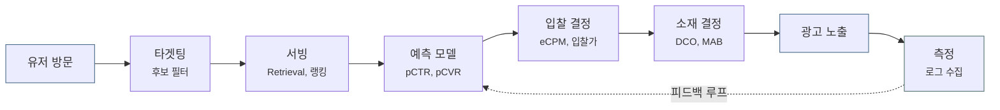
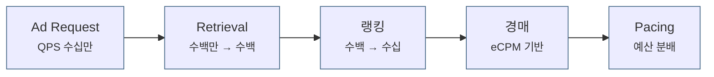
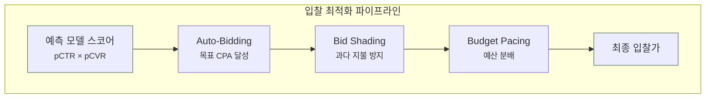
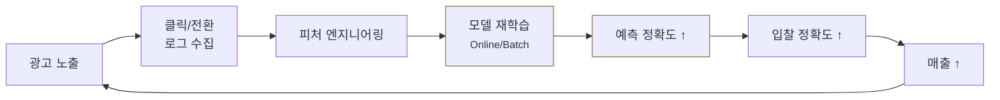

웹페이지를 연 유저의 화면에 광고 하나가 뜨기까지는 **수십 밀리초**(ms, 1000분의 1초)밖에 걸리지 않습니다. 그 짧은 사이에 광고 시스템은 **8개의 전문 레이어**를 통과하면서 「누구에게」, 「무엇을」, 「얼마에」 보여 줄지 정합니다. 레이어는 광고 시스템의 일을 그 일이 답하는 질문에 따라 나눈 층입니다.

이 글은 Ad Tech(광고 기술) 개발에서 다루는 레이어 전체를 지도 한 장에 펼쳐 놓고 레이어마다 어떤 문제를 푸는지와 레이어끼리 어떻게 이어지는지를 정리합니다.

회사와 회사가 무엇을 주고받는지는 [광고 생태계 전체 지도](post.html?id=adtech-ecosystem-map)에서 다룹니다. 그 글의 질문이 「누가 누구와 무엇을 주고받나」라면 이 글의 질문은 **「엔지니어가 무엇을 만드나」**입니다.

---


> 위 그림은 광고 요청 하나가 유저에게 닿기까지 거치는 파이프라인(차례로 이어진 처리 단계) 전체입니다. 아래 절에서 레이어를 하나씩 떼어 자세히 봅니다.

---

아래 표는 8개 레이어가 각각 답하는 질문과 그 레이어에서 주로 쓰는 기술입니다. 기술 이름은 본문에서 처음 나올 때 풉니다.

| 레이어 | 핵심 질문 | 주요 기술 |
|--------|----------|----------|
| **타겟팅, 오디언스** | 누구에게 보여줄까? | 세그먼트, Lookalike, 리타겟팅 |
| **광고 서빙** | 어떤 광고를 후보로? | Retrieval, 랭킹, 경매 |
| **예측 모델링** | 클릭/전환 확률은? | pCTR, pCVR, Calibration |
| **입찰 최적화** | 얼마에 입찰할까? | Auto-Bidding, Bid Shading |
| **소재 최적화** | 어떤 소재를 보여줄까? | DCO, MAB, 품질 심사 |
| **측정, 어트리뷰션** | 효과가 있었는가? | 어트리뷰션, 증분성, Fraud |
| **인프라, 플랫폼** | 이 모든 걸 어떻게 돌릴까? | 모델 서빙, 로그, 실험 플랫폼 |
| **프라이버시, 규제** | 합법적으로 할 수 있는가? | 쿠키리스, CMP, 차등 프라이버시 |

---

## 1. 광고 요청 하나의 전체 흐름

**광고 요청 하나는 타겟팅(볼 사람 고르기), 서빙(후보 광고 찾기), 예측 모델, 입찰 결정, 소재 결정을 차례로 지나 화면에 노출됩니다. 노출 뒤에는 측정이 모은 로그가 다시 예측 모델의 학습 데이터로 돌아갑니다.**

광고 요청(ad request)은 유저가 광고 자리가 있는 페이지를 열 때 그 페이지가 자리에 채울 광고를 달라고 광고 시스템에 보내는 요청입니다. 뒤의 절은 레이어를 하나씩 따로 보지만 실제 요청은 아래 그림의 단계를 왼쪽부터 차례로 지나가므로 앞 단계가 낸 결과가 다음 단계의 입력이 됩니다. 그래서 레이어 하나하나를 보기 전에 요청 하나가 지나는 순서부터 봅니다.

아래 그림의 실선 화살표는 「유저 방문」부터 「측정」까지 일이 진행되는 순서입니다. 점선 화살표는 측정이 모은 로그가 예측 모델로 돌아가는 피드백 루프(결과가 다시 앞 단계의 입력으로 돌아오는 순환)를 나타냅니다.



단계마다 내리는 결정은 이렇습니다.

1. **타겟팅**: 수천만 유저 가운데 이 광고를 볼 자격이 있는 후보를 걸러 냅니다.
2. **서빙**: 광고 후보 수백만 개에서 이 요청에 맞을 만한 수백 개를 먼저 찾아내고(검색, Retrieval) 그 수백 개를 점수 순서로 정렬합니다(랭킹).
3. **예측 모델**: 후보 광고마다 유저가 클릭할 확률(pCTR, predicted Click-Through Rate)과 클릭한 뒤 구매나 가입 같은 전환으로 이어질 확률(pCVR, predicted Conversion Rate)을 예측해 점수를 매깁니다.
4. **입찰 결정**: 예측값으로 eCPM(노출 1000번당 수익 기대값, 식은 4절)을 계산하고 경매에 낼 가장 좋은 입찰가를 정합니다.
5. **소재 결정**: 경매에서 이긴(낙찰된) 광고를 어떤 소재 조합으로 보여 줄지 정합니다. 소재(creative)는 광고에서 눈에 보이는 제목, 이미지, CTA(Call To Action, 누르라고 권하는 버튼 문구) 같은 요소입니다. 조합은 요소마다 하나씩 골라 짝지은 결과(제목 × 이미지 × CTA)입니다.
6. **측정**: 노출(광고가 화면에 한 번 보인 일), 클릭, 전환의 로그(시스템이 남기는 기록)를 모아 모델의 학습 데이터로 돌려보냅니다.

> 이 과정 전체가 **10~100ms** 안에 일어납니다.

---

## 2. 타겟팅, 오디언스 — 광고를 보여 줄 대상 [무대: 공통]

**타겟팅은 유저 전체에서 광고주의 목표에 맞는 유저를 후보로 걸러 내는 첫 관문입니다. 8개 레이어 가운데 두 무대(한 회사가 모두 갖춘 담장 안과 여러 회사가 거래하는 열린 RTB)의 차이가 가장 큰 레이어가 타겟팅입니다. 두 무대는 타겟팅의 재료인 유저 정보가 얼마나 확실한지부터 다릅니다.**

타겟팅 레이어는 「이 광고를 누구에게 보여 줄 것인가」를 정합니다. 첫 번째 관문이라 여기서 걸러진 유저는 뒤의 레이어로 넘어가지 않습니다. 이렇게 고른 유저 집단을 오디언스라고 부릅니다.

이 블로그는 광고를 사고파는 환경을 두 무대로 나눠 봅니다. 담장 안은 네이버, 카카오처럼 한 회사가 광고를 내보내는 지면과 광고를 고르는 시스템을 함께 가진 곳입니다. 열린 RTB(Real-Time Bidding, 실시간 입찰)는 여러 회사가 노출 한 번을 실시간 경매로 사고파는 시장입니다. 두 무대는 **재료의 확실성**, 바꿔 말해 지금 광고를 볼 사람이 누구인지 얼마나 확실하게 아느냐가 다릅니다.

담장 안에는 로그인 ID 가 있어 「이 사람이 이 사람」이라고 확정할 수 있습니다. 유저가 폰에서 PC 로 기기를 바꿔도 같은 사람으로 이어집니다. 세그먼트(관심사, 행동, 인구통계로 나눈 유저 그룹)도 실시간으로 갱신해 곧바로 랭킹에 반영합니다.

열린 RTB 는 쿠키(브라우저가 사이트마다 남겨 두는 작은 식별 값)나 기기 ID 처럼 같은 사람일 가능성만 알려 주는 확률적 신호에 기대야 합니다. 다른 기기를 쓰는 같은 사람을 하나로 이어 붙이는 크로스디바이스 매칭은 정확도가 60~70% 에 그쳐 10번 가운데 6~7번만 맞습니다. 세그먼트도 데이터 업체에서 사 와야 할 때가 많습니다.

9절에서 계산해 보겠지만 잘못된 유저에게 나간 노출의 클릭, 전환 로그가 다시 모델의 학습 데이터가 되므로 타겟팅 오차는 **다음 학습으로 되돌아옵니다.** 그래서 재료가 부실한 무대에서는 그 부실함이 한 번에 끝나지 않고 시간이 갈수록 쌓입니다.

### 주요 컴포넌트

아래 표는 타겟팅 레이어를 이루는 컴포넌트(시스템을 이루는 기능 단위) 5개입니다.

| 컴포넌트 | 설명 |
|---------|------|
| **오디언스 세그먼트** | 유저를 관심사/행동/인구통계 기반으로 그룹화. 예: "30대 남성 + 최근 운동화 검색" |
| **Lookalike 확장** | 전환 유저(시드)와 유사한 신규 유저를 임베딩 유사도로 발굴. Facebook Lookalike이 대표적 |
| **리타겟팅** | 사이트 방문/장바구니 이탈 유저를 추적하여 재노출. 가장 높은 전환율을 보이는 전략 |
| **컨텍스트 타겟팅** | 유저가 아닌 콘텐츠(기사/영상)의 맥락을 분석하여 매칭. 쿠키리스 시대에 부상 |
| **Position Bias 보정** | 광고 위치에 따른 클릭률 편향을 제거하여 공정한 랭킹 보장 |

Lookalike 확장은 이미 전환한 유저를 시드(seed, 출발점으로 삼는 유저)로 두고 임베딩(유저를 숫자 벡터로 바꾼 값)이 시드와 가까운 새 유저를 찾습니다. 리타겟팅은 사이트에 왔거나 장바구니에 담고 떠난 유저에게 광고를 다시 보여 주는 전략입니다. 컨텍스트 타겟팅은 유저 대신 기사나 영상 같은 콘텐츠의 맥락을 보고 광고를 맞추는 방법이라 쿠키가 없어도 쓸 수 있고 8절의 쿠키리스 대응 표에도 들어 있습니다. Position Bias 보정은 광고가 놓인 위치 때문에 생기는 클릭률 편향을 없애 랭킹을 공정하게 만듭니다.

**관련 글:**
- [타겟팅 기초](post.html?id=targeting-basics) — 기초 4편 가운데 첫 글로, 광고주가 정한 조건과 유저 정보가 만나는 자리를 다룹니다
- [오디언스 세그멘테이션](post.html?id=audience-segmentation) — 인구통계(Demographic), 행동(Behavioral), RFM(최근성, 빈도, 금액), ML Clustering 으로 세그먼트를 나누는 설계
- [Lookalike Modeling](post.html?id=lookalike-modeling) — 시드(Seed)와 닮은 유저를 임베딩(Embedding), 성향 점수(Propensity), 그래프(Graph)로 찾는 방법
- [Position Bias](post.html?id=position-bias-ultr) — 광고 위치 때문에 생기는 클릭률 편향을 보정하는 방법
- [Two-Tower Retrieval](post.html?id=two-tower-retrieval) — 유저와 광고를 짝짓는 데 바탕이 되는 기술

---

## 3. 광고 서빙 — 요청을 처리하는 파이프라인

**서빙 레이어는 요청이 들어올 때마다 광고 수백만 개 가운데 보여 줄 후보를 찾아 경매까지 넘깁니다. 수백만 개를 실시간으로 모두 점수 매길 수는 없어서 Multi-Stage Ranking(후보를 단계마다 줄이며 고르는 구조)으로 가벼운 모델에서 무거운 모델 순서로 후보를 줄여 나갑니다.**

서빙 레이어는 「어떤 광고를 보여 줄지」를 정하는 파이프라인인데, 이 일을 요청이 들어올 때마다 실시간으로 끝내야 합니다.

아래 그림은 요청 하나가 서빙 레이어 안에서 거치는 단계를 보여 줍니다. 맨 왼쪽의 QPS(Queries Per Second, 초당 요청 수) 수십만은 이런 요청이 1초에 수십만 번 들어온다는 뜻입니다.



Retrieval(후보 검색)은 수백만 개 가운데 이 요청에 맞을 만한 수백 개를 빠르게 찾아내는 단계입니다. 랭킹은 그 수백 개를 점수로 정렬해 수십 개로 줄입니다. 경매는 eCPM 을 기준으로 낙찰 광고를 정합니다. Pacing 은 광고주의 예산이 하루에 걸쳐 나뉘어 쓰이도록 조절하는 단계로 5절의 Budget Pacing 과 같은 일입니다.

### Multi-Stage Ranking

실시간 서빙에서 수백만 개를 모두 점수 매기는(스코어링) 대신 쓰는 Multi-Stage Ranking 을 단계별로 펼치면 아래 표와 같습니다. 표는 단계마다 줄어드는 후보 수와 그 단계가 쓰는 모델의 복잡도, 지연 시간(latency, 요청을 받아 결과를 내기까지 걸리는 시간)입니다.

| 단계 | 후보 수 | 모델 복잡도 | 지연 시간 |
|------|---------|-----------|----------|
| Retrieval | 수백만 → 수백 | 가벼운 (Two-Tower, ANN) | ~5ms |
| Pre-Ranking | 수백 → 수십 | 중간 (경량 DNN) | ~3ms |
| Ranking | 수십 → Top K | 무거운 (DeepFM, DIN) | ~10ms |
| 경매 | Top K → 낙찰 | eCPM 계산 | ~1ms |

표를 위에서 아래로 따라가면 광고 수백만 개가 Retrieval 에서 수백 개로, Pre-Ranking(본 랭킹 앞에서 후보를 덜어 내는 가벼운 랭킹)에서 수십 개로 줄고 Ranking 이 그 수십 개 가운데 Top K(점수가 높은 상위 K개)를 고른 뒤 경매가 Top K 에서 낙찰 하나를 정합니다. 모델 복잡도가 가벼운, 중간, 무거운 순서로 올라갈수록 받는 후보는 수백만, 수백, 수십으로 줄어서 무거운 모델일수록 적은 후보만 맡습니다. Retrieval 에서는 Two-Tower(유저와 광고를 각각 벡터로 바꾸는 신경망 2개)와 ANN(Approximate Nearest Neighbor, 가까운 벡터를 근사로 빠르게 찾는 검색)으로 ~5ms, Pre-Ranking 에서는 경량 DNN(작게 만든 심층 신경망)으로 ~3ms 가 걸립니다. 가장 무거운 DeepFM 과 DIN(4절에 나오는 클릭 확률 예측 모델)은 후보가 수십 개로 줄어든 Ranking 에서만 돌아가는데도 ~10ms 로 네 단계 가운데 가장 오래 걸립니다.

**관련 글:**
- [Ad Serving Flow: 후보 12만 건이 800건으로 좁혀지는 순서](post.html?id=ad-serving-flow)
- [광고 모델 서빙 아키텍처: 10ms 안에 수백 개 광고를 스코어링하는 법](post.html?id=model-serving-architecture)

---

## 4. 예측 모델링 — 성과를 예측하는 ML

**예측 모델링은 「이 유저가 이 광고를 클릭할 확률은 얼마인가?」를 예측해 eCPM 계산과 입찰의 근거를 만드는 레이어입니다. 전환당 과금 캠페인에서는 eCPM 을 두 확률(pCTR, pCVR)의 곱에 입찰가를 곱해 계산하므로(아래 식) 두 확률의 정확도가 그대로 매출로 이어집니다.**

3절의 경매가 쓰는 eCPM 과 5절의 입찰가가 모두 이 레이어가 낸 확률에서 출발하므로, 광고 시스템의 **두뇌**라고 부르는 예측 모델링이 틀리면 그 뒤의 계산이 함께 틀립니다.

### 주요 컴포넌트

아래 표는 이 레이어의 컴포넌트 5개입니다.

| 컴포넌트 | 역할 |
|---------|------|
| **pCTR 예측** | 클릭 확률 예측. LR → FM → DeepFM → DIN으로 진화. 광고 수익의 직접적 근거 |
| **pCVR 예측** | 전환(구매/가입) 확률 예측. 지연 피드백(Delayed Feedback) 처리가 핵심 난제 |
| **Calibration** | 모델의 예측 확률을 실제 확률에 맞게 보정. AUC가 높아도 보정 없으면 돈을 잃음 |
| **Multi-Task Learning** | pCTR + pCVR을 동시 학습하여 Sample Selection Bias 해결 (ESMM, MMoE, PLE) |
| **Feature Store** | Batch/Streaming/Real-Time 피처를 통합 관리하여 10ms 안에 모델에 공급 |

pCTR 모델은 LR(로지스틱 회귀)에서 FM(Factorization Machine), DeepFM, DIN 순서로 발전해 왔습니다. 클릭 확률이 아래 eCPM 식에 그대로 곱해지므로 pCTR 은 광고 수익의 직접적인 근거가 됩니다. pCVR 예측에서는 지연 피드백(Delayed Feedback)이 가장 어려운 문제로 꼽힙니다. 전환은 클릭보다 늦게 들어오므로 모델을 학습하는 시점에는 아직 전환이 도착하지 않은 클릭이 전환하지 않을 클릭과 똑같아 보입니다.

Calibration(보정)은 모델이 낸 확률을 실제로 일어나는 비율에 맞추는 일입니다. AUC 는 클릭한 노출에 클릭하지 않은 노출보다 높은 점수를 주는지, 다시 말해 순서를 맞히는지를 보는 지표이고 1 에 가까울수록 좋습니다. 그래서 AUC 가 높아도 확률 값 자체가 실제와 맞는지는 따로 확인해야 하는데, 아래 eCPM 식은 그 확률 값을 그대로 곱합니다.

Multi-Task Learning(MTL)은 여러 과제를 한 모델에서 같이 학습하는 방법으로 여기서는 pCTR 과 pCVR 을 함께 배웁니다. Sample Selection Bias(표본 선택 편향)는 pCVR 모델이 클릭한 노출로만 학습하는데 서빙할 때는 노출 전체의 전환 확률을 예측해야 해서 생기는 차이입니다. 표의 ESMM, MMoE, PLE 는 MTL 구조의 이름입니다.

Feature Store 는 모델의 입력값인 피처를 모아 두었다가 요청이 오면 꺼내 줍니다. 정해진 주기로 모아 계산하는 Batch 피처와 이벤트가 들어오는 대로 계산하는 Streaming 피처, 요청이 온 순간에 계산하는 Real-Time 피처를 한곳에서 관리해 10ms 안에 모델에 넘깁니다.

광고에서 eCPM(노출 1000번당 수익 기대값)은 전환 한 번마다 돈을 내는 전환당 과금(CPA, Cost Per Action) 캠페인이라면 아래 식으로 계산합니다.

$$\text{eCPM} = \text{pCTR} \times \text{pCVR} \times \text{Bid} \times 1000$$

식을 왼쪽부터 읽으면 pCTR 은 노출이 클릭으로, pCVR 은 클릭이 전환으로 이어질 확률이라 두 확률을 곱하면 노출 한 번이 전환까지 갈 확률이 됩니다. 여기에 광고주가 전환 한 번에 내는 Bid 를 곱하면 노출 한 번의 수익 기대값이 되고 1000 을 곱하면 노출 1000번의 수익 기대값이 됩니다. 항이 모두 곱해지므로 pCTR 이나 pCVR 이 10% 높게 나오면 eCPM 도 10% 높게 나옵니다(9절 2단계와 같은 계산). 그래서 이 식에서는 pCTR 과 pCVR 의 **정확도가 그대로 매출로 이어집니다**.

**관련 글:**
- [Deep CTR 모델의 진화: LR에서 DIN까지](post.html?id=deep-ctr-models)
- [Calibration: AUC가 높아도 돈을 잃는 이유](post.html?id=calibration)
- [Multi-Task Learning: pCTR과 pCVR을 같이 배우면 왜 더 좋은가](post.html?id=multi-task-learning)
- [Feature Store](post.html?id=feature-store-serving)

---

## 5. 입찰 최적화 — 입찰가 결정

**입찰 최적화는 4절의 예측 점수를 받아 「그래서 얼마를 써야 하는지」를 정하는 레이어입니다. 예측 점수가 이 레이어의 출발점이라 예측이 틀리면 최종 입찰가도 같이 틀리므로 9절의 우선순위에서 입찰은 예측 다음입니다.**

예측 모델이 「이 광고가 얼마나 좋은지」를 알려 준다면 입찰 최적화는 그 값으로 경매에 얼마를 부를지 정합니다. 광고주가 정하는 목표는 전환 한 번에 쓸 비용인 CPA 나 쓴 광고비 대비 매출인 ROAS(Return On Ad Spend)입니다. 이 레이어는 그 목표를 지키면서 예산을 가장 잘 나눠 씁니다.

### 주요 컴포넌트

아래 표는 이 레이어의 컴포넌트 4개입니다.

| 컴포넌트 | 설명 |
|---------|------|
| **Auto-Bidding** | 광고주가 목표 CPA/ROAS만 설정하면 시스템이 자동으로 입찰가 결정. PID Controller → Lagrangian Dual → RL로 진화 |
| **Bid Shading** | 1st Price 경매에서 과다 지불을 방지. True Value보다 낮게 입찰하여 Surplus 극대화 |
| **Bid Landscape** | 입찰가별 낙찰률/비용 곡선을 모델링. Censored Data에서 시장 가격 분포 추정이 핵심 |
| **Budget Pacing** | 일 예산을 하루 전체에 걸쳐 균등 분배. 아침에 예산을 다 써버리는 문제 방지 |

Auto-Bidding 은 광고주가 목표 CPA 나 ROAS 만 정하면 시스템이 입찰가를 알아서 정하는 방식입니다. 입찰가를 정하는 방법은 PID Controller(목표와 지금 성과의 차이를 보고 입찰가를 조금씩 고치는 제어기)에서 Lagrangian Dual(예산 같은 제약이 있는 최적화 문제를 푸는 수학 방법), RL(Reinforcement Learning, 강화학습) 순서로 발전했습니다.

Bid Shading 은 1st Price 경매(낙찰자가 자기가 부른 값을 그대로 내는 경매)에서 씁니다. 이 경매에서 노출의 진짜 가치(True Value)를 그대로 부르면 이겨도 가치만큼 다 내서 남는 것이 없으므로, 가치보다 낮게 불러 가치와 낸 값의 차이인 Surplus 를 최대로 만듭니다.

Bid Landscape 는 입찰가마다 낙찰률(경매에서 이기는 비율)과 비용이 어떻게 달라지는지 그린 곡선입니다. 경매에서 이기면 실제 낙찰가를 알지만 지면 시장 가격이 내 입찰가보다 높았다는 사실만 아는 데이터를 Censored Data(중도절단 데이터)라고 부르는데, 이 데이터로 시장 가격의 분포를 추정하는 일이 Bid Landscape 의 중심입니다.

Budget Pacing 은 일 예산을 하루 전체에 고르게 나눠 써서 아침에 예산을 다 써 버리는 문제를 막습니다.

아래 그림은 예측 점수가 최종 입찰가가 되기까지 거치는 순서입니다.



그림의 출발점은 4절 예측 모델의 점수(pCTR × pCVR)라서 이 점수가 틀리면 Auto-Bidding, Bid Shading, Budget Pacing 을 차례로 거친 최종 입찰가도 같이 틀립니다. 7절의 피드백 루프 그림에서도 「예측 정확도 ↑」가 「입찰 정확도 ↑」보다 앞에 옵니다.

**관련 글:**
- [Auto-Bidding 과 예산 페이싱: 하루 예산을 언제 얼마씩 쓰나](post.html?id=auto-bidding-pacing)
- [Bid Shading: 1st Price 경매에서 얼마를 깎아 부를까](post.html?id=bid-shading-censored)

---

## 6. 소재 최적화 — 보여 줄 소재 결정

**소재 최적화 레이어는 유저마다 가장 좋은 소재(광고에서 눈에 보이는 제목, 이미지, 문구) 조합을 고릅니다. 가상 데이터로 세어 보면 작게 잡은 조합 180개를 A/B 테스트(노출을 똑같이 나눠 비교하는 실험)로 다 검증하는 데 29일이 걸립니다. 성과를 보며 노출을 옮기는 밴딧은 진짜 1등을 못 찾고도 같은 노출에서 클릭을 40.1% 더 얻었습니다.**

CTR(Click-Through Rate, 클릭률)은 노출 가운데 클릭으로 이어진 비율입니다. 같은 상품을 광고해도 **어떤 소재로 보여 주느냐**에 따라 이 CTR 이 2~5배 차이가 납니다.

### 주요 컴포넌트

아래 표는 이 레이어의 컴포넌트 4개입니다.

| 컴포넌트 | 설명 |
|---------|------|
| **DCO (Dynamic Creative Optimization)** | 제목 × 이미지 × CTA × 배경색 등 요소를 조합하여 유저별 맞춤 소재 자동 생성 |
| **A/B, MAB** | 소재 변형 간 성과 비교. MAB(밴딧)를 쓰면 탐색과 활용을 동시에 수행하여 A/B 대비 기회 비용 절감 |
| **소재 피처 추출** | 이미지 임베딩(ResNet 등), 텍스트 임베딩으로 소재의 특성을 수치화하여 성과 예측에 활용 |
| **품질 심사** | 정책 위반 소재(성인물, 허위 광고 등)를 ML 기반으로 자동 필터링 |

DCO 가 만드는 조합의 수는 요소마다 고를 수 있는 개수를 곱한 값이라 요소가 조금만 늘어도 빠르게 커집니다(아래 코드의 1단계와 2단계). A/B 테스트는 소재 변형(variant)마다 노출을 똑같이 나눠 성과를 비교하는 실험입니다. MAB(Multi-Armed Bandit, 밴딧)는 성과를 보면서 노출을 좋은 변형 쪽으로 옮기는 방법으로, 아직 덜 본 변형에 노출을 줘 보는 탐색(exploration)과 지금까지 가장 좋은 변형에 노출을 주는 활용(exploitation)을 한 실험 안에서 동시에 합니다. 그래서 나쁜 변형에도 끝까지 같은 몫을 주는 A/B 보다 기회 비용(더 좋은 변형에 줬다면 얻었을 성과)이 작습니다. 표의 이미지 임베딩은 이미지를 숫자 벡터로 바꾼 값입니다. ResNet 은 그런 임베딩을 만드는 이미지 모델입니다.

### 소재 조합 수와 A/B 검증 기간

「조합을 다 만들어서 A/B로 측정해 보면 되지 않나?」라는 생각이 자연스럽게 듭니다. 아래 코드는 그 방법이 왜 통하지 않는지를 숫자로 보려고 돌립니다. 숫자는 모두 설명을 위해 만든 가상 데이터입니다. 1단계는 조합 수를, 2단계는 전 조합을 A/B 로 검증하는 데 드는 날수를, 4단계는 같은 노출에서 A/B 와 밴딧이 얻는 클릭 수를 찍습니다.

```python
# 하는 일: DCO 가 제목, 이미지, CTA, 배경색으로 만드는 소재 조합 수를 세고, 그 조합을 A/B 로 다 검증하는 데 드는 날수를 구한 뒤, 같은 노출에서 A/B 와 밴딧의 클릭 수를 비교한다.

# 1단계: 소재 요소의 조합 수를 센다
# DCO 는 제목, 이미지, CTA, 배경색을 조합해 소재를 자동으로 만든다. 소재 조합을 사람이 다 못 고르는 까닭을 개수부터 센다.
import random
random.seed(42)

SLOTS = {"제목": 5, "이미지": 4, "CTA 문구": 3, "배경색": 3}

combos = 1
parts = []
for name, n in SLOTS.items():
    combos *= n
    parts.append(f"{name} {n}")
print("소재 요소:", " × ".join(parts))
print(f"만들 수 있는 조합  {combos}개")
print()

# 2단계: A/B 로 전 조합을 검증하는 데 드는 날을 센다
# 「다 만들어서 A/B 를 돌리면 되지 않나?」가 왜 안 통하는지 본다. 기준 CTR 2% 에서 상대 10% 차이를 잡으려면 변형마다 약 8만 노출이 든다(RCT 글의 표본 크기 계산과 같은 뼈대다).
PER_VARIANT = 80_680
DAILY_IMPRESSIONS = 500_000

print(f"A/B로 전 조합 검증하려면 (변형당 {PER_VARIANT:,}회 필요, 하루 {DAILY_IMPRESSIONS:,}회 노출)")
for label, slots in [("작게 잡아도", SLOTS), ("실무 규모라면", {"제목": 8, "이미지": 6, "CTA 문구": 4, "배경색": 3})]:
    n = 1
    for v in slots.values():
        n *= v
    need = n * PER_VARIANT
    d = need / DAILY_IMPRESSIONS
    print(f"  {label:<10} 조합 {n:>4}개 → {need:>12,}회 → {d:>5.0f}일")
print("  → 캠페인이 보통 2~4주인데, 작게 잡아도 그 기간을 다 써야 첫 결론이 나온다.")
print("  → 요소를 조금만 늘리면 석 달이 넘는다. 그동안 얻는 정보는 0이다.")
print()

# 3단계: 조합마다 진짜 CTR 을 정하고 A/B 와 밴딧 함수를 만든다
# 나쁜 조합을 일찍 접고 좋은 조합에 노출을 몰아준다.
# 전 조합을 '검증'하지 않고, 좋은 걸 '찾아' 쓴다.
true_ctr = {}
for i in range(combos):
    # 조합마다 진짜 CTR을 만든다. 대부분 평범하고 몇 개만 좋다(현실의 모양).
    true_ctr[i] = max(0.002, random.gauss(0.020, 0.006))
best_i = max(true_ctr, key=true_ctr.get)

def run_ab(impressions):
    """모든 조합에 노출을 똑같이 나눈다."""
    per = impressions // combos
    return sum(true_ctr[i] * per for i in range(combos))

def run_bandit(impressions, explore_share=0.15):
    """앞부분만 탐색에 쓰고, 그 뒤엔 그때까지 1등에 몰아준다."""
    explore = int(impressions * explore_share)
    per = explore // combos
    clicks = sum(true_ctr[i] * per for i in range(combos))
    # 탐색 구간의 관측으로 1등을 고른다(노출이 적으면 잘못 고를 수도 있다)
    observed = {i: random.binomialvariate(per, true_ctr[i]) if hasattr(random, 'binomialvariate')
                   else sum(1 for _ in range(per) if random.random() < true_ctr[i])
                for i in range(combos)}
    picked = max(observed, key=observed.get)
    clicks += true_ctr[picked] * (impressions - explore)
    return clicks, picked

# 4단계: 노출 3,000,000회로 두 방식의 클릭을 비교한다
# A/B 는 노출을 모든 조합에 똑같이 나누고, 밴딧은 15% 만 탐색에 쓴다.
TOTAL = 3_000_000
ab = run_ab(TOTAL)
bandit, picked = run_bandit(TOTAL)
print(f"노출 {TOTAL:,}회를 쓸 때 클릭 수")
print(f"  A/B (전 조합 균등)   {ab:>10,.0f}회")
print(f"  밴딧 (탐색 15%)      {bandit:>10,.0f}회   {(bandit/ab-1)*100:+.1f}%")
print(f"  진짜 1등 조합 #{best_i} (CTR {true_ctr[best_i]:.2%})"
      f" / 밴딧이 고른 조합 #{picked} (CTR {true_ctr[picked]:.2%})")
print()
print("→ 조합이 180개면 A/B로는 다 못 측정해 본다. 시간이 안 된다.")
print("→ 밴딧은 '전부 검증'을 포기하고 '좋은 걸 빨리 쓰기'를 택한다.")
print("→ 소재 레이어에서 밴딧이 잘 통하는 이유는, 실패가 다음 학습을 오염시키지 않기 때문이다.")

# 출력:
# 1단계 뜻: 요소 넷을 곱하면 만들 수 있는 조합이 180개다.
# 소재 요소: 제목 5 × 이미지 4 × CTA 문구 3 × 배경색 3
# 만들 수 있는 조합  180개
#
# 2단계 뜻: 변형마다 80,680회씩이면 작게 잡아도 29일, 실무 규모 576개면 93일이 걸린다.
# A/B로 전 조합 검증하려면 (변형당 80,680회 필요, 하루 500,000회 노출)
#   작게 잡아도     조합  180개 →   14,522,400회 →    29일
#   실무 규모라면    조합  576개 →   46,471,680회 →    93일
#   → 캠페인이 보통 2~4주인데, 작게 잡아도 그 기간을 다 써야 첫 결론이 나온다.
#   → 요소를 조금만 늘리면 석 달이 넘는다. 그동안 얻는 정보는 0이다.
#
# 4단계 뜻: 같은 노출 3,000,000회로 밴딧이 클릭을 40.1% 더 얻는다. 진짜 1등 #53 은 못 골랐지만 CTR 3.05% 인 #132 를 골라 쓴다.
# 노출 3,000,000회를 쓸 때 클릭 수
#   A/B (전 조합 균등)       62,111회
#   밴딧 (탐색 15%)          87,027회   +40.1%
#   진짜 1등 조합 #53 (CTR 3.40%) / 밴딧이 고른 조합 #132 (CTR 3.05%)
#
# → 조합이 180개면 A/B로는 다 못 측정해 본다. 시간이 안 된다.
# → 밴딧은 '전부 검증'을 포기하고 '좋은 걸 빨리 쓰기'를 택한다.
# → 소재 레이어에서 밴딧이 잘 통하는 이유는, 실패가 다음 학습을 오염시키지 않기 때문이다.
```

찍힌 값에서 두 가지를 읽을 수 있습니다.

첫째, **A/B 로는 시간이 모자랍니다.** 1단계는 제목 5개, 이미지 4개, CTA 문구 3개, 배경색 3개를 곱해 5 × 4 × 3 × 3 = 180개 조합을 찍습니다. 2단계의 변형당 80,680회(약 8만 회)는 표본 크기 계산(차이를 통계적으로 구별하는 데 드는 표본 수를 구하는 식)으로 얻은 값으로, 기준 CTR 2% 에서 2% 의 10% 만큼 벌어진 차이(상대 10% 차이)를 잡아내는 데 드는 노출 수입니다. 그래서 작게 잡은 180개 조합을 모두 검증하려면 180 × 80,680 = 14,522,400회가 필요하고 하루 노출이 500,000회이므로 29일이 걸립니다. 캠페인은 보통 2~4주인데 작게 잡아도 그 기간을 다 써야 첫 결론이 나옵니다. 요소를 조금만 늘린 실무 규모(제목 8 × 이미지 6 × CTA 문구 4 × 배경색 3 = 576개)에서는 46,471,680회가 필요해 93일, 석 달이 넘게 걸립니다. **검증이 끝나기 전까지 얻는 정보는 0입니다.**

둘째, **밴딧이 이깁니다.** 3단계는 조합마다 진짜 CTR 을 평균 2.0%(0.020) 근처에서 뽑아 대부분은 평범하고 몇 개만 좋게 만듭니다. 4단계는 같은 노출 300만 회(3,000,000회)를 두 방식에 똑같이 줍니다. A/B 는 노출을 180개 조합에 끝까지 똑같이 나누므로 평범한 조합에도 같은 몫이 가서 클릭이 62,111회(약 6.2만)에 그칩니다. 밴딧은 앞쪽 15% 의 노출만 180개 조합에 고르게 나눠 탐색하고 나머지 노출은 탐색 구간에서 클릭이 가장 많이 관측된 조합에 모두 몰아서 클릭 87,027회(약 8.7만)를 얻으니 A/B 보다 40.1% 많습니다.

그런데 밴딧은 **진짜 1등을 찾지 못했습니다.** 진짜 1등은 CTR 3.40% 인 53번 조합(#53)입니다. 밴딧은 탐색 구간에서 관측한 클릭만 보고 1등을 고르는데 3단계 주석대로 조합마다 받은 노출이 적으면 잘못 고를 수 있어서 이번에는 CTR 3.05% 인 132번 조합(#132)을 골랐습니다.

진짜 1등을 놓치고도 밴딧은 A/B 를 크게 앞섰습니다. #132 의 CTR 3.05% 는 진짜 1등의 3.40% 보다 낮지만 평균 2.0% 근처에 몰린 평범한 조합들보다는 높습니다. 밴딧이 노출 대부분을 그 조합에 쓰는 동안 A/B 는 평범한 조합에도 끝까지 노출을 나눴으므로, **이득의 대부분은 「최고를 찾는 것」보다 「나쁜 걸 빨리 접는 것」에서 나옵니다.**

이 결과에서 소재 레이어의 성격이 보입니다. 나쁜 소재를 보여 준 손해는 그 노출에서 끝나고 다음 모델 학습을 오염시키지 않으므로 소재는 **틀려도 되돌아오지 않습니다.** 그래서 이 레이어에서는 마음껏 실험할 수 있고 밴딧이 특히 잘 통합니다.

**관련 글:**
- [탐색과 활용(Exploration & Exploitation): 새 소재에 노출 몇 번을 걸까](post.html?id=exploration-exploitation) — 밴딧(MAB)으로 소재를 고르는 방법의 이론적 배경

---

## 7. 측정, 어트리뷰션 — 광고 효과 여부

**측정 레이어는 광고를 노출한 뒤 실제로 효과가 있었는지 확인합니다. 여기서 모인 데이터는 보고서로 끝나지 않고 예측 모델을 다시 학습시키는 피드백 루프의 출발점이 됩니다.**

노출로 기록됐다고 해서 그 광고가 **실제로 효과가 있었다고** 볼 수는 없으므로, 측정 레이어는 광고가 화면에 정말 보였는지와 광고 덕분에 생긴 전환인지, 무효 트래픽은 아닌지를 따로 확인합니다.

### 주요 컴포넌트

아래 표는 이 레이어의 컴포넌트 4개입니다.

| 컴포넌트 | 설명 |
|---------|------|
| **어트리뷰션** | 전환에 기여한 터치포인트를 식별. Last Click → Multi-Touch → Data-Driven 모델로 진화 |
| **증분성 테스트 (Incrementality)** | "광고가 없었어도 전환했을까?"에 대한 인과 추론. 가장 정직한 광고 효과 측정 |
| **Viewability** | 광고가 실제로 유저의 화면에 보였는지 측정. "노출"과 "실제 시청"은 다름 |
| **Fraud Detection** | 봇 트래픽, 클릭 팜 등 무효 트래픽 탐지. 광고비 낭비 방지 |

어트리뷰션은 전환 하나를 두고 유저가 그 전에 광고를 만난 지점(터치포인트) 가운데 어디에 공을 돌릴지 정하는 일입니다. 방식은 마지막 클릭에 공을 모두 주는 Last Click 에서 여러 터치포인트에 나눠 주는 Multi-Touch, 나누는 비율을 데이터로 정하는 Data-Driven 으로 발전했습니다. 증분성 테스트는 「광고가 없었어도 전환했을까?」를 인과 추론(원인과 결과의 관계를 추정하는 방법)으로 따지는 실험입니다. 광고가 없어도 일어났을 전환은 빼고 광고 덕분에 늘어난 전환만 셉니다. 표는 이 테스트를 가장 정직한 광고 효과 측정으로 꼽습니다.

Viewability 는 노출로 기록된 광고가 실제로 유저 화면에 보였는지를 측정합니다. 「노출」로 기록된 것과 유저가 「실제로 본 것」은 다릅니다. Fraud Detection 은 봇(사람 대신 자동으로 움직이는 프로그램)이나 클릭 팜(사람을 모아 일부러 클릭하게 하는 곳) 같은 무효 트래픽을 찾아내 광고비가 낭비되지 않게 막습니다.

### 피드백 루프

측정 데이터는 보고서 한 장으로 끝나지 않고 **예측 모델의 학습 데이터**로 되돌아갑니다. 결과가 다시 학습으로 돌아오는 이 피드백 루프가 광고 시스템을 움직이는 주된 동력입니다.

아래 그림은 광고 노출에서 출발해 다시 광고 노출로 돌아오는 루프 한 바퀴입니다.



그림을 따라가면 광고를 노출한 뒤 클릭, 전환 로그를 모으고 그 로그에서 모델 입력값을 만드는 피처 엔지니어링을 거쳐 모델을 다시 학습합니다. 재학습은 새 로그가 들어오는 대로 조금씩 학습하는 Online 방식이나 쌓인 로그를 모아 한꺼번에 학습하는 Batch 방식으로 합니다. 그 뒤로 예측 정확도, 입찰 정확도, 매출이 차례로 오릅니다. 매출 다음 화살표는 다시 광고 노출을 가리켜 루프 한 바퀴가 닫힙니다.

모델이 빨리 업데이트될수록, 바꿔 말해 이 루프가 빨리 돌수록 시스템 성능이 좋아집니다. [Online Learning](post.html?id=online-learning-delayed-feedback)은 새 로그가 들어오는 대로 모델을 조금씩 업데이트해 이 루프를 빠르게 돌리므로 광고 시스템에서 중요하게 다룹니다.

---

## 8. 모든 단계에 걸친 크로스커팅 레이어

**인프라, 플랫폼과 프라이버시, 규제는 요청 흐름의 한 단계가 아니라 모든 단계에 걸쳐 적용되는 크로스커팅 레이어입니다. 2절부터 7절까지의 단계 6개에 이 2개를 더하면 처음 표의 레이어 8개가 됩니다.**

2절부터 7절까지 본 6개 레이어는 요청 흐름에서 차례가 정해진 「단계」입니다. 남은 2개 레이어는 어느 한 단계에 속하지 않고 **모든 단계에 걸쳐 적용되므로** 여러 단계를 가로지른다는 뜻에서 크로스커팅 관심사라고 부릅니다.

### 인프라, 플랫폼

인프라, 플랫폼은 처음 표의 질문 「이 모든 걸 어떻게 돌릴까?」를 맡습니다.

| 컴포넌트 | 역할 |
|---------|------|
| **실시간 서빙 인프라** | 수십만 QPS를 수십ms 이내에 처리하는 고성능 시스템 |
| **모델 서빙** | ML 모델을 온라인 추론에 최적화 (TF Serving, Triton, ONNX Runtime) |
| **Online Learning** | 실시간 피드백으로 모델을 점진적 업데이트. Concept Drift 대응 |
| **로그 파이프라인** | 노출/클릭/전환 이벤트를 수집, 조인하여 학습 데이터 생성 |
| **실험 플랫폼** | A/B 테스트 인프라. 새로운 모델, 전략의 인과적 효과 검증 |

실시간 서빙 인프라는 3절에서 본 대로 1초에 수십만 번(QPS 수십만) 들어오는 요청을 수십 ms 안에 처리합니다. 모델 서빙 칸의 TF Serving, Triton, ONNX Runtime 은 학습한 모델을 온라인 추론(요청이 올 때마다 바로 예측하는 일)에 맞게 띄워 주는 소프트웨어입니다. Online Learning 은 7절에서 본 대로 실시간 피드백으로 모델을 조금씩 업데이트해서 시간이 지나며 입력과 정답의 관계가 바뀌는 Concept Drift 에 대응합니다. 로그 파이프라인은 노출, 클릭, 전환 이벤트를 모아 서로 이어 붙이는 조인으로 학습 데이터를 만듭니다. 실험 플랫폼은 A/B 테스트를 돌리는 인프라로 새 모델이나 전략이 정말 효과를 냈는지 인과적으로 검증합니다.

### 프라이버시, 규제

프라이버시, 규제는 처음 표의 질문 「합법적으로 할 수 있는가?」를 맡습니다.

| 컴포넌트 | 역할 |
|---------|------|
| **쿠키리스 대응** | 쿠키 없이 타겟팅하고 측정하는 대안 — 1st-party 데이터, 집계 리포팅(SKAdNetwork 류), 컨텍스트 타겟팅. Chrome 의 Privacy Sandbox 광고 기능은 2025년에 종료가 발표됨 |
| **동의 관리 (CMP)** | GDPR/CCPA 준수를 위한 유저 동의 수집, 관리 |
| **차등 프라이버시** | 집계 데이터에 노이즈를 추가하여 개인 식별 방지 |

쿠키리스 대응은 쿠키 없이 타겟팅하고 측정하는 대안을 모은 칸입니다. 그 가운데 1st-party 데이터는 서비스가 사용자에게 직접 받은 데이터입니다. 컨텍스트 타겟팅은 2절에서 본 대로 유저 대신 콘텐츠의 맥락으로 광고를 맞춥니다. Privacy Sandbox 는 Chrome 이 쿠키 대신 브라우저 안에서 광고 기능을 제공하려던 API 세트인데, 표에 적은 대로 2025년에 종료가 발표됐습니다. 동의 관리(CMP, Consent Management Platform)는 유럽의 GDPR 과 미국 캘리포니아의 CCPA 같은 개인정보 법을 지키려고 유저의 동의를 받고 관리하는 도구입니다. 차등 프라이버시는 여러 사람의 기록을 합친 집계 데이터에 일부러 노이즈(무작위 값)를 더해 그 안에 특정 개인이 들어 있는지 알아낼 수 없게 하는 방법입니다.

프라이버시 규제는 한 레이어에서 끝나지 않고 여러 레이어를 한꺼번에 건드립니다. 타겟팅이 유저 데이터를 얼마나 쓸 수 있는지, 측정이 사이트를 넘나들며 같은 사람을 따라가는 크로스사이트 추적을 할 수 있는지, 예측 모델이 어떤 데이터까지 학습에 넣을 수 있는지까지 규제는 **모든 레이어에 직접 영향**을 줍니다.

**관련 글:**
- [Online Learning 과 지연 피드백: 광고 모델은 왜 매일 낡아지는가](post.html?id=online-learning-delayed-feedback)

---

## 9. 먼저 손볼 레이어 [무대: 공통]

**기대 매출은 레이어마다 낸 결과를 곱한 값이라 어느 레이어가 10% 나빠져도 매출은 똑같이 10% 줄어듭니다. 차이는 그 오차가 몇 개 층으로 전파되느냐에서 생기는데, 한 층을 지날 때마다 0.9배가 더 곱해진다고 단순하게 가정하면 다음 학습으로 되돌아오는 타겟팅과 측정의 10% 는 34.4% 로 커지는 반면 소재의 10% 는 10% 로 남습니다. 그래서 타겟팅과 측정을 먼저 잡습니다.**

레이어가 8개나 되면 「다 중요하다」는 말로는 무엇부터 손볼지 정할 수 없습니다. 그래서 이 절에서는 **무엇부터 손봐야 하는지**를 숫자로 정합니다. 아래 숫자도 설명을 위해 만든 가상 데이터입니다.

아래 코드는 레이어 하나가 10% 틀릴 때 줄어드는 매출과 그 오차가 전파되는 층 수를 같이 보려고 돌립니다. 1단계는 기준 기대 매출을, 2단계는 레이어 하나만 10% 나빠질 때의 매출을, 3단계는 전파되는 층 수에 따른 누적 영향을 찍습니다.

```python
# 하는 일: 광고 레이어 가운데 무엇부터 손볼지, 한 레이어가 10% 틀릴 때 줄어드는 매출과 그 오차가 번지는 층 수로 비교한다.

# 1단계: 기대수익 곱셈 사슬을 둔다
# 광고 하나의 기대수익은 도달가능유저 × pCTR × pCVR × 전환가치 × (소재계수) × (측정신뢰도)로, 레이어 결과가 곱해져 만들어진다. 무엇부터 손볼지는 이 사슬에서 어디에 있느냐로 정해진다.
BASE = {
    "도달 유저(타겟팅)":   1_000_000,   # 이 캠페인이 닿을 수 있는 유저 수
    "pCTR":                0.020,       # 노출→클릭
    "pCVR":                0.050,       # 클릭→전환
    "전환가치(원)":         30_000,
    "소재계수":             1.00,        # 소재가 평균일 때 1.0
    "측정신뢰도":           1.00,        # 성과를 얼마나 정확히 세는가
}

def revenue(d):
    """기대 매출 = 도달 × pCTR × pCVR × 전환가치 × 소재계수. 측정은 매출이 아니라 '판단'에 곱해진다."""
    return (d["도달 유저(타겟팅)"] * d["pCTR"] * d["pCVR"]
            * d["전환가치(원)"] * d["소재계수"])

base_rev = revenue(BASE)
print(f"기준 기대매출  {base_rev:,.0f}원")
print(f"  = 도달 {BASE['도달 유저(타겟팅)']:,}명 × pCTR {BASE['pCTR']:.1%}"
      f" × pCVR {BASE['pCVR']:.1%} × 전환가치 {BASE['전환가치(원)']:,}원")
print()

# 2단계: 한 레이어만 10% 나빠졌을 때 매출을 구한다
# 곱셈이므로 어느 한 칸이 10% 틀리면 결과도 10% 틀린다.
print("한 레이어만 10% 나빠질 때")
print(f"{'레이어':<20}{'매출':>16}{'감소':>10}")
rows = []
for k in ["도달 유저(타겟팅)", "pCTR", "pCVR", "소재계수"]:
    d = dict(BASE)
    d[k] = d[k] * 0.9
    r = revenue(d)
    rows.append((k, r, (r / base_rev - 1) * 100))
    print(f"{k:<20}{r:>14,.0f}원{(r/base_rev-1)*100:>9.1f}%")
print("  → 곱셈 사슬이라 어느 칸이든 10%면 매출도 10%. 여기까진 같다.")
print()

# 3단계: 오차가 번지는 층 수를 비교한다
# 차이는 그 오차가 몇 칸을 타고 번지는가에서 생긴다.

# 타겟팅이 틀리면 잘못된 유저에게 노출된다. 그 노출로 만든 클릭, 전환 로그가
# 다시 모델 학습 데이터가 되므로, 오차가 다음 학습에 반영되어 되돌아온다.
# pCTR이 틀리면 입찰가가 틀리고, 낙찰 결과가 다시 로그가 된다.
# 소재는 그 라운드에서만 손해가 나고 다음 학습을 오염시키지 않는다.
CASCADE = {
    "타겟팅":   3,   # 서빙 → 예측 학습 → 입찰. 세 층으로 번진다
    "예측":     2,   # 입찰 → 측정
    "입찰":     1,   # 낙찰 결과에만
    "소재":     0,   # 그 라운드에서 끝
    "측정":     3,   # 모든 판단의 근거라, 틀리면 위 전부를 잘못 고친다
}
print("같은 10% 오차가 몇 개 층으로 번지나 (1라운드 뒤 누적 영향)")
print(f"{'레이어':<8}{'번지는 층':>10}{'누적 영향':>12}")
for k, hops in sorted(CASCADE.items(), key=lambda x: -x[1]):
    # 한 층 지날 때마다 오차가 0.9배씩 누적된다고 단순 가정
    cumulative = (0.9 ** (1 + hops) - 1) * 100
    print(f"{k:<8}{hops:>8}층{cumulative:>11.1f}%")
print()
print("→ 매출 감소만 보면 모든 레이어가 같아 보인다.")
print("→ 하지만 타겟팅, 측정 오차는 다음 학습을 오염시켜 몇 배로 되돌아온다.")
print("→ 그래서 '먼저 고칠 곳'은 사슬 앞쪽(타겟팅)과 판단 근거(측정)다.")
print("→ 소재는 되돌아오지 않으니 마음껏 실험해도 된다 — 그래서 밴딧을 쓴다.")

# 출력:
# 1단계 뜻: 도달 1,000,000명에 pCTR 2.0%, pCVR 5.0%, 전환가치 30,000원을 곱하면 기준 기대매출은 30,000,000원이다.
# 기준 기대매출  30,000,000원
#   = 도달 1,000,000명 × pCTR 2.0% × pCVR 5.0% × 전환가치 30,000원
#
# 2단계 뜻: 어느 레이어가 10% 나빠져도 매출은 똑같이 27,000,000원으로 10.0% 준다.
# 한 레이어만 10% 나빠질 때
# 레이어                               매출        감소
# 도달 유저(타겟팅)              27,000,000원    -10.0%
# pCTR                    27,000,000원    -10.0%
# pCVR                    27,000,000원    -10.0%
# 소재계수                    27,000,000원    -10.0%
#   → 곱셈 사슬이라 어느 칸이든 10%면 매출도 10%. 여기까진 같다.
#
# 3단계 뜻: 같은 10% 오차라도 타겟팅과 측정은 3층으로 번져 누적 영향이 -34.4% 이고, 소재는 번지지 않아 -10.0% 에서 멈춘다.
# 같은 10% 오차가 몇 개 층으로 번지나 (1라운드 뒤 누적 영향)
# 레이어          번지는 층       누적 영향
# 타겟팅            3층      -34.4%
# 측정             3층      -34.4%
# 예측             2층      -27.1%
# 입찰             1층      -19.0%
# 소재             0층      -10.0%
#
# → 매출 감소만 보면 모든 레이어가 같아 보인다.
# → 하지만 타겟팅, 측정 오차는 다음 학습을 오염시켜 몇 배로 되돌아온다.
# → 그래서 '먼저 고칠 곳'은 사슬 앞쪽(타겟팅)과 판단 근거(측정)다.
# → 소재는 되돌아오지 않으니 마음껏 실험해도 된다 — 그래서 밴딧을 쓴다.
```

찍힌 결과는 2단계의 위쪽 표와 3단계의 아래쪽 표로 나눠 읽습니다.

**위쪽 표에서는 모든 레이어가 똑같습니다.** 1단계의 기준 기대 매출 30,000,000원은 도달(이 캠페인이 닿을 수 있는 유저 수) 1,000,000명에 pCTR 2.0%, pCVR 5.0%, 전환가치(전환 한 번의 가치) 30,000원을 곱한 값입니다. 기대 매출이 이렇게 곱셈 사슬(도달 × pCTR × pCVR × 전환가치)이라 2단계에서 도달, pCTR, pCVR, 소재계수(소재가 평균이면 1.0) 가운데 어느 칸 하나를 0.9배로 줄여도 매출은 30,000,000원의 0.9배인 27,000,000원이 되어 모두 -10.0% 입니다. 측정신뢰도(성과를 얼마나 정확히 세는가)는 코드 주석대로 매출이 아니라 판단에 곱해지는 값이라 매출 식에 들어가지 않으므로 위쪽 표에 측정 줄이 없습니다. 그래서 위쪽 표만으로는 어느 레이어를 먼저 손볼지 고를 수 없습니다.

**아래쪽 표에서 차이가 납니다.** 차이는 같은 오차가 **몇 개 층으로 전파되는가**에서 생깁니다. 3단계는 레이어마다 「번지는 층」의 수를 정해 두고(타겟팅 3층, 측정 3층, 예측 2층, 입찰 1층, 소재 0층) 한 층을 지날 때마다 0.9배가 한 번 더 곱해진다고 단순하게 가정합니다. 그래서 「1라운드 뒤 누적 영향」, 다시 말해 오차가 정해진 층 수만큼 한 차례 전파된 뒤의 매출 변화는 소재가 처음의 0.9배에서 멈춰 -10.0%, 입찰이 0.9 를 두 번 곱해 -19.0%, 예측이 세 번 곱해 -27.1%, 타겟팅과 측정이 네 번 곱해 -34.4% 입니다.

타겟팅이 틀리면 잘못된 유저에게 광고가 나가고 그 노출로 만든 클릭, 전환 로그가 **다시 모델 학습 데이터가 되므로** 오차가 서빙, 예측 학습, 입찰의 3개 층을 거쳐 다음 학습으로 되돌아옵니다. 그래서 같은 10% 가 34.4% 로 커집니다.

측정도 같은 3층입니다. 측정은 모든 판단의 근거라서 측정이 틀리면 잘못된 숫자를 보고 엉뚱한 곳을 고치게 되므로 노력이 오히려 상황을 나쁘게 만듭니다.

예측은 pCTR 이 틀리면 입찰가가 틀리고 그 낙찰 결과가 다시 로그가 되어 입찰과 측정의 2개 층으로 전파됩니다. 입찰은 낙찰 결과에만 영향을 줘 1층에서 멈춥니다. 반대로 소재는 손해가 그 라운드에서 끝나 10% 가 10% 그대로 남습니다.

**이 결과로 정한 순서는 다음과 같습니다.** 곱셈 사슬의 앞쪽인 타겟팅과 판단의 근거인 측정을 먼저 잡습니다. 예측은 그 뒤에, 입찰은 예측 뒤에 손봅니다. 소재는 오차가 되돌아오지 않으니 마음껏 실험해도 되므로 6절에서는 소재에 밴딧을 썼습니다.

:::deep 더 깊이 — 곱셈 사슬에서 「가장 약한 칸」을 먼저 보는 까닭

기대수익이 항들을 더한 값이라면 항마다 따로 개선해도 되지만 곱셈이면 성질이 달라집니다.

$$\text{수익} = R \times p_{ctr} \times p_{cvr} \times V$$

각 항의 상대 개선률을 $1+\epsilon_i$ 로 두면 전체 개선률은 그 값들을 모두 곱한 $\prod_i (1+\epsilon_i)$ 가 됩니다. 여기에 로그를 취하면 곱이 합으로 바뀌어 $\sum_i \ln(1+\epsilon_i) \approx \sum_i \epsilon_i$ 가 됩니다. $\epsilon_i$ 가 작으면 $\ln(1+\epsilon_i)$ 가 $\epsilon_i$ 와 거의 같아서 **작은 개선들은 그냥 더해집니다.** 그래서 pCTR 5% 개선과 pCVR 5% 개선을 합치면 약 10% 입니다.

손해 쪽은 다릅니다. 어느 한 항이 0 에 가까워지면 나머지가 아무리 좋아도 전체가 0 이 되므로, 타겟팅이 완전히 틀려 도달이 0 이면 세계 최고의 pCTR 모델도 매출을 만들지 못합니다.

그래서 실무에서는 **「가장 좋은 칸을 더 좋게」보다 「가장 나쁜 칸을 덜 나쁘게」를 먼저 합니다.** 예를 들어 pCTR 모델의 AUC 를 0.82 에서 0.83 으로 올리는 일과 타겟팅 세그먼트 커버리지(세그먼트로 잡아내는 유저의 비율)가 40% 밖에 안 되는 문제를 고치는 일이 함께 있다면, 뒤의 일이 훨씬 크게 남습니다.

위 코드에서 「번지는 층」마다 0.9배씩 곱한 가정은 설명을 위해 단순하게 만든 장치입니다. 실제로 오차가 전파되는 비율(전파율)은 모델을 얼마나 자주 다시 학습하는지(재학습 주기)와 학습 데이터에 로그가 어떤 비율로 섞이는지(로그 혼합 비율)에 따라 달라지므로, 코드의 결과는 방향만 참고하고 -34.4% 같은 값은 그대로 믿지 않습니다.
:::

이 블로그에 있는 글을 레이어별로 모으면 아래와 같습니다.

### 예측 모델링 (글이 가장 많은 레이어)
- [Deep CTR 모델](post.html?id=deep-ctr-models) — CTR 예측 모델이 발전해 온 계보
- [Calibration: AUC가 높아도 돈을 잃는 이유](post.html?id=calibration) — 예측 확률을 실제 확률에 맞추는 보정
- [Multi-Task Learning](post.html?id=multi-task-learning) — pCTR 과 pCVR 을 한 모델에서 함께 학습하는 방법
- [Negative Sampling & Bias](post.html?id=negative-sampling-bias) — 학습 데이터에 생기는 편향

### 입찰 최적화
- [Auto-Bidding 과 예산 페이싱](post.html?id=auto-bidding-pacing) — 자동 입찰이 돌아가는 전체 그림
- [Bid Shading](post.html?id=bid-shading-censored) — 1st Price 경매에서 입찰가를 최적화하는 방법
- [eCPM과 광고 랭킹](post.html?id=ecpm-ranking) — 광고 순위를 정하는 기준

### 광고 생태계
- [광고 기술 생태계 지도: 요청 하나가 지나는 23개 모듈](post.html?id=adtech-ecosystem-map) — 광고 생태계 전체를 한눈에 보는 개관
- [Ad Serving Flow](post.html?id=ad-serving-flow) — 광고 서빙이 지나는 흐름
- [닫힌 생태계(Walled Garden)](post.html?id=walled-garden) — 폐쇄형 생태계와 개방형 생태계의 비교

### 타겟팅, 오디언스
- [타겟팅 기초](post.html?id=targeting-basics), [오디언스와 세그먼트](post.html?id=audience-and-segments), [Lookalike 기초](post.html?id=lookalike-basics), [리타겟팅과 빈도 상한](post.html?id=retargeting-frequency-cap) — 기초 4편
- [오디언스 세그멘테이션](post.html?id=audience-segmentation), [Lookalike Modeling](post.html?id=lookalike-modeling) — 심화 2편

### 밴딧, 개인화
- [탐색과 활용](post.html?id=exploration-exploitation) — 밴딧(MAB)의 이론과 실무
- [UCB 계열](post.html?id=ucb-family) — UCB1 과 LinUCB 의 비교
- [멀티암드 밴딧 계보](post.html?id=mab-summary) — 밴딧 알고리즘의 전체 정리

### 인프라
- [광고 모델 서빙 아키텍처](post.html?id=model-serving-architecture) — 10ms 안에 서빙하는 구조
- [Feature Store](post.html?id=feature-store-serving) — 피처를 모델에 공급하는 데이터 경로
- [Online Learning 과 지연 피드백](post.html?id=online-learning-delayed-feedback) — 모델을 실시간으로 업데이트하는 방법

> 광고 시스템이 처음이라면 [생태계 전체 지도](post.html?id=adtech-ecosystem-map)에서 회사들 사이의 큰 그림부터 잡은 뒤 관심 있는 레이어의 글로 넘어가 깊이 읽기를 권합니다.
