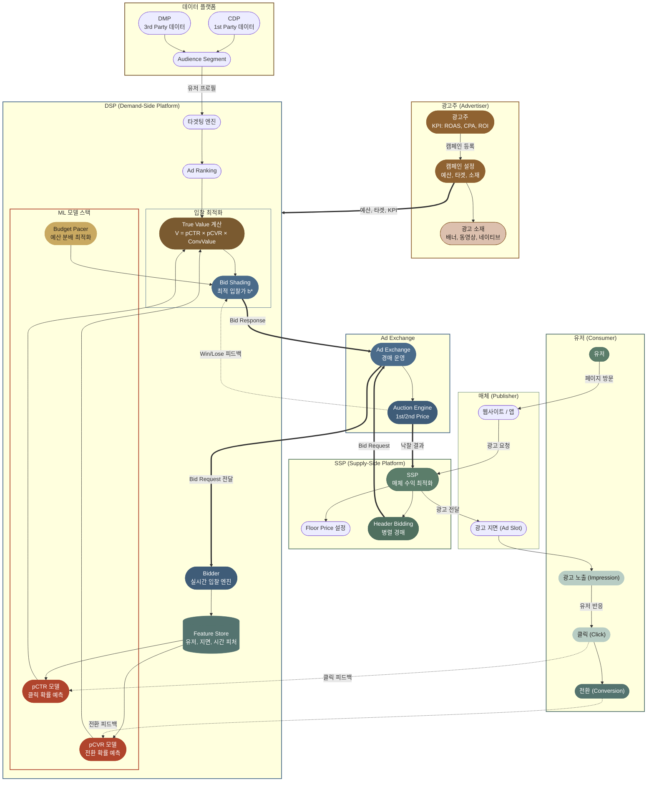

pCTR(predicted Click-Through Rate)은 광고를 본 유저가 그 광고를 클릭할 확률을 모델이 미리 예측한 값입니다. 이 값을 내는 pCTR 모델을 만드는 사람에게 「내 모델이 실제로 어디에서 어떻게 쓰이는가」는 모델 설계 못지않게 알아야 할 내용입니다. 이 글은 **광고주의 캠페인 등록부터 유저의 전환까지** 광고 생태계 전체를 pCTR 모델러의 눈으로 한 단계씩 따라갑니다. 전환(Conversion)은 광고를 본 유저가 결제처럼 광고주가 바라는 행동을 마치는 이벤트입니다. pCVR(predicted Conversion Rate)은 광고를 클릭한 유저가 전환할 확률을 모델이 예측한 값입니다.

> 단계마다 pCTR 모델과 pCVR 모델이 무슨 일을 맡는지, 모델의 정확도가 비즈니스 성과에 어떻게 이어지는지를 중심으로 봅니다.

---

## 1. 광고 생태계의 참여자와 데이터 흐름

**광고 생태계 그림에서 pCTR 모델러가 맡는 자리는 광고를 사는 쪽 플랫폼(DSP) 안의 pCTR 모델과 pCVR 모델입니다. 두 모델이 낸 확률은 같은 DSP 안에서 입찰가로 바뀝니다.**

내 모델이 어디에서 쓰이는지 알려면 먼저 광고 생태계 전체를 봐야 하므로 아래 그림에 주요 참여자와 데이터가 오가는 길을 모두 그렸습니다.



그림에서 벽돌색으로 칠한 pCTR 모델과 pCVR 모델이 pCTR 모델러의 영역입니다. 황동색 True Value 계산과 파란색 Bid Shading 은 두 모델이 낸 확률이 실제 입찰가로 바뀌는 지점입니다. 참 가치(True Value)는 노출 한 번이 광고주에게 주는 값어치를 `V = pCTR × pCVR × ConvValue`(ConvValue 는 전환 1건의 가치)로 계산한 값입니다.

광고주(Advertiser)는 성과 지표(KPI)를 목표로 캠페인을 등록합니다. 캠페인은 예산, 타겟(광고를 보여 줄 유저의 조건), 소재(배너, 동영상, 네이티브처럼 유저에게 실제로 보이는 광고물)를 정해 둔 광고 단위입니다. 캠페인의 예산, 타겟, KPI 는 DSP(Demand-Side Platform, 광고를 사는 쪽의 플랫폼)로 넘어갑니다.

유저가 매체(Publisher, 웹사이트나 앱)의 페이지를 방문하면 매체는 광고 지면(Ad Slot, 광고가 들어갈 자리)을 채울 광고를 SSP(Supply-Side Platform, 매체의 지면을 파는 쪽의 플랫폼)에 요청합니다. SSP 는 바닥값(Floor Price, 이 밑으로는 팔지 않는 최저 가격)을 정합니다. 입찰 요청(Bid Request, 이 지면을 얼마에 사겠는지 묻는 메시지)은 SSP 쪽에서 광고 거래소(Ad Exchange, SSP 와 DSP 사이에서 경매를 운영하는 곳)를 거쳐 DSP 의 Bidder(실시간 입찰 엔진)에 전달됩니다.

DSP 안에서는 Bidder 가 피처 스토어(Feature Store)에서 유저, 지면, 시간 피처를 가져옵니다. 피처 스토어는 모델에 넣는 입력값인 피처(feature)를 모아 두는 저장소입니다. pCTR 모델과 pCVR 모델은 이 피처로 클릭 확률과 전환 확률을 예측합니다. 두 확률은 타겟팅 엔진(이 유저가 캠페인 타겟에 맞는지 보는 엔진)과 Ad Ranking(광고 선택)을 거친 광고와 함께 True Value 계산에 들어갑니다. Bid Shading 은 그 참 가치와 Budget Pacer(예산 분배를 최적화하는 모듈)의 출력을 함께 보고 실제로 부를 최적 입찰가 b* 를 정한 뒤 입찰 응답(Bid Response)으로 광고 거래소에 돌려보냅니다.

타겟팅 엔진은 데이터 플랫폼이 만든 오디언스 세그먼트(Audience Segment, 조건이 비슷한 유저를 모은 그룹)에서 유저 프로필을 받습니다. 데이터 플랫폼의 DMP 는 바깥 업체가 모은 3rd Party 데이터를 다루고 CDP 는 광고주가 직접 모은 1st Party 데이터를 다룹니다.

광고 거래소는 Auction Engine 에서 경매를 열어 낙찰 결과를 SSP 에 보냅니다. SSP 가 광고를 지면에 전달하면 광고가 유저에게 노출(Impression)됩니다. 유저가 광고에 반응하면 클릭(Click)이 일어나고 클릭은 전환으로 이어집니다. 그림의 점선 3개는 경매와 유저 반응의 결과가 다시 DSP 안으로 돌아오는 피드백입니다. 전환 피드백은 pCVR 모델로, 클릭 피드백은 pCTR 모델로, 경매에서 이겼는지 졌는지를 알리는 Win/Lose 피드백은 Bid Shading 으로 돌아갑니다.

### 같은 그림을 눌러 보는 지도 페이지

[살아있는 생태계 지도](ecosystem.html)는 위 그림을 눌러 보고 흐름을 재생할 수 있게 만든 페이지입니다. 이 지도는 모듈(지도의 상자 하나) 23개를 **두 층**으로 나눠 놓았습니다.

- **위층은 두뇌 층입니다.** 피처 스토어에서 출발해 모델을 학습하는 Training 을 거칩니다. 그다음 점수를 매길 광고 후보를 먼저 고르는 후보 추출(Candidate Retrieval)과 학습된 모델로 요청마다 예측값을 돌려주는 모델 서빙(Model Serving)을 지나 **pCTR/pCVR** 이 나옵니다. 그 뒤로 예측 확률을 실제 확률에 맞추는 Calibration, 입찰가를 정하는 Bid Optimizer, 모델의 상태를 지켜보는 Monitoring 이 이어집니다.
- **아래층은 거래 층입니다.** 이 층에는 사용자 → 매체, SSP → 광고 거래소 → DSP → 광고주가 차례로 놓여 있습니다.

거래 층과 두뇌 층은 **DSP 와 pCTR/pCVR 을 연결하는 세로선**에서 만납니다. 이 선 하나만 기억하면 나머지 연결은 따라옵니다. 지도 위의 칩(누르면 정해진 흐름을 재생하는 단추)으로 원하는 흐름만 골라 볼 수도 있습니다. 처음 보는 사람은 [모델러의 눈으로 보는 0.1초](ecosystem.html?flow=modeler) 칩부터 누릅니다. 거래 층만 보려면 [100ms RTB](ecosystem.html?flow=rtb) 칩을 누릅니다. RTB(Real-Time Bidding)는 노출 한 번마다 실시간으로 경매를 열어 광고를 파는 방식입니다. DSP 안에서 일이 일어나는 순서는 [DSP 안의 순서](ecosystem.html?flow=dspinside) 칩으로 봅니다.

지도 위의 무대 바꾸기를 누르면 지도가 작동하는 시장 환경(무대)을 열린 RTB 와 닫힌 생태계 사이에서 바꿔 볼 수도 있습니다. 열린 RTB 는 지도의 상자 사이마다 회사 경계가 있는 시장이고 닫힌 생태계는 상자 여럿이 한 회사 안에 있는 시장입니다. 두 무대는 8절에서 비교합니다.

---

## 2. 입찰 한 번이 일어나는 100ms

**유저가 웹페이지를 연 뒤 광고가 노출되기까지는 약 100~200ms 가 걸리고 그 가운데 pCTR 모델이 예측값을 내는 추론은 약 1ms 안에 끝나야 합니다.**

이 짧은 시간 동안 유저의 페이지 방문에서 시작한 요청이 매체, SSP, 광고 거래소, DSP 를 차례로 거쳐 오갑니다. pCTR 모델은 그 가운데 DSP 처리 단계에서 실행됩니다. 모델이 쓸 수 있는 시간과 학습에 쓸 정답이 돌아오는 시점도 이 순서 안에서 정해집니다. 아래 띠는 이 시간에 일어나는 모든 일을 시간순으로 그렸습니다. 칸 안의 숫자가 단계 번호입니다.

<div class="chart-timeline">
<div style="display:flex; justify-content:space-between; align-items:center; margin-bottom:8px;">
<span style="font-size:0.85rem; font-weight:700; color:var(--text-primary);">RTB 입찰 전체 타임라인 (~100-200ms)</span>
<span style="font-size:0.75rem; color:var(--text-muted);">유저 페이지 방문 &rarr; 광고 노출</span>
</div>
<div class="chart-timeline-bar">
<div class="chart-timeline-segment green" style="width:5%;" title="유저 → Publisher">1</div>
<div class="chart-timeline-segment green" style="width:8%;" title="Publisher → SSP">2-3</div>
<div class="chart-timeline-segment blue" style="width:10%;" title="SSP → Exchange → DSP">4</div>
<div class="chart-timeline-segment pink" style="width:35%;" title="DSP 내부 처리">5. DSP 내부 처리 (~10-30ms)</div>
<div class="chart-timeline-segment blue" style="width:8%;" title="Bid Response">6</div>
<div class="chart-timeline-segment" style="width:10%; background:rgba(176,38,255,0.5);" title="Auction">7. 경매</div>
<div class="chart-timeline-segment green" style="width:12%;" title="낙찰 → 노출">8-10</div>
<div class="chart-timeline-segment orange" style="width:12%;" title="유저 반응">11-12</div>
</div>
<div class="chart-timeline-labels">
<span>0ms</span>
<span>입찰 요청(Bid Request)</span>
<span style="color:var(--accent-primary); font-weight:600;">DSP: Feature &rarr; pCTR &rarr; Shading</span>
<span>Auction</span>
<span>노출</span>
<span>~200ms</span>
</div>
<div class="chart-timeline-legend">
<div class="chart-timeline-legend-item">
<div class="chart-timeline-legend-dot" style="background:rgba(75,192,192,0.7);"></div>
<span>1. 유저 페이지 방문 &rarr; SSP 광고 요청</span>
</div>
<div class="chart-timeline-legend-item">
<div class="chart-timeline-legend-dot" style="background:rgba(54,162,235,0.7);"></div>
<span>4. 입찰 요청 전달 (~50ms 타임아웃)</span>
</div>
<div class="chart-timeline-legend-item">
<div class="chart-timeline-legend-dot" style="background:rgba(255,99,132,0.7);"></div>
<span>5. DSP: Feature 추출 → pCTR=0.032 → pCVR=0.15 → V=$0.24 (ROAS 기준, 4절) → b*=$0.17</span>
</div>
<div class="chart-timeline-legend-item">
<div class="chart-timeline-legend-dot" style="background:rgba(176,38,255,0.5);"></div>
<span>7. Auction (1st/2nd Price) &rarr; 낙찰</span>
</div>
<div class="chart-timeline-legend-item">
<div class="chart-timeline-legend-dot" style="background:rgba(255,159,64,0.7);"></div>
<span>11-12. Click (수 초) / Conversion (수 시간~수 일 지연)</span>
</div>
</div>
</div>

번호를 따라가면 유저가 페이지를 열고(1) 매체가 SSP 에 광고를 요청한 뒤(2-3) 입찰 요청이 SSP 에서 광고 거래소를 거쳐 DSP 로 전달됩니다(4). 이 단계의 타임아웃(응답을 기다려 주는 최대 시간)은 약 50ms 입니다.

5단계는 DSP 내부 처리로 약 10~30ms 가 걸립니다. 이 안에서 DSP 는 피처를 추출해 pCTR 0.032 와 pCVR 0.15 를 예측하고 두 확률로 참 가치 V `$0.24` 를 계산한 뒤 Bid Shading 으로 최종 입찰가 b* `$0.17` 을 정합니다. V `$0.24` 는 ROAS(Return On Ad Spend, 광고비 대비 매출) 기준으로 계산한 값입니다. Bid Shading 은 이겼을 때 남는 몫과 이길 확률을 함께 따져 입찰가를 정하므로 b* 는 V 보다 낮습니다. 두 계산은 4절에서 차례로 봅니다.

DSP 가 이 입찰가를 입찰 응답으로 보내면(6) 광고 거래소가 경매를 열어 낙찰(경매에서 이기는 것)할 광고를 정합니다(7). 경매 방식에는 1등이 자기가 부른 값을 그대로 내는 1st Price 와 1등이 2등이 부른 값을 내는 2nd Price 가 있습니다. 낙찰된 광고가 노출되기까지가 8-10단계입니다. 11-12단계는 노출을 본 유저의 반응인 클릭과 전환입니다.

### pCTR 모델러가 볼 지점 3가지

- **5단계 안의 추론**: 추론(inference)은 학습을 마친 모델에 이번 요청의 피처를 넣어 예측값을 얻는 계산입니다. pCTR 추론은 **약 1ms 안에** 끝나야 합니다. 모델 복잡도와 레이턴시(요청을 받고 답을 내기까지 걸리는 시간)는 트레이드오프 관계로, 모델을 복잡하게 만들수록 레이턴시가 늘어납니다.
- **5단계 안의 가치 계산**: pCTR 의 작은 오차는 참 가치에서 증폭됩니다. 4절의 ROAS 기준 식은 pCTR 0.032 에 pCVR 0.15 와 평균 전환 매출 `$50` 을 곱해 V `$0.24` 를 냅니다. pCTR 이 0.032 가 아니라 0.050 이었다면 같은 식이 0.050 × 0.15 × `$50` = `$0.375` 를 내므로 참 가치는 56% 오르고 입찰가도 그만큼 올라갑니다.
- **11-12단계**: 클릭 피드백은 수 초 안에 도착하지만 전환 피드백은 **수 시간에서 수 일까지 늦게** 도착할 수 있습니다. 라벨(모델이 맞혀야 할 정답, 여기서는 전환했는지 여부)이 이렇게 늦게 도착하는 현상을 지연 피드백(Delayed Feedback)이라고 부릅니다. 지연 피드백은 pCVR 모델이 넘어야 할 주된 난관입니다.

### 같은 100ms 가 겹치는 횟수

지도에는 「SSP → Exchange → DSP」 화살표가 하나뿐이지만 실제로는 이 100ms 가 초마다 수만 번 겹쳐 일어납니다. 아래 코드는 페이지가 한 번 열릴 때 그 화살표에서 입찰 요청이 몇 건 나가는지 센 뒤 하루와 1초 단위로 늘려 봅니다. 가정은 한 페이지의 지면 5개, 지면마다 SSP 3곳, 경매마다 DSP 20곳, 이 매체의 하루 페이지뷰(PV, 페이지가 열린 횟수) 1,000만 번입니다.

```python
# 하는 일: 페이지가 한 번 열릴 때 지도의 「SSP → Exchange → DSP」 화살표 하나에서 Bid Request 가 몇 건 나가는지 세고, 하루와 초당으로 늘려 본다.
SLOTS, SSP_PER_SLOT, DSP_PER_AUCTION = 5, 3, 20  # 지면 수, 지면당 SSP, 경매당 DSP
PAGEVIEW = 10_000_000                            # 이 매체의 하루 페이지뷰

per_page = SLOTS * SSP_PER_SLOT * DSP_PER_AUCTION  # 페이지 1회의 Bid Request
daily = per_page * PAGEVIEW                        # 하루 총건
avg = daily / 86_400                               # 초당 평균(하루 = 86,400초)

for label, n in [("페이지 1회", per_page), ("하루 전체", daily), ("초당 평균", avg),
                 ("초당 피크(평균×3)", avg * 3), ("DSP 1곳 몫", avg / DSP_PER_AUCTION),
                 ("매체 100곳이면", avg * 100)]:
    print(f"{n:>15,.0f} 건  {label}")

# 출력:
# 뜻: 페이지 한 번이 Bid Request 300건을 만든다. 하루면 3,000,000,000건이고, 초당 평균 34,722건에 피크는 104,167건이다. 매체가 100곳이면 초당 3,472,222건이다.
#             300 건  페이지 1회
#   3,000,000,000 건  하루 전체
#          34,722 건  초당 평균
#         104,167 건  초당 피크(평균×3)
#           1,736 건  DSP 1곳 몫
#       3,472,222 건  매체 100곳이면
```

찍힌 첫 줄의 300건은 페이지 한 번이 만드는 **입찰 요청 수**입니다. 지면 하나의 요청이 SSP 3곳으로 전달되고 그 3건의 경매마다 DSP 20곳에 입찰 요청이 가므로 페이지 한 번에 5 × 3 × 20 = 300건이 나갑니다. 여기에 하루 1,000만 PV 를 곱하면 하루 3,000,000,000건(30억 건)이 됩니다. 30억 건을 하루 86,400초로 나누면 초당 평균 34,722건, 약 3만 5천 건입니다.

피크를 평균의 3배로 잡으면 초당 104,167건으로 늘어납니다. DSP 한 곳은 경매마다 요청을 1건씩 받으므로 이 매체에서 받는 요청은 초당 평균 34,722건을 DSP 20곳으로 나눈 1,736건입니다. 이런 매체가 100곳이면 초당 3,472,222건, 약 347만 건이 됩니다.

---

## 3. pCTR 정확도가 광고주 ROI 까지 이어지는 경로

**pCTR 모델의 정확도는 참 가치, 입찰가, 낙찰률과 비용을 차례로 거쳐 광고주의 ROI(투자 대비 수익)까지 이어집니다.**

모델러는 캘리브레이션과 AUC 로 모델을 평가하지만 이 경로의 최종 목표는 광고주 ROI 극대화입니다. ROI(Return On Investment)는 광고에 쓴 돈에 비해 얼마를 벌었는지 나타내는 비율로 높을수록 좋습니다. 아래 네 단계는 pCTR 의 정확도가 ROI 까지 이어지는 길을 순서대로 보여 줍니다.

<div class="chart-steps">
<div style="font-size:0.85rem; font-weight:700; color:var(--text-primary); margin-bottom:12px;">pCTR 모델 정확도 &rarr; 비즈니스 결과 영향 경로</div>
<div class="chart-step">
<div class="chart-step-indicator">
<div class="chart-step-dot pink">1</div>
<div class="chart-step-line"></div>
</div>
<div class="chart-step-content">
<div class="chart-step-title">pCTR 모델</div>
<div class="chart-step-desc">캘리브레이션 (예측 vs 실제 확률 일치도) + 판별력 (AUC-ROC)</div>
<span class="chart-step-badge pink">모델러의 영역</span>
</div>
</div>
<div class="chart-step">
<div class="chart-step-indicator">
<div class="chart-step-dot purple" style="background:rgba(176,38,255,0.8);">2</div>
<div class="chart-step-line"></div>
</div>
<div class="chart-step-content">
<div class="chart-step-title">참 가치 정확도</div>
<div class="chart-step-desc">V = pCTR &times; pCVR &times; ConvValue. pCTR 오차가 그대로 V에 전파됩니다.</div>
</div>
</div>
<div class="chart-step">
<div class="chart-step-indicator">
<div class="chart-step-dot blue">3</div>
<div class="chart-step-line"></div>
</div>
<div class="chart-step-content">
<div class="chart-step-title">입찰가 정확도 &rarr; 낙찰률(Win Rate) &amp; 비용 효율</div>
<div class="chart-step-desc">과대추정 &rarr; 과다입찰 &rarr; 낙찰률&uarr; but 비용&uarr;&uarr;. 과소추정 &rarr; 과소입찰 &rarr; 기회 손실.</div>
</div>
</div>
<div class="chart-step">
<div class="chart-step-indicator">
<div class="chart-step-dot green">4</div>
</div>
<div class="chart-step-content">
<div class="chart-step-title">비즈니스 결과</div>
<div class="chart-step-desc">광고주 ROI, DSP 수익, 예산 소진 속도가 모두 pCTR 정확도에 직결됩니다.</div>
<span class="chart-step-badge green">최종 목표: ROI 극대화</span>
</div>
</div>
</div>

1단계에서는 pCTR 모델을 두 가지로 평가합니다. 캘리브레이션(Calibration)은 예측한 확률이 실제 확률과 얼마나 일치하는지를 봅니다. 판별력(AUC-ROC)은 클릭할 노출과 클릭하지 않을 노출을 점수 순서로 얼마나 잘 구분하는지를 봅니다. 2단계의 참 가치는 `V = pCTR × pCVR × ConvValue` 라서 pCTR 의 오차가 그대로 V 로 전파됩니다. 3단계에서는 그 V 로 정한 입찰가의 정확도가 낙찰률(Win Rate, 입찰한 경매 가운데 이긴 비율)과 비용 효율로 이어집니다.

아래 표는 pCTR 의 상태 4가지마다 이 경로를 끝까지 따라간 결과입니다. 표의 실제 CTR(Click-Through Rate)은 노출 가운데 실제로 클릭된 비율입니다.

| pCTR 상태 | 참 가치 | 입찰 결과 | 비즈니스 영향 |
|-----------|-----------|---------|-------------|
| **과대추정** (pCTR > 실제 CTR) | V 과대 → 과다 입찰 | 낙찰률 ↑ but 비용 ↑↑ | ROI 하락, 예산 조기 소진 |
| **과소추정** (pCTR < 실제 CTR) | V 과소 → 과소 입찰 | Win Rate ↓↓ | 기회 손실, 노출 부족 |
| **정확** (pCTR ≈ 실제 CTR) | V 정확 → 최적 shading 가능 | Win Rate 적정 + 비용 효율 | **ROI 극대화** |
| **판별력 부족** (AUC 낮음) | 좋은 지면/나쁜 지면 구분 실패 | 나쁜 지면에 과다입찰 | 전환 없는 노출에 예산 낭비 |

과대추정은 pCTR 이 실제 CTR 보다 큰 경우로, V 도 실제보다 크게 나와 과다 입찰하므로 낙찰률은 오르지만 비용이 그보다 더 크게 올라 ROI 가 떨어지고 예산이 일찍 소진됩니다. 과소추정은 반대로 V 가 작게 나와 과소 입찰하므로 낙찰률이 크게 떨어지고 노출이 부족해 기회를 잃습니다. pCTR 이 실제 CTR 과 거의 같으면 V 가 정확해 최적의 Shading 이 가능하고 낙찰률은 적정하면서 비용 효율도 좋아 ROI 가 극대화됩니다. AUC 가 낮아 판별력이 부족하면 좋은 지면과 나쁜 지면을 구분하지 못해 나쁜 지면에 과다 입찰하고 전환이 없는 노출에 예산을 낭비합니다.

### 지도에서 pCTR/pCVR 상자만 크게 그린 이유

위 표의 네 줄처럼 pCTR/pCVR 값이 틀리면 참 가치가 틀리고 입찰가와 비용이 함께 틀어지므로 [생태계 지도](ecosystem.html)는 pCTR/pCVR 상자를 심장으로 삼아 다른 상자보다 크고 색도 다르게 그렸습니다. 아래 코드의 주석도 pCTR 을 「심장」이라고 부릅니다. 오차가 얼마나 넓게 퍼지는지는 지도의 모양으로 확인할 수 있습니다.

아래 코드는 지도의 화살표를 짧은 이름으로 옮겨 적고 pCTR 에서 각 모듈까지 화살표를 몇 개 건너야 닿는지 셉니다. 코드가 「다리」라고 부르는 이 수는 그래프에서 흔히 hop 이라고 하는 거리입니다. `TRADE` 는 거래 층, `BRAIN` 은 두뇌 층의 화살표이고 `CROSS` 는 두 층을 연결하는 화살표입니다. 화살표의 방향은 빼고 양 끝을 서로의 이웃으로 담은 뒤 pCTR 에서 출발하는 너비 우선 탐색(BFS, breadth-first search)으로 거리를 셉니다. 너비 우선 탐색은 출발점에서 화살표 1개로 닿는 모듈을 먼저 모두 방문하고 나서 2개로 닿는 모듈로 넘어가므로 모듈에 처음 닿은 단계 수가 곧 가장 짧은 거리입니다.

```python
# 하는 일: 지도의 모듈을 이웃 관계로 잇고, 각 모듈이 pCTR 에서 화살표 몇 개 떨어져 있는지 센다.
from collections import deque

# 1단계: 지도의 화살표를 옮겨 적는다
# 지도의 화살표를 짧은 이름으로 옮겨 적었다(방향은 빼고 이웃 관계만 본다).
TRADE = ("user-pub pub-ssp ssp-ex ex-dsp dsp-adv ex-auc ex-pub pub-hb hb-ssp user-log "
         "pub-log log-mmp mmp-adv dmp-dsp dco-dsp brand-adv cmp-dmp journey-log journey-cmp")
BRAIN = "fs-train train-serve serve-mon mon-train fs-serve cand-serve serve-pctr pctr-calib calib-bid"
CROSS = "dsp-pctr dsp-serve dsp-cand dmp-cand auc-pctr bid-dsp log-fs"  # 두 층을 잇는 화살표

# 2단계: 이웃 관계 그래프를 만든다
# 화살표 양 끝을 서로의 이웃으로 담는다.
g = {}
for pair in f"{TRADE} {BRAIN} {CROSS}".split():
    a, b = pair.split("-")
    g.setdefault(a, set()).add(b)   # 이웃 관계는 양방향으로 담는다
    g.setdefault(b, set()).add(a)

# 3단계: pCTR 에서 너비 우선 탐색으로 거리를 측정한다
# pCTR 에서 출발해 화살표 몇 개를 건너면 닿는지를 다리 수로 센다.
dist, q = {"pctr": 0}, deque(["pctr"])  # 심장에서 출발하는 너비 우선 탐색
while q:
    n = q.popleft()
    for m in sorted(g[n]):              # sorted로 출력 순서를 고정
        if m not in dist:
            dist[m] = dist[n] + 1
            q.append(m)

print(f"모듈 {len(g)}개, 두 층을 잇는 화살표 {len(CROSS.split())}개")
for k in range(max(dist.values()) + 1):
    same = sorted(n for n, v in dist.items() if v == k)
    print(f"{k}다리 {len(same):2d}개  {' '.join(same)}")

# 출력:
# 3단계 뜻: 모듈 23개 가운데 pCTR 에 바로 닿는 것이 4개, 두 다리가 9개, 세 다리가 6개다. 가장 먼 hb, journey, user 도 네 다리다.
# 모듈 23개, 두 층을 잇는 화살표 7개
# 0다리  1개  pctr
# 1다리  4개  auc calib dsp serve
# 2다리  9개  adv bid cand dco dmp ex fs mon train
# 3다리  6개  brand cmp log mmp pub ssp
# 4다리  3개  hb journey user
```

찍힌 값을 보면 모듈 23개 가운데 pCTR 에 1다리로 바로 닿는 모듈이 4개(`auc` 경매, `calib` Calibration, `dsp` DSP, `serve` 모델 서빙)이고 2다리가 9개, 3다리가 6개입니다. 가장 먼 모듈도 4다리인 `hb`(Header Bidding, 매체 페이지가 여러 SSP 에 한꺼번에 값을 묻는 병렬 경매), `journey`(User Journey, 유저 여정), `user`(사용자) 3개라서 23개 모듈 전부가 pCTR 에서 **4다리 안**에 있습니다.

사용자까지 가는 길을 코드의 화살표로 따라가면 pCTR 에서 `dsp-pctr` 로 DSP(1다리), `ex-dsp` 로 광고 거래소(2다리), `ex-pub` 으로 매체(3다리), `user-pub` 으로 사용자(4다리)에 닿습니다. 두 층을 연결하는 화살표는 7개뿐인데도 모든 모듈이 이만큼 가까우므로 pCTR 오차가 왜 지도 전체로 전파되는지를 지도의 모양이 설명합니다.

---

## 4. 자동 입찰(Auto-Bidding) 파이프라인

**광고주가 전환 1건당 목표 비용과 예산, 타겟 조건을 정하면 DSP 는 예측, 가치 산정, 입찰 최적화를 차례로 거쳐 입찰 요청마다 입찰가를 정합니다.**

CPA(Cost Per Action)는 전환 1건을 얻는 데 드는 비용입니다. 「CPA `$10` 목표」는 전환 1건에 `$10` 을 쓰는 것을 목표로 삼는다는 뜻입니다. 자동 입찰(Auto-Bidding)은 광고주가 이런 목표와 예산, 타겟 조건만 정하면 DSP 가 입찰 요청마다 입찰가를 대신 계산하는 방식입니다. 아래 다섯 칸은 DSP 안에서 그 계산이 진행되는 순서를 보여 줍니다.

<div class="chart-arch">
<div class="chart-arch-section">
<div class="chart-arch-section-header">
<span class="chart-arch-section-icon">1</span>
<span class="chart-arch-section-title orange">광고주 입력 (Input)</span>
</div>
<div class="chart-arch-grid">
<div class="chart-arch-node">
<div class="chart-arch-node-name">캠페인 목표</div>
<div class="chart-arch-node-desc">CPA = $10</div>
</div>
<div class="chart-arch-node">
<div class="chart-arch-node-name">일일 예산</div>
<div class="chart-arch-node-desc">$1,000</div>
</div>
<div class="chart-arch-node">
<div class="chart-arch-node-name">타겟 조건</div>
<div class="chart-arch-node-desc">국가, 디바이스, 관심사</div>
</div>
</div>
</div>
<div class="chart-arch-connector">&#8595;</div>
<div class="chart-arch-section">
<div class="chart-arch-section-header">
<span class="chart-arch-section-icon">2</span>
<span class="chart-arch-section-title pink">예측 단계 (Prediction)</span>
</div>
<div class="chart-arch-grid">
<div class="chart-arch-node">
<div class="chart-arch-node-name">pCTR(x) = 0.032</div>
<div class="chart-arch-node-desc">클릭 확률 예측</div>
</div>
<div class="chart-arch-node">
<div class="chart-arch-node-name">pCVR(x) = 0.15</div>
<div class="chart-arch-node-desc">전환 확률 예측</div>
</div>
<div class="chart-arch-node">
<div class="chart-arch-node-name">pCTCVR = 0.0048</div>
<div class="chart-arch-node-desc">pCTR &times; pCVR</div>
</div>
</div>
</div>
<div class="chart-arch-connector">&#8595;</div>
<div class="chart-arch-row">
<div class="chart-arch-section">
<div class="chart-arch-section-header">
<span class="chart-arch-section-icon">3</span>
<span class="chart-arch-section-title purple">가치 산정 (Valuation)</span>
</div>
<div class="chart-arch-grid">
<div class="chart-arch-node">
<div class="chart-arch-node-name">CPA 기반</div>
<div class="chart-arch-node-desc">V = 0.0048 &times; $10 = $0.048</div>
</div>
<div class="chart-arch-node">
<div class="chart-arch-node-name">ROAS 기반</div>
<div class="chart-arch-node-desc">V = 0.0048 &times; $50 = $0.24</div>
</div>
</div>
</div>
<div class="chart-arch-section">
<div class="chart-arch-section-header">
<span class="chart-arch-section-icon">4</span>
<span class="chart-arch-section-title blue">입찰 최적화 (Shading)</span>
</div>
<div class="chart-arch-grid">
<div class="chart-arch-node">
<div class="chart-arch-node-name">시장 분포 추정</div>
<div class="chart-arch-node-desc">F(b|x) ~ LogNormal</div>
</div>
<div class="chart-arch-node">
<div class="chart-arch-node-name">예산 페이싱(Budget Pacing)</div>
<div class="chart-arch-node-desc">남은 예산 기반 조절</div>
</div>
</div>
</div>
</div>
<div class="chart-arch-connector">&#8595;</div>
<div class="chart-arch-section">
<div class="chart-arch-section-header">
<span class="chart-arch-section-icon">5</span>
<span class="chart-arch-section-title" style="color:var(--accent-secondary);">입찰 출력 (Output)</span>
</div>
<div class="chart-arch-grid">
<div class="chart-arch-node">
<div class="chart-arch-node-name">최종 입찰가: b* = $0.034</div>
<div class="chart-arch-node-desc">Surplus 최대화: b* = argmax (V-b)×F(b|x), shading 29%</div>
</div>
</div>
</div>
</div>

1칸 광고주 입력은 목표 CPA `$10`, 일일 예산 `$1,000`, 타겟 조건(국가, 디바이스, 관심사)입니다. 2칸에서는 이번 요청 x 의 pCTR(x) 0.032 와 pCVR(x) 0.15 를 예측하고 두 값을 곱해 pCTCVR(노출 한 번이 클릭을 거쳐 전환까지 갈 확률) 0.0048 을 얻습니다. 3칸은 이 확률에 전환 1건의 값어치를 곱해 참 가치 V 를 냅니다. CPA 기반이면 목표 CPA `$10` 을 곱해 0.0048 × `$10` = `$0.048` 이고 ROAS 기반이면 평균 전환 매출 `$50` 을 곱해 0.0048 × `$50` = `$0.24` 입니다.

4칸에서는 두 가지를 함께 봅니다. 시장 분포 `F(b|x)` 는 요청 x 에서 입찰가 b 를 냈을 때 이길 확률입니다. 이 시장 분포는 로그정규분포(LogNormal)를 따른다고 보고 추정합니다. 예산 페이싱(Budget Pacing)은 남은 예산을 보고 입찰을 조절합니다.

5칸의 최종 입찰가 b* 는 `(V - b) × F(b|x)` 를 가장 크게 만드는 b 입니다. `V - b` 는 이겼을 때 남는 몫(Surplus)이고 `F(b|x)` 는 이길 확률이라서 입찰가 b 를 낮추면 남는 몫은 커지지만 이길 확률은 줄어듭니다. 이 예에서 b* 는 `$0.034` 로 CPA 기반 V `$0.048` 보다 29% 낮습니다(shading 29%).

### 과금 모델을 하나의 단위로 맞추는 eCPM

광고 시장에는 노출 1,000회마다 돈을 내는 CPM(Cost Per Mille), 클릭마다 내는 CPC(Cost Per Click), 전환마다 내는 CPA 처럼 여러 과금 모델이 함께 있습니다. 광고 거래소에서는 과금 모델이 서로 다른 캠페인들이 **같은 지면을 두고 경쟁**합니다. 노출 기준 가격과 클릭 기준 가격은 단위가 달라 그대로는 나란히 비교할 수 없으므로 **eCPM(effective Cost Per Mille)** 하나로 단위를 맞춥니다.

$$\text{eCPM} = \text{1,000 노출당 기대 수익}$$

| 과금 모델 | eCPM 변환 공식 | 예시 |
|----------|--------------|------|
| **CPM** | $\text{eCPM} = \text{CPM}$ | CPM `$5.00` → eCPM `$5.00` |
| **CPC** | $\text{eCPM} = pCTR \times CPC \times 1{,}000$ | pCTR 2%, CPC `$0.50` → eCPM `$10.00` |
| **CPA** | $\text{eCPM} = pCTR \times pCVR \times CPA \times 1{,}000$ | pCTR 2%, pCVR 10%, CPA `$20` → eCPM `$40.00` |

표의 예시를 위에서부터 따라가 봅니다. CPM 캠페인은 이미 노출 1,000회 기준으로 값을 내므로 CPM `$5.00` 이 그대로 eCPM `$5.00` 입니다. CPC 캠페인은 클릭이 일어나야 광고주가 돈을 내므로 노출 1,000회에서 기대되는 클릭 수(pCTR × 1,000)에 클릭당 가격을 곱해 2% × `$0.50` × 1,000 = `$10.00` 입니다. CPA 캠페인은 전환이 일어나야 돈을 내므로 여기에 pCVR 까지 곱해 2% × 10% × `$20` × 1,000 = `$40.00` 입니다.

CPC 와 CPA 캠페인의 eCPM 은 이렇게 pCTR 을 곱해서 나오므로 pCTR 모델의 정확도가 eCPM 에 직결됩니다. 실제 값이 2% 인데 모델이 pCTR 을 4% 로 과대추정하면 eCPM 이 두 배로 커져 실제 가치보다 훨씬 높은 가격에 입찰합니다. 반대로 과소추정하면 경쟁에서 밀려 노출 기회를 잃습니다.

SSP 와 광고 거래소 쪽에서 보면 거래소는 모든 입찰을 eCPM 으로 바꾼 뒤 비교해 낙찰자를 정합니다. 따라서 DSP 가 보내는 입찰가는 이미 eCPM 기반이고 앞에서 본 참 가치 계산이 바로 이 eCPM 을 산출하는 과정입니다. 표의 CPA 식에서 마지막 `× 1,000` 을 빼면 아래 CPA 기반 V 식과 모양이 같습니다.

### CPA 기반과 ROAS 기반의 가치 산정

참 가치 V 를 계산할 때 전환 1건에 매기는 값어치는 캠페인 목표에 따라 두 가지입니다.

**CPA 기반**은 전환을 최적화하는 캠페인이 쓰는 식으로, 전환 확률(pCTCVR)에 광고주가 정한 목표 CPA(Target CPA)를 곱합니다.
$$V = \underbrace{pCTR(x) \times pCVR(x)}_{\text{전환 확률 (pCTCVR)}} \times \underbrace{\text{Target CPA}}_{\text{광고주 설정 목표}}$$

**ROAS 기반**은 수익을 최적화하는 캠페인이 쓰는 식으로, 목표 CPA 대신 전환 1건의 평균 매출(Avg Revenue)을 곱합니다.
$$V = pCTR(x) \times pCVR(x) \times \underbrace{\text{Avg Revenue}}_{\text{평균 전환 매출}}$$

어느 방식이든 V 는 pCTR 과 pCVR 의 곱에서 시작하므로 두 모델이 부정확하면 V 가 부정확하고 V 가 부정확하면 입찰가도 부정확합니다.

---

## 5. 모델이 학습하는 데이터 피드백 루프

**광고 시스템은 pCTR 모델의 예측이 데이터를 만들고 그 데이터가 다시 모델을 학습시키는 고리로 돌아갑니다. 이 고리에서 모델러가 매일 마주하는 난관은 4가지입니다.**

자기 강화 루프(feedback loop)는 시스템이 낸 결과가 다시 시스템의 입력으로 돌아오는 고리입니다. 광고 시스템에서는 pCTR 모델의 예측으로 입찰가가 정해지고 낙찰한 광고만 노출되어 클릭과 전환 기록을 남기므로, 모델이 다음에 학습할 데이터는 모델 자신의 예측이 고른 결과에서 나옵니다. 아래 그림은 이 고리를 세 층으로 나눠 그렸습니다.

<div class="chart-layer">
<div class="chart-layer-title">OFFLINE TRAINING (수 시간 ~ 수 일 주기)</div>
<div class="chart-layer-row">
<div class="chart-layer-group">
<div class="chart-layer-group-label">로그 데이터</div>
<div class="chart-layer-items">
<span class="chart-layer-item blue">Impression</span>
<span class="chart-layer-item blue">Click</span>
<span class="chart-layer-item blue">Conversion</span>
</div>
</div>
<div class="chart-layer-group">
<div class="chart-layer-group-label">Feature Engineering</div>
<div class="chart-layer-items">
<span class="chart-layer-item pink">유저, 지면, 시간, 소재 피처</span>
</div>
</div>
<div class="chart-layer-group">
<div class="chart-layer-group-label">모델 학습 &amp; 평가</div>
<div class="chart-layer-items">
<span class="chart-layer-item pink">Logistic Reg, DeepFM 등</span>
<span class="chart-layer-item pink">AUC, Calibration, LogLoss</span>
</div>
</div>
<div class="chart-layer-group">
<div class="chart-layer-group-label">모델 배포</div>
<div class="chart-layer-items">
<span class="chart-layer-item green">서빙 서버 배포</span>
</div>
</div>
</div>
<div class="chart-layer-arrow">&#8595; 배포된 모델</div>
<div class="chart-layer-title">ONLINE SERVING (실시간, ~1ms)</div>
<div class="chart-layer-row">
<div class="chart-layer-group">
<div class="chart-layer-group-label">pCTR 추론</div>
<div class="chart-layer-items">
<span class="chart-layer-item pink">x &rarr; p(click|x)</span>
</div>
</div>
<div class="chart-layer-group">
<div class="chart-layer-group-label">입찰 &amp; 낙찰</div>
<div class="chart-layer-items">
<span class="chart-layer-item blue">참 가치 &rarr; Bid Shading</span>
</div>
</div>
<div class="chart-layer-group">
<div class="chart-layer-group-label">광고 노출</div>
<div class="chart-layer-items">
<span class="chart-layer-item green">유저에게 광고 도달</span>
</div>
</div>
</div>
<div class="chart-layer-arrow">&#8595; 유저 반응</div>
<div class="chart-layer-title">FEEDBACK (피드백 수집) &mdash; &#8634; 다시 로그 데이터로</div>
<div class="chart-layer-row">
<div class="chart-layer-group">
<div class="chart-layer-group-label">클릭 이벤트</div>
<div class="chart-layer-items">
<span class="chart-layer-item cyan">수 초 내 수집</span>
</div>
</div>
<div class="chart-layer-group">
<div class="chart-layer-group-label">전환 이벤트</div>
<div class="chart-layer-items">
<span class="chart-layer-item cyan">수 시간 ~ 수 일 지연</span>
</div>
</div>
<div class="chart-layer-group">
<div class="chart-layer-group-label">Win/Lose 피드백</div>
<div class="chart-layer-items">
<span class="chart-layer-item cyan">경매 결과</span>
</div>
</div>
<div class="chart-layer-group">
<div class="chart-layer-group-label">! 난관 (Challenges)</div>
<div class="chart-layer-items">
<span class="chart-layer-item orange">고른 것만 보이는 편향(Selection Bias)</span>
<span class="chart-layer-item orange">지연 피드백</span>
<span class="chart-layer-item orange">분포가 달라지는 것(Distribution Shift)</span>
<span class="chart-layer-item orange">숨겨진 데이터(Censored Data)</span>
</div>
</div>
</div>
</div>

맨 위 OFFLINE TRAINING 층은 수 시간에서 수 일 주기로 돕니다. 노출, 클릭, 전환 로그에서 유저, 지면, 시간, 소재 피처를 만드는 Feature Engineering 을 거쳐 Logistic Regression(로지스틱 회귀)이나 DeepFM 같은 모델을 학습하고 AUC, Calibration, LogLoss 로 평가한 뒤 서빙 서버에 배포합니다. LogLoss 는 예측 확률이 실제 정답과 얼마나 다른지 매기는 손실로 작을수록 좋습니다.

가운데 ONLINE SERVING 층에서는 배포된 모델이 요청마다 약 1ms 안에 `x → p(click|x)` 를 추론합니다. p(click|x) 는 입력 x 가 주어졌을 때 클릭할 확률입니다. 그 확률로 계산한 참 가치를 Bid Shading 에 넘겨 입찰하고 낙찰하면 유저에게 광고가 도달합니다.

맨 아래 FEEDBACK 층은 클릭 이벤트와 전환 이벤트, 경매 결과인 Win/Lose 피드백을 모아 다시 로그 데이터로 보냅니다.

### pCTR 모델러가 매일 마주하는 4가지 난관

그림 FEEDBACK 층의 난관 칸에 있는 4가지를 원인, 영향, 대응으로 나누면 아래 표와 같습니다.

| 난관 | 원인 | 영향 | 대응 |
|------|------|------|------|
| **고른 것만 보이는 편향** | 낙찰한 광고만 클릭/전환 데이터 수집 | 못 이긴 경매의 잠재 성과를 모름 | ESMM, Inverse Propensity Weighting |
| **지연 피드백** | 전환은 클릭 후 수 시간~수 일 후 발생 | 최신 데이터에 전환 라벨 누락 | Attribution Window, FSIW |
| **분포가 달라지는 것** | 유저 행동, 시즌, 경쟁 환경 변화 | 어제의 모델이 오늘 부정확 | 온라인 학습, 주기적 재학습 |
| **숨겨진 데이터** | 패찰 시 경쟁자 가격 미관측 | 시장 분포 과소추정 → 과도한 shading | Censored Regression, Survival Analysis |

고른 것만 보이는 편향(Selection Bias)은 낙찰한 광고에서만 클릭과 전환 데이터가 모이는 탓에 못 이긴 경매에서 그 광고가 냈을 성과를 모르는 문제입니다. 대응으로는 클릭하지 않은 노출까지 포함한 전체 노출에서 pCTR 과 pCTCVR 을 함께 학습하는 ESMM 과, 데이터에 들어올 확률이 낮았던 표본에 큰 가중치를 주어 치우침을 되돌리는 Inverse Propensity Weighting 이 있습니다.

지연 피드백은 전환이 클릭 뒤 수 시간에서 수 일 지나서 일어나므로 최신 데이터에 전환 라벨이 빠지는 문제입니다. 클릭 뒤 얼마 동안 일어난 전환까지 그 광고의 전환으로 셀지 정하는 Attribution Window 와, 아직 들어오지 않은 전환을 가중치로 보정하는 FSIW(Feedback Shift Importance Weighting)가 대응 방법입니다.

분포가 달라지는 것(Distribution Shift)은 유저 행동, 시즌, 경쟁 환경이 변해 어제의 모델이 오늘은 부정확해지는 문제입니다. 새 데이터가 들어오는 대로 모델을 조금씩 고치는 온라인 학습과 주기적 재학습으로 대응합니다.

패찰했을 때(경매에서 졌을 때)는 경쟁자가 내 입찰가보다 높게 불렀다는 것만 알 뿐 얼마를 불렀는지는 보이지 않으므로 그 경매의 기록은 숨겨진 데이터(Censored Data)가 됩니다. 보이지 않는 가격 탓에 DSP 는 시장 분포를 실제보다 낮게 추정하고 그 결과 입찰가를 지나치게 깎습니다(과도한 shading). 대응 방법은 이런 데이터를 다루는 통계 방법인 Censored Regression(중도절단 회귀)과 Survival Analysis(생존 분석)입니다.

### 두뇌 층이 한 바퀴 도는 시간

지도 위층인 두뇌 층은 왼쪽에서 오른쪽으로 한 번 지나가고 끝나는 구조가 아니라 **고리**입니다. 로그에서 출발해 피처 스토어, Training, 모델 서빙을 지나 pCTR/pCVR 이 나온 뒤 Monitoring 을 거쳐 다시 Training 으로 돌아옵니다. 이 고리만 따라가려면 [모델 학습, 서빙 흐름](ecosystem.html?flow=modeling) 칩을 누릅니다.

아래 코드는 로그가 학습을 거쳐 다시 서빙 모델에 닿기까지 한 바퀴의 시간을 단계별로 더한 뒤, 학습을 하루 n번 돌릴 때 지금 서빙 중인 모델이 평균 몇 시간 전 데이터를 보는지 구합니다. 코드는 이 시간을 「모델 나이」라고 부릅니다. 모델 나이가 작을수록 서빙 중인 모델이 더 최근의 데이터를 봅니다.

```python
# 하는 일: 로그가 학습을 거쳐 다시 서빙 모델에 닿기까지 한 바퀴 걸리는 시간을 더하고, 하루 학습 횟수마다 서빙 모델이 평균 몇 시간 전 데이터를 보는지 구한다.
# 1단계: 고리의 단계와 시간을 둔다
# 두뇌 층은 로그가 한 바퀴 돌아 다시 모델에 닿는 고리다. 단계마다 걸리는 시간(시간 단위)을 둔다.
STAGES = [
    ("로그 수집, 조인", 0.5),   # 노출, 클릭 로그가 모여 붙기까지
    ("전환 라벨 대기", 24.0),  # 전환은 클릭보다 한참 늦게 온다
    ("학습셋 만들기", 1.5),    # Feature Store에서 피처를 붙인다
    ("모델 학습", 4.0),        # Training
    ("오프라인 검증", 1.0),    # AUC, LogLoss가 기준을 넘는지
    ("배포, 워밍업", 0.5),      # Model Serving 교체
]
# 2단계: 한 바퀴 시간을 더해 찍는다
# 단계마다 한 바퀴에서 차지하는 몫을 함께 찍는다.
loop = sum(h for _, h in STAGES)
for name, h in STAGES:
    print(f"{h:5.1f}시간 ({h / loop:3.0%})  {name}")
print(f"{loop:5.1f}시간         한 바퀴 전체")

# 3단계: 학습 횟수별 모델 나이를 구한다
# 학습을 하루 n번 돌리면 지금 서빙 중인 모델이 평균 몇 시간 전 세상을 보는지 구한다.
# 모델 나이는 한 주기 안에서 loop ~ loop+24/n을 오가니 평균은 loop+12/n이다.
for n in (1, 4, 24):
    print(f"하루 {n:2d}회 학습 → 모델 나이 평균 {loop + 12 / n:.1f}시간")

# 출력:
# 2단계 뜻: 한 바퀴는 31.5시간이고, 그중 전환 라벨 대기 24.0시간이 76% 를 차지한다. 모델 학습은 4.0시간, 13% 다.
#   0.5시간 ( 2%)  로그 수집, 조인
#  24.0시간 (76%)  전환 라벨 대기
#   1.5시간 ( 5%)  학습셋 만들기
#   4.0시간 (13%)  모델 학습
#   1.0시간 ( 3%)  오프라인 검증
#   0.5시간 ( 2%)  배포, 워밍업
#  31.5시간         한 바퀴 전체
# 3단계 뜻: 학습을 하루 1회에서 24회로 늘려도 모델 나이는 43.5시간에서 32.0시간까지만 줄어든다. 4회만 돌려도 34.5시간이다.
# 하루  1회 학습 → 모델 나이 평균 43.5시간
# 하루  4회 학습 → 모델 나이 평균 34.5시간
# 하루 24회 학습 → 모델 나이 평균 32.0시간
```

찍힌 값을 단계별로 더하면 0.5 + 24.0 + 1.5 + 4.0 + 1.0 + 0.5 = 31.5시간이 한 바퀴입니다. 코드 주석대로 전환은 클릭보다 한참 늦게 오므로 그중 **전환 라벨을 기다리는 시간** 24.0시간이 76% 를 차지합니다. 실제로 모델을 학습하는 시간은 4.0시간으로 13% 입니다.

모델 나이는 새 모델을 배포한 직후 31.5시간에서 시작해 다음 배포까지 24/n 시간 동안 늘어나므로 평균은 31.5 + 12/n 시간입니다. 하루 1회 학습이면 31.5 + 12 = 43.5시간, 4회면 31.5 + 3 = 34.5시간, 24회면 31.5 + 0.5 = 32.0시간이라서 학습을 하루 1번에서 24번으로 늘려도 모델 나이는 43.5시간에서 32.0시간까지만 줄어듭니다. 학습 횟수를 늘려 줄일 수 있는 몫은 12/n 시간뿐이고 76% 가 전환 라벨 대기인 31.5시간 한 바퀴는 그대로 남으므로 병목은 학습에 쓰는 GPU 가 아니라 기다림입니다([지연 피드백 글](post.html?id=online-learning-delayed-feedback)).

---

## 6. 유저 여정과 모델 터치포인트

**유저가 뉴스 앱을 열고 결제를 마치기까지 네 시점에서 각각 다른 모델이 개입합니다.**

마지막으로 같은 과정을 유저 쪽에서 따라가며 광고가 어떤 경로로 유저에게 닿는지와 단계마다 어떤 모델이 개입하는지 봅니다. 유저 여정(Consumer Journey)은 유저가 앱을 열고 결제를 마치기까지 거치는 단계입니다. 터치포인트는 그 여정에서 모델이 개입하는 지점을 말합니다. 아래 띠는 여정의 일곱 단계와 네 시점의 모델을 그렸습니다. 그 아래 표는 같은 내용을 시점별로 적었습니다.

<div class="chart-timeline">
<div style="font-size:0.85rem; font-weight:700; color:var(--text-primary); margin-bottom:12px;">유저 여정 (Consumer Journey) &amp; 모델 터치포인트</div>
<div class="chart-timeline-bar">
<div class="chart-timeline-segment green" style="width:14%;">뉴스 앱 실행</div>
<div class="chart-timeline-segment green" style="width:14%;">기사 페이지 로딩</div>
<div class="chart-timeline-segment cyan" style="width:15%;">광고 노출</div>
<div class="chart-timeline-segment pink" style="width:14%;">광고 클릭</div>
<div class="chart-timeline-segment" style="width:14%; background:rgba(176,38,255,0.5);">랜딩 페이지</div>
<div class="chart-timeline-segment orange" style="width:14%;">장바구니 담기</div>
<div class="chart-timeline-segment" style="width:15%; background:rgba(75,192,192,0.7);">결제 완료</div>
</div>
<div class="chart-timeline-legend">
<div class="chart-timeline-legend-item">
<div class="chart-timeline-legend-dot" style="background:rgba(255,206,86,0.8);"></div>
<span><strong>페이지 로딩 시</strong> &mdash; 타겟팅 모델: 이 유저에게 광고를 보여줄 것인가?</span>
</div>
<div class="chart-timeline-legend-item">
<div class="chart-timeline-legend-dot" style="background:rgba(255,99,132,0.8);"></div>
<span><strong>노출 전 (~10ms)</strong> &mdash; pCTR 모델: 클릭 확률은? + Bid Shading: 얼마에 입찰?</span>
</div>
<div class="chart-timeline-legend-item">
<div class="chart-timeline-legend-dot" style="background:rgba(255,99,132,0.8);"></div>
<span><strong>클릭 시 (수 초)</strong> &mdash; pCVR 모델 (사후 분석) + pCTR 학습 데이터 수집</span>
</div>
<div class="chart-timeline-legend-item">
<div class="chart-timeline-legend-dot" style="background:rgba(176,38,255,0.8);"></div>
<span><strong>전환 시 (수 시간~수 일)</strong> &mdash; 어트리뷰션 모델: 이 전환은 어떤 광고 덕분?</span>
</div>
</div>
</div>

| 유저 행동 | 시점 | 개입 모델 | 모델러 관심사 |
|----------|------|---------|-------------|
| 페이지 방문 | 입찰 요청 발생 | **타겟팅 모델** | 이 유저가 캠페인 타겟에 맞는가? |
| 광고 노출 전 | 입찰 결정 (~10ms) | **pCTR** + **Bid Shading** | 클릭 확률 → 참 가치 → 최적 입찰가 |
| 클릭 | 수 초 내 | **pCVR** (사후 분석) | 클릭 피드백으로 pCTR 모델 업데이트 |
| 전환 | 수 시간~수 일 후 | **어트리뷰션 모델** | 어떤 노출/클릭이 전환에 기여했는가? |

뉴스 앱을 열어 기사 페이지가 로딩되면서 입찰 요청이 생기면 타겟팅 모델이 이 유저가 캠페인 타겟에 맞는지, 이 유저에게 광고를 보여 줄지를 판단합니다. 광고가 노출되기 전 약 10ms 안에는 pCTR 모델이 클릭 확률을 예측하고 Bid Shading 이 얼마에 입찰할지 정합니다. 클릭 확률에서 참 가치를 거쳐 최적 입찰가로 가는 순서는 4절의 자동 입찰 파이프라인과 같습니다.

노출 뒤 수 초 안에 유저가 광고를 클릭하면 랜딩 페이지(광고를 누르면 열리는 광고주의 페이지)로 넘어갑니다. 이 클릭 피드백은 pCTR 모델을 업데이트하는 학습 데이터로 모입니다. pCVR 모델은 이 시점에 사후 분석으로 개입합니다.

장바구니에 담고 결제를 마치는 전환은 수 시간에서 수 일 뒤에 일어납니다. 그때 어트리뷰션 모델이 어떤 노출과 클릭이 이 전환에 기여했는지 판단합니다. 어트리뷰션(Attribution)은 전환 한 건의 공을 그 전에 유저가 본 광고 노출과 클릭에 나누는 방법입니다.

---

## 7. 데모와 생태계 위치의 연결

**이 블로그의 데모 6개는 각각 생태계의 한 자리를 다룹니다. 추천 학습 순서대로 보면 pCTR 정확도가 비즈니스 성과를 좌우한다는 교훈에 닿습니다.**

아래 표는 데모마다 생태계의 어느 위치를 다루는지와 pCTR 모델러에게 무엇을 보여 주는지를 짝지었습니다. UCB1 과 Thompson Sampling 은 여러 광고 가운데 무엇을 보여 줄지 고르는 알고리즘으로, 아직 성과를 모르는 광고를 시험해 보는 탐색과 지금까지 가장 좋았던 광고를 고르는 활용 사이의 균형을 다룹니다. LinUCB 는 같은 선택에 유저 피처를 함께 씁니다.

| 데모 | 생태계 위치 | pCTR 모델러에게 주는 인사이트 |
|------|-----------|--------------------------|
| [UCB1 Demo](demo-ucb1.html) | 광고 선택 (Ad Ranking) | 새 광고의 pCTR을 아직 모를 때, 탐색과 활용의 균형 |
| [Thompson Sampling](demo-ts.html) | 광고 선택 (확률적 접근) | pCTR의 **불확실성**을 분포로 표현하여 자연스러운 탐색 |
| [LinUCB](demo-linucb.html) | 개인화 광고 선택 | **유저 Feature**를 활용한 pCTR 예측의 기초 원리 |
| [RTB Auction](demo-rtb.html) | 광고 거래소 경매 | pCTR × ConvValue가 입찰가로 변환되는 과정 |
| [Bid Landscape](demo-bid-landscape.html) | 입찰 전략 분석 | pCTR 정확도가 최적 입찰가에 미치는 영향 |
| [Bid Shading](demo-bid-shading.html) | 입찰 최적화 + 숨겨진 데이터 | 1st Price에서 Shading이 필수인 이유 + 관측 불가 문제 |

표의 Bid Landscape 는 입찰가에 따라 낙찰 확률과 비용이 어떻게 달라지는지 보여 주는 분석입니다.

### 추천 학습 순서

```text
1. UCB1 / Thompson Sampling  →  "탐색 vs 활용" 직관 형성
2. LinUCB                    →  "Feature가 예측에 미치는 영향" 이해
3. RTB Auction               →  "경매 시장에서 입찰이 어떻게 작동하는가"
4. Bid Landscape             →  "pCTR이 입찰 전략에 미치는 영향"
5. Bid Shading               →  "1st Price에서의 최적화 + Censored Data"
```

1-2단계(UCB1, Thompson Sampling, LinUCB)에서 알고리즘의 기초를 잡고 3단계(RTB Auction)에서 경매 시장이 움직이는 방식을 익힙니다. 그다음 4-5단계(Bid Landscape, Bid Shading)에서 **pCTR 정확도가 비즈니스 성과를 좌우한다**는 이 글의 주된 교훈에 닿습니다.

### 지도에서 보는 같은 연결

위 표는 외우지 않아도 됩니다. [살아있는 생태계 지도](ecosystem.html)에서 상자를 클릭하면 그 모듈의 정의와 연결된 데모, 글이 옆 패널에 열립니다. 지도와 글이 같은 색인을 함께 쓰므로 DSP 상자를 누르면 위 표의 데모가 그 패널에 모두 붙어 있습니다. 두뇌 층만 순서대로 살펴보려면 [ML 엔지니어 트랙](ml-track.html)이 읽는 순서를 정해 줍니다. 회사별 역할은 [DSP, SSP, Exchange](post.html?id=dsp-ssp-exchange) 글에서, 광고 기술 전체로 들어가는 관문은 [30분 입문 가이드](post.html?id=adtech-30min-primer)에서 봅니다.

---

## 8. 같은 지도, 두 무대

**같은 지도라도 상자들이 서로 다른 회사인지 한 회사 안에 있는지에 따라 다르게 작동합니다.**

1절에서 본 두 무대, 열린 RTB 와 닫힌 생태계를 차례로 봅니다.

### 상자 사이마다 회사 경계가 있는 경우 [무대: 열린 RTB]

열린 RTB 에서는 상자 사이의 경계를 넘을 때마다 회사가 바뀌므로 그 경계에서 **수수료**가 붙고 **정보 단절**이 생깁니다. 아래 표는 지도의 구간마다 붙는 수수료와 넘어가지 않는 정보를 가상 데이터로 적었습니다. 표의 수수료율은 업계에서 통념으로 보는 범위일 뿐 특정 회사의 요율이 아닙니다.

| 지도 구간 | 회사 경계 | 이 구간 수수료(가상 데이터) | 넘어가지 않는 정보 |
|---|---|---|---|
| Publisher → SSP | 있음 | 10~20% | 매체의 실제 실수령액 |
| SSP → 광고 거래소 | 있음 | 10~20% | 다른 SSP가 받은 바닥값 |
| 광고 거래소 → DSP | 있음 | 10~20% | 패찰 시 경쟁자 입찰가 |
| DSP → Advertiser | 있음 | 5~20% | 각 단계의 실제 수수료율 |
| DSP ↔ pCTR/pCVR (두 층 연결선) | 없음 | 0% | 없음 |

표에서 요점은 마지막 줄입니다. DSP ↔ pCTR/pCVR 연결선은 회사 경계가 없어 수수료가 0% 이고 끊기는 정보도 없습니다. 두 층을 연결하는 이 세로선만 어느 무대에서도 경계를 넘지 않습니다. 앞 구간이 떼고 남은 금액에 다음 구간의 수수료율이 다시 적용되어 비율이 곱해지는 계산은 [DSP, SSP, Exchange](post.html?id=dsp-ssp-exchange) 글에 있습니다.

광고 거래소 → DSP 구간에서 패찰 시 경쟁자 입찰가가 넘어가지 않으므로 DSP 쪽에는 5절의 숨겨진 데이터 문제가 생깁니다.

:::deep 경계를 넘는 화살표의 내용 — OpenRTB 입찰 요청의 뼈대
회사 경계를 넘는 화살표에는 OpenRTB(회사 사이에 오가는 입찰 요청과 응답의 형식을 정한 공개 규격)가 정한 서식의 JSON 이 담깁니다. 그 뼈대는 `imp`(지면 크기, 바닥값), `site`/`app`, `device`, `user`, `tmax`(제한시간)입니다. 이 요청에 없는 값은 아무리 좋은 모델이라도 쓸 수 없습니다.
:::

### 상자 여럿이 한 회사 안에 있는 경우 [무대: 닫힌 생태계]

이 글은 닫힌 생태계를 담장 안이라고도 부릅니다. 담장 안(네이버, 카카오)에서는 매체, SSP, Exchange, DSP 가 대부분 한 회사라서 위 표의 수수료 칸과 정보 단절 칸이 함께 사라집니다. 열린 RTB 에서 어려운 부분은 회사 사이의 가로 화살표지만 담장 안에서는 두 층 사이의 세로선이 거의 전부입니다. 두 무대의 비교는 [닫힌 생태계(Walled Garden)](post.html?id=walled-garden) 글에서 다룹니다.

---

## 마무리

1. **pCTR 모델은 광고 시스템의 심장입니다.** 참 가치 계산의 주된 입력이라서 pCTR 의 정확도가 입찰가 → 낙찰률 → 비용 효율 → 광고주 ROI 로 바로 이어집니다.

2. **모델링은 입찰의 시작일 뿐입니다.** pCTR → 참 가치 → Bid Shading → 예산 페이싱까지 처음부터 끝까지(end-to-end) 이어지는 파이프라인을 이해해야 모델을 어느 방향으로 개선할지 정할 수 있습니다.

3. **피드백 루프의 함정에 주의해야 합니다.** 고른 것만 보이는 편향, 지연 피드백, 숨겨진 데이터는 모델이 학습하는 데이터 자체를 오염시킵니다. 이런 구조적인 문제를 모르면 모델 정확도를 올려도 비즈니스 성과가 따라오지 않습니다.

4. **캘리브레이션이 AUC 보다 중요할 수 있습니다.** pCTR 값이 참 가치에 그대로 곱해져 입찰가로 이어지므로, 입찰 시스템에서는 확률이 얼마나 정확한가(calibration)가 순서를 잘 맞추는가(AUC)보다 비용에 더 직접 영향을 줍니다.

5. **시장은 계속 변합니다.** 경쟁 DSP 의 전략 변화, 시즌 효과, SSP 의 바닥값 조정 같은 외부 요인이 끊임없이 바뀝니다. 모델을 다시 학습하는 주기와 모니터링을 반드시 갖춰야 합니다.

---

## 더 깊이 보기

- [살아있는 생태계 지도](ecosystem.html) — 눌러 보고 흐름 재생
- [ML 엔지니어 트랙](ml-track.html) — 두뇌 층 읽는 순서
- [DSP, SSP, Exchange](post.html?id=dsp-ssp-exchange)
- [30분 입문 가이드](post.html?id=adtech-30min-primer)
- [광고 서빙 플로우](post.html?id=ad-serving-flow)
- [타겟팅 기초](post.html?id=targeting-basics) — 그림의 타겟팅 엔진이 하는 일
- [Walled Garden](post.html?id=walled-garden)