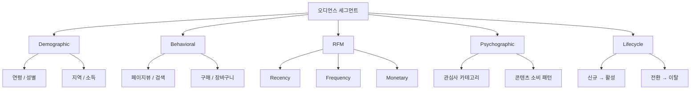
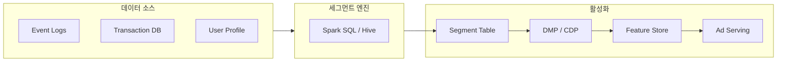
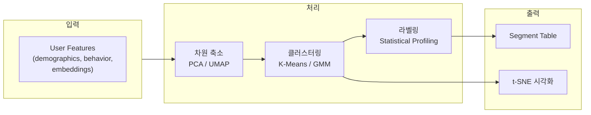
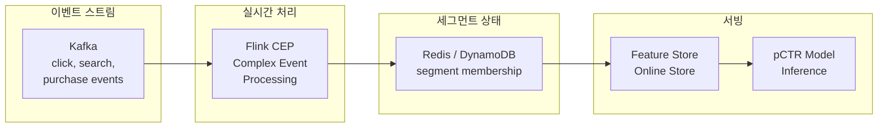
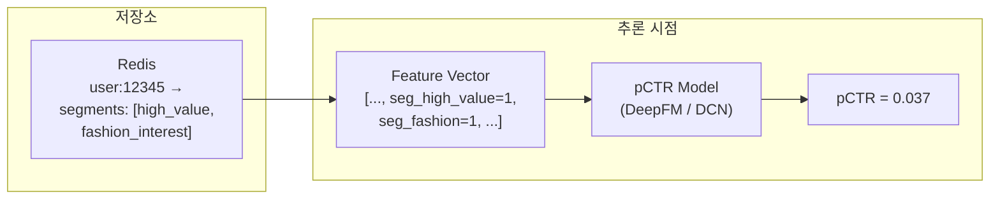
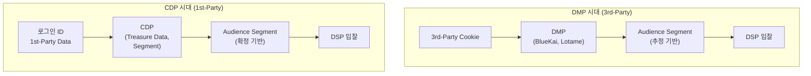

「누구에게 보여줄 것인가?」는 광고가 노출되기 전에 시스템이 가장 먼저 답해야 하는 질문입니다. 광고를 클릭할 확률을 예측하는 pCTR 모델을 아무리 정교하게 만들고 입찰 전략을 최적으로 설계해도 광고가 **적절한 오디언스에게 도달하지 못하면** 모든 노력이 의미를 잃습니다. 오디언스는 광고를 보여 줄 대상 유저입니다. 오디언스 세그멘테이션은 수백만~수억 명의 유저를 광고주가 바로 타겟팅에 쓸 수 있는 **행동 가능한 그룹(Actionable Audience)**으로 묶는 일이며 이렇게 묶은 그룹 하나하나를 세그먼트라고 부릅니다. 세그먼트는 사이트나 앱에서 행동한 유저에게 광고를 다시 보여 주는 리타겟팅을 비롯한 모든 타겟팅 전략의 출발점입니다. [Lookalike 모델링(Lookalike Modeling)](post.html?id=lookalike-modeling)은 기준이 되는 시드 오디언스와 닮은 유저를 찾아 오디언스를 넓히는 방법인데, 그 시드 오디언스도 세그먼트에서 나옵니다.

[Ad Tech 개발 레이어](post.html?id=adtech-dev-layers) 편의 구조로 보면 세그멘테이션은 데이터 레이어와 모델링 레이어가 만나는 자리에 놓여 있습니다. 이벤트 로그(유저가 검색하고 클릭하고 구매한 기록)는 [피처 스토어(Feature Store)](post.html?id=feature-store-serving)를 거쳐 실시간으로 서빙됩니다. 피처 스토어는 모델이 쓰는 피처를 저장해 두었다가 추론할 때 바로 꺼내 주는 저장소입니다. 오디언스를 정의하고 활성화하는 방식은 무대마다 다른데, 이 블로그는 무대를 [닫힌 생태계(Walled Garden)](post.html?id=walled-garden)와 열린 RTB(Open RTB) 두 가지로 나눕니다. 닫힌 생태계에서는 네이버, 카카오, Meta, Google 처럼 로그인한 회원의 데이터를 가진 플랫폼이 자기 안에서 타겟팅까지 합니다. 열린 RTB 는 광고 자리가 날 때마다 입찰 요청이 여러 광고 구매 플랫폼에 전달되고 실시간 경매(RTB, Real-Time Bidding)로 낙찰이 정해지는 시장입니다. 이 글은 사람이 조건을 SQL 로 적는 규칙 기반(Rule-based) 세그먼트에서 시작해 ML 기반 클러스터링, 이벤트가 들어오는 즉시 세그먼트를 붙이는 실시간 스트리밍 할당, 세그먼트를 pCTR 모델의 피처로 넣는 연동까지 이어지는 넓은 범위를 엔지니어 관점에서 정리합니다.

> **골라 읽는 법** — 마무리까지 절이 12개인 긴 글이라 처음부터 다 읽지 않아도 됩니다.
>
> - 세그먼트가 무엇이고 어떤 종류가 있는지 → 1~2절
> - 세그먼트를 만드는 방법(SQL 규칙, ML 클러스터링, 실시간 할당) → 3~5절
> - 세그먼트를 pCTR 모델에 쓰고 그 품질을 지켜보는 법 → 6~7절
> - 데이터 출처(DMP, CDP)와 개인정보 규제, 두 무대 비교 → 8~10절
> - 프로덕션 설계 가이드 → 11절

---
## 1. 접근법과 플랫폼 비교 (Executive Summary)

**세그먼트를 만드는 접근법 5가지는 새 행동이 반영되는 속도와 유저를 나누는 세밀함, 결과를 읽기 쉬운 정도, 구현 난도가 서로 다릅니다. 세그먼트를 만드는 데이터의 기반은 외부 쿠키를 쓰는 DMP 에서 자사 데이터를 쓰는 CDP 로 옮겨 가고 있습니다.**

세그먼트를 만드는 방법은 하나가 아니어서 어느 방법을 고르느냐에 따라 오늘의 행동이 세그먼트에 반영되기까지 걸리는 시간도, 광고주에게 세그먼트를 설명할 수 있는 정도도 달라집니다. 그래서 방법마다 자세히 들어가기 전에 전체 지형부터 표 하나로 비교합니다.

### 세그멘테이션 접근법 비교

표의 다섯 줄에 이 글에서 차례로 다룰 접근법을 모았습니다. 규칙 기반 (SQL)은 사람이 조건을 SQL 로 적는 방식(3절)이고 RFM Scoring 은 최근성(Recency), 빈도(Frequency), 금액(Monetary)에 점수를 매기는 방식(2-3절)입니다. K-Means 는 피처가 비슷한 유저끼리 K개 클러스터(비슷한 유저가 모인 그룹)로 나누는 알고리즘(4-1절)이고 GMM 은 유저 한 명을 여러 클러스터에 확률로 나눠 넣습니다(4-2절). Streaming (CEP) 은 실시간 이벤트 흐름에서 정해진 시간 안의 이벤트 패턴을 찾아 세그먼트를 붙이는 Complex Event Processing(5-1절)입니다. 열 이름의 갱신 지연은 새 행동이 세그먼트에 반영되기까지 걸리는 시간, 세분화 수준은 유저를 얼마나 잘게 나눌 수 있는지, 해석 가능성은 그 세그먼트가 어떤 유저인지 사람이 읽어 낼 수 있는 정도를 뜻합니다.

| 접근법 | 입력 데이터 | 갱신 지연 | 세분화 수준 | 해석 가능성 | 구현 복잡도 |
|--------|-----------|----------|-----------|-----------|-----------|
| **규칙 기반 (SQL)** | 이벤트 로그, 프로필 | 시간~일 (배치) | 중간 (조건 조합) | 매우 높음 | 낮음 |
| **RFM Scoring** | 거래 데이터 | 일 1회 (배치) | 중간 (5×5×5 = 125셀) | 높음 | 낮음 |
| **K-Means 클러스터링(K-Means Clustering)** | 유저 피처/임베딩 | 주 1회 (모델 재학습) | 높음 (K개 클러스터) | 중간 (라벨링 필요) | 중간 |
| **GMM (Soft Assignment)** | 유저 피처/임베딩 | 주 1회 (모델 재학습) | 매우 높음 (확률적) | 낮음 (확률 분포) | 높음 |
| **Streaming (CEP)** | 실시간 이벤트 스트림 | 초~분 | 낮음 (단순 규칙) | 매우 높음 | 높음 (인프라) |

RFM 은 세 기준을 각각 1~5점으로 매겨 5 × 5 × 5 = 125셀로 나누므로 세분화 수준이 「중간」에 머뭅니다. GMM 은 유저마다 클러스터별 확률을 주므로 세분화 수준은 「매우 높음」이지만 결과가 확률 분포라 해석 가능성은 「낮음」입니다. Streaming (CEP) 은 갱신 지연이 초~분으로 가장 짧고 해석 가능성도 「매우 높음」이지만 단순 규칙만 돌려 세분화 수준이 「낮음」이고 인프라 때문에 구현 복잡도가 「높음」으로 적혀 있습니다.

### DMP vs CDP 비교

세그먼트의 데이터 기반이 되는 플랫폼에는 두 가지가 있습니다. DMP(Data Management Platform)는 외부(3rd-party) 쿠키로 여러 사이트의 유저 행동을 모아 세그먼트를 만들고 거래하는 플랫폼입니다. 외부 쿠키(cookie)는 유저가 방문한 사이트가 아닌 다른 회사의 도메인이 심는 쿠키라서 여러 사이트에 걸친 행동을 한 브라우저 단위로 연결하는 데 쓰입니다. CDP(Customer Data Platform)는 광고주가 자기 웹, 앱, CRM(고객 관리 시스템), 거래 기록에서 직접 모은 자사(1st-party) 데이터로 유저를 통합하고 세그먼트를 만드는 플랫폼입니다(8-1절, 8-2절). DMP 에서 CDP 로 넘어가는 전환은 지금도 진행되고 있습니다.

| 구분 | DMP | CDP |
|------|-----|-----|
| **주요 데이터** | 외부 쿠키, 외부 데이터 구매 | 자사 행동 데이터, CRM, 거래 |
| **식별자** | 쿠키(Cookie) ID, MAID (비결정론적) | 로그인 ID, 이메일 해시 (결정론적) |
| **데이터 지속성** | 90일 (쿠키 수명) | 무제한 (고객 동의 기반) |
| **주요 용도** | 프로그래매틱 광고 타겟팅 | 전 채널 개인화 + 광고 |
| **대표 서비스** | Lotame, Oracle BlueKai(2024년 사업 종료) | Treasure Data, Segment (Twilio), mParticle |
| **현재 추세** | 축소 (Safari, Firefox의 쿠키 차단) | 성장 (자사 데이터 중심) |

식별자 줄의 쿠키 ID 와 MAID(휴대폰 운영체제가 광고용으로 주는 기기 ID)는 브라우저나 기기 하나를 가리키므로 폰과 PC 의 유저가 같은 사람인지는 확률로 맞춰야 해서 비결정론적입니다. 로그인 ID 와 이메일 해시(이메일 주소를 원래 값으로 되돌릴 수 없게 바꾼 값)는 사람 한 명을 가리키므로 결정론적입니다. 데이터 지속성 줄의 90일은 쿠키의 수명이라 DMP 의 기록은 그 기간까지만 이어집니다. CDP 의 데이터는 쿠키처럼 정해진 수명이 없어 고객이 동의한 동안 계속 이어집니다.

> **DMP 에서 CDP 로**: Safari 와 Firefox 가 외부 쿠키를 차단하고 GDPR(EU 개인정보 보호 규정)과 CCPA(캘리포니아 소비자 개인정보 보호법) 같은 규제도 세지면서 세그멘테이션의 기반이 「외부 데이터 구매(DMP)」에서 「자사 데이터 구축(CDP)」으로 옮겨 가고 있습니다. 이 전환에 실패한 광고주는 타겟팅 정밀도에서 구조적으로 불리한 자리에 놓입니다.

---

## 2. 세그먼트 분류 체계 (Taxonomy)

**오디언스 세그먼트는 어떤 데이터로 유저를 나누느냐에 따라 크게 인구통계, 행동 기반, RFM, Psychographic(관심사), Lifecycle(고객 여정 단계)의 5가지 유형으로 나뉩니다. 유형마다 출발하는 데이터 소스와 타겟팅 정밀도, 쓰는 목적이 다릅니다.**

「25-34세 여성」처럼 인구통계로만 나눈 세그먼트에는 운동화를 찾는 사람과 유아용품을 찾는 사람이 섞여 있어서 어떤 데이터로 나눈 세그먼트인가에 따라 광고에 반응할 유저를 얼마나 정확히 골라내는지가 달라집니다. 그래서 유형마다 무엇으로 만들고 어디에 쓰는지 차례로 봅니다. 분류 체계(Taxonomy)는 대상을 상위 유형과 하위 유형으로 나눈 체계입니다. 아래 그림은 5가지 유형마다 쓰는 대표 데이터를 계층으로 그렸습니다.



### 2-1. 인구통계(Demographic) 세그먼트

인구통계 세그먼트는 가장 기본적인 세그멘테이션으로, 연령, 성별, 소득 수준, 거주 지역 같은 **인구통계학적 속성**으로 유저를 나눕니다.

**데이터 소스**: 회원가입 정보, 설문, DMP 가 추정한 데이터를 씁니다. 유저가 직접 밝힌 데이터(Declared Data)가 가장 정확하지만 대부분의 경우 모델로 추정한 데이터(Inferred Data)에 의존합니다. 예를 들어 네이버는 검색 패턴과 서비스 이용 이력으로 연령대와 성별을 추정하는데, 이때 추정이 얼마나 정확한지가 세그먼트 품질을 좌우합니다.

**한계**: 인구통계 세그먼트에는 유저가 지금 무엇을 찾는지를 뜻하는 **의도(Intent)**가 담기지 않습니다. 「25-34세 여성 서울 거주」 세그먼트에는 수백만 명이 들어가는데, 그 안에서 운동화를 찾는 사람과 유아용품을 찾는 사람은 같은 광고에 완전히 다르게 반응합니다. 그래서 인구통계 세그먼트는 혼자 쓰기보다 정밀 타겟팅 전에 범위를 먼저 좁히는 **Pre-filter**로 씁니다. 연령과 성별로 대상을 먼저 좁힌 다음 2-2절의 행동 기반(Behavioral) 세그먼트로 정밀하게 타겟팅하는 방식입니다.

**프로덕션 활용**: 광고주가 캠페인을 설정하면서 「25-34세, 여성, 서울/경기」를 고르면 그 조건이 DSP(Demand-Side Platform, 광고주를 대신해 광고 자리에 입찰하는 플랫폼)의 입찰 필터로 작동합니다. 실시간 입찰 메시지의 표준 규격인 OpenRTB 는 광고 자리가 날 때 DSP 에 보내는 입찰 요청을 bid request 라고 부릅니다. 이 조건에 해당하는 bid request 필드가 `user.gender`(성별), `user.yob`(출생 연도), `device.geo`(위치)입니다.

### 2-2. 행동 기반 세그먼트

행동 기반 세그먼트는 유저의 **실제 행동**으로 만든 세그먼트입니다. 유저가 지금 무엇을 원하는지 보여 주는 **의도 신호(Intent Signal)**를 직접 담기 때문에 인구통계보다 훨씬 강한 신호를 주며 광고 반응 예측과의 상관관계도 가장 높습니다. 「운동화를 검색한 사람」은 「25-34세 남성」보다 운동화 광고에 반응할 확률이 압도적으로 높습니다.

**행동 데이터 유형**: 이 글이 예로 드는 행동 기록은 4가지입니다.
- **검색 쿼리**: 「나이키 에어맥스 가격」을 검색한 유저는 구매 의도가 높다고 봅니다.
- **페이지뷰**: 상품 상세 페이지를 3회 이상 방문한 유저는 관심이 깊은 고관여 유저입니다.
- **장바구니**: 상품을 담고 사지 않은 유저는 리타겟팅 대상이 됩니다.
- **앱 활동**: 앱을 설치하고 7일 이내에 쓰지 않은 유저에게는 이탈 위험이 있습니다.

**세그먼트 예시**: 이 기록으로 만든 세그먼트의 이름과 그 세그먼트로 하는 광고는 이렇습니다.
- `최근_7일_운동화_검색_3회이상`: 운동화 카테고리 광고가 주로 노리는 타겟입니다.
- `30일_내_3회_이상_구매`: 자주 사는 고빈도 구매자라서 산 상품과 관련된 다른 상품을 권하는 Cross-sell 의 기회가 됩니다.
- `장바구니_이탈_24시간_이내`: 리타겟팅 세그먼트 가운데 전환율이 가장 높습니다.
- `앱_미사용_14일_이상`: 푸시 알림이나 떠난 유저가 다시 쓰게 만드는 Re-engagement 캠페인을 보낼 대상입니다.

의도 신호는 시간이 지날수록 세기가 급격히 떨어지는데(Recency Decay), 7일 전 검색과 1시간 전 검색은 의도의 세기가 완전히 다릅니다. 그래서 세그먼트를 다시 계산하는 간격인 **갱신 주기**를 신경 써서 정해야 합니다.

### 2-3. RFM 세그먼트

RFM(Recency, Frequency, Monetary)은 우편이나 전화로 고객에게 직접 판촉하는 Direct Marketing 에서 시작된 고전적 기법입니다. 오래됐어도 여전히 가장 실용적인 세그멘테이션 프레임워크이며 고객 가치를 세 가지 기준의 점수로 나타냅니다.

- **Recency (R)**: 마지막 구매나 활동 뒤로 지난 시간입니다. 최근일수록 점수가 높습니다.
- **Frequency (F)**: 정해진 기간 안의 구매나 활동 횟수입니다. 많을수록 점수가 높습니다.
- **Monetary (M)**: 정해진 기간 안의 총 구매 금액이며 클수록 점수가 높습니다.

세 기준을 각각 1-5점으로 매기면 R 이 5가지, F 가 5가지, M 이 5가지라 이론적으로 $5 \times 5 \times 5 = 125$개의 셀(점수 조합)이 나옵니다. 실무에서는 이 셀들을 뜻이 있는 그룹으로 합쳐 씁니다.

$$\text{RFM Score} = (R, F, M) \quad \text{where each} \in \{1, 2, 3, 4, 5\}$$

아래 표에 셀을 합쳐 만든 대표 그룹 다섯 가지와 그 점수 범위, 광고 전략을 모았습니다.

| 세그먼트 | R | F | M | 설명 | 광고 전략 |
|----------|---|---|---|------|----------|
| **Champions** | 5 | 5 | 5 | 최근 + 자주 + 고액 구매 | 로열티 프로그램, Cross-sell 프리미엄 상품 |
| **Loyal** | 3-4 | 4-5 | 4-5 | 꾸준히 자주 구매하는 충성 고객 | Upsell, 신상품 우선 노출 |
| **At Risk** | 1-2 | 3-5 | 3-5 | 과거에 우수했지만 최근 이탈 조짐 | Win-back 캠페인, 할인 쿠폰 |
| **Hibernating** | 1-2 | 1-2 | 1-2 | 장기 비활성 유저 | 재활성화 시도 or 타겟팅 제외 |
| **New** | 5 | 1 | 1 | 최근 첫 구매한 신규 고객 | 온보딩, 2차 전환 유도, 웰컴 쿠폰 |

At Risk 줄은 R 이 1-2 라 마지막 구매나 활동이 오래전이지만 F 와 M 이 3-5 라 예전에는 자주, 큰 금액을 구매한 고객이므로 떠난 고객을 되찾는 Win-back 캠페인과 할인 쿠폰을 씁니다. Loyal 줄의 Upsell 은 더 비싼 상품을 권하는 전략입니다.

RFM 의 강점은 결과를 사람이 바로 읽을 수 있는 **해석 가능성**입니다. 클러스터링이 내놓는 「Cluster 3」 같은 이름은 아무도 이해하지 못하지만 「At Risk (R=1, F=4, M=5) — 과거 고액 다빈도 구매자가 최근 30일 미활동」이라고 하면 광고주가 듣자마자 전략을 세울 수 있습니다. 그래서 ML 클러스터링을 들이기 전에 RFM 으로 먼저 시작하는 순서가 실무에서 올바릅니다.

### 2-4. Psychographic & Interest 세그먼트

Psychographic 은 마케팅에서 관심사나 가치관 같은 심리적 특성을 가리키는 말입니다. Psychographic 세그먼트는 유저의 **관심사, 가치관, 라이프스타일**로 만든 세그먼트로, 행동 기반 세그먼트가 유저가 「무엇을 했는가」를 본다면 Psychographic 세그먼트는 「무엇에 관심이 있는가」를 봅니다.

**데이터 소스**: 어떤 기사를 읽는지(콘텐츠 소비 패턴), 무엇을 찾는지(검색 쿼리), 무엇에 반응하는지(소셜 인터랙션)와 앱 설치 목록, 구독 서비스를 씁니다. 이 신호들을 모아 유저마다 관심사 카테고리에 연결(매핑)합니다.

**Taxonomy 구조**: Meta 와 Google 은 각각 1,000개 이상의 관심사 카테고리를 운영합니다. Meta 의 Detailed Targeting 은 「패션 > 스트리트웨어 > 나이키」, 「스포츠 > 러닝 > 마라톤」처럼 넓은 카테고리 아래로 좁은 카테고리가 이어지는 계층 구조입니다. 업계 표준 분류로는 디지털 광고 업계 단체 IAB 가 만든 **IAB Content Taxonomy** 가 있는데, 현재 버전 3.0 이 약 700개의 콘텐츠 카테고리를 정의합니다. OpenRTB bid request 에서는 사이트의 카테고리를 적는 `site.cat` 또는 앱의 카테고리를 적는 `app.cat` 필드가 이 IAB 카테고리 값을 씁니다.

**구축 방법**: 관심사 세그먼트는 자사 데이터로 직접 만들 수도 있습니다. 먼저 NLP(자연어 처리) 모델로 유저가 소비한 콘텐츠를 분류한 다음 TF-IDF 나 embedding 으로 카테고리마다 유저의 관심 정도를 나타내는 affinity score 를 계산합니다. TF-IDF 는 어떤 낱말이 한 문서에 자주 나오고 다른 문서에는 드물수록 높은 점수를 주는 방법입니다. embedding 은 유저나 콘텐츠를 숫자 벡터로 나타낸 값입니다. 예를 들어 한 유저가 최근 30일 동안 「스트리트웨어」 관련 기사를 10건 이상 읽었다면 그 유저의 「패션 > 스트리트웨어」 affinity 는 높게 잡힙니다.

### 2-5. Lifecycle 세그먼트

Lifecycle 세그먼트는 유저가 처음 방문해 구매하고 떠나기까지 거치는 **고객 여정 단계**로 나눈 세그먼트입니다. 같은 제품에 관심이 있어도 신규 방문자와 재구매 고객에게는 완전히 다른 광고 메시지와 입찰 전략이 필요하기 때문에 단계별로 나눕니다.

**Lifecycle 단계**: 단계는 아래 순서로 이어집니다.
```
신규 방문자 → 활성 유저 → 첫 전환자 → 재구매 고객 → 충성 고객 → 이탈 위험 → 이탈
```

단계마다 광고 목표가 다릅니다. 아래 목록은 단계마다 목표와 함께 광고를 사는 기준을 적었습니다. CPM 은 노출 1,000번당, CPC 는 클릭 한 번당, CPA 는 전환 한 번당 비용을 기준으로 삼는 광고입니다. ROAS 기반은 광고비 대비 매출을 기준으로 삼습니다.
- **신규 방문자**: 목표는 브랜드 인지도와 회원가입 유도이고 CPM 기반 광고를 씁니다.
- **활성 유저 (미전환)**: 제품 탐색 유도와 프로모션 노출을 노리며 CPC 기반으로 삽니다.
- **첫 전환자**: 2차 구매를 이끌고 관련 상품을 추천하는 단계이며 CPA 기반입니다.
- **재구매 고객**: Cross-sell 과 Upsell 을 노리고 ROAS 를 기준으로 삼습니다.
- **이탈 위험**: Win-back 캠페인을 하면서 높은 입찰가로 적극 리타겟팅합니다.
- **이탈 고객**: Re-engagement 캠페인을 하거나 타겟팅에서 제외합니다.

### 세그먼트 유형 종합 비교

다섯 유형을 데이터 소스, 예시, 갱신 주기, 타겟팅 정밀도로 나란히 놓으면 아래와 같습니다. 느리게 변하는 인구통계는 주 1회, 의도 신호가 빨리 약해지는 행동 기반은 일 1회 ~ 실시간으로 갱신합니다(11-2절, 2-2절).

| 유형 | 데이터 소스 | 예시 | 갱신 주기 | 타겟팅 정밀도 |
|------|-----------|------|----------|-------------|
| **인구통계** | 회원 정보, 추정 모델 | 25-34세 여성, 서울 거주 | 주 1회 | 낮음 |
| **행동 기반** | 이벤트 로그 | 최근 7일 운동화 검색 3회+ | 일 1회 ~ 실시간 | 높음 |
| **RFM** | 거래 데이터 | Champions (R5-F5-M5) | 일 1회 | 중간 |
| **Psychographic** | 콘텐츠 소비, 검색 | 패션 > 스트리트웨어 관심 | 주 1회 | 중간 |
| **Lifecycle** | 전환 이벤트 | 첫 구매 후 30일 미재방문 | 일 1회 | 높음 |

> 실무에서 가장 효과적인 타겟팅은 여러 유형의 조건을 모두 만족하는 유저만 남기는 **세그먼트 조합(Intersection)**입니다. 「25-34세 여성 + 최근 7일 운동화 검색 + At Risk」는 인구통계, 행동 기반, RFM 조건을 하나씩 겹친 조합입니다. 이렇게 여러 유형을 교차하면 정밀도가 크게 올라가지만 너무 많이 교차하면 세그먼트에 남는 유저가 너무 적어져 결과가 우연이 아니라고 볼 근거인 통계적 유의성과 광고가 닿는 사람 수인 도달 범위(Reach)가 함께 떨어집니다.

---

## 3. 규칙 기반(Rule-Based) 세그멘테이션

**대부분의 프로덕션 세그먼트는 사람이 조건을 SQL 로 적는 규칙 기반으로 시작합니다. 세그먼트가 수백 개로 늘면 규칙 사이의 중복과 의존 관계를 파악하기 어려워지므로 세그먼트 정의를 코드처럼 파일로 관리합니다.**

규칙 기반 세그먼트는 1절 표에서 해석 가능성이 「매우 높음」, 구현 복잡도가 「낮음」인 방식이지만 프로덕션에서는 요청이 쌓이면서 관리 문제가 생깁니다. 3-1절에서 실제로 쓰는 SQL 패턴을 보고 3-2절에서 그 관리 문제와 해결 방법을 봅니다.

### 3-1. SQL/Hive 기반 세그먼트 정의

SQL 세그먼트 시스템은 이벤트 로그, 거래 DB, 유저 프로필을 입력으로 받아 대용량 데이터에 SQL 을 돌리는 Spark SQL 이나 Hive 에서 유저마다 어느 세그먼트에 속하는지(**세그먼트 멤버십**)를 계산한 뒤 그 결과를 DMP/CDP 와 피처 스토어로 넘깁니다.

카드에서는 조건 한 벌이 사람 목록으로 바뀌는 순서를 보면 됩니다.

<div class="demo-embed-wrap">
<iframe class="demo-embed" src="demo-targeting-cards.html?embed=1&card=segment" height="480" loading="lazy" title="조건 한 벌이 사람 목록이 된다"></iframe>
<a class="demo-embed-open" href="demo-targeting-cards.html" target="_blank" rel="noopener">↗ 카드 아홉 장 전체로 열기</a>
</div>

아래 그림은 데이터 소스 세 가지(Event Logs, Transaction DB, User Profile)가 세그먼트 엔진(Spark SQL / Hive)을 거쳐 Segment Table 에 쌓인 뒤 DMP / CDP 와 Feature Store 를 지나 광고 서빙(Ad Serving)까지 가는 길입니다.



아래 블록에 프로덕션에서 실제로 쓰는 세그먼트 SQL 패턴 4가지를 모았습니다. 패턴마다 머리 주석에 조건과 「활용」(그 세그먼트로 하는 광고)이 적혀 있습니다.

```sql
-- ============================================================
-- 1. 고가치 최근 구매자 (High-Value Recent Buyer)
-- 최근 30일 내 10만원 이상, 3회 이상 구매한 유저
-- 활용: Cross-sell 프리미엄 상품, 로열티 프로그램 광고
-- ============================================================
INSERT OVERWRITE TABLE segments PARTITION (segment_id = 'high_value_recent')
SELECT user_id
FROM transactions
WHERE purchase_date >= date_sub(current_date, 30)
GROUP BY user_id
HAVING SUM(amount) >= 100000
   AND COUNT(*) >= 3;

-- ============================================================
-- 2. 장바구니 이탈자 (Cart Abandoner — 7일 윈도우)
-- 장바구니에 담았지만 7일 내 구매하지 않은 유저
-- 활용: 가장 전환율이 높은 리타겟팅 세그먼트 중 하나
-- ============================================================
INSERT OVERWRITE TABLE segments PARTITION (segment_id = 'cart_abandon_7d')
SELECT DISTINCT a.user_id
FROM cart_events a
LEFT JOIN purchase_events b
  ON a.user_id = b.user_id
  AND a.product_id = b.product_id
  AND b.event_date BETWEEN a.event_date AND date_add(a.event_date, 7)
WHERE a.event_date >= date_sub(current_date, 7)
  AND b.user_id IS NULL;

-- ============================================================
-- 3. 신규 유저 (14일 이내 가입)
-- 최근 2주 내 가입한 유저 — 온보딩 광고 대상
-- 활용: 웰컴 쿠폰, 첫 구매 유도 캠페인
-- ============================================================
INSERT OVERWRITE TABLE segments PARTITION (segment_id = 'new_user_14d')
SELECT user_id
FROM user_profiles
WHERE signup_date >= date_sub(current_date, 14);

-- ============================================================
-- 4. 이탈 위험 유저 (과거 활성 → 최근 30일 미접속)
-- 90일 전까지 활발했지만 최근 30일간 접속하지 않은 유저
-- 활용: Win-back 캠페인, 특별 할인 리타겟팅
-- ============================================================
INSERT OVERWRITE TABLE segments PARTITION (segment_id = 'churn_risk')
SELECT user_id
FROM user_activity
WHERE last_active_date BETWEEN date_sub(current_date, 90)
                          AND date_sub(current_date, 30)
  AND total_sessions_90d >= 10;
```

1번 고가치 최근 구매자 쿼리는 `purchase_date >= date_sub(current_date, 30)` 으로 최근 30일 거래만 남기고 `GROUP BY user_id` 로 유저마다 모은 뒤 `HAVING SUM(amount) >= 100000 AND COUNT(*) >= 3` 으로 금액 합이 100000원(10만 원) 이상이면서 구매가 3건 이상인 유저만 `high_value_recent` 파티션에 씁니다. LEFT JOIN 은 왼쪽 테이블의 행을 모두 남기고 오른쪽 테이블에 맞는 행이 없으면 빈 값(NULL)을 붙이는 조인입니다. 2번 장바구니 이탈자 쿼리는 최근 7일의 장바구니 이벤트에 같은 유저, 같은 상품의 구매 이벤트를 LEFT JOIN 하되 담은 날부터 7일 안의 구매만 붙이므로, 붙은 구매가 없어 `b.user_id IS NULL` 인 행의 유저가 「담고 7일 안에 사지 않은」 유저입니다. 3번 신규 유저는 가입일이 최근 14일 안에 있는 유저입니다. 4번 이탈 위험 유저 쿼리는 마지막 접속일이 90일 전과 30일 전 사이이면서 최근 90일 세션이 10회 이상인 유저만 고르므로 예전에는 자주 왔지만 최근 30일은 오지 않은 사람만 남습니다.

SQL 4개는 모두 `INSERT OVERWRITE TABLE segments PARTITION (segment_id = ...)` 로 세그먼트 테이블에서 자기 파티션의 결과만 덮어씁니다. `segment_id` 를 파티션 키(테이블을 나눠 저장하는 기준 열)로 쓰면 세그먼트마다 따로 갱신할 수 있고 갱신 주기도 세그먼트마다 다르게 잡을 수 있습니다. 예를 들어 장바구니 이탈은 2-2절에서 본 것처럼 시간이 지나면 빨리 약해지는 의도 신호라서 `cart_abandon_7d` 는 매시간 갱신하지만 `churn_risk` 는 일 1회면 충분합니다.

### 3-2. 규칙 관리와 버전 관리

규칙 기반 세그먼트는 사람이 조건을 손으로 적는 방식이라 간단해 보입니다. 하지만 프로덕션에서는 광고주와 마케터의 요청이 쌓이면서 세그먼트 규칙이 수백 개로 늘고 규칙 사이의 중복, 의존성, 상충 관계를 파악하기 어려워지는 **규칙 폭증(Rule Proliferation)** 문제를 만납니다.

**규칙 폭증의 증상**: 규칙이 폭증하면 아래 같은 일이 생깁니다.
- `cart_abandon_7d`, `cart_abandon_3d`, `cart_abandon_24h`, `cart_abandon_7d_high_value` 처럼 비슷하지만 조금씩 다른 세그먼트가 20개 이상 생깁니다.
- 어떤 세그먼트가 어떤 캠페인에 연결되어 있는지 아는 사람이 없습니다.
- 세그먼트 정의를 바꿨을 때 그 결과를 받아 쓰는 뒤 단계(downstream)가 어디까지 영향을 받는지 알 수 없습니다.
- 아무도 쓰지 않는 세그먼트가 여전히 매일 계산되어 컴퓨팅 자원을 낭비합니다.

**해결 방법**: 세그먼트 정의를 코드처럼 파일로 관리합니다(**Segment-as-Code**). 세그먼트마다 SQL 정의, 갱신 주기, 소유자, 의존하는 데이터 소스를 설정 파일 형식인 YAML 이나 JSON 스키마로 선언하고 Git 으로 버전을 관리합니다. 세그먼트 사이의 의존 관계는 방향이 있고 순환이 없는 그래프인 DAG(Directed Acyclic Graph)로 적어 두는데, 그러면 작업 순서를 짜고 돌리는 Airflow 나 Dagster 같은 워크플로우 엔진이 세그먼트를 올바른 순서로 실행합니다.

아래는 3-1절의 1번 고가치 최근 구매자 세그먼트를 이렇게 선언한 YAML 파일입니다.

```yaml
# segment_definitions/high_value_recent.yaml
segment_id: high_value_recent
name: "고가치 최근 구매자"
description: "30일 내 10만원+, 3회+ 구매 유저"
owner: marketing-analytics@company.com
schedule: "0 6 * * *"  # 매일 06:00 UTC
source_tables:
  - transactions
sql_file: sql/high_value_recent.sql
dependencies:
  - segment_id: null  # 다른 세그먼트에 의존하지 않음
downstream_consumers:
  - campaign: summer_crosssell_2024
  - feature_store: seg_high_value_recent
ttl_days: 1
min_size: 1000
max_size: 5000000
```

`schedule` 의 `"0 6 * * *"` 은 매일 06:00 UTC 에 돌리라는 cron 표기입니다. `dependencies` 의 `segment_id: null` 은 다른 세그먼트에 의존하지 않는다는 뜻입니다. `downstream_consumers` 에는 이 세그먼트를 받아 쓰는 캠페인 `summer_crosssell_2024` 와 피처 스토어 피처 `seg_high_value_recent` 가 적혀 있어서 정의를 바꿀 때 영향받는 곳을 바로 찾을 수 있습니다. `min_size: 1000` 과 `max_size: 5000000` 은 11-3절 카탈로그 표가 「크기 경고 범위」라고 부르는 값입니다.

이렇게 세그먼트마다 메타데이터를 파일로 관리하는 체계가 **세그먼트 카탈로그**(모든 세그먼트의 정의, 소유자, 사용처를 한곳에 모은 목록, 11-3절)의 기초가 됩니다. 7절의 건강성 모니터링도 이 카탈로그 위에서 돌아갑니다.

---

## 4. ML 기반 세그멘테이션

**규칙은 분석가가 이미 아는 패턴만 담으므로, 유저 피처에서 비슷한 유저끼리 모인 그룹을 찾는 ML 클러스터링으로 분석가가 몰랐던 세그먼트를 찾습니다. 찾은 클러스터에는 사람이 읽을 수 있는 라벨을 붙이고 실무에서는 그 패턴을 다시 SQL 규칙으로 옮겨 배포합니다.**

「최근 7일 운동화 검색 3회」 같은 규칙은 분석가가 이미 알고 있는 패턴을 코드로 옮긴 결과일 뿐 데이터에서 새 패턴을 찾아낸 결과가 아니라서 규칙 기반 세그먼트는 명시적이고 해석할 수 있어도 **유저 사이에 숨은 패턴**은 찾지 못합니다. 클러스터링은 정답 라벨 없이 피처가 비슷한 데이터끼리 모아 그룹(클러스터)을 만드는 방법입니다. ML 기반 클러스터링은 유저 한 명을 피처 값들로 이루어진 점 하나로 놓은 유저 피처 공간에서 **자연스러운 그룹**을 찾아 분석가가 미처 알아차리지 못한 세그먼트를 보여 줍니다.

아래 그림은 유저 피처(인구통계, 행동, 임베딩)가 차원 축소(PCA / UMAP, 4-3절), 클러스터링(K-Means / GMM), 라벨링(Statistical Profiling, 4-4절)을 거쳐 Segment Table 이 되는 흐름입니다. 클러스터 결과는 고차원 점을 2차원에 비슷한 것끼리 가깝게 그리는 t-SNE 로 시각화합니다.



### 4-1. K-Means 클러스터링

K-Means 는 가장 널리 쓰이는 클러스터링 알고리즘입니다. $N$명의 유저를 $K$개의 클러스터로 나누되 클러스터마다 그 안의 유저가 중심에서 흩어진 정도(분산)를 가장 작게 만드는 것이 목표입니다.

**목적 함수 (Inertia)**: Inertia $J$ 는 이 목표를 식 하나로 적은 값입니다. 유저마다 자기 클러스터 중심까지의 거리를 제곱해 모두 더한 값이라 작을수록 클러스터가 촘촘합니다.

$$J = \sum_{k=1}^{K} \sum_{x_i \in C_k} \|x_i - \mu_k\|^2$$

여기서 $C_k$ 는 클러스터 $k$ 에 속한 유저 집합, $\mu_k$ 는 클러스터 $k$ 의 중심(centroid)입니다. 알고리즘은 (1) 유저마다 가장 가까운 centroid 의 클러스터에 할당하고 (2) centroid 마다 그 클러스터에 든 유저들의 평균 위치로 옮기는 두 단계를 번갈아 되풀이합니다. centroid 가 옮겨 가면 유저마다 가장 가까운 centroid 가 바뀔 수 있으므로 할당이 더는 바뀌지 않을 때(수렴)까지 돌립니다.

**최적 K 결정**: $K$ 를 몇으로 정할지는 언제나 어려운 문제인데, 표준으로 쓰는 방법이 두 가지 있습니다.

1. **Elbow Method**: $K$ 를 1부터 하나씩 늘리면서 Inertia $J$ 가 얼마나 줄어드는지 봅니다. $K$ 가 커질수록 클러스터가 작아져 $J$ 는 계속 줄어들지만 어느 지점부터 줄어드는 기울기가 급격히 완만해지는데, 그래프가 꺾이는 그 지점(「팔꿈치」)의 $K$ 가 최적 $K$ 의 후보입니다.

2. **Silhouette 점수(Silhouette Score)**: 유저 $i$ 마다 같은 클러스터의 다른 유저까지 평균 거리 $a(i)$ 와 가장 가까운 다른 클러스터의 유저까지 평균 거리 $b(i)$ 를 비교합니다.

$$s(i) = \frac{b(i) - a(i)}{\max(a(i), b(i))}$$

$s(i) \in [-1, 1]$ 입니다. 자기 클러스터가 촘촘해 $a(i)$ 가 $b(i)$ 보다 훨씬 작으면 분모가 $b(i)$ 이고 분자 $b(i) - a(i)$ 가 $b(i)$ 에 가까워져 $s(i)$ 는 1 에 다가갑니다. 반대로 다른 클러스터가 더 가까워 $a(i)$ 가 $b(i)$ 보다 크면 분자가 음수라 $s(i)$ 도 음수가 됩니다. 그래서 $s(i)$ 가 1 에 가까울수록 유저 $i$ 가 올바른 클러스터에 잘 할당되었다는 뜻입니다. $K$ 는 전체 유저의 평균 Silhouette 점수가 가장 높은 값으로 고릅니다.

아래 표는 K-Means 와 4-2절의 GMM, 그리고 점이 빽빽한 영역을 클러스터로 보는 DBSCAN 을 클러스터 형태, 할당 방식, 하이퍼파라미터(사람이 정해 주는 설정값), 장점, 한계로 비교합니다.

| 알고리즘 | 클러스터 형태 | 할당 방식 | 하이퍼파라미터 | 장점 | 한계 |
|----------|-------------|----------|--------------|------|------|
| **K-Means** | 구형 (Spherical) | Hard (1 cluster) | $K$ | 빠름, 직관적, 대규모 데이터 적합 | 비구형 클러스터에 약함 |
| **GMM** | 타원형 (Ellipsoidal) | Soft (확률) | $K$, 공분산 타입 | 확률적 할당, 유연한 형태 | 수렴 느림, 초기화 민감 |
| **DBSCAN** | 임의 형태 | Hard + Noise 탐지 | $\epsilon$, min_samples | $K$ 불필요, 노이즈 탐지 | 밀도 차이에 민감, 고차원 약함 |

K-Means 는 클러스터를 중심에서 모든 방향으로 고르게 퍼진 구형(Spherical)으로 보고 유저를 클러스터 하나에만 넣습니다(Hard). 빠르고 직관적이며 대규모 데이터에 알맞지만 구형이 아닌 클러스터에는 약합니다. DBSCAN 은 $K$ 를 정하지 않아도 되고 어느 클러스터에도 속하지 않는 노이즈 점까지 찾는 대신 밀도 차이에 민감하고 고차원 데이터에 약합니다.

### 4-2. GMM (Gaussian Mixture Model)

K-Means 의 가장 큰 한계는 유저를 반드시 클러스터 하나에만 넣는 **Hard Assignment** 입니다. 두 클러스터의 경계에 있는 유저도 한쪽으로만 들어가 어느 쪽인지 불확실하다는 사실을 표현할 수 없는데, 광고 세그멘테이션에서는 한 유저가 「패션」과 「스포츠」에 함께 관심이 있는 경우가 흔하기 때문에 이 한계가 심각한 문제가 됩니다. GMM(Gaussian Mixture Model)은 유저 한 명을 여러 클러스터에 확률로 나눠 넣는 클러스터링입니다. 이 글은 이 방식을 **확률로 나눠 넣기(Soft Assignment)** 라고 부릅니다.

:::deep 더 깊이 — GMM의 혼합 분포와 EM 알고리즘

GMM 은 데이터가 가우시안(정규) 분포 $K$개를 섞은 분포에서 만들어졌다고 가정합니다.

$$P(x) = \sum_{k=1}^{K} \pi_k \, \mathcal{N}(x \mid \mu_k, \Sigma_k)$$

여기서 $\pi_k$ 는 혼합 계수(mixing coefficient)로, 데이터가 컴포넌트 $k$ 에서 나올 비율이라 $\sum_{k=1}^{K} \pi_k = 1$ 을 만족합니다. $\mu_k$ 와 $\Sigma_k$ 는 가우시안 컴포넌트마다의 평균과 공분산 행렬입니다.

**EM 알고리즘**: 아래 두 단계를 번갈아 되풀이해 파라미터를 맞춥니다.
1. **E-step (Expectation)**: 지금 파라미터에서 유저 $x_i$ 가 클러스터 $k$ 에 속할 **책임(Responsibility)** $\gamma_{ik}$ 를 계산합니다. 아래 식의 분자는 컴포넌트 $k$ 가 $x_i$ 를 만들 가능성이고 분모는 모든 컴포넌트의 가능성을 더한 값이라서 유저 한 명의 $\gamma_{ik}$ 를 클러스터마다 모두 더하면 1 이 됩니다.
   $$\gamma_{ik} = \frac{\pi_k \, \mathcal{N}(x_i \mid \mu_k, \Sigma_k)}{\sum_{j=1}^{K} \pi_j \, \mathcal{N}(x_i \mid \mu_j, \Sigma_j)}$$

2. **M-step (Maximization)**: $\gamma_{ik}$ 를 가중치로 삼아 $\pi_k$, $\mu_k$, $\Sigma_k$ 를 다시 계산합니다. 책임이 큰 유저일수록 그 클러스터의 평균과 공분산에 크게 반영됩니다.
:::

**Soft Assignment 의 광고 활용**: GMM 이 내놓는 값은 유저마다 각 클러스터에 속할 확률을 모은 **확률 벡터**입니다. 유저 A 가 「패션」 클러스터에 70%, 「스포츠」 클러스터에 30% 확률로 할당되었다면 확률 벡터의 값 0.7 과 0.3 을 그대로 캠페인별 입찰 가중치로 쓸 수 있습니다:
- 패션 광고 캠페인에서는 유저 A 의 입찰 가중치를 0.7 로 둡니다.
- 스포츠 광고 캠페인에서도 가중치 0.3 으로 입찰할 수 있습니다.
- K-Means 였다면 유저 A 는 「패션」에만 들어가 스포츠 광고 기회를 놓칩니다.

이렇게 확률로 나눠 넣으면 K-Means 라면 놓쳤을 스포츠 광고에도 낮은 가중치로 입찰하므로 광고 예산을 효율적으로 배분하는 데 직접 기여합니다.

### 4-3. 유저 임베딩 기반 클러스터링

전통적인 클러스터링은 연령, 구매 횟수, 평균 구매 금액처럼 사람이 직접 설계한 피처를 입력으로 쓰는데, 이렇게 명시적으로 고른 피처로는 유저 행동의 복잡한 패턴을 충분히 담지 못합니다.

그래서 [Two-Tower Model](post.html?id=two-tower-retrieval)의 User Tower 가 만든 유저 임베딩을 입력으로 씁니다. User Tower 는 유저의 모든 상호작용을 128차원 dense vector(대부분의 값이 0 이 아닌 실수로 채워진 벡터)로 압축하는 신경망입니다. 이 유저 임베딩은 행동이 비슷한 유저를 벡터 공간에서 가까이 놓으므로 클러스터링 입력으로 아주 알맞습니다.

**파이프라인**: 유저 임베딩을 정규화(StandardScaler, 피처마다 평균 0 과 분산 1 로 맞추는 변환)한 뒤 차원 축소(PCA/UMAP)로 차원을 줄여 클러스터링(K-Means/GMM)에 넣습니다. PCA 는 분산을 가장 많이 담는 방향 몇 개만 남기는 선형 차원 축소입니다. UMAP 은 가까운 점끼리의 이웃 관계를 지키면서 차원을 줄이는 비선형 방법입니다.

아래 블록은 이 파이프라인을 sklearn 으로 적은 실무 코드로, 자기 임베딩 파일이 있어야 돌아가므로 그대로 실행되지는 않습니다. 임베딩을 32차원으로 줄인 뒤 K-Means 와 GMM 으로 세그먼트 8개를 할당한 다음 GMM 확률로 유저마다 주 세그먼트와 둘째 세그먼트를 적는 순서를 보면 됩니다.

```python
# (실무 파이프라인 — 그대로 실행되지 않습니다.)
# 하는 일: Two-Tower 의 유저 임베딩을 정규화하고 PCA 로 32차원까지 줄인 뒤, K-Means 와 GMM 으로 세그먼트 8개를 할당하고, GMM 확률로 유저마다 주 세그먼트와 둘째 세그먼트를 적는다.
import numpy as np
from sklearn.cluster import KMeans
from sklearn.mixture import GaussianMixture
from sklearn.preprocessing import StandardScaler
from sklearn.decomposition import PCA

# 1단계: 유저 임베딩을 읽는다
# Two-Tower User Tower 의 출력이다. 자기 임베딩 파일이 있어야 그대로 돌아간다.
user_embeddings = np.load('user_embeddings.npy')  # shape: (N, 128)
user_ids = np.load('user_ids.npy')                # shape: (N,)

# 2단계: 정규화하고 32차원으로 줄인다
scaler = StandardScaler()
X = scaler.fit_transform(user_embeddings)

pca = PCA(n_components=32)
X_reduced = pca.fit_transform(X)
print(f"PCA 누적 설명 분산: {pca.explained_variance_ratio_.sum():.2%}")

# 3단계: K-Means 로 유저마다 세그먼트를 하나씩 할당한다
# Hard Assignment 다.
kmeans = KMeans(n_clusters=8, random_state=42, n_init=10)
hard_labels = kmeans.fit_predict(X_reduced)

# 4단계: GMM 으로 세그먼트마다 확률을 할당한다
# Soft Assignment 다. 유저마다 세그먼트 8개의 확률이 한 행씩 나와 (N, 8) 확률 행렬이 된다.
gmm = GaussianMixture(n_components=8, covariance_type='full', random_state=42)
gmm.fit(X_reduced)
soft_probs = gmm.predict_proba(X_reduced)   # shape: (N, 8) 확률 행렬
primary_labels = gmm.predict(X_reduced)

# 5단계: 세그먼트 테이블을 만든다
# 유저마다 주 세그먼트와 둘째 세그먼트를 확률과 함께 적는다.
segment_records = []
for i, uid in enumerate(user_ids):
    primary_seg = primary_labels[i]
    top2_segs = np.argsort(soft_probs[i])[-2:][::-1]
    top2_probs = soft_probs[i][top2_segs]
    
    segment_records.append({
        'user_id': uid,
        'primary_segment': int(primary_seg),
        'primary_prob': float(top2_probs[0]),
        'secondary_segment': int(top2_segs[1]),
        'secondary_prob': float(top2_probs[1]),
    })
    # → DMP/CDP 또는 Feature Store에 적재
```

블록이 찍는 줄은 `PCA 누적 설명 분산` 하나로, 32개 주성분(PCA 가 남긴 방향)이 원래 128차원 데이터의 분산을 몇 % 담는지 보여 줍니다. 3단계 `KMeans(n_clusters=8, ...)` 는 유저마다 세그먼트 번호 하나(`hard_labels`)를 줍니다. 4단계의 `gmm.predict_proba` 는 유저마다 세그먼트 8개의 확률을 한 행씩 내놓아 (N, 8) 확률 행렬 `soft_probs` 를 만듭니다. 5단계는 각 행에서 `np.argsort(soft_probs[i])[-2:][::-1]` 로 확률이 가장 큰 세그먼트 두 개를 큰 순서대로 골라 `primary_segment` 와 `secondary_segment` 에 확률과 함께 적은 레코드를 DMP/CDP 나 피처 스토어에 적재합니다.

**차원 축소가 꼭 필요한 까닭**: 128차원 임베딩에 K-Means 를 바로 적용하면 「차원의 저주(Curse of Dimensionality)」 문제가 생깁니다. 차원이 높을수록 모든 점 사이의 거리가 비슷해지므로 두 점의 좌표 차이로 계산한 직선 거리인 유클리드 거리로 가까운 점을 모으는 클러스터링이 의미를 잃습니다. PCA 로 32차원, 또는 UMAP 으로 10-20차원까지 줄인 뒤 클러스터링하면 훨씬 깨끗한 군집이 만들어집니다.

### 4-4. 세그먼트 라벨링과 해석

클러스터링 알고리즘은 「Cluster 0」, 「Cluster 1」, … 같은 번호만 출력하므로 광고주와 캠페인 매니저가 이해하고 활용하려면 클러스터마다 **사람이 읽을 수 있는 라벨**을 붙여야 합니다. 그래서 라벨링은 ML 클러스터링에서 마지막까지 남는 **「Last Mile」 문제**입니다.

**Statistical Profiling 방법**: 클러스터마다 전체 유저 평균과 비교해 **과대표(Over-represented)된 피처**, 곧 평균보다 훨씬 자주 나타나는 피처를 찾습니다. 아래는 Cluster 3 을 이렇게 프로파일링한 결과입니다.

```
Cluster 3 프로파일:
  - 평균 연령: 27.3세 (전체 평균: 34.1세) ↓
  - 스포츠웨어 구매 비율: 42% (전체: 12%) ↑↑
  - 모바일 앱 사용 비율: 89% (전체: 61%) ↑
  - 월 평균 구매 금액: 85,000원 (전체: 120,000원) ↓
  → 라벨: "모바일 중심 영스포츠 소비자"
```

Cluster 3 은 스포츠웨어 구매 비율이 42% 로 전체 12% 보다 크게 높아 ↑↑ 표시가, 모바일 앱 사용 비율이 89% 로 전체 61% 보다 높아 ↑ 표시가 붙었습니다. 평균 연령 27.3세는 전체 34.1세보다, 월 평균 구매 금액 85,000원은 전체 120,000원보다 낮아 ↓ 표시가 붙었습니다. 이 특징을 모아 「모바일 중심 영스포츠 소비자」라는 라벨을 붙였습니다.

**자동 라벨링**: 클러스터마다 다른 클러스터와 가장 잘 구별되는 피처 상위 3-5개를 뽑아 조합하면 라벨을 자동으로 만들 수 있습니다. 「패션_관심_고소득_2030」처럼 피처 이름을 연결하는 방식이 가장 직관적이며 LLM(대규모 언어 모델)을 쓰면 프로파일 통계를 자연어 라벨로 바꿀 수도 있습니다.

> ML 클러스터링은 새 패턴을 찾는 「발견(Discovery)」에 강하고 규칙 기반은 명시적이고 해석할 수 있어 바로 돌리는 「실행(Execution)」에 강합니다. 그래서 실무에서는 ML 로 새 패턴을 먼저 발견한 다음 그 패턴을 SQL 규칙으로 코드화해 프로덕션에 배포합니다. 이렇게 발견과 실행을 나눠 맡기는 **Discovery → Rule 파이프라인**이 가장 효과적입니다.

---

## 5. 실시간 세그먼트 할당

**지금 이 순간의 행동은 이벤트가 들어오는 즉시 처리하는 스트리밍으로 세그먼트에 반영하고 무거운 집계는 배치로 계산하는 하이브리드가 대부분의 프로덕션 구성입니다.**

배치 파이프라인(정해진 주기마다 쌓인 데이터를 한꺼번에 처리하는 작업)은 「어제의 데이터」로 세그먼트를 계산합니다. 그런데 유저가 **지금 이 순간** 장바구니에 담고 검색하고 페이지를 넘기는 행동이 가장 강한 의도 신호라서 이 신호는 바로 세그먼트에 반영해야 합니다.

카드에서는 이벤트 하나가 몇 초 만에 세그먼트가 되는 경로를 보면 됩니다.

<div class="demo-embed-wrap">
<iframe class="demo-embed" src="demo-data-model-cards.html?embed=1&card=rtsegment" height="480" loading="lazy" title="이벤트가 초 안에 세그먼트가 되는 길"></iframe>
<a class="demo-embed-open" href="demo-data-model-cards.html" target="_blank" rel="noopener">↗ 카드 여덟 장 전체로 열기</a>
</div>

아래 그림에서 이벤트는 Kafka, Flink CEP, Redis / DynamoDB, 피처 스토어의 Online Store 를 차례로 지나 pCTR 모델 추론까지 갑니다. Kafka 는 들어오는 이벤트를 순서대로 쌓아 두고 여러 컨슈머가 읽어 가게 하는 분산 메시지 시스템입니다. Flink 는 이벤트 흐름을 실시간으로 처리하는 엔진입니다. Redis 는 데이터를 메모리에 키와 값으로 두는 빠른 저장소이고 DynamoDB 는 AWS 의 키-값 데이터베이스입니다. Online Store 는 피처 스토어 가운데 추론할 때 바로 읽는 저장소를 말합니다.



### 5-1. 스트리밍 파이프라인 (Kafka + Flink)

실시간 세그먼트 할당은 **Complex Event Processing (CEP)** 으로 합니다. CEP 는 이벤트 하나만 보지 않고 일정한 시간 윈도우 안에서 이벤트들이 이룬 패턴을 감지해 세그먼트를 할당하는 처리 방식으로, 아래 규칙 1 의 「최근 1시간 안에 검색 3회 이상」이 그런 패턴입니다.

아래 의사코드는 그대로 실행되지 않는 코드로, Kafka 로 들어오는 유저 이벤트마다 규칙 3가지를 확인해 실시간 세그먼트를 할당하고 해제하는 Flink 처리 클래스의 구조를 보여 줍니다.

```python
# (의사코드 — 그대로 실행되지 않습니다.)
# 하는 일: Kafka 로 들어오는 유저 이벤트마다 규칙 셋을 확인해 실시간 세그먼트를 할당하고 해제하는 Flink CEP 처리 클래스의 구조를 보여 준다.
class SegmentAssigner(ProcessFunction):
    """
    Kafka에서 유저 이벤트를 수신하고,
    규칙 기반으로 실시간 세그먼트를 할당/해제합니다.
    세그먼트 상태는 Redis에 저장되어 Feature Store에서 서빙됩니다.
    """
    
    def process_element(self, event, ctx):
        user_id = event.user_id
        
        # 규칙 1: 최근 1시간 내 3회 이상 검색 → "active_searcher"
        search_count = self.state.get_search_count(user_id, window='1h')
        if event.type == 'search':
            search_count += 1
            self.state.update_search_count(user_id, search_count)
        if search_count >= 3:
            self.emit_segment(user_id, 'active_searcher', ttl=3600)
        
        # 규칙 2: 장바구니 추가 후 10분 내 미구매 → "cart_abandoner_rt"
        if event.type == 'add_to_cart':
            ctx.timer_service().register_event_time_timer(
                event.timestamp + 600_000  # 10분 후 트리거
            )
        
        # 규칙 3: 구매 이벤트 → "converter" 세그먼트 즉시 할당
        if event.type == 'purchase':
            self.emit_segment(user_id, 'converter', ttl=86400 * 30)
            # 장바구니 이탈 타이머가 있으면 취소
            self.cancel_cart_abandon_timer(user_id)
            # cart_abandoner 세그먼트 해제
            self.remove_segment(user_id, 'cart_abandoner_rt')
    
    def on_timer(self, timestamp, ctx):
        """10분 타이머 만료 — 구매 없었으면 cart_abandoner_rt 할당"""
        user_id = ctx.get_current_key()
        if not self.state.has_recent_purchase(user_id, window='10m'):
            self.emit_segment(user_id, 'cart_abandoner_rt', ttl=86400)
```

규칙 1 은 최근 1시간(`window='1h'`) 검색 횟수가 3 이상이 되면 `active_searcher` 를 `ttl=3600`(3600초, 1시간)으로 붙입니다. 규칙 2 는 장바구니 추가 이벤트가 오면 `event.timestamp + 600_000` 에 타이머를 거는데, 시각이 밀리초 단위라 `600_000` 밀리초는 10분을 뜻합니다. 10분이 지나 `on_timer` 가 불렸을 때 최근 10분 안에 구매가 없으면 `cart_abandoner_rt` 를 `ttl=86400`(하루)으로 붙입니다. 구매 이벤트가 오면 규칙 3 이 `converter` 를 `ttl=86400 * 30`(30일)으로 바로 붙이면서 남아 있는 장바구니 타이머를 취소하고 이미 붙은 `cart_abandoner_rt` 도 뗍니다.

**TTL(Time-To-Live) 설계**: TTL 은 값을 저장한 뒤 정해진 시간이 지나면 자동으로 지우는 유효 기간입니다. 실시간 세그먼트에는 반드시 TTL 을 설정해야 합니다. `active_searcher` 의 TTL 이 1시간이면 유저가 검색을 멈추고 1시간 뒤 세그먼트에서 저절로 빠집니다. TTL 없이 할당하면 한 번 들어온 유저가 빠지지 않아 세그먼트 크기가 늘기만 하는 단조 증가가 일어나 타겟팅 정밀도가 급격히 떨어집니다.

**상태 관리**: Flink 는 유저별 이벤트 카운터와 타이머를 Keyed State(키마다, 여기서는 유저마다 따로 두는 상태)에 둡니다. 이 상태는 디스크 기반 키-값 저장소인 RocksDB 에 두고 체크포인트(상태의 스냅숏)로 저장하므로 장애가 나도 체크포인트에서 복구해 이벤트를 정확히 한 번씩만 반영하는 exactly-once 시맨틱을 보장합니다. 세그먼트 할당 결과는 Redis 에 저장되어 pCTR 모델이 추론할 때 [피처 스토어](post.html?id=feature-store-serving)의 Online Store 에서 실시간으로 조회됩니다.

### 5-2. 배치 vs 스트리밍 vs 하이브리드

배치와 스트리밍, 그리고 두 방식을 섞은 하이브리드를 갱신 지연, 데이터 범위, 집계, 인프라 비용, 맞는 세그먼트, 장애 영향으로 비교하면 아래와 같습니다.

| 구분 | 배치 (Spark/Hive) | 스트리밍 (Flink) | 하이브리드 |
|------|-------------------|-----------------|-----------|
| **갱신 지연** | 시간 ~ 일 | 초 ~ 분 | 세그먼트별 최적 |
| **데이터 범위** | 전체 이력 | 최근 이벤트 | 이력 + 최근 |
| **복잡한 집계** | 용이 (GROUP BY 전체) | 제한적 (Window 집계) | 배치에서 복잡 집계 |
| **인프라 비용** | 낮음 (주기적 실행) | 높음 (상시 운영) | 중간 |
| **적합한 세그먼트** | RFM, 인구통계, Lifecycle | Cart Abandon, Active Searcher | 대부분의 프로덕션 |
| **장애 영향** | 다음 배치까지 지연 | 실시간 세그먼트 중단 | 배치가 Fallback 역할 |

배치는 전체 이력을 GROUP BY 로 집계하기 쉽고 주기적으로만 돌아 인프라 비용이 낮지만 갱신 지연이 시간 ~ 일입니다. 스트리밍은 지연이 초 ~ 분인 대신 최근 이벤트를 Window 집계로만 다룰 수 있고 상시 운영이라 비용이 높습니다. 장애가 나면 배치는 다음 배치까지 늦어지고 스트리밍은 실시간 세그먼트가 멈추는데, 하이브리드에서는 배치가 Fallback(스트리밍이 멈췄을 때 대신 쓰는 값) 역할을 합니다.

> 대부분의 프로덕션 시스템은 두 방식을 함께 쓰는 **하이브리드 아키텍처**를 택해 무거운 집계가 필요한 세그먼트(RFM, Lifecycle, ML Clustering)는 배치로 계산하고 실시간 반응이 필요한 세그먼트(장바구니 이탈, 활성 검색자, 실시간 전환자)는 스트리밍으로 처리합니다. 배치 층과 실시간 층을 함께 두는 Lambda Architecture, 또는 스트림 하나로 모두 처리하는 Kappa Architecture 를 세그멘테이션에 맞춘 버전이라 할 수 있습니다.

**하이브리드의 설계 원칙**: 같은 유저를 두고 스트리밍 세그먼트와 배치 세그먼트가 충돌하면 **스트리밍이 우선**합니다. 배치가 유저 A 를 「비활성」으로 분류했더라도 스트리밍이 유저 A 의 실시간 검색 이벤트를 감지하면 바로 「active_searcher」로 바꿔야 하는데, 스트리밍이 보는 지금 이 순간의 행동이 가장 강한 의도 신호이기 때문입니다. Redis 에서는 배치 세그먼트와 스트리밍 세그먼트를 서로 다른 키 프리픽스(키 이름 앞부분)로 나눠 저장해 두고 조회할 때 두 세그먼트를 합치면서 스트리밍 값을 우선으로 쓰는 패턴(merge with streaming priority)이 일반적입니다.

---

## 6. 피처로 쓰는 세그먼트: pCTR 모델 연동

**pCTR 모델로 추론할 때마다 Redis 에서 유저의 세그먼트 목록을 읽어 0 과 1 의 벡터나 학습된 벡터(embedding)로 바꿔 피처로 넣는데, 이 조회는 10ms 안에 끝나야 합니다.**

세그먼트를 만드는 일은 절반에 지나지 않습니다. 세그먼트의 **실질적 가치**는 그 세그먼트가 pCTR 모델에 피처로 들어가 입찰 결정을 바꿀 때 생깁니다. 아래 그림은 Redis 의 `user:12345` 에 저장된 세그먼트 [high_value, fashion_interest] 가 피처 벡터의 `seg_high_value=1`, `seg_fashion=1` 이 되어 pCTR 모델에 들어가고 그림의 예시 값 pCTR = 0.037 이 나오는 순서입니다. 모델 상자의 DeepFM 과 DCN 은 피처끼리의 조합 효과까지 학습해 클릭률(CTR)을 예측하는 딥러닝 모델입니다.



### 6-1. 피처 스토어에서 서빙하는 세그먼트 피처

세그먼트 멤버십은 [피처 스토어](post.html?id=feature-store-serving) 가운데 추론할 때 바로 읽는 Online Store(Redis)에 저장됩니다. pCTR 모델로 추론할 때마다 유저의 세그먼트 목록을 조회해 피처 벡터로 인코딩하는데, 이 조회가 **10ms 이내**에 끝나야 하므로 키 하나를 데이터 양과 상관없이 일정한 시간에 찾는 Redis 의 O(1) 조회 성능이 꼭 필요합니다.

**세그먼트 피처 인코딩 방식**: 세그먼트 목록을 모델이 읽는 숫자로 바꾸는 방식은 두 가지입니다.

**1. Multi-hot 인코딩**

전체 세그먼트가 $M$개라면 유저 한 명을 $M$차원 이진 벡터로 나타냅니다. 세그먼트마다 칸이 하나씩 있고 유저가 그 세그먼트에 속하면 1, 아니면 0 인데, 여러 칸이 동시에 1 일 수 있어서 Multi-hot 이라고 부릅니다. 아래 예에서 유저 12345 는 `high_value` 와 `fashion_interest` 칸이 1, `active_searcher` 와 `new_user` 칸이 0 입니다.

```
세그먼트 목록: [high_value, fashion_interest, active_searcher, new_user, ...]
유저 12345:    [    1     ,        1        ,       0        ,    0    , ...]
```

- **장점**: 직관적이고 해석할 수 있으며 구현이 간단합니다.
- **단점**: 세그먼트 수가 늘면 대부분의 칸이 0 인 sparse 벡터가 되고 세그먼트끼리 뜻이 비슷한지도 담지 못합니다.
- **적용 시점**: 세그먼트가 50개 미만일 때 알맞습니다.

**2. 세그먼트 임베딩(Embedding)**

세그먼트마다 dense embedding vector(학습으로 값이 정해지는 짧은 실수 벡터)를 학습합니다. pCTR 모델의 embedding table(ID 마다 벡터를 하나씩 둔 행렬)에 segment_id 를 추가한 뒤 다른 피처의 embedding 과 함께 interaction(두 피처가 함께 있을 때 생기는 효과)을 학습합니다.

$$e_{\text{segment}} = W_{\text{seg}} \cdot \text{one\_hot}(\text{segment\_id})$$

여기서 $W_{\text{seg}} \in \mathbb{R}^{d \times M}$ 은 세그먼트 embedding table 이고 $d$ 는 embedding 차원으로 보통 8-32 를 씁니다. one_hot(segment_id) 는 $M$차원 가운데 그 세그먼트 자리만 1 인 벡터라서 $W_{\text{seg}}$ 에 곱하면 $M$개 열 가운데 그 세그먼트의 열 하나($d$개 숫자)만 남습니다. 세그먼트가 50개이고 $d$ 가 8 이라면 $W_{\text{seg}}$ 는 8 × 50 행렬이 되어 세그먼트 하나의 embedding 은 숫자 8개로 이루어집니다.

- **장점**: 세그먼트끼리 뜻이 비슷한지를 학습해 「high_value」와 「repeat_buyer」 같은 세그먼트가 벡터 공간에서 가까이 놓입니다. 새 세그먼트를 추가해도 그 embedding 을 학습할 수 있습니다.
- **단점**: 해석이 어렵고 학습 데이터가 충분해야 합니다.
- **적용 시점**: 세그먼트가 50개 이상이거나 세그먼트 사이의 interaction 을 꼭 잡아내야 할 때 씁니다.

### 6-2. 세그먼트 임베딩의 심화

[Deep CTR Models](post.html?id=deep-ctr-models) 편에서 다룬 DeepFM 이나 DCN 에서는 세그먼트 embedding 이 광고 카테고리, 크리에이티브(광고 소재) 타입, 유저 임베딩 같은 다른 피처의 embedding 과 함께 **Cross Feature Interaction** 을 이룹니다. Cross Feature Interaction 은 두 피처가 함께 있을 때만 생기는 효과로, 아래 두 조합이 그 예입니다.
- `seg_high_value × ad_category_luxury` 는 양의 interaction 이 강한 조합으로, 고가치 유저에게 럭셔리 광고를 보이면 pCTR 이 높게 나옵니다.
- `seg_new_user × ad_category_luxury` 는 interaction 이 약한 조합으로, 신규 유저에게 럭셔리 광고를 보이면 pCTR 이 낮게 나옵니다.

모델이 이런 interaction 을 학습하면 세그먼트 정보가 pCTR 예측에 가장 효과적으로 반영됩니다. `seg_high_value=1` 을 피처 하나로 그냥 넣는 방법도 있지만 embedding 으로 다른 피처와의 interaction 까지 학습하면 AUC 에서 유의미한 개선이 나옵니다. AUC 는 모델이 클릭할 광고와 클릭하지 않을 광고의 순서를 얼마나 잘 매기는지 나타내는 지표로 1 에 가까울수록 좋습니다.

**Multi-Segment 유저의 처리**: GMM 의 확률로 나눠 넣기를 쓰면 유저 한 명이 여러 세그먼트에 확률로 속하므로 세그먼트 피처를 인코딩하는 방법이 두 가지로 나뉩니다.

1. **Weighted Sum**: 세그먼트 embedding 마다 그 세그먼트의 확률 $p_k$ 를 곱해 모두 더합니다.
   $$e_{\text{user\_seg}} = \sum_{k=1}^{K} p_k \cdot e_{\text{seg}_k}$$

2. **Top-K Selection**: 확률이 가장 높은 세그먼트 K개만 씁니다(보통 K=2~3).

4-2절의 유저 A 라면 Weighted Sum 은 「패션」 세그먼트 embedding 에 0.7, 「스포츠」 세그먼트 embedding 에 0.3 을 곱해 더한 벡터입니다. 실무에서는 Top-K Selection 이 더 일반적인데, Weighted Sum 은 이론적으로 정보 손실이 없지만 모델을 학습할 때 gradient(파라미터를 바꿀 때 손실이 얼마나 변하는지 나타내는 기울기) 전파가 복잡해지고 수렴이 느릴 수 있습니다.

> 세그먼트를 만들고도 pCTR 모델에 피처로 넣지 못하면 그 세그먼트는 **단순 리포팅 도구**로 끝납니다. 세그먼트의 실질적 가치는 피처 스토어에서 모델로 서빙될 때 생기기 시작해 그 값이 모델의 예측을 바꾸고 끝내 입찰 결정까지 바꿀 때 완성됩니다.

---

## 7. 세그먼트 건강성 모니터링

**세그먼트는 만든 뒤에도 크기와 분포 안정성(PSI), 세그먼트끼리의 중복(Jaccard), 세그먼트별 예측 편향(P/O)을 꾸준히 지켜봐야 합니다.**

세그먼트 정의는 고정되어 있는데 유저 행동은 계속 변하므로 손대지 않고 둔 세그먼트는 시간이 지날수록 정밀도가 떨어지며 이 하락은 pCTR 모델의 품질까지 서서히 해칩니다. 그래서 세그먼트는 구축만큼 **지속적 모니터링**에도 비중을 둡니다.

### 7-1. 크기 모니터링과 드리프트 감지 (Size Monitoring & Drift Detection)

**세그먼트 크기 모니터링**: 세그먼트의 유저 수가 갑자기 크게 변하면 문제가 생겼다는 신호입니다. 원인은 앞 단계 테이블이 빠진 데이터 파이프라인 장애(upstream 테이블 누락)일 수도, 세그먼트 정의의 오류일 수도, 실제 유저 행동의 변화일 수도 있습니다.

**PSI (Population Stability Index)**: 세그먼트 분포가 시간이 지나도 안정적인지 측정하는 지표로, 기준 기간(baseline)과 현재 기간(current)의 분포를 비교합니다.

$$\text{PSI} = \sum_{i=1}^{n} (p_i - q_i) \ln \frac{p_i}{q_i}$$

여기서 $p_i$ 는 현재 기간에 bin(값을 나눈 구간) $i$ 에 든 비율, $q_i$ 는 기준 기간에 bin $i$ 에 든 비율이며 연속형 피처는 분위수(quantile, 데이터를 같은 개수씩 나누는 경계값)로 bin 을 나눕니다. 구간마다 $p_i - q_i$ 와 $\ln(p_i/q_i)$ 는 부호가 늘 같아 곱이 0 이상이므로, 두 기간의 비율이 모두 같으면 PSI 는 0 이고 비율이 달라질수록 커집니다.

PSI 값은 아래 세 구간으로 나눠 해석하고 조치합니다.

| PSI 범위 | 해석 | 조치 |
|----------|------|------|
| < 0.1 | 안정 — 유의미한 변화 없음 | 모니터링 유지 |
| 0.1 ~ 0.25 | 약간의 변화 — 주의 필요 | 원인 조사, 추이 관찰 |
| > 0.25 | 유의미한 변화 — 세그먼트 드리프트 | 세그먼트 재정의 검토, 모델 재학습 |

표의 세그먼트 드리프트는 세그먼트의 분포가 기준 기간에서 크게 멀어진 상태를 말합니다.

PSI 는 세그먼트 안 유저의 **피처 분포**에도 적용합니다. 예를 들어 「고가치 구매자」 세그먼트 안 유저의 평균 구매 금액 분포가 크게 변했다면 세그먼트 정의에 적힌 금액 임계값(3-1절 SQL 의 `SUM(amount) >= 100000` 같은 값)을 다시 잡아야 할 수 있습니다.

### 7-2. 세그먼트 간 중복(Overlap) 분석

세그먼트끼리 지나치게 겹치면 두 세그먼트가 같은 정보를 겹쳐 담는 **정보 중복(Redundancy)** 이 됩니다. 「high_value_recent」와 「champions_rfm」의 유저가 90% 겹친다면 두 세그먼트를 따로 유지할 필요가 없습니다.

**Jaccard Index**: 두 세그먼트 $A$, $B$ 의 교집합 크기를 합집합 크기로 나눈 값입니다. 두 세그먼트가 완전히 같으면 1, 하나도 겹치지 않으면 0 입니다.

$$J(A, B) = \frac{|A \cap B|}{|A \cup B|}$$

$J(A, B) > 0.5$ 이면 두 세그먼트가 많이 겹치는 상태라서 두 세그먼트를 합치거나 정의를 더 잘게 나누는 방안을 검토해야 합니다. 반대로 「구매자」 ⊃ 「고빈도 구매자」 ⊃ 「Champions」 처럼 세그먼트를 일부러 계층적으로 설계했다면 하위 세그먼트가 상위 세그먼트 안에 모두 드는 것이 정상입니다. 이때는 포함 관계(Containment)를 따로 측정합니다.

$$\text{Containment}(A, B) = \frac{|A \cap B|}{|A|}$$

Containment(A, B) 는 $A$ 의 유저 가운데 $B$ 에도 있는 유저의 비율입니다. Containment 가 높은데 Jaccard 가 낮으면 $A$ 는 거의 $B$ 안에 있고 $B$ 가 $A$ 보다 훨씬 크다는 뜻이라서 $A$ 가 $B$ 의 부분집합인 계층 구조임을 확인할 수 있습니다.

### 세그먼트 건강성 대시보드

지금까지 본 크기, PSI, Jaccard 에 7-3절의 P/O 와 Coverage, Freshness 까지 대시보드 하나에 모으고 지표마다 경고 임계값과 모니터링 주기를 정해 둡니다.

| 메트릭 | 설명 | 경고 임계값 | 모니터링 주기 |
|--------|------|-----------|-------------|
| **Segment Size** | 세그먼트 유저 수 | ±30% 이상 급변 | 일 1회 |
| **PSI** | 분포 안정성 지수 | > 0.25 | 주 1회 |
| **Overlap (Jaccard)** | 세그먼트 간 중복도 | > 0.5 | 월 1회 |
| **P/O Ratio** | 예측/실제 CTR 비 | ±20% 이상 괴리 | 일 1회 |
| **Coverage** | 전체 유저 중 세그먼트 할당 비율 | < 70% | 주 1회 |
| **Freshness** | 마지막 갱신으로부터 경과 시간 | SLA 초과 | 실시간 |

표에서 P/O Ratio 는 7-3절에서 다루는 예측값과 실제값의 비율입니다. Coverage 는 전체 유저 가운데 세그먼트가 할당된 유저의 비율, Freshness 는 마지막 갱신 뒤로 지난 시간입니다. Freshness 의 경고 임계값인 SLA 는 갱신을 끝내기로 약속해 둔 시한이라서 이 시한을 넘기면 실시간으로 경고합니다.

### 7-3. 세그먼트별 편향 모니터링

Calibration 은 모델이 예측한 확률이 실제로 관측한 비율과 맞는 정도입니다. pCTR 모델의 Calibration 은 세그먼트마다 다를 수 있어서 전체 유저로 계산한 P/O Ratio 가 1.0 에 가깝더라도 특정 세그먼트만 떼어 보면 크게 벗어날 수 있습니다.

**P/O (Predicted/Observed) Ratio**: 세그먼트 안에서 모델이 예측한 평균 CTR 을 실제로 관측한 CTR 로 나눈 값입니다. 1.0 이면 예측과 관측이 같습니다. 1 보다 크면 관측한 CTR 보다 높게 예측한 과대예측이고 1 보다 작으면 낮게 예측한 과소예측입니다.

$$\text{P/O}_{\text{seg}} = \frac{\text{avg predicted CTR for segment}}{\text{observed CTR for segment}}$$

세그먼트 3개의 P/O 를 계산하면 아래와 같습니다.

| 세그먼트 | 평균 pCTR | 실제 CTR | P/O | 해석 |
|----------|----------|---------|-----|------|
| Champions | 0.045 | 0.042 | 1.07 | 양호 |
| New Users | 0.025 | 0.018 | 1.39 | 과대예측 — 신규 유저 보정 필요 |
| Cart Abandoners | 0.038 | 0.051 | 0.75 | 과소예측 — 입찰 기회 손실 |

Champions 는 평균 pCTR 0.045 를 실제 CTR 0.042 로 나눈 P/O 가 1.07 로 1 에 가까워 양호합니다. New Users 는 0.025 를 0.018 로 나눈 1.39 로 1 보다 커서 과대예측이라 신규 유저 보정이 필요합니다. Cart Abandoners 는 0.038 을 0.051 로 나눈 0.75 로 1 보다 작아 과소예측입니다.

과대예측 세그먼트에서는 불필요하게 높은 입찰이 일어나 광고비가 낭비됩니다. 과소예측 세그먼트에서는 입찰 기회를 놓쳐 수익이 줄어듭니다. 표의 Cart Abandoners 해석 칸에 적힌 「입찰 기회 손실」이 이 경우입니다. P/O 모니터링의 전체 틀은 [Negative Sampling & Bias](post.html?id=negative-sampling-bias) 편에 있습니다. 여기서는 같은 틀을 세그먼트 단위로 적용합니다.

> 세그먼트별 P/O 모니터링은 [Calibration](post.html?id=calibration) 편에서 다룬 전체 Calibration 을 세그먼트 단위로 나눠 보는 **세분화된 버전**입니다. 전체 Calibration 이 양호해도 특정 세그먼트의 편향은 클 수 있으며 이런 세그먼트별 편향이 쌓이면 전체 시스템의 수익성이 떨어집니다.

---

## 8. DMP vs CDP: 3rd-Party에서 1st-Party로 [무대: 열린 RTB]

**세그먼트를 만드는 데이터 기반이 외부 쿠키로 다른 사이트의 행동을 모으던 DMP 에서 로그인 ID 로 유저를 식별하는 자사 데이터를 쓰는 CDP 로 옮겨 가고 있습니다. 이 전환은 기술을 골라서 생긴 일이 아니라 브라우저 정책과 프라이버시 규제가 강제하는 구조적 변화입니다.**

오디언스 세그멘테이션의 **인프라 기반**이 근본적으로 바뀌고 있습니다. 아래 그림의 위쪽은 3rd-Party Cookie 를 DMP 가 모아 추정 기반 세그먼트를 만들던 DMP 시대, 아래쪽은 로그인 ID 같은 1st-Party Data 를 CDP 가 모아 확정 기반 세그먼트를 만드는 CDP 시대입니다. 두 시대 모두 만든 세그먼트는 DSP 입찰에 쓰입니다.



### 8-1. DMP 시대 (3rd-Party 쿠키)

**DMP(Data Management Platform)**는 외부 쿠키를 기반으로 유저 세그먼트를 수집하고 거래하던 플랫폼입니다. 대표적인 서비스로 Lotame, Nielsen DMP, 그리고 2024년에 사업을 접은 Oracle BlueKai 가 있습니다.

**작동 방식**: DMP 는 수천 개의 웹사이트에 tracking pixel(페이지가 열릴 때 DMP 서버로 요청을 보내는 보이지 않는 작은 이미지나 스크립트)을 설치합니다. 그 요청에 담긴 외부 쿠키로 같은 브라우저가 여러 사이트를 오가며 한 행동(크로스 사이트 행동)을 추적합니다. 이렇게 모은 데이터로 「25-34세 남성, 자동차 관심」 같은 세그먼트를 만들어 광고주에게 팝니다. 광고주는 DSP 에서 이 세그먼트를 사서(Segment Buying) 타겟팅에 씁니다.

**소멸 원인**: DMP 가 줄어든 원인은 4가지입니다.
- **Safari ITP (Intelligent Tracking Prevention)**: 2017년부터 외부 쿠키를 단계적으로 차단해 지금은 완전히 차단합니다.
- **Firefox ETP (Enhanced Tracking Protection)**: 2019년부터 외부 쿠키를 기본으로 차단합니다.
- **Chrome**: 외부 쿠키 폐지를 추진했지만 2024년 7월 사용자 선택에 맡기는 방향으로 바꿨고 2025년 4월에는 그 선택 창을 띄우려던 계획도 접었습니다. 쿠키는 그대로 남았습니다. 쿠키를 대신하려던 광고 API(Topics, Protected Audience)는 2025년 10월에 종료가 발표됐습니다.
- **GDPR/CCPA**: 명시적 동의(Consent) 없는 tracking 이 법으로 제한되어 DMP 가 외부 데이터를 대규모로 모으기가 점점 어려워집니다.

이 네 가지가 겹쳐 DMP 기반 세그먼트의 정확도와 도달 범위가 크게 줄었습니다. Safari 와 Firefox 유저는 이미 DMP 로 추적할 수 없습니다. Chrome 에서는 쿠키가 남았어도 동의를 받지 않은 추적이 규제로 계속 줄어들고 있습니다.

### 8-2. CDP 시대 (1st-Party ID)

**CDP(Customer Data Platform)**는 자사 데이터를 중심으로 유저를 통합하고 세그먼트를 만드는 플랫폼입니다. DMP 와 결정적으로 다른 점은 유저를 알아보는 **식별자(Identifier)**입니다.

아래 표의 첫 줄에서 DMP 의 외부 쿠키는 같은 사람인지 추정해야 하는 비결정론적 식별자이고 CDP 의 로그인 ID 와 이메일 해시는 같은 사람임이 확정되는 결정론적 식별자입니다. 나머지 줄은 데이터 출처, 데이터 정확도, Cross-device 매칭, 세그먼트를 만드는 방식을 나란히 놓았습니다.

| 구분 | DMP | CDP |
|------|-----|-----|
| **식별자** | 외부 쿠키 (비결정론적) | 로그인 ID, 이메일 해시 (결정론적) |
| **데이터 출처** | 외부 사이트 tracking | 자사 웹/앱/CRM/거래 |
| **데이터 정확도** | 추정(Inferred) | 확정(Declared + Observed) |
| **Cross-device** | 확률론적 매칭 (60-70% 정확도) | 결정론적 매칭 (로그인 기반, 95%+) |
| **세그먼트 구축** | 외부 데이터 구매 | 자체 데이터로 직접 구축 |

Cross-device 는 같은 사람이 쓰는 여러 기기(폰, PC)를 한 사람으로 묶는 일입니다. DMP 는 쿠키끼리 확률로 맞춰 정확도가 60-70% 에 그치고 CDP 는 로그인으로 맞춰 95%+ 입니다.

**CDP 의 가치**: 외부에서 세그먼트를 사 오던 「Segment Buying」에서 자사 데이터를 통합해 더 정확하고 풍부한 세그먼트를 직접 구축하는 「Segment Building」으로 바꾸는 데 있습니다.

**대표 CDP 서비스**: 이 글이 드는 CDP 는 4개입니다.
- **Treasure Data**: 기업용(엔터프라이즈) CDP 로 일본과 한국 시장에서 강합니다.
- **Segment (Twilio)**: 개발자가 쓰기 편한 CDP 로 API 를 먼저 설계했고(API-first) 300+ 개 서비스와 통합됩니다.
- **mParticle**: 모바일 앱 중심 CDP 로 앱에 넣은 SDK 로 데이터를 실시간 수집합니다.
- **Adobe Real-Time CDP**: 마케팅 클라우드와 통합된 CDP 로 대기업이 중심 고객입니다.

**구현 패턴**: 기술로 보면 CDP 는 앞에서 다룬 세그멘테이션 파이프라인(SQL 기반 배치, 스트리밍, ML 클러스터링)에 **Identity Resolution** 과 **Audience Activation** 두 층을 추가한 구조입니다. Identity Resolution 은 웹, 앱, 오프라인 같은 여러 채널에 흩어진 유저 데이터를 프로필 하나로 통합합니다. Audience Activation 은 이렇게 만든 세그먼트를 DSP, 이메일, 푸시 같은 채널로 보내 동기화합니다.

### 8-3. 닫힌 생태계의 세그먼트 전략

네이버, 카카오, Meta, Google 같은 [닫힌 생태계](post.html?id=walled-garden)는 처음부터 **로그인 기반 자사 데이터**를 보유해 쿠키 차단의 영향을 상대적으로 적게 받습니다.

**닫힌 생태계의 세그멘테이션 우위**: 닫힌 생태계가 세그멘테이션에서 앞서는 점은 4가지입니다.

1. **결정론적 ID**: 네이버 ID, 카카오 계정, Google 계정으로 유저를 확정해서 알아봅니다. 브라우저 하나에 묶인 외부 쿠키와 달리 브라우저와 디바이스를 넘어 같은 유저를 추적할 수 있습니다.

2. **Cross-service 데이터**: 네이버는 검색, 쇼핑, 뉴스, 블로그, 페이를, 카카오는 톡, 페이, 쇼핑, 지도를 연결합니다. 이렇게 결합한 데이터로는 외부 DMP 나 CDP 가 닿을 수 없는 수준의 세그멘테이션을 할 수 있습니다.

3. **실시간 행동 신호**: 유저가 플랫폼 안에서 한 행동은 초~분 안에 실시간 세그먼트(5절)에 반영됩니다. 외부 CDP 는 이벤트를 모으고 세그먼트를 동기화하는 데 수분~수시간이 걸리지만 닫힌 생태계는 내부 시스템이라 실시간 반영이 가능합니다. 관심사 같은 집계 세그먼트는 닫힌 생태계도 배치로 갱신합니다(11-2절).

4. **Privacy-safe Targeting**: 유저 데이터가 플랫폼 밖으로 나가지 않고 광고주는 세그먼트의 회원 목록을 직접 다루지 않은 채 플랫폼이 주는 타겟팅 옵션(연령, 관심사, Lookalike 등)을 고르거나 고객 목록(이메일 해시)을 올리므로 프라이버시 규제에 구조적으로 유리합니다.

**광고주의 딜레마**: 닫힌 생태계는 가장 정밀한 타겟팅을 주는 대신 광고주의 **통제권(Control)**에는 제한이 있습니다. 광고주는 플랫폼이 만든 세그먼트의 정의를 직접 고칠 수 없고 유저 레벨 데이터를 꺼낼 수 없으며 안을 들여다볼 수 없는 플랫폼의 알고리즘(블랙박스)에 기대야 합니다. 열린 RTB 에서는 DSP 로 세그먼트를 직접 정의하고 입찰 전략을 완전히 통제할 수 있지만 데이터 품질은 닫힌 생태계에 미치지 못합니다.

---

## 9. 프라이버시: GDPR/CCPA가 세그멘테이션에 미치는 영향

**엔지니어는 동의 상태 전파, 삭제 요청 처리, 세그먼트 최소 크기, 통계 노이즈 같은 프라이버시 제약을 설계 초기부터 반영해야 합니다.**

세그멘테이션은 본래 유저 데이터를 수집하고 분류하고 활용하는 일이라 프라이버시 규제와 직접 충돌합니다. 아래에 엔지니어가 반드시 고려해야 할 기술적 제약을 모았습니다.

### 9-1. 세그먼트 보존 기간과 동의 관리

**GDPR (EU General Data Protection Regulation)**: 유럽연합의 개인정보 보호 규정으로, 세그먼트 설계에 세 가지 원칙이 걸립니다.
- **목적 제한(Purpose Limitation)**: 광고 타겟팅처럼 특정 목적으로 모은 데이터는 다른 목적에 쓸 수 없으므로 세그먼트를 정의할 때 목적을 적어 둬야 합니다.
- **저장 제한(Storage Limitation)**: 데이터는 목적을 이루는 데 필요한 기간만 보존합니다. 「고가치 구매자」 세그먼트를 기한 없이 영구 보존하면 위반 소지가 있습니다.
- **삭제권(Right to Erasure)**: 유저가 삭제를 요청하면 **모든 세그먼트에서** 그 유저를 지워야 합니다. 수백 개의 세그먼트 테이블은 물론 Redis 캐시, 피처 스토어, 백업 데이터까지 모든 저장소에서 완전히 삭제해야 합니다.

**CCPA (California Consumer Privacy Act)**: 미국 캘리포니아주의 소비자 개인정보 보호법으로, 두 가지가 걸립니다.
- **Opt-out 권리**: 유저는 자기 개인 정보를 팔지 말라고 거부할 수 있습니다. 외부 DMP 에 세그먼트 데이터를 공유하는 일도 「판매」에 해당할 수 있습니다.
- **Do Not Sell**: CCPA 에서 opt-out 한 유저는 외부로 세그먼트를 공유하는 대상에서 뺍니다.

**기술적 구현**: 유저의 동의(Consent) 상태를 세그먼트 파이프라인 전체에 전파해야 합니다. OpenRTB 2.6 에서는 TCF 2.0 consent string(유저가 어떤 벤더에게 어떤 목적의 처리를 허락했는지 담은 문자열)이 bid request 의 `user.consent` 필드에 담기고 GDPR 적용 여부는 `regs.gdpr` 필드(1 이면 적용)에 담깁니다. 2.6 전에는 두 필드 모두 `ext` 아래에 있었습니다. DSP 는 이 문자열을 파싱해 동의하지 않은 유저에게는 세그먼트 기반 타겟팅을 꺼야 합니다.

아래는 `user.consent` 필드에 담긴 문자열의 예로, Base64 로 인코딩되어 있습니다.

```
# TCF 2.0 Consent String 예시 (Base64 인코딩)
user.consent: "CPXxRfAPXxRfAAfKABENB-CgAAAAAAAAAAYgAAAAAAAA"
```

이 문자열을 디코딩하면 어떤 벤더(Vendor, 데이터를 처리하는 광고 회사)가 어떤 목적(Purpose)으로 동의를 받았는지 확인할 수 있습니다. Purpose 4(개인화 광고)에 동의하지 않은 유저는 행동 세그먼트 기반 타겟팅에서 빠집니다.

### 9-2. 차등 프라이버시와 세그먼트 최소 크기

**플랫폼별 최소 오디언스 크기**: 세그먼트가 너무 작으면 그 안의 유저가 누구인지 다시 알아낼 수 있으므로 대부분의 광고 플랫폼은 이런 재식별(Re-identification)을 막으려고 세그먼트의 최소 크기를 강제합니다.

| 플랫폼 | 최소 오디언스 크기 | 적용 대상 |
|--------|-----------------|----------|
| Google Ads | 100명 | Custom Audiences, Remarketing Lists |
| Meta Ads | 100명 | Custom Audiences |
| DV360 | 100명 | First-Party Audiences |
| 네이버 SA | 비공개 (추정 500+) | Custom Targeting |

표의 DV360 은 Google 의 DSP 입니다. 네이버 SA(검색광고)는 최소 크기를 공개하지 않아 표의 500+ 는 추정값입니다.

이 최소 크기 제한은 **k-anonymity** 개념에서 나왔습니다. k-anonymity 는 세그먼트에 적어도 $k$명이 들어 있어야 그중 한 명을 특정할 수 없다는 원칙입니다. 표의 Meta Ads 100명은 $k$ 를 100 으로 둔 제한에 해당합니다.

**차등 프라이버시 (Differential Privacy)**: 더 강하게 프라이버시를 지키려면 세그먼트 통계에 노이즈를 더합니다. 세그먼트 크기나 평균 전환율 같은 집계 통계에 Laplace 분포나 Gaussian(정규) 분포에서 뽑은 무작위 값을 더하면 특정 유저 한 명이 세그먼트에 있든 없든 공개되는 숫자가 거의 같아지므로 그 유저가 들어 있는지를 추론할 수 없습니다.

$$\text{noisy\_count}(\text{segment}) = \text{true\_count}(\text{segment}) + \text{Lap}\left(\frac{1}{\epsilon}\right)$$

$\epsilon$ 은 프라이버시 예산(Privacy Budget)입니다. 식에서 노이즈의 크기가 $1/\epsilon$ 에 비례하므로 $\epsilon$ 이 작을수록 노이즈가 커져 프라이버시는 강해지고 통계의 정확도는 떨어집니다. Google 의 Privacy Sandbox(쿠키를 대신하려던 광고 API 세트)에 있던 Protected Audience API 도 집계 결과에 노이즈를 더하는 방식을 썼습니다. 브라우저 안에서 세그먼트 기반 입찰을 돌리면서 유저 프라이버시를 지키는 구조였지만 2025년 10월에 종료가 발표됐습니다.

> 프라이버시 규제는 세그멘테이션이 얼마나 잘게 나눌 수 있는지에 「해상도 상한선」을 둡니다. 아무리 정밀한 세그먼트를 만들 수 있어도 최소 크기 제한과 동의 관리 때문에 실제로 쓸 수 있는 해상도에는 한계가 있으므로, 이 제약을 설계 초기부터 반영해야 나중에 규제에 대응하느라 시스템을 다시 설계하는 비용을 피할 수 있습니다.

---

## 10. 열린 RTB vs 닫힌 생태계 세그멘테이션 비교 [무대: 공통]

**두 무대는 세그먼트를 누가 어떤 식별자로 만들고 어떻게 전달하는지가 다르며 외부 쿠키가 줄어든 지금은 열린 RTB 의 세그멘테이션 역량이 닫힌 생태계보다 구조적으로 불리합니다.**

두 무대의 전체 구조 비교는 [닫힌 생태계](post.html?id=walled-garden) 편에 있습니다. 세그멘테이션에만 초점을 맞추면 두 무대의 차이가 더 선명해집니다.

| 구분 | 열린 RTB | 닫힌 생태계 (자사 지면) |
|------|----------|--------------|
| **세그먼트 출처** | DSP-side (외부 DMP, 자체 CDP) | 플랫폼 내 자사 데이터 |
| **식별자** | 쿠키 / MAID (점점 제한적) | 로그인 ID (결정론적) |
| **세그먼트 해상도** | 낮음 (추정 기반, 쿠키 매칭 손실) | 높음 (확정 기반, 직접 관찰) |
| **실시간 반영** | 시간 ~ 일 지연 (세그먼트 동기화) | 실시간 가능 (내부 시스템) |
| **Cross-device** | 확률론적 매칭 (60-70%) | 결정론적 매칭 (95%+) |
| **프라이버시 제약** | Safari/Firefox의 쿠키 차단으로 축소 | 상대적으로 안정 (자사) |
| **세그먼트 활성화** | Bid Request에 segment ID 포함 | 플랫폼 내부 직접 매칭 |
| **광고주 제어** | 높음 (직접 세그먼트 정의/구매) | 제한적 (플랫폼 제공 옵션만) |
| **데이터 투명성** | 높음 (유저 레벨 로그 확인 가능) | 낮음 (집계 리포트만 제공) |
| **Lookalike 시드** | 직접 업로드 (이메일 해시 목록, 쿠키/MAID 로 매칭) | 직접 업로드 (이메일 해시 목록, 로그인 ID 로 매칭) 또는 전환 픽셀 기반 자동 생성 |

열린 RTB 의 세그먼트 출처는 DSP-side(외부 DMP, 자체 CDP)이고 식별자는 쿠키나 MAID 이며 세그먼트 활성화는 bid request 에 segment ID 를 담아서 합니다. 닫힌 생태계는 플랫폼 안의 자사 데이터로 세그먼트를 만들고 로그인 ID 로 플랫폼 내부에서 직접 매칭합니다. 광고주 제어와 데이터 투명성은 열린 RTB 가 높고 세그먼트 해상도와 Cross-device 매칭 정확도는 닫힌 생태계가 높습니다.

**열린 RTB 의 세그먼트 전달**: OpenRTB bid request 에서 세그먼트 정보는 `user.data` 필드에 담깁니다. 아래 예에서는 DMP 공급자 Lotame 이 이 유저에게 「Auto Intender」(자동차 구매 의향자)와 「High Income HH」(고소득 가구) 세그먼트를 붙였습니다.

```json
{
  "user": {
    "id": "abc123",
    "data": [
      {
        "id": "dmp_provider_1",
        "name": "Lotame",
        "segment": [
          {"id": "seg_auto_intender", "name": "Auto Intender"},
          {"id": "seg_high_income", "name": "High Income HH"}
        ]
      }
    ]
  }
}
```

DSP 는 이 세그먼트 정보를 pCTR 모델의 피처로 쓰거나 입찰 필터로 씁니다. 그런데 회사마다 따로 붙인 쿠키 ID 를 같은 유저로 연결하지 못해 생기는 쿠키 매칭 손실(Match Rate)이 문제라서 세그먼트 정보가 실제로 담긴 bid request 는 전체의 30-50% 뿐입니다. bid request 100건이 오면 세그먼트가 담긴 bid request 는 30~50건이고 나머지 50~70건은 세그먼트 정보 없이 판단해야 합니다.

**닫힌 생태계의 세그먼트 활용**: 광고주는 네이버 광고 관리, Meta Ads Manager, Google Ads 같은 닫힌 생태계의 광고 플랫폼에서 타겟팅 조건을 설정합니다. 「관심사: 패션, 연령: 25-34, 지역: 서울」 같은 조건을 고르면 플랫폼이 내부에서 그 세그먼트에 매칭되는 유저를 찾아 광고를 노출합니다. 유저 데이터는 플랫폼 밖으로 나가지 않고 광고주도 유저 단위 데이터는 볼 수 없습니다.

> 외부 쿠키가 줄어든 지금 열린 RTB 의 세그멘테이션 역량은 구조적으로 닫힌 생태계보다 불리합니다. 이 차이를 메우려는 시도가 이어졌습니다. Google 은 Privacy Sandbox(Topics API, Protected Audience)를 내놓았다가 2025년 10월에 종료를 발표했습니다. IAB 는 매체가 자기 데이터로 정의한 오디언스를 bid request 에 담아 보내는 Seller Defined Audiences 를 정의했습니다. 이메일 같은 로그인 정보로 여러 회사가 같은 유저를 알아보게 하는 UID 2.0 같은 공유 ID 솔루션도 그런 시도 가운데 하나입니다. 하지만 이 가운데 어느 것도 닫힌 생태계의 자사 데이터 우위를 대신하지 못했습니다.

---

## 11. 프로덕션 설계 가이드

**프로덕션 세그먼트 시스템에는 유저와 세그먼트 양방향의 색인, 세그먼트 성격에 맞춘 갱신 주기, 모든 세그먼트를 기록한 카탈로그가 필요합니다. 그리고 세그먼트는 Lookalike 모델에 좋은 시드를 댈 수 있어야 합니다.**

지금까지 다룬 세그멘테이션의 이론과 기법을 프로덕션에 옮기려면 저장 구조, 갱신 주기, 관리 체계, Lookalike 연결을 정해야 하는데, 아래 4개 절이 그 실전 설계 가이드입니다.

### 11-1. 스토리지 아키텍처

세그먼트 멤버십 데이터는 「이 유저는 어느 세그먼트에 있나」와 「이 세그먼트에는 누가 있나」라는 두 방향의 질문에 모두 답해야 하므로 색인(인덱스)도 두 방향이 필요합니다.

**Inverted Index (User → Segments)**: pCTR 모델이 추론할 때 `user_id` 를 키로 그 유저의 세그먼트 목록을 꺼내는 색인으로, 피처 스토어를 조회할 때 씁니다. 키 하나에 원소 집합을 담는 Redis 의 Set 이나 원소를 점수 순으로 정렬해 두는 Sorted Set 자료구조가 알맞습니다.

아래가 Redis 에 저장되는 키와 값의 모양입니다.

```
Redis Key: user_segments:{user_id}
Redis Value (Set): {"high_value", "fashion_interest", "active_searcher"}
```

**정방향 색인(Forward Index) (Segment → Users)**: 세그먼트 크기를 계산하거나 Lookalike 시드를 추출하거나 세그먼트를 내보낼 때 씁니다. 그런데 유저가 수백만 명인 세그먼트를 일반 Set 으로 저장하면 메모리 비용이 급격히 늘어납니다.

**Roaring Bitmap**: 그래서 정방향 색인은 Roaring Bitmap 으로 효율적으로 구현합니다. Roaring Bitmap 은 정수 집합을 압축해 저장하면서 AND/OR/XOR 같은 집합 연산을 매우 빠르게 하는 자료구조라서 유저 ID 를 정수로 매핑해 두면 세그먼트 하나의 멤버십을 Roaring Bitmap 하나로 나타낼 수 있습니다.

유저 100만 명을 담은 세그먼트 하나를 세 방식으로 저장할 때의 메모리와 교집합 연산 속도는 아래와 같습니다.

| 저장 방식 | 100만 유저 기준 메모리 | 교집합 연산 속도 | 적용 시점 |
|----------|---------------------|---------------|----------|
| HashSet | ~40 MB | O(min(n,m)) | 소규모 세그먼트 |
| Sorted Array | ~4 MB | O(n+m) | 중규모, 정렬된 접근 |
| Roaring Bitmap | ~0.5-2 MB | O(n/64) (SIMD) | 대규모, 집합 연산 빈번 |

메모리는 HashSet(해시 집합)이 ~40 MB, Sorted Array(정렬된 배열)가 ~4 MB 이고 Roaring Bitmap 은 ~0.5-2 MB 로 가장 작습니다. 교집합 연산 속도 열의 n 과 m 은 교집합을 구하는 두 집합의 크기이고 O(n/64) 는 비트 64개를 한 번에 처리한다는 뜻입니다. SIMD 는 명령 하나로 여러 데이터를 함께 처리하는 CPU 기능입니다.

Jaccard 는 교집합 크기와 합집합 크기만 있으면 계산되므로, 수백만 유저의 교집합과 합집합을 밀리초 단위로 계산하는 Roaring Bitmap 은 7-2절의 Overlap 분석(Jaccard 계산)에서 특히 쓸모가 큽니다. 같은 까닭으로 조건에 맞는 유저 수를 바로 보여 주는 실시간 오디언스 크기 추정(Reach Estimation)에도 씁니다.

### 11-2. 갱신 주기 전략

세그먼트의 성격에 따라 알맞은 갱신 주기가 다르므로 모든 세그먼트를 같은 주기로 갱신하면 비효율적입니다. 세그먼트 유형별로 권장하는 주기와 파이프라인은 아래와 같습니다.

| 세그먼트 유형 | 권장 갱신 주기 | 파이프라인 | 비고 |
|-------------|-------------|----------|------|
| **인구통계** | 주 1회 | Batch | 인구통계는 느리게 변함 |
| **RFM** | 일 1회 | Batch | 거래 데이터 일배치 반영 |
| **행동 기반 (집계)** | 일 1회 | Batch | 7일/30일 윈도우 집계 |
| **행동 기반 (실시간)** | 초 ~ 분 | Streaming | 장바구니 이탈, 활성 검색 |
| **Lifecycle** | 일 1회 | Batch | 전환 단계 변화 추적 |
| **ML Clustering** | 주 1회 | Batch | 모델 재학습 + 추론 |
| **Psychographic** | 주 1회 | Batch | 관심사 점수 재계산 |

비고 칸에 적힌 대로 인구통계는 느리게 변하므로 주 1회 갱신합니다. 장바구니 이탈과 활성 검색 같은 실시간 행동 기반 세그먼트는 Streaming 으로 초 ~ 분 단위로 갱신합니다.

**갱신 주기의 Trade-off**: 갱신 주기를 짧게 잡으면 세그먼트 신선도(Freshness)가 올라가지만 컴퓨팅 비용과 파이프라인 복잡도도 늘어나므로, 실무에서는 들인 비용 대비 얻는 효과를 따지는 **ROI 기반**으로 정합니다. 장바구니 이탈 세그먼트는 10분 이내로 갱신하면 전환율이 바로 움직여 실시간 파이프라인에 투자할 가치가 있지만 인구통계 세그먼트는 일 1회에서 시간 1회로 바꿔도 광고 성과가 거의 그대로입니다.

### 11-3. 세그먼트 카탈로그 패턴

세그먼트가 수십 개를 넘어 수백 개로 늘면 3-2절의 규칙 폭증 증상처럼 어떤 세그먼트가 어디에 쓰이는지 아무도 모르는 일이 생기므로, 모든 세그먼트를 한곳에 기록하는 **중앙 집중식 카탈로그(Centralized Segment Catalog)**가 꼭 있어야 합니다.

카탈로그에는 세그먼트마다 아래 메타데이터를 기록합니다.

| 필드 | 설명 | 예시 |
|------|------|------|
| **segment_id** | 고유 식별자 | `high_value_recent` |
| **name** | 사람이 읽는 이름 | 고가치 최근 구매자 (30일) |
| **description** | 세그먼트 정의 설명 | 최근 30일 내 10만원+, 3회+ 구매 유저 |
| **owner** | 담당 팀/개인 | marketing-analytics@company.com |
| **type** | 세그먼트 유형 | 행동 기반 / RFM / ML / Lifecycle |
| **pipeline** | 배치/스트리밍/하이브리드 | Batch (Spark SQL) |
| **refresh_cadence** | 갱신 주기 | 매일 06:00 UTC |
| **source_tables** | 입력 데이터 소스 | transactions |
| **downstream_consumers** | 사용처 | summer_crosssell_2024, seg_high_value_recent |
| **created_at** | 생성일 | 2024-03-15 |
| **last_refreshed** | 마지막 갱신 시각 | 2024-07-10 06:23:15 UTC |
| **current_size** | 현재 세그먼트 크기 | 1,234,567 |
| **min/max_size** | 크기 경고 범위 | 1,000 ~ 5,000,000 |

예시 칸을 이어 읽으면 `high_value_recent` 는 marketing-analytics@company.com 이 관리하는 「고가치 최근 구매자 (30일)」 세그먼트입니다. Spark SQL 배치가 transactions 를 읽어 매일 06:00 UTC 에 갱신하고 캠페인 summer_crosssell_2024 와 피처 스토어의 seg_high_value_recent 가 받아 씁니다. 현재 크기 1,234,567 은 크기 경고 범위 1,000 ~ 5,000,000 안에 있습니다.

이 카탈로그는 단순한 문서를 넘어 **데이터 거버넌스**(데이터를 누가 어떻게 쓰는지 관리하는 체계)를 받치는 인프라입니다. 어떤 세그먼트가 어떤 데이터를 쓰고 누가 관리하며 어디에서 소비되는지 투명하게 추적할 수 있어서 세그먼트를 지우거나 정의를 바꿀 때 영향받는 downstream 을 미리 분석(Impact Analysis)할 수 있습니다.

### 11-4. Lookalike 연결

세그먼트 시스템은 [Lookalike 모델링](post.html?id=lookalike-modeling)에 **시드 오디언스(Seed Audience)**를 대 주는 공급원입니다. Lookalike 모델은 시드 오디언스와 닮은 유저를 찾아 오디언스를 넓히므로 시드의 품질이 Lookalike 결과의 품질을 결정합니다.

**시드 추출 요구사항**: 좋은 시드를 대려면 세그먼트 시스템이 아래 네 가지를 갖춰야 합니다.
1. **효율적 Export**: 「Champions」 세그먼트의 전체 유저 목록을 빠르게 추출할 수 있어야 하므로 11-1절의 정방향 색인(Segment → Users)이 꼭 있어야 합니다.
2. **알맞은 시드 크기**: 시드가 너무 작으면(< 1,000) Lookalike 모델이 시드에만 맞춰지는 과적합(학습 데이터에만 맞고 새 유저에는 맞지 않는 상태)이 생깁니다. 반대로 너무 크면(> 100만) 시드 자체가 너무 일반적이라 닮은 유저를 찾는 의미가 흐려집니다. 보통은 1만 ~ 10만 명이 가장 알맞은 범위입니다.
3. **시드 품질**: 전환 데이터가 풍부하고 행동 패턴이 뚜렷한 세그먼트가 좋은 시드입니다. 「Champions (R5-F5-M5)」나 「최근 30일 3회+ 구매자」가 대표적입니다.
4. **시드 신선도**: 오래된 시드로 만든 Lookalike 오디언스는 지금의 유저 행동 패턴을 반영하지 못하므로 시드 세그먼트의 갱신 주기와 Lookalike 모델의 재학습 주기를 맞춰야 합니다.

**세그먼트-Lookalike 파이프라인**: 아래 순서는 일 1회 갱신한 세그먼트에서 정방향 색인(Forward Index)으로 시드를 뽑아 Lookalike 모델을 주 1회 재학습하고 확장 오디언스를 만들어 피처 스토어에 적재한 뒤 pCTR 모델 서빙까지 가는 길입니다.
```
세그먼트 갱신 (일 1회)
  → 시드 추출 (Forward Index 조회)
    → Lookalike 모델 재학습 (주 1회)
      → 확장 오디언스 생성
        → Feature Store 적재
          → pCTR 모델 서빙
```

이 파이프라인에서 세그먼트 시스템은 Lookalike 의 **입력**(시드)이면서 **출력 저장소**(확장 오디언스)이기도 합니다. Lookalike 모델로 넓힌 오디언스도 세그먼트 하나로 등록되어 다른 세그먼트와 같은 카탈로그와 모니터링 체계 아래에서 관리됩니다.

---

## 마무리

이 글의 내용을 5가지로 모읍니다.

1. **규칙 기반 SQL 로 시작해 ML 클러스터링으로 나아가도 두 방식은 서로를 대신하지 않고 보완합니다.** 규칙 기반은 명시적이고 해석할 수 있어 바로 실행하기에 알맞습니다. ML 은 데이터에서 새 패턴을 찾는 데 알맞습니다. 두 장점을 합쳐 ML 로 찾은 패턴을 SQL 규칙으로 옮기는 Discovery → Rule 파이프라인이 가장 효과적입니다.

2. **RFM 은 간단해도 여전히 가장 실용적인 세그멘테이션 프레임워크입니다.** 해석할 수 있고 광고주가 바로 쓸 수 있으며 구현 비용도 낮으므로 복잡한 ML 모델을 들이기 전에 RFM 부터 구축합니다. RFM 으로 설명되지 않는 패턴이 보이면 그때 ML 클러스터링을 추가합니다.

3. **세그먼트의 실질적 가치는 피처 스토어 연동이 결정합니다.** 세그먼트를 만들고도 pCTR 모델에 피처로 넣지 못하면 리포팅 도구로 끝나므로 [피처 스토어](post.html?id=feature-store-serving)에서 10ms 이내에 세그먼트를 서빙하고 embedding 으로 모델에 통합해야 입찰 결정에 실질적인 영향을 줍니다.

4. **DMP 에서 CDP 로의 전환은 고를 수 있는 일이 아니라 꼭 해야 하는 일입니다.** Safari 와 Firefox 의 외부 쿠키 차단과 GDPR/CCPA 가 이 전환을 강제합니다. 자사 데이터를 중심으로 세그멘테이션 역량을 갖추지 못하면 타겟팅 정밀도에서 구조적으로 불리해집니다. [닫힌 생태계](post.html?id=walled-garden)의 자사 데이터 우위가 더 단단해지는 환경에서 열린 RTB 참여자에게 CDP 기반 세그먼트 역량은 살아남기 위한 조건입니다.

5. **세그먼트 건강성 모니터링(PSI, Overlap, P/O)에는 구축만큼 비중을 둡니다.** 손대지 않은 세그먼트는 시간이 지나면서 분포가 드리프트하고 pCTR 모델의 Calibration 을 조금씩 나빠지게 하므로 세그먼트 카탈로그와 자동화된 건강성 대시보드, 세그먼트별 P/O 모니터링을 함께 운영합니다.

> 세그멘테이션은 「누구에게 보여줄 것인가」라는 질문에 시스템이 내놓는 답입니다. 이 답의 정밀도가 뒤에 오는 모든 단계의 상한선을 정해서 후보를 고르는 [Retrieval](post.html?id=two-tower-retrieval), 순위를 매기는 [Ranking](post.html?id=deep-ctr-models), 값을 부르는 [Bidding](post.html?id=auto-bidding-pacing), 오디언스를 넓히는 [Lookalike](post.html?id=lookalike-modeling)까지 모두 이 상한선 아래에서 움직입니다.

---

### 참고문헌

- Fader, P., Hardie, B., & Lee, K. (2005). "RFM and CLV: Using Iso-Value Curves for Customer Base Analysis." *Journal of Marketing Research*, 42(4), 415-430.
- Google Ads Help. "About audience segments." (2024). https://support.google.com/google-ads/answer/2497941
- IAB Tech Lab. "Audience Taxonomy 1.1." (2023). https://iabtechlab.com/standards/audience-taxonomy/
- Segment (Twilio). "The CDP Report: Unifying Customer Data for Better Experiences." (2023).
- McMahan, H.B., Holt, G., Sculley, D., et al. (2013). "Ad Click Prediction: a View from the Trenches." *Proceedings of the 19th ACM SIGKDD International Conference on Knowledge Discovery and Data Mining*.
- Dwork, C. (2006). "Differential Privacy." *Proceedings of the 33rd International Colloquium on Automata, Languages and Programming (ICALP)*.
- Lemire, D., Kaser, O., Kurz, N., et al. (2018). "Roaring Bitmaps: Implementation of an Optimized Software Library." *Software: Practice and Experience*, 48(4), 867-895.
- OpenRTB Specification v2.6. IAB Tech Lab. (2022).
