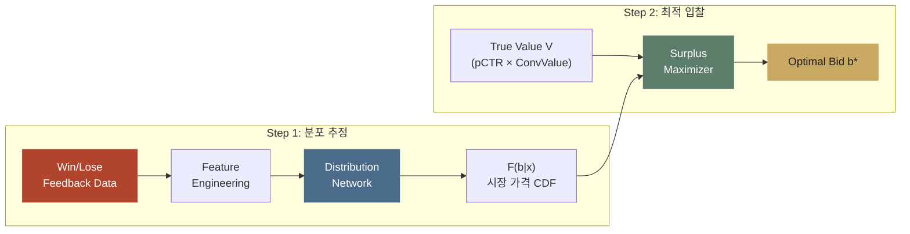
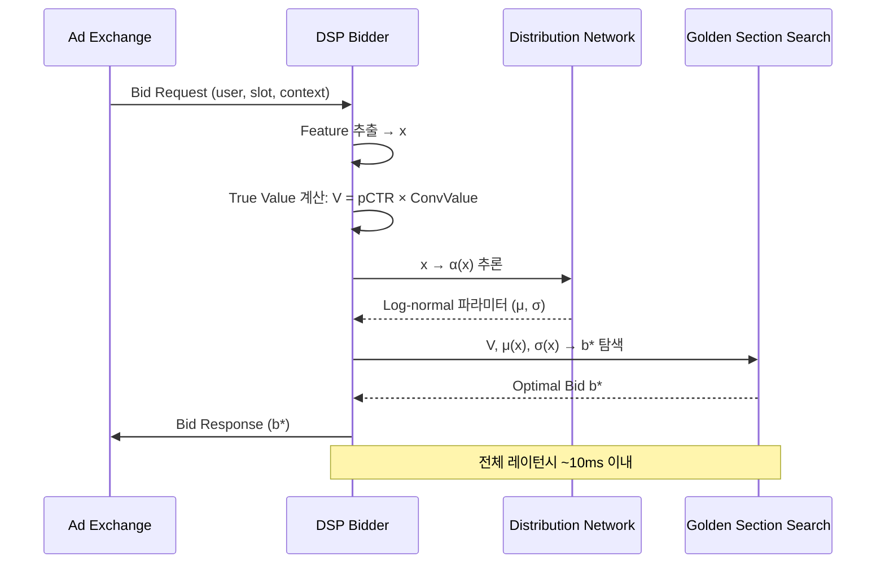

2017년 무렵부터 디지털 광고 시장의 경매 방식이 **2nd Price에서 1st Price로** 대전환되었습니다. 2nd Price 경매는 가장 높게 부른 입찰자가 이기되 돈은 2등이 부른 값만큼 냅니다. 1st Price 경매에서는 이긴 입찰자가 자기가 부른 값을 그대로 냅니다. 전환은 AppNexus, Index Exchange, OpenX, Rubicon Project 같은 거래소가 먼저 시작했고 2019년 무렵 Google Ad Manager(AdX)까지 합류하면서 사실상 업계 표준이 됐습니다. 거래소(Ad Exchange)는 매체가 내놓은 광고 자리를 경매에 올리고 광고주 쪽 입찰을 받아 낙찰자를 정하는 곳입니다. 규칙이 왜 바뀌었는지는 [2등 가격 경매](post.html?id=second-price-auction)에서 다루고 이 글은 그다음 질문 하나만 파고듭니다. **"내 진짜 가치(True Value)보다 얼마나 깎아서 입찰해야 하는가?"**

진짜 가치는 노출(광고가 화면에 한 번 나가는 일) 한 번이 광고주에게 실제로 얼마짜리인지를 나타내는 값이고 본문에서는 참 가치라고 부릅니다. 1st Price 경매에서 입찰가를 이 참 가치보다 낮춰 부르는 일을 Bid Shading 이라고 합니다. 이 글은 아래 두 편의 논문을 중심으로 Bid Shading 의 이론과 실무를 차례로 살펴봅니다.

- **Ghosh et al. (Adobe Research, 2020)**. "Scalable Bid Landscape Forecasting in Real-time Bidding"
- **Zhou et al. (Yahoo/Verizon Media, KDD 2021)**. "An Efficient Deep Distribution Network for Bid Shading in First-Price Auctions"

> 수식보다 화면으로 먼저 감을 잡고 싶다면 [Bid Shading Visualizer 데모](demo-bid-shading.html)의 슬라이더를 움직여 봅니다. 슬라이더를 옮길 때마다 이 글의 수식이 실제 값으로 어떻게 바뀌는지 볼 수 있습니다.

---

## 1. Bid Shading 이 필요한 이유

**1st Price 경매에서는 참 가치 그대로 부르면 이겨도 남는 돈이 0 이라 입찰가를 깎아야 합니다. 많이 깎을수록 이겼을 때 남는 돈은 늘지만 이길 확률이 줄어서 가장 좋은 깎기 비율은 양 끝이 아닌 가운데에 있습니다. 가상 데이터에서 참 가치 1,000원인 노출을 0% 부터 50% 까지 깎아 보면 40% 깎은 600원일 때 기대이익(이길 확률 × 이겼을 때 남는 돈)이 267.6원으로 가장 컸습니다.**

### ① 2nd Price 에서 1st Price 로 바뀐 경매 규칙

DSP(Demand-Side Platform)는 광고주를 대신해 경매에 입찰가를 내는 플랫폼입니다. 2nd Price 경매에서 DSP 의 최적 전략은 간단해서 **참 가치 그대로 입찰**하면 됐습니다. 이렇게 참 가치를 깎지 않고 부르는 전략을 정직 입찰(Truthful Bidding)이라고 합니다. 이겨도 내는 돈은 내 입찰가가 아니라 2등의 입찰가라서 높게 불러도 손해 볼 일이 없었습니다. 1st Price 경매에서는 이기면 **내 입찰가를 그대로 내므로** 참 가치 그대로 부르면 이겨도 참 가치만큼 돈을 내고 남는 것이 없습니다.

두 방식의 차이를 지불 금액, 최적 전략, 시장 가격 정보, DSP 가 할 일의 복잡도로 나누면 아래 표와 같습니다.

| 구분 | 2nd 가격 경매(Price Auction) | 1st 가격 경매 |
|------|-------------------|-------------------|
| 지불 금액 | 2등 입찰가 (= 시장가) | **내 입찰가 그대로** |
| 최적 전략 | 정직 입찰 ($b = V$) | **Bid Shading ($b < V$)** |
| 시장 가격 정보 | 낙찰 시 Clearing Price 관측 | 패찰 시 경쟁자 가격 **미관측** |
| DSP 복잡도 | 낮음 (가치 계산만) | 높음 (분포 추정 + 최적화 필요) |

표의 $b$ 는 내 입찰가이고 $V$ 는 참 가치입니다. 낙찰은 경매에서 이기는 일이고 패찰은 지는 일입니다. Clearing Price 는 낙찰자가 실제로 내는 가격으로, 2nd Price 경매에서는 2등 입찰가가 곧 Clearing Price 이자 시장가입니다. 표의 마지막 줄처럼 1st Price 경매의 DSP 는 가치 계산만 하면 되던 예전과 달리 시장 가격의 분포를 추정하고 그 분포로 입찰가를 최적화해야 합니다. 셋째 줄처럼 패찰한 경매의 경쟁자 가격이 보이지 않는다는 점이 이 분포 추정을 어렵게 만드는데, 2절에서 이 문제를 자세히 봅니다.

거래소들이 규칙을 바꾼 데는 두 가지 동기가 있었습니다.

- **투명성**: 1st Price 경매에서는 입찰가가 곧 지불가라서 광고주가 정확히 얼마를 내는지 분명합니다.
- **헤더비딩과의 호환**: [헤더비딩](post.html?id=header-bidding)은 같은 노출 하나를 여러 경매에 동시에 올리는 구조라, 이 구조에서는 「2등 값」이 어느 경매의 2등 값인지가 흐려집니다.

> 이웃 주제 하나와 헷갈리기 쉬워 범위를 먼저 정해 둡니다. 이 글이 다루는 범위는 **경매 한 번에 얼마를 부를지**, 곧 가치를 추정하고 마지막에 얼마나 깎을지입니다. 하루 예산과 목표 CPA(전환 한 건을 얻는 데 쓸 비용)를 맞추려고 입찰가를 위아래로 조절하는 제어는 [Auto-Bidding & Pacing](post.html?id=auto-bidding-pacing)에서 다룹니다.

### ② 남는 몫(Surplus)을 최대로 만드는 문제

얼마나 깎을지 정하려면 깎은 결과를 비교할 기준이 있어야 합니다. Bid Shading 은 **기대 남는 몫**이 가장 커지는 입찰가를 찾습니다. Zhou et al. 은 기대 남는 몫을 아래 식으로 정의합니다.

$$s(b; V, x) = \underbrace{(V - b)}_{\text{낙찰 시 이익 (Surplus)}} \cdot \underbrace{\Pr(\hat{b} < b \mid x)}_{\text{낙찰 확률 (Win Rate)}}$$

식의 앞쪽 $(V - b)$ 는 이겼을 때 참 가치에서 낸 돈을 빼고 남는 이익이라 남는 몫(Surplus)이라고 부릅니다. 뒤쪽 $\Pr(\hat{b} < b \mid x)$ 는 경쟁자 최고 입찰가 $\hat{b}$ 가 내 입찰가 $b$ 보다 낮을 확률, 곧 내가 이길 낙찰 확률(Win Rate)입니다. 패찰하면 남는 몫이 0 이므로 이길 때와 질 때를 평균하면 남는 몫에 낙찰 확률을 곱한 값이 남는데, 이 곱 $s(b)$ 가 기대 남는 몫입니다. 아래 첫 코드는 이 기대 남는 몫을 그냥 Surplus 라고 찍습니다. 1절③ 의 표와 코드는 같은 값을 기대이익이라고 부릅니다.

식에 나오는 기호의 뜻은 아래와 같습니다.

- $V$ : 참 가치입니다. pCTR(광고를 보여 줬을 때 클릭할 확률의 예측값)에 Conversion Value(전환 한 건의 가치)를 곱한 값이고 pCTR 모델이 이 값을 결정합니다. 전환은 광고를 본 유저가 구매나 가입처럼 광고주가 바라는 행동을 하는 일을 말합니다.
- $b$ : 실제 입찰가로, DSP 가 정하는 변수입니다.
- $\hat{b}$ : 시장의 Minimum Winning Price 입니다. 경쟁자들이 부른 값 가운데 가장 높은 값이라 내가 이기려면 이 값보다 높게 불러야 합니다.
- $x$ : 유저 특성, 지면(광고가 나가는 자리), 시간대, 디바이스처럼 그 경매의 상황을 담은 컨텍스트 피처 벡터입니다.

$b$ 를 올리면 더 많은 경매에서 이겨 낙찰 확률 $\Pr(\hat{b} < b)$ 는 오르지만 이겼을 때의 이익 $(V - b)$ 가 줄어듭니다. 반대로 $b$ 를 내리면 이익 $(V - b)$ 는 늘지만 낙찰 확률이 떨어집니다. 한쪽을 얻으면 다른 쪽을 잃는 이 **맞바꿈**에서 두 효과가 균형을 이루는 점이 최적 입찰가 $b^*$ 입니다. [데모의 Sweep 차트](demo-bid-shading.html)에서 이 균형점을 직접 확인할 수 있습니다.

아래 코드는 참 가치가 `$5` 인 노출에서 시장 가격이 Log-normal(μ=0.8, σ=0.5) 를 따른다고 놓고 입찰가 50개의 Surplus 를 모두 계산해 가장 큰 곳을 찾습니다. Log-normal 은 로그정규분포, 곧 값에 로그를 취하면 정규분포가 되는 분포로 늘 양수이고 오른쪽 꼬리가 길어서 입찰가처럼 0 보다 크고 가끔 아주 큰 값이 나오는 데이터에 씁니다. 코드의 μ 와 σ 는 가격에 로그를 취한 값의 평균과 표준편차입니다. 낙찰 확률 $F(b)$ 는 시장 가격이 $b$ 보다 낮을 확률입니다. 코드는 이 값을 로그정규분포의 누적분포함수(CDF, 값이 $b$ 이하일 확률을 주는 함수)인 lognorm.cdf 로 구합니다.

```python
# 하는 일: 진짜 가치 $5 인 노출에서 시장 가격이 로그정규를 따를 때, 이익 × 낙찰 확률(Surplus)이 가장 큰 입찰가 b* 를 찾는다.
import numpy as np
from scipy.stats import lognorm

# 1단계: Surplus 함수를 만든다
# Surplus 는 이익 (V - b) 에 낙찰 확률 F(b) 를 곱한 값이다.
def surplus(b, V, mu, sigma):
    """Surplus = (V - b) × F(b|x): 이익 × 낙찰 확률"""
    if b <= 0 or b >= V:
        return 0.0
    win_prob = lognorm.cdf(b, s=sigma, scale=np.exp(mu))
    return (V - b) * win_prob

# 2단계: 입찰가 50개로 Surplus 가 가장 큰 곳을 찾는다
# True Value 는 $5, 시장 가격은 Log-normal(μ=0.8, σ=0.5)이다. $0.1 에서 $4.9 까지 입찰가 50개를 측정한다.
V, mu, sigma = 5.0, 0.8, 0.5
bids = np.linspace(0.1, V - 0.1, 50)
surpluses = [surplus(b, V, mu, sigma) for b in bids]

best_idx = np.argmax(surpluses)
print(f"  최적 입찰가 b* = ${bids[best_idx]:.2f}")
print(f"  최대 Surplus  = ${surpluses[best_idx]:.3f}")
print(f"  Shading 비율  = {(1 - bids[best_idx]/V)*100:.0f}% 할인")

# 출력:
# 2단계 뜻: 입찰가를 $2.65 로 47% 깎을 때 Surplus 가 $1.496 으로 가장 크다. 입찰가를 올리면 낙찰 확률은 오르지만 이익이 줄고, 내리면 반대라서 그 균형점이 b* 다.
#   최적 입찰가 b* = $2.65
#   최대 Surplus  = $1.496
#   Shading 비율  = 47% 할인
```

찍힌 값을 보면 입찰가 50개 가운데 `$2.65` 에서 Surplus 가 `$1.496` 으로 가장 큽니다. 참 가치 `$5` 에서 `$2.65` 로 내린 폭을 참 가치로 나누면 47% 라 마지막 줄이 Shading 비율을 47% 할인으로 찍었습니다. 입찰가를 `$2.65` 보다 올리면 낙찰 확률은 오르지만 이익이 줄고 내리면 반대라서 그 균형점인 `$2.65` 가 이 경매의 $b^*$ 입니다.

### ③ 깎기 비율에 따라 바뀌는 승률과 기대이익 (가상 데이터)

이 절의 표와 코드는 가상 데이터입니다. 맞바꿈을 숫자로 보려고 참 가치 1,000원인 노출 하나를 놓고 깎는 비율만 바꿔 보는데, 경쟁자 최고가는 로그정규분포에서 20,000건을 뽑아 만들었고 그 평균은 546원입니다. 깎기 비율은 참 가치에서 몇 % 를 낮춰 부르는지를 뜻합니다. 승률은 20,000건 가운데 경쟁자 최고가가 내 입찰가보다 낮아 내가 이기는 경매의 비율로, 1절② 의 낙찰 확률을 경매 수로 센 값입니다. 기대이익은 승률에 이겼을 때 남는 돈(참 가치 − 입찰가)을 곱한 값이라 1절② 의 기대 남는 몫과 같고 클수록 좋습니다.

| 깎기 비율 | 내 입찰가 | 승률 | 기대이익 |
|---|---|---|---|
| 0% | 1,000원 | 94.0% | **0.0원** |
| 20% | 800원 | 85.9% | 171.7원 |
| 40% | 600원 | 66.9% | **267.6원** |
| 50% | 500원 | 51.3% | 256.4원 |

40% 를 깎은 줄을 따라가 보면 입찰가는 600원이고 20,000건 가운데 66.9% 에서 이기므로, 이겼을 때 남는 돈 1,000원 − 600원에 승률 66.9% 를 곱한 267.6원이 기대이익입니다. 깎지 않은 0% 는 1,000원을 불러 94.0% 를 이기지만 이겨도 참 가치만큼 내므로 기대이익이 0.0원입니다. 50% 를 깎은 500원은 이겼을 때 남는 돈은 크지만 승률이 51.3% 라 경매의 절반 가까이를 놓쳐 256.4원에 그칩니다. 그래서 최적점은 양 끝이 아니라 **가운데**에 있습니다.

아래 코드는 위 표를 만든 계산을 두 시장에서 돌립니다. 평상시 시장은 가격에 로그를 취한 평균 μ 가 6.2 이고 경쟁 과열 시장은 μ 가 7.0 이라 가격이 전체적으로 더 비쌉니다. 두 시장 모두 0% 부터 50% 까지 10% 씩 깎아 가며 승률과 기대이익을 찍습니다.

```python
# 하는 일: 가치 1,000원인 노출에서 입찰가를 0% 부터 50% 까지 깎으며, 평상시와 경쟁 과열 시장의 승률과 기대이익을 비교한다.
import random

V = 1000  # 이 노출의 진짜 가치(원). pCTR x 전환가치로 계산된 값.

# 1단계: 가상의 시장 분포를 만든다
# 가상 데이터: 경쟁자 최고가를 20,000번 뽑아 '진짜 시장 분포'를 만든다.
# 로그정규를 쓰는 이유는 입찰가가 늘 양수이고 오른쪽 꼬리가 길기 때문이다.
def market(mu):
    random.seed(42)
    return [random.lognormvariate(mu, 0.45) for _ in range(20000)]

# 2단계: 입찰가별 승률과 기대이익을 구하는 함수를 만든다
# 경쟁가가 내 입찰가보다 낮으면 이긴다. 기대이익은 승률 x (가치 - 입찰가)다.
def profit(bid, prices):
    wins = sum(1 for p in prices if p < bid)   # 경쟁가가 내 입찰가보다 낮으면 내가 이김
    win_rate = wins / len(prices)
    return win_rate, win_rate * (V - bid)      # 기대이익 = 승률 x (가치 - 입찰가)

# 3단계: 두 시장에서 깎는 비율별로 찍는다
# 평상시는 μ=6.2, 경쟁 과열은 μ=7.0 이다.
for label, mu in [("평상시", 6.2), ("경쟁 과열", 7.0)]:
    prices = market(mu)
    print("%s: 시장 평균 %.0f원" % (label, sum(prices) / len(prices)))
    print("  깎기 |   입찰 |   승률 | 기대이익")
    best = (0, 0.0)
    for cut in (0, 10, 20, 30, 40, 50):
        bid = V * (100 - cut) // 100
        wr, ep = profit(bid, prices)
        print("  %2d%% | %4d원 | %5.1f%% | %6.1f원" % (cut, bid, wr * 100, ep))
        if ep > best[1]:
            best = (cut, ep)
    print("  -> 최적은 %d%% 깎기" % best[0])

# 출력:
# 3단계 뜻: 평상시에는 40% 깎은 600원이 기대이익 267.6원으로 가장 크다. 경쟁이 과열돼 시장 평균이 1215원으로 오르면, 20% 만 깎은 800원이 48.3원으로 가장 크다.
# 평상시: 시장 평균 546원
#   깎기 |   입찰 |   승률 | 기대이익
#    0% | 1000원 |  94.0% |    0.0원
#   10% |  900원 |  90.7% |   90.7원
#   20% |  800원 |  85.9% |  171.7원
#   30% |  700원 |  78.1% |  234.4원
#   40% |  600원 |  66.9% |  267.6원
#   50% |  500원 |  51.3% |  256.4원
#   -> 최적은 40% 깎기
# 경쟁 과열: 시장 평균 1215원
#   깎기 |   입찰 |   승률 | 기대이익
#    0% | 1000원 |  41.8% |    0.0원
#   10% |  900원 |  32.9% |   32.9원
#   20% |  800원 |  24.2% |   48.3원
#   30% |  700원 |  16.1% |   48.2원
#   40% |  600원 |   9.2% |   36.7원
#   50% |  500원 |   4.2% |   21.0원
#   -> 최적은 20% 깎기
```

찍힌 값을 보면 평상시 시장(평균 546원)에서는 40% 깎은 600원이 기대이익 267.6원으로 가장 큽니다. 경쟁이 과열돼 시장 평균이 546원에서 1,215원으로 오르면 최적 깎기가 40% 에서 20% 로 내려와 800원이 48.3원으로 가장 큽니다. 과열 시장에서는 깎지 않은 1,000원도 승률이 41.8% 에 그치고 40% 를 깎은 600원은 9.2% 만 이겨 기대이익이 36.7원에 머뭅니다. 비싼 시장에서는 덜 깎아야 이깁니다.

꼭대기가 평평하다는 점도 눈여겨볼 만합니다. 과열 시장에서 20% 와 30% 의 기대이익은 48.3원과 48.2원으로 0.1원 차이라, 최적점 근처에서는 깎기 비율이 조금 달라도 기대이익이 거의 같습니다.

아래 데모에서는 위 계산을 손으로 움직여 볼 수 있습니다. 깎기 비율을 끌면 승률과 기대이익이 함께 바뀌면서 **최적점이 양 끝이 아니라 가운데에 있다**는 것이 곡선으로 보이고 경쟁 분포를 바꾸면 그 꼭대기가 옆으로 움직입니다.

<div class="demo-embed-wrap">
<iframe class="demo-embed" src="demo-bid-landscape.html?embed=1" height="560" loading="lazy" title="입찰 지형 미니 데모"></iframe>
<a class="demo-embed-open" href="demo-bid-landscape.html" target="_blank" rel="noopener">↗ 전체 데모로 열기 (가이드 투어 포함)</a>
</div>

### ④ 분포 추정과 최적 입찰의 2단계 파이프라인

1절② 와 1절③ 의 계산은 시장 가격 분포를 처음부터 안다고 놓고 시작했습니다. 실제 DSP 는 이 분포를 모르므로, 최적 입찰가를 실시간으로 계산하려면 분포를 먼저 추정하고 그 분포로 입찰가를 고르는 **2단계 파이프라인**이 필요합니다.



그림의 두 단계는 아래 일을 맡습니다.

- **Step 1 (분포 추정)**: 과거 경매의 낙찰과 패찰 기록(그림의 Win/Lose Feedback Data)으로 시장 가격 분포 $F(b \mid x)$ 를 학습합니다. $F(b \mid x)$ 는 1절② 의 낙찰 확률을 경매 상황 $x$ 마다 따로 구한 누적분포함수로, 상황이 $x$ 일 때 입찰가 $b$ 로 이길 확률을 줍니다.
- **Step 2 (최적 입찰)**: 학습한 분포와 참 가치 $V$ 를 넣어 기대 남는 몫이 가장 큰 $b^*$ 를 찾습니다.

이 글의 나머지는 두 단계를 차례로 깊이 다룹니다. 가장 큰 난관은 Step 1 에서 만나는 **censored data(중도절단 데이터) 문제**입니다. censored data 는 값이 어느 선을 넘었다는 사실만 남고 정확한 값은 잘려 나간 데이터인데, 패찰한 경매의 시장 가격이 바로 이런 데이터라 2절에서 이 문제를 먼저 다룹니다.

---

## 2. 시장의 절반이 보이지 않는 Censored data 문제 [무대: 열린 RTB]

**DSP 는 이긴 경매에서만 시장 가격을 보고 진 경매에서는 「내 입찰가보다 높았다」는 사실만 알기 때문에, 이긴 경매의 가격만 모아 분포를 맞추면 시장을 체계적으로 싸게 봅니다. 가상 데이터에서 이긴 경매만 평균하면 시장 평균을 39.8% 낮게 봤습니다. 패찰을 「적어도 내 입찰가는 넘었다」는 하한 정보로 계산에 넣는 추정은 내 입찰가까지의 구간을 정답과 똑같이 맞혔지만 그 위쪽은 되살리지 못했습니다.**

이 절의 무대는 열린 RTB 입니다. RTB(Real-Time Bidding)는 노출 기회가 생길 때마다 실시간으로 경매를 열어 광고를 고르는 방식입니다. 열린 RTB 는 지면을 가진 매체, 경매를 여는 거래소, 입찰하는 DSP 를 서로 다른 회사가 맡는 시장이라 DSP 는 남이 연 경매에 참여만 하고 경매 결과를 다 보지 못합니다.

### ① Right-Censoring 의 뜻

DSP 가 돌려받는 경매 결과는 이겼는지 졌는지에 따라 담긴 정보의 양이 다른 **비대칭** 데이터입니다.

| 경매 결과 | 관측 가능한 정보 | 수식 표현 |
|-----------|------------------|-----------|
| **낙찰 (Win)** | 실제 Clearing Price $w_i$ | $w_i$ 직접 관측 |
| **패찰 (Lose)** | "내 입찰가 $b_i$보다 높았다"는 사실만 | $W_i > b_i$ (하한만 알 수 있음) |

표에서 $w_i$ 는 $i$ 번째 경매에서 실제로 관측한 낙찰가(Clearing Price)이고 $W_i$ 는 그 경매의 시장 가격, $b_i$ 는 그 경매에서 내가 부른 입찰가입니다. 예를 들어 `$2.00` 을 불렀다가 졌다면 경쟁자가 `$2.01` 을 불렀는지 `$10.00` 을 불렀는지는 알 수 없고 「내 `$2.00` 보다는 높았다」는 사실만 남습니다. 이렇게 내 입찰가 **오른쪽(그 이상)**의 값이 잘려 하한만 남는 데이터를 **Right-Censoring** 이라고 부릅니다.

이 구조는 의학의 **생존 분석(Survival Analysis)**과 똑같습니다. 생존 분석은 환자가 얼마나 오래 사는지를 다루는데, 관찰 기간이 끝날 때까지 살아 있던 환자는 실제 수명을 모르고 관찰 기간보다는 길다는 것만 압니다. 「관찰 기간 안에 사망하지 않은 환자의 실제 수명을 모른다」와 「패찰한 경매의 실제 시장 가격을 모른다」는 수학적으로 같은 문제입니다.

> [데모](demo-bid-shading.html)에서 **"Censored View로 전환"** 버튼을 누르면 내 입찰가 이상의 히스토그램이 "???" 사선 무늬로 바뀌어 DSP 가 실제로 볼 수 있는 정보가 어디까지인지 눈으로 확인할 수 있습니다.

### ② Naive 추정이 실패하는 이유

가장 단순한 방법은 관측된 데이터, 곧 이긴 경매의 낙찰가(clearing price)만 모아 분포를 추정하는 Naive 추정입니다. 이 방법은 **선택 편향(Selection Bias)**에 빠집니다. 선택 편향은 데이터가 전체에서 고르게 뽑히지 않고 어떤 조건을 통과한 것만 남아 결과가 한쪽으로 치우치는 현상입니다.

$$\hat{\mu}_{\text{naive}} = \mathbb{E}[W \mid W < b] \;<\; \mathbb{E}[W] = \mu_{\text{true}}$$

식의 왼쪽은 시장 가격 $W$ 가 내 입찰가 $b$ 보다 낮았던 경매, 곧 내가 이긴 경매만의 평균이고 오른쪽은 모든 경매의 진짜 평균 $\mu_{\text{true}}$ 입니다. 관측된 데이터는 모두 내가 이긴 경매, 곧 **경쟁자 가격이 낮았던 경매**에서만 나오므로 왼쪽이 오른쪽보다 작습니다. 그래서 Naive 추정은 시장 가격의 평균과 중앙값을 **체계적으로 과소추정**하는데, 체계적이라는 말은 우연한 오차가 아니라 데이터를 모으는 방식 때문에 늘 같은 방향(낮은 쪽)으로 틀린다는 뜻입니다.

데모에서 Censored View 를 켜면 나타나는 **벽돌색 점선**이 이 Naive 추정입니다. 실제 분포를 보여 주는 God View 와 비교하면 아래 두 가지가 보입니다.

- 평균(Mean)을 20~40% 낮게 봅니다.
- 시장을 싸게 보니 Shading 을 지나치게 많이 해서 낙찰률이 크게 떨어지고 전체 수익이 줄어듭니다.

Ghosh et al. 은 공개 데이터셋 iPinYou 에서 이 문제를 논문의 Figure 1 로 직접 보여 줍니다. 패찰까지 계산에 넣는 Kaplan-Meier 추정치(2절③ 에서 다룹니다)와 단순히 정규분포를 맞춘 Gaussian Fit 이 매우 크게 다릅니다.

이 편향이 입찰가와 기대이익을 얼마나 바꾸는지 직접 돌려 봅니다. 아래 코드는 1절③ 의 평상시 시장과 같은 가상 시장(진짜 평균 546원)에서 먼저 시장을 다 알 때의 최적 입찰가를 구합니다. 이어서 이긴 경매의 낙찰가만 모아 로그정규분포를 다시 맞추고 그 분포로 입찰가를 다시 정하는 일을 세 번 반복합니다.

```python
# 하는 일: 이긴 경매의 낙찰가만 보고 시장 분포를 추정하면, 회차를 거듭할수록 시장을 낮게 보고 입찰가를 더 깎아 기대이익을 잃는 과정을 본다.
import math, random, statistics

# 1단계: 1절과 같은 시장을 만든다
# 가치 1,000원에 경쟁자 최고가 20,000개를 뽑는다.
V = 1000
random.seed(42)
TRUE = [random.lognormvariate(6.2, 0.45) for _ in range(20000)]  # 1절과 같은 시장(진짜 평균 546원)

# 2단계: 최적 입찰가와 실제 성적을 구하는 함수를 만든다
# best_bid 는 어떤 승률 함수를 주든 그 함수 기준의 최적 입찰가를 고른다.
def best_bid(win_prob):
    """승률 함수를 받아 기대이익이 가장 큰 입찰가를 10원 단위로 고른다."""
    return max(range(200, 1000, 10), key=lambda b: win_prob(b) * (V - b))

def real(bid):
    """실제 시장에서의 승률과 기대이익 — 독자만 볼 수 있는 정답."""
    wr = sum(1 for p in TRUE if p < bid) / len(TRUE)
    return wr, wr * (V - bid)

# 3단계: 시장을 다 알 때의 정답을 구한다
bid = best_bid(lambda b: real(b)[0])   # 시장을 다 안다고 가정한 최적값 = 비교 기준
print("정답: 입찰 %d원 | 승률 %.1f%% | 기대이익 %.1f원" % (bid, real(bid)[0] * 100, real(bid)[1]))

# 4단계: 이긴 경매만 보고 세 번 다시 추정한다
# 이긴 경매의 낙찰가에 로그정규를 그대로 맞추고, 그 분포로 다시 최적화한다.
for rnd in (1, 2, 3):
    won = [math.log(p) for p in TRUE if p < bid]        # 이긴 경매의 낙찰가만 관측된다
    m, s = statistics.mean(won), statistics.stdev(won)  # 그 표본에 로그정규를 그대로 적합
    fit = statistics.NormalDist(m, s)
    bid = best_bid(lambda b: fit.cdf(math.log(b)))      # 편향된 분포로 다시 최적화
    print("%d회차: 추정평균 %d원 -> 입찰 %d원 | 승률 %.1f%% | 기대이익 %.1f원"
          % (rnd, math.exp(m + s * s / 2), bid, real(bid)[0] * 100, real(bid)[1]))

# 출력:
# 3단계 뜻: 시장을 다 알면 570원을 불러 승률 62.5%, 기대이익 268.9원을 얻는다.
# 정답: 입찰 570원 | 승률 62.5% | 기대이익 268.9원
# 4단계 뜻: 이긴 경매만 보면 시장 평균을 392원, 360원, 345원으로 점점 낮게 보고, 입찰가도 460원까지 내려가 기대이익이 237.6원으로 준다.
# 1회차: 추정평균 392원 -> 입찰 500원 | 승률 51.3% | 기대이익 256.4원
# 2회차: 추정평균 360원 -> 입찰 470원 | 승률 45.9% | 기대이익 243.0원
# 3회차: 추정평균 345원 -> 입찰 460원 | 승률 44.0% | 기대이익 237.6원
```

찍힌 값에서 정답은 시장을 다 알 때의 입찰로, 570원을 불러 승률 62.5% 와 기대이익 268.9원을 얻습니다. 이긴 경매만 보면 1회차에서 벌써 진짜 평균 546원을 392원으로 봐서 28% 과소추정하고 입찰가를 500원으로 낮춥니다. 그러면 낮게 추정하니 낮게 부르고 낮게 부르니 더 싼 경매만 이겨 다음 회차에 모이는 낙찰가가 더 싸지므로 편향이 스스로를 키웁니다. 추정평균은 2회차 360원, 3회차 345원으로 계속 내려가고 입찰가도 470원, 460원으로 따라 내려가서 세 회차 만에 기대이익이 268.9원에서 237.6원으로 12% 줄었습니다.

### ③ 잘린 데이터에서 되찾을 수 있는 것과 없는 것

2절② 에서 이긴 경매만 보면 시장을 싸게 본다는 것을 확인했습니다. 이 편향을 되돌릴 방법은 있지만 **어디까지만** 있습니다.

되돌리는 출발점은 패찰도 정보라는 사실입니다. 경매에서 졌다면 낙찰가가 적어도 내 입찰가는 넘었다는 뜻이므로 정확한 값은 몰라도 하한은 압니다. 이 하한 정보를 버리지 않고 계산에 넣는 도구가 **Kaplan-Meier**(KM) 추정입니다. KM 은 원래 의학에서 환자가 아직 살아 있는데 추적이 끊긴 경우를 다루려고 만든 방법입니다. 경매에서는 이 경우가 「경매가 아직 안 끝났는데 관측이 끊긴」 경우로 그대로 옮겨지는데, 가격을 0 에서부터 올려 가며 시장 가격에 닿는 순간을 경매가 끝나는 때로 보면 패찰한 경매는 내 입찰가까지 올려도 아직 끝나지 않은 채 관측이 끊긴 경우입니다.

KM 이 구하는 값은 생존함수 $S(t)$, 곧 낙찰가가 $t$ 를 넘을 확률입니다. 가격을 낮은 것부터 차례로 보면서 관측된 가격마다 (1 − 그 가격에서 끝난 수 ÷ 아직 남은 수) 를 곱해 갑니다. 잘린 항목은 「끝났다」로 세지 않지만 잘린 가격 전까지는 「남은 수」에 넣으므로 패찰 정보가 바로 이 「남은 수」로 계산에 들어갑니다.

아래 코드는 내 입찰가를 570원으로 고정한 가상 시장 20,000건에서 이긴 경매만 평균한 값과 KM 추정을 정답과 비교합니다. 이 시장은 로그정규분포의 σ 를 0.6 으로 놓은 별도의 가상 시장이라 진짜 평균도 2절② 의 546원과 다른 591.0원입니다. KM 이 아무 가정 없이 맞힐 수 있는 값은 「내 입찰가까지 자른 평균」, 곧 570원보다 비싼 가격을 모두 570원으로 바꿔 놓고 낸 평균이라 코드는 정답도 같은 방식으로 잘라 비교합니다.

```python
# 하는 일: 입찰가 570원에서 잘린 낙찰가 데이터로 시장을 추정할 때, 이긴 것만 평균한 값과 Kaplan-Meier 추정을 정답과 비교한다.

# 1단계: 가상 시장과 내 입찰가를 둔다
# 내가 입찰가 b 를 내면, 이길 때는 낙찰가를 보고 질 때는 b 보다 높았다는 것만 안다.
import random
random.seed(42)

N = 20_000
MEAN_LOG, SIGMA_LOG = 6.2, 0.6      # 시장가를 로그정규로 가정(가상 데이터)
MY_BID = 570                        # 내 입찰가 — 이보다 비싸면 패찰

market = [random.lognormvariate(MEAN_LOG, SIGMA_LOG) for _ in range(N)]
true_mean = sum(market) / N

# 2단계: 관측 데이터를 만든다
# 관측 데이터: 이기면 (낙찰가, 관측됨), 지면 (내 입찰가, 잘림=censored)
obs = [(p, True) if p <= MY_BID else (MY_BID, False) for p in market]
lost = sum(1 for _, seen in obs if not seen)

# 3단계: 이긴 것만 평균한다
# 흔히 저지르는 계산이다. 비싼 경매가 전부 빠지니 시장을 실제보다 싸게 본다.
won = [p for p, seen in obs if seen]
naive_mean = sum(won) / len(won)

# 4단계: Kaplan-Meier 생존함수로 추정한다
# 패찰도 「적어도 b 는 넘었다」는 정보라서, 버리지 않고 계산에 넣는다.

# S(t) = "낙찰가가 t를 넘을 확률". 가격을 오름차순으로 순회하며
# 관측된 지점마다 (1 - 그 가격에서 끝난 수 / 아직 남은 수) 를 곱해 간다.
# 잘린 항목은 '끝났다'로 세지 않지만, 그 전까지 '남은 수'에는 들어간다 —
# 이게 패찰 정보를 계산에 참여시키는 방식이다.
events = sorted(obs, key=lambda x: x[0])
at_risk = len(events)
surv = 1.0
prev = 0.0
km_restricted = 0.0                  # 생존함수 아래 면적 = E[min(가격, MY_BID)]
i = 0
while i < len(events):
    price = events[i][0]
    tied = [e for e in events[i:] if e[0] == price]
    deaths = sum(1 for _, seen in tied if seen)
    km_restricted += surv * (price - prev)      # 구간 [prev, price) 의 면적
    if at_risk > 0 and deaths > 0:
        surv *= (1 - deaths / at_risk)
    at_risk -= len(tied)
    prev = price
    i += len(tied)

# 5단계: 정답도 같은 방식으로 잘라 둔다
# KM이 가정 없이 맞힐 수 있는 건 "내 입찰가까지 자른 평균"이다.
# 정답도 같은 방식으로 잘라서 비교해야 공정하다.
true_restricted = sum(min(p, MY_BID) for p in market) / N

# 6단계: 정답과 두 추정을 비교해 찍는다
print(f"경매 {N:,}건, 내 입찰가 {MY_BID}원, 패찰 {lost/N*100:.1f}%")
print()
print("[내 입찰가까지 자른 평균] — KM이 가정 없이 맞힐 수 있는 구간")
print(f"  정답                    {true_restricted:7.1f}원")
print(f"  Kaplan-Meier            {km_restricted:7.1f}원   ({(km_restricted/true_restricted-1)*100:+.2f}%)")
print()
print("[전체 시장 평균] — 내 입찰가 위쪽은 관측이 아예 없다")
print(f"  정답                    {true_mean:7.1f}원")
print(f"  이긴 것만 평균          {naive_mean:7.1f}원   ({(naive_mean/true_mean-1)*100:+.1f}%)")
print()
print("→ 이긴 것만 보면 시장을 40% 싸게 본다. 비싼 경매가 전부 빠지니까.")
print("→ KM은 패찰을 '적어도 내 입찰가는 넘었다'로 써서, 관측 구간을 오차 0.1% 안에 맞힌다.")
print("→ 하지만 내 입찰가 위쪽은 되살릴 수 없다. 그건 데이터가 아니라 가정의 영역이다.")
print("→ 그래서 실무는 일부 트래픽에 일부러 높게 입찰해 꼬리를 사 온다(탐색 비용).")

# 출력:
# 6단계 뜻: 패찰이 40.6% 인 데이터에서 이긴 것만 평균하면 355.9원으로, 정답 591.0원보다 39.8% 싸게 본다. Kaplan-Meier 는 내 입찰가까지 자른 평균을 442.9원으로 정답과 똑같이 맞힌다.
# 경매 20,000건, 내 입찰가 570원, 패찰 40.6%
#
# [내 입찰가까지 자른 평균] — KM이 가정 없이 맞힐 수 있는 구간
#   정답                      442.9원
#   Kaplan-Meier              442.9원   (+0.00%)
#
# [전체 시장 평균] — 내 입찰가 위쪽은 관측이 아예 없다
#   정답                      591.0원
#   이긴 것만 평균            355.9원   (-39.8%)
#
# → 이긴 것만 보면 시장을 40% 싸게 본다. 비싼 경매가 전부 빠지니까.
# → KM은 패찰을 '적어도 내 입찰가는 넘었다'로 써서, 관측 구간을 오차 0.1% 안에 맞힌다.
# → 하지만 내 입찰가 위쪽은 되살릴 수 없다. 그건 데이터가 아니라 가정의 영역이다.
# → 그래서 실무는 일부 트래픽에 일부러 높게 입찰해 꼬리를 사 온다(탐색 비용).
```

결과는 두 부분으로 나눠 읽어야 합니다.

**위쪽, 내 입찰가까지 자른 평균.** 정답 442.9원을 KM 이 442.9원으로 오차 0.00% 로 맞혔습니다. 관측이 있는 구간, 곧 570원까지는 패찰 정보를 제대로 쓰면 편향이 사라진다는 뜻입니다.

**아래쪽, 전체 시장 평균.** 패찰이 40.6% 인 데이터에서 이긴 것만 평균하면 591원인 시장을 356원으로, **40% 싸게** 봅니다. 찍힌 값으로는 정답 591.0원에 355.9원, -39.8% 이고 비싼 경매가 전부 빠진 결과입니다. KM 도 이 숫자는 맞히지 못하는데, 내 입찰가 위쪽에는 관측이 하나도 없어 **그 구간은 데이터가 아니라 가정의 영역**이기 때문입니다.

그래서 실무에서는 꼬리, 곧 내 입찰가 위쪽의 비싼 가격대를 알고 싶으면 **사 와야 합니다.** 일부 트래픽에 일부러 높게 입찰해 비싼 경매의 낙찰가를 관측하는 방법인데, 이 입찰은 대체로 손해를 냅니다. 이 손해는 정보를 사는 데 드는 탐색 비용입니다. 탐색(exploration)은 당장은 손해를 보더라도 모르는 것을 알아보려고 시도하는 일을 말합니다. 정보를 얻으려고 손해를 감수하는 이 상황은 [탐색과 활용](post.html?id=exploration-exploitation)에서 다루는 맞바꿈과 같은 구조입니다.

아래 데모에서 God View 를 Engineer View 로 바꾸면 위 계산이 눈으로 보입니다. 내 입찰가 위쪽이 물음표로 숨겨지고 그 상태로 추정한 분포가 실제 분포보다 왼쪽(싼 쪽)에 그려집니다.

<div class="demo-embed-wrap">
<iframe class="demo-embed" src="demo-censored-data.html?embed=1" height="600" loading="lazy" title="Censored Data 미니 데모"></iframe>
<a class="demo-embed-open" href="demo-censored-data.html" target="_blank" rel="noopener">↗ 전체 데모로 열기 (5단계 가이드 투어)</a>
</div>

### ④ Censored Regression(중도절단 회귀)의 기본 아이디어

Censored regression(중도절단 회귀)은 일부 값이 잘린 데이터로 회귀 모델을 학습하는 방법입니다. censored data 를 학습에서 올바르게 다루려면 **Win 데이터와 Lose 데이터를 다르게 취급**해야 합니다. 두 논문 모두 아래 꼴의 손실 함수를 씁니다.

$$\mathcal{L} = \underbrace{\sum_{i \in \mathcal{W}} \log P(w_i \mid x_i)}_{\text{낙찰: PDF 직접 사용}} + \underbrace{\sum_{i \in \mathcal{L}} \log \Pr(W_i > b_i \mid x_i)}_{\text{패찰: Survival Function 사용}}$$

- 식 왼쪽의 $\mathcal{L}$ 은 손실 함수 전체를 가리킵니다. 합 기호 아래의 $\mathcal{W}$ 는 낙찰(Win)한 경매의 집합이고 $\mathcal{L}$ 은 패찰(Lose)한 경매의 집합입니다.
- $P(w_i \mid x_i)$ 는 시장 가격의 PDF(확률 밀도 함수)로, 가격이 $w_i$ 근처에서 나올 가능성이 얼마나 큰지를 나타냅니다.
- $\Pr(W_i > b_i \mid x_i) = 1 - F(b_i \mid x_i)$ 는 시장 가격이 내 입찰가를 넘을 확률이라 Survival Function(생존함수)이라고 부릅니다. 2절③ 의 KM 이 구한 $S(t)$ 와 같은 뜻의 함수를 경매 상황마다 구한 값입니다.

likelihood(우도)는 어떤 분포를 가정했을 때 지금 가진 데이터가 관측될 가능성으로, 학습은 이 값이 가장 커지는 분포를 찾습니다. 위 식은 낙찰한 경매에서는 실제로 관측한 시장 가격 $w_i$ 의 likelihood 를 최대화하고 패찰한 경매에서는 「시장 가격이 내 입찰가보다 높다」는 **부분 정보**의 likelihood 를 최대화합니다. 그래서 Lose 데이터의 하한(lower bound)도 학습에 쓰여 Naive 의 과소추정이 보정됩니다.

이 식이 censored regression(보이지 않는 절반을 감안해 맞추는 회귀)의 기본이고 두 논문의 출발점입니다. 두 논문의 차이는 시장 가격이 어떤 모양의 분포를 따른다고 보는지, 곧 **분포 가정**에 있습니다. 3절이 그 차이를 다룹니다.

---

## 3. 분포 추정 모델의 발전: Standard CR 에서 MCNet 까지

**가장 기본적인 censored regression 은 모든 경매의 시장 가격이 폭이 같고 봉우리가 하나인 정규분포를 따른다고 가정하는데, 실제 시장은 지면과 시간대마다 가격의 폭이 다르고 봉우리가 여러 개 생깁니다. Ghosh et al. 은 폭을 경매마다 바꾼 모델과 정규분포 여러 개를 섞은 모델로 두 가정을 차례로 풀었습니다. Zhou et al. 은 혼합 대신 분포 하나에 강한 네트워크를 붙였습니다. 분포 4가지와 네트워크 5가지를 비교한 결과 Log-normal 분포에 피처 교차까지 학습하는 DeepFM 네트워크를 붙인 구성이 가장 좋았습니다.**

### ① Standard Censored Regression (Baseline)

출발점이 되는 기본형(Baseline) censored regression 은 시장 가격, 곧 winning price(이기는 데 필요한 가격)가 **정규분포**를 따른다고 가정합니다.

$$W_i \mid x_i \sim \mathcal{N}(\beta^T x_i, \; \sigma^2)$$

식은 경매 상황이 $x_i$ 일 때 시장 가격 $W_i$ 가 평균 $\beta^T x_i$, 표준편차 $\sigma$ 인 정규분포를 따른다는 뜻입니다. $\beta$ 는 피처(feature)마다 곱하는 가중치라 평균은 경매 상황에 따라 바뀌지만 $\sigma$ 는 **모든 bid request 에서 같은 값**이라고 가정하는데, 이 가정을 등분산(homoscedastic)이라고 합니다. bid request(입찰 요청)는 경매가 열릴 때 거래소가 DSP 에게 값을 불러 달라고 보내는 요청입니다.

이 모델에는 현실과 맞지 않는 가정이 두 가지 있습니다.

1. **등분산(Homoscedasticity)**: 프리미엄 지면(경쟁이 몰리는 인기 지면)이든 롱테일 지면(트래픽이 적은 수많은 작은 지면)이든, 낮이든 밤이든 분산 $\sigma$ 가 같다고 가정합니다. 현실에서는 당연히 다릅니다.
2. **단봉(Unimodal) 가우시안**: 시장 가격 분포가 봉우리(피크) 하나인 종 모양이라고 가정합니다. 실제로는 소규모 DSP 와 대형 DSP 가 서로 다른 가격대에 몰려 봉우리가 여러 개인 **다봉(multi-modal)** 분포가 됩니다.

Ghosh et al. 은 iPinYou 데이터로 그린 논문의 Figure 1 에서 이 두 가정이 모두 깨진다는 것을 직접 보여 줍니다.

### ② Fully Parametric Censored Regression (P-CR) — Ghosh et al.

첫 번째 개선은 등분산 가정을 푸는 **이분산(heteroscedastic) 모델**입니다. 이분산은 분산이 경매 상황마다 다를 수 있다는 뜻입니다. 이 모델은 $\sigma$ 를 고정된 상수가 아니라 피처의 함수로 만듭니다.

$$\sigma_i = \exp(\alpha^T x_i)$$

- $\alpha$ 는 평균을 정하는 $\beta$ 와 별도로 분산을 정하는 가중치 벡터입니다.
- $\exp(\cdot)$ 는 표준편차가 늘 양수가 되도록 적용하는 변환입니다.

이제 bid request 의 특성에 따라 분산이 달라집니다. 경쟁이 치열한 프리미엄 지면은 가격이 촘촘하게 몰려 $\sigma$ 가 작고 롱테일 지면은 $\sigma$ 가 클 수 있습니다. 다만 봉우리가 하나라는 **단봉 가우시안** 가정은 그대로 남습니다.

### ③ MCNet (Mixture Density Censored Network) — Ghosh et al.

남은 단봉 가정까지 푼 모델이 Ghosh et al. 의 가장 큰 기여인 MCNet 입니다. MCNet 은 **Mixture Density Network 를 censored data 에 적용**한 모델입니다. Mixture Density Network 는 신경망이 분포 하나의 파라미터가 아니라 여러 분포를 섞는 비율과 각 분포의 파라미터를 함께 출력하게 만든 모델입니다. MCNet 은 이 방식으로 정규분포(가우시안) $K$ 개를 섞어 임의의 분포를 근사합니다.

$$P(w \mid x) = \sum_{k=1}^{K} \underbrace{\pi_k(x)}_{\text{혼합 가중치}} \cdot \frac{1}{\sigma_k(x)} \phi\!\left(\frac{w - \mu_k(x)}{\sigma_k(x)}\right)$$

- $\pi_k(x)$ 는 $k$ 번째 혼합 성분, 곧 $k$ 번째 정규분포를 얼마나 섞을지 정하는 가중치입니다. softmax(여러 값을 합이 1 인 비율로 바꾸는 함수)로 출력해서 $K$ 개를 모두 더하면 1 이 됩니다.
- $\mu_k(x)$ 는 $k$ 번째 성분의 평균으로 딥 네트워크가 출력합니다.
- $\sigma_k(x)$ 는 $k$ 번째 성분의 표준편차이고 $\exp(\cdot)$ 로 양수를 보장합니다.
- $\phi$ 는 표준 정규분포의 PDF 입니다.

딥 네트워크는 입력 $x$ 하나에서 성분마다 $\mu_k, \sigma_k, \pi_k$ 3개씩, 모두 $3K$ 개의 파라미터를 한 번에 출력합니다. 그래서 MCNet 은 아래 세 가지를 함께 해냅니다.

- **이분산**: 성분마다 $\sigma_k(x)$ 가 피처에 따라 다릅니다.
- **다봉**: $K$ 개 성분을 섞으므로 봉우리를 여러 개 표현할 수 있습니다.
- **Censored data 처리**: Win 데이터와 Lose 데이터를 모두 2절④ 의 censored likelihood 에 넣어 학습에 씁니다.

### ④ Zhou et al. 의 접근: 단일 분포와 강한 네트워크

Zhou et al. 은 다른 전략을 씁니다. 여러 분포를 섞는 혼합 모델 대신 **단일 파라메트릭 분포**를 쓰고 그 분포의 파라미터를 내는 **네트워크를 강화**합니다. 파라메트릭 분포는 평균과 표준편차처럼 파라미터 몇 개만 정하면 모양이 정해지는 분포입니다.

먼저 분포 4가지를 비교했습니다. Log-loss 는 모델이 낸 확률이 실제 결과를 얼마나 잘 설명하는지 나타내는 손실로 낮을수록 좋습니다. 남는 몫 증가(Surplus Lift)는 프로덕션, 곧 실제 서비스에서 쓰던 기존 방식과 비교해 남는 몫이 몇 % 늘었는지로 높을수록 좋습니다.

| 분포 | Log-loss | 남는 몫 증가(Surplus Lift) (vs 프로덕션) | 특징 |
|------|----------|--------------------------|------|
| Truncated Normal | 0.87 | +1.45% | 음수 허용 안 함, 양쪽 꼬리 제한 |
| Exponential | 0.68 | +5.12% | 단순, 무기억 성질 |
| Gamma | 0.58 | +6.85% | 유연한 형태, 양수 지지 |
| **Log-normal** | **0.56** | **+9.65%** | **오른쪽 긴 꼬리, 양수 지지** |

Log-normal 이 Log-loss 0.56, 남는 몫 증가 +9.65% 로 **압도적**입니다. RTB 입찰가는 늘 양수이고 대부분 중간 가격대에 몰리지만 가끔 매우 높은 입찰이 나오는데, log-normal 이 이 **양수와 오른쪽 긴 꼬리(right-skewed, 큰 값 쪽으로 길게 늘어진 모양)** 특성을 가장 잘 잡아내기 때문입니다. 표 맨 위 줄의 Truncated Normal 이 Log-loss 0.87 에 남는 몫 증가 +1.45% 이므로 차이가 분명합니다.

이어서 log-normal 분포를 고정하고 네트워크 구조 5가지를 비교했습니다. 남는 몫 증가는 첫 줄의 Logistic 회귀를 기준(baseline)으로 한 값입니다. Feature Interaction(피처 교차)은 두 피처가 함께 나타날 때 따로 볼 때와 다른 효과를 내는 현상입니다. 표의 FM 은 두 피처 사이의 2차 교차를 학습합니다. DNN 은 층을 여러 개 쌓은 신경망입니다.

| 네트워크 구조 | Log-loss | 남는 몫 증가 | 특징 |
|-------------|----------|-------------|------|
| Logistic 회귀(Regression) | 0.718 | baseline | 선형, Feature Interaction 없음 |
| FM | 0.569 | +4.52% | 2차 Feature Interaction |
| FwFM | 0.558 | +4.70% | 가중 FM |
| Wide & Deep | 0.522 | +6.36% | 선형 + DNN 결합 |
| **DeepFM** | **0.521** | **+7.10%** | **FM + DNN, 고차 Interaction 학습** |

Log-loss 는 Logistic 회귀 0.718 에서 FM 0.569, FwFM 0.558, Wide & Deep 0.522 를 거쳐 DeepFM 0.521 까지 내려갑니다. 남는 몫 증가도 FM 과 DNN 을 결합해 고차 교차까지 학습하는 DeepFM 이 +7.10% 로 가장 큽니다. 그래서 **Log-normal 분포와 DeepFM 네트워크의 조합**이 가장 좋습니다.

---

## 4. 남는 몫을 최대로 만드는 최적 입찰가 계산

**분포를 학습했으면 기대 남는 몫이 가장 큰 입찰가 $b^*$ 를 찾아야 합니다. Zhou et al. 은 분포 4가지 모두에서 기대 남는 몫 곡선의 봉우리가 하나뿐이라는 것을 증명했습니다. 봉우리가 하나이므로 구간을 반복마다 0.618배로 줄이는 황금 비율 탐색으로 참 가치 `$5.00` 경매의 $b^*$ 를 13회 반복 만에 찾을 수 있어 하루 수십억 건의 실시간 서빙이 가능합니다.**

3절에서 분포 $F(b \mid x)$ 를 학습했다면 이제 그 분포로 $b^*$ 를 찾을 차례입니다.

### ① 남는 몫 함수의 단봉성(Unimodality) 증명

$b^*$ 를 빨리 찾으려면 먼저 기대 남는 몫 곡선의 모양을 알아야 합니다. Zhou et al. 의 가장 큰 이론적 기여는 **surplus 함수의 단봉성(unimodality) 증명**, 곧 기대 남는 몫 곡선의 봉우리가 하나라는 증명입니다. 시장 가격이 log-normal 분포를 따르면 기대 남는 몫은 아래 식이 됩니다.

$$s(b) = (V - b) \cdot \Phi\!\left(\frac{\ln b - \mu(x)}{\sigma(x)}\right)$$

식의 뒷부분은 1절② 의 낙찰 확률을 log-normal 분포로 계산한 값입니다. $\Phi$ 는 표준 정규분포의 CDF 이고 $\mu(x), \sigma(x)$ 는 3절의 네트워크가 경매 상황 $x$ 를 보고 출력한 log-normal 파라미터입니다.

**Theorem 1 (Zhou et al.)** 은 Truncated-normal, Exponential, Gamma, Log-normal 분포 모두에서 같은 성질이 성립한다는 정리입니다. 이 정리에 따르면 surplus 함수 $s(b)$ 는 입찰가가 0 보다 크고 참 가치보다 작은 구간 $(0, V)$ 에서 **극대값(global maximum)을 정확히 하나** 갖고 극소값은 갖지 않습니다. 극대값이 하나뿐이고 극소값이 없으면 입찰가를 0 에서 $V$ 까지 올려 가는 동안 기대 남는 몫은 오르다가 꼭대기를 한 번 찍은 뒤로는 내려가기만 합니다.

:::deep 더 깊이 — 단봉성은 어떻게 증명하는가

증명은 분포마다 $s''(b)$ 가 $(0, V)$ 에서 근을 최대 하나만 가진다는 것을 보이는 방식으로 진행합니다. 예를 들어 log-normal 이면 $s''(b)$ 는 아래와 같습니다.

$$s''(b) = \frac{f_{\ln}(b)}{b\sigma^2} \left[(\mu - \sigma^2 - \ln b)(V - b) - 2\sigma^2 b\right]$$

대괄호 안의 함수는 $b$ 를 변수로 볼 때 볼록(convex)이라 근을 최대 하나 가집니다. 근이 하나면 $s'(b)$ 의 부호가 한 번만 바뀌므로 봉우리가 하나로 확정됩니다.
:::

극대값이 하나뿐이면 **어떤 탐색 알고리즘을 쓰든 최적해를 찾습니다**. 1절② 의 첫 코드처럼 후보 입찰가를 일정한 간격으로 늘어놓고 모두 계산하는 Grid Search 도 되지만 그보다 훨씬 효율적인 방법이 있습니다.

### ② 황금 비율 탐색(Golden Section Search)

단봉 함수에서 최적값을 찾는 가장 효율적인 방법은 **황금 비율 탐색(Golden Section Search)**입니다. 황금 비율 탐색은 꼭대기가 들어 있는 구간 안에 두 점을 찍어 기대 남는 몫을 비교하고 값이 작은 점 쪽의 바깥 구간을 버리는 일을 되풀이해 구간을 좁혀 갑니다. 두 점은 구간 양 끝에서 구간 폭의 0.618배(황금 비율 약 1.618 의 역수)만큼 안쪽으로 들어간 자리에 찍습니다. [데모](demo-golden-section.html)에서 단계별로 찾아가는 과정을 볼 수 있습니다.

아래 코드는 1절② 의 첫 코드와 같은 경매(참 가치 `$5.00`, 시장 가격 Log-normal(μ=0.8, σ=0.5))에서 황금 비율 탐색으로 $b^*$ 를 구하고 구간 폭이 허용 오차 `$0.01` 보다 좁아지면 멈춥니다.

```python
# 하는 일: 황금 비율 탐색으로, 진짜 가치 $5 에 시장 가격이 Log-normal(μ=0.8, σ=0.5)인 경매의 최적 입찰가 b* 를 구한다.
import numpy as np
from scipy.stats import lognorm

# 1단계: 황금 비율 탐색 함수를 만든다
# 구간 양 끝에서 구간 폭의 0.618배(황금 비율의 역수)만큼 안쪽으로 들어간 두 점을 비교해, Surplus 가 작은 쪽 구간을 버린다.
def golden_section_search(V, mu, sigma, tol=0.01):
    """황금 비율 탐색으로 최적 입찰가 b* 계산"""
    def surplus(b):
        return (V - b) * lognorm.cdf(b, s=sigma, scale=np.exp(mu))

    gr = (np.sqrt(5) + 1) / 2  # 황금 비율 ≈ 1.618
    a, b = 1e-6, V - 1e-6

    iters = 0
    while (b - a) > tol:
        x1 = b - (b - a) / gr
        x2 = a + (b - a) / gr
        if surplus(x1) > surplus(x2):
            b = x2
        else:
            a = x1
        iters += 1

    optimal_bid = (a + b) / 2
    print(f"  b* = ${optimal_bid:.4f}  ({iters}회 반복, 구간 < ${tol})")
    return optimal_bid

# 2단계: 같은 경매로 돌린다
# 첫 블록과 같은 경매(V=$5.00, 시장 가격 Log-normal(μ=0.8, σ=0.5))다.
# Grid Search(500개)가 Surplus 를 500번 계산할 때, 이 탐색은 반복마다 두 번씩만 계산한다.
b_star = golden_section_search(V=5.0, mu=0.8, sigma=0.5, tol=0.01)

# 출력:
# 2단계 뜻: 13번 반복하면 구간이 $0.01 보다 좁아져 b* = $2.6788 에 닿는다.
#   b* = $2.6788  (13회 반복, 구간 < $0.01)
```

찍힌 값을 보면 13번 반복해 구간이 `$0.01` 보다 좁아졌을 때 $b^*$ 는 `$2.6788` 입니다. 같은 경매를 1절② 에서는 입찰가 50개 간격으로 계산해 `$2.65` 를 얻었고 여기서는 폭 `$0.01` 안까지 좁혀 `$2.6788` 을 얻었습니다.

**수렴 속도**: 반복마다 탐색 구간이 $1/\phi \approx 0.618$ 배로 줄어듭니다. $V$ 가 `$5.00`, 허용 오차 $\varepsilon$ 이 `$0.01` 일 때 **13회 반복**이면 충분합니다. 구간은 처음에 0 에서 $V$ 까지 거의 `$5.00` 폭이고 반복마다 0.618배가 되므로, 12번 줄인 폭은 아직 `$0.01` 보다 넓고 13번째에 처음으로 `$0.01` 보다 좁아집니다. Grid Search(그리드 $N = 500$ 개)는 코드 주석대로 Surplus 를 500번 계산하지만 황금 비율 탐색은 반복마다 두 번씩만 계산하므로 13회 반복해도 30번이 안 되어 20배 가까이 빠릅니다.

이 효율성 덕분에 **하루 수십억 건의 실시간 서빙**이 가능합니다. CDF $F(b \mid x)$ 계산만 빠르면 입찰가 최적화가 $O(\log(1/\varepsilon))$ 에 끝나는데, $O(\log(1/\varepsilon))$ 는 반복 횟수가 허용 오차의 역수에 로그를 취한 크기만큼만 늘어난다는 뜻입니다.

아래 데모에서 한 걸음씩 누르면 위 코드가 하는 일이 그대로 보입니다. 탐색 구간의 양 끝이 안쪽으로 좁혀지면서 매번 **구간이 0.618배로 줄어듭니다.**

<div class="demo-embed-wrap">
<iframe class="demo-embed" src="demo-golden-section.html?embed=1" height="560" loading="lazy" title="황금 비율 탐색 미니 데모"></iframe>
<a class="demo-embed-open" href="demo-golden-section.html" target="_blank" rel="noopener">↗ 전체 데모로 열기 (가이드 투어 포함)</a>
</div>

새로 찍는 두 점 가운데 하나는 앞 반복에서 찍은 점과 같은 자리라 그 값을 다시 쓰면 반복마다 새로 계산할 점은 하나뿐입니다. 위 코드는 단순하게 두 점을 매번 새로 계산했고 13회 반복에서 구간이 0.01보다 작아져 멈췄습니다.

**버리는 쪽**도 눈여겨볼 만합니다. 두 점을 비교해 값이 낮은 점이 있는 쪽의 구간을 한 번에 전부 버리는데, 봉우리가 하나라는 전제가 있어야 이렇게 과감하게 버려도 안전합니다. 극대값이 둘이면 버린 구간 쪽에 더 높은 봉우리가 있어도 다시 돌아가지 못해 잘못된 봉우리에 갇히므로, 4절① 의 단봉성 증명이 바로 이 버리기를 위해 필요했습니다.

### ③ 실시간 서빙 아키텍처

Zhou et al. 은 VerizonMedia DSP 에서 이 파이프라인을 실제 서비스(프로덕션)에 배포한 아키텍처를 공개했습니다. 아래 그림은 bid request 하나가 들어와 입찰가가 나가기까지의 순서입니다.



그림을 위에서부터 읽으면 거래소(Ad Exchange)가 bid request 를 보내고 DSP 가 피처 $x$ 를 뽑아 참 가치 $V$ 를 계산한 뒤 Distribution Network 에서 log-normal 파라미터 $(\mu, \sigma)$ 를 받아 황금 비율 탐색으로 $b^*$ 를 구해 응답합니다. 그림 아래의 메모대로 전체 레이턴시(요청부터 응답까지 걸리는 시간)는 약 10ms 이내입니다.

이 구조에서 볼 점은 세 가지입니다.

- Distribution Network 는 **오프라인에서 학습**하고 서빙 서버는 학습된 모델을 **주기적으로 불러옵니다**.
- 황금 비율 탐색은 요청마다 **온라인에서 실시간으로 실행**되며 반복 13회, CDF 계산 30회 안쪽으로 끝납니다.
- Bid Shading 모듈 전체는 기존 DSP 파이프라인에 **플러그인**으로 추가합니다.

---

## 5. 실험 결과와 프로덕션 임팩트

**Ghosh et al. 의 MCNet 은 공개 데이터셋에서 비교한 방법들보다 분포를 더 잘 맞혔습니다. Zhou et al. 의 방법은 실제 DSP 데이터에서 경매가 끝난 뒤 winning price 를 알려 주는 경매일 때 남는 몫을 +9.65%, 알려 주지 않는 경매일 때 +5.32% 늘렸고 3일간의 온라인 A/B 테스트에서는 목표에 따라 캠페인의 54.5~71.8% 에서 비용 효율이 좋아졌습니다.**

### ① iPinYou Dataset — Ghosh et al.

Ghosh et al. 은 공개 데이터셋 iPinYou 로 실험했습니다. 샘플이 53M 개이고 승률(win rate)이 22.87% 라 경매 대부분이 패찰이므로, 그 경매들에는 시장 가격의 하한만 남아 있습니다.

- **MCNet**(혼합 밀도 네트워크)을 Standard Censored Regression, Kaplan-Meier 추정과 비교한 결과 **NLL(Negative Log-Likelihood)과 분포 캘리브레이션** 모두에서 유의미하게 개선됐습니다. NLL 은 2절④ 의 로그 likelihood 에 마이너스를 붙인 값이라 낮을수록 데이터를 잘 설명합니다. 분포 캘리브레이션은 예측한 확률이 실제로 일어난 비율과 얼마나 맞는지를 봅니다.
- 특히 봉우리가 여러 개인 **다봉 분포 구간**에서 MCNet 의 강점이 두드러졌습니다. 정규분포 하나로는 잡을 수 없는 여러 봉우리를 MCNet 은 정확히 모델링했습니다.
- Adobe 의 자사 DSP 인 Adobe Adcloud 데이터에서도 같은 경향이 확인됐습니다.

### ② Yahoo/Verizon Offline — Zhou et al.

Zhou et al. 은 VerizonMedia DSP 의 실제 입찰 데이터로 오프라인 실험을 했습니다.

- 피처는 exchange_id, device_type, sub_domain, ad layout, hour, day_of_week 등 12개를 썼습니다.
- 7일치 데이터로 학습하고 다음 1일치로 테스트했습니다.
- **Non-censored** 경매(open auction, winning price 를 알려 줌)에서는 Log-normal 이 남는 몫을 **+9.65%** 늘렸습니다(surplus lift).
- **Censored** 경매(closed auction, winning price 를 알려 주지 않음)에서는 Log-normal 이 남는 몫을 **+5.32%** 늘렸습니다.

두 경매의 차이는 9.65% 대 5.32%, 약 **4%p**(퍼센트포인트, 두 백분율의 차이)이고 이 격차가 곧 **winning price 정보의 값**입니다. SSP(매체를 대신해 광고 자리를 경매에 내놓는 플랫폼)가 winning price 를 공개하는 Open Auction 에서는 패찰한 경매의 가격도 보이므로 DSP 가 약 **4%p 의 추가 최적화 여지**를 얻습니다.

### ③ Online A/B 테스트 — Zhou et al.

Zhou et al. 은 VerizonMedia DSP 에서 실제 트래픽을 나눠 기존 방식과 새 방식을 3일간 비교하는 Online A/B 테스트도 진행했습니다. eCPX 는 캠페인 목표 한 단위(CPA 면 전환, CPC 면 클릭, CPM 이면 노출)를 얻는 데 실제로 든 비용이라 줄어들수록 좋습니다. ROI (BPI) 는 투자 대비 성과가 얼마나 좋아졌는지로 높을수록 좋습니다.

| 캠페인 최적화 목표 | eCPX 개선 (median) | 비용 효율 개선 캠페인 비율 | ROI (BPI) |
|------------------|-------------------|--------------------------|-----------|
| CPA (전환) | -3.5% | 62.3% | **+8.57%** |
| CPC (클릭) | -0.9% | 54.5% | +2.35% |
| CPM (노출) | -6.2% | 71.8% | +2.35% |

표의 첫 줄을 읽으면 CPA(전환) 목표 캠페인은 eCPX 중앙값(median)이 -3.5% 라 전환 한 건을 얻는 비용이 줄었습니다. 캠페인의 62.3% 에서 비용 효율이 좋아졌고 ROI 는 +8.57% 올랐습니다.

- eCPX 감소는 같은 성과를 더 싼 비용으로 얻었다는 뜻이라 그만큼 광고주 ROI 가 좋아집니다.
- 목표에 따라 **캠페인의 54.5~71.8%** 에서 비용 효율이 좋아졌습니다.
- **하루 수십억 건의 bid request** 를 처리하는 세계 최대 규모 DSP 가운데 하나에서 프로덕션으로 검증했습니다.

### ④ 두 논문의 포지셔닝

두 논문을 같은 항목으로 나란히 놓으면 아래 표와 같습니다.

| 차원 | Ghosh et al. (Adobe, 2020) | Zhou et al. (Yahoo, KDD 2021) |
|------|---------------------------|-------------------------------|
| **초점** | 분포 추정 (Step 1) | End-to-End (Step 1 + Step 2) |
| **분포 모델** | Gaussian Mixture (MCNet, K성분) | 단일 분포 (Log-normal 최적) |
| **Censoring 처리** | Censored likelihood (PDF + Survival) | Censored + Non-censored 통합 |
| **최적 입찰** | 별도 다루지 않음 | 황금 비율 탐색 + Unimodality 증명 |
| **실시간 서빙** | 언급 없음 | 프로덕션 아키텍처 공개 |
| **검증** | iPinYou (공개) + Adobe Adcloud (자사 DSP) | Yahoo/Verizon Online A/B (프로덕션) |
| **핵심 기여** | 이질적 분산 + 다봉 분포 모델링 | Unimodality 증명 + O(log n) 최적 탐색 |

두 논문은 서로 빈 곳을 채우는 **상호 보완적** 관계입니다. Ghosh et al. 은 「분포를 얼마나 정확히 추정할까」, 곧 1절④ 의 Step 1 에 집중합니다. Zhou et al. 은 「그 분포로 입찰가를 어떻게 실시간으로 최적화하고 서빙할까」, 곧 Step 2 까지 갑니다. 시장 가격 분포가 심하게 multi-modal 이면 MCNet 의 혼합 모델이 유리합니다. 레이턴시가 극도로 중요하면 Zhou et al. 의 단일 분포와 Golden Section(황금 비율 탐색) 조합이 실용적입니다.

---

## 6. 실무 피처 엔지니어링 가이드

**논문들이 피처 벡터 $x$ 로 추상화한 자리는 실무에서 거래소, 지면, 시간, 디바이스, 유저, 광고 특성으로 채웁니다. 거래소와 지면이 가격대 자체를 정해 시장 가격 예측에 가장 세게 작용하므로 작업도 이 두 가지를 잘게 나누는 데서 시작합니다. 서로 다른 값이 수만에서 수십만 개인 피처는 차원을 줄여 넣고 내 과거 입찰가는 피처로 넣지 않습니다.**

논문들은 경매 상황을 「feature vector $x$」 한 기호로 추상화했는데, 실무에서는 이 자리를 실제 피처로 채워야 합니다. 아래는 Zhou et al. 이 쓴 12개 피처를 바탕으로 검증된 카테고리입니다.

### ① 주요 피처 카테고리

피처는 아래 6가지 카테고리로 나눌 수 있습니다. 영향도는 그 카테고리가 **시장 가격 예측에 얼마나 세게 작용하는지**를 상대적으로 매긴 크기입니다. 이 값은 업계 통념을 기준으로 매겼고 실제 순위는 인벤토리(DSP 가 살 수 있는 광고 자리 전체)의 구성에 따라 달라집니다.

| 카테고리 | 피처 예시 | 영향도 | 설명 |
|---------|---------|-------|------|
| **Exchange 특성** | exchange_id, auction_type | 매우 높음 | Exchange마다 경쟁 강도와 가격 분포가 근본적으로 다름 |
| **지면 특성** | domain, sub_domain, ad_layout, slot_size | 매우 높음 | 프리미엄 매체 vs 롱테일의 가격 차이가 수 배 |
| **시간 특성** | hour_of_day, day_of_week | 중간 | 출퇴근 시간대, 주말 vs 평일의 경쟁 강도 차이 |
| **디바이스 특성** | device_type, os, browser | 중간 | 모바일 vs 데스크톱, iOS vs Android의 가격대 차이 |
| **유저 특성** | geo (country/region), audience_segment | 높음 | 미국 vs 동남아, 고가치 세그먼트의 가격 차이 |
| **광고 특성** | ad_format (banner/video/native), creative_size | 높음 | 비디오 지면이 배너보다 높은 가격대 형성 |

거래소와 지면은 **가격대 자체를 결정**해서 영향도가 가장 높습니다. 프리미엄 매체와 롱테일은 낙찰가가 수 배 차이 납니다. 거래소도 거래소마다 참여하는 DSP 수와 경매 규칙이 달라 경쟁 강도가 근본적으로 다릅니다. 반면 시간대는 같은 지면 안에서 가격을 위아래로 흔드는 정도입니다.

그래서 실무에서는 이 영향도 순서가 곧 작업 순서가 됩니다. **거래소와 지면부터 잘게 나누고** 그 안에서 시간과 디바이스로 다시 쪼갭니다. 순서를 반대로 하면 세그먼트(같은 조건으로 나눈 경매 그룹)만 잘게 쪼개지고 예측은 나빠집니다. 지면 하나에 시간대 24개를 붙이는 것보다 지면 100개를 구분하는 일이 먼저입니다.

### ② 피처 선택 시 주의사항

**Cardinality 관리**: 카디널리티(cardinality)는 한 피처가 가질 수 있는 서로 다른 값의 개수입니다. `sub_domain` 처럼 카디널리티가 수만에서 수십만인 피처를 원핫 인코딩(값마다 칸을 하나씩 두고 해당 칸만 1 로 표시하는 방식)으로 바로 넣으면 값 하나마다 차원이 하나씩 생겨 차원이 폭발합니다. 실무에서는 아래 방법을 씁니다.

- Hashing Trick(feature hashing)으로 값을 해시 함수에 넣어 정해진 개수의 칸에 나눠 담아 고정 차원으로 매핑합니다.
- 자주 나오는 상위 N개 값만 그대로 두고 나머지는 「기타」 하나로 묶습니다.
- Embedding Layer 로 값마다 저차원 벡터를 학습합니다.

**Cross Feature**: `exchange_id × hour_of_day` 처럼 두 피처를 조합한 교차항도 따로 봐야 합니다. 특정 Exchange 는 낮 시간대에만 경쟁이 치열할 수 있어서 거래소와 시간을 하나씩만 보면 이 효과를 놓치는데, 3절④ 의 DeepFM 은 이런 교차항을 자동으로 학습한다는 강점이 있습니다.

**사용하면 안 되는 피처**: 내 과거 입찰가(`my_previous_bid`)를 피처로 넣으면 **자기 참조 루프**가 생깁니다. 자기 참조 루프는 모델 예측으로 정한 내 입찰가가 다시 모델의 입력이 되어 예측이 제 출력을 따라가는 상태입니다. 시장 분포는 내 입찰과 독립적이어야 합니다.

---

## 7. 시간에 따른 시장 분포 변화 대응

**시장 분포 $F(b|x)$ 는 고정되어 있지 않고 시간대, 요일, 시즌, 경쟁 DSP 의 전략, SSP 의 최저가 조정에 따라 바뀝니다. 그래서 일 단위 재학습을 기본으로 두고 최근 낙찰률로 예측을 실시간 보정하며 예측 낙찰률과 실제 낙찰률의 차이가 임계치를 넘으면 재학습하거나 보정을 강화합니다.**

시장 분포 $F(b|x)$ 가 **고정되어 있지 않다**는 점은 실무에서 가장 과소평가되는 문제 가운데 하나입니다.

### ① 분포가 변하는 원인

분포를 바꾸는 원인은 시간 스케일에 따라 아래 다섯 가지입니다.

| 원인 | 시간 스케일 | 영향 |
|------|-----------|------|
| **시간대 변동** | 시간 단위 | 출근 시간 vs 새벽의 경쟁 강도 차이 |
| **요일 변동** | 일 단위 | 주말 쇼핑 트래픽 증가 → 커머스 지면 가격 급등 |
| **시즌 효과** | 주~월 단위 | 블랙 프라이데이, 연말 시즌에 입찰가 전반 상승 |
| **경쟁 DSP 전략 변경** | 일~주 단위 | 대형 DSP의 알고리즘 업데이트 → 시장 구조 변화 |
| **SSP Floor Price 조정** | 비정기 | Floor 인상 → 하위 분포 잘림 (left-truncation) |

표의 마지막 줄에서 Floor Price 는 SSP 가 정해 둔 최저 입찰가입니다. 이 값을 올리면 그보다 낮은 입찰이 경매에서 빠져 분포의 아래쪽이 잘리는데, 이 현상을 left-truncation 이라고 부릅니다.

### ② 대응 전략

대응 전략은 재학습 주기, 실시간 보정, 모니터링의 세 가지입니다.

**모델 재학습 주기 설정**:

- **일 단위 재학습**이 일반적인 베이스라인입니다. Zhou et al. 도 5절② 에서 본 것처럼 7일치로 학습하고 1일치로 테스트했습니다.
- 블랙 프라이데이 전후 같은 시즌 전환기에는 **학습 윈도우**(학습에 쓰는 최근 기간)를 3일로 **짧게** 잡아 바뀐 분포를 빨리 반영합니다.
- 학습 데이터에 **시간 감쇠 가중치(time-decay weighting)** 를 적용해 최근 데이터일수록 높은 가중치를 줍니다.

**실시간 보정 (Online Calibration)**:

- 오프라인에서 학습한 모델의 예측을 실시간으로 관측한 낙찰률(Win Rate, 1절③ 의 승률과 같은 비율)로 보정합니다.
- 예를 들어 모델은 낙찰률 30% 를 예측했는데 최근 1시간의 실제 낙찰률이 20% 라면, 같은 입찰가로 이기는 경매가 예측보다 줄었으니 시장 가격이 올랐다는 신호입니다. 그래서 Shading 비율을 줄여 입찰가를 높입니다.

**Distribution Shift 모니터링**: Distribution Shift 는 학습할 때의 분포와 서빙할 때의 분포가 달라지는 현상입니다.

- 시간대별로 예측 낙찰률과 실제 낙찰률의 차이(calibration gap)를 추적합니다.
- 이 gap 이 임계치(예: 5%p)를 넘으면 모델 재학습을 시작하거나 온라인 보정의 강도를 높입니다.

---

## 8. 보론: 품질 지수(Quality Index)가 있을 때 시장 가격의 재정의

**SSP 가 입찰가에 품질 지수(광고 품질 점수 같은 보정 계수)를 곱해 순위를 매기면 나보다 적게 부른 경쟁자에게 질 수 있지만 시장 가격을 「내가 이기려면 불러야 했던 최소 입찰가」로 바꿔 정의하면 censored data 의 전제(시장 가격 > 내 입찰가)가 그대로 성립합니다. 품질 지수 2.0 인 경쟁자가 `$60` 을 불러 순위 지수(입찰가 × 품질 지수) 120 을 얻으면 품질 지수 1.0 인 나의 필요 입찰가는 `$120` 이라 내 입찰가 `$80` 보다 높습니다.**

1절부터 7절까지는 입찰가 자체가 경매 순위를 정하는 순수 CPM 경매를 가정했습니다. 순수 CPM 경매는 노출 1,000번당 가격(CPM)으로 부른 입찰가만으로 순위를 매기는 경매입니다. 하지만 실제 RTB 경매에서는 SSP 가 입찰가에 **품질 지수(QI)**를 곱합니다. QI 는 광고 품질 점수나 Viewability(광고가 실제로 화면에 보일 가능성) 예측치 같은 보정 계수입니다. 입찰가에 QI 를 곱한 값이 **순위 지수(Rank Index, RI)**이고 순위는 이 RI 로 매기는데, 순위를 왜 이렇게 계산하는지는 [eCPM 랭킹](post.html?id=ecpm-ranking)에 정리돼 있습니다.

이렇게 순위를 매기면 자연스러운 의문이 생깁니다. 낙찰자의 원래 입찰가(Raw Bid)가 내 입찰가보다 **낮은데** 내가 졌다면, 2절에서 정의한 censored data 의 전제인 「시장 가격 > 내 입찰가」가 깨지는 것이 아닐까요?

결론부터 말하면 「시장 가격」을 원래 입찰가가 아니라 **필요 입찰가(Required Bid)**로 바꿔 정의하면 전제는 **깨지지 않습니다.**

### 필요 입찰가, 내가 이기려면 불러야 했던 값

나와 경쟁자가 붙은 경매 하나를 예로 봅니다.

| 참여자 | 원래 입찰가 | 품질 지수 | 순위 지수 (Bid x QI) | 결과 |
|--------|---------|---------------|----------------------|------|
| **나 (패찰)** | $80 | 1.0 | 80 | Lose |
| **경쟁자 (낙찰)** | $60 | 2.0 | 120 | Win |

경쟁자의 원래 입찰가 `$60` 은 내 원래 입찰가 `$80` 보다 **낮은데도** 내가 졌습니다. 경쟁자의 QI 가 2.0 으로 내 1.0 의 2배라 순위 지수가 경쟁자는 60 × 2.0 = 120 이고 나는 80 × 1.0 = 80 이 되어 QI 가 높은 경쟁자가 더 적은 돈으로도 더 높은 순위 지수를 얻었기 때문입니다.

**필요 입찰가**는 내가 이기려면 불러야 했던 최소 입찰가로, 낙찰자의 순위 지수를 내 QI 로 나눠 구합니다.

$$\text{Required Bid} = \frac{\text{Winner's RI}}{\text{My QI}} = \frac{120}{1.0} = \$120$$

계산하면 낙찰자의 순위 지수 120 을 내 QI 1.0 으로 나눈 `$120` 이라 이제 관계가 뒤집혀 **필요 입찰가 `$120` 이 내 입찰가 `$80` 보다 큽니다.** 그래서 「시장 가격 > 내 입찰가」라는 censored regression 의 전제가 성립하고 2절의 Right-Censoring 틀과 4절의 남는 몫 공식도 「시장 가격」만 필요 입찰가로 바꿔 그대로 쓸 수 있습니다.

### 필요 입찰가로 다시 읽은 표

- **경쟁자**는 QI 가 2.0 이라 `$60` 만 불러도 순위 지수 120 을 얻습니다.
- **나**는 QI 가 1.0 이라 같은 120 을 얻으려면 `$120` 을 불러야 하므로 `$80` 으로는 모자랍니다.
- 경쟁자가 원래 입찰가를 덜 불렀다는 사실은 따질 필요가 없습니다. **내가 넘어야 했던 값(필요 입찰가 `$120`)이 내 입찰가(`$80`)를 넘었다**는 사실만 보면 됩니다.

따라서 「필요 입찰가 > `$80`(내 입찰가)」, 곧 시장 가격이 내 입찰가보다 높다는 기록은 유효한 관측입니다.

### 품질 차이를 돈으로 환산한 결과

진 까닭이 QI 이든 원래 입찰가이든 필요 입찰가의 공간으로 옮겨 놓으면 같은 censored regression 문제가 됩니다. 그래서 **품질이 부족해서 진 경매도 돈으로 환산하면 돈을 덜 내서 진 경매와 수학적으로 같습니다.**

모든 참여자의 QI 가 1.0 인 순수 CPM 경매라면 필요 입찰가는 낙찰자의 순위 지수(원래 입찰가 × 1.0)를 내 QI 1.0 으로 나눈 값, 곧 낙찰자의 원래 입찰가와 같아서 1절부터 7절까지 다룬 표준 경우와 정확히 일치합니다. 다시 말해 QI 가 없는 경매는 이 틀의 **특수한 경우**입니다.

실무에서 DSP 가 경쟁자의 QI 를 정확히 아는 경우는 드뭅니다. 대신 SSP 가 알려 주는 Minimum Bid to Win(이기려면 불러야 했던 최소 입찰가) 같은 신호로 필요 입찰가를 근사할 수 있습니다. 수학적 틀 자체는 QI 정보가 얼마나 정밀한지와 상관없이 성립합니다.

---

## 9. 이 추정 문제가 없는 담장 안 [무대: 닫힌 생태계]

**여기까지는 열린 RTB 이야기입니다. 담장 안에서는 2절의 잘린 데이터 문제가 아예 생기지 않는 대신 안 보이는 쪽이 DSP 에서 광고주로 바뀝니다.**

네이버, 카카오처럼 지면과 경매를 한 회사가 모두 가진 구조를 담장 안(닫힌 생태계)이라고 부릅니다. 플랫폼이 경매를 직접 열기 때문에 누가 얼마를 불렀는지가 전부 로그에 남습니다. 이미 다 보고 있으니 분포를 따로 추정할 이유가 없습니다.

대신 안 보이는 쪽이 뒤바뀝니다. 담장 밖에서는 DSP 가 시장을 보지 못했지만 담장 안에서는 광고주가 계산 과정을 보지 못합니다. 플랫폼은 「3,500원이면 1등입니다」라며 입찰가를 깎아 주지만 그 근거는 공개하지 않습니다. 이 구조는 [닫힌 생태계(Walled Garden)](post.html?id=walled-garden)에 정리돼 있습니다.

---

## 마무리

1. **1st Price 경매에서 Bid Shading 은 선택이 아니라 필수입니다.** 참 가치 그대로 입찰하면 이겨도 이익이 0 입니다. 1절③ 표의 첫 줄(깎기 0%, 기대이익 0.0원)과 [데모](demo-bid-shading.html)의 No Shade 가 같은 이야기입니다.

2. **Censored data 를 무시하면 시장 가격을 체계적으로 과소추정합니다.** 이긴 경매만 보는 Naive 추정은 2절② 에서 시장 평균을 28% 낮게 봤습니다. 그래서 censored regression 이나 Survival Analysis 기법이 반드시 필요합니다.

3. **분포 선택이 성능을 좌우합니다.** RTB 시장에서는 Log-normal 이 가장 강력합니다(3절④ 에서 남는 몫 증가 +9.65%). 봉우리가 여럿인 다봉 분포가 의심되면 MCNet 을 고려합니다.

4. **단봉성(Unimodality) 증명 덕분에 황금 비율 탐색으로 O(log n) 만에 최적 입찰가를 찾습니다.** 참 가치 `$5.00` 경매에서 13회 반복이면 충분해서 Grid Search 없이 실시간 서빙이 가능합니다.

5. **분포 추정부터 서빙까지 End-to-End 로 봐야 합니다.** 분포 추정만 잘해서는 부족합니다. 최적 입찰가 계산과 서빙 레이턴시까지 고려해야 프로덕션에서 성과가 납니다.

이 기술은 Google DV360, The Trade Desk, Yahoo DSP, Amazon DSP 를 비롯한 **주요 DSP 대부분**이 프로덕션에서 돌리고 있습니다. 참 가치는 pCTR 모델의 정확도가 결정하고 Bid Shading 은 참 가치가 정확해야 제대로 동작하므로, **pCTR 모델러와 Bidding 엔지니어의 협업**이 성패를 좌우합니다.

---

### 참고문헌

- Ghosh, A., Mitra, S., Sarkhel, S., Xie, J., Wu, G., & Swaminathan, V. (2020). *Scalable Bid Landscape Forecasting in Real-time Bidding*. arXiv:2001.06587.
- Zhou, T., He, H., Pan, S., Karlsson, N., Shetty, B., Kitts, B., ... & Flores, A. (2021). *An Efficient Deep Distribution Network for Bid Shading in First-Price Auctions*. In Proceedings of the 27th ACM SIGKDD Conference on Knowledge Discovery and Data Mining (KDD '21).

---

## 더 깊이 보기

- 규칙이 왜 1등 가격으로 바뀌었나 → [2등 가격 경매](post.html?id=second-price-auction)
- 예산, 목표를 맞추는 제어 층 → [Auto-Bidding & Pacing](post.html?id=auto-bidding-pacing)
- 광고 ML 전체 지도에서 이 글의 위치 → [ML 엔지니어 트랙](ml-track.html)
