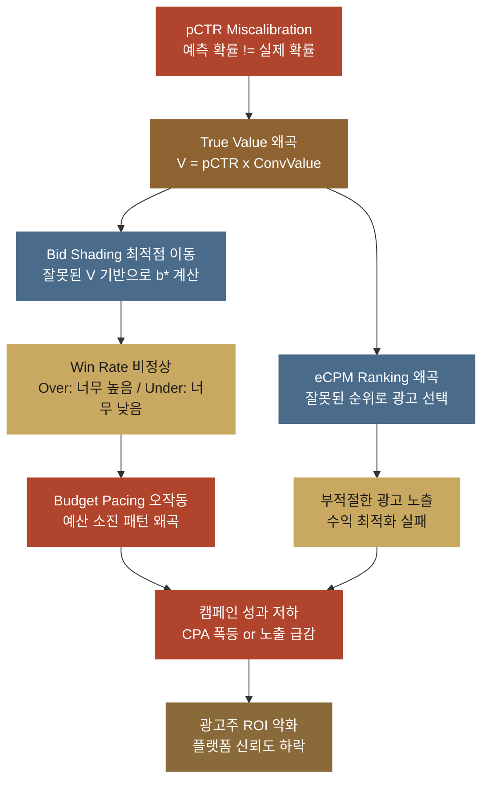
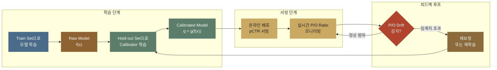
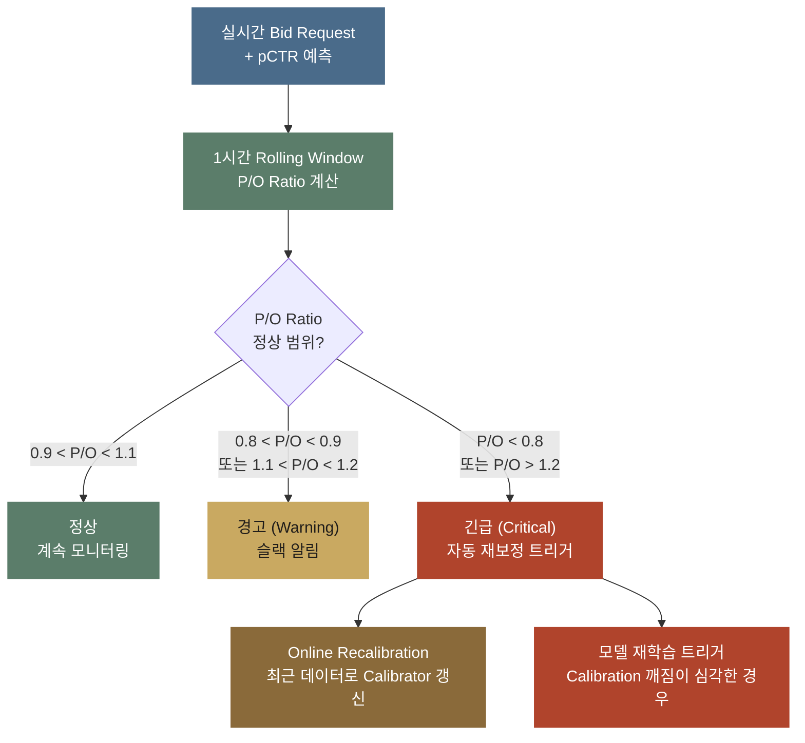

pCTR 모델(광고가 노출됐을 때 클릭될 확률 pCTR 을 예측하는 모델)의 AUC(클릭된 노출이 클릭되지 않은 노출보다 높은 점수를 받는 정도를 재는 값으로, 클수록 순서를 잘 맞힙니다)가 0.85입니다. 팀원들과 자축하며 프로덕션에 배포했습니다. 그런데 일주일 후 광고주 대시보드를 열어보니, ROI(쓴 광고비 대비 번 돈의 비율)가 오히려 나빠졌습니다. 캠페인 절반은 CPA(전환, 곧 구매 같은 목표 행동 한 건을 얻는 데 든 광고비)가 폭등했고 나머지 절반은 노출 자체가 급감했습니다. 모델이 "잘 맞추고" 있었는데 왜 돈을 잃은 걸까요?

답은 간단합니다. **AUC는 "순서(ranking)"만 평가합니다.** 확률값 자체가 맞는지는 보지 않으므로 순서가 그대로인 채 값만 달라져도 AUC는 변하지 않습니다. 그런데 광고 시스템은 pCTR 값을 입찰가 계산에 그대로 씁니다. 노출 한 번의 기대 가치인 참 가치(True Value)는 pCTR에 전환했을 때의 가치(Conversion Value)를 곱해서 구합니다.

$$\text{True Value} = pCTR \times \text{Conversion Value}$$

입찰의 근거가 되는 확률이 늘 같은 방향으로 틀리면 어떻게 될까요. 참 가치가 같은 방향으로 틀리고 입찰가가 그 값에서 정해지므로 순서를 잘 맞춰도 돈을 잃습니다. 확률이 이렇게 틀리는 문제가 **보정(Calibration)**(예측 확률이 실제로 일어나는 비율과 맞는 정도) 문제입니다.

<a href="demo-calibration.html" class="btn-demo">보정 왜곡을 직접 슬라이더로 실험해보기 →</a>

슬라이더를 조금 움직이면 낙찰 결과가 흔들리는 게 보입니다.

> 이어지는 글들을 먼저 적어 둡니다.
> - pCTR이 무엇이고 eCPM에 어떻게 곱해지는지 → [pCTR 예측](post.html?id=pctr-prediction)
> - 참 가치(True Value)로 최적 입찰가를 만드는 구조 → [Bid Shading](post.html?id=bid-shading-censored)
> - 참 가치가 예산 페이싱의 입력이 되는 과정 → [Auto-Bidding](post.html?id=auto-bidding-pacing)
> - pCTR이 광고 랭킹의 핵심 입력인 이유 → [eCPM 랭킹](post.html?id=ecpm-ranking)
>
> 이 시스템들의 **전제 조건**은 "pCTR 값 자체가 정확할 것" 하나입니다. 이 조건이 곧 보정입니다.

---

## 1. 순서 맞히기(Discrimination) vs 보정: 무엇이 다른가

**순서 맞히기(AUC가 재는 것)는 광고들의 점수 순서를 맞히는 능력이고 보정은 점수 값 자체가 실제 비율과 맞는 정도입니다. 입찰가는 값으로 계산되므로 값이 틀리면 순서가 맞아도 손해가 납니다.**

pCTR 모델이 광고마다 점수를 내면 두 가지를 물을 수 있습니다. 어느 광고가 앞서는지, 그리고 그 점수가 실제 클릭 비율과 같은지입니다. 모델 평가에서는 **순서 맞히기(순서를 맞히는 능력)**와 **보정**을 구분하지 못하는 혼동이 가장 흔합니다. 이 둘은 완전히 다른 속성입니다.

| 속성 | 순서 맞히기 (AUC) | 보정 |
|------|---------------------|-------------|
| **측정 대상** | 양성/음성 샘플의 순서를 맞추는 능력 | 예측 확률이 실제 확률과 일치하는 정도 |
| **핵심 질문** | "클릭할 광고가 안 클릭할 광고보다 높은 점수를 받았는가?" | "pCTR 2%로 예측한 광고가 실제로 2% 클릭되는가?" |
| **이상적인 상태** | AUC = 1.0 (모든 양성이 모든 음성보다 높음) | 예측 = 실제 (모든 구간에서) |
| **평가 도구** | ROC 곡선(ROC Curve), AUC | 보정 그림(Reliability Diagram), ECE, P/O Ratio |
| **개선 방법** | 피처 엔지니어링, 모델 아키텍처, 학습 데이터 | 사후 보정(Post-hoc Calibration) (Platt, Isotonic 등) |
| **광고에서의 역할** | 어떤 광고를 보여줄지 **순서** 결정 | 입찰가를 **얼마로** 설정할지 결정 |

### 둘의 차이를 한 줄로

순서 맞히기는 **순서**만 봅니다. 클릭할 노출이 안 클릭할 노출보다 높은 점수를 받았는지만 셉니다. 보정은 **값 자체**를 봅니다. pCTR 2%라고 적었으면 실제로 100번 중 2번 클릭이 나야 합니다.

광고 시스템에서는 둘 다 필요하지만 **입찰가는 순서가 아니라 절대값으로 계산되기 때문에** 보정이 더 위험합니다. 실제 CTR이 0.01인 광고를 모델이 0.03으로 예측해도, 다른 광고도 모두 3배로 예측했다면 순서는 그대로라 AUC는 변하지 않습니다. 그러나 입찰가는 3배가 됩니다. 입찰가가 pCTR에 비례해 정해지므로, 순서가 같아도 광고주는 실제 가치의 3배 가격으로 입찰하게 됩니다.

---

## 2. 보정이 광고 비즈니스에 미치는 영향

**pCTR을 실제보다 높게 틀리면 입찰이 과해져 광고주의 전환 한 건 비용이 오르고 낮게 틀리면 경매에서 지는 일이 늘어 노출이 줄어듭니다. 후보가 여럿일 때 틀린 방향이 광고마다 다르면 1등이 바뀔 수 있습니다.**

### 과대 예측(Over-prediction) 시나리오

pCTR을 실제보다 높게 예측하면(과대 예측) 참 가치가 과대 계산되고 입찰가를 높게 제출합니다. 아래 표에서 실제 CTR 1%인 광고를 모델이 3%로 보면, 같은 전환 가치 `$10` 에 곱해 참 가치가 실제 `$0.10` 대신 `$0.30` 이 됩니다. 입찰가 행은 Bid Shading(참 가치를 그대로 내지 않고 조금 낮춰서 내는 입찰) 뒤의 값이고 참 가치가 3배라 입찰가도 `~$0.07` 에서 `~$0.21` 로 3배가 됩니다.

> 이 글에서 과대 예측(over-prediction)은 평균 pCTR이 실제보다 높은 상태를 말합니다. 확률을 0이나 1 쪽으로 너무 치우치게 내는 과신(over-confidence)과는 다릅니다. 과신한 모델은 높은 pCTR은 너무 높게, 낮은 pCTR은 너무 낮게 내므로 평균은 맞을 수도 있습니다. 4절의 Temperature Scaling은 과신 쪽을 고칩니다.

| 항목 | 실제 | 모델 예측 |
|------|------|----------|
| CTR | 1% | 3% (3배 과대) |
| 전환 가치(Conversion Value) | `$10` | `$10` |
| 참 가치 | `$0.10` | `$0.30` |
| 입찰가 (Bid Shading 후) | `~$0.07` | `~$0.21` |

모델은 클릭이 3%로 일어날 것이라 믿고 입찰하지만 실제 클릭은 1%뿐이라, 3배 높은 입찰가를 내면서도 기대한 전환의 1/3 만 얻습니다. 같은 광고비로 얻는 전환이 줄어 전환 한 건의 비용이 오릅니다.

결과:
- 경매에서 **자주 이기지만**, 실제 CTR은 1%이므로 전환이 기대의 1/3
- 광고주 CPA가 3배 상승 (목표 `$10` → 실제 `$30`)
- 광고주 이탈, 플랫폼 신뢰도 하락

### 과소 예측(Under-prediction) 시나리오

pCTR을 실제보다 낮게 예측하면(과소 예측) 참 가치가 과소 계산되고 입찰가를 낮게 제출합니다. 아래 표에서 실제 CTR 3%인 광고를 모델이 1%로 보면, 참 가치는 실제 `$0.30` 대신 `$0.10` 이고 입찰가도 `~$0.21` 대신 `~$0.07` 로 3분의 1이 됩니다.

| 항목 | 실제 | 모델 예측 |
|------|------|----------|
| CTR | 3% | 1% (3배 과소) |
| 전환 가치 | `$10` | `$10` |
| 참 가치 | `$0.30` | `$0.10` |
| 입찰가 (Bid Shading 후) | `~$0.21` | `~$0.07` |

참 가치대로라면 `~$0.21` 을 낼 광고가 `~$0.07` 만 내니 경매에서 이기기 어려워 노출이 사라집니다. win rate 는 경매에서 이기는 비율입니다. 예산 페이싱(Budget Pacing)은 하루 예산을 시간에 맞춰 나눠 쓰도록 입찰 강도를 조절하는 장치입니다.

결과:
- 경매에서 **거의 못 이김** (win rate 급감)
- 노출 자체가 사라짐 → 캠페인 예산 소진 못함
- 예산 페이싱(Budget Pacing)이 예산을 쓰려고 입찰 강도를 높여도, 참 가치 자체가 낮으니 효과 없음

### 가상 데이터로 손해액을 계산해 본다

위 두 시나리오는 광고 하나만 놓고 봤습니다. 실제 경매에는 후보가 여러 개 들어옵니다. 이때 보정 오류는 **누가 1등이 되는가**를 바꿉니다. 아래는 **가상 데이터**입니다.

| 광고 | 지면 세그먼트 | 모델 pCTR | 실제 CTR | CPC 입찰가 | COPC (실제÷예측) |
|------|-------------|----------|---------|-----------|-----------------|
| A | 앱 하단 배너 | 2.40% | 1.50% | ₩300 | 0.625 (과대예측) |
| B | 웹 인피드 | 1.20% | 1.40% | ₩500 | 1.167 (과소예측) |
| C | 앱 인피드 | 1.00% | 2.00% | ₩400 | **2.000** (과소예측) |
| D | 웹 상단 배너 | 1.80% | 1.60% | ₩350 | 0.889 (과대예측) |
| E | 앱 리워드 | 2.00% | 1.00% | ₩250 | **0.500** (과대예측) |

'실제 CTR'은 로그가 충분히 쌓인 뒤에야 알 수 있는 값입니다. 랭킹을 매기는 순간에는 모델 pCTR만 손에 있습니다. 지면마다 틀린 방향이 다르다는 점을 눈여겨봅니다. A, D, E는 크게 봤고 B와 C는 낮춰 봤습니다.

표의 CPC 입찰가는 클릭 한 번에 광고주가 내겠다고 한 금액입니다. 지면 세그먼트는 광고가 나가는 자리의 묶음입니다. COPC(Click Over Predicted Click)는 실제 CTR을 모델 pCTR로 나눈 값이라 1보다 작으면 모델이 실제보다 높게 본 과대 예측, 1보다 크면 낮게 본 과소 예측입니다. A는 1.50% ÷ 2.40% = 0.625, C는 2.00% ÷ 1.00% = 2.000 입니다.

아래 코드는 이 후보 5개로 eCPM(노출 1,000회당 기대 매출)을 매겨 1등을 정합니다. 클릭당 과금이라 eCPM은 pCTR × CPC × 1,000 입니다. 보정하지 않을 때, 전체 COPC 하나로 보정할 때, 지면마다 보정할 때 1등이 누구인지와 그 1등이 노출 1,000회에서 실제로 번 돈을 비교합니다.

```python
# 하는 일: 광고 후보 5개를 모델 pCTR 로 순위를 매길 때, 보정하지 않을 때와 전체 COPC 로 보정할 때, 지면별로 보정할 때의 1등과 노출 1,000회 실제 매출을 비교한다.

# 1단계: 가상 후보 5개를 둔다
# 한 번의 노출 기회에 광고 후보 5개가 들어오고, 하나만 보여 줄 수 있다. 각 행은 (광고, 지면 세그먼트, 모델이 내놓은 pCTR, 나중에 확인된 실제 CTR, CPC 입찰가(원))이다. 표준 라이브러리만 쓴다.
CANDIDATES = [
    ("A", "앱 하단 배너", 0.024, 0.015, 300),
    ("B", "웹 인피드",   0.012, 0.014, 500),
    ("C", "앱 인피드",   0.010, 0.020, 400),
    ("D", "웹 상단 배너", 0.018, 0.016, 350),
    ("E", "앱 리워드",   0.020, 0.010, 250),
]
IMPRESSIONS = 1000              # 이 지면에 노출 기회가 1,000회 있다고 가정
DAILY_IMPRESSIONS = 10_000_000  # 서비스 전체 하루 노출 규모 (환산용)

CPC = {ad: cpc for ad, _s, _p, _r, cpc in CANDIDATES}    # 광고별 클릭 단가
# '실제 CTR'은 로그가 충분히 쌓인 뒤에야 알 수 있는 값이다. 랭킹을 매기는 순간 손에 있는 건 모델 pCTR 뿐이고, 그게 이 문제의 핵심이다.
REAL = {ad: real for ad, _s, _p, real, _c in CANDIDATES}  # 광고별 실제 CTR


# 2단계: eCPM 으로 순위를 매기는 함수를 만든다
# 플랫폼은 eCPM(노출 1,000회당 기대 매출)이 가장 큰 후보를 고른다. eCPM 계산의 상세는 eCPM 랭킹 글에 있고, 여기서는 '1등이 바뀌는가'만 본다.
def ranking(pctr_by_ad):
    """주어진 pCTR로 eCPM을 매겨 큰 순서대로 돌려줍니다.
    eCPM = pCTR x CPC x 1000. 클릭당 과금이라 pCTR을 곱해야 노출 가치가 됩니다."""
    board = [(pctr_by_ad[ad] * CPC[ad] * 1000, ad) for ad in pctr_by_ad]
    board.sort(reverse=True)    # 맨 앞이 1등
    return board


def show(title, board):
    """랭킹을 보기 좋게 출력합니다."""
    print(title)
    for i, (score, ad) in enumerate(board, 1):
        print(f"  {i}위 {ad}  eCPM {score:,.0f}원")


# 3단계: 후보별 COPC 와 전체 COPC 를 구해 찍는다
# COPC(Click Over Predicted Click)는 실제 클릭 / 예측 클릭이다. 1 보다 크면 실제가 더 많았으니 모델이 과소예측한 것이고, 1 보다 작으면 과대예측한 것이다.
print("광고  모델pCTR  실제CTR   COPC  판정        지면")
pred_clicks = 0.0   # 예측 클릭 총합 (COPC의 분모)
real_clicks = 0.0   # 실제 클릭 총합 (COPC의 분자)
for ad, seg, pctr, real_ctr, _cpc in CANDIDATES:
    copc = real_ctr / pctr                    # 후보 하나의 COPC
    pred_clicks += IMPRESSIONS * pctr         # 노출 x 예측 CTR = 예측 클릭 수
    real_clicks += IMPRESSIONS * real_ctr     # 노출 x 실제 CTR = 실제 클릭 수
    verdict = "과소예측" if copc > 1 else "과대예측"
    print(f" {ad}   {pctr:6.2%}  {real_ctr:6.2%}  {copc:5.3f}  {verdict}    {seg}")

global_copc = real_clicks / pred_clicks       # 전체를 뭉쳐서 본 COPC
print(f"\n전체 COPC = {real_clicks:.0f} / {pred_clicks:.0f} = {global_copc:.3f}"
      f"  (1보다 작으니 전체적으로 과대예측)")
print(f"뒤집어 본 P/O Ratio = 예측/실제 = {1 / global_copc:.3f}")

# 4단계: 보정 없이 랭킹을 매긴다
raw = {ad: pctr for ad, _s, pctr, _r, _c in CANDIDATES}
board_raw = ranking(raw)
show("\n[보정 없음] eCPM 랭킹", board_raw)

# 5단계: 전체 COPC 로 한 번에 보정한다
# 가장 흔한 첫 시도다. 모든 예측에 같은 배수(global_copc)를 곱해 전체 평균만 맞춘다. 같은 배수를 곱하는 건 단조 변환이라 순서를 절대 바꾸지 못한다.
scaled = {ad: pctr * global_copc for ad, _s, pctr, _r, _c in CANDIDATES}
after = real_clicks / sum(IMPRESSIONS * p for p in scaled.values())
show(f"\n[전체 보정] 보정 후 전체 COPC = {after:.3f}  <- 지표는 완벽해졌다",
     ranking(scaled))

# 6단계: 지면 세그먼트별로 보정한다
# 지면마다 틀리는 방향이 달랐으니 지면별 배수를 따로 쓴다. 이 예시는 세그먼트마다 광고가 하나씩이라 보정값이 곧 실제 CTR 이 된다. 실제로는 한 세그먼트에 광고가 수천 개 있고, 세그먼트 배수는 그 평균 오차만 걷어낸다.
by_segment = {ad: pctr * (REAL[ad] / pctr) for ad, _s, pctr, _r, _c in CANDIDATES}
board_seg = ranking(by_segment)
show("\n[세그먼트별 보정] eCPM 랭킹", board_seg)

# 7단계: 1등이 바뀐 만큼의 손해를 돈으로 센다
# 그래서 얼마 손해인가를 본다. 뽑힌 광고가 다르면 실제로 들어오는 돈도 달라진다. 실제 매출은 노출 수 × 실제 CTR × CPC 로, 예측이 아니라 실제 CTR 로 계산한다.
bad = board_raw[0][1]    # 보정 안 하고 뽑은 1등
good = board_seg[0][1]   # 제대로 보정하고 뽑은 1등
rev_bad = IMPRESSIONS * REAL[bad] * CPC[bad]
rev_good = IMPRESSIONS * REAL[good] * CPC[good]
gap = rev_good - rev_bad
print(f"\n1등 비교: 보정 없음 → {bad} / 세그먼트 보정 → {good}")
print(f"노출 1,000회 실제 매출: {bad} {rev_bad:,.0f}원 vs {good} {rev_good:,.0f}원")
print(f"차이 {gap:,.0f}원 = {gap / rev_good:.1%} 손실")
print(f"하루 {DAILY_IMPRESSIONS:,}회 노출이면 {gap / IMPRESSIONS * DAILY_IMPRESSIONS:,.0f}원/일")

# 출력:
# 3단계 뜻: COPC 가 1 보다 작은 A, D, E 는 과대예측, 1 보다 큰 B, C 는 과소예측이다. 다섯을 뭉치면 실제 클릭 75 에 예측 클릭 84 라 전체 COPC 는 0.893 이고, 뒤집은 P/O Ratio 는 1.120 이다.
# 광고  모델pCTR  실제CTR   COPC  판정        지면
#  A    2.40%   1.50%  0.625  과대예측    앱 하단 배너
#  B    1.20%   1.40%  1.167  과소예측    웹 인피드
#  C    1.00%   2.00%  2.000  과소예측    앱 인피드
#  D    1.80%   1.60%  0.889  과대예측    웹 상단 배너
#  E    2.00%   1.00%  0.500  과대예측    앱 리워드
#
# 전체 COPC = 75 / 84 = 0.893  (1보다 작으니 전체적으로 과대예측)
# 뒤집어 본 P/O Ratio = 예측/실제 = 1.120
# 4단계 뜻: 보정하지 않으면 A 가 eCPM 7,200원으로 1위, C 가 4,000원으로 5위다.
#
# [보정 없음] eCPM 랭킹
#   1위 A  eCPM 7,200원
#   2위 D  eCPM 6,300원
#   3위 B  eCPM 6,000원
#   4위 E  eCPM 5,000원
#   5위 C  eCPM 4,000원
# 5단계 뜻: 전체 COPC 는 1.000 으로 맞았지만 eCPM 이 모두 같은 비율로 줄어 순서는 A, D, B, E, C 그대로다. 지표는 완벽해졌는데 1위는 여전히 A 다.
#
# [전체 보정] 보정 후 전체 COPC = 1.000  <- 지표는 완벽해졌다
#   1위 A  eCPM 6,429원
#   2위 D  eCPM 5,625원
#   3위 B  eCPM 5,357원
#   4위 E  eCPM 4,464원
#   5위 C  eCPM 3,571원
# 6단계 뜻: 지면마다 따로 보정하면 C 가 eCPM 8,000원으로 1위가 되고, A 는 4,500원으로 4위로 내려간다.
#
# [세그먼트별 보정] eCPM 랭킹
#   1위 C  eCPM 8,000원
#   2위 B  eCPM 7,000원
#   3위 D  eCPM 5,600원
#   4위 A  eCPM 4,500원
#   5위 E  eCPM 2,500원
# 7단계 뜻: 노출 1,000회에 A 를 보이면 실제 매출이 4,500원, C 를 보였다면 8,000원이다. 3,500원, 곧 C 매출의 43.8% 를 잃고, 하루 10,000,000회 노출이면 35,000,000원이다.
#
# 1등 비교: 보정 없음 → A / 세그먼트 보정 → C
# 노출 1,000회 실제 매출: A 4,500원 vs C 8,000원
# 차이 3,500원 = 43.8% 손실
# 하루 10,000,000회 노출이면 35,000,000원/일
```

결과를 세 줄로 적습니다.

**1. 보정 없이 뽑은 1등은 A입니다.** 보정하지 않은 pCTR 2.40% 에 CPC 입찰가 300원을 곱해 매긴 eCPM 이 5개 후보 가운데 가장 큽니다. 모델은 A의 CTR을 2.40%로 봤지만 실제는 1.50%였습니다.

**2. 전체 COPC를 1.000으로 맞춰도 1등은 그대로 A입니다.** 모든 예측에 같은 배수(전체 COPC 0.893)를 곱하는 보정은 모든 후보의 eCPM을 같은 비율로 줄이므로 순서를 바꾸지 못합니다. 대시보드의 보정 지표는 1.000이 되지만 손해는 한 푼도 줄지 않습니다.

**3. 세그먼트별로 보정하면 1등이 C로 바뀝니다.** C는 실제 CTR이 2.00%인데 모델은 1.00%로 절반만 보고 있었습니다. 지면별 배수는 후보마다 달라 C의 eCPM은 올리고 A의 eCPM은 내리므로 순서가 바뀝니다.

돈으로 보면 이렇습니다. A를 1,000회 노출하면 실제 매출은 4,500원입니다(1,000 × 1.50% × 300원). C를 노출했다면 8,000원이었습니다(1,000 × 2.00% × 400원). 노출 1,000회마다 3,500원, 곧 8,000원 가운데 43.8%를 잃고 있었습니다. 하루 1,000만 노출이면 3,500만 원입니다. 물론 실제 트래픽에 이 후보 5개만 반복되지는 않습니다. 이 환산은 규모 감각을 잡는 용도입니다. 그래도 방향은 분명합니다. AUC 대시보드는 이 손실을 한 번도 알려주지 않습니다.

### 시스템 전체로의 파급 효과

Miscalibration(보정이 어긋난 상태)은 하나의 모델 문제로 끝나지 않습니다. 광고 시스템의 모든 하류 컴포넌트(pCTR을 받아 쓰는 뒤쪽 단계)가 pCTR 값을 **절대값으로** 사용하기 때문에, 오류가 연쇄적으로 전파됩니다. 아래 그림은 맨 위의 pCTR 오차가 참 가치를 거쳐 Bid Shading과 eCPM 랭킹으로 번지고 예산 페이싱을 지나 광고주 ROI 악화까지 이어지는 경로입니다.



**AUC가 높은 모델의 보정 어긋남(Miscalibration)은 오히려 더 위험합니다.** AUC가 높으면 팀은 자신감을 갖고 배포합니다. 그런데 보정이 틀어져 있으면 잘못된 확률값이 그 자신감을 타고 시스템 전체로 퍼집니다.

---

## 3. 보정 측정: 모델이 잘 보정되었는지 어떻게 아는가

**보정은 그림으로 먼저 보고 숫자로는 ECE와 P/O Ratio로 측정합니다. 전체 P/O Ratio가 1.0에 가까워도 세그먼트별로는 크게 틀릴 수 있어 쪼개서 봐야 합니다.**

### 보정 그림 (Calibration Plot)

보정 그림은 예측 확률과 실제 빈도를 맞대 그린 그림으로, 보정을 **시각적으로** 진단하는 가장 직관적인 도구입니다.

**구성 방법:**
1. 모델의 예측 확률을 M개 구간(bin)으로 나눈다 (예: [0, 0.1), [0.1, 0.2), ...)
2. 각 구간에 속한 샘플들의 **평균 예측 확률**(X축)과 **실제 양성 비율**(Y축)을 계산한다
3. 점들을 찍어 연결한다

가로에는 예측을, 세로에는 실제를 두므로 대각선 위의 점은 예측과 실제가 같은 구간입니다. 점이 대각선 아래라면 같은 가로 위치에서 세로가 낮으니 실제가 예측보다 낮은 과대 예측입니다.

**해석:**
- **Perfect 보정**: 모든 점이 대각선에 딱 붙는다 (예측 = 실제)
- **과대 예측**: 점들이 대각선보다 **아래쪽**에 놓인다 (예측 > 실제, 과대 예측)
- **과소 예측**: 점들이 대각선보다 **위쪽**에 놓인다 (예측 < 실제, 과소 예측)

| 패턴 | 대각선 대비 위치 | 의미 | 광고 임팩트 |
|------|----------------|------|------------|
| Perfect | 대각선에 붙음 | 예측 = 실제 | 최적 입찰 |
| Over-prediction | 대각선보다 아래 | "2% 예측했지만 실제는 1%" | CPA 폭등 |
| Under-prediction | 대각선보다 위 | "1% 예측했지만 실제는 2%" | 노출 급감 |
| S자 곡선 | 중간은 맞지만 양 끝이 틀림 | 극단값에서 miscalibration | 세그먼트별 편차 |

<div class="demo-embed-wrap">
<iframe class="demo-embed" src="demo-calibration.html?embed=1" height="560" loading="lazy" title="보정 왜곡 미니 데모"></iframe>
<a class="demo-embed-open" href="demo-calibration.html" target="_blank" rel="noopener">↗ 전체 데모로 열기 (가이드 투어 포함)</a>
</div>

기울기와 편향을 움직여 보면 곡선이 대각선에서 떨어지는 모습이 보입니다.

아래 코드는 클릭이 실제로 일어나는 비율은 3%인데 예측은 그와 상관없이 더 높게 나오도록 만든 모델을 10구간으로 나눠, 구간마다 평균 예측과 실제 클릭 비율을 찍습니다. 찍힌 두 구간은 모두 평균 예측이 실제 비율보다 높아 Over이고 점으로 그리면 둘 다 대각선 아래입니다.

```python
# 하는 일: 실제 CTR 3% 인 노출 10,000건에 그와 상관없는 예측을 붙이고, 예측을 10구간으로 나눠 구간마다 평균 예측과 실제 클릭 비율을 비교한다.
import numpy as np

# 1단계: 구간마다 평균 예측과 실제 비율을 내는 함수를 만든다
# 예측을 [0, 0.1), [0.1, 0.2), … 10구간으로 나누고, 비어 있는 구간은 건너뛴다. 이 쌍을 점으로 찍은 것이 보정 그림(Reliability Diagram)이다.
def reliability_diagram_data(y_true, y_prob, n_bins=10):
    """Reliability Diagram 데이터: (평균 예측, 실제 비율) 쌍"""
    bin_edges = np.linspace(0, 1, n_bins + 1)
    centers, accs, counts = [], [], []
    for i in range(n_bins):
        mask = (y_prob >= bin_edges[i]) & (y_prob < bin_edges[i + 1])
        if mask.sum() == 0:
            continue
        centers.append(y_prob[mask].mean())
        accs.append(y_true[mask].mean())
        counts.append(mask.sum())
    return centers, accs, counts

# 2단계: 과대예측하는 모델의 예측을 만들어 구간마다 찍는다
# 실제 클릭은 3% 확률로 뽑고, 예측은 그와 상관없이 Beta(2, 50) 에서 뽑는다. 예측 평균이 실제보다 높은 과대예측(Over-prediction) 모델이다.
np.random.seed(42)
y_true = np.random.binomial(1, 0.03, size=10000)
y_prob = np.clip(np.random.beta(2, 50, size=10000), 0, 1)

centers, accs, counts = reliability_diagram_data(y_true, y_prob)
for c, a, n in zip(centers, accs, counts):
    gap = "Over ↓" if c > a else "Under ↑"
    print(f"  예측={c:.3f}  실제={a:.3f}  (n={n:,})  {gap}")

# 출력:
# 2단계 뜻: 두 구간 모두 평균 예측(0.036, 0.120)이 실제 비율(0.026, 0.032)보다 높아 Over 다. 예측 0.120 인 280건은 실제가 0.032 라 차이가 더 크고, 보정 그림에서 점이 대각선 아래에 놓이면 Over, 위에 놓이면 Under 다.
#   예측=0.036  실제=0.026  (n=9,720)  Over ↓
#   예측=0.120  실제=0.032  (n=280)  Over ↓
```

### ECE (Expected Calibration Error)

ECE(예측과 실제의 평균 격차)는 보정 그림을 **하나의 숫자**로 요약한 지표입니다.

$$ECE = \sum_{m=1}^{M} \frac{|B_m|}{n} \left| \text{acc}(B_m) - \text{conf}(B_m) \right|$$

- $M$ : 구간 개수
- $B_m$ : $m$번째 구간에 속한 샘플 집합
- $|B_m|$ : $m$번째 구간의 샘플 수
- $n$ : 전체 샘플 수
- $\text{acc}(B_m)$ : 구간 $m$의 실제 양성 비율 (accuracy)
- $\text{conf}(B_m)$ : 구간 $m$의 평균 예측 확률 (confidence)

직관적으로 해석하면 ECE는 **각 구간에서 "예측 확률"과 "실제 비율"의 차이를 샘플 수로 가중 평균**한 값입니다. ECE = 0이면 어긋남이 없는 보정, 높을수록 miscalibrated입니다. 구간마다 차이에 그 구간의 샘플 비율을 곱해 더하므로, 샘플이 많은 구간의 어긋남이 더 크게 반영됩니다. 아래 코드는 과대예측하는 데이터로 이 식을 그대로 계산해, 0에서 얼마나 먼지로 보정 상태를 읽습니다.

> ECE를 계산할 때 구간 개수 $M$의 선택이 결과에 영향을 미칩니다. 일반적으로 $M = 10 \sim 20$을 사용하되, 구간당 샘플 수가 충분한지(최소 수백 개) 확인해야 합니다. 샘플이 적은 구간은 노이즈가 크므로 equal-frequency binning(각 구간의 샘플 수를 균등하게)을 권장합니다.

```python
# 하는 일: 실제 CTR 2% 인 노출 10,000건에 과대예측한 예측을 붙이고, 구간마다 예측과 실제의 차이를 샘플 수로 가중 평균한 ECE 를 잰다.
import numpy as np

# 1단계: ECE 를 구하는 함수를 만든다
# 예측을 10구간으로 나눠 구간마다 |실제 양성 비율 - 평균 예측 확률| 을 구하고, 구간의 샘플 비율을 곱해 더한다.
def expected_calibration_error(y_true, y_prob, n_bins=10):
    """ECE: 예측 확률과 실제 비율의 가중 평균 차이"""
    bin_edges = np.linspace(0, 1, n_bins + 1)
    ece = 0.0
    for i in range(n_bins):
        mask = (y_prob >= bin_edges[i]) & (y_prob < bin_edges[i + 1])
        if mask.sum() == 0:
            continue
        bin_acc = y_true[mask].mean()    # 실제 양성 비율
        bin_conf = y_prob[mask].mean()   # 평균 예측 확률
        ece += (mask.sum() / len(y_true)) * abs(bin_acc - bin_conf)
    return ece

# 2단계: 과대예측하는 모델로 ECE 를 잰다
# 예측은 실제와 상관없이 Beta(2, 30) 에서 뽑는다. 평균이 2% 보다 높은 과대예측(Over-prediction) 모델이다.
np.random.seed(42)
y_true = np.random.binomial(1, 0.02, size=10000)   # 실제 CTR 2%
y_prob = np.clip(np.random.beta(2, 30, size=10000), 0, 1)

print(f"  ECE = {expected_calibration_error(y_true, y_prob):.4f}")
print(f"  (0에 가까울수록 보정이 잘 된 모델)")

# 출력:
# 2단계 뜻: ECE 가 0.0443 이다. 구간마다 예측과 실제의 차이를 샘플 수로 가중 평균한 값이 이만큼이고, 0 에 가까울수록 보정이 잘 된 모델이다.
#   ECE = 0.0443
#   (0에 가까울수록 보정이 잘 된 모델)
```

### 실무 메트릭: Predicted/Observed Ratio (P/O Ratio)

계산이 극도로 단순하고 해석이 직관적이어서 실무에서는 ECE보다 **P/O Ratio**(Predicted/Observed, 평균 예측을 실제로 나눈 값)가 더 자주 쓰입니다.

$$\text{P/O Ratio} = \frac{\bar{p}}{\bar{y}} = \frac{\text{평균 예측 CTR}}{\text{실제 CTR}}$$

| P/O Ratio | 해석 | 조치 |
|-----------|------|------|
| 1.0 | 정확히 보정됨 | 유지 |
| > 1.0 (예: 1.3) | Over-prediction (30% 과대 예측) | 입찰가 30% 과다 → 보정 필요 |
| < 1.0 (예: 0.7) | Under-prediction (30% 과소 예측) | 입찰가 30% 과소 → 보정 필요 |

예를 들어 P/O Ratio가 1.3이면 모델이 실제보다 30% 높게 본 것이고 입찰가가 예측을 따라가므로 입찰가도 30% 과다가 됩니다.

P/O Ratio는 **세그먼트별로 쪼개서 모니터링**할 수 있어 쓸모가 큽니다.

| 세그먼트 | 평균 pCTR | 실제 CTR | P/O Ratio | 상태 |
|---------|----------|---------|-----------|------|
| Exchange A | 2.1% | 2.0% | 1.05 | 양호 |
| Exchange B | 1.8% | 1.2% | **1.50** | Over-prediction |
| Mobile | 3.2% | 3.0% | 1.07 | 양호 |
| Desktop | 1.5% | 2.1% | **0.71** | Under-prediction |
| 오전 (6-12시) | 1.9% | 1.8% | 1.06 | 양호 |
| 저녁 (18-24시) | 2.5% | 1.6% | **1.56** | Over-prediction |

Exchange B는 평균 pCTR 1.8%를 실제 CTR 1.2%로 나눈 1.50이라 과대 예측이고 Desktop은 1.5%를 2.1%로 나눈 0.71이라 과소 예측입니다. 위로 틀린 세그먼트와 아래로 틀린 세그먼트가 섞이면 전체 평균에서는 서로 상쇄됩니다. 2절 가상 데이터에서도 A는 COPC 0.625, C는 2.000 으로 크게 틀렸지만 전체 COPC는 0.893 으로 그보다 1에 가까웠습니다.

이 테이블에서 보듯 **Global P/O Ratio가 1.0에 가까워도, 세그먼트별로는 심각하게 miscalibrated일 수 있습니다.** Exchange B에서는 50% 과대 예측, Desktop에서는 29% 과소 예측입니다. Global Calibration만으로는 이 문제를 발견할 수 없습니다.

### COPC: 방향이 반대인 쌍둥이 지표

Click Over Predicted Click의 줄임말인 **COPC**는 같은 것을 측정하면서 분자와 분모만 뒤집은 지표입니다.

$$\text{COPC} = \frac{\text{실제 클릭 수}}{\text{예측 클릭 수}}$$

P/O Ratio와 분자, 분모가 반대이므로, 1을 기준으로 한 해석도 반대가 됩니다.

| 지표 | 정의 | 1보다 크면 | 1보다 작으면 |
|------|------|-----------|-------------|
| P/O Ratio | 예측 ÷ 실제 | 과대 예측 (입찰 과다) | 과소 예측 (입찰 부족) |
| COPC | 실제 ÷ 예측 | **과소 예측** (입찰 부족) | **과대 예측** (입찰 과다) |

표를 외우기보다 이름으로 기억하는 편이 낫습니다. COPC는 이름부터 실제 클릭(Click)이 먼저 나옵니다. 분자가 실제이니 값이 크면 실제가 더 많았고 모델이 낮게 봤다는 뜻입니다.

방향을 거꾸로 읽는 사고는 실무에서 정말 자주 일어납니다. 대시보드를 열면 어느 쪽 지표인지부터 확인합니다. [pCTR 예측](post.html?id=pctr-prediction) 글의 예시 모델은 COPC 1.13이었습니다. 실제가 예측보다 13% 많았다는 뜻이고 뒤집으면(1 ÷ 1.13) P/O Ratio 0.88입니다. 이 글 2절의 가상 데이터는 반대쪽이었습니다. 전체 COPC 0.893, P/O Ratio 1.120으로 과대 예측이었습니다.

:::deep 더 깊이 — Brier score를 쪼개면 보정 오차 항이 나온다
ECE는 bin을 어떻게 자르느냐에 따라 답이 흔들립니다. bin 없이 측정하는 지표로 **Brier score**가 있습니다. 예측 확률과 실제 라벨(0 또는 1)의 제곱 오차 평균입니다.

$$BS = \frac{1}{n}\sum_{i=1}^{n}(p_i - y_i)^2$$

Murphy(1973)는 이 값이 세 조각으로 정확히 쪼개진다는 것을 보였습니다. 같은 예측값을 가진 샘플끼리 K개 그룹으로 묶으면 이렇게 됩니다.

$$BS = \underbrace{\frac{1}{n}\sum_{k} n_k (p_k - \bar{y}_k)^2}_{\text{reliability}} - \underbrace{\frac{1}{n}\sum_{k} n_k (\bar{y}_k - \bar{y})^2}_{\text{resolution}} + \underbrace{\bar{y}(1 - \bar{y})}_{\text{uncertainty}}$$

- **reliability**: 그룹의 예측값 $p_k$와 그 그룹의 실제 비율 $\bar{y}_k$의 차이입니다. 이 차이가 곧 보정 오차입니다. 작을수록 좋습니다.
- **resolution**: 그룹별 실제 비율이 전체 평균 $\bar{y}$에서 얼마나 벌어지는지입니다. 순서를 나누는 힘, 즉 Discrimination에 대응합니다. 클수록 좋으니 부호가 마이너스입니다.
- **uncertainty**: 데이터 자체의 분산입니다. 모델이 무엇을 하든 바뀌지 않습니다.

이 분해를 보면 Discrimination과 Calibration은 한 지표 안에서 뒤섞여 있지 않고 **서로 다른 항**으로 나뉘어 있습니다. reliability만 줄이는 작업이 Post-hoc Calibration입니다. resolution을 키우는 작업이 피처, 모델 개선입니다. 6절에서 말하는 "먼저 AUC, 그다음 Calibration"이라는 순서의 수학적 근거가 바로 이 분해입니다.
:::

---

## 4. Calibration 보정 기법

**사후 보정은 모델을 다시 학습하지 않고 출력 값에 순서를 뒤집지 않는 변환을 한 번 더 걸어 실제 비율에 맞춥니다. 기본은 Platt, 데이터가 충분하면 Isotonic, 신경망이 과신하면(확률을 0이나 1 쪽으로 치우치게 내면) Temperature입니다.**

모델 학습이 끝난 후, **Post-hoc Calibration**(사후 보정, 학습이 끝난 모델의 출력을 나중에 고치는 방법) 기법으로 예측 확률을 보정할 수 있습니다. Platt, Isotonic, Temperature 세 기법의 원리는 같습니다. 모델의 raw output $f(x)$에 **단조 변환**(monotonic transformation)을 적용합니다. 순서는 그대로 두고 값만 실제에 가깝게 당기는 변환입니다. 마지막의 Histogram Binning 은 bin별 실제 비율을 그대로 쓰므로 단조가 보장되지 않습니다. 모든 값에 같은 배수를 곱하는 2절의 보정도 단조 변환입니다.

### Platt Scaling

Platt Scaling은 가장 널리 쓰이는 보정 기법입니다. 모델의 raw output(logit, sigmoid를 씌우기 전 점수)에 **sigmoid 변환**(값을 0과 1 사이 확률로 바꾸는 함수)을 적용합니다.

$$q = \sigma(A \cdot f(x) + B) = \frac{1}{1 + \exp(-(A \cdot f(x) + B))}$$

- $f(x)$ : 모델의 raw output (logit 또는 예측 확률)
- $A, B$ : validation set에서 학습하는 2개의 파라미터
- $q$ : 보정된 확률

**학습 방법:** Validation set에서 $A$와 $B$를 NLL(Negative Log-Likelihood, 실제 라벨에 낮은 확률을 준 만큼 커지는 손실) 최소화로 학습합니다. 모델은 자기가 학습한 데이터를 실제보다 잘 맞히므로 이때 학습에 사용하는 데이터는 반드시 모델 학습에 사용하지 않은 **hold-out** 데이터여야 합니다(5절).

아래 코드는 예측이 실제보다 양 끝으로 치우치게 일부러 만든 모델에 Platt Scaling을 적용해 A와 B를 학습하고 보정 전후 평균 예측이 실제 양성 비율과 맞는지 봅니다. 보정 전 평균 예측은 실제 양성 비율과 달랐는데 보정 후에는 같은 값이 됩니다. A가 1보다 작으니 치우친 예측을 가운데 쪽으로 당기고 B는 평균 예측을 위로 올립니다.

```python
# 하는 일: 예측이 양 끝으로 치우친 모델의 logit 5,000개에 Platt Scaling 의 A, B 를 학습하고, 보정 전후 평균 예측을 실제 양성 비율과 비교한다.
import numpy as np
from scipy.optimize import minimize
from scipy.special import expit  # sigmoid

# 1단계: NLL 을 최소로 하는 A, B 를 찾는 함수를 만든다
# 보정된 확률은 q = sigmoid(A × logit + B) 이다. 실무에서는 모델 학습에 쓰지 않은 hold-out 데이터로 맞춘다.
def platt_scaling_fit(logits, y_true):
    """Platt Scaling: NLL 최소화로 A, B 학습"""
    def nll(params):
        A, B = params
        q = expit(A * logits + B)           # q = sigmoid(A * f(x) + B)
        q = np.clip(q, 1e-7, 1 - 1e-7)
        return -np.mean(y_true * np.log(q) + (1 - y_true) * np.log(1 - q))
    return minimize(nll, x0=[1.0, 0.0], method="L-BFGS-B").x

# 2단계: 예측이 양 끝으로 치우친 모델의 logit 과 실제 클릭을 만든다
# 실제 확률은 sigmoid(0.7 × logit) 이라, 모델이 내놓는 sigmoid(logit) 은 실제보다 양 끝으로 치우친다.
np.random.seed(42)
logits = np.random.randn(5000) * 0.5
y_true = (np.random.rand(5000) < expit(logits * 0.7)).astype(float)

# 3단계: A, B 를 학습하고 보정 전후 평균을 비교한다
A, B = platt_scaling_fit(logits, y_true)
print(f"  학습된 파라미터: A={A:.3f}, B={B:.3f}")
print(f"  보정 전 평균 예측: {expit(logits).mean():.4f}")
print(f"  보정 후 평균 예측: {expit(A * logits + B).mean():.4f}")
print(f"  실제 양성 비율:    {y_true.mean():.4f}")

# 출력:
# 3단계 뜻: A=0.761 은 양 끝으로 치우친 예측을 가운데로 당기고, B=0.063 은 평균 예측을 올려 0.5007 을 실제 양성 비율과 같은 0.5158 로 맞춘다. 서빙할 때는 calibrated_pCTR = sigmoid(A × model_logit + B) 로 쓴다.
#   학습된 파라미터: A=0.761, B=0.063
#   보정 전 평균 예측: 0.5007
#   보정 후 평균 예측: 0.5158
#   실제 양성 비율:    0.5158
```

**장점:**
- 파라미터 2개로 매우 가볍고 서빙 시 sigmoid 연산 하나 추가
- 대부분의 실무 상황에서 충분히 효과적
- Production-ready: 구현이 단순하고 안정적

**한계:**
- 전역적(global) 보정 → 하나의 $(A, B)$ 쌍이 모든 데이터에 적용
- 세그먼트별 편향 패턴이 다르면 (Exchange A는 over, Exchange B는 under), 전역 보정으로는 부족 (한 쌍의 $(A, B)$ 로 두 방향을 한꺼번에 맞출 수 없기 때문)

### Isotonic Regression

Isotonic Regression은 **비모수적 단조 변환**(곡선의 모양을 미리 정하지 않고 데이터로 맞추는 방식)입니다. 데이터를 구간별로 나누어 각 구간에서 개별적으로 보정합니다.

**핵심 원리:** 예측 확률을 정렬한 후, 실제 양성 비율이 단조 증가(monotonically increasing)하도록 **step function**(계단 모양의 함수)을 학습합니다. Platt Scaling이 하나의 S자 곡선을 적용하는 것과 달리, Isotonic Regression은 **구간별로 다른 보정값**을 적용합니다.

**장점:**
- Platt Scaling보다 유연: 비선형 miscalibration 패턴도 보정 가능
- 모수적 가정이 없으므로 다양한 형태의 왜곡에 대응

**한계:**
- 데이터가 많아야 안정적 (bin당 수백~수천 샘플 필요)
- 데이터가 적으면 overfitting 위험 → calibration이 오히려 나빠질 수 있음
- Platt보다 서빙이 약간 복잡 (lookup table 또는 구간 매핑 필요)

### Temperature Scaling

Temperature Scaling은 **파라미터 하나**로 전체 확률 분포의 "날카로움"을 조절합니다. logit을 $T$로 나눈 뒤 sigmoid를 씌우므로, $T$가 1보다 크면 logit의 크기가 줄어 확률이 덜 극단적이 되고 $T$가 1보다 작으면 그 반대입니다.

$$q = \sigma\left(\frac{f(x)}{T}\right)$$

- $T$ : Temperature 파라미터 (validation set에서 학습)
- $T > 1$ : 확률을 0.5 쪽으로 당김 (0이나 1에 치우친 예측을 완화) → 과신(over-confidence) 보정
- $T < 1$ : 확률을 0이나 1 쪽으로 밀어냄 (머뭇거리는 예측을 강화) → 확신이 부족한(under-confident) 모델 보정
- $T = 1$ : 원래 모델 그대로

> $T > 1$ 은 0.5보다 큰 확률은 내리고 0.5보다 작은 확률은 올립니다. 그래서 평균 pCTR이 실제보다 높은 과대 예측은 Temperature로 고치지 못합니다. pCTR이 대부분 0.5보다 훨씬 작은 광고에서는 $T > 1$ 이 오히려 pCTR을 올립니다. 평균 수준을 옮기려면 Platt의 $B$처럼 logit에 더하는 항이나 P/O Ratio로 나누는 보정이 필요합니다.

**장점:**
- 파라미터 단 하나 → overfitting 위험 최소
- 서빙 오버헤드 거의 없음 (나눗셈 하나)
- 특히 Neural Network의 over-confidence 보정에 효과적

**한계:**
- 전역적 보정 (Platt과 동일한 한계)
- 보정의 자유도가 가장 낮음 → 복잡한 miscalibration 패턴에는 부족

### Histogram Binning

Histogram Binning은 예측 확률을 bin으로 나눈 후, 각 bin의 예측값을 해당 bin의 **실제 양성 비율**로 교체합니다. 개념적으로 가장 단순합니다.

**장점:**
- 구현이 극도로 단순 (bin별 lookup)
- 비모수적이며 bin 내에서는 정확히 보정됨

**한계:**
- bin 경계에서 불연속적 (discontinuity)
- bin 개수 선택에 민감
- 충분한 데이터가 없으면 bin별 추정치가 불안정
- bin별 값이 단조 증가한다는 보장이 없음 → 이웃 bin 사이에서 순서가 뒤집힐 수 있고 같은 bin 안의 점수는 모두 동점이 됨

### 기법 비교

| 기법 | 파라미터 수 | 유연성 | 데이터 요구량 | 서빙 오버헤드 | 실무 추천도 |
|------|-----------|--------|-------------|-------------|-----------|
| Platt Scaling | 2 ($A, B$) | 중간 | 낮음 | 극히 낮음 (sigmoid 1회) | 높음 -- 기본 선택 |
| Isotonic Regression | $O(n)$ | 높음 | 높음 | 낮음 (lookup) | 중간 -- 데이터 충분 시 |
| Temperature Scaling | 1 ($T$) | 낮음 | 매우 낮음 | 극히 낮음 (나눗셈 1회) | 높음 -- NN 모델에 특히 |
| Histogram Binning | $M$ (bin 수) | 높음 | 높음 | 극히 낮음 (lookup) | 낮음 -- 불연속성 문제 |

> 실무 권장: **Platt 보정(Platt Scaling)부터 시작합니다.** 대부분의 경우 충분히 효과적이고 구현과 서빙이 단순합니다. Platt으로 부족한 경우(세그먼트별 편향 패턴이 복잡한 경우)에만 Isotonic Regression이나 세그먼트별 Platt을 고려합니다. Temperature 보정은 Deep Learning 모델이 과신할 때(확률을 0이나 1 쪽으로 치우치게 낼 때) 가장 먼저 시도할 기법입니다. 평균이 높은 과대 예측에는 Platt이나 P/O Ratio 보정을 씁니다.

---

## 5. 프로덕션 보정 파이프라인

**보정은 한 번 맞추고 끝나지 않으므로, 모델과 보정기를 서로 다른 데이터로 학습하고 P/O Ratio를 계속 측정해서 정상 범위를 벗어나면 다시 맞춰야 합니다.**

보정은 일회성 작업이 아닙니다. 프로덕션 환경에서는 **지속적인 모니터링과 재보정** 파이프라인이 필요합니다. 아래 그림은 학습 단계에서 모델과 보정기를 만들고 서빙 단계에서 P/O Ratio를 실시간으로 측정하며 임계치를 넘으면 재보정이나 재학습으로 되돌아가는 순환입니다.



### 학습-보정 분리 원칙

보정기(Calibrator)를 학습할 때는 모델 학습에 사용한 데이터로 보정기도 학습하는 **실수가 가장 흔합니다**. 모델은 자기가 본 데이터에서는 실제보다 잘 맞춥니다. 그 과적합된 예측값을 기준으로 보정하면, 새 데이터에서 보정이 깨집니다.

**올바른 방법:**

| 데이터셋 | 용도 | 비율 (예시) |
|---------|------|-----------|
| 학습 셋(Train Set) | 모델 $f(x)$ 학습 | 70% |
| 보정 Set | 보정기 $g(\cdot)$ 학습 | 15% |
| Test Set | 최종 평가 (AUC + ECE + P/O) | 15% |

데이터가 부족하면 **Cross-Validation 보정**을 씁니다.

1. 학습 셋을 K-fold로 나눈다
2. 각 조각(fold)에서 K-1개 조각으로 모델 학습, 나머지 1개 조각에서 예측값 생성
3. 모든 조각의 예측값을 합쳐서 보정기 학습

각 조각의 예측값은 그 조각을 학습에 쓰지 않은 모델이 만들므로 이 방법은 학습 데이터를 전부 보정에 쓰면서도 데이터 오염을 막습니다.

### 세그먼트별 보정

3절의 P/O Ratio 표에서 확인했듯, Global 보정으로는 세그먼트별 편향을 해결할 수 없습니다. 프로덕션에서는 **세그먼트별 보정기**를 운영합니다.

**세그먼트 키 선정 기준:**

| 세그먼트 키 | 이유 | P/O 편차 패턴 예시 |
|------------|------|-------------------|
| exchange_id | Exchange마다 트래픽 특성이 다름 | Exchange A: 1.05, Exchange B: 1.50 |
| device_type | Mobile vs Desktop CTR 패턴 상이 | Mobile: 1.07, Desktop: 0.71 |
| hour_of_day | 시간대별 유저 행동 변화 | 오전: 1.06, 저녁: 1.56 |
| ad_format | Banner vs Native vs Video 특성 차이 | Banner: 0.95, Video: 1.40 |

**구현 방식은 두 가지입니다:**

**방식 1: 세그먼트별 Platt 보정**
- 세그먼트마다 별도의 $(A_s, B_s)$를 학습
- 장점: 세그먼트 특성에 맞는 정밀 보정
- 단점: 세그먼트가 많으면 파라미터 관리 복잡, 데이터가 적은 세그먼트는 불안정

**방식 2: 세그먼트별 P/O Ratio 보정**
- 각 세그먼트의 P/O Ratio $r_s$를 계산한 후, 예측값을 $r_s$로 나눔
- $q_s = \frac{f(x)}{r_s}$
- 장점: 극도로 단순, 실시간 업데이트 용이
- 단점: 선형 보정이므로, 세그먼트 내 비선형 왜곡은 남음

예를 들어 Exchange B는 P/O Ratio가 1.50이므로 평균 예측 1.8%를 1.50으로 나누면 1.2%가 되어 실제 CTR과 맞습니다.

실무에서는 **방식 2를 기본으로 사용**하고 트래픽이 충분한 주요 세그먼트에만 방식 1을 적용하는 하이브리드 전략이 일반적입니다.

### 시간에 따른 드리프트 대응

보정은 **시간이 지나면 반드시 깨집니다.** 유저 행동, 시즌, 경쟁 환경은 계속 바뀝니다. CTR 분포가 그렇게 움직이면, 과거 데이터로 학습한 보정기는 더 이상 맞지 않습니다.

**실시간 모니터링 체계:** 1시간 단위로 P/O Ratio를 다시 측정해 정상 범위에 있는지 보고 벗어난 정도에 따라 알림이나 자동 재보정을 겁니다.



| 수준 | P/O Ratio 범위 | 조치 |
|------|---------------|------|
| 정상 | 0.9 -- 1.1 | 계속 모니터링 |
| 경고 | 0.8 -- 0.9 또는 1.1 -- 1.2 | 슬랙 알림, 원인 분석 시작 |
| 긴급 | < 0.8 또는 > 1.2 | 자동 재보정 트리거 |

**Online Recalibration** 전략:
- 최근 N시간(예: 6시간)의 데이터로 보정기 파라미터를 **온라인 갱신**
- Platt 보정의 경우 $(A, B)$를 exponential moving average(최근 값에 더 큰 비중을 두는 이동 평균)로 업데이트
- P/O Ratio 보정의 경우, rolling P/O ratio를 직접 적용

> 보정이 낡는 것(Calibration Drift)은 세상이 변해 모델이 낡는 것(Concept Drift)의 직접적인 결과입니다. Concept Drift와 모델 Staleness(학습한 지 오래된 모델이 지금 데이터와 맞지 않게 되는 문제)는 [온라인 학습(Online Learning)](post.html?id=online-learning-delayed-feedback) 글에서 따로 다뤘습니다. 온라인 학습 파이프라인과 보정 모니터링은 붙어 있어야 합니다.

---

## 6. 보정 vs 순서 맞히기: Trade-off는 있는가

**보정을 맞춰도 AUC는 보통 그대로입니다. Platt, Isotonic, Temperature 같은 사후 보정은 값만 바꾸고 순서는 뒤집지 않는 변환이라서, 순서를 평가하는 AUC에 영향이 없습니다.**

자주 받는 질문이 있습니다. "보정을 맞추면 AUC가 떨어지지 않나요?"

**답: 일반적으로 No.** Isotonic 은 순서를 지키며 계단으로 맞추는 보정입니다. 이 글에서 권하는 Platt, Isotonic, Temperature 는 모두 **단조 변환(monotonic transformation)**입니다. Histogram Binning 은 bin마다 값을 따로 정하므로 단조가 보장되지 않습니다. AUC는 점수의 순서로만 계산되는데 단조 변환은 순서를 보존하므로, 이론적으로 **AUC에 영향을 주지 않습니다.**

직관적으로 보겠습니다. $g$가 순증가 함수라면(Platt에서 $A > 0$일 때, Temperature) $f(x_1) > f(x_2)$일 때 $g(f(x_1)) > g(f(x_2))$입니다. 순서가 바뀌지 않으니 AUC는 동일합니다. Isotonic은 계단 함수라 $g(f(x_1)) \ge g(f(x_2))$까지만 보장합니다. 순서가 뒤집히지는 않지만 같은 계단에 들어간 점수는 동점이 되므로, 계단이 거칠면 AUC가 조금 내려갈 수 있습니다. 2절의 가상 데이터에서 모든 예측에 같은 배수 0.893을 곱해도 후보 5개의 순서가 그대로였던 것과 같은 이야기입니다.

| 상황 | AUC 변화 | 보정 변화 | 설명 |
|------|---------|-----------------|------|
| 사후 보정 적용 (Platt, Temperature) | 불변 | 개선 | 순증가 변환이므로 ranking 보존 |
| Calibration-aware Loss로 재학습 | 미세 변화 가능 | 개선 | Loss 함수 변경으로 모델 자체가 변함 |
| 극단적 Isotonic 보정 (데이터 부족) | 미세 하락 가능 | 개선 (과적합 위험) | 순서는 뒤집히지 않지만 평평한 계단 안의 점수가 동점이 됨 |

**실무 원칙:** 이런 사후 보정은 순서를 뒤집지 못하므로 순서의 질은 모델 단계에서 정해지고 보정은 그 순서를 둔 채 값만 고칩니다.

> "먼저 AUC를 최대화하고, 그다음 보정을 맞춘다." AUC(순서 맞히기)는 모델 아키텍처, 피처, 학습 데이터의 영역이고 보정은 사후 보정(Post-hoc Calibration)의 영역입니다. 두 문제를 분리하면 각각 독립적으로 최적화할 수 있습니다.

**Calibration-aware 학습**(학습할 때부터 보정을 같이 맞추는 방식)이라는 접근도 있습니다. 교차 엔트로피 손실(Cross-entropy Loss, 실제 라벨에 낮은 확률을 준 만큼 커지는 손실) 자체에 보정을 유도하는 성질이 있습니다. 그래서 학습 과정에서 보정을 함께 최적화하기도 합니다. Facebook 사례(He et al., 2014)는 교차 엔트로피 손실로 학습하고 배포 전에 보정 Layer를 한 번 더 붙이는 **이중 보정** 전략을 씁니다.

---

## 7. 실무에서 자주 만나는 보정 함정

**보정은 모델 밖에서도 깨집니다. 라벨(클릭 기록)이 이미 치우쳐 있거나, 학습 때와 서빙 때 데이터 분포가 다르거나, 전체 평균만 확인하면 세그먼트의 어긋남을 놓칩니다.**

### 함정 1: Label이 이미 편향되어 있다

CTR 모델의 Label(클릭/비클릭)이 이미 편향되어 있으면, 모델이 아무리 잘 학습해도 보정이 깨집니다.

- **Click Flooding**: 봇 트래픽이 클릭을 늘려 관측 CTR이 실제보다 높게 잡힙니다. P/O Ratio의 분모인 관측 CTR이 커지므로 측정된 P/O Ratio는 1보다 작아집니다(COPC는 1보다 커짐). 모델이 과소 예측하는 것처럼 보입니다.
- **Delayed Label**: 전환이 늦게 도착해 학습 시점에는 음성으로 찍힙니다. 방향이 두 가지로 나뉘니 조심해야 합니다. 그 데이터로 학습한 모델은 확률을 낮게 보도록 배웁니다(진짜 과소 예측). 반면 아직 도착하지 않은 전환 때문에 관측값이 낮게 잡히면, 그 순간의 P/O Ratio는 1보다 크게 나옵니다(과대 예측처럼 보임). 라벨이 다 도착한 뒤에 다시 측정해야 합니다. 자세한 구조는 [pCVR 모델링](post.html?id=pcvr-modeling)에 있습니다.
- **자리 편향(Position Bias)**(광고가 놓인 자리 때문에 클릭이 달라지는 현상): 상위 노출 광고의 클릭률이 실제보다 크게 잡힙니다. 그래서 위치별로 보정 오류가 달라집니다. 보정 방법은 [자리 편향 & ULTR](post.html?id=position-bias-ultr)에서 다룹니다.
- **안 눌린 로그 줄이기(Negative Sampling)**: 무클릭 샘플을 버리고 학습하면 학습 데이터의 클릭 비율이 실제보다 높아져 확률이 전부 위로 올라갑니다. 보정 없이 쓰면 심한 과대 예측이 됩니다. 되돌리는 공식은 [안 눌린 로그 줄이기 & Bias](post.html?id=negative-sampling-bias)에 있습니다.

### 함정 2: 학습 데이터와 서빙 데이터의 분포 차이

모델은 과거 데이터로 학습하고 미래 데이터에 적용됩니다. 이 시간 차이가 보정을 깨뜨립니다.

- **Train/Serve Skew**: 학습 데이터의 CTR 분포와 서빙 시점의 CTR 분포가 다름
- **Selection Bias**: 학습 데이터는 이전 모델이 선택한 광고에서만 생성 → 탐색되지 않은 영역의 보정 불확실

### 함정 3: 보정을 Global로만 확인한다

3절에서 강조했듯, Global P/O Ratio = 1.0이어도 세그먼트별로는 심각하게 틀릴 수 있습니다. 전체 평균에서는 위로 틀린 곳과 아래로 틀린 곳이 상쇄되므로 **반드시 세그먼트별로 쪼개서** 확인해야 합니다. 특히 아래 세그먼트에서 편차가 큰 경우가 많습니다.

- 새로 추가된 Exchange 또는 Publisher
- 특정 디바이스/OS 버전
- 피크 시간대 vs 비피크 시간대
- 새 광고 포맷

---

## 8. 담장 안에서는 모든 입찰을 관측한다 [무대: 닫힌 생태계]

**보정에 쓸 데이터가 끊기지 않습니다. 대신 오차로 생긴 손실도 전부 자기 매출에서 빠집니다.**

한 회사가 광고 요청부터 랭킹, 노출, 클릭 로그까지 모두 갖고 있는 구조를 담장 안(walled garden)이라 부릅니다. 여기서는 랭킹에 올린 후보의 예측값과, 실제로 노출된 광고의 클릭 결과가 같은 로그에 남습니다. 세그먼트별 P/O Ratio를 시간 단위로 갱신할 수 있습니다. 5절의 자동 재보정 파이프라인이 실제로 돌아가는 세계입니다.

여기서 흔한 오해 하나를 바로잡아야 합니다. "우리 랭킹에만 쓰니까 절댓값이 좀 틀려도 순서만 맞으면 된다"는 말입니다. 2절에서 확인했듯 같은 배수는 순서를 바꾸지 못하므로 그 말은 **모든 예측이 같은 배수로** 틀렸을 때만 맞습니다. 지면별, 포맷별로 틀린 방향이 다르면 1등이 바뀝니다. 담장 안에서는 그 손실이 곧 자기 매출입니다. 가상 데이터로는 노출 1,000회마다 3,500원이 사라졌습니다.

과금 방식이 섞이면 절댓값은 더 중요해집니다. CPC 광고(클릭당 과금)와 CPM 광고(노출 1,000회당 과금), 예약(CPT) 물량이 한 지면을 두고 경쟁하는 경우입니다. 서로 다른 단위를 eCPM으로 환산해 비교해야 합니다. CPC 광고는 클릭이 나야 돈이 되므로 노출의 가치를 구하려면 pCTR을 곱해야 하고 이 환산식에는 pCTR의 절댓값이 반드시 들어갑니다. 환산 방식은 [eCPM 랭킹](post.html?id=ecpm-ranking)에 정리돼 있습니다.

담장 안에서는 탐색도 스스로 설계할 수 있습니다. 보정이 불확실한 구간에 노출을 일부러 조금 보내 데이터를 만들 수 있습니다. 이 탐색은 플랫폼 내부 정책 문제로 끝나 남의 허락이 필요 없습니다. 탐색 설계는 [탐색과 활용](post.html?id=exploration-exploitation)에서 다룹니다.

---

## 9. 열린 RTB에서는 이긴 노출만 보인다 [무대: 열린 RTB]

**DSP는 낙찰된 노출만 봅니다. 그래서 보정에 쓸 데이터부터 편향됩니다.**

열린 RTB(Real-Time Bidding, 노출이 생길 때마다 그 자리에서 경매를 여는 방식)에서는 여러 회사가 차례로 한 노출을 처리합니다. DSP(광고주를 대신해 입찰하는 플랫폼)는 입찰에 참여하고 이기면 광고를 내보낸 뒤 그 노출의 클릭 로그를 받습니다. 문제는 **패찰한 입찰**(경매에서 진 입찰)입니다. 진 경매의 노출이 어떻게 됐는지는 알 수 없습니다. 클릭 로그가 아예 생기지 않습니다.

그래서 P/O Ratio를 계산할 재료가 이긴 경매에만 존재합니다. 이렇게 생기는 편향을 승자 편향이라고 부릅니다. 게다가 이 편향은 스스로를 키웁니다. 어떤 세그먼트를 과대 예측하면 입찰가가 높아져 더 자주 이깁니다. 그 세그먼트 데이터만 잔뜩 쌓입니다. 반대로 과소 예측한 세그먼트는 계속 패찰합니다. 데이터가 쌓이지 않으니 보정할 기회조차 오지 않습니다. 그래서 7절의 함정 2가 열린 RTB에서 훨씬 심하게 나타납니다.

세그먼트 키 자체도 담장 안보다 믿기 어렵습니다. 같은 Exchange(경매가 열리는 거래소) 안에서도 지면 정보가 숨겨지거나 뭉뚱그려 오는 경우가 있습니다. 3절의 Exchange별 P/O 테이블은 열린 RTB에서 특히 중요합니다. 그런데 그 키의 신뢰도가 낮다는 게 함정입니다.

낙찰가 정보도 잘려 있습니다. 진 경매의 상대 입찰가는 볼 수 없습니다. 이 잘린 데이터(censored data) 문제는 [Bid Shading](post.html?id=bid-shading-censored) 글에 따로 정리했습니다. 그래서 열린 RTB의 DSP는 예산의 일부를 일부러 탐색에 씁니다. 확실히 이길 입찰만 계속하면, 모델은 자기가 이미 아는 구간만 다시 확인하게 됩니다. 이 구조적 차이는 [닫힌 생태계(Walled Garden)](post.html?id=walled-garden)에 더 정리돼 있습니다.

---

## 마무리

핵심을 다섯 가지로 정리합니다.

**1. AUC와 보정은 다른 속성이다.** AUC는 순서(ranking)의 정확도, 보정은 확률값 자체의 정확도입니다. 광고 시스템에서는 확률값이 직접 입찰가로 변환되므로, 보정이 비즈니스에 더 직접적인 영향을 미칩니다.

**2. 보정 어긋남은 시스템 전체로 전파된다.** pCTR의 보정 오류는 연쇄적으로 퍼집니다. 참 가치 왜곡, Bid Shading 오작동, 예산 페이싱 오작동, 캠페인 성과 저하 순입니다.

**3. P/O Ratio는 세그먼트별로 봐야 한다.** Global P/O Ratio만으로는 부족합니다. Exchange, Device, 시간대 등 핵심 세그먼트별로 쪼개서 모니터링해야 숨겨진 보정 어긋남을 발견할 수 있습니다.

**4. Platt 보정부터 시작하면 된다.** 대부분의 실무 상황에서 Platt 보정이면 충분합니다. 복잡한 기법은 Platt으로 해결되지 않는 문제가 확인된 후에 도입합니다.

**5. 보정은 일회성이 아니라 지속적 과정이다.** 시장은 끊임없이 변하고 보정은 반드시 깨집니다. 실시간 모니터링과 자동 재보정 파이프라인이 프로덕션 필수 요소입니다.

> AUC는 **순서를 맞히는 힘**이고 보정은 **값을 맞히는 힘**입니다. 광고 시스템은 둘 다 필요합니다. 순서는 맞아도 값이 틀린 모델은 경매에서 체계적으로 잘못된 가격을 제시하고 그 비용은 그대로 광고주와 플랫폼이 부담합니다.

---

## 더 깊이 보기

- pCTR의 정의와 eCPM 곱셈부터 → [pCTR 예측](post.html?id=pctr-prediction)
- 샘플링이 확률을 키우는 문제와 되돌리는 공식 → [Negative Sampling & Bias](post.html?id=negative-sampling-bias)
- 라벨 오염과 지연 전환 → [pCVR 모델링](post.html?id=pcvr-modeling)
- 위치가 만드는 클릭 왜곡 → [Position Bias & ULTR](post.html?id=position-bias-ultr)
- 1등을 정하는 계산의 상세 → [eCPM 랭킹](post.html?id=ecpm-ranking)
- 모델 구조의 진화(LR → DeepFM → DIN) → [Deep CTR 모델](post.html?id=deep-ctr-models)
- 보정된 확률이 입찰가로 바뀌는 경로 → [Bid Shading](post.html?id=bid-shading-censored)
- 보정이 시간에 따라 깨지는 문제 → [Online Learning 과 지연 피드백](post.html?id=online-learning-delayed-feedback)
- 담장 안과 열린 RTB의 구조 차이 → [Walled Garden](post.html?id=walled-garden)
- 보정 왜곡을 슬라이더로 직접 실험 → [Calibration 데모](demo-calibration.html)
- 광고 ML 전체 지도에서 이 글의 위치 → [ML 엔지니어 트랙](ml-track.html)

---

## 참고문헌

- Niculescu-Mizil, A. & Caruana, R. (2005). *Predicting Good Probabilities with Supervised Learning.* ICML 2005. -- Platt Scaling과 Isotonic Regression의 체계적 비교.
- Guo, C. et al. (2017). *On Calibration of Modern Neural Networks.* ICML 2017. -- Temperature Scaling 제안. 현대 Neural Network이 over-confident한 이유와 해결책.
- He, X. et al. (2014). *Practical Lessons from Predicting Clicks of Ads at Facebook.* AdKDD 2014. -- Facebook 광고 pCTR 모델의 Calibration 실무 사례.
- McMahan, H.B. et al. (2013). *Ad Click Prediction: a View from the Trenches.* KDD 2013. -- Google 광고 시스템의 대규모 CTR 예측과 Calibration 운영 경험.
- Murphy, A.H. (1973). *A New Vector Partition of the Probability Score.* Journal of Applied Meteorology. -- Brier score를 reliability/resolution/uncertainty로 쪼개는 분해의 출처.