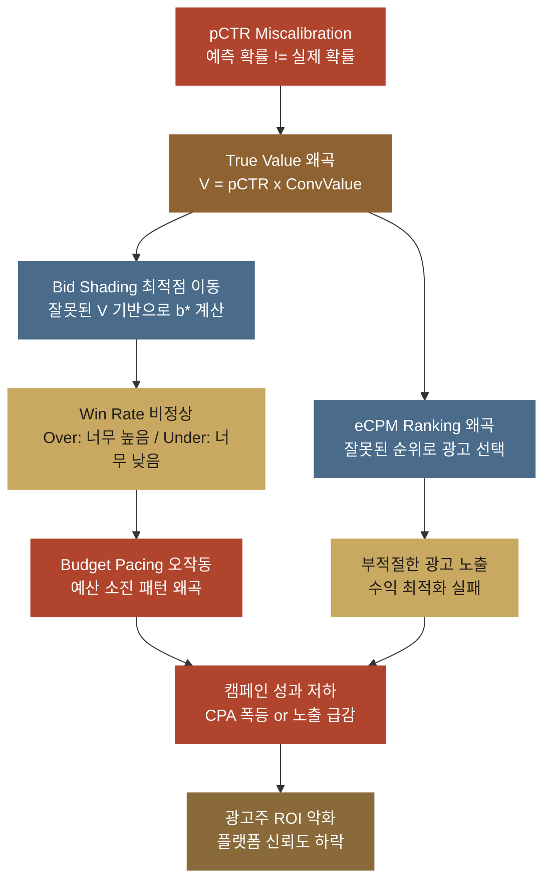
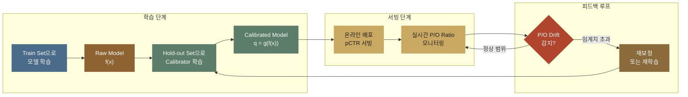
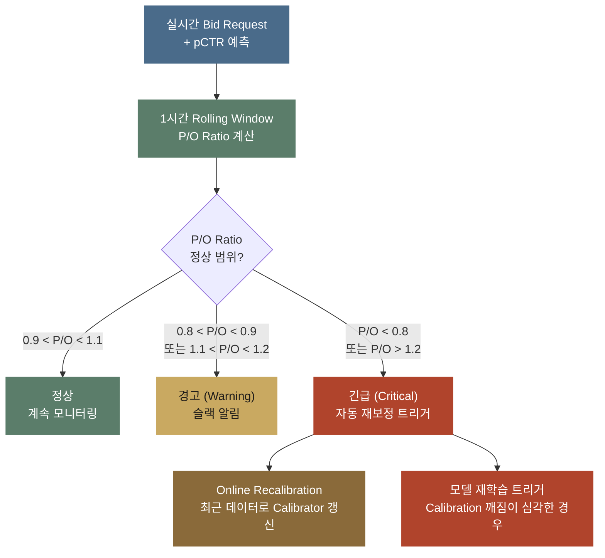

pCTR 모델의 AUC가 0.85입니다. 팀원들과 자축하며 프로덕션에 배포했는데, 일주일 뒤 광고주 대시보드를 열어 보니 ROI(쓴 광고비 대비 수익)가 오히려 나빠져 있었습니다. 캠페인 절반은 CPA(전환 한 건을 얻는 데 든 광고비)가 폭등했고 나머지 절반은 노출 자체가 급감했습니다. 모델이 "잘 맞추고" 있었는데 왜 돈을 잃은 걸까요?

답은 간단합니다. **AUC는 "순서(ranking)"만 평가합니다.** pCTR 은 광고가 한 번 노출됐을 때 클릭될 확률을 모델이 예측한 값입니다. AUC 는 클릭이 난 노출이 클릭이 나지 않은 노출보다 높은 pCTR 을 받았는지를 세는 지표입니다. 그래서 AUC 는 모든 pCTR 이 실제보다 높게 틀려도 순서만 같으면 그대로이고 확률값 자체가 맞는지는 보지 않습니다. 그런데 광고 시스템은 이 pCTR 값을 입찰가 계산에 그대로 씁니다. 노출 한 번이 광고주에게 주는 가치를 참 가치(True Value)라고 합니다. 광고 시스템은 아래 식처럼 pCTR 에 전환 가치(Conversion Value, 전환 한 건이 광고주에게 주는 가치)를 곱해 참 가치를 구한 뒤 그 값에서 입찰가를 정합니다.

$$\text{True Value} = pCTR \times \text{Conversion Value}$$

그러면 입찰의 근거가 되는 확률이 늘 같은 방향으로 틀릴 때 참 가치와 입찰가도 같은 방향으로 틀리므로, 모델이 순서를 아무리 잘 맞춰도 돈을 잃습니다. 이렇게 예측 확률이 실제로 일어나는 비율과 맞는지를 다루는 문제를 **보정(Calibration)** 문제라고 부릅니다. 보정이 맞는 모델이라면 pCTR 2% 로 예측한 노출은 실제로도 100번에 2번꼴로 클릭됩니다.

<a href="demo-calibration.html" class="btn-demo">보정 왜곡을 직접 슬라이더로 실험해보기 →</a>

데모의 슬라이더를 조금만 움직여도 낙찰 결과가 흔들리는 모습을 볼 수 있습니다.

> 이 글은 아래 네 글과 이어집니다.
> - pCTR이 무엇이고 eCPM에 어떻게 곱해지는지 → [pCTR 예측](post.html?id=pctr-prediction)
> - 참 가치(True Value)로 최적 입찰가를 만드는 구조 → [Bid Shading](post.html?id=bid-shading-censored)
> - 참 가치가 예산 페이싱의 입력이 되는 과정 → [Auto-Bidding](post.html?id=auto-bidding-pacing)
> - pCTR이 광고 랭킹의 핵심 입력인 이유 → [eCPM 랭킹](post.html?id=ecpm-ranking)
>
> 네 글의 시스템은 모두 pCTR 값을 받아 그대로 계산에 쓰므로 "pCTR 값 자체가 정확할 것"이라는 **전제 조건** 하나를 함께 둡니다. 이 전제 조건을 지키는 일이 보정입니다.

---

## 1. 순서 맞히기(Discrimination)와 보정의 차이

**순서 맞히기는 클릭할 노출을 안 클릭할 노출보다 위에 놓는 능력이고 보정은 pCTR 값이 실제 클릭 비율과 맞는 정도입니다. 모든 예측이 같은 배수로 틀리면 순서와 AUC 는 그대로인데 입찰가는 그 배수만큼 틀립니다.**

도입의 팀은 AUC 0.85 를 보고 배포했지만 AUC 는 모델의 두 속성 가운데 순서 쪽만 측정합니다. 순서 맞히기(Discrimination)는 클릭할 노출에 안 클릭할 노출보다 높은 점수를 주는 능력입니다. 보정은 예측 확률이 실제 확률과 일치하는 정도라서 순서 맞히기와는 완전히 다른 속성인데, 모델 평가에서는 이 둘을 구분하지 못하는 혼동이 가장 흔합니다. 아래 표의 양성 샘플은 클릭이 난 노출이고 음성 샘플은 클릭이 나지 않은 노출입니다. CTR(Click-Through Rate)은 노출 가운데 실제로 클릭이 난 비율이라 pCTR 은 이 비율을 모델이 미리 예측한 값이 됩니다.

| 속성 | 순서 맞히기 (AUC) | 보정 |
|------|---------------------|-------------|
| **측정 대상** | 양성/음성 샘플의 순서를 맞추는 능력 | 예측 확률이 실제 확률과 일치하는 정도 |
| **핵심 질문** | "클릭할 광고가 안 클릭할 광고보다 높은 점수를 받았는가?" | "pCTR 2%로 예측한 광고가 실제로 2% 클릭되는가?" |
| **이상적인 상태** | AUC = 1.0 (모든 양성이 모든 음성보다 높음) | 예측 = 실제 (모든 구간에서) |
| **평가 도구** | ROC 곡선(ROC Curve), AUC | 보정 그림(Reliability Diagram), ECE, P/O Ratio |
| **개선 방법** | 피처 엔지니어링, 모델 아키텍처, 학습 데이터 | 사후 보정(Post-hoc Calibration) (Platt, Isotonic 등) |
| **광고에서의 역할** | 어떤 광고를 보여줄지 **순서** 결정 | 입찰가를 **얼마로** 설정할지 결정 |

표의 ROC 곡선은 양성과 음성을 나누는 기준 점수를 바꿔 가며 양성을 맞힌 비율과 음성을 양성으로 잘못 고른 비율을 이어 그린 곡선입니다. AUC 는 그 곡선 아래의 넓이라서 모든 양성이 모든 음성보다 높은 점수를 받으면 1.0 이 됩니다. 보정 쪽 도구인 보정 그림, ECE, P/O Ratio 는 예측과 실제의 차이를 그림이나 숫자 하나로 보여 주는 방법으로, 3절에서 하나씩 계산합니다. 개선 방법 줄을 보면 순서는 피처와 모델 구조, 학습 데이터를 바꿔야 좋아지는 반면 보정은 학습이 끝난 출력을 나중에 고쳐 맞출 수 있는데, 그 기법인 Platt 과 Isotonic 은 4절에서 다룹니다.

### 순서와 값

순서 맞히기는 클릭할 노출이 안 클릭할 노출보다 높은 점수를 받았는지만 세므로 **순서**만 봅니다. 보정은 **값 자체**를 보는데, pCTR 2% 라고 적었다면 실제로도 100번 가운데 2번은 클릭이 나야 보정이 맞습니다.

광고 시스템에는 둘 다 필요하지만 **입찰가는 순서가 아니라 절대값으로 계산되므로** 보정이 틀렸을 때가 더 위험합니다. 실제 CTR 이 0.01 인 광고를 모델이 0.03 으로 예측하고 다른 광고도 모두 실제의 3배로 예측했다고 해 봅니다. 모든 광고에 같은 3배가 곱해졌으니 어느 광고가 어느 광고보다 위에 있는지는 하나도 바뀌지 않아 AUC 는 변하지 않습니다. 그러나 입찰가는 pCTR 에 비례해 계산되므로 pCTR 이 0.01 에서 0.03 으로 바뀐 만큼 3배가 됩니다. 2절은 이 차이가 경매에서 얼마의 손해가 되는지를 값으로 따라갑니다.

---

## 2. 보정이 광고 비즈니스에 미치는 영향

**pCTR 을 실제보다 높게 보면 입찰이 과해져 광고주의 전환 한 건당 비용이 오르고 낮게 보면 경매에서 져 노출이 사라집니다. 후보가 여럿인 경매에서 지면마다 틀린 방향이 다르면 1등이 바뀌는데, 가상 데이터에서는 그 탓에 노출 1,000회마다 매출 3,500원을 잃었습니다.**

도입의 대시보드에서 캠페인 절반은 CPA 가 폭등하고 나머지 절반은 노출이 급감했는데, 두 증상은 pCTR 이 서로 반대 방향으로 틀린 두 경우에서 나옵니다. 먼저 광고 하나로 두 방향을 따라간 뒤 후보가 여럿인 경매로 넓혀 손해액을 계산합니다.

### 과대 예측(Over-prediction) 시나리오

과대 예측은 pCTR 을 실제보다 높게 예측하는 경우입니다. pCTR 이 높으면 거기에 전환 가치를 곱한 참 가치도 과대 계산되어 입찰가를 높게 제출하게 됩니다.

> 이 글의 과대 예측은 평균 pCTR 이 실제보다 높은 상태를 가리키므로 확률을 0 이나 1 쪽으로 너무 치우치게 내는 과신(over-confidence)과는 다릅니다. 과신한 모델은 높은 pCTR 은 너무 높게, 낮은 pCTR 은 너무 낮게 내서 두 쪽의 오차가 서로 상쇄되면 평균은 맞을 수도 있습니다. 4절의 Temperature Scaling 은 과신 쪽을 고칩니다.

| 항목 | 실제 | 모델 예측 |
|------|------|----------|
| CTR | 1% | 3% (3배 과대) |
| 전환 가치(Conversion Value) | `$10` | `$10` |
| 참 가치 | `$0.10` | `$0.30` |
| 입찰가 (Bid Shading 후) | `~$0.07` | `~$0.21` |

표에서 실제 CTR 은 1% 인데 모델은 3% 로 3배 높게 봅니다. 전환 가치 `$10` 은 같으므로 참 가치는 1% × `$10` = `$0.10` 이어야 하는데 모델 예측으로는 3% × `$10` = `$0.30` 이 됩니다. 입찰가 줄은 Bid Shading 을 거친 값입니다. Bid Shading 은 참 가치를 그대로 입찰하지 않고 그보다 낮춰 내는 방법이라 두 입찰가는 모두 참 가치보다 작고 모델 쪽 `~$0.21` 은 실제 쪽 `~$0.07` 의 3배입니다.

그 결과는 세 가지입니다.

- 입찰가가 높으니 경매에서 **자주 이기지만** 실제 CTR 은 1% 라 얻는 전환은 모델이 기대한 양의 1/3 입니다.
- 노출 한 번에 3배 높은 입찰가를 내는데 노출당 전환은 그대로라서 광고주 CPA 가 목표 `$10` 에서 실제 `$30` 으로 3배 오릅니다.
- CPA 가 목표를 넘으면 광고주 이탈과 플랫폼 신뢰도 하락으로 이어집니다.

### 과소 예측(Under-prediction) 시나리오

과소 예측은 반대로 pCTR 을 실제보다 낮게 예측하는 경우라서 참 가치가 과소 계산되고 입찰가도 낮게 제출됩니다.

| 항목 | 실제 | 모델 예측 |
|------|------|----------|
| CTR | 3% | 1% (3배 과소) |
| 전환 가치 | `$10` | `$10` |
| 참 가치 | `$0.30` | `$0.10` |
| 입찰가 (Bid Shading 후) | `~$0.21` | `~$0.07` |

표에서는 실제 CTR 이 3% 인 광고를 모델이 1% 로 3배 낮게 봐서 참 가치가 `$0.30` 대신 `$0.10` 으로 계산되므로, Bid Shading 뒤의 입찰가도 `~$0.21` 이어야 할 자리에 `~$0.07` 이 나갑니다.

그러면 이렇게 됩니다.

- 제 가치의 1/3 만 입찰하니 경매에서 **거의 못 이겨** win rate(입찰한 경매 가운데 이긴 비율)가 급감합니다.
- 이기지 못한 경매에서는 광고가 나가지 않으므로 노출 자체가 사라지고 캠페인은 예산을 다 쓰지 못합니다.
- 예산 페이싱(Budget Pacing)은 하루 예산을 시간에 맞춰 나눠 쓰도록 입찰 강도를 조절하는 장치입니다. 예산 페이싱이 남은 예산을 쓰려고 입찰 강도를 높여도 출발점인 참 가치 자체가 낮게 계산되어 있으니 효과가 없습니다.

### 가상 데이터로 계산한 손해액

위 두 시나리오는 광고 하나만 놓고 봤지만 실제 경매에는 후보가 여러 개 들어오고 그중 하나만 노출됩니다. 그래서 후보마다 pCTR 이 틀린 방향이 다르면 보정 오류가 **누가 1등이 되는가**를 바꿉니다. 아래 표는 그 상황을 만든 **가상 데이터**입니다.

| 광고 | 지면 세그먼트 | 모델 pCTR | 실제 CTR | CPC 입찰가 | COPC (실제÷예측) |
|------|-------------|----------|---------|-----------|-----------------|
| A | 앱 하단 배너 | 2.40% | 1.50% | ₩300 | 0.625 (과대예측) |
| B | 웹 인피드 | 1.20% | 1.40% | ₩500 | 1.167 (과소예측) |
| C | 앱 인피드 | 1.00% | 2.00% | ₩400 | **2.000** (과소예측) |
| D | 웹 상단 배너 | 1.80% | 1.60% | ₩350 | 0.889 (과대예측) |
| E | 앱 리워드 | 2.00% | 1.00% | ₩250 | **0.500** (과대예측) |

지면은 광고가 걸리는 자리이고 표의 지면 세그먼트는 앱 하단 배너나 웹 인피드처럼 같은 종류의 지면을 모은 그룹입니다. CPC 입찰가는 광고주가 클릭 한 번에 내겠다고 정한 금액입니다. COPC(Click Over Predicted Click)는 실제 클릭 수를 예측 클릭 수로 나눈 값이라 1 보다 작으면 실제가 예측보다 적었으니 과대 예측이고 1 보다 크면 과소 예측입니다. A 는 실제 1.50% 를 예측 2.40% 로 나눈 0.625 라서 모델이 실제보다 크게 본 과대 예측입니다. C 는 2.00% 를 1.00% 로 나눈 2.000 이라 실제 CTR 이 예측의 두 배인 과소 예측입니다.

표의 실제 CTR 은 로그가 충분히 쌓인 뒤에야 알 수 있는 값이라 랭킹을 매기는 순간 손에 있는 값은 모델 pCTR 뿐입니다. 게다가 틀린 방향도 지면마다 달라서 A, D, E 는 실제보다 크게 봤고 B 와 C 는 낮춰 봤습니다.

아래 코드는 이 후보 5개의 순위를 세 가지 방식으로 매깁니다. 플랫폼은 eCPM(노출 1,000회당 기대 매출)이 가장 큰 후보를 고르는데, 클릭당 과금에서는 클릭이 나야 돈을 받으므로 eCPM 을 pCTR × CPC × 1,000 으로 계산합니다. 세 방식은 보정 없음, 전체 COPC 하나로 보정, 지면 세그먼트마다 따로 보정입니다. 마지막 단계는 1등이 바뀌면 원래 1등과 바뀐 1등이 노출 1,000회에서 실제로 버는 돈을 비교하는데, 이 실제 매출은 예측이 아니라 실제 CTR 로 계산합니다.

```python
# 하는 일: 광고 후보 5개를 모델 pCTR 로 순위를 매길 때, 보정하지 않을 때와 전체 COPC 로 보정할 때, 지면별로 보정할 때의 1등과 노출 1,000회 실제 매출을 비교한다.

# 1단계: 가상 후보 5개를 둔다
# 한 번의 노출 기회에 광고 후보 5개가 들어오고, 하나만 보여 줄 수 있다. 각 행은 (광고, 지면 세그먼트, 모델이 내놓은 pCTR, 나중에 확인된 실제 CTR, CPC 입찰가(원))이다. 표준 라이브러리만 쓴다.
CANDIDATES = [
    ("A", "앱 하단 배너", 0.024, 0.015, 300),
    ("B", "웹 인피드",   0.012, 0.014, 500),
    ("C", "앱 인피드",   0.010, 0.020, 400),
    ("D", "웹 상단 배너", 0.018, 0.016, 350),
    ("E", "앱 리워드",   0.020, 0.010, 250),
]
IMPRESSIONS = 1000              # 이 지면에 노출 기회가 1,000회 있다고 가정
DAILY_IMPRESSIONS = 10_000_000  # 서비스 전체 하루 노출 규모 (환산용)

CPC = {ad: cpc for ad, _s, _p, _r, cpc in CANDIDATES}    # 광고별 클릭 단가
# '실제 CTR'은 로그가 충분히 쌓인 뒤에야 알 수 있는 값이다. 랭킹을 매기는 순간 손에 있는 건 모델 pCTR 뿐이고, 그게 이 문제의 핵심이다.
REAL = {ad: real for ad, _s, _p, real, _c in CANDIDATES}  # 광고별 실제 CTR


# 2단계: eCPM 으로 순위를 매기는 함수를 만든다
# 플랫폼은 eCPM(노출 1,000회당 기대 매출)이 가장 큰 후보를 고른다. eCPM 계산의 상세는 eCPM 랭킹 글에 있고, 여기서는 '1등이 바뀌는가'만 본다.
def ranking(pctr_by_ad):
    """주어진 pCTR로 eCPM을 매겨 큰 순서대로 돌려줍니다.
    eCPM = pCTR x CPC x 1000. 클릭당 과금이라 pCTR을 곱해야 노출 가치가 됩니다."""
    board = [(pctr_by_ad[ad] * CPC[ad] * 1000, ad) for ad in pctr_by_ad]
    board.sort(reverse=True)    # 맨 앞이 1등
    return board


def show(title, board):
    """랭킹을 보기 좋게 출력합니다."""
    print(title)
    for i, (score, ad) in enumerate(board, 1):
        print(f"  {i}위 {ad}  eCPM {score:,.0f}원")


# 3단계: 후보별 COPC 와 전체 COPC 를 구해 찍는다
# COPC(Click Over Predicted Click)는 실제 클릭 / 예측 클릭이다. 1 보다 크면 실제가 더 많았으니 모델이 과소예측한 것이고, 1 보다 작으면 과대예측한 것이다.
print("광고  모델pCTR  실제CTR   COPC  판정        지면")
pred_clicks = 0.0   # 예측 클릭 총합 (COPC의 분모)
real_clicks = 0.0   # 실제 클릭 총합 (COPC의 분자)
for ad, seg, pctr, real_ctr, _cpc in CANDIDATES:
    copc = real_ctr / pctr                    # 후보 하나의 COPC
    pred_clicks += IMPRESSIONS * pctr         # 노출 x 예측 CTR = 예측 클릭 수
    real_clicks += IMPRESSIONS * real_ctr     # 노출 x 실제 CTR = 실제 클릭 수
    verdict = "과소예측" if copc > 1 else "과대예측"
    print(f" {ad}   {pctr:6.2%}  {real_ctr:6.2%}  {copc:5.3f}  {verdict}    {seg}")

global_copc = real_clicks / pred_clicks       # 전체를 뭉쳐서 본 COPC
print(f"\n전체 COPC = {real_clicks:.0f} / {pred_clicks:.0f} = {global_copc:.3f}"
      f"  (1보다 작으니 전체적으로 과대예측)")
print(f"뒤집어 본 P/O Ratio = 예측/실제 = {1 / global_copc:.3f}")

# 4단계: 보정 없이 랭킹을 매긴다
raw = {ad: pctr for ad, _s, pctr, _r, _c in CANDIDATES}
board_raw = ranking(raw)
show("\n[보정 없음] eCPM 랭킹", board_raw)

# 5단계: 전체 COPC 로 한 번에 보정한다
# 가장 흔한 첫 시도다. 모든 예측에 같은 배수(global_copc)를 곱해 전체 평균만 맞춘다. 같은 배수를 곱하는 건 단조 변환이라 순서를 절대 바꾸지 못한다.
scaled = {ad: pctr * global_copc for ad, _s, pctr, _r, _c in CANDIDATES}
after = real_clicks / sum(IMPRESSIONS * p for p in scaled.values())
show(f"\n[전체 보정] 보정 후 전체 COPC = {after:.3f}  <- 지표는 완벽해졌다",
     ranking(scaled))

# 6단계: 지면 세그먼트별로 보정한다
# 지면마다 틀리는 방향이 달랐으니 지면별 배수를 따로 쓴다. 이 예시는 세그먼트마다 광고가 하나씩이라 보정값이 곧 실제 CTR 이 된다. 실제로는 한 세그먼트에 광고가 수천 개 있고, 세그먼트 배수는 그 평균 오차만 걷어낸다.
by_segment = {ad: pctr * (REAL[ad] / pctr) for ad, _s, pctr, _r, _c in CANDIDATES}
board_seg = ranking(by_segment)
show("\n[세그먼트별 보정] eCPM 랭킹", board_seg)

# 7단계: 1등이 바뀐 만큼의 손해를 돈으로 센다
# 그래서 얼마 손해인가를 본다. 뽑힌 광고가 다르면 실제로 들어오는 돈도 달라진다. 실제 매출은 노출 수 × 실제 CTR × CPC 로, 예측이 아니라 실제 CTR 로 계산한다.
bad = board_raw[0][1]    # 보정 안 하고 뽑은 1등
good = board_seg[0][1]   # 제대로 보정하고 뽑은 1등
rev_bad = IMPRESSIONS * REAL[bad] * CPC[bad]
rev_good = IMPRESSIONS * REAL[good] * CPC[good]
gap = rev_good - rev_bad
print(f"\n1등 비교: 보정 없음 → {bad} / 세그먼트 보정 → {good}")
print(f"노출 1,000회 실제 매출: {bad} {rev_bad:,.0f}원 vs {good} {rev_good:,.0f}원")
print(f"차이 {gap:,.0f}원 = {gap / rev_good:.1%} 손실")
print(f"하루 {DAILY_IMPRESSIONS:,}회 노출이면 {gap / IMPRESSIONS * DAILY_IMPRESSIONS:,.0f}원/일")

# 출력:
# 3단계 뜻: COPC 가 1 보다 작은 A, D, E 는 과대예측, 1 보다 큰 B, C 는 과소예측이다. 다섯을 뭉치면 실제 클릭 75 에 예측 클릭 84 라 전체 COPC 는 0.893 이고, 뒤집은 P/O Ratio 는 1.120 이다.
# 광고  모델pCTR  실제CTR   COPC  판정        지면
#  A    2.40%   1.50%  0.625  과대예측    앱 하단 배너
#  B    1.20%   1.40%  1.167  과소예측    웹 인피드
#  C    1.00%   2.00%  2.000  과소예측    앱 인피드
#  D    1.80%   1.60%  0.889  과대예측    웹 상단 배너
#  E    2.00%   1.00%  0.500  과대예측    앱 리워드
#
# 전체 COPC = 75 / 84 = 0.893  (1보다 작으니 전체적으로 과대예측)
# 뒤집어 본 P/O Ratio = 예측/실제 = 1.120
# 4단계 뜻: 보정하지 않으면 A 가 eCPM 7,200원으로 1위, C 가 4,000원으로 5위다.
#
# [보정 없음] eCPM 랭킹
#   1위 A  eCPM 7,200원
#   2위 D  eCPM 6,300원
#   3위 B  eCPM 6,000원
#   4위 E  eCPM 5,000원
#   5위 C  eCPM 4,000원
# 5단계 뜻: 전체 COPC 는 1.000 으로 맞았지만 eCPM 이 모두 같은 비율로 줄어 순서는 A, D, B, E, C 그대로다. 지표는 완벽해졌는데 1위는 여전히 A 다.
#
# [전체 보정] 보정 후 전체 COPC = 1.000  <- 지표는 완벽해졌다
#   1위 A  eCPM 6,429원
#   2위 D  eCPM 5,625원
#   3위 B  eCPM 5,357원
#   4위 E  eCPM 4,464원
#   5위 C  eCPM 3,571원
# 6단계 뜻: 지면마다 따로 보정하면 C 가 eCPM 8,000원으로 1위가 되고, A 는 4,500원으로 4위로 내려간다.
#
# [세그먼트별 보정] eCPM 랭킹
#   1위 C  eCPM 8,000원
#   2위 B  eCPM 7,000원
#   3위 D  eCPM 5,600원
#   4위 A  eCPM 4,500원
#   5위 E  eCPM 2,500원
# 7단계 뜻: 노출 1,000회에 A 를 보이면 실제 매출이 4,500원, C 를 보였다면 8,000원이다. 3,500원, 곧 C 매출의 43.8% 를 잃고, 하루 10,000,000회 노출이면 35,000,000원이다.
#
# 1등 비교: 보정 없음 → A / 세그먼트 보정 → C
# 노출 1,000회 실제 매출: A 4,500원 vs C 8,000원
# 차이 3,500원 = 43.8% 손실
# 하루 10,000,000회 노출이면 35,000,000원/일
```

출력은 세 가지를 보여 줍니다.

**1. 보정 없이 뽑은 1등은 A입니다.** A 는 pCTR 2.40% 에 CPC 300원을 곱한 eCPM 이 5개 가운데 가장 커서 1위가 되었는데, 실제 CTR 은 1.50% 로 모델이 크게 본 광고입니다. 실제 CTR 이 가장 높은 C 는 거꾸로 pCTR 이 1.00% 로 가장 낮게 잡혀 5위였습니다.

**2. 전체 COPC를 1.000으로 맞춰도 1등은 그대로 A입니다.** 전체 COPC 는 다섯 후보의 실제 클릭을 합쳐 예측 클릭 합계로 나눈 0.893 이고 5단계는 모든 pCTR 에 이 0.893 을 곱해 예측 클릭 합계를 실제 클릭 합계에 맞춥니다. 그러면 대시보드의 전체 COPC 는 1.000 이 되지만 같은 양수를 곱하면 큰 값은 여전히 크게 남으므로, 모든 eCPM 이 같은 비율로 줄었을 뿐 순서는 A, D, B, E, C 그대로이고 손해도 한 푼 줄지 않습니다.

**3. 세그먼트별로 보정하면 1등이 C로 바뀝니다.** 지면 세그먼트마다 배수를 따로 곱하면 C 의 pCTR 은 1.00% 에서 2.00% 로 두 배가 되는 반면 A 는 2.40% 에서 1.50% 로 내려가므로, 후보마다 다른 배수가 순서를 바꿉니다. C 는 실제 CTR 이 2.00% 인데 모델이 1.00% 로 절반만 보고 있었습니다. 이 예시는 세그먼트마다 광고가 하나씩이라 보정한 값이 곧 실제 CTR 이 되는데, 실제로는 한 세그먼트에 광고가 수천 개 있어 세그먼트 배수는 그 평균 오차만 걷어냅니다.

7단계는 1등이 바뀐 만큼을 돈으로 바꿉니다. A 를 1,000회 노출하면 실제 매출은 1,000 × 1.50% × 300원 = 4,500원입니다. C 를 노출했다면 1,000 × 2.00% × 400원 = 8,000원이었으므로, 보정하지 않은 랭킹은 노출 1,000회마다 3,500원, 곧 C 매출의 43.8% 를 잃고 있었습니다. 하루 1,000만 노출이라면 손실은 3,500만 원이 됩니다. 실제 트래픽에 이 후보 5개만 되풀이되지는 않으므로 이 환산은 규모 감각을 잡는 용도입니다. 그래도 손실이 나는 방향은 분명한데, AUC 대시보드는 이 손실을 한 번도 알려 주지 않습니다.

### 시스템 전체로의 파급 효과

보정이 틀어진 상태를 보정 어긋남(Miscalibration)이라고 합니다. 광고 시스템에서 모델 뒤에 붙어 pCTR 을 입력으로 받는 하류 컴포넌트는 모두 그 값을 순서가 아니라 **절대값으로** 쓰기 때문에, 보정 어긋남은 모델 하나의 문제로 끝나지 않고 오류가 단계를 따라 연쇄적으로 전파됩니다.

아래 그림에서 pCTR 의 오차는 먼저 참 가치 V 를 틀리게 만든 뒤 두 경로로 퍼집니다. 한 경로에서는 Bid Shading 이 잘못된 V 로 최적 입찰가 $b^*$ 를 계산하므로 win rate 가 과대 예측이면 너무 높게, 과소 예측이면 너무 낮게 나오고 예산 페이싱의 예산 소진 패턴도 따라서 틀어집니다. 다른 경로에서는 eCPM 랭킹이 잘못된 순위로 광고를 골라 수익을 최적화하지 못하는 광고가 노출됩니다. 두 경로는 캠페인 성과 저하(CPA 폭등이나 노출 급감)에서 만나 광고주 ROI 악화와 플랫폼 신뢰도 하락으로 이어집니다.



**AUC가 높은 모델의 보정 어긋남은 오히려 더 위험합니다.** AUC 가 높으면 팀은 도입의 장면처럼 자신 있게 배포하는데, 그 모델의 보정이 틀어져 있으면 잘못된 확률값이 아무도 의심하지 않는 사이에 위 그림의 경로를 따라 시스템 전체로 퍼집니다.

---

## 3. 보정 측정: 모델이 잘 보정되었는지 확인하는 법

**보정은 예측 구간마다 평균 예측과 실제 비율을 맞대 그린 보정 그림으로 먼저 보고 숫자로는 구간별 차이의 가중 평균인 ECE 와 평균 예측을 실제로 나눈 P/O Ratio 로 측정합니다. 전체 P/O Ratio 가 1.0 에 가까워도 세그먼트별로 쪼개면 1.50 이나 0.71 처럼 크게 틀린 곳이 있을 수 있습니다.**

2절의 계산은 실제 CTR 을 정답으로 미리 알고 있어서 가능했습니다. 실제 서비스에서는 노출 로그가 쌓인 뒤 모델의 예측과 실제 클릭을 맞대어 얼마나 틀렸는지 측정해야 하는데, 이 절의 보정 그림, ECE, P/O Ratio, COPC 가 그 측정 도구입니다.

### 보정 그림 (Calibration Plot)

보정 그림은 예측 확률과 실제 빈도를 한 그림에 맞대 그려 보정을 **시각적으로** 진단하는 가장 직관적인 도구로, 1절 표의 Reliability Diagram 과 같은 그림입니다.

**구성 방법:**
1. 모델의 예측 확률을 M개 구간(bin)으로 나눕니다(예: [0, 0.1), [0.1, 0.2), ...). 샘플 하나의 결과는 클릭이 났거나 나지 않았거나 둘 중 하나라 확률과 바로 비교할 수 없으므로, 비슷한 예측을 받은 샘플을 한 구간에 모아 비율로 비교합니다.
2. 구간마다 그 구간에 속한 샘플들의 **평균 예측 확률**(X축)과 **실제 양성 비율**(Y축), 곧 그 구간에서 클릭이 난 비율을 계산합니다.
3. 구간마다 찍은 점을 연결합니다.

**해석:**
- **Perfect 보정**: 모든 점이 대각선에 붙습니다 (예측 = 실제)
- **과대 예측**: 점들이 대각선보다 **아래쪽**에 놓입니다 (예측 > 실제)
- **과소 예측**: 점들이 대각선보다 **위쪽**에 놓입니다 (예측 < 실제)

가로가 예측이고 세로가 실제라서 대각선은 예측과 실제가 같은 자리입니다. 그래서 점이 대각선보다 아래에 있으면 같은 예측에 비해 실제 비율이 낮다는 뜻이라 과대 예측이 됩니다.

| 패턴 | 대각선 대비 위치 | 의미 | 광고 임팩트 |
|------|----------------|------|------------|
| Perfect | 대각선에 붙음 | 예측 = 실제 | 최적 입찰 |
| Over-prediction | 대각선보다 아래 | "2% 예측했지만 실제는 1%" | CPA 폭등 |
| Under-prediction | 대각선보다 위 | "1% 예측했지만 실제는 2%" | 노출 급감 |
| S자 곡선 | 중간은 맞지만 양 끝이 틀림 | 극단값에서 miscalibration | 세그먼트별 편차 |

표의 마지막 줄 S자 곡선은 가운데 구간의 점은 대각선에 붙는데 아주 낮거나 아주 높은 예측 구간의 점만 대각선에서 떨어지는 모양입니다. 아래 데모에서 기울기와 편향을 움직이면 곡선이 대각선에서 떨어지는 모습을 볼 수 있습니다.

<div class="demo-embed-wrap">
<iframe class="demo-embed" src="demo-calibration.html?embed=1" height="560" loading="lazy" title="보정 왜곡 미니 데모"></iframe>
<a class="demo-embed-open" href="demo-calibration.html" target="_blank" rel="noopener">↗ 전체 데모로 열기 (가이드 투어 포함)</a>
</div>

아래 코드는 실제 클릭은 3% 확률로 뽑고 예측은 그와 상관없이 Beta 분포에서 뽑아 평균 예측이 실제보다 높은 과대 예측 모델을 만듭니다. 그 예측을 10구간으로 나눠 구간마다 평균 예측과 실제 클릭 비율을 찍습니다.

```python
# 하는 일: 실제 CTR 3% 인 노출 10,000건에 그와 상관없는 예측을 붙이고, 예측을 10구간으로 나눠 구간마다 평균 예측과 실제 클릭 비율을 비교한다.
import numpy as np

# 1단계: 구간마다 평균 예측과 실제 비율을 내는 함수를 만든다
# 예측을 [0, 0.1), [0.1, 0.2), … 10구간으로 나누고, 비어 있는 구간은 건너뛴다. 이 쌍을 점으로 찍은 것이 보정 그림(Reliability Diagram)이다.
def reliability_diagram_data(y_true, y_prob, n_bins=10):
    """Reliability Diagram 데이터: (평균 예측, 실제 비율) 쌍"""
    bin_edges = np.linspace(0, 1, n_bins + 1)
    centers, accs, counts = [], [], []
    for i in range(n_bins):
        mask = (y_prob >= bin_edges[i]) & (y_prob < bin_edges[i + 1])
        if mask.sum() == 0:
            continue
        centers.append(y_prob[mask].mean())
        accs.append(y_true[mask].mean())
        counts.append(mask.sum())
    return centers, accs, counts

# 2단계: 과대예측하는 모델의 예측을 만들어 구간마다 찍는다
# 실제 클릭은 3% 확률로 뽑고, 예측은 그와 상관없이 Beta(2, 50) 에서 뽑는다. 예측 평균이 실제보다 높은 과대예측(Over-prediction) 모델이다.
np.random.seed(42)
y_true = np.random.binomial(1, 0.03, size=10000)
y_prob = np.clip(np.random.beta(2, 50, size=10000), 0, 1)

centers, accs, counts = reliability_diagram_data(y_true, y_prob)
for c, a, n in zip(centers, accs, counts):
    gap = "Over ↓" if c > a else "Under ↑"
    print(f"  예측={c:.3f}  실제={a:.3f}  (n={n:,})  {gap}")

# 출력:
# 2단계 뜻: 두 구간 모두 평균 예측(0.036, 0.120)이 실제 비율(0.026, 0.032)보다 높아 Over 다. 예측 0.120 인 280건은 실제가 0.032 라 차이가 더 크고, 보정 그림에서 점이 대각선 아래에 놓이면 Over, 위에 놓이면 Under 다.
#   예측=0.036  실제=0.026  (n=9,720)  Over ↓
#   예측=0.120  실제=0.032  (n=280)  Over ↓
```

찍힌 두 구간은 모두 평균 예측이 실제 비율보다 높아 Over 로 표시되었으므로, 보정 그림에 옮기면 두 점이 모두 대각선 아래에 놓입니다. 예측이 실제와 상관없이 뽑혔으니 어느 구간이든 실제 비율은 전체 CTR 3% 근처에 머무는데 평균 예측은 구간이 높을수록 커지므로, 둘째 구간은 샘플 수가 훨씬 적지만 예측과 실제의 차이가 더 큽니다.

### ECE (Expected Calibration Error)

ECE 는 보정 그림을 **하나의 숫자**로 요약한 값으로, 구간마다 평균 예측과 실제 비율이 벌어진 정도의 평균입니다.

$$ECE = \sum_{m=1}^{M} \frac{|B_m|}{n} \left| \text{acc}(B_m) - \text{conf}(B_m) \right|$$

- $M$ : 구간 개수
- $B_m$ : $m$번째 구간에 속한 샘플 집합
- $|B_m|$ : $m$번째 구간의 샘플 수
- $n$ : 전체 샘플 수
- $\text{acc}(B_m)$ : 구간 $m$의 실제 양성 비율 (accuracy)
- $\text{conf}(B_m)$ : 구간 $m$의 평균 예측 확률 (confidence)

식을 말로 옮기면 **구간마다 "예측 확률"과 "실제 비율"의 차이를 구해 샘플 수로 가중 평균**한 값입니다. 구간 $m$ 의 차이 $|\text{acc}(B_m) - \text{conf}(B_m)|$ 에 그 구간이 전체에서 차지하는 샘플 비율 $|B_m|/n$ 을 곱해 모든 구간에서 더하므로, 샘플이 많은 구간의 차이가 ECE 에 더 크게 들어갑니다. 앞 코드의 두 구간에 적용해 보면 샘플 대부분이 든 첫 구간의 차이가 ECE 의 대부분을 차지하는 반면, 차이가 더 큰 둘째 구간은 샘플 비율이 작아 조금만 더해집니다. ECE 가 0 이면 모든 구간에서 예측과 실제가 같은 상태이고 클수록 보정 어긋남이 큽니다.

> ECE 는 구간 개수 $M$ 을 몇으로 잡느냐에 따라 값이 달라집니다. 보통 $M = 10 \sim 20$ 을 쓰지만 샘플이 적은 구간은 노이즈가 커서 실제 비율을 믿기 어려우므로 구간마다 샘플이 충분한지(최소 수백 개) 확인해야 합니다. 그래서 구간 폭을 똑같이 자르는 대신 각 구간의 샘플 수를 똑같이 맞추는 equal-frequency binning 을 권장합니다.

아래 코드는 실제 CTR 이 2% 인 노출에 그와 상관없이 Beta 분포에서 뽑은, 평균이 2% 보다 높은 과대 예측을 붙이고 위 식 그대로 ECE 를 계산합니다.

```python
# 하는 일: 실제 CTR 2% 인 노출 10,000건에 과대예측한 예측을 붙이고, 구간마다 예측과 실제의 차이를 샘플 수로 가중 평균한 ECE 를 잰다.
import numpy as np

# 1단계: ECE 를 구하는 함수를 만든다
# 예측을 10구간으로 나눠 구간마다 |실제 양성 비율 - 평균 예측 확률| 을 구하고, 구간의 샘플 비율을 곱해 더한다.
def expected_calibration_error(y_true, y_prob, n_bins=10):
    """ECE: 예측 확률과 실제 비율의 가중 평균 차이"""
    bin_edges = np.linspace(0, 1, n_bins + 1)
    ece = 0.0
    for i in range(n_bins):
        mask = (y_prob >= bin_edges[i]) & (y_prob < bin_edges[i + 1])
        if mask.sum() == 0:
            continue
        bin_acc = y_true[mask].mean()    # 실제 양성 비율
        bin_conf = y_prob[mask].mean()   # 평균 예측 확률
        ece += (mask.sum() / len(y_true)) * abs(bin_acc - bin_conf)
    return ece

# 2단계: 과대예측하는 모델로 ECE 를 잰다
# 예측은 실제와 상관없이 Beta(2, 30) 에서 뽑는다. 평균이 2% 보다 높은 과대예측(Over-prediction) 모델이다.
np.random.seed(42)
y_true = np.random.binomial(1, 0.02, size=10000)   # 실제 CTR 2%
y_prob = np.clip(np.random.beta(2, 30, size=10000), 0, 1)

print(f"  ECE = {expected_calibration_error(y_true, y_prob):.4f}")
print(f"  (0에 가까울수록 보정이 잘 된 모델)")

# 출력:
# 2단계 뜻: ECE 가 0.0443 이다. 구간마다 예측과 실제의 차이를 샘플 수로 가중 평균한 값이 이만큼이고, 0 에 가까울수록 보정이 잘 된 모델이다.
#   ECE = 0.0443
#   (0에 가까울수록 보정이 잘 된 모델)
```

출력된 ECE 는 실제 CTR 2% 보다도 큽니다. 구간마다 예측과 실제가 벌어진 정도를 샘플 수로 가중 평균한 값이 CTR 자체보다 크다는 뜻입니다. ECE 는 0 에 가까울수록 보정이 잘 된 모델입니다.

### 실무 메트릭: Predicted/Observed Ratio (P/O Ratio)

P/O Ratio 는 평균 예측 CTR 을 실제 CTR 로 나눈 값입니다. 나눗셈 하나라 계산이 아주 단순한 데다 1 보다 크면 높게, 작으면 낮게 봤다고 바로 읽혀 해석도 직관적이므로, 실무에서는 ECE 보다 **P/O Ratio** 를 더 자주 씁니다.

$$\text{P/O Ratio} = \frac{\bar{p}}{\bar{y}} = \frac{\text{평균 예측 CTR}}{\text{실제 CTR}}$$

| P/O Ratio | 해석 | 조치 |
|-----------|------|------|
| 1.0 | 정확히 보정됨 | 유지 |
| > 1.0 (예: 1.3) | Over-prediction (30% 과대 예측) | 입찰가 30% 과다 → 보정 필요 |
| < 1.0 (예: 0.7) | Under-prediction (30% 과소 예측) | 입찰가 30% 과소 → 보정 필요 |

표의 1.3 은 평균 예측이 실제보다 30% 높다는 뜻입니다. 입찰가가 pCTR 을 따라 정해지므로 입찰가도 30% 과다하고 0.7 이면 반대로 예측과 입찰가가 모두 30% 낮습니다.

P/O Ratio 의 진짜 쓸모는 데이터를 **세그먼트별로 쪼개서 모니터링**할 수 있다는 점입니다. 아래 표는 P/O Ratio 를 광고 거래소(Exchange A, B), 기기(Mobile, Desktop), 시간대(오전, 저녁)로 쪼갠 값입니다. Exchange 는 매체의 노출을 경매로 파는 광고 거래소입니다.

| 세그먼트 | 평균 pCTR | 실제 CTR | P/O Ratio | 상태 |
|---------|----------|---------|-----------|------|
| Exchange A | 2.1% | 2.0% | 1.05 | 양호 |
| Exchange B | 1.8% | 1.2% | **1.50** | Over-prediction |
| Mobile | 3.2% | 3.0% | 1.07 | 양호 |
| Desktop | 1.5% | 2.1% | **0.71** | Under-prediction |
| 오전 (6-12시) | 1.9% | 1.8% | 1.06 | 양호 |
| 저녁 (18-24시) | 2.5% | 1.6% | **1.56** | Over-prediction |

Exchange B 는 평균 pCTR 1.8% 를 실제 CTR 1.2% 로 나눈 P/O Ratio 가 1.50 이라서 실제보다 50% 높게 예측하고 있습니다. Desktop 은 1.5% 를 2.1% 로 나눈 0.71 이라 29% 과소 예측입니다. 저녁(18-24시)도 2.5% 를 1.6% 로 나눈 1.56 이라 크게 과대 예측합니다.

**그래서 Global P/O Ratio 가 1.0 에 가까워도 세그먼트별로는 보정 어긋남이 심할 수 있습니다.** Global P/O Ratio 는 모든 노출을 한꺼번에 계산한 전체 P/O Ratio 라서 과대 예측인 세그먼트와 과소 예측인 세그먼트의 오차가 평균 안에서 상쇄되면 1.0 에 가깝게 나올 수 있습니다. 2절 가상 데이터에서도 A 는 COPC 0.625, C 는 2.000 으로 크게 틀렸는데 다섯을 합친 전체 COPC 는 그보다 1 에 가까운 0.893 이었습니다. 전체만 보는 보정(Global Calibration)으로는 Exchange B 의 50% 과대 예측도 Desktop 의 29% 과소 예측도 발견할 수 없습니다.

### COPC: 방향이 반대인 쌍둥이 지표

2절에서 쓴 **COPC** 는 P/O Ratio 와 같은 것을 측정하면서 분자와 분모만 뒤집은 지표입니다.

$$\text{COPC} = \frac{\text{실제 클릭 수}}{\text{예측 클릭 수}}$$

P/O Ratio 는 예측을 실제로 나누고 COPC 는 실제를 예측으로 나누므로 1 을 기준으로 읽는 방향도 반대가 됩니다.

| 지표 | 정의 | 1보다 크면 | 1보다 작으면 |
|------|------|-----------|-------------|
| P/O Ratio | 예측 ÷ 실제 | 과대 예측 (입찰 과다) | 과소 예측 (입찰 부족) |
| COPC | 실제 ÷ 예측 | **과소 예측** (입찰 부족) | **과대 예측** (입찰 과다) |

두 방향을 표로 외우기보다 이름에서 읽어 내는 편이 쉽습니다. COPC 는 이름에서 실제 클릭(Click)이 먼저 나오고 그 실제 클릭이 분자이므로, COPC 가 크면 실제 클릭이 예측보다 많았고 모델이 낮게 봤다는 뜻입니다.

같은 1.13 이라도 COPC 라면 과소 예측이고 P/O Ratio 라면 과대 예측이라서 실무에서는 방향을 거꾸로 읽는 사고가 정말 자주 일어납니다. 그래서 대시보드를 열면 어느 쪽 지표인지부터 확인합니다. [pCTR 예측](post.html?id=pctr-prediction) 글의 예시 모델은 COPC 가 1.13 이었는데, 실제 클릭이 예측보다 13% 많았다는 뜻이라 뒤집은 P/O Ratio 는 1 ÷ 1.13 = 0.88 이고 과소 예측입니다. 이 글 2절의 가상 데이터는 반대쪽이라서 전체 COPC 0.893 을 뒤집은 P/O Ratio 가 1.120 인 과대 예측이었습니다.

:::deep 더 깊이 — Brier score를 쪼개면 보정 오차 항이 나온다
ECE 는 bin 을 어떻게 자르느냐에 따라 답이 흔들리는데, bin 없이 측정하는 지표로 **Brier score** 가 있습니다. Brier score 는 예측 확률과 실제 라벨(0 또는 1)의 차이를 제곱해 평균한 값입니다.

$$BS = \frac{1}{n}\sum_{i=1}^{n}(p_i - y_i)^2$$

Murphy(1973)는 같은 예측값을 가진 샘플끼리 K개 그룹으로 모으면 이 값이 아래처럼 세 항으로 정확히 쪼개진다는 것을 보였습니다.

$$BS = \underbrace{\frac{1}{n}\sum_{k} n_k (p_k - \bar{y}_k)^2}_{\text{reliability}} - \underbrace{\frac{1}{n}\sum_{k} n_k (\bar{y}_k - \bar{y})^2}_{\text{resolution}} + \underbrace{\bar{y}(1 - \bar{y})}_{\text{uncertainty}}$$

- **reliability**: 그룹의 예측값 $p_k$ 와 그 그룹의 실제 비율 $\bar{y}_k$ 의 차이입니다. 이 항이 곧 보정 오차라서 작을수록 좋습니다.
- **resolution**: 그룹별 실제 비율이 전체 평균 $\bar{y}$ 에서 얼마나 벌어지는지를 나타냅니다. 순서를 나누는 힘, 곧 Discrimination 에 대응하는 항이라 클수록 좋으므로 식에서 부호가 마이너스입니다.
- **uncertainty**: 데이터 자체의 분산이라 모델이 무엇을 하든 바뀌지 않습니다.

이 분해에서 Discrimination 과 Calibration 은 한 지표 안에 뒤섞여 있지 않고 **서로 다른 항**으로 나뉘어 있습니다. reliability 만 줄이는 작업이 Post-hoc Calibration 이고 resolution 을 키우는 작업이 피처와 모델 개선이므로, 6절의 "먼저 AUC, 그다음 Calibration" 순서도 이 분해를 수학적 근거로 둡니다.
:::

---

## 4. 사후 보정(Post-hoc Calibration) 기법

**사후 보정은 학습이 끝난 모델은 그대로 두고 그 출력에 변환을 하나 더 적용해 예측을 실제 비율 쪽으로 옮깁니다. 기본은 파라미터 2개인 Platt Scaling 입니다. Platt 으로 부족하고 데이터가 충분하면 Isotonic Regression 을 고려합니다. 신경망이 과신하면(확률을 0 이나 1 쪽으로 치우치게 내면) Temperature Scaling 을 먼저 시도합니다.**

틀린 정도를 측정했다면 다음은 고칠 차례인데, 모델을 처음부터 다시 학습하지 않아도 학습이 끝난 뒤 그 출력에 함수를 하나 더 적용하면 예측 확률을 보정할 수 있습니다. 이 방법을 **사후 보정**이라고 부릅니다. Platt, Isotonic, Temperature 세 기법은 원리가 같습니다. 모두 모델의 raw output $f(x)$, 곧 보정하기 전 모델이 낸 값에 **단조 변환**(monotonic transformation)을 적용합니다. 단조 변환은 입력의 순서를 출력에서 뒤집지 않는 변환이라 순서는 그대로 두고 값만 실제에 가깝게 당깁니다. 2절에서 모든 pCTR 에 전체 COPC 0.893 을 곱해도 순서가 그대로였는데, 같은 양수를 곱하는 변환도 단조 변환입니다. 마지막에 다루는 Histogram Binning 은 bin 별 실제 비율을 그대로 쓰므로 단조가 보장되지 않습니다.

### Platt Scaling

Platt Scaling 은 가장 널리 쓰이는 보정 기법으로, 모델의 raw output 인 logit 에 $A$ 를 곱하고 $B$ 를 더한 뒤 **sigmoid 변환**을 적용합니다. logit 은 확률로 바꾸기 전의 점수입니다. sigmoid 는 어떤 실수든 0 과 1 사이의 확률로 바꾸는 함수라서 logit 0 은 확률 0.5 가 되고 logit 이 클수록 1 에 가까워집니다.

$$q = \sigma(A \cdot f(x) + B) = \frac{1}{1 + \exp(-(A \cdot f(x) + B))}$$

- $f(x)$ : 모델의 raw output (logit 또는 예측 확률)
- $A, B$ : validation set에서 학습하는 2개의 파라미터
- $q$ : 보정된 확률

$A$ 는 logit 의 기울기를 바꿔 예측이 양 끝으로 치우친 정도를 조절합니다. $B$ 는 logit 전체를 옮겨 평균 예측을 올리거나 내립니다.

**학습 방법:** validation set 은 학습에 쓰지 않고 떼어 둔 검증용 데이터입니다. $A$ 와 $B$ 는 이 데이터에서 NLL(Negative Log-Likelihood)을 최소로 만드는 값으로 학습합니다. NLL 은 클릭이 난 샘플에는 $-\log q$ 를, 나지 않은 샘플에는 $-\log(1-q)$ 를 매겨 평균한 손실이라 실제 결과에 낮은 확률을 줄수록 커집니다. 모델은 자기가 학습한 데이터에서는 실제보다 잘 맞히므로 그 데이터로 $A$ 와 $B$ 를 맞추면 새 데이터에서 보정이 깨집니다. 그래서 여기에 쓰는 데이터는 반드시 모델 학습에 쓰지 않은 **hold-out** 데이터여야 합니다(5절).

아래 코드는 실제 확률이 sigmoid(0.7 × logit) 인 데이터를 만듭니다. logit 에 0.7 을 곱하면 크기가 줄어 실제 확률은 0.5 쪽에 더 가까운데, 모델은 logit 을 그대로 sigmoid 에 넣으므로 모델의 예측은 실제보다 양 끝으로 치우칩니다. 이 logit 으로 Platt Scaling 의 $A$, $B$ 를 학습하고 보정 전후의 평균 예측을 실제 양성 비율과 비교합니다.

```python
# 하는 일: 예측이 양 끝으로 치우친 모델의 logit 5,000개에 Platt Scaling 의 A, B 를 학습하고, 보정 전후 평균 예측을 실제 양성 비율과 비교한다.
import numpy as np
from scipy.optimize import minimize
from scipy.special import expit  # sigmoid

# 1단계: NLL 을 최소로 하는 A, B 를 찾는 함수를 만든다
# 보정된 확률은 q = sigmoid(A × logit + B) 이다. 실무에서는 모델 학습에 쓰지 않은 hold-out 데이터로 맞춘다.
def platt_scaling_fit(logits, y_true):
    """Platt Scaling: NLL 최소화로 A, B 학습"""
    def nll(params):
        A, B = params
        q = expit(A * logits + B)           # q = sigmoid(A * f(x) + B)
        q = np.clip(q, 1e-7, 1 - 1e-7)
        return -np.mean(y_true * np.log(q) + (1 - y_true) * np.log(1 - q))
    return minimize(nll, x0=[1.0, 0.0], method="L-BFGS-B").x

# 2단계: 예측이 양 끝으로 치우친 모델의 logit 과 실제 클릭을 만든다
# 실제 확률은 sigmoid(0.7 × logit) 이라, 모델이 내놓는 sigmoid(logit) 은 실제보다 양 끝으로 치우친다.
np.random.seed(42)
logits = np.random.randn(5000) * 0.5
y_true = (np.random.rand(5000) < expit(logits * 0.7)).astype(float)

# 3단계: A, B 를 학습하고 보정 전후 평균을 비교한다
A, B = platt_scaling_fit(logits, y_true)
print(f"  학습된 파라미터: A={A:.3f}, B={B:.3f}")
print(f"  보정 전 평균 예측: {expit(logits).mean():.4f}")
print(f"  보정 후 평균 예측: {expit(A * logits + B).mean():.4f}")
print(f"  실제 양성 비율:    {y_true.mean():.4f}")

# 출력:
# 3단계 뜻: A=0.761 은 양 끝으로 치우친 예측을 가운데로 당기고, B=0.063 은 평균 예측을 올려 0.5007 을 실제 양성 비율과 같은 0.5158 로 맞춘다. 서빙할 때는 calibrated_pCTR = sigmoid(A × model_logit + B) 로 쓴다.
#   학습된 파라미터: A=0.761, B=0.063
#   보정 전 평균 예측: 0.5007
#   보정 후 평균 예측: 0.5158
#   실제 양성 비율:    0.5158
```

출력에서 학습된 $A$ 는 1 보다 작아 logit 을 줄이므로 양 끝으로 치우친 예측을 가운데로 당깁니다. $B$ 는 양수라서 logit 전체를 올려 평균 예측을 높이고 그 결과 보정 전에는 실제 양성 비율보다 낮았던 평균 예측이 보정 후에는 실제 양성 비율과 같은 값이 됩니다. 서빙할 때는 모델이 낸 logit 에 이 $A$, $B$ 를 적용한 `calibrated_pCTR = sigmoid(A × model_logit + B)` 를 pCTR 로 씁니다.

**장점:**
- 파라미터가 $A$, $B$ 2개뿐이라 매우 가볍고 서빙할 때도 sigmoid 연산 하나만 추가됩니다.
- 대부분의 실무 상황에서 Platt 하나로 충분히 효과적입니다.
- 구현이 단순하고 안정적이라서 바로 프로덕션에 쓸 수 있습니다(Production-ready).

**한계:**
- 전역적(global) 보정이라 하나의 $(A, B)$ 쌍이 모든 데이터에 똑같이 적용됩니다.
- 그래서 세그먼트마다 편향 패턴이 다르면(Exchange A는 over, Exchange B는 under) 한 쌍으로 두 방향을 함께 고칠 수 없어 전역 보정으로는 부족합니다.

### Isotonic Regression

Isotonic Regression 은 **비모수적 단조 변환**입니다. 비모수적이라는 말은 sigmoid 같은 곡선 모양을 미리 정하지 않고 데이터가 모양을 정한다는 뜻입니다. Isotonic Regression 은 데이터를 구간별로 나누어 구간마다 따로 보정합니다.

**원리:** 샘플을 예측 확률 순서로 정렬한 뒤 실제 양성 비율에 맞추되 보정값이 예측 순서를 따라 줄어들지 않는(단조 증가, monotonically increasing) **step function**(계단 함수)을 학습합니다. Platt Scaling 이 S자 곡선 하나를 모든 예측에 적용하는 것과 달리 Isotonic Regression 은 계단마다 **구간별로 다른 보정값**을 적용하므로, 곡선 하나로 그릴 수 없는 왜곡도 따라갈 수 있습니다.

**장점:**
- 곡선 모양을 정해 두지 않아 Platt Scaling 보다 유연하므로 비선형 보정 어긋남 패턴도 보정할 수 있습니다.
- 곡선 모양에 대한 모수적 가정이 없으니 여러 형태의 왜곡에 대응합니다.

**한계:**
- 계단마다 값을 데이터로 정하므로 데이터가 많아야 안정적입니다(bin당 수백~수천 샘플 필요).
- 데이터가 적으면 계단이 우연한 노이즈까지 따라가는 overfitting(과적합) 위험이 있어 보정이 오히려 나빠질 수 있습니다.
- 서빙할 때 예측값이 어느 계단에 드는지 찾아야 하므로 Platt 보다 약간 복잡합니다(구간별 보정값을 적어 둔 lookup table 또는 구간 매핑 필요).

### Temperature Scaling

Temperature Scaling 은 logit 을 **파라미터 하나** $T$ 로 나눈 뒤 sigmoid 를 씌워 전체 확률 분포의 "날카로움"을 조절합니다. $T$ 가 1 보다 크면 logit 의 크기가 줄어 확률이 0.5 쪽으로 모이는 반면 1 보다 작으면 logit 이 커져 0 이나 1 쪽으로 퍼집니다.

$$q = \sigma\left(\frac{f(x)}{T}\right)$$

- $T$ : Temperature 파라미터 (validation set 에서 학습)
- $T > 1$ : 확률을 0.5 쪽으로 당겨 0 이나 1 에 치우친 예측을 누그러뜨림 → 과신(over-confidence) 보정
- $T < 1$ : 확률을 0 이나 1 쪽으로 밀어내 머뭇거리는 예측을 강하게 함 → 확신이 부족한(under-confident) 모델 보정
- $T = 1$ : 원래 모델 그대로

> $T > 1$ 은 0.5 보다 큰 확률을 내리고 0.5 보다 작은 확률을 올려 모두 0.5 쪽으로 모읍니다. 그래서 평균 pCTR 이 실제보다 높은 과대 예측은 Temperature 로 고치지 못합니다. pCTR 이 대부분 0.5 보다 훨씬 작은 광고에서는 $T > 1$ 이 오히려 pCTR 을 올립니다. 평균 수준을 옮기려면 logit 전체를 옮기는 Platt 의 $B$ 같은 항이나 P/O Ratio 로 나누는 보정이 필요합니다.

**장점:**
- 파라미터가 $T$ 하나뿐이라 overfitting 위험이 가장 작습니다.
- 서빙할 때 나눗셈 하나만 추가되어 오버헤드가 거의 없습니다.
- 특히 Neural Network(신경망)의 과신을 보정할 때 효과적입니다.

**한계:**
- Platt 과 같은 전역적 보정이라 세그먼트마다 편향이 다르면 부족합니다.
- 조절할 수 있는 것이 날카로움 하나뿐이라 보정의 자유도가 가장 낮아 복잡한 보정 어긋남 패턴에는 부족합니다.

### Histogram Binning

Histogram Binning 은 개념이 가장 단순한 기법입니다. 예측 확률을 bin 으로 나눈 뒤 각 bin 의 예측값을 모두 그 bin 의 **실제 양성 비율** 하나로 바꾸는데, 3절 보정 그림에서 구간마다 계산한 실제 비율을 그대로 보정값으로 쓰는 방식입니다.

**장점:**
- bin 별로 값을 찾아 쓰기만 하면 되므로(bin별 lookup) 구현이 아주 단순합니다.
- 비모수적인 데다 같은 bin 안에서는 예측값이 그 bin 의 실제 비율과 정확히 같아집니다.

**한계:**
- bin 경계를 넘는 순간 보정값이 갑자기 바뀌어 불연속적입니다(discontinuity).
- bin 개수를 몇으로 잡느냐에 결과가 민감합니다.
- 데이터가 충분하지 않으면 bin 별 실제 비율 추정치가 불안정합니다.
- bin 마다 값을 따로 정하므로 bin 별 값이 단조 증가한다는 보장이 없습니다. 그래서 이웃 bin 사이에서 순서가 뒤집힐 수 있고 같은 bin 안의 점수는 모두 같은 값으로 바뀌어 동점이 됩니다.

### 기법 비교

아래 표는 네 기법을 파라미터 수, 유연성, 데이터 요구량, 서빙 오버헤드로 나란히 놓습니다. Isotonic 의 파라미터 수 $O(n)$ 은 계단 수가 데이터 크기 $n$ 에 따라 늘어난다는 뜻입니다. 표에서 유연성이 높은 기법일수록 데이터 요구량도 높습니다.

| 기법 | 파라미터 수 | 유연성 | 데이터 요구량 | 서빙 오버헤드 | 실무 추천도 |
|------|-----------|--------|-------------|-------------|-----------|
| Platt Scaling | 2 ($A, B$) | 중간 | 낮음 | 극히 낮음 (sigmoid 1회) | 높음 -- 기본 선택 |
| Isotonic Regression | $O(n)$ | 높음 | 높음 | 낮음 (lookup) | 중간 -- 데이터 충분 시 |
| Temperature Scaling | 1 ($T$) | 낮음 | 매우 낮음 | 극히 낮음 (나눗셈 1회) | 높음 -- NN 모델에 특히 |
| Histogram Binning | $M$ (bin 수) | 높음 | 높음 | 극히 낮음 (lookup) | 낮음 -- 불연속성 문제 |

> 실무 권장: **Platt 보정(Platt Scaling)부터 시작합니다.** Platt 은 대부분의 경우 충분히 효과적이면서 구현과 서빙이 단순하므로, Isotonic Regression 이나 세그먼트별 Platt 은 Platt 으로 부족할 때(세그먼트별 편향 패턴이 복잡할 때)만 고려합니다. Deep Learning 모델이 과신할 때(확률을 0 이나 1 쪽으로 치우치게 낼 때)는 Temperature 보정을 가장 먼저 시도합니다. 평균 자체가 높은 과대 예측은 Temperature 로 고치지 못하므로 Platt 이나 P/O Ratio 보정을 씁니다.

---

## 5. 프로덕션 보정 파이프라인

**모델과 보정기(모델 출력을 보정된 확률로 바꾸는 함수)는 서로 다른 데이터로 학습합니다. 보정은 한 번 맞추고 끝나지 않으므로 서빙 중에도 P/O Ratio 를 계속 측정해 정상 범위(0.9~1.1)를 벗어나면 경고를 보내고 0.8 아래나 1.2 위로 가면 자동으로 다시 보정합니다.**

모델 출력 $f(x)$ 를 받아 보정된 확률 $q = g(f(x))$ 를 내는 함수 $g$ 를 보정기(Calibrator)라고 부릅니다. 4절의 Platt 이나 Isotonic 이 이 자리에 들어갑니다. 보정기를 한 번 학습해 두어도 시간이 지나면 다시 틀어지므로 보정은 일회성 작업으로 끝나지 않습니다. 그래서 프로덕션 환경에는 **지속적인 모니터링과 재보정** 파이프라인이 필요합니다.

아래 그림은 이 파이프라인을 학습, 서빙, 피드백 루프의 세 단계로 보여 줍니다. 학습 단계는 Train Set 으로 모델을 학습한 뒤 그와 다른 Hold-out Set 으로 보정기를 학습합니다. 서빙 단계는 보정된 pCTR 을 온라인에 배포하며 P/O Ratio 를 실시간으로 모니터링합니다. 피드백 루프는 P/O 가 시간에 따라 1 에서 멀어지는 드리프트(Drift)가 임계치를 넘으면 재보정이나 재학습을 거쳐 보정기 학습으로 돌아갑니다. 정상 범위에 있으면 모니터링만 계속합니다.



### 학습-보정 분리 원칙

보정기를 학습할 때는 모델 학습에 쓴 데이터로 보정기까지 학습하는 **실수가 가장 흔합니다**. 모델은 자기가 본 데이터에서 실제보다 잘 맞히므로 그 데이터에서 나온 예측값은 과적합되어 있는데, 이 값을 기준으로 맞춘 보정기는 모델이 처음 보는 새 데이터에서 보정이 깨집니다.

**올바른 방법:** 데이터를 아래처럼 용도에 따라 나눕니다.

| 데이터셋 | 용도 | 비율 (예시) |
|---------|------|-----------|
| 학습 셋(Train Set) | 모델 $f(x)$ 학습 | 70% |
| 보정 Set | 보정기 $g(\cdot)$ 학습 | 15% |
| Test Set | 최종 평가 (AUC + ECE + P/O) | 15% |

보정 Set 은 모델이 학습에서 보지 않은 데이터라서 보정기가 서빙 때와 같은 조건의 예측을 보고 맞출 수 있습니다. Test Set 은 모델과 보정기 모두 보지 않은 데이터라 마지막에 AUC, ECE, P/O 를 한꺼번에 측정하는 데 씁니다.

데이터가 부족해 보정 Set 을 따로 떼기 어렵다면 **Cross-Validation 보정**을 씁니다.

1. 학습 셋을 K개 조각(fold)으로 나눕니다(K-fold).
2. 조각마다 나머지 K-1개 조각으로 모델을 학습하고 남겨 둔 1개 조각에서 예측값을 만듭니다.
3. 모든 조각의 예측값을 합쳐 보정기를 학습합니다.

각 조각의 예측값은 그 조각을 학습에 쓰지 않은 모델이 만든 값이라 hold-out 데이터의 예측과 조건이 같습니다. 그래서 이 방법은 학습 데이터 전부를 보정에 쓰면서도 보정기가 모델이 이미 본 데이터의 예측으로 학습되는 데이터 오염을 막습니다.

### 세그먼트별 보정

3절의 P/O Ratio 표에서 Exchange B 는 1.50 으로 과대 예측이고 Desktop 은 0.71 로 과소 예측이었는데, 전체에 보정 하나를 걸면 한쪽을 고치는 방향이 다른 쪽을 더 틀리게 하므로 Global 보정으로는 세그먼트별 편향을 해결할 수 없습니다. 그래서 프로덕션에서는 세그먼트마다 따로 맞춘 **세그먼트별 보정기**를 운영합니다.

**세그먼트 키 선정 기준:** 세그먼트 키는 데이터를 쪼개는 기준 필드입니다. 아래 표는 키마다 세그먼트별 P/O 가 다르게 나오는 이유와 그 예시 값입니다.

| 세그먼트 키 | 이유 | P/O 편차 패턴 예시 |
|------------|------|-------------------|
| exchange_id | Exchange마다 트래픽 특성이 다름 | Exchange A: 1.05, Exchange B: 1.50 |
| device_type | Mobile vs Desktop CTR 패턴 상이 | Mobile: 1.07, Desktop: 0.71 |
| hour_of_day | 시간대별 유저 행동 변화 | 오전: 1.06, 저녁: 1.56 |
| ad_format | Banner vs Native vs Video 특성 차이 | Banner: 0.95, Video: 1.40 |

**구현 방식은 두 가지입니다.**

**방식 1: 세그먼트별 Platt 보정**
- 세그먼트마다 $(A_s, B_s)$ 를 따로 학습합니다.
- 장점: 세그먼트 특성에 맞춰 정밀하게 보정합니다.
- 단점: 세그먼트가 많으면 관리할 파라미터가 늘어나 복잡해지는 데다 데이터가 적은 세그먼트는 $A_s$, $B_s$ 추정이 불안정합니다.

**방식 2: 세그먼트별 P/O Ratio 보정**
- 세그먼트마다 P/O Ratio $r_s$ 를 계산한 뒤 예측값을 $r_s$ 로 나눕니다.
- $q_s = \frac{f(x)}{r_s}$
- 장점: 나눗셈 하나라서 아주 단순하고 실시간으로 업데이트하기 쉽습니다.
- 단점: 모든 예측을 같은 비율로 나누는 선형 보정이라 세그먼트 안의 비선형 왜곡은 남습니다.

예를 들어 3절 표의 Exchange B 는 $r_s$ 가 1.50 이므로 평균 예측 1.8% 를 1.50 으로 나누면 1.2% 가 되어 그 세그먼트의 실제 CTR 과 같아집니다.

실무에서는 단순한 **방식 2를 기본으로 사용**하고 트래픽이 충분해 $(A_s, B_s)$ 를 안정적으로 학습할 수 있는 주요 세그먼트에만 방식 1을 적용하는 하이브리드 전략이 일반적입니다.

### 시간에 따른 드리프트 대응

유저 행동, 시즌, 경쟁 환경이 계속 바뀌어 CTR 분포가 움직이면 과거 데이터로 학습한 보정기는 더 이상 맞지 않으므로, 보정은 **시간이 지나면 반드시 깨집니다.**

**실시간 모니터링 체계:** 입찰 요청(Bid Request)이 들어올 때마다 pCTR 예측과 결과를 모아 최근 1시간만 계속 밀어 가며 보는 1시간 Rolling Window 로 P/O Ratio 를 다시 계산합니다. 그 값이 1 에서 벗어난 정도에 따라 정상, 경고, 긴급의 세 수준으로 대응합니다.



| 수준 | P/O Ratio 범위 | 조치 |
|------|---------------|------|
| 정상 | 0.9 -- 1.1 | 계속 모니터링 |
| 경고 | 0.8 -- 0.9 또는 1.1 -- 1.2 | 슬랙 알림, 원인 분석 시작 |
| 긴급 | < 0.8 또는 > 1.2 | 자동 재보정 트리거 |

이 기준을 3절 표의 세그먼트 값에 적용해 보면 Exchange A 의 1.05 는 정상 범위입니다. Exchange B 의 1.50 과 저녁의 1.56 은 1.2 를 넘고 Desktop 의 0.71 은 0.8 보다 작아서 세 세그먼트 모두 자동 재보정을 거는 긴급 수준에 해당합니다.

긴급 수준에서 도는 **Online Recalibration**(서비스를 멈추지 않고 보정기를 최근 데이터로 다시 맞추는 일)은 이렇게 합니다.
- 최근 N시간(예: 6시간)의 데이터로 보정기 파라미터를 **온라인 갱신**합니다.
- Platt 보정이라면 $(A, B)$ 를 exponential moving average(최근 값일수록 비중을 크게 두는 이동 평균)로 업데이트합니다.
- P/O Ratio 보정이라면 최근 구간으로 계산한 rolling P/O ratio 를 바로 나눗셈에 적용합니다.

> 보정이 낡는 현상(Calibration Drift)은 세상이 변해 입력과 클릭의 관계가 바뀌고 모델이 낡는 현상(Concept Drift)에서 바로 나옵니다. 학습한 지 오래된 모델이 지금 데이터와 맞지 않게 되는 모델 Staleness 문제는 Concept Drift 와 함께 [온라인 학습(Online Learning)](post.html?id=online-learning-delayed-feedback) 글에서 따로 다뤘습니다. Calibration Drift 가 Concept Drift 에서 나오므로 온라인 학습 파이프라인과 보정 모니터링은 붙어 있어야 합니다.

---

## 6. 보정과 순서 맞히기: Trade-off 가 있는가

**사후 보정은 대개 AUC 를 바꾸지 않습니다. Platt 과 Temperature 는 순서를 그대로 지키는 변환이라 AUC 가 같고 Isotonic 은 같은 계단에 든 점수가 동점이 되어 AUC 가 조금 내려갈 수 있습니다.**

보정을 이야기하면 "보정을 맞추면 AUC가 떨어지지 않나요?"라는 질문을 자주 받습니다.

**답: 일반적으로 No.** AUC 는 점수의 순서로만 계산되는데, 이 글에서 권하는 Platt, Isotonic, Temperature 는 모두 순서를 뒤집지 않는 **단조 변환**이라 이론적으로 **AUC에 영향을 주지 않습니다.** Isotonic 도 계단으로 맞추기는 하지만 계단이 예측 순서를 따라 내려가지 않으므로 순서를 뒤집지 않습니다. 반면 Histogram Binning 은 bin 마다 값을 따로 정해 단조가 보장되지 않으므로 이 답에서 제외됩니다.

식으로 보면 이렇습니다. 보정 함수 $g$ 가 입력이 크면 출력도 반드시 큰 순증가 함수라면(Platt 에서 $A > 0$ 일 때, Temperature) $f(x_1) > f(x_2)$ 인 두 노출은 보정 뒤에도 $g(f(x_1)) > g(f(x_2))$ 라서 순서가 그대로이고 AUC 도 같습니다. Isotonic 은 계단 함수라 $g(f(x_1)) \ge g(f(x_2))$ 까지만 보장합니다. 순서가 뒤집히지는 않지만 같은 계단에 들어간 두 점수는 동점이 되어 어느 쪽이 위인지 구분되지 않으므로, 계단이 거칠면 AUC 가 조금 내려갈 수 있습니다. 2절에서 다섯 후보의 pCTR 에 모두 0.893 을 곱해도 순서가 A, D, B, E, C 그대로였는데, 양수를 곱하는 변환도 순증가 함수입니다.

| 상황 | AUC 변화 | 보정 변화 | 설명 |
|------|---------|-----------------|------|
| 사후 보정 적용 (Platt, Temperature) | 불변 | 개선 | 순증가 변환이므로 ranking 보존 |
| Calibration-aware Loss로 재학습 | 미세 변화 가능 | 개선 | Loss 함수 변경으로 모델 자체가 변함 |
| 극단적 Isotonic 보정 (데이터 부족) | 미세 하락 가능 | 개선 (과적합 위험) | 순서는 뒤집히지 않지만 평평한 계단 안의 점수가 동점이 됨 |

**실무 원칙:** 사후 보정은 순서를 거의 바꾸지 못하므로 순서의 질은 모델 단계에서 먼저 끌어올려 두고 보정은 그 뒤에 값만 고칩니다.

> "먼저 AUC를 최대화하고, 그다음 보정을 맞춘다." AUC(순서 맞히기)는 모델 아키텍처, 피처, 학습 데이터가 정하는 영역이고 보정은 사후 보정(Post-hoc Calibration)이 맡는 영역이라서 두 문제를 나눠 두면 각각 따로 최적화할 수 있습니다.

다만 학습할 때부터 보정을 함께 맞추는 **Calibration-aware 학습**이라는 접근도 있습니다. 교차 엔트로피 손실(Cross-entropy Loss)은 4절에서 Platt 의 $A$, $B$ 를 맞출 때 쓴 NLL 과 같은 꼴의 손실인데, 이 손실 자체에 보정을 유도하는 성질이 있어 학습 과정에서 보정을 함께 최적화하기도 합니다. Facebook 사례(He et al., 2014)는 교차 엔트로피 손실로 학습한 뒤 배포 전에 보정 Layer 를 한 번 더 붙이는 **이중 보정** 전략을 씁니다.

---

## 7. 실무에서 자주 만나는 보정 함정

**보정은 모델 바깥에서도 깨지고 깨진 것을 놓치기도 합니다. 라벨이 처음부터 치우쳐 있거나, 학습 때와 서빙 때의 데이터 분포가 다르거나, 전체 평균만 확인해 세그먼트의 보정 어긋남을 놓치는 경우입니다.**

보정기는 로그에 남은 클릭 라벨을 정답으로 삼아 맞추므로, 그 라벨이나 데이터가 처음부터 틀려 있으면 모델과 보정기를 아무리 잘 학습해도 보정이 깨집니다. 아래 함정 1 과 2 가 그런 경우이고 함정 3 은 보정을 확인하는 방식에서 생깁니다.

### 함정 1: Label이 이미 편향되어 있다

CTR 모델의 Label 은 노출마다 클릭이 났는지(1) 나지 않았는지(0)를 적은 값입니다. 이 Label 은 다음 네 가지 이유로 이미 편향되어 있을 수 있습니다.

- **Click Flooding**: 봇 트래픽이 클릭을 늘려 관측 CTR 이 실제보다 높게 잡힙니다. P/O Ratio 는 예측을 관측 CTR 로 나눈 값이라 분모가 커져 1 보다 작게 측정되므로(COPC 는 1 보다 커짐) 모델이 과소 예측하는 것처럼 보입니다.
- **Delayed Label**: 전환이 늦게 도착하면 학습 시점에는 아직 오지 않은 전환이 음성으로 찍히는데, 이 지연은 두 방향으로 작용하니 조심해야 합니다. 그 데이터로 학습한 모델은 확률을 낮게 보도록 배워 진짜 과소 예측이 됩니다. 반면 아직 도착하지 않은 전환 때문에 관측값이 낮게 잡히면 그 순간의 P/O Ratio 는 1 보다 크게 나와 과대 예측처럼 보입니다. 그래서 라벨이 다 도착한 뒤에 다시 측정해야 합니다. 자세한 구조는 [pCVR 모델링](post.html?id=pcvr-modeling)에 있습니다.
- **자리 편향(Position Bias)**: 자리 편향은 광고가 놓인 위치 때문에 클릭이 달라지는 현상으로, 상위에 노출된 광고는 클릭률이 실제보다 크게 잡힙니다. 그래서 위치마다 보정 오류가 달라집니다. 보정 방법은 [자리 편향 & ULTR](post.html?id=position-bias-ultr)에서 다룹니다.
- **안 눌린 로그 줄이기(Negative Sampling)**: 클릭이 없는 샘플을 버리고 학습하면 학습 데이터의 클릭 비율이 실제보다 높아져 확률이 전부 위로 올라가므로, 보정 없이 쓰면 심한 과대 예측이 됩니다. 되돌리는 공식은 [안 눌린 로그 줄이기 & Bias](post.html?id=negative-sampling-bias)에 있습니다.

### 함정 2: 학습 데이터와 서빙 데이터의 분포 차이

모델은 과거 데이터로 학습하고 미래 데이터에 적용되므로, 그 사이의 시간 차이만큼 두 데이터가 달라지면 보정이 깨집니다.

- **Train/Serve Skew**(학습-서빙 불일치): 학습 데이터의 CTR 분포와 서빙 시점의 CTR 분포가 달라 학습 데이터에서 맞춘 보정이 서빙에서 맞지 않습니다.
- **Selection Bias**(선택 편향): 학습 데이터는 이전 모델이 골라 노출한 광고에서만 생깁니다. 그래서 이전 모델이 고르지 않아 탐색되지 않은 영역은 보정이 맞는지 확인할 데이터가 없어 불확실합니다.

### 함정 3: 보정을 Global로만 확인한다

3절의 표처럼 과대 예측인 세그먼트와 과소 예측인 세그먼트의 오차가 평균 안에서 상쇄되면 Global P/O Ratio = 1.0 이어도 세그먼트별로는 심하게 틀릴 수 있으므로, 보정은 **반드시 세그먼트별로 쪼개서** 확인해야 합니다. 편차가 큰 경우가 많은 세그먼트는 다음과 같습니다.

- 새로 추가된 Exchange 또는 Publisher(광고 지면을 가진 매체)
- 특정 디바이스/OS 버전
- 피크 시간대와 비피크 시간대
- 새 광고 포맷

---

## 8. 담장 안에서는 모든 입찰을 관측한다 [무대: 닫힌 생태계]

**담장 안에서는 후보의 예측과 노출된 광고의 클릭이 한 로그에 남아 보정에 쓸 데이터가 끊기지 않는 대신, 보정 오차로 생긴 손실도 전부 자기 매출에서 빠집니다.**

담장 안(walled garden)은 한 회사가 광고 요청부터 랭킹, 노출, 클릭 로그까지 모두 가진 구조입니다. 랭킹에 올린 후보의 예측값과 실제로 노출된 광고의 클릭 결과가 같은 로그에 남으므로 세그먼트별 P/O Ratio 를 시간 단위로 갱신할 수 있어, 5절의 자동 재보정 파이프라인이 실제로 돌아갑니다.

담장 안에서 흔히 듣는 "우리 랭킹에만 쓰니까 절댓값이 좀 틀려도 순서만 맞으면 된다"는 말은 오해입니다. 2절에서 확인했듯 모든 예측에 같은 배수가 곱해지면 순서가 그대로이므로 그 말은 **모든 예측이 같은 배수로** 틀렸을 때만 맞습니다. 지면별, 포맷별로 틀린 방향이 다르면 1등이 바뀌는데, 담장 안에서는 그 손실이 곧 자기 매출입니다. 2절 가상 데이터에서는 C 대신 A 가 뽑혀 노출 1,000회마다 3,500원이 사라졌습니다.

과금 방식이 섞이면 절댓값이 더 중요해집니다. 클릭당 돈을 받는 CPC 광고와 노출 1,000회당 받는 CPM 광고, 기간을 정해 지면을 사는 예약(CPT) 물량이 한 지면을 두고 경쟁하면 서로 다른 단위를 eCPM 으로 환산해 비교해야 합니다. CPC 광고는 클릭이 나야 돈이 되므로 이 환산식에는 pCTR 의 절댓값이 반드시 들어갑니다. 환산 방식은 [eCPM 랭킹](post.html?id=ecpm-ranking)에 정리돼 있습니다.

담장 안에서는 탐색도 스스로 설계할 수 있습니다. 탐색은 확신이 없는 곳에 일부러 노출을 조금 보내 데이터를 모으는 일입니다. 보정이 불확실한 구간에 이렇게 노출을 배정하면 그 구간의 클릭 데이터가 생깁니다. 노출을 어디에 보낼지는 플랫폼 내부 정책으로 정하면 끝나므로 남의 허락이 필요 없습니다. 탐색 설계는 [탐색과 활용](post.html?id=exploration-exploitation)에서 다룹니다.

---

## 9. 열린 RTB에서는 이긴 노출만 보인다 [무대: 열린 RTB]

**열린 RTB 의 DSP 는 낙찰된 노출의 클릭만 볼 수 있어서 보정에 쓸 데이터부터 이긴 경매 쪽으로 편향됩니다.**

열린 RTB(Real-Time Bidding)는 노출 기회가 생길 때마다 실시간 경매를 열어 광고를 정하는 방식입니다. 열린 RTB 에서는 한 노출을 여러 회사가 차례로 처리합니다. 그중 DSP(Demand-Side Platform)는 광고주를 대신해 입찰하는 회사인데, 경매에 이기면 광고를 내보내고 그 노출의 클릭 로그를 받습니다. 그런데 경매에서 진 **패찰한 입찰**에서는 DSP 의 광고가 나가지 않았으니 클릭 로그가 아예 생기지 않아, 그 노출이 어떻게 됐는지도 알 수 없습니다.

그래서 P/O Ratio 를 계산할 재료는 이긴 경매에만 있습니다. 이렇게 이긴 경매의 데이터만 남아 생기는 편향을 승자 편향이라고 부릅니다. 승자 편향은 스스로를 키웁니다. 어떤 세그먼트를 과대 예측하면 2절처럼 입찰가가 높아져 더 자주 이기므로 그 세그먼트 데이터만 잔뜩 쌓이는 반면, 과소 예측한 세그먼트는 계속 패찰해 데이터가 쌓이지 않으니 보정할 기회조차 오지 않습니다. 그래서 학습 데이터가 이전 모델이 고른 광고에서만 생긴다는 7절의 함정 2가 열린 RTB 에서 훨씬 심하게 나타납니다.

세그먼트 키도 담장 안보다 믿기 어렵습니다. 같은 Exchange 안에서도 지면 정보가 숨겨지거나 뭉뚱그려져 오는 경우가 있습니다. 3절의 Exchange 별 P/O 테이블은 열린 RTB 에서 특히 중요한데, 바로 그 테이블을 나누는 키의 신뢰도가 낮다는 점이 함정입니다.

낙찰가 정보도 잘려 있습니다. 진 경매에서는 상대 입찰가가 DSP 의 입찰가보다 높았다는 것만 알 뿐 얼마였는지는 볼 수 없는데, 이렇게 정확한 값 대신 범위만 남는 데이터를 잘린 데이터(censored data)라고 합니다. 이 문제는 [Bid Shading](post.html?id=bid-shading-censored) 글에 따로 정리했습니다. 확실히 이길 입찰만 계속하면 모델은 자기가 이미 아는 구간만 다시 확인하게 되므로, 열린 RTB 의 DSP 는 예산의 일부를 일부러 탐색에 씁니다. 담장 안과 열린 RTB 의 이 구조적 차이는 [닫힌 생태계(Walled Garden)](post.html?id=walled-garden)에 더 정리돼 있습니다.

---

## 마무리

이 글의 결론은 다섯 가지입니다.

**1. AUC와 보정은 다른 속성이다.** AUC 는 순서(ranking)가 얼마나 정확한지를, 보정은 확률값 자체가 얼마나 정확한지를 측정합니다. 광고 시스템에서는 확률값이 곧바로 입찰가로 변환되므로 보정이 비즈니스에 더 직접적인 영향을 미칩니다.

**2. 보정 어긋남은 시스템 전체로 전파된다.** 하류 컴포넌트가 모두 pCTR 을 절대값으로 쓰므로 pCTR 의 보정 오류는 참 가치 왜곡, Bid Shading 오작동, 예산 페이싱 오작동, 캠페인 성과 저하 순으로 연쇄적으로 퍼집니다.

**3. P/O Ratio는 세그먼트별로 봐야 한다.** 과대 예측과 과소 예측이 평균 안에서 상쇄될 수 있어 Global P/O Ratio 만으로는 부족합니다. Exchange, Device, 시간대 같은 주요 세그먼트별로 쪼개서 모니터링해야 숨겨진 보정 어긋남을 발견할 수 있습니다.

**4. Platt 보정부터 시작하면 된다.** 대부분의 실무 상황은 Platt 보정으로 충분하므로, 더 복잡한 기법은 Platt 으로 해결되지 않는 문제를 확인한 뒤에 도입합니다.

**5. 보정은 일회성이 아니라 지속적 과정이다.** 시장이 끊임없이 변해 보정은 반드시 깨지므로 실시간 모니터링과 자동 재보정 파이프라인은 프로덕션의 필수 요소입니다.

> AUC 는 **순서를 맞히는 힘**이고 보정은 **값을 맞히는 힘**입니다. 광고 시스템에는 두 힘이 다 필요합니다. 순서는 맞아도 값이 틀린 모델은 경매에서 체계적으로 잘못된 가격을 제시하므로 그 비용을 그대로 광고주와 플랫폼이 부담합니다.

---

## 더 깊이 보기

- pCTR의 정의와 eCPM 곱셈부터 → [pCTR 예측](post.html?id=pctr-prediction)
- 샘플링이 확률을 키우는 문제와 되돌리는 공식 → [Negative Sampling & Bias](post.html?id=negative-sampling-bias)
- 라벨 오염과 지연 전환 → [pCVR 모델링](post.html?id=pcvr-modeling)
- 위치가 만드는 클릭 왜곡 → [Position Bias & ULTR](post.html?id=position-bias-ultr)
- 1등을 정하는 계산의 상세 → [eCPM 랭킹](post.html?id=ecpm-ranking)
- 모델 구조의 진화(LR → DeepFM → DIN) → [Deep CTR 모델](post.html?id=deep-ctr-models)
- 보정된 확률이 입찰가로 바뀌는 경로 → [Bid Shading](post.html?id=bid-shading-censored)
- 보정이 시간에 따라 깨지는 문제 → [Online Learning 과 지연 피드백](post.html?id=online-learning-delayed-feedback)
- 담장 안과 열린 RTB의 구조 차이 → [Walled Garden](post.html?id=walled-garden)
- 보정 왜곡을 슬라이더로 직접 실험 → [Calibration 데모](demo-calibration.html)
- 광고 ML 전체 지도에서 이 글의 위치 → [ML 엔지니어 트랙](ml-track.html)

---

## 참고문헌

- Niculescu-Mizil, A. & Caruana, R. (2005). *Predicting Good Probabilities with Supervised Learning.* ICML 2005. -- Platt Scaling과 Isotonic Regression의 체계적 비교.
- Guo, C. et al. (2017). *On Calibration of Modern Neural Networks.* ICML 2017. -- Temperature Scaling 제안. 현대 Neural Network이 over-confident한 이유와 해결책.
- He, X. et al. (2014). *Practical Lessons from Predicting Clicks of Ads at Facebook.* AdKDD 2014. -- Facebook 광고 pCTR 모델의 Calibration 실무 사례.
- McMahan, H.B. et al. (2013). *Ad Click Prediction: a View from the Trenches.* KDD 2013. -- Google 광고 시스템의 대규모 CTR 예측과 Calibration 운영 경험.
- Murphy, A.H. (1973). *A New Vector Partition of the Probability Score.* Journal of Applied Meteorology. -- Brier score를 reliability/resolution/uncertainty로 쪼개는 분해의 출처.