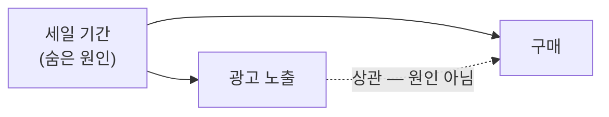

어떤 이커머스 광고팀이 신발 배너 광고를 두 달 동안 내보냈습니다. 캠페인이 끝난 뒤 로그를 열어 보니 광고를 본 사람들의 구매율이 안 본 사람들보다 훨씬 높게 나와 있었습니다. 팀장은 회의에서 그 숫자를 근거로 이렇게 말했습니다. “배너 광고 효과 확실하네요. 예산 더 씁시다.”

보고서에 그 결론을 적기 전에 확인할 것이 하나 있습니다. 광고를 본 사람과 안 본 사람은 애초에 같은 부류였을까요? 두 그룹이 처음부터 다른 부류였다면 구매율 차이에는 광고 효과 말고도 두 부류가 원래 가진 차이가 섞여 있을 수 있습니다. 이 질문에 제대로 답하는 방법을 인과추론(causal inference)이라고 부릅니다. 이 글은 그 방법을 다루는 인과추론 트랙의 첫 번째 글입니다.

> 한 줄 요약: 상관은 두 값이 '같이 움직인다'는 관찰이고 인과는 '내가 하나를 바꾸면 다른 하나도 바뀐다'는 주장입니다. 광고를 본 사람이 더 샀다는 관찰은 상관에 그치므로 그 사람들이 광고가 없었어도 원래 더 살 사람들이었다면 그 구매는 광고 *때문에* 일어난 것이 아닐 수 있습니다. 이 글이 시뮬레이션으로 만든 캠페인에서도 광고를 본 사람과 안 본 사람의 구매율 차이는 +12.7%p(퍼센트포인트)였지만 원래 살 마음이 비슷한 사람끼리 비교한 광고 효과는 +2%p 근처였습니다.

---

## 1. 광고 본 사람이 유독 많이 산 것처럼 보이는 착시

**광고를 본 사람과 안 본 사람을 원래 살 마음이 높은 층과 낮은 층으로 나누지 않고 그냥 비교하면 광고가 실제로 만든 효과보다 몇 배나 큰 효과가 보입니다.**

앞의 광고팀 로그에는 광고를 본 사람과 못 본 사람이 각각 샀는지 안 샀는지가 기록되어 있습니다. 광고를 본 사람들을 노출군, 못 본 사람들을 비노출군이라고 부릅니다. 노출군의 구매율에서 비노출군의 구매율을 그냥 빼면 얼핏 그럴듯한 '광고 효과'가 나오지만 광고가 아무에게나 똑같이 보이지 않는다는 점이 문제입니다. 타겟팅(광고를 보여 줄 사람을 고르는 일)은 실제로 이미 살 것 같은 사람에게 광고를 더 많이 보여 주므로 노출군에는 처음부터 구매 확률이 높은 사람이 더 많이 섞여 들어갑니다. 그러면 두 구매율의 차이에는 광고 효과와 함께 두 그룹에 든 사람이 처음부터 달랐던 몫까지 포함됩니다.

노출이 어느 쪽으로 쏠렸는지를 숫자로 보려면 유저를 원래 살 마음, 즉 구매 의향이 높은 층과 낮은 층으로 나눠야 합니다. 아래 표 ①은 2절의 파이썬 코드가 시뮬레이션한 유저 20만 명을 이 두 층으로 나눈 결과로, 타겟팅이 노출을 어느 층에 몰아주는지와 층을 무시한 비교가 얼마나 크게 잡히는지를 함께 보여 줍니다. 층을 나누지 않고 노출군과 비노출군 전체의 구매율을 그대로 빼는 비교를 naive 비교(아무 보정 없이 하는 비교)라고 부릅니다. 구매율끼리의 차이는 %p(퍼센트로 적은 두 비율을 뺀 값의 단위)로 적습니다. 카드에서는 로그를 그대로 비교한 차이 +12.7%p 와 의향 층 안에서만 비교한 차이 +2%p 근처를 나란히 보면 됩니다.

<div class="demo-embed-wrap">
<iframe class="demo-embed" src="demo-experiment-cards.html?embed=1&card=confound" height="480" loading="lazy" title="숨은 원인이 광고 효과처럼 보인다"></iframe>
<a class="demo-embed-open" href="demo-experiment-cards.html" target="_blank" rel="noopener">↗ 카드 두 장 전체로 열기</a>
</div>

**표 ① — 층 안에서 비교하면 줄어드는 '광고 효과'**

| 층 (원래 구매 의향) | 인원 | 노출 (인원 가운데 비율) | 비노출 (인원 가운데 비율) | 노출군 구매율 | 비노출군 구매율 | 차이 (노출군 − 비노출군) |
|---|---|---|---|---|---|---|
| 의향 높음 | 39,708명 | 35,827명 (90.2%) | 3,881명 (9.8%) | 22.1% | 20.4% | +1.6%p |
| 의향 낮음 | 160,292명 | 16,149명 (10.1%) | 144,143명 (89.9%) | 5.9% | 4.0% | +2.0%p |
| **전체 (층 무시 = naive 비교)** | 200,000명 | 51,976명 (26.0%) | 148,024명 (74.0%) | **17.0%** | **4.4%** | **+12.7%p** |

표의 구매율 칸은 소수 첫째 자리로 반올림한 값이고 차이 칸은 반올림하기 전의 구매율로 뺀 값이라서 구매율 두 칸을 직접 빼면(예를 들어 22.1% 에서 20.4%) 차이 칸과 끝자리가 다를 수 있습니다.

표 ①을 위 줄부터 읽어 보겠습니다. 광고를 안 본 사람의 구매율을 그 층의 원래 구매율로 보면 의향 높은 층은 20.4% 로 높고 의향 낮은 층은 4.0% 로 낮습니다. 의향 높은 층은 광고를 본 사람의 구매율도 22.1% 라서 노출 여부와 관계없이 구매율이 높습니다.

그런데 타겟팅 때문에 광고는 의향 높은 층으로 몰립니다. 의향 높은 층은 39,708명 가운데 35,827명이 광고를 봐서 층 인원의 90.2% 가 노출되었지만 의향 낮은 층은 160,292명 가운데 16,149명만 봐서 10.1% 만 노출되었습니다. 노출군 51,976명은 이 35,827명과 16,149명을 더한 수입니다. 노출군의 절반을 훨씬 넘는 35,827명이 의향 높은 층이라서 '노출군'이라는 그룹 자체가 원래 구매율이 높은 사람들로 채워집니다.

표의 마지막 줄이 naive 비교입니다. 노출군 구매율 17.0% 는 구매율 22.1% 인 의향 높은 층 35,827명과 5.9% 인 의향 낮은 층 16,149명이 섞인 값이라 22.1% 쪽으로 올라가 있습니다. 비노출군 구매율 4.4% 는 4.0% 인 의향 낮은 층 144,143명에 20.4% 인 의향 높은 층 3,881명이 조금 섞인 값이라 4.0% 가까이에 머뭅니다. 그래서 두 구매율을 빼면 차이가 +12.7%p 로 커집니다.

같은 층 안에서만 비교한 첫째, 둘째 줄의 차이는 +1.6%p 와 +2.0%p 라서 광고 자체의 효과는 거의 그대로인데 '누구를 노출군으로 세었는지'만 달라져도 차이가 6배 넘게 커졌습니다. 이 착시가 이 글이 처음부터 끝까지 다루는 문제입니다.

---

## 2. 파이썬으로 측정한 naive 비교의 배수

**표 ①을 만든 시뮬레이션을 파이썬으로 다시 돌리면 naive 비교가 참값(광고가 실제로 올리는 구매율)보다 몇 배 크게 잡혔는지가 정확한 배수로 나옵니다.**

표 ①의 숫자는 손으로 끼워 맞춘 값이 아니라 파이썬으로 유저 20만 명을 한 명씩 시뮬레이션해서 얻은 값입니다. 시뮬레이션은 광고가 실제로 올리는 구매율인 참값을 코드에 처음부터 정해 두고 시작합니다(코드의 TRUE_LIFT 0.02, 2%p).

시뮬레이션은 유저마다 세 가지를 차례로 정합니다. 먼저 20% 확률로 의향 높은 층에, 나머지 80% 확률로 의향 낮은 층에 넣습니다. 그다음 그 층의 타겟팅 확률(의향 높은 층 0.9, 의향 낮은 층 0.1)에 따라 광고를 볼지가 정해집니다. 마지막으로 그 층의 원래 구매율(의향 높은 층 0.20, 의향 낮은 층 0.04)에 광고를 본 사람만 광고 효과 +2%p 를 더한 확률로 실제로 샀는지가 결정됩니다.

아래 코드는 이 시뮬레이션을 그대로 구현한 뒤 광고 효과를 세 가지 방법으로 추정해 나란히 찍어서 어느 방법이 참값에 가까운지를 보여 줍니다. (a) naive 효과는 1절처럼 층을 무시하고 전체를 비교해서 얻습니다. (b) 층별 보정 효과는 층마다 그 안에서 노출군과 비노출군의 구매율 차이를 구한 다음 층의 인원 비중을 가중치로 삼아 가중평균해서 구합니다. 가중평균은 값마다 가중치를 곱해 더하고 가중치의 합으로 나눈 평균입니다. 그래서 인원이 많은 층의 차이가 결과에 더 크게 반영됩니다. (c) 는 노출 비율을 관측 데이터와 같은 26.0% 로 두고 누가 노출될지만 층과 무관하게 무작위로 다시 정하는 RCT 시뮬레이션으로 얻은 추정치로, 참값 근처로 돌아옵니다. RCT(Randomized Controlled Trial, 랜덤 실험)는 누가 광고를 볼지를 무작위로 정해 놓고 두 그룹을 비교하는 실험이며 5절에서 다시 다룹니다.

```python
# 하는 일: 노출이 구매 의향 높은 층에 쏠린 가짜 캠페인 20만 명으로, naive 비교와 층별 보정, 무작위 배정 시뮬레이션이 측정한 광고 효과를 비교한다.
import random
random.seed(42)

# 1단계: 가짜 캠페인의 설정을 둔다
# 유저는 '원래 구매 의향' 높음/낮음 두 층으로 나뉜다. 광고가 실제로 올리는 구매율은 두 층이 같다. 표준 라이브러리만 쓴다.
N = 200_000                        # 전체 유저 수
HIGH_SHARE = 0.2                   # 의향 높은 층 비중 20%
BASE_HIGH, BASE_LOW = 0.20, 0.04   # 광고가 없었을 때 각 층의 '원래' 구매율
TRUE_LIFT = 0.02                   # 광고가 실제로 올리는 구매율(참값, 두 층 동일)

# 2단계: 유저를 만들고 구매율 차이를 측정하는 함수를 만든다
# make_users 는 층별 노출 확률만 받아 유저를 만든다. gap 은 노출군과 비노출군의 구매율 차이와 두 군의 인원을 돌려준다.
def make_users(p_expose_high, p_expose_low):
    """층별 노출 확률만 받아 유저 (의향, 노출여부, 구매여부) 리스트를 만든다."""
    rows = []
    for _ in range(N):
        high = random.random() < HIGH_SHARE
        exposed = random.random() < (p_expose_high if high else p_expose_low)
        p_buy = (BASE_HIGH if high else BASE_LOW) + (TRUE_LIFT if exposed else 0.0)
        rows.append((high, exposed, random.random() < p_buy))
    return rows

def rate(rows):
    return sum(r[2] for r in rows) / len(rows) if rows else 0.0

def gap(rows):
    """노출군 구매율 - 비노출군 구매율."""
    e = [r for r in rows if r[1]]
    c = [r for r in rows if not r[1]]
    return rate(e) - rate(c), len(e), len(c)

# 3단계: 노출이 쏠린 관측 데이터로 naive 와 층별 보정 효과를 구한다
# 타겟팅 탓에 광고 노출은 의향 높은 층에 쏠린다(교란). 관측 데이터는 그 상태 그대로다(90% vs 10%). 층별 보정은 층 안에서 비교한 차이를 인구 비중으로 가중평균한다.
obs = make_users(p_expose_high=0.9, p_expose_low=0.1)

naive_gap, n_exp, n_unexp = gap(obs)                     # (a) 층을 무시하고 그냥 비교

layers = {"의향 높음": [r for r in obs if r[0]], "의향 낮음": [r for r in obs if not r[0]]}
layer_gaps = {name: gap(rows) for name, rows in layers.items()}
weights = [len(rows) for rows in layers.values()]
stratified_gap = sum(g[0] * w for g, w in zip(layer_gaps.values(), weights)) / sum(weights)  # (b)

# 4단계: 노출을 무작위로 다시 배정해 참값을 구한다
# 노출되는 비율은 그대로 두고, 누가 노출되는지만 무작위로 바꾼다.
p_rct = n_exp / N                                          # 같은 노출 비율을 유지한 채 배정만 랜덤화
rct = make_users(p_expose_high=p_rct, p_expose_low=p_rct)   # 노출이 의향과 무관해진다
rct_gap, _, _ = gap(rct)                                    # (c) 무작위 배정 시뮬레이션 참값

# 5단계: 층별 차이와 세 효과를 찍는다
for name, (g, ne, nc) in layer_gaps.items():
    print(f"[{name}] 노출 {ne:,}명 / 비노출 {nc:,}명, 차이 {g*100:+.1f}%p")
print(f"[전체, naive] 노출 {n_exp:,}명 / 비노출 {n_unexp:,}명, 차이 {naive_gap*100:+.1f}%p")
print()
print(f"(a) naive 효과          {naive_gap*100:+.2f}%p")
print(f"(b) 층별 보정 효과       {stratified_gap*100:+.2f}%p")
print(f"(c) RCT 시뮬레이션 참값  {rct_gap*100:+.2f}%p")
print(f"naive는 층별 보정 대비 {naive_gap/stratified_gap:.1f}배, RCT 참값 대비 {naive_gap/rct_gap:.1f}배 크게 잡혔다")

# 6단계: 결과를 스스로 검증한다
# naive 가 층별 보정의 3배를 넘는지, 층별 보정과 RCT 시뮬레이션이 참값에서 0.01 안쪽인지 본다.
assert naive_gap > stratified_gap * 3          # 착시가 몇 배 이상임을 스스로 검증
assert abs(stratified_gap - TRUE_LIFT) < 0.01   # 층별 보정은 참값 근처로 돌아온다
assert abs(rct_gap - TRUE_LIFT) < 0.01          # RCT 시뮬레이션도 참값 근처로 돌아온다

# 출력:
# 5단계 뜻: 층 안에서 비교하면 차이가 +1.6%p, +2.0%p 인데, 층을 무시하면 +12.7%p 로 튄다. 노출된 51,976명 가운데 35,827명이 원래 구매율이 높은 의향 높음 층이라서다.
# [의향 높음] 노출 35,827명 / 비노출 3,881명, 차이 +1.6%p
# [의향 낮음] 노출 16,149명 / 비노출 144,143명, 차이 +2.0%p
# [전체, naive] 노출 51,976명 / 비노출 148,024명, 차이 +12.7%p
#
# 5단계 뜻: 층별 보정 +1.90%p 와 RCT 시뮬레이션 +2.00%p 는 거의 같고, naive 는 그 둘보다 6.7배, 6.3배 크게 잡혔다.
# (a) naive 효과          +12.65%p
# (b) 층별 보정 효과       +1.90%p
# (c) RCT 시뮬레이션 참값  +2.00%p
# naive는 층별 보정 대비 6.7배, RCT 참값 대비 6.3배 크게 잡혔다
```

출력의 앞 세 줄은 표 ①과 같은 값입니다. 뒤의 네 줄에서는 (b) 층별 보정 효과 +1.90%p 와 (c) RCT 시뮬레이션 참값 +2.00%p 가 거의 같습니다. 코드는 같은 층 사람의 원래 구매율을 노출 여부와 관계없이 같게(의향 높은 층 0.20, 의향 낮은 층 0.04) 만들었으므로 층 안의 차이가 광고 효과 +2%p 근처로 나옵니다. 반올림하기 전의 두 층 차이를 층 인원으로 가중평균하면 전체의 80% 로 정한 의향 낮은 층의 +2.0%p 쪽으로 기운 +1.90%p 가 됩니다.

교란변수(confounder)는 노출과 구매를 동시에 움직이는 숨은 원인입니다. 이 글에서는 의향 층이 교란변수이며 4절에서 자세히 봅니다. (b) 와 (c) 가 거의 같다는 결과는 무작위 배정을 실제로 하지 않아도 교란변수만 제대로 나눠 통제하면(층마다 따로 비교해 그 영향을 없애면) 진짜 실험과 거의 같은 답을 얻을 수 있다는 뜻입니다.

반면 (a) naive 효과 +12.65%p 는 층별 보정의 +1.90%p 로 나누면 6.7배이고 RCT 시뮬레이션 참값 +2.00%p 로 나누면 6.3배라서 출력 마지막 줄대로 두 값보다 6배 넘게 크게 잡혔습니다. 이 배수가 이 글에서 가장 기억해 둘 숫자입니다. 「광고 본 사람이 더 샀다」는 관찰과 「광고가 그만큼 더 팔았다」는 결론 사이가 이렇게 몇 배씩 벌어질 수 있습니다.

---

## 3. 영원히 관측할 수 없는 반사실, 광고를 안 본 세계

**한 사람에게서 광고를 봤을 때의 결과와 안 봤을 때의 결과를 동시에 관측할 수 없다는 한 가지 사실에서 인과추론의 모든 어려움이 나옵니다.**

유저 A 가 광고를 보고 신발을 샀다고 해 보겠습니다. A 는 이미 광고를 본 세계에 속해 버렸으므로 A 가 광고를 안 봤어도 샀을지는 우리가 절대로 알 수 없습니다. 광고를 보지 않은 유저 B 와 함께 두 사람의 결과를 표로 적으면 아래와 같습니다.

| 유저 | 광고를 본 세계의 결과 | 광고를 안 본 세계의 결과 | 실제로 관측되는 값 |
|---|---|---|---|
| 유저 A (노출됨) | 구매함 | ? — 영원히 모름 | 구매함 |
| 유저 B (미노출) | ? — 영원히 모름 | 구매 안 함 | 구매 안 함 |

표에서 유저 A 와 B 는 결과가 한 칸씩 비어 있습니다. 같은 사람이 같은 순간에 광고를 보면서 동시에 안 볼 수는 없으므로 이 빈칸은 시간이 지나도, 데이터를 아무리 더 모아도 채워지지 않습니다. 학계에서는 이렇게 일어나지 않은 세계를 반사실(counterfactual)이라고 부릅니다. 유저 A 에게는 광고를 안 본 세계가, 유저 B 에게는 광고를 본 세계가 반사실입니다. 반사실의 결과가 늘 빈칸으로 남는 이 문제에는 인과추론의 근본 문제(fundamental problem)라는 이름이 붙어 있습니다.

한 사람의 빈칸은 채울 수 없으니 인과추론은 결국 「이 사람 대신 빈칸을 채워 줄 비슷한 남을 어떻게 찾을까」를 푸는 일로 바뀝니다. 1절의 naive 비교도 노출군이 광고를 안 봤다면 보였을 구매율 자리에 비노출군의 구매율을 넣은 비교였는데, 비노출군 148,024명 가운데 144,143명이 의향 낮은 층이라서 노출군과 비슷한 남이 아니었습니다. 그 비슷한 남을 잘못 고르면 무슨 일이 생기는지는 다음 절의 교란변수에서 봅니다.

:::deep 더 깊이 — 잠재적 결과 표기법과 ATE, ATT 의 차이
반사실을 수식으로 다룰 때는 잠재적 결과 표기법을 씁니다. 분석하는 단위인 유닛(여기서는 사람) $i$ 마다 잠재적 결과(potential outcome)를 두 개 정의합니다. 잠재적 결과는 $i$ 가 광고에 노출됐을 때와 노출되지 않았을 때 각각 나왔을 결과입니다.

| 표기 | 뜻 |
|---|---|
| $Y_i(1)$ | $i$가 광고에 노출됐을 때의 결과 (예: 구매 여부) |
| $Y_i(0)$ | $i$가 광고에 노출되지 않았을 때의 결과 |

$i$ 한 사람의 인과효과는 두 잠재적 결과의 차이인 $Y_i(1) - Y_i(0)$ 입니다. 그런데 본문 표의 유저 A, B 처럼 두 결과 가운데 하나는 늘 관측되지 않으므로 개인의 효과 대신 집단의 평균을 봅니다. 평균을 내는 집단을 누구로 잡느냐에 따라 이름이 달라집니다.

$$\text{ATE} = E[\,Y_i(1) - Y_i(0)\,]$$

ATE(Average Treatment Effect, 평균처치효과)는 전체 인구를 대상으로 낸 평균입니다. 「모두에게 광고를 보여 줬다면」의 결과와 「아무에게도 안 보여 줬다면」의 결과가 평균적으로 얼마나 다른지를 뜻합니다. 처치(treatment)는 효과를 알고 싶은 개입이며 이 글에서는 광고 노출이 처치입니다.

$$\text{ATT} = E[\,Y_i(1) - Y_i(0) \mid D_i = 1\,]$$

ATT(Average Treatment effect on the Treated)는 같은 평균처치효과를 실제로 노출된 사람만 놓고 측정한 값입니다. 식의 $D_i=1$ 은 $i$ 가 실제로 노출되었다는 표시입니다.

이 글의 시뮬레이션은 두 층의 참 효과(TRUE_LIFT)를 똑같이 2%p 로 맞췄으므로 ATE 와 ATT 가 같은 값으로 나왔습니다. 실제 데이터는 이렇게 친절하지 않아서 층마다 광고 효과가 종종 다릅니다. 이미 살 마음을 정한 의향 높은 층에는 광고 효과가 거의 없어 +0.5%p 라고 해 보겠습니다. 반대로 관심이 없던 의향 낮은 층에는 광고 효과가 커서 +4%p 라면 어떨까요? 타겟팅은 의향 높은 층에 노출을 몰아주므로 노출된 사람만 놓고 낸 평균인 ATT 는 ATE 와 크게 달라집니다. 노출된 사람은 대부분 효과가 +0.5%p 인 의향 높은 층에서 나와 ATT 는 +0.5%p 쪽으로 기울지만 ATE 는 전체 인구의 80% 인 의향 낮은 층의 비중이 커서 +4%p 쪽으로 기웁니다. 그래서 「이 캠페인 효과가 얼마다」라고 말할 때는 항상 「누구를 기준으로 측정한 평균이냐」를 같이 밝혀야 합니다.
:::

---

## 4. 노출과 구매를 동시에 움직이는 숨은 원인, 교란변수

**광고 노출과 구매를 둘 다 늘리는 숨은 제3의 원인이 있으면 노출이 구매를 만든 것처럼 보입니다. 광고판에는 이런 원인이 여러 모양으로 숨어 있습니다.**

세일 기간을 예로 들어 보겠습니다. 세일 기간에는 광고 예산이 늘어 노출이 늘고 같은 기간에 가격이 싸져 구매도 늘어납니다. 노출과 구매가 나란히 움직이므로 노출이 구매를 만든 것처럼 보이지만 실제로는 세일이 노출과 구매를 함께 늘렸습니다. 이렇게 두 결과를 동시에 일으키는 숨은 원인이 2절에서 잠깐 본 교란변수입니다. 아래 그림의 화살표는 원인이 흐르는 방향을 가리킵니다.



세일에서 노출로, 세일에서 구매로 가는 두 실선은 원인입니다. 노출과 구매 사이의 점선은 상관일 뿐 원인이 아닙니다. 상관만 보고 이 점선을 노출에서 구매로 가는 원인 화살표로 잘못 그리면 세일이 만든 구매까지 광고가 만든 것으로 쳐서 엉뚱한 예산 결정이 나옵니다.

표 ①의 구매 의향도 같은 구조라 노출 여부와 구매 여부를 동시에 정합니다. 타겟팅이 의향을 보고 광고를 몰아주므로 노출 여부가 의향에 따라 정해집니다. 의향 높은 사람은 원래 살 사람이라 구매 여부도 의향에 따라 정해집니다. 의향이라는 교란변수가 노출과 구매를 함께 끌어올려서 둘 사이의 +2%p 근처인 인과를 몇 배나 큰 것처럼 보이게 만들었습니다.

의향 말고도 광고판에 있는 교란변수 후보는 많은데, 그 가운데 세 가지만 보겠습니다.

- **계절성** — 겨울에는 코트 광고를 집중적으로 내보내는데 이때 코트 수요는 광고가 없어도 원래 늘어나므로 그 증가분을 광고 효과로 착각하기 쉽습니다.
- **신제품 출시** — 출시 주에는 광고 예산과 노출이 늘어나는 동시에 뉴스와 입소문으로 검색과 구매도 늘어나므로 출시 자체가 만든 구매를 광고가 만든 것으로 착각합니다.
- **브랜드 검색량 급증** — 제품이 화제가 되면 회사는 광고 예산을 늘리고 사람들은 관심이 생겨 검색과 구매를 늘리므로 화제성이 만든 구매를 광고가 만든 것으로 착각합니다.

표 ①처럼 교란변수를 미리 알면 층으로 나눠 통제할 수 있습니다. 그러나 로그에 찍히지 않는 성향(예: 원래 부지런히 검색하는 사람)도 얼마든지 숨어 있을 수 있어서 후보를 전부 찾아 통제하기가 사실상 불가능하다는 점이 교란변수의 진짜 문제입니다. 그래서 다음 절의 두 갈래 길이 해법으로 나왔습니다. 하나는 무작위 배정으로 교란을 처음부터 막는 길이고 다른 하나는 통제하지 못한 교란이 있어도 답을 얻을 수 있는 상황을 찾는 준실험입니다.

---

## 5. 반사실의 빈칸을 채우는 두 갈래 길, 랜덤 실험과 준실험

**반사실의 빈칸을 채우는 방법은 크게 두 갈래로, 비교할 그룹을 무작위 배정으로 직접 만드는 RCT 와 이미 벌어진 데이터에서 실험과 비슷한 상황을 찾는 준실험이 있습니다.**

첫째 길은 무작위 배정입니다. 누구에게 광고를 보여 줄지를 무작위로 정하면 의향 높은 사람도 낮은 사람도 노출군과 비노출군에 골고루 섞이므로 두 그룹 사이에 남는 차이는 노출 여부뿐이라 두 그룹의 구매율 차이가 곧 순수한 광고 효과입니다. 2절 코드의 (c) 가 바로 이 방법을 흉내 낸 시뮬레이션이었습니다. 그 결과는 2.00%p 로 참값 2%p 근처로 돌아왔습니다. 이 방법이 인과추론의 황금기준(gold standard, 다른 방법을 평가할 때 기준으로 삼는 방법)으로 꼽히는 랜덤 실험(RCT)입니다. 랜덤 실험은 다음 글 [랜덤 실험 자세히](post.html?id=rct-randomized-experiment)에서 더 깊이 다룹니다.

둘째 길이 쓰이는 경우가 훨씬 흔합니다. 광고는 보통 이미 전체 유저에게 나간 뒤라 절반을 일부러 꺼서 실험할 기회가 지나가 버린 경우가 많습니다. 실험에 드는 비용, 시간, 정책 제약도 있습니다. 이럴 때는 이미 쌓인 데이터에서 「거의 무작위로 나뉜 것처럼 보이는 상황」을 찾는데, 이 방법을 준실험(quasi-experiment)이라고 부릅니다. 이 트랙의 나머지 글이 다루는 준실험 도구는 세 가지입니다.

- **이중차분(DiD, Difference-in-Differences)** — 처치(효과를 알고 싶은 개입, 여기서는 광고)를 받지 않은 옆 그룹이 같은 기간에 얼마나 변했는지를 빌려 와 처치를 받은 그룹이 처치를 안 받았다면 어떻게 변했을지(반사실)를 그립니다. [이중차분 자세히](post.html?id=difference-in-differences)
- **회귀불연속(RDD, Regression Discontinuity Design)** — 규칙이 바뀌는 기준값인 컷오프의 바로 위와 바로 아래를 비교해 그 기준값 근처에서만 통하는 국소적인 효과를 읽습니다. [회귀불연속 자세히](post.html?id=regression-discontinuity)
- **도구변수(IV, Instrumental Variable)** — 처치를 받을지 말지를 우연히 흔드는 외부 요인을 지렛대로 삼아 처치의 효과를 읽습니다. [도구변수 자세히](post.html?id=instrumental-variables)

두 길 가운데 무엇을 고를지는 상황이 정합니다. 아래 표의 마지막 줄에 나오는 두 무대를 먼저 풀어 두겠습니다. 닫힌 생태계는 네이버, 카카오처럼 로그인한 자기 유저와 광고 지면을 함께 가진 플랫폼 안의 광고 시장을 말합니다. 열린 RTB 는 광고주가 거래소(광고 지면을 경매로 파는 곳)를 거쳐 여러 매체(광고 지면을 가진 앱이나 사이트)의 지면에 실시간 입찰(RTB, Real-Time Bidding)로 광고를 내는 시장입니다. 6절과 7절 제목 끝의 무대 표시는 그 절의 이야기가 두 무대 가운데 어디에서 통하는지를 뜻합니다. 판단 기준마다 두 길을 비교하면 아래 표와 같습니다.

| 판단 기준 | 랜덤 실험(RCT) | 준실험(DiD, RDD, IV) |
|---|---|---|
| 노출을 내가 직접 정할 수 있나 | 가능 | 불가능 (이미 벌어진 데이터) |
| 되돌리기 | 아직 늦지 않음 | 이미 전체 배포, 되돌릴 수 없음 |
| 필요한 준비 기간 | 실험 설계, 집행 기간 필요 | 과거 데이터로 바로 분석 |
| 얻는 값의 신뢰도 | 참값에 가장 가까움 | 가정이 맞을 때만 참값에 근접 |
| 특히 잘 맞는 무대 | 닫힌 생태계 (6절) | 열린 RTB (7절) |

6절은 닫힌 생태계에서, 7절은 열린 RTB 에서 이 선택이 실제로 어떻게 나타나는지를 봅니다.

---

## 6. 실험이 기본 도구인 담장 안 [무대: 닫힌 생태계]

**네이버, 카카오 같은 닫힌 생태계는 누구에게 광고를 보여 줄지를 플랫폼이 직접 정할 수 있어서 광고를 일부러 빼 둔 그룹(홀드아웃)을 두는 RCT 를 깔끔하게 설계할 수 있습니다.**

제목의 담장 안(walled garden)은 닫힌 생태계를 가리키는 말입니다. 닫힌 생태계의 플랫폼은 로그인한 자기 유저 전체를 확보하고 있어서 유저 100만 명 가운데 절반에게는 광고를 보여 주고 나머지 절반에게는 일부러 보여 주지 않는 홀드아웃을 손쉽게 나눌 수 있습니다. 5절에서 본 무작위 배정을 실무에서 그대로 실행할 수 있다는 뜻입니다.

홀드아웃(holdout)은 비교하려고 일부러 광고를 빼 둔 그룹으로, 대조군이라고도 부릅니다. 1절의 비노출군은 타겟팅이 고르지 않아 광고를 못 본 사람들이지만 대조군은 무작위로 골라 일부러 광고를 뺀 사람들이라서 의향 높은 사람과 낮은 사람이 노출군과 마찬가지로 골고루 섞여 있습니다.

홀드아웃을 실제 숫자로 돌리는 계산은 다른 글에서 이미 다뤘습니다. 노출군과 대조군의 구매율을 비교해 증분(incrementality, 광고가 추가로 만든 구매)과 겉보기 CPA 를 구분하는 계산이며 [어트리뷰션 입문 7절](post.html?id=attribution-basics)에 있습니다. CPA(Cost Per Acquisition)는 전환(여기서는 구매) 하나에 든 광고비입니다. 겉보기 CPA 는 광고비를 노출군의 구매 전부로 나눈 값이라서 광고가 없어도 일어났을 구매까지 광고의 공으로 셉니다. 어트리뷰션 입문 7절의 「노출군 2.50% 대 대조군 2.00%」 비교가 이 글 5절의 RCT 를 캠페인 숫자 예시로 옮긴 사례로, 노출군 구매율 2.50% 에서 대조군 2.00% 를 뺀 차이가 광고가 만든 증분입니다.

홀드아웃을 쉽게 나눌 수 있다고 모든 문제가 저절로 풀리지는 않습니다. 실험에 참여한 사람이 적어 표본이 작으면 우연히 생긴 차이를 진짜 효과로 오해할 수 있고 실험 기간이 짧으면 장기 효과를 놓치기도 합니다. 그래도 닫힌 생태계에는 「노출을 내 마음대로 못 정한다」는 열린 RTB 의 근본적인 제약이 없다는 점 하나만으로도 이점이 큽니다.

---

## 7. 준실험에 기대는 열린 RTB [무대: 열린 RTB]

**열린 RTB 에서는 누구에게 광고를 보여 줄지를 매체가 정하고 사람 한 명씩 따라가며 측정하기도 어려워서 깨끗한 홀드아웃 대신 준실험과 집계 기반 기법(지역, 시간 단위로 모아 비교하는 기법)에 기댑니다.**

광고주가 캠페인을 집행하더라도 어느 유저에게 광고를 몇 번 보여 줄지는 대개 매체나 거래소의 알고리즘이 결정합니다. 광고주 마음대로 유저 절반에게 광고를 완전히 꺼 버리는 실험은 매체가 협조하지 않으면 어렵습니다. 노출을 직접 통제하지 못하니 5절의 첫째 길인 RCT 를 쓰기가 닫힌 생태계보다 훨씬 까다롭습니다.

게다가 서드파티 쿠키(사이트를 운영하는 회사가 아닌 다른 회사가 브라우저에 남겨 여러 사이트에 걸쳐 같은 사람을 알아보는 데 쓰는 쿠키)가 줄어들고 iOS 가 ATT(앱 추적 동의)로 광고 식별자 접근을 막아서 한 사람이 본 광고와 그 사람의 구매를 연결하는 일 자체가 점점 어려워지고 있습니다. 두 이야기는 [어트리뷰션 입문 6절](post.html?id=attribution-basics)에서 자세히 다뤘습니다. 여기서 ATT 는 3절 「더 깊이」의 ATT(노출된 사람의 평균처치효과)와 이름만 같은 다른 말입니다. 개인 단위로 반사실을 비교하기가 힘드니 측정은 자연히 지역이나 시간 단위로 사람들을 모아 비교하는 쪽으로 옮겨 갑니다.

그래서 열린 RTB 에서는 준실험에 무게가 실립니다. 대표적인 도구는 캠페인을 안 한 옆 지역을 대조군으로 삼아 캠페인 전후의 변화를 비교하는 이중차분(DiD)입니다. 입찰가나 빈도 캡(한 사람에게 같은 광고를 보여 주는 횟수의 상한) 같은 자연적 컷오프를 쓰는 회귀불연속(RDD)도 쓰입니다. 자연적 컷오프는 효과를 측정하려고 만든 기준값이 아니라 운영 규칙으로 이미 있는 기준값입니다. 지역이나 시간 단위에서 우연히 생긴 변동을 지렛대로 삼는 도구변수(IV)도 마찬가지입니다. 광고주 입장에서 「우리 캠페인이 진짜 효과가 있었나」를 물어야 한다면 담장 밖(열린 RTB)에서는 이 준실험 도구부터 배워야 합니다.

---

## 8. 한눈 정리

| 개념 | 뜻 | 이 글에서 본 숫자 | 핵심 |
|---|---|---|---|
| 상관 vs 인과 | 같이 움직임 vs 내가 바꾸면 바뀜 | naive 노출군 17.0% vs 비노출군 4.4% | 상관이 커도 인과라는 보장은 없다 |
| 교란변수(confounder) | 노출과 결과를 동시에 흔드는 숨은 원인 | 의향 높은 층의 90.2% 가 노출됨 | 비교 대상이 애초에 다르면 효과가 크게 잡힌다 |
| naive vs 층별 보정 vs RCT | 세 가지 추정 방식 | +12.7%p vs +1.9%p vs +2.0%p | naive가 6~7배 과대 |
| 반사실(counterfactual) | 안 일어난 세계의 결과 | 유저 A, B 표의 '?' | 한 사람에게선 절대 동시에 못 본다 |
| ATE vs ATT | 전체 평균 vs 노출된 사람만의 평균 | 이 글에서는 일부러 맞춰 둘 다 2%p | 실무에선 서로 다를 수 있어 구분이 필요 |
| RCT vs 준실험 | 직접 무작위 배정 vs 데이터에서 찾기 | RCT 시뮬레이션 +2.00%p | 못 하면 DiD, RDD, IV로 흉내 낸다 |

---

## 9. 헷갈리기 쉬운 점

- **상관이 강해도 인과라는 보장은 없습니다.** naive 비교는 +12.7%p 라는 큰 차이를 보였지만 실제 효과는 +2%p 근처였으므로 상관의 크기와 인과의 크기는 서로 다른 숫자입니다.
- **「A/B 테스트만 하면 다 해결된다」는 말은 절반만 맞습니다.** A/B 테스트는 유저를 무작위로 두 그룹에 나눠 비교하는 실험으로 5절의 RCT 와 같은 방식입니다. 무작위 배정은 교란을 없애 주지만 표본이 작거나 기간이 짧으면 우연히 생긴 차이와 진짜 효과를 구분하지 못합니다.
- **교란변수는 눈에 보이는 것만 있지 않습니다.** 구매 의향처럼 로그에 찍히지 않는 성향도 노출과 결과를 동시에 흔듭니다. 통제하지 못한 교란은 상관표(변수끼리의 상관을 모아 놓은 표)에 흔적을 남기지 않습니다.
- **ATE 와 ATT 는 같은 숫자로 착각하기 쉽습니다.** 이 글의 예시는 두 층의 광고 효과를 일부러 똑같이 맞춰서 전체 평균(ATE)과 노출된 사람의 평균(ATT)이 같았을 뿐 실무 데이터에서는 두 값이 종종 달라집니다.
- **반사실의 빈칸은 '아직 모르는' 칸이 아니라 '영원히 알 수 없는' 칸입니다.** 데이터를 더 모아도 채워지지 않으므로 비슷한 남을 빌려 와 그 자리에 쓰는 전략(RCT, 준실험)이 필요합니다.
- **층별로 나누면 언제나 답이 나온다는 생각도 착각입니다.** 표 ①은 교란변수가 의향이라는 사실을 미리 알았기에 그 기준으로 층을 나눌 수 있었습니다. 미처 찾지 못한 교란변수는 층을 나눈 뒤에도 보이지 않는 채로 남아 있습니다.

---

## 더 깊이 보기

- 광고 효과를 캠페인 숫자 예시로 실험해 측정하는 법 → [어트리뷰션 입문 7절](post.html?id=attribution-basics)
- 반사실의 빈칸을 가장 깨끗하게 채우는 법 → [랜덤 실험(RCT)](post.html?id=rct-randomized-experiment)
- 실험을 못 할 때 옆 그룹을 빌리는 법 → [이중차분법(DiD)](post.html?id=difference-in-differences)
- 컷오프 바로 위/아래를 비교하는 법 → [회귀불연속(RDD)](post.html?id=regression-discontinuity)
- 원인을 직접 못 흔들 때 우회하는 법 → [도구변수(IV)](post.html?id=instrumental-variables)
- 광고 ML 전체 지도에서 이 글의 위치 → [ML 엔지니어 트랙](ml-track.html)
