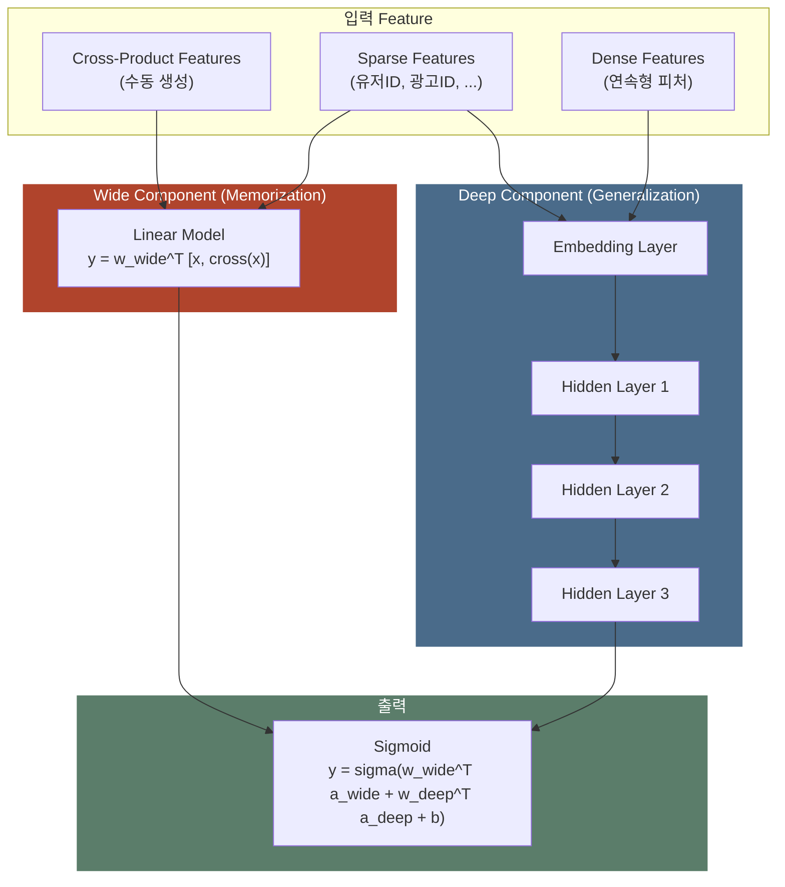
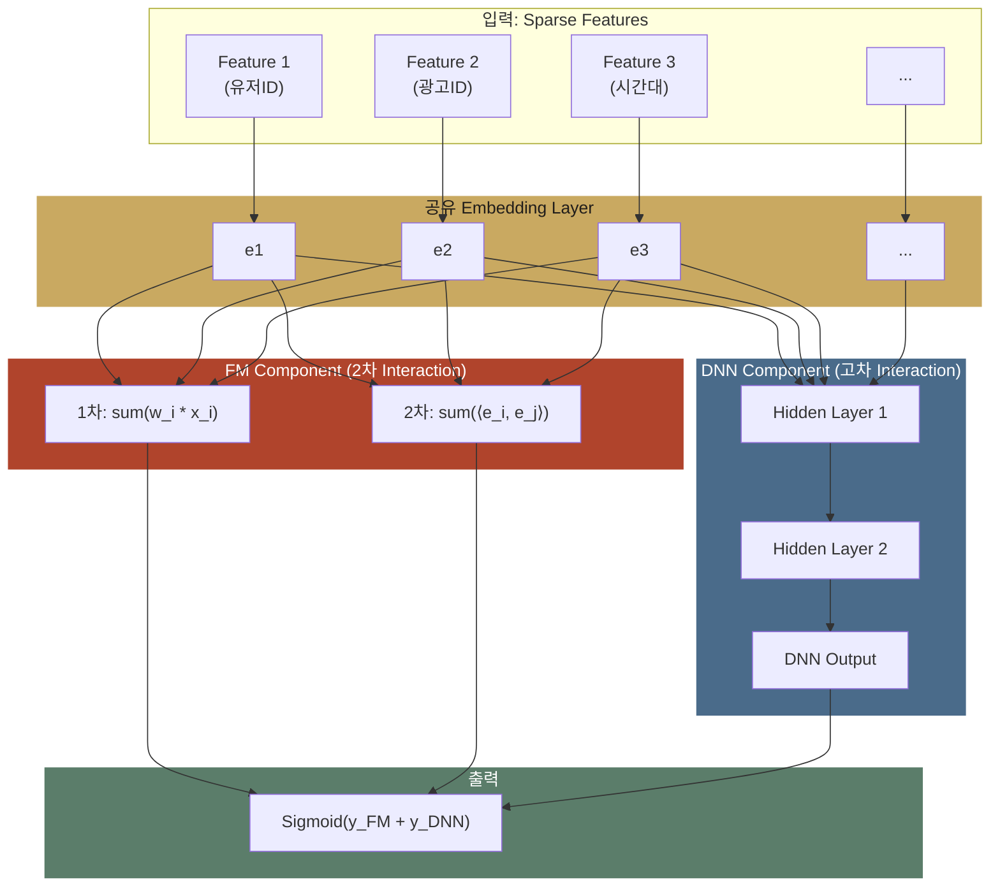
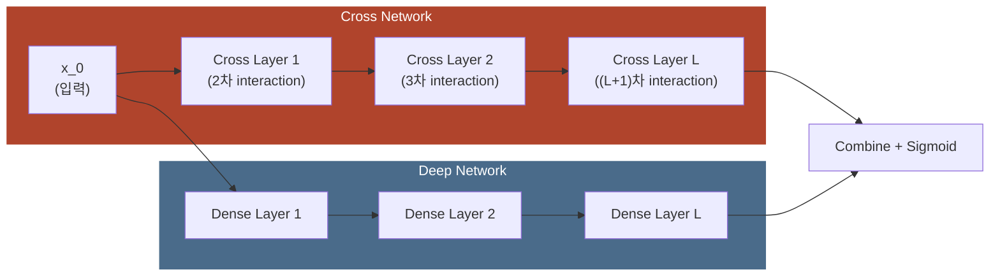
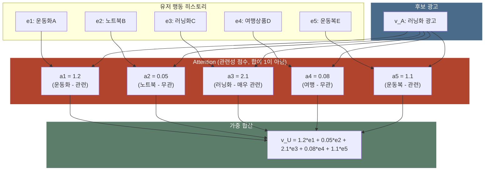
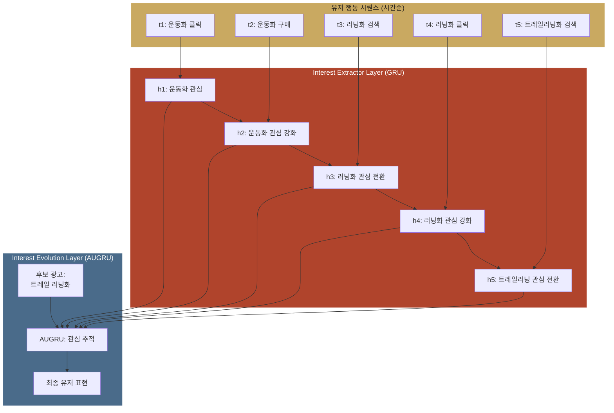

저녁 8시, 지하철에서 폰을 켜고 앱을 열면 광고 한 칸이 뜹니다. 그 칸에 어떤 광고를 넣을지는 "이 사람이 이 광고를 누를까?"에 답하는 확률 하나가 정하는데, 이 예측 확률을 pCTR 이라고 부릅니다. pCTR(predicted Click-Through Rate)은 광고를 보여 주기 전에 모델이 미리 계산한 클릭 확률입니다. CTR(클릭률)은 실제로 보여 준 횟수 가운데 클릭이 나온 비율입니다.

그런데 이 확률은 무엇으로 계산할까요? 재료는 나이, 시간대, 광고 카테고리 같은 조각들입니다. 모델에 넣는 이런 조각 하나하나를 피처(feature)라고 합니다. 어려운 부분은 피처를 어떻게 **조합**하느냐입니다. "20대"라는 피처 하나로는 아무것도 알 수 없고 "20대 × 저녁 × 화장품"처럼 여러 피처가 함께 맞아야 뜻이 생기는데, 이렇게 피처를 둘 이상 엮은 것을 피처 조합(feature interaction)이라고 부릅니다.

지난 15년 동안 CTR 모델의 역사는 곧 이 조합을 누가 만드느냐의 역사였습니다. 처음에는 사람이 조합을 손으로 적어 넣었고 다음에는 모델이 조합을 스스로 만들었습니다. 마지막에는 모델이 유저가 어떤 순서로 무엇을 했는지까지 읽기 시작했습니다.

> 한 줄 요약: CTR 모델은 두 방향으로 발전했습니다. 하나는 피처 조합을 사람이 손으로 만들던 데서 모델이 스스로 배우는 쪽으로 넘긴 방향이고 다른 하나는 유저의 과거 행동을 똑같은 비중으로 평균하던 데서 지금 보여 줄지 따지는 광고와 관련된 행동에 더 큰 비중을 주는 어텐션(attention)으로 바꾼 방향입니다.

광고 시스템의 계산은 모두 pCTR 에서 시작하므로 이 확률이 틀리면 그 뒤의 계산도 전부 틀립니다.

- 최적 입찰가는 참 가치(True Value, 노출 한 번이 광고주에게 주는 가치)에서 계산하는데, 참 가치는 pCTR 에 전환 가치를 곱한 값이라 pCTR 이 틀리면 입찰가도 틀립니다 → [Bid Shading](post.html?id=bid-shading-censored)
- 하루 수십만 번의 입찰에 예산을 나눠 쓰려면 입찰 기회마다 그 기회의 가치가 얼마인지 알아야 합니다 → [Auto-Bidding](post.html?id=auto-bidding-pacing)
- 어느 단계에 어떤 모델을 둘지는 정확도를 얻는 만큼 지연을 내주는 맞교환입니다 → [모델 서빙 아키텍처](post.html?id=model-serving-architecture)

pCTR 을 어떻게 정의하고 eCPM(노출 1,000회당 기대 수익)으로 어떻게 이어지는지는 [pCTR 예측](post.html?id=pctr-prediction) 편에서 다루므로, 이 글은 그 확률을 계산하는 모델의 안쪽만 봅니다.

이 글은 CTR 예측 모델의 진화를 **"어떤 문제를 풀려고 했는가"**의 관점으로 따라갑니다. 모델마다 앞 모델의 어떤 한계를 넘었는지 보고 그 변화가 실제 서비스(프로덕션) 광고 시스템에서 왜 의미가 있는지 살펴봅니다.

> **골라 읽는 법** — 절이 11개인 긴 글이라 처음부터 다 읽지 않아도 됩니다.
>
> - 모델 계보만 보려면 → 1~3절
> - 유저 행동 시퀀스를 읽는 DIN, DIEN 만 → 4절
> - 모델을 고르는 기준과 서빙 제약만 → 5~6절
> - 두 무대의 비교만 → 7~8절

---
## 1. 핵심 비교: Executive Summary

**LR 부터 DIEN 까지의 모델은 피처 조합을 더 풍부하게 잡는 방향과 유저 행동 시퀀스를 더 정교하게 읽는 방향으로 발전했습니다. 표의 아래로 갈수록 정확도가 오르지만 지연도 같이 늘어납니다.**

모델 이름이 연도순으로 이어지면 각 모델이 무엇을 바꿨는지 놓치기 쉬우므로, 먼저 LR 부터 DIEN 까지 각 모델이 CTR 예측의 어떤 문제를 해결했는지 표 한 장으로 비교합니다. 표에 나오는 모델은 3절과 4절에서 하나씩 자세히 봅니다. 여기서는 표를 읽는 데 필요한 말만 먼저 풉니다.

- LR(Logistic Regression, 로지스틱 회귀)은 피처마다 weight 하나를 곱해 더한 값을 0 과 1 사이의 확률로 바꾸는 가장 단순한 모델로, 표에서는 다른 모델과 비교하는 기준선(Baseline)입니다.
- 피처 조합 열의 수동 교차 피처(Cross Feature)는 엔지니어가 피처 2개 이상의 값을 이어 붙여 손으로 만든 피처입니다. 같은 열의 2차는 피처 2개를, 고차는 그보다 많은 피처를 함께 엮은 조합을 뜻합니다.
- 숨은 벡터(Latent Vector)는 피처마다 학습하는 짧은 숫자 벡터인데, FM 은 두 피처의 숨은 벡터를 내적해 그 조합의 세기를 계산합니다.
- FFM 은 필드(유저 ID, 광고 ID, 시간대처럼 피처를 종류별로 나눈 그룹)마다 다른 숨은 벡터를 두는 FM 의 변형이며 이 글의 뒤에서는 따로 다루지 않습니다.

| 모델 | 연도 | 핵심 혁신 | 피처 조합(Feature Interaction) | 유저 행동 반영 | 복잡도 |
|------|------|----------|-------------------|-------------|-------|
| **LR** | - | Baseline, 해석 가능 | 수동 교차 피처(Cross Feature) | 없음 | 매우 낮음 |
| **FM** | 2010 | 숨은 벡터(Latent Vector)로 조합(Interaction) 자동 학습 | 2차 (자동) | 없음 | 낮음 |
| **FFM** | 2016 | Field-aware: 필드별 다른 숨은 벡터 | 2차 (필드별) | 없음 | 중간 |
| **Wide & Deep** | 2016 | Memorization + Generalization 결합 | 수동(Wide) + 암묵적(Deep) | 없음 | 중간 |
| **DeepFM** | 2017 | FM + DNN, 임베딩(Embedding) 공유로 End-to-End | 2차(FM) + 고차(DNN) | 없음 | 중간 |
| **DCN** | 2017 | 조합 층 망(Cross Network)으로 명시적 고차 조합 | 명시적 고차 (L-layer) | 없음 | 중간 |
| **DCN-v2** | 2021 | 가중치 행렬(Weight Matrix) + Mixture of Experts | 명시적 고차 (풍부한 표현력) | 없음 | 중~높음 |
| **DIN** | 2018 | 후보 광고 기반 어텐션(Attention)으로 행동 가중 | 고차 (DNN) | 어텐션 기반 | 높음 |
| **DIEN** | 2019 | GRU + AUGRU로 관심사의 시간적 변화 모델링 | 고차 (DNN) | 시퀀스 + 어텐션 | 매우 높음 |

> 표에서 볼 것: 모델은 크게 (1) 피처 조합을 더 풍부하게 잡는 방향과 (2) 유저 행동 시퀀스를 더 정교하게 반영하는 방향으로 발전했습니다. 두 방향이 합쳐질 때 CTR 예측의 정확도가 크게 오릅니다.

표를 위에서 아래로 읽으면 두 열에서 흐름이 보입니다.

첫째, **피처 조합 열은 "수동"에서 "자동"으로 바뀝니다.** LR 을 쓰던 때에는 엔지니어가 "관심사 × 카테고리" 같은 조합을 손으로 적어 넣어야 했는데 FM 이 이 일을 모델에게 넘겼고 DCN 은 3차, 4차 조합까지 모델이 자동으로 배우게 했습니다.

둘째, **유저 행동 열은 "없음"에서 "시퀀스"로 바뀝니다.** 2017년까지의 모델은 유저를 ID 하나로만 봤지만 DIN 부터는 "이 유저가 최근에 무엇을 눌렀는가"를 직접 읽습니다. 행동 시퀀스는 한 유저가 누르거나 본 상품을 시간 순서대로 늘어놓은 기록입니다.

두 방향은 서로 독립이라 실무에서는 두 방향을 섞어 씁니다. 피처 조합 전용 구조를 개선한 DCN-v2 의 조합 층 망(cross network, 피처 조합을 층마다 쌓는 부분) 위에 DIN 의 어텐션을 붙인 구조가 흔합니다. 다만 표의 아래로 갈수록 정확도가 오르는 대신 응답에 걸리는 시간인 지연도 같이 늘어나는데, 이 맞교환은 6절에서 숫자로 봅니다.

구조와는 따로 미리 분명히 해 둘 것이 하나 있습니다. 광고 시스템은 pCTR 의 절대값으로 입찰가를 계산하므로 구조를 아무리 키워도 예측값이 실제 클릭률과 맞지 않으면 엉뚱한 광고가 낙찰됩니다. 그래서 순서만 맞히는지 보는 순위 지표(3절에서 보는 AUC)만 좋아진 모델은 돈을 잃습니다. 예측값을 실제 클릭률에 맞추는 일은 구조가 아니라 보정(calibration)이 푸는 문제이며 자세한 내용은 [Calibration](post.html?id=calibration) 편에 있습니다.

---

## 2. 희소 피처(Sparse Feature)의 도전: 광고 CTR 과 일반 ML 의 차이

**광고 CTR 예측의 입력은 고유값이 수십만에서 수억 개인 ID 피처라서 값마다 칸을 하나씩 주는 방식으로 그대로 넣으면 파라미터가 폭발하고 조합 대부분은 배울 데이터조차 없습니다. ID 마다 짧은 벡터를 두는 임베딩이 이 문제를 풀며 CTR 은 피처 하나보다 피처 조합에 크게 좌우됩니다.**

1절 표의 모델들이 피처 조합을 다루는 구조를 따로 만든 데에는 광고 데이터의 생김새가 이미지나 문장과 다르다는 사정이 있습니다. 먼저 그 차이를 봅니다.

### 광고 CTR 예측의 특수성

이미지 분류는 픽셀 값을, 자연어 처리(NLP)는 단어 임베딩을 입력으로 받으므로 입력의 거의 모든 칸에 0 이 아닌 값이 들어 있습니다. 광고 CTR 예측의 입력은 다릅니다. 유저 ID, 광고 ID, 퍼블리셔(광고 자리를 내놓는 매체) ID, 광고주 ID, 캠페인 ID, 크리에이티브(광고 소재) ID 처럼 정해진 값 가운데 하나를 고르는 범주형(categorical) 피처가 입력을 지배하는데, 피처마다 고유값이 수십만에서 수억 개에 이릅니다. 이런 ID 를 숫자로 바꾸면 고유값 하나에 칸 하나를 주고 해당하는 칸만 1, 나머지는 모두 0 으로 두게 되어 칸 대부분이 0 입니다. 이렇게 칸 대부분이 0 인 피처를 희소 피처(sparse feature)라고 부르며 광고 CTR 의 입력은 극도로 희소합니다.

아래 표의 피처 조합 줄처럼 이미지와 문장에서는 CNN 이나 Transformer 같은 모델이 입력 사이의 관계를 스스로 배우지만 광고 CTR 에서는 피처 조합을 명시적으로 설계하거나 조합 전용 구조를 써야 합니다. 마지막 줄의 Long-tail 은 노출이 많은 인기 광고가 전체 광고에 비해 아주 적고 나머지 대다수 광고에는 데이터가 조금씩만 쌓이는 분포입니다.

| 특성 | 일반 ML (이미지, NLP) | 광고 CTR 예측 |
|------|---------------------|-------------|
| **주요 피처(Feature) 타입** | Dense (픽셀, 임베딩) | Sparse Categorical |
| **피처 공간(Feature Space) 차원** | 수백~수천 | **수천만~수억** |
| **피처 밀도** | 거의 모든 값이 non-zero | 대부분 0 (One-hot) |
| **피처 조합** | CNN/Transformer가 자동 학습 | **명시적 설계 또는 전용 아키텍처 필요** |
| **데이터 분포** | 비교적 균일 | **극도의 Long-tail** (인기 광고 << 전체) |

### One-hot 의 한계와 Embedding 이 꼭 필요한 까닭

고유값 하나에 칸 하나를 주는 방식을 One-hot 인코딩이라고 합니다. 유저 ID 가 1,000만 개면 One-hot 인코딩은 유저 한 명을 1,000만 차원 벡터로 나타내고 그중 한 칸만 1 입니다. 이 벡터를 그대로 모델에 넣으면 세 가지 문제가 생깁니다.

- 칸마다 weight 가 하나씩 필요해 파라미터 수가 폭발합니다. LR 의 weight 만 해도 수억 개입니다.
- 두 피처의 조합을 배우려면 두 값이 같은 로그에 함께 나와야 하는데 대부분의 피처 쌍은 한 번도 함께 나오지 않으므로, 희소 피처 사이의 조합(interaction)을 학습할 수 없습니다.
- 학습 때 없던 새 유저나 새 광고는 자기 칸의 weight 를 배운 적이 없어 일반화가 불가능합니다. 이렇게 쌓인 데이터가 없어 새 유저나 새 광고를 예측하지 못하는 문제를 Cold-start 라고 합니다.

임베딩(Embedding)이 앞의 두 문제를 풉니다. 새 유저나 새 광고는 임베딩도 학습된 적이 없으므로 Cold-start 는 임베딩만으로 풀리지 않습니다. 수천만 차원의 One-hot 벡터 대신 ID 마다 수십~수백 차원의 촘촘한 벡터(dense vector, 거의 모든 칸에 값이 있는 벡터)를 하나씩 두고 아래 식처럼 그 ID 의 벡터를 표에서 꺼내 씁니다(lookup).

$$\text{Embedding}: \mathbb{R}^{|V|} \xrightarrow{\text{lookup}} \mathbb{R}^{k} \quad (|V| \gg k)$$

식의 $|V|$ 는 vocabulary 크기, 곧 ID 의 가짓수로 수천만에 이릅니다. $k$ 는 임베딩 차원이며 보통 8~128 을 씁니다. ID 마다 $k$ 개의 값을 두는 이 표가 임베딩 테이블(Embedding Table)인데, 행이 $|V|$ 개, 곧 수천만 개라 광고 모델의 **메모리 병목**이 됩니다. 해시 버킷을 400만 개로 고정한 6절의 가상 계산에서도 임베딩을 쓰는 모델은 파라미터의 78.6%~99.5% 가 임베딩 테이블입니다. 서빙에서 Embedding Lookup 이 가장 큰 병목이 되는 까닭도 여기에 있습니다. 자세한 내용은 [서빙 아키텍처](post.html?id=model-serving-architecture) 편에 있습니다.

파라미터가 얼마나 줄어드는지는 직접 곱해 보면 바로 보입니다. 아래 코드는 유저 1,000만 명과 광고 100만 개를 두고 두 방법을 비교합니다. 방법 A 는 "이 유저 × 이 광고" 조합마다 weight 를 하나씩 주는 One-hot 교차입니다. 방법 B 는 유저와 광고에 16차원 임베딩을 하나씩 주고 유저와 광고의 조합은 두 벡터의 내적으로 계산하는 방식입니다. 코드는 두 방법의 파라미터 수와 FP32(값 하나를 4바이트로 저장하는 부동소수점 형식) 메모리를 곱셈으로 셉니다. 마지막으로 방법 A 에서 실제로 배울 수 있는 조합의 비율도 구합니다.

```python
# 하는 일: 유저 1,000만 명과 광고 100만 개로 one-hot 교차 weight 수와 embedding 파라미터 수를 곱셈으로 세어 FP32 메모리와 함께 비교하고, one-hot 교차에서 배울 수 있는 조합의 비율을 구한다.
# 1단계: 유저 수, 광고 수, embedding 차원을 둔다
# 표준 라이브러리만 쓰고, 무작위성도 없다. 그냥 산수다.
N_USER = 10_000_000   # 유저 1,000만 명 (중견 서비스의 월간 활성 유저 규모)
N_AD   = 1_000_000    # 광고 100만 개 (크리에이티브 단위로 세면 이 정도가 된다)
K      = 16           # embedding 차원. 실무에서 8~128 사이를 쓴다.

# 2단계: 두 방법의 파라미터 수를 곱한다
# 방법 A 는 조합마다, 방법 B 는 유저와 광고마다 값을 둔다. 그 차이가 그대로 파라미터 수의 차이다.

# 방법 A: "이 유저 × 이 광고" 조합마다 weight를 하나씩 준다.
#   LR로 유저-광고 상호작용을 배우려면 이 방법밖에 없다.
onehot_cross = N_USER * N_AD

# 방법 B: 유저와 광고에 각각 embedding을 주고, 상호작용은 내적으로 만든다.
#   조합을 미리 만들지 않으므로 파라미터는 '유저 수 + 광고 수'에만 비례한다.
emb_params = N_USER * K + N_AD * K

print(f"A. one-hot 교차 weight : {onehot_cross:,} 개")
print(f"B. embedding 파라미터  : {emb_params:,} 개")
print(f"   B가 A보다 {onehot_cross / emb_params:,.0f}배 적다")

# 3단계: FP32 로 저장했을 때 메모리를 구한다
# 값 하나가 4바이트다. 서버에 올라가는지가 여기서 정해진다.
GB = 1024 ** 3
print(f"A 메모리(FP32): {onehot_cross * 4 / GB:,.0f} GB")
print(f"B 메모리(FP32): {emb_params * 4 / GB:,.2f} GB")

# 4단계: one-hot 교차에서 배울 수 있는 조합의 비율을 구한다
# 파라미터가 줄어드는 것만 이득이 아니다. '배울 수 있느냐'가 더 큰 차이다.
# A는 그 유저와 그 광고가 함께 등장한 로그가 있어야 weight를 배운다.
# 실제로 한 유저가 평생 만나는 광고는 많아야 수백 개다.
seen_per_user = 300
coverage = seen_per_user * N_USER / onehot_cross
print(f"A에서 학습 가능한 조합 비율: {coverage * 100:.4f}%")

# 출력:
# 2단계 뜻: one-hot 교차는 weight 가 10,000,000,000,000개이고 embedding 은 176,000,000개라, B 가 A 보다 56,818배 적다.
# A. one-hot 교차 weight : 10,000,000,000,000 개
# B. embedding 파라미터  : 176,000,000 개
#    B가 A보다 56,818배 적다
# 3단계 뜻: FP32 로 담으면 A 는 37,253 GB, B 는 0.66 GB 다.
# A 메모리(FP32): 37,253 GB
# B 메모리(FP32): 0.66 GB
# 4단계 뜻: one-hot 교차 weight 가운데 학습할 로그가 생기는 조합은 0.0300% 다. 나머지는 weight 를 한 번도 배우지 못한다.
# A에서 학습 가능한 조합 비율: 0.0300%
```

찍힌 값을 차례로 따라가면 방법 A 는 유저 1,000만 명 × 광고 100만 개 = 10,000,000,000,000개의 weight 가 필요하지만 방법 B 는 (1,000만 + 100만) × 16 = 176,000,000개면 되어 B 가 A 보다 56,818배(5만 6천 배) 적습니다. FP32 로 저장하면 A 는 37,253 GB 이고 B 는 0.66 GB 라 코드 주석대로 모델이 서버 메모리에 올라가는지가 이 차이에서 정해집니다.

더 큰 차이는 마지막 줄에 있습니다. 방법 A 는 그 유저와 그 광고가 함께 나온 로그가 있어야 그 조합의 weight 를 배우는데, 코드처럼 한 유저가 평생 만나는 광고를 많아야 300개로 잡으면 배울 로그가 생기는 조합은 300 × 1,000만 ÷ (1,000만 × 100만) = **0.03%** 뿐입니다. 나머지 99.97% 는 데이터를 한 번도 보지 못해 weight 가 영원히 0 에 머뭅니다. 임베딩은 조합이 아니라 유저와 광고를 따로 배우므로 두 벡터의 내적으로 처음 만나는 조합에도 값을 내놓을 수 있습니다.

### Feature Interaction 이 CTR 을 결정한다

광고 CTR 예측에서는 피처 하나하나보다 **피처끼리의 조합(interaction)이 클릭을 훨씬 더 잘 설명합니다.** 러닝에 관심 있는 유저를 예로 들면 조합의 차수가 올라갈수록 예측이 나아집니다.

- `user_interest=러닝` 하나만으로는 CTR 예측에 거의 도움이 되지 않습니다.
- 광고 카테고리를 엮은 `user_interest=러닝 AND ad_category=운동화` 2차 조합은 CTR 을 크게 높입니다. AND 는 두 조건이 동시에 맞는다는 뜻입니다.
- 시간까지 엮은 `user_interest=러닝 AND ad_category=운동화 AND hour=21` 3차 조합은 예측을 더 정확하게 만듭니다.

이런 조합을 어떻게 잡아내느냐가 CTR 모델이 발전해 온 큰 방향이었습니다. 3절은 그 방법이 바뀌어 온 순서를 모델별로 따라갑니다.

---

## 3. Feature Interaction 의 진화

**LR 은 피처 조합을 사람이 손으로 만들어 넣어야 했습니다. FM 은 2차 조합을 숨은 벡터의 내적으로 자동 학습했고 Wide & Deep 과 DeepFM 은 DNN(층을 여러 개 쌓은 신경망) 갈래를 붙여 고차 조합을 배웠으며 DCN 은 조합 층을 쌓아 고차 조합을 명시적으로 학습합니다.**

CTR 은 피처 조합에 크게 좌우되지만 2차 조합만 해도 그 수가 피처 수의 제곱에 비례해 늘어나므로, 모델마다 누가 어떤 조합을 만들고 어떻게 배울지를 다르게 풀었습니다. 가장 단순한 LR 부터 차례로 봅니다.

### ① Logistic Regression (Baseline)

LR 은 모든 CTR 예측이 출발하는 기준선입니다. 피처 벡터 $x$ 의 칸마다 weight 를 곱해 더하고 bias $b$ 를 붙인 값 $w^T x + b$ 를 시그모이드 $\sigma$ 에 넣으면 0 과 1 사이의 확률이 나옵니다.

$$\hat{y} = \sigma(w^T x + b) = \frac{1}{1 + e^{-(w^T x + b)}}$$

이 식에서 피처 $i$ 는 자기 weight $w_i$ 하나로만 확률에 기여하므로 LR 은 두 피처가 함께 나올 때만 생기는 효과를 스스로 배우지 못합니다. 그래서 피처끼리의 조합은 엔지니어가 아래처럼 피처 값을 이어 붙인 교차 피처(cross feature)로 손수 만들어 넣어야 합니다.

```
# 수동 Cross Feature Engineering
feature["gender_X_adcat"] = feature["gender"] + "_" + feature["ad_category"]
feature["gender_X_adcat_X_hour"] = feature["gender"] + "_" + feature["ad_category"] + "_" + str(feature["hour"])
```

첫 줄의 `gender_X_adcat` 은 성별과 광고 카테고리를 이은 2차 교차 피처이고 둘째 줄의 `gender_X_adcat_X_hour` 는 시간대까지 이은 3차 교차 피처입니다.

**한계**: 피처가 $n$ 개면 2차 조합만 해도 교차 피처 수가 $O(n^2)$ 으로 폭발하고 3차 이상은 사실상 손으로 만들 수 없습니다. 어떤 피처 쌍이 쓸모 있는지는 도메인 지식에 기댈 수밖에 없습니다. 게다가 새 피처가 붙을 때마다 교차 피처를 다시 설계해야 합니다.

**실무에서의 위치**: 그래도 LR 은 여전히 많이 쓰입니다. 해석 가능성, 학습 속도, 서빙 레이턴시(요청 하나에 답을 내는 데 걸리는 시간)에서 다른 모델이 LR 을 따라오지 못하고 [모델 서빙 아키텍처](post.html?id=model-serving-architecture) 편의 Multi-Stage Ranking 에서는 Pre-Ranking 단계의 가벼운 모델로 널리 쓰입니다. Multi-Stage Ranking 은 후보를 여러 단계에 걸쳐 줄여 가며 순위를 매기는 구조이며, Pre-Ranking 은 그 가운데 5절 표처럼 수백 개 후보를 약 1ms 안에 50개로 줄이는 첫 랭킹 단계를 가리킵니다.

#### 교차 피처 유무에 따른 차이 — 숫자로

LR 이 조합을 스스로 못 배운다는 말이 실제로 얼마나 큰 차이인지 작은 로지스틱 회귀를 직접 짜서 확인합니다.

가상 로그 4만 건을 만들되 20대는 저녁에, 40대는 출근길 아침에 광고를 누르게 했습니다. 나이와 시간대가 맞는 조합은 클릭률이 4.5%, 맞지 않는 조합은 0.5% 라서 나이별로 평균하면 (4.5 + 0.5) ÷ 2 = 2.5% 로 20대와 40대가 같습니다. 같은 이유로 아침과 저녁도 똑같이 2.5% 라 **나이만 봐도, 시간만 봐도 클릭률이 같고** 신호는 나이와 시간의 조합에만 숨어 있습니다.

코드는 LR 두 개를 학습해 비교합니다. A 는 나이와 시간대를 따로 넣은 LR 이고 B 는 여기에 "나이_시간" 교차 피처 하나를 손으로 붙인 LR 입니다. 광고 로그는 조합 수가 유한해서 4만 행을 같은 조합끼리 (노출, 클릭) 4행으로 접어도 로지스틱 손실이 같으므로, 코드는 접은 4행으로 경사하강(손실이 줄어드는 방향으로 weight 를 조금씩 옮기는 학습)을 3000번 합니다.

채점은 두 지표로 합니다. AUC 는 클릭이 난 노출이 클릭이 나지 않은 노출보다 높은 점수를 받았는지만 보는 **순위** 지표라 1 에 가까울수록 좋고 0.500 이면 동전 던지기와 같습니다. LogLoss 는 예측 확률의 **절대값**이 실제 클릭 여부와 얼마나 맞는지 보는 지표라 낮을수록 좋습니다.

```python
# 하는 일: 가상 로그 4만 건에서 나이와 시간대만 넣은 LR 과 교차 피처를 하나 붙인 LR 을 학습해, LR 이 「20대 × 저녁」 같은 조합을 스스로 배우지 못하는 것을 AUC 와 LogLoss 로 확인한다.
import random, math
from collections import Counter

random.seed(42)

# 1단계: 조합에만 신호가 있는 가상 로그 4만 건을 만든다
# 조합이 맞으면 4.5%, 어긋나면 0.5%. 나이별 평균은 (4.5+0.5)/2 = 2.5% 로
# 두 나이대가 똑같다. 시간대도 같은 이유로 똑같다. 단독 신호가 0 인 설계다.
# 표준 라이브러리만 쓴다.
TRUE_CTR = {("20대", "저녁"): 0.045, ("20대", "아침"): 0.005,
            ("40대", "아침"): 0.045, ("40대", "저녁"): 0.005}

N = 40000
rows = []
for _ in range(N):
    age  = random.choice(["20대", "40대"])
    hour = random.choice(["아침", "저녁"])
    y = 1 if random.random() < TRUE_CTR[(age, hour)] else 0   # 노출 1건의 클릭 여부
    rows.append((age, hour, y))

base = sum(r[2] for r in rows) / N
print(f"표본 전체 클릭률: {base*100:.2f}%")
for key in ["20대", "40대", "아침", "저녁"]:            # 단독 피처의 클릭률
    n_imp = sum(1 for a, h, _ in rows if key in (a, h))
    n_clk = sum(y for a, h, y in rows if key in (a, h))
    print(f"  {key} 단독: {n_clk/n_imp*100:.2f}%")

# 2단계: 피처를 만드는 함수 둘을 만든다
# 두 방식은 교차 피처 하나가 있고 없고만 다르다.
def plain(a, h):                 # A: 나이, 시간을 따로따로 (LR이 흔히 받는 형태)
    return [f"age={a}", f"hour={h}"]

def cross(a, h):                 # B: A + "나이_시간" 교차 피처 하나를 손으로 붙임
    return plain(a, h) + [f"age_x_hour={a}_{h}"]

# 3단계: 같은 조합끼리 노출과 클릭을 미리 접는다
# 광고 로그는 조합 수가 유한하므로, 4만 행을 (노출, 클릭) 4행으로 접을 수 있다.
# 접어도 로지스틱 손실은 완전히 같다. 대신 학습이 정확하고 빨라진다.
imp, clk = Counter(), Counter()
for a, h, y in rows:
    imp[(a, h)] += 1
    clk[(a, h)] += y

# 4단계: 전체 배치 경사하강으로 학습하는 함수를 만든다
# 접은 4행으로 기울기를 구해 3000번 내려간다.
def train(featfn, steps=3000, lr=2.0):
    """전체 배치 경사하강. 파라미터는 '피처 이름 → weight' 딕셔너리다."""
    w = {}
    b = math.log(base / (1 - base))       # bias를 base CTR의 logit에서 출발
    for _ in range(steps):
        gb, gw = 0.0, {}
        for cell, n in imp.items():
            z = b + sum(w.get(nm, 0.0) for nm in featfn(*cell))
            p = 1 / (1 + math.exp(-z))
            g = (n * p - clk[cell]) / N    # 로지스틱 손실의 기울기 = 예측합 - 실제합
            gb += g
            for nm in featfn(*cell):       # sparse 피처는 값이 1이라 g를 그대로 쓴다
                gw[nm] = gw.get(nm, 0.0) + g
        b -= lr * gb
        for nm, g in gw.items():
            w[nm] = w.get(nm, 0.0) - lr * g
    return w, b

# 5단계: AUC 와 LogLoss 로 채점하는 함수를 만든다
# LogLoss 는 확률의 절대값을, AUC 는 순위만 측정한다.
def evaluate(featfn, w, b):
    preds = []
    for a, h, y in rows:
        z = b + sum(w.get(nm, 0.0) for nm in featfn(a, h))
        preds.append((1 / (1 + math.exp(-z)), y))
    # LogLoss: 확률의 '절대값'을 측정하는 지표. 낮을수록 좋다.
    ll = -sum(y*math.log(p) + (1-y)*math.log(1-p) for p, y in preds) / len(preds)
    # AUC: '순위'만 측정하는 지표. 순위합으로 계산하고, 동점은 평균 순위로 센다.
    preds.sort(key=lambda t: t[0])
    i, rank_sum, npos = 0, 0.0, 0
    while i < len(preds):
        j = i
        while j < len(preds) and preds[j][0] == preds[i][0]:   # 동점 구간 묶기
            j += 1
        avg_rank = (i + 1 + j) / 2
        for k in range(i, j):
            if preds[k][1] == 1:
                rank_sum += avg_rank
                npos += 1
        i = j
    nneg = len(preds) - npos
    return (rank_sum - npos*(npos+1)/2) / (npos*nneg), ll

# 6단계: 두 방식으로 학습하고 채점한다
# B 는 네 조합의 예측을 표본 클릭률과 나란히 찍는다.
for label, fn in [("A 원 피처만", plain), ("B 교차 피처 추가", cross)]:
    w, b = train(fn)
    auc, ll = evaluate(fn, w, b)
    print(f"{label}  AUC {auc:.3f}  LogLoss {ll:.4f}  weight {len(w)}개")
    if fn is cross:
        for cell in imp:
            z = b + sum(w.get(nm, 0.0) for nm in fn(*cell))
            print(f"   {cell[0]} x {cell[1]}: 예측 {1/(1+math.exp(-z))*100:5.2f}%"
                  f"  표본 {clk[cell]/imp[cell]*100:5.2f}%")

# 출력:
# 1단계 뜻: 전체 클릭률은 2.43% 이고, 나이나 시간대 하나만 보면 2.37% 에서 2.48% 사이라 단독 피처에는 신호가 거의 없다.
# 표본 전체 클릭률: 2.43%
#   20대 단독: 2.48%
#   40대 단독: 2.37%
#   아침 단독: 2.42%
#   저녁 단독: 2.43%
# 6단계 뜻: 원 피처만 넣은 A 는 AUC 0.506 으로 순위를 매기지 못하고, 교차 피처를 붙인 B 는 AUC 0.707, LogLoss 0.1050 이다. B 의 예측은 조합마다 표본 클릭률과 같다.
# A 원 피처만  AUC 0.506  LogLoss 0.1141  weight 4개
# B 교차 피처 추가  AUC 0.707  LogLoss 0.1050  weight 8개
#    20대 x 아침: 예측  0.51%  표본  0.51%
#    40대 x 아침: 예측  4.29%  표본  4.29%
#    20대 x 저녁: 예측  4.40%  표본  4.40%
#    40대 x 저녁: 예측  0.42%  표본  0.42%
```

1단계 출력에서 표본 전체 클릭률은 2.43% 이고 나이나 시간대 하나만 본 클릭률은 2.37% 에서 2.48% 사이라 전체 평균과 사실상 같습니다. 나이나 시간을 따로 보면 클릭을 예측할 정보가 없다는 뜻입니다.

그래서 원 피처만 넣은 **A 는 순위를 전혀 매기지 못합니다.** A 의 AUC 0.506 은 동전 던지기의 0.500 과 다르지 않고 LogLoss 0.1141 은 모든 노출에 "2.43%"라고 답했을 때와 거의 같은 값입니다.

교차 피처 하나만 붙인 **B 는 AUC 가 0.707 로 올라갑니다.** LogLoss 도 0.1141 에서 0.1050 으로 8.0% 내려가는데 weight 는 4개에서 8개로 늘었을 뿐입니다. 새로 생긴 weight 4개가 네 조합에 하나씩 붙어 조합마다 확률을 따로 맞출 수 있으므로 B 의 조합별 예측은 표본 클릭률을 소수점까지 되찾았습니다(20대 x 저녁 예측 4.40%, 표본 4.40%).

여기서 두 가지를 챙겨 둡니다. 첫째, 클릭률이 2~3%대인 광고 데이터에서 LogLoss 는 대략 0.09~0.13 사이에 놓이므로 이 범위를 크게 벗어난 값이 나오면 계산이 틀렸다고 의심해야 합니다. 이 실험의 0.1141 과 0.1050 도 그 범위 안에 있습니다. 6절에서 보듯 클릭률 2.5% 에서는 아무것도 배우지 않은 상수 예측도 LogLoss 가 0.1169 라서 학습한 모델의 LogLoss 도 이 근처에서 조금씩만 내려갑니다. 둘째, B 의 교차 피처는 손으로 하나 붙였을 뿐입니다. 피처가 40종이면 2차 조합만 780개, 3차 조합은 9,880개라 어느 것을 붙일지 사람이 다 고를 수 없는데 FM 은 바로 이 지점에서 나왔습니다.

### ② FM (Factorization Machines, 2010)

Rendle 이 2010년에 제안한 FM 은 사람이 교차 피처를 고르던 일을 모델에게 넘겨 CTR 예측의 **패러다임을 바꿨습니다**. FM 은 피처마다 길이 $k$ 의 숨은 벡터(latent vector) $v_i$ 를 하나씩 학습하고 모든 피처 쌍의 조합을 **두 숨은 벡터의 내적**으로 계산합니다.

$$\hat{y} = w_0 + \sum_{i=1}^{n} w_i x_i + \sum_{i=1}^{n} \sum_{j=i+1}^{n} \langle v_i, v_j \rangle x_i x_j$$

식의 앞 두 항은 LR 과 같은 bias 와 1차항이고 마지막 항이 모든 피처 쌍 $(i, j)$ 의 2차 조합입니다. $v_i \in \mathbb{R}^k$ 는 피처 $i$ 의 숨은 벡터이고 $\langle v_i, v_j \rangle$ 는 두 벡터의 내적, 곧 $\sum_{f=1}^{k} v_{i,f} v_{j,f}$ 입니다. One-hot 피처에서 $x_i x_j$ 는 두 피처가 모두 켜졌을 때만 1 이므로 그 노출에 함께 나온 쌍만 점수에 들어갑니다.

**LR 과 다른 점**: LR 에서 조합 weight $w_{ij}$ 를 직접 학습하려면 피처 $i$ 와 $j$ 가 함께 나온 데이터가 있어야 하는데, 희소 데이터에서는 대부분의 쌍이 한 번도 함께 나오지 않아 학습이 불가능합니다. 2절의 One-hot 교차에서 배울 로그가 있는 조합이 0.03% 뿐이던 것과 같은 문제입니다. FM 은 $w_{ij}$ 대신 피처마다 숨은 벡터를 따로 학습하고 조합은 두 벡터의 내적으로 계산하므로 **한 번도 함께 나오지 않은 피처 쌍의 조합도 추정할 수 있습니다.** `user_interest=러닝` 의 벡터는 이 피처가 다른 광고와 함께 나온 로그에서 배우고 `ad_category=운동화` 의 벡터는 다른 유저와 함께 나온 로그에서 배우므로, 두 피처가 처음 만나도 두 벡터의 내적으로 조합 값이 나옵니다.

**계산 트릭**: 마지막 항을 그대로 계산하면 피처 쌍마다 길이 $k$ 의 내적을 구해야 해서 $O(kn^2)$ 이 걸리지만, 식을 아래처럼 바꾸면 $O(kn)$ 으로 줄어듭니다.

$$\sum_{i=1}^{n} \sum_{j=i+1}^{n} \langle v_i, v_j \rangle x_i x_j = \frac{1}{2} \sum_{f=1}^{k} \left[ \left( \sum_{i=1}^{n} v_{i,f} x_i \right)^2 - \sum_{i=1}^{n} v_{i,f}^2 x_i^2 \right]$$

오른쪽 식은 숨은 벡터의 차원 $f$ 마다 $v_{i,f} x_i$ 를 모두 더한 합을 제곱한 뒤 $v_{i,f} x_i$ 각각의 제곱을 더한 값을 빼고 2 로 나눕니다. 쌍은 한 번도 만들지 않고 피처를 차원마다 두 번 순회하면 끝나므로, 이 트릭 덕분에 FM 은 대규모 광고 시스템에서도 실시간 서빙이 가능합니다. 두 식이 왜 같은지는 아래 「더 깊이」 상자에서 풉니다.

두 방법이 정말 같은 값을 내는지 확인해 봅니다. 아래 코드는 피처 5개와 숨은 벡터 차원 4 를 두고 1, 3, 4번 피처만 켜진 희소 입력으로 두 방법을 모두 계산해 값을 비교합니다. 이어서 피처 수를 10개에서 10,000개까지 늘리며 나이브 방법이 도는 쌍의 수와 트릭이 순회하는 피처 수를 나란히 찍습니다.

```python
# 하는 일: FM 의 2차 상호작용을 모든 쌍을 도는 O(k×n²) 방법과 트릭을 쓴 O(k×n) 방법으로 계산해 값이 같은지 보고, 피처 수에 따라 두 방법이 도는 개수를 비교한다.
import random

random.seed(42)

# 1단계: 피처 5개의 latent vector 와 sparse 입력을 만든다
# 표준 라이브러리만 쓴다.
n, k = 5, 4                                                    # 피처 5개, latent 차원 4
V = [[random.gauss(0, 1) for _ in range(k)] for _ in range(n)]  # 피처별 latent vector
x = [1.0, 0.0, 1.0, 1.0, 0.0]                                  # sparse 입력: 1, 3, 4번만 켜짐

# 2단계: 모든 피처 쌍을 직접 도는 함수를 만든다
def naive(V, x):
    """모든 피처 쌍을 직접 돌면서 내적을 더한다 — 쌍의 개수만큼 반복한다."""
    total, pairs = 0.0, 0
    for i in range(len(x)):
        for j in range(i + 1, len(x)):
            dot = sum(V[i][f] * V[j][f] for f in range(len(V[i])))
            total += dot * x[i] * x[j]
            pairs += 1
    return total, pairs

# 3단계: 합의 제곱에서 제곱의 합을 빼는 트릭 함수를 만든다
def fast(V, x):
    """(합의 제곱 - 제곱의 합) / 2. 쌍을 한 번도 만들지 않는다."""
    total = 0.0
    for f in range(len(V[0])):                                  # latent 차원마다 한 번
        s  = sum(V[i][f] * x[i] for i in range(len(x)))          # 그 차원의 가중합
        sq = sum((V[i][f] * x[i]) ** 2 for i in range(len(x)))    # 제곱들의 합
        total += s * s - sq                                      # 대각선 항을 걷어낸다
    return 0.5 * total

# 4단계: 두 방법으로 계산해 값을 비교한다
# 파이썬 3.12 부터는 sum 이 부동소수점 오차를 보정해 차이가 0.0e+00 으로 찍힌다.
a, pairs = naive(V, x)
b = fast(V, x)
print(f"naive O(k n^2) = {a:.6f}   (피처 쌍 {pairs}개를 직접 돌았다)")
print(f"fast  O(k n)   = {b:.6f}   (쌍을 만들지 않았다)")
print(f"차이 {abs(a-b):.1e} — 부동소수점 오차 수준")

# 5단계: 피처 수를 늘려 쌍의 개수와 트릭이 순회하는 개수를 비교한다
# 피처가 늘어나면 두 방법의 격차가 벌어진다. 서빙에 올릴 수 있는지가 이 차이로 정해진다.
for nn in (10, 100, 1000, 10000):
    print(f"  피처 {nn:5d}개 → 쌍 {nn*(nn-1)//2:>11,}개  vs  트릭은 {nn:,}개 순회")

# 출력 (파이썬 3.9):
# 4단계 뜻: 두 방법이 모두 -1.423433 을 내고, 차이 4.4e-16 은 부동소수점 오차다. 나이브 방법은 피처 쌍 10개를 직접 돌았다.
# naive O(k n^2) = -1.423433   (피처 쌍 10개를 직접 돌았다)
# fast  O(k n)   = -1.423433   (쌍을 만들지 않았다)
# 차이 4.4e-16 — 부동소수점 오차 수준
# 5단계 뜻: 피처 10000개면 쌍이 49,995,000개지만 트릭은 10,000개만 순회한다.
#   피처    10개 → 쌍          45개  vs  트릭은 10개 순회
#   피처   100개 → 쌍       4,950개  vs  트릭은 100개 순회
#   피처  1000개 → 쌍     499,500개  vs  트릭은 1,000개 순회
#   피처 10000개 → 쌍  49,995,000개  vs  트릭은 10,000개 순회
```

4단계 출력에서 두 방법은 모두 -1.423433 을 내고 차이 4.4e-16 은 부동소수점 오차 수준이므로, 트릭은 쌍을 만들지 않고도 같은 값을 구합니다. 나이브 방법은 피처 5개에서 쌍 10개를 직접 돌았는데 5단계처럼 피처를 늘리면 쌍의 수가 피처 수의 제곱에 비례해 늘어 피처 10,000개에서는 49,995,000개, 약 5천만 개가 됩니다. 같은 경우에 트릭은 피처 1만 개를 두 번 순회하면 끝납니다.

:::deep 더 깊이 — (합의 제곱 - 제곱의 합)이 왜 쌍의 합과 같은가
숨은 벡터의 차원 하나 $f$ 만 떼어 놓고 $z_i = v_{i,f} x_i$ 라고 쓰면 구하려는 값은 $\sum_{i < j} z_i z_j$ 입니다. 합 전체를 제곱해 보면 이 값이 식 안에 들어 있습니다.

$$\left(\sum_i z_i\right)^2 = \sum_i z_i^2 + 2\sum_{i < j} z_i z_j$$

제곱을 전개하면 항은 두 종류입니다. 하나는 자기 자신과 곱한 대각선 항 $z_i^2$ 이고 다른 하나는 서로 다른 두 값을 곱한 항 $z_i z_j$ 인데, 대각선이 아닌 항은 $(i, j)$ 와 $(j, i)$ 로 두 번씩 나와 계수가 2 가 됩니다. 그래서 양변에서 대각선 항을 빼고 2 로 나누면 구하려던 값만 남습니다.

$$\sum_{i < j} z_i z_j = \frac{1}{2}\left[ \left(\sum_i z_i\right)^2 - \sum_i z_i^2 \right]$$

차원 $f$ 마다 이 계산을 한 번씩 해서 더하면 FM 의 2차항이 됩니다. 이 과정에서 쌍은 한 번도 만들지 않고 차원마다 합 한 번과 제곱합 한 번, 곧 피처를 두 번 순회하기만 하므로 비용이 $O(kn)$ 으로 내려갑니다.

실서비스에서는 피처가 많을수록 이 차이로 FM 을 쓸 수 있는지가 정해집니다. 광고 한 건을 3ms 안에 채점해야 하는 상황에서 0 이 아닌 피처가 많으면 이 트릭 없이는 FM 을 서빙에 올리기 어렵습니다.
:::

**한계**: FM 은 **2차 조합까지만** 잡습니다. 식에 피처 쌍의 항만 있어서 `유저 X 광고 X 시간대` 같은 3차 이상의 조합은 학습할 수 없습니다.

### ③ Wide & Deep (Google, 2016)

Google 은 2016년 Google Play Store 의 앱 추천에 Wide & Deep 을 적용했습니다. 이 모델은 **Memorization 과 Generalization 을 한 모델에서 결합**한다는 새 관점을 내놓았습니다. Memorization 은 학습 데이터에 자주 나온 특정 피처 조합과 그 결과를 그대로 기억하는 능력이고 Generalization 은 본 적 없는 피처 조합에도 알맞은 값을 내는 능력입니다. 아래 그림처럼 입력은 두 갈래로 들어갑니다.



- **Wide (Memorization)**: 원 피처와 cross-product 변환으로 만든 교차 피처를 선형 모델에 넣어 **특정 패턴을 직접 기억**합니다. cross-product 변환은 고른 피처들이 모두 켜졌을 때만 1 이 되는 새 피처를 만드는 변환이라, "25-34세 AND 최근 게임 앱 설치 이력 AND 게임 앱 → 높은 설치율" 같은 직접적인 패턴을 교차 피처 하나의 weight 로 기억할 수 있습니다.
- **Deep (Generalization)**: 희소 피처를 임베딩으로 바꾼 뒤 DNN 에 넣습니다. 임베딩은 2절에서 본 대로 ID 를 하나씩 따로 배우므로 Deep 쪽은 **본 적 없는 피처 조합에도 일반화**할 수 있습니다.

두 갈래는 마지막에 sigmoid 하나로 합쳐집니다.

$$\hat{y} = \sigma \left( w_{wide}^T [x, \phi(x)] + w_{deep}^T a^{(l_f)} + b \right)$$

$[x, \phi(x)]$ 는 원 피처 $x$ 와 cross-product 변환 $\phi(x)$ 의 결과를 나란히 붙인 Wide 의 입력이고 $a^{(l_f)}$ 는 Deep 쪽 DNN 의 마지막 hidden layer(출력 바로 앞의 층) 출력입니다. 두 갈래가 낸 값을 더하고 bias $b$ 를 붙인 뒤 sigmoid 로 확률을 만듭니다.

Google 은 Google Play Store 에 Wide & Deep 을 적용한 결과 기존 모델보다 앱 설치율이 3.9% 올랐다고 보고했습니다.

**한계**: Wide 쪽 cross-product 피처는 여전히 **사람이 설계**해야 합니다. 어떤 피처 쌍을 교차할지 도메인 전문가가 정해야 하고 그 선택이 모델 성능의 상한을 정하는데, 피처가 수백 개면 가장 좋은 교차 조합을 찾는 일은 사실상 불가능합니다.

### ④ DeepFM (2017)

DeepFM 은 Wide & Deep 의 가장 큰 한계였던 Wide 쪽의 수동 피처 엔지니어링을 없앴습니다. **Wide 자리에 FM 을 넣어** 2차 조합을 모델이 자동으로 배우게 했습니다. 그리고 FM 과 DNN 이 **임베딩을 공유**하게 해서 입력부터 출력까지 한 번에 학습합니다(end-to-end).



그림에서 피처마다 꺼낸 임베딩은 FM 쪽과 DNN 쪽으로 동시에 들어가고 두 쪽의 출력은 마지막 sigmoid 에서 합쳐집니다.

$$\hat{y} = \sigma(y_{FM} + y_{DNN})$$

$y_{FM}$ 은 FM 쪽 출력으로 1차항과 2차 조합을 담고 $y_{DNN}$ 은 DNN 쪽 출력으로 고차 조합을 담습니다.

DeepFM 에서는 FM 과 DNN 이 **같은 임베딩 테이블(Embedding Table)을 공유**하는데, 이 공유 덕분에 세 가지가 달라집니다.

- 2차 조합은 FM 이 임베딩의 내적으로 스스로 배우므로 교차 피처를 손으로 만드는 피처 엔지니어링이 따로 필요 없습니다. Wide & Deep 과 가장 크게 다른 점입니다.
- FM 이 2차 같은 낮은 차수(low-order)의 조합을, DNN 이 고차(high-order) 조합을 나눠 맡습니다.
- 두 쪽에서 온 학습 신호가 같은 임베딩을 함께 고치는 end-to-end 학습이라 임베딩이 두 쪽 모두에 맞게 최적화됩니다.

아래 표는 두 모델을 항목별로 비교합니다.

| 비교 항목 | Wide & Deep | DeepFM |
|----------|-------------|--------|
| Low-order 조합 | 수동 교차 피처 (Wide) | **FM이 자동 학습** |
| High-order 조합 | DNN (Deep) | DNN (Deep) |
| 피처 엔지니어링(Feature Engineering) | **필요 (Wide 파트)** | 불필요 |
| 임베딩 공유 | Wide와 Deep 별도 | **FM과 DNN 공유** |
| End-to-End 학습 | 부분적 | **완전한 End-to-End** |

DeepFM 이 실제로 어떤 차이를 내는지는 [Bid Shading](post.html?id=bid-shading-censored) 편의 실험 비교에 나옵니다. Zhou et al. 은 시장 가격(그 경매를 이기려면 넘어야 하는 경쟁자의 입찰가)의 분포를 추정하는 모델에 여러 네트워크 구조를 붙여 비교했습니다. Surplus 는 낙찰했을 때의 가치에서 낸 입찰가를 뺀 이익, 곧 입찰로 남기는 몫이고 Surplus Lift 는 이 몫이 늘어난 비율이라 클수록 좋습니다. 비교한 구조 가운데 **DeepFM 이 Surplus Lift +7.10% 로 가장 좋은 성능**을 냈습니다. 다만 논문은 온라인 지연 제약 때문에 온라인 실험에는 FwFM(필드 쌍마다 가중치를 하나씩 더 두는 FM 의 변형)을 썼습니다.

이 결과는 FM 의 2차 조합과 DNN 의 고차 조합이 함께 작동해서 나왔습니다. 시장 가격은 exchange(광고 거래소), 시간대, 디바이스, 광고 카테고리가 얽혀 정해지는데 DeepFM 에서는 두 갈래가 이 복잡한 조합을 나눠 잡았습니다.

### ⑤ DCN / DCN-v2 (Google, 2017/2021)

DCN(Deep & Cross Network)은 FM 이 2차 조합까지만 잡는 한계를 다른 방식으로 넘었습니다. DNN 옆에 **조합 층 망(Cross Network)** 을 나란히 두는데, 조합 층 망은 층을 지날 때마다 피처 조합을 한 차수씩 더 쌓는 부분입니다. 1절 표에서 DNN 쪽 조합은 암묵적이라고 했지만 조합 층 망은 층 수로 조합의 차수가 정해지는 구조라 **명시적으로 고차 피처 조합을 학습**하고 파라미터도 DNN 보다 효율적으로 씁니다.

#### 조합 층(Cross Layer)의 수식

DCN 논문(2017)은 조합 층 망의 층 하나를 아래 식으로 정의합니다.

$$x_{l+1} = x_0 \cdot x_l^T w_l + b_l + x_l$$

$x_0$ 은 조합 층 망의 입력, $x_l$ 은 $l$ 번째 층의 출력이며 $w_l$ 과 $b_l$ 은 길이 $d$ 의 weight 벡터와 bias 벡터입니다. 6절 코드처럼 필드 40개의 16차원 임베딩을 이어 붙여 입력으로 쓰면 $d$ 는 640 입니다.

첫 항 $x_0 \cdot x_l^T w_l$ 에서 $x_l^T w_l$ 은 두 벡터의 내적이라 숫자 하나가 되고 이 숫자를 입력 $x_0$ 에 곱한 뒤 $b_l$ 과 직전 출력 $x_l$ 을 더합니다. $x_l$ 에 이미 들어 있는 조합에 $x_0$ 이 한 번 더 곱해지므로 층을 지날 때마다 조합의 차수가 하나씩 올라갑니다. 마지막에 더하는 $x_l$ 덕분에 앞 층까지 만든 낮은 차수의 조합도 그대로 남습니다. 아래 DCN-v2 는 이 벡터 $w_l$ 을 행렬로 바꿉니다.

이 식에서 세 가지 성질이 나옵니다.

- 각 층이 $x_0$ 과의 조합을 한 번 더 붙이므로 **조합 차수가 층마다 1씩 올라갑니다.** 아래 그림처럼 첫 층을 지나면 2차, 둘째 층을 지나면 3차 조합이 됩니다.
- 그래서 **$L$ 층짜리 조합 층 망은 $(L+1)$ 차까지의 피처 조합을 명시적으로 학습**합니다.
- 층마다 학습하는 값은 길이 $d$ 의 벡터 $w_l$ 과 $b_l$ 뿐이라 **파라미터 수가 층당 $O(d)$** 이고 $d \times d$ 행렬을 쓰는 DNN 층의 $O(d^2)$ 보다 훨씬 적습니다.

그림은 조합 층 망과 DNN 이 같은 입력 $x_0$ 을 받아 나란히 계산한 뒤 결과를 합쳐 sigmoid 로 확률을 내는 구조입니다.



#### DCN-v2 (2021)

DCN 의 조합 층에서 $w_l$ 은 벡터였습니다. 식의 $x_0 \cdot x_l^T w_l$ 은 행렬 $x_0 w_l^T$ 를 $x_l$ 에 곱한 것과 같습니다. 열 벡터 하나에 행 벡터 하나를 곱한 이 행렬은 모든 행이 한 벡터의 배수인 **rank-1 행렬**이라 $x_0$ 의 모든 원소에 같은 숫자 $x_l^T w_l$ 하나가 곱해지므로 표현력이 제한됩니다. DCN-v2 는 이 벡터를 $d \times d$ 의 **full-rank weight 행렬**(rank 에 제약을 두지 않은 일반 행렬)로 넓혔습니다.

$$x_{l+1} = x_0 \odot (W_l x_l + b_l) + x_l$$

$W_l \in \mathbb{R}^{d \times d}$ 는 행렬이고 $\odot$ 은 같은 자리의 원소끼리 곱하는 element-wise 곱입니다. $x_0$ 의 $i$ 번째 원소에 곱해지는 값을 $W_l$ 의 $i$ 번째 행이 따로 계산하므로 원소마다 서로 다른 조합을 배울 수 있습니다. 대신 층마다 $d \times d$ 개의 값을 학습해야 해서 파라미터 수와 계산량이 층당 $O(d^2)$ 로 늘어나는 대가가 따릅니다.

논문은 학습된 $W_l$ 의 rank 가 실제로는 낮다는 관찰에서 출발해 이 비용을 **low-rank 분해**로 줄였습니다. $d \times d$ 행렬을 $d \times r$ 행렬 두 개의 곱 $U_l V_l^T$ ($r \ll d$) 로 근사하면 층마다 학습하는 값이 $d^2$ 개에서 $2dr$ 개로 줄어드는데, 6절 코드의 DCN-v2 도 $d$ 640 을 rank 64 로 분해한 조합 층 3장을 씁니다.

여기에 **Mixture of Experts(MoE)** 를 더한 구조가 논문의 DCN-Mix 입니다. MoE 는 작은 모델(expert)을 여러 개 두고 입력마다 어느 expert 에 얼마나 비중을 줄지 정해 결과를 섞는 방식이라, DCN-Mix 는 low-rank expert $K$ 개를 입력에 따라 섞어 표현력을 보탭니다.

$$x_{l+1} = \sum_{i=1}^{K} G_i(x_l) \, E_i(x_l) + x_l, \quad E_i(x_l) = x_0 \odot (U_l^{i} (V_l^{i})^T x_l + b_l)$$

$G_i(x_l)$ 는 입력 $x_l$ 을 보고 $i$ 번째 expert 의 비중을 정하는 gating function 입니다. $E_i$ 는 $i$ 번째 low-rank expert 이고 $U_l^{i}, V_l^{i}$ 는 그 expert 의 $d \times r$ 행렬입니다. 입력에 따라 expert 마다 비중이 달라지므로 expert 하나하나는 low-rank 로 가볍게 두면서도 표현력을 높일 수 있습니다. 비용을 줄이는 일은 low-rank 분해가 맡고 표현력을 보태는 일은 expert 를 섞는 MoE 가 맡습니다.

논문의 복잡도 분석은 full-rank 조합 층 망(cross network)을 $O(d^2 L)$, DCN-Mix 를 $O(2drKL)$ 로 적고 $rK \ll d$ 일 때 효율적이라고 합니다. 두 식을 비교하면 $d^2$ 자리에 $2drK$ 가 들어가 있으므로 $rK$ 가 $d$ 보다 훨씬 작을 때 DCN-Mix 의 비용이 작아집니다.

세 모델을 나란히 놓으면 다음과 같습니다. 파라미터 효율 줄의 $n$ 은 피처 수, $k$ 는 숨은 벡터 차원, $L$ 은 층 수, $d$ 는 입력 길이입니다.

| 비교 항목 | FM | DCN | DCN-v2 |
|----------|-----|-----|--------|
| 조합 차수 | 2차 | $(L+1)$차 | $(L+1)$차 |
| Cross weight | 내적 (스칼라) | 벡터 (rank-1) | **행렬 (full-rank)** |
| 파라미터 효율 | $O(nk)$ | $O(Ld)$ | $O(Ld^2)$, DCN-Mix는 $O(2LdrK)$ |
| 표현력 | 제한적 | 중간 | **높음** |

---

## 4. 유저 행동 시퀀스의 도입: DIN & DIEN

**3절의 모델은 유저의 과거 행동을 평균 벡터 하나로 눌러 담아 여러 관심사가 한데 섞였습니다. DIN 은 후보 광고(지금 점수를 매기는 광고)와 관련된 행동에 큰 가중치를 주는 어텐션으로 이 문제를 풀었고 DIEN 은 행동의 순서까지 읽어 관심이 시간에 따라 옮겨 가는 흐름을 추적합니다.**

3절의 모델들은 피처 조합을 더 풍부하게 잡는 데 집중했지만 유저의 과거 행동(behavior sequence)을 다루는 방식에는 공통된 **구조적 한계**가 있었습니다. 행동 기록 전체를 길이가 고정된 벡터 하나로 눌러 담는다는 점입니다.

유저가 지난 30일 동안 상품 100개를 클릭했다면 기존 모델은 100개 행동의 임베딩 $e_j$ 를 아래처럼 평균해 유저 벡터 $v_U$ 하나를 만듭니다. 이렇게 단순 평균하는 방식을 mean pooling 이라고 합니다. 식의 $H$ 는 행동 수로 이 예에서는 100 입니다.

$$v_U = \frac{1}{H} \sum_{j=1}^{H} e_j \quad \text{(mean pooling)}$$

평균에서는 모든 행동이 같은 비중 $1/H$ 를 받으므로 운동화도 보고 노트북도 보고 여행 상품도 본 유저라면 세 관심사가 한 벡터에 뭉개져 **어느 관심사도 제대로 남지 않습니다**. 게다가 이 평균은 어떤 광고를 채점하든 같아서 운동화 광고를 볼 때도 무관한 잡음인 노트북 구매 이력이 운동화 이력과 같은 비중으로 들어갑니다.

### ① DIN (Alibaba, 2018)

DIN(Deep Interest Network)은 이 문제를 **어텐션 메커니즘**으로 풀었습니다. 후보 광고(candidate ad)는 지금 이 유저에게 보여 줄지 점수를 매기는 광고인데, DIN 은 유저의 행동 가운데 **후보 광고와 관련된 행동에 주목**하도록 행동마다 다른 가중치를 줍니다.

카드에서는 같은 유저의 같은 이력이 후보 광고에 따라 서로 다른 가중치를 받는 모습을 보면 됩니다.

<div class="demo-embed-wrap">
<iframe class="demo-embed" src="demo-data-model-cards.html?embed=1&card=din" height="480" loading="lazy" title="후보 광고에 따라 이력의 가중치가 달라진다"></iframe>
<a class="demo-embed-open" href="demo-data-model-cards.html" target="_blank" rel="noopener">↗ 카드 여덟 장 전체로 열기</a>
</div>

#### 어텐션 메커니즘

유저의 행동 히스토리를 임베딩 $\{e_1, e_2, ..., e_H\}$ 로, 후보 광고를 임베딩 $v_A$ 로 나타내면 DIN 은 유저 표현 $v_U$ 를 평균 대신 아래 가중합으로 만듭니다.

$$v_U(A) = f(v_A, e_1, e_2, ..., e_H) = \sum_{j=1}^{H} a(e_j, v_A) \cdot e_j$$

행동 $e_j$ 마다 곱해지는 어텐션 weight $a(e_j, v_A)$ 는 activation unit 이라는 작은 신경망이 그 행동과 후보 광고를 보고 내는 점수입니다.

$$a(e_j, v_A) = \text{MLP}(e_j,\ v_A,\ e_j - v_A,\ e_j \odot v_A)$$

**논문은 이 점수를 softmax 로 나누지 않습니다.** softmax 는 점수들을 지수로 바꾼 뒤 그 합으로 나눠 가중치의 합이 1 이 되게 만드는 정규화입니다. 합을 1 로 누르면 관련 행동이 3개인 광고와 1개인 광고가 똑같이 1 을 나눠 가지므로, DIN 은 이 제약을 일부러 풀어 관련 행동이 많을수록 $v_U$ 가 커지고 관심이 얼마나 센지가 그대로 남게 했습니다. 논문은 티셔츠 광고가 휴대폰 광고보다 옷 관련 이력을 더 많이 활성화한다는 예를 듭니다.

MLP(층을 여러 개 쌓은 완전 연결 신경망)에는 네 가지를 함께 넣습니다. 행동 $e_j$ 와 후보 $v_A$ 에 더해 둘의 차이 $e_j - v_A$ 와 element-wise 곱 $e_j \odot v_A$ 까지 넣는데, 차이는 두 벡터가 얼마나 떨어져 있는지를 담고 곱은 차원마다 두 벡터가 같은 쪽을 가리키는지를 담으므로 차이와 곱을 같이 주면 관련성 신호가 훨씬 풍부해집니다. 논문 그림은 두 임베딩과 외적(outer product)을 넣는다고 그렸고 널리 쓰이는 공개 구현인 DeepCTR 은 위 식처럼 차이와 곱을 붙입니다. DeepCTR 은 softmax 정규화를 옵션으로 두지만 기본값은 끈 쪽입니다.

아래 그림은 러닝화 광고를 후보로 둔 예입니다.



러닝화 이력(a3 = 2.1), 운동화(a1 = 1.2), 운동복(a5 = 1.1)에는 큰 점수가 붙고 노트북(a2 = 0.05)과 여행 상품(a4 = 0.08)에는 0 에 가까운 점수가 붙습니다. 다섯 점수는 softmax 를 거치지 않아 합이 1 이 아닙니다.

**직관**: 러닝화 광고를 볼 때는 유저의 과거 러닝화, 운동화, 운동복 구매 이력이 높은 weight 를 받고 노트북이나 여행 상품은 0 에 가까운 weight 를 받습니다. 그래서 같은 유저라도 **후보 광고가 바뀌면 유저 표현 $v_U$ 가 달라집니다.** 어떤 광고를 채점하든 평균이 그대로인 mean pooling 과 달리 광고마다 다른 유저 표현을 쓴다는 점이 DIN 이 새로 들여온 생각입니다.

같은 유저를 두 광고로 채점하면 가중치가 어떻게 달라지는지 직접 돌려 봅니다. 아래 코드는 같은 유저의 최근 행동 5개(운동화, 노트북, 러닝화, 여행팩, 운동복)를 러닝화 광고와 노트북 광고로 한 번씩 채점하고 mean pooling 과 비교합니다. 실제 DIN 은 학습된 MLP 가 가중치를 내지만 코드는 두 벡터의 방향이 맞고(내적이 크고) 거리가 가까울수록 관련 있다고 보는 손 계산으로 대신합니다. 가상 임베딩은 카테고리마다 정해진 차원에 +2.0 을 더해 운동, 전자기기, 여행 방향을 만듭니다. 가중치는 논문처럼 합이 1 이 되게 나누지 않고 읽기 쉽도록 전체에서 차지하는 비중을 따로 계산해 찍습니다.

```python
# 하는 일: 같은 유저의 최근 행동 5개를 러닝화 광고와 노트북 광고로 각각 채점해, DIN 의 attention 가중치가 후보 광고에 따라 어떻게 달라지는지 mean pooling 과 비교한다.
import random, math

random.seed(42)

# 1단계: 차원과 온도를 두고 가상 embedding 함수를 만든다
# 같은 유저라도 '어떤 광고를 채점하느냐'에 따라 유저 표현이 달라지는 것을 본다. 표준 라이브러리만 쓴다.
D = 8      # embedding 차원
T = 3.0    # 점수를 누그러뜨리는 온도. 낮추면 가중치 차이가 더 벌어진다.

def emb(axis):
    """가상 embedding. axis 자리에 +2.0을 더해 '카테고리 방향'을 만든다.
       실제 모델에서는 이 벡터를 클릭 로그로 학습한다."""
    v = [random.gauss(0, 0.4) for _ in range(D)]
    v[axis] += 2.0
    return v

# 2단계: 유저가 최근에 본 상품 5개를 카테고리 방향으로 만든다
AXIS = {"운동": 0, "전자기기": 2, "여행": 3}     # 카테고리마다 쓰는 자리를 다르게
behaviors = {                                     # 이 유저가 최근에 본 상품 5개
    "운동화": emb(AXIS["운동"]),
    "노트북": emb(AXIS["전자기기"]),
    "러닝화": emb(AXIS["운동"]),
    "여행팩": emb(AXIS["여행"]),
    "운동복": emb(AXIS["운동"]),
}

# 3단계: 방향과 거리로 가중치를 내는 attention 함수를 만든다
def attention(behavior_vecs, candidate):
    """DIN의 attention. 실제로는 학습된 MLP가 행동마다 가중치를 내지만, 여기서는
       '방향이 맞고 거리가 가까우면 관련 있다'는 손 계산으로 대신한다.
       논문처럼 가중치를 합이 1이 되게 나누지 않는다. 비중은 읽기 쉽게 따로 계산한다."""
    raw = []
    for v in behavior_vecs:
        dot  = sum(a*b for a, b in zip(v, candidate))            # 방향이 얼마나 맞나
        dist = sum((a-b)**2 for a, b in zip(v, candidate))       # 얼마나 떨어져 있나
        raw.append(math.exp((dot - 0.5*dist) / T))               # 양수 가중치, 나누지 않은 값
    total = sum(raw)
    return [x/total for x in raw], total              # (읽기용 비중, 나누지 않은 가중치의 합)

# 4단계: 러닝화 광고와 노트북 광고로 같은 유저를 채점한다
SPORTS = ["운동화", "러닝화", "운동복"]
for ad_name, axis in [("러닝화 광고", "운동"), ("노트북 광고", "전자기기")]:
    ws, total = attention(list(behaviors.values()), emb(AXIS[axis]))
    print(f"[{ad_name}] 채점 — 같은 유저, 같은 행동 5개")
    for name, w in zip(behaviors, ws):
        print(f"   {name}: {w:.3f} {'█' * round(w*40)}")
    share = sum(w for n, w in zip(behaviors, ws) if n in SPORTS)
    print(f"   운동 관련 3개가 가져간 비중: {share*100:.1f}%")
    print(f"   나누지 않은 가중치의 합: {total:.2f}")

# 5단계: mean pooling 의 고정 비중과 비교한다
print(f"mean pooling이라면 5개 모두 {1/len(behaviors):.3f} — 운동 관련 비중은 60.0% 고정")

# 출력:
# 4단계 뜻: 러닝화 광고를 채점하면 운동 관련 3개가 비중 91.3% 를 가져가고, 노트북 광고로 바꾸면 9.1% 로 떨어진다. 나누지 않은 가중치의 합은 8.41 과 3.89 다.
# [러닝화 광고] 채점 — 같은 유저, 같은 행동 5개
#    운동화: 0.376 ███████████████
#    노트북: 0.026 █
#    러닝화: 0.370 ███████████████
#    여행팩: 0.061 ██
#    운동복: 0.167 ███████
#    운동 관련 3개가 가져간 비중: 91.3%
#    나누지 않은 가중치의 합: 8.41
# [노트북 광고] 채점 — 같은 유저, 같은 행동 5개
#    운동화: 0.029 █
#    노트북: 0.846 ██████████████████████████████████
#    러닝화: 0.022 █
#    여행팩: 0.063 ███
#    운동복: 0.040 ██
#    운동 관련 3개가 가져간 비중: 9.1%
#    나누지 않은 가중치의 합: 3.89
# 5단계 뜻: mean pooling 은 5개에 0.200 씩 주어, 운동 관련 비중이 어느 광고에서나 60.0% 다.
# mean pooling이라면 5개 모두 0.200 — 운동 관련 비중은 60.0% 고정
```

같은 유저의 같은 행동 5개인데 채점하는 광고에 따라 결과가 완전히 달라집니다. 러닝화 광고를 채점하면 운동화 0.376, 러닝화 0.370, 운동복 0.167 을 합친 운동 관련 3개가 비중의 **91.3%** 를 가져갑니다. 노트북 광고로 바꾸면 노트북 하나가 0.846 을 가져가면서 운동 관련 비중이 **9.1%** 로 떨어집니다.

mean pooling 은 5개 행동에 0.200 씩 주므로 운동 관련 비중이 어느 광고에서나 3 × 0.200 = 60.0% 로 고정입니다. 광고가 바뀌어도 유저 표현이 그대로라는 뜻이며 DIN 과 mean pooling 의 차이는 전부 여기서 나옵니다.

비중은 읽기 쉽게 나눈 값이지만 모델 안에서는 나누지 않은 가중치가 그대로 행동 임베딩에 곱해집니다. 그 합이 러닝화 광고에서 **8.41**, 노트북 광고에서 **3.89** 인데, 이 유저의 이력에 운동 관련 행동이 3개이고 전자기기는 1개라서 러닝화 광고가 이력을 두 배 넘게 활성화한 결과입니다. softmax 로 나눴다면 두 광고 모두 합이 1 이 되어 이 차이가 사라집니다. 행동 하나가 벡터가 되는 단계부터 이력이 수만 개일 때까지 숫자로 따라가는 과정은 [행동 시퀀스 Attention](post.html?id=behavior-sequence-attention) 편에 있습니다.

#### DIN vs 기존 방식 비교

mean pooling 과 DIN 을 항목별로 놓으면 다음과 같습니다. 표의 $H$ 는 행동 수, $d$ 는 임베딩 차원, $h$ 는 어텐션 MLP 의 은닉층 폭, $N$ 은 후보 광고 수입니다.

| 비교 항목 | 기존 (Sum/Mean Pooling) | DIN (어텐션) |
|----------|----------------------|-----------------|
| 유저 표현 | 고정 (후보 광고와 무관) | **후보 광고에 따라 동적 변화** |
| 정보 손실 | 다양한 관심사가 평균화 | **관련 행동만 선택적 증폭** |
| 계산 비용 | $O(H \cdot d)$ | $O(H \cdot d \cdot h)$ (행동마다 어텐션 MLP, $h$ = MLP 은닉층 폭) |
| 후보 광고 수 $N$일 때 | 유저 표현 1번 계산 | **$N$번 계산 (서빙 비용 증가)** |

> 서빙에서 주의할 점: DIN 은 유저 표현이 후보 광고마다 달라 미리 계산해 둘 수 없으므로 후보가 50개면 어텐션을 50번 계산해야 합니다. 그래서 후보를 단계마다 줄여 가는 단계별 랭킹(Multi-Stage Ranking)이 꼭 필요하고 DIN 같은 무거운 모델은 후보가 50개 이하로 줄어든 Ranking 단계에서만 씁니다. 단계별 배치는 [서빙 아키텍처](post.html?id=model-serving-architecture) 편에서 다룹니다.

### ② DIEN (Alibaba, 2019)

DIEN 은 유저 행동에서 변해 가는 관심을 읽는 구조입니다. DIN 은 어떤 행동이 후보 광고와 **관련**있는지는 잡지만 관심이 시간에 따라 바뀌는 흐름, 곧 **시간적 변화(temporal evolution)** 는 반영하지 못합니다. 1주 전에는 운동화, 3일 전에는 러닝화, 어제부터는 트레일 러닝화를 본 유저가 있어도 DIN 의 가중합은 행동의 순서를 섞어도 결과가 똑같아서 이런 관심사의 **흐름**을 보지 못합니다. DIEN(Deep Interest Evolution Network)은 행동의 순서까지 읽어 이 한계를 넘었고 아래 그림처럼 두 층으로 이루어집니다.



그림의 Interest Extractor Layer 는 행동 5개를 시간순으로 읽으며 시점마다 관심사 상태 $h_1$ 부터 $h_5$ 까지를 만듭니다. Interest Evolution Layer 는 그 상태들을 후보 광고인 트레일 러닝화를 기준으로 다시 읽어 최종 유저 표현을 만듭니다.

#### Interest Extractor Layer

첫 층은 GRU(Gated Recurrent Unit)로 행동 시퀀스에서 **관심사 시퀀스**를 뽑습니다. GRU 는 시퀀스를 한 시점씩 읽으면서 직전 상태 $h_{t-1}$ 과 이번 행동 $e_t$ 로 새 상태 $h_t$ 를 만드는 순환 신경망이며 그 안의 update gate 가 이번 입력을 상태에 얼마나 반영할지 정합니다.

$$h_t = \text{GRU}(h_{t-1}, e_t)$$

시점마다 나오는 hidden state $h_t$ 는 그 시점까지 유저의 관심사를 요약한 벡터입니다. DIEN 은 여기에 보조 손실(auxiliary loss)을 하나 더 붙이는데, $h_t$ 가 다음 행동을 맞히도록 함께 학습시켜 hidden state 의 품질을 올립니다.

$$L_{aux} = -\frac{1}{T-1} \sum_{t=1}^{T-1} \left[ \log \sigma(h_t^T e_{t+1}^+) + \log(1 - \sigma(h_t^T e_{t+1}^-)) \right]$$

식의 $e_{t+1}^+$ 는 실제 다음 행동이고 $e_{t+1}^-$ 는 유저가 하지 않은 행동에서 뽑은 negative sample(음성 샘플)입니다. 첫 항은 $h_t$ 와 실제 다음 행동의 내적이 커질수록, 둘째 항은 음성 샘플과의 내적이 작아질수록 손실을 줄이므로 이 손실이 작아지면 $h_t$ 가 다음 행동을 잘 맞히게 됩니다. 음성 샘플을 고르는 방법은 [음성 샘플링](post.html?id=negative-sampling-bias) 편에서 다룹니다.

#### Interest Evolution Layer

둘째 층은 AUGRU(GRU with Attentional Update gate)로 **후보 광고와 관련된 관심사가 시간에 따라 어떻게 바뀌는지** 추적합니다. AUGRU 는 일반 GRU 의 update gate 를 어텐션 점수로 조절하는 GRU 입니다. 먼저 시점마다 첫 층의 상태 $h_t$ 와 후보 광고 $v_A$ 의 관련성을 어텐션 점수 $a_t$ 로 계산합니다.

$$a_t = \text{Attention}(h_t, v_A)$$

그다음 GRU 의 update gate $u'_t$ 에 이 점수를 곱해 $\tilde{u}'_t$ 를 만듭니다.

$$\tilde{u}'_t = a_t \cdot u'_t$$

이렇게 조절한 gate $\tilde{u}'_t$ 가 직전 상태 $h'_{t-1}$ 과 이번 시점에 새로 계산한 후보 상태 $\tilde{h}'_t$ 를 섞는 비율이 됩니다.

$$h'_t = (1 - \tilde{u}'_t) \odot h'_{t-1} + \tilde{u}'_t \odot \tilde{h}'_t$$

$a_t$ 가 낮으면 그 시점의 관심사가 후보 광고와 무관하다는 뜻입니다. 이때는 $\tilde{u}'_t$ 도 0 에 가까워져 update gate 가 닫히므로 $h'_t$ 는 직전 상태 $h'_{t-1}$ 을 거의 그대로 이어받고 그 시점의 정보는 다음으로 넘어가지 않습니다. $a_t$ 가 높으면 반대로 gate 가 열려 그 시점의 정보가 그대로 흘러 들어갑니다.

**직관적 예시**: 트레일 러닝화 광고를 후보로 두고 시점마다 따라가면 이렇습니다.

| 시점 | 유저 행동 | GRU 상태 (Interest Extractor) | AUGRU (트레일 러닝화 광고 기준) |
|------|---------|---------------------------|---------------------------|
| t1 | 운동화 클릭 | 운동화 관심 | 약간 관련 → 부분 전달 |
| t2 | 운동화 구매 | 운동화 관심 강화 | 약간 관련 → 부분 전달 |
| t3 | 러닝화 검색 | 러닝화로 관심 전환 | 관련 → 전달 |
| t4 | 러닝화 클릭 | 러닝화 관심 강화 | 관련 → 전달 |
| t5 | 트레일 러닝화 검색 | 트레일 러닝으로 전환 | **매우 관련 → 강하게 전달** |

운동화를 클릭하고 산 t1, t2 의 정보는 트레일 러닝화와 약간만 관련이 있어 일부만 전달됩니다. 러닝화를 검색하고 클릭한 t3, t4 는 전달되고 트레일 러닝화를 검색한 t5 는 강하게 전달되므로, 최종 hidden state 에는 "운동화 → 러닝화 → 트레일 러닝화"로 옮겨 온 관심사의 진화가 담깁니다.

DIN 과 DIEN 을 나란히 놓으면 다음과 같습니다.

| 비교 항목 | DIN | DIEN |
|----------|-----|------|
| 유저 행동 모델링 | 어텐션 (순서 무시) | **GRU + 어텐션 (순서 반영)** |
| 관심사 변화 | 반영 불가 | **시간적 evolution 추적** |
| Auxiliary Loss | 없음 | **다음 행동 예측으로 hidden state 강화** |
| 모델 복잡도 | 중간 | 높음 (GRU + AUGRU) |
| 서빙 레이턴시 | 중간 | **높음 (sequential 연산)** |

GRU 는 시점을 하나씩 순서대로 계산해야 해서 병렬로 처리할 수 없으므로 표의 마지막 줄처럼 DIEN 의 서빙 레이턴시가 높습니다. 6절에서 그 차이를 숫자로 봅니다.

---

## 5. 실무 선택 가이드: 상황별 추천 모델

**모델은 논문이 나온 순서가 아니라 유저 행동 로그가 쌓여 있는지, 피처 조합을 관리할 사람이 있는지, 지연 예산이 몇 ms 인지로 고릅니다. 실제 서비스에서는 랭킹 단계마다 그 단계에 맞는 모델을 따로 둡니다.**

나중에 나온 모델일수록 나아 보이지만 이론적으로 앞선 모델과 실제 서비스(프로덕션)에 맞는 모델은 다른 문제입니다. 그래서 이 절은 실무 상황별로 어떤 모델을 고를지 정리합니다. 고를 때는 세 가지를 묻습니다.

**유저 행동 로그가 쌓여 있는가.** DIN 과 DIEN 은 유저 한 명당 행동이 수십 개 쌓인 시퀀스를 전제로 합니다. 시퀀스 평균 길이가 3~4개면 어텐션이 볼 것이 없고 mean pooling 과 결과가 거의 같아집니다. 시퀀스가 얼마나 길지는 서비스 형태가 결정하므로 7절과 8절에서 두 무대로 나눠 자세히 봅니다.

**피처 조합을 관리할 사람이 있는가.** LR 과 Wide & Deep 의 성능은 교차 피처 목록의 품질이 좌우합니다. 그 목록을 계속 손볼 사람이 없으면 조합을 모델이 알아서 배우는 DeepFM 쪽이 낫습니다.

**지연 예산이 몇 ms 인가.** 지연 예산은 모델이 점수를 내는 데 쓸 수 있는 시간입니다. 6절 표에서 DIEN 은 5.2ms 로 DeepFM 의 1.5ms 보다 3배 이상 걸리는데, 예산이 3ms 인 자리에 5ms 모델을 올리면 응답이 타임아웃으로 버려집니다. 이때는 정확도가 아니라 응답률이 깎이므로 손해가 훨씬 큽니다.

아래 표에 서비스 상황별 추천 모델을 모았습니다.

| 상황 | 트래픽 규모 | 유저 행동 데이터 | 서빙 레이턴시 제약 | 피처 엔지니어링 리소스 | 추천 모델 |
|------|-----------|-------------|---------------|----------------------|---------|
| **MVP / 초기** | 소규모 (일 수십만) | 없거나 적음 | 느슨 (50ms+) | 적음 | **LR + 수동 교차 피처** |
| **성장기** | 중규모 (일 수백만) | 기본 클릭 로그 | 보통 (20ms) | 중간 | **DeepFM** |
| **대규모, 행동 데이터 부족** | 대규모 (일 수억) | 적음 | 엄격 (10ms) | 많음 | **DCN-v2** |
| **대규모, 행동 데이터 풍부** | 대규모 (일 수억) | 풍부한 클릭/구매 시퀀스 | Ranking 단계 5ms | 많음 | **DIN** |
| **대규모, 시퀀스 + 시간 중요** | 대규모 | 시계열 행동 데이터 | Ranking 단계 5ms | 많음 | **DIEN** |

표에서 대규모 서비스의 세 행은 유저 행동 데이터 열이 서로 다릅니다. 행동 데이터가 적으면 DCN-v2, 클릭과 구매 시퀀스가 풍부하면 DIN, 시간 순서까지 중요하면 DIEN 을 추천합니다.

### Multi-Stage 에서의 모델 배치

실제 서비스는 모델 하나만 쓰지 않고 랭킹 단계마다 그 단계에 맞는 모델을 따로 배치합니다. 이 구조는 [서빙 아키텍처](post.html?id=model-serving-architecture) 편에서 다뤘습니다.

| Ranking 단계 | 후보 수 | 레이턴시 예산 | 적합 모델 | 이유 |
|-------------|--------|-----------|---------|------|
| **Pre-Ranking** | 수백 → 50 | ~1ms | LR, 작은 MLP | 빠른 필터링이 핵심 |
| **Ranking** | 50 → 5 | ~3-5ms | DeepFM, DCN-v2, DIN | 정밀 예측이 핵심 |
| **Re-Ranking** | 5 → 1 | ~0.5ms | 규칙 + 점수 보정 | 비즈니스 로직 적용 |

표를 위에서 따라가면 Pre-Ranking 은 수백 개 후보를 약 1ms 안에 LR 이나 작은 MLP 로 50개까지 빠르게 걸러 냅니다. Ranking 은 남은 50개를 약 3-5ms 안에 DeepFM, DCN-v2, DIN 같은 모델로 정밀하게 예측해 5개를 남깁니다. Re-Ranking 은 약 0.5ms 안에 규칙과 점수 보정으로 비즈니스 로직을 적용해 최종 1개를 고릅니다.

> 실무 원칙: 모델의 AUC 를 1% 올리는 일보다 알맞은 모델을 알맞은 단계에 두는 시스템 설계가 비즈니스에 주는 효과가 더 큽니다.

이 글은 랭킹 모델 하나의 안쪽만 봅니다. 앞뒤 단계는 다른 글에서 다룹니다.

- 수백만 후보에서 수백 개를 먼저 건져 내는 단계 → [Two-Tower Retrieval](post.html?id=two-tower-retrieval)
- Tower(과제마다 따로 두는 신경망 갈래)를 여러 개 두고 CTR 과 CVR(클릭 뒤 전환으로 이어질 확률)을 함께 배우는 구조 → [Multi-Task Learning](post.html?id=multi-task-learning)
- 이 글에서 본 구조는 그 Tower 하나의 **안쪽**에 그대로 들어갑니다
- 예측 확률의 절대값을 실제 클릭률에 맞추는 일 → [Calibration](post.html?id=calibration)

---

## 6. 서빙과의 연결: 모델이 아무리 좋아도 10ms 안에 돌아야 한다

**가상 표에서 모델을 DeepFM 에서 DIEN 까지 올리면 AUC 는 +0.011 오르는 데 그치지만 추론 시간은 1.5ms 에서 5.2ms 로 늘어납니다. 모델 크기는 대부분 임베딩 테이블이 차지해 구조와 거의 무관하므로 실무의 병목은 모델 크기가 아니라 연산 순서입니다.**

### 모델 복잡도 vs 서빙 레이턴시 Trade-off

모델이 복잡해질수록 CTR 예측 정확도는 올라가지만 서빙 레이턴시도 늘어납니다. RTB(Real-Time Bidding, 노출 한 번마다 열리는 실시간 경매)는 100ms 타임아웃 안에 모든 처리를 끝내야 하므로 그 안에서 모델에 줄 수 있는 시간은 기껏해야 3-5ms 입니다. 정확도를 올리는 구조라도 이 시간을 넘기면 쓸 수 없습니다.

아래 표는 **가상 데이터**입니다. 실제 벤치마크가 아니라 한 서비스에서 같은 로그와 같은 피처로 모델을 차례로 바꿔 올렸을 때 흔히 나오는 모양을 숫자로 옮겼습니다. 평균 클릭률(base CTR) 2.5%, 해시 버킷 400만 개, 임베딩 16차원을 가정했습니다. 해시 버킷은 ID 를 해시 함수로 정해진 개수의 칸에 나눠 넣는 hashing trick 의 칸 수라 vocabulary 크기가 400만으로 고정됩니다.

표의 열은 순위를 보는 AUC(높을수록 좋음), 확률의 절대값을 보는 LogLoss(낮을수록 좋음), 파라미터 수, 그 가운데 임베딩이 차지하는 비중, 후보 50개를 한 번에 채점하는 추론 시간, FP32 로 저장했을 때의 크기입니다. 첫 줄의 상수 예측은 모든 노출에 2.5% 라고 답하는 기준선입니다. GBDT + LR 은 결정 트리 여러 개(GBDT)가 만든 피처를 LR 에 넣는 방식입니다.

| 모델 | AUC | LogLoss | 파라미터 수 | 임베딩 비중 | 추론(50개 배치) | FP32 크기 |
|------|-----|---------|----------|-------------|-------------|--------|
| 상수 예측(2.5%) | 0.500 | 0.1169 | 1 | 0% | — | — |
| LR (원 피처) | 0.698 | 0.1152 | 400만 | 0% | 0.1ms | 15 MB |
| LR + 수동 cross 200종 | 0.724 | 0.1141 | 1,711만 | 0% | 0.15ms | 65 MB |
| GBDT + LR | 0.728 | 0.1136 | 1,717만 | 0% | 0.8ms | 65 MB |
| FM | 0.730 | 0.1134 | 6,800만 | 94.1% | 0.3ms | 259 MB |
| Wide & Deep | 0.733 | 0.1130 | 8,144만 | 78.6% | 1.4ms | 311 MB |
| DeepFM | 0.735 | 0.1128 | 6,834만 | 93.7% | 1.5ms | 261 MB |
| DCN-v2 | 0.739 | 0.1125 | 6,458만 | 99.1% | 2.0ms | 246 MB |
| DIN | 0.743 | 0.1120 | 6,435만 | 99.5% | 3.0ms | 245 MB |
| DIEN | 0.746 | 0.1118 | 6,435만 | 99.5% | 5.2ms | 245 MB |

이 표에서는 세 가지를 읽습니다.

첫째, **AUC 가 오르는 폭이 계단마다 줄어듭니다.** LR(원 피처)의 0.698 에 교차 피처를 붙인 첫 계단이 0.724 로 +0.026 올라 가장 크고 DeepFM 0.735 에서 DIEN 0.746 까지 세 계단을 다 올라가도 +0.011 입니다. 반면 추론 시간은 같은 세 계단에서 1.5ms 에서 5.2ms 로 3.5배가 됩니다.

둘째, **LogLoss 는 0.1118~0.1169 사이에 모여 있습니다.** 클릭률이 2.5% 인 데이터에서는 아무것도 배우지 않은 상수 예측의 LogLoss 가 이미 0.1169 라서 표의 모델은 모두 이 값보다 조금 낮을 뿐입니다. 0.1118 은 이 표에서 가장 나은 DIEN 의 값이지 아래쪽 한계가 아닙니다. 모델끼리의 차이도 DeepFM 0.1128 과 DCN-v2 0.1125 처럼 작게 나옵니다. CTR 예측에서 지표 개선폭이 소수 넷째 자리 단위로 나오는 까닭도 여기에 있습니다.

셋째, **파라미터 수는 구조와 거의 무관합니다.** DCN-v2 의 6,458만 개와 DIN 의 6,435만 개는 0.4% 차이뿐이고 DeepFM 의 6,834만 개까지 넓혀도 6% 남짓인데, 세 모델 모두 임베딩 비중이 93.7%~99.5% 라 파라미터 대부분을 임베딩 테이블이 차지하기 때문입니다. 부품마다 크기를 직접 세어 봅니다.

아래 코드는 해시 버킷 400만 개, 임베딩 16차원, 필드 40개, 손으로 만든 교차 피처 200종을 두고 임베딩 테이블, 1차항, Wide 쪽 교차 피처, MLP, 조합 층, 어텐션, GRU, 트리의 파라미터를 하나씩 셉니다. 그다음 부품을 조합해 모델 9개를 만들고 모델마다 총 파라미터, 임베딩 비중, FP32 크기를 찍는데, 위 표의 파라미터 수 열이 이 계산에서 나왔습니다.

```python
# 하는 일: 해시 버킷 400만 개, 차원 16 으로 LR 부터 DIEN 까지 모델 9개의 파라미터 수를 부품별로 더해, embedding table 이 모델 크기의 대부분을 차지하는지 본다.
# 1단계: 해시 버킷, 차원, 필드, 교차 피처 수를 둔다
# 위 가상 표의 '파라미터 수' 열을 그대로 계산한다. 구조를 바꿔도 DeepFM, DCN-v2, DIN, DIEN 의 크기가 거의 안 변하는 까닭이 여기서 보인다. 표준 라이브러리만 쓴다.
V      = 4_000_000     # 해시 버킷 400만 (hashing trick으로 vocabulary를 고정)
K      = 16            # embedding 차원
FIELDS = 40            # 필드(피처 그룹) 수. 유저ID, 광고ID, 시간대, 디바이스 등
CROSS_KINDS, CROSS_BUCKETS = 200, 65_536   # 손으로 만든 cross feature 200종

# 2단계: embedding table, 1차항, Wide 파트의 크기를 센다
emb_table   = V * K                          # embedding table — 여기가 몸통이다
lr_weight   = V                              # LR/FM 1차항: 피처마다 스칼라 하나
wide_weight = CROSS_KINDS * CROSS_BUCKETS    # Wide 파트의 cross feature weight

# 3단계: MLP 의 파라미터 수를 세는 함수를 만든다
def mlp(dims):
    """dims를 순서대로 잇는 fully-connected MLP의 파라미터 수 (weight + bias)"""
    return sum(dims[i]*dims[i+1] + dims[i+1] for i in range(len(dims)-1))

# 4단계: MLP, cross layer, attention, GRU, 트리의 크기를 센다
deep_mlp = mlp([FIELDS*K, 400, 200, 1])      # 640 → 400 → 200 → 1
cross_v2 = 3 * (FIELDS*K * 64 * 2)           # DCN-v2 cross layer 3장 (rank 64로 분해)
att_mlp  = mlp([4*K, 80, 40, 1])             # DIN attention: 입력 4종(행동, 후보, 차, 곱)
gru      = 2 * 3 * (K*K + K*K + K)           # GRU + AUGRU, gate 3개씩
gbdt     = 500 * 63 * 2                      # 트리 500개, 노드 63개, 분기점+출력값

# 5단계: 모델 9개를 부품 조합으로 적는다
models = [
    ("LR (원 피처)",    {"linear": lr_weight}),
    ("LR + 수동 cross", {"linear": lr_weight, "wide": wide_weight}),
    ("GBDT + LR",       {"linear": lr_weight, "wide": wide_weight, "tree": gbdt}),
    ("FM",              {"linear": lr_weight, "embedding": emb_table}),
    ("Wide & Deep",     {"linear": lr_weight, "wide": wide_weight,
                         "embedding": emb_table, "mlp": deep_mlp}),
    ("DeepFM",          {"linear": lr_weight, "embedding": emb_table, "mlp": deep_mlp}),
    ("DCN-v2",          {"embedding": emb_table, "mlp": deep_mlp, "cross": cross_v2}),
    ("DIN",             {"embedding": emb_table, "mlp": deep_mlp, "attention": att_mlp}),
    ("DIEN",            {"embedding": emb_table, "mlp": deep_mlp,
                         "attention": att_mlp, "gru": gru}),
]

# 6단계: 모델마다 총 파라미터, embedding 비중, FP32 크기를 찍는다
def pad(s, width):
    """한글은 표시 폭이 2칸이다. 글자 수로 맞추면 표가 어긋나므로 폭으로 맞춘다."""
    w = sum(2 if ord(c) > 0x2E80 else 1 for c in s)
    return s + " " * max(0, width - w)

print(pad("모델", 18) + "   총 파라미터   embedding   FP32 크기")
for name, parts in models:
    total = sum(parts.values())
    share = parts.get("embedding", 0) / total * 100
    print(f"{pad(name, 18)} {total:>13,} {share:>10.1f}% {total*4/1024**2:>8.0f} MB")

# 7단계: embedding table 과 DIN 의 attention MLP 크기를 비교한다
print()
print(f"embedding table 하나 = {emb_table:,}개 ({emb_table*4/1024**2:.0f} MB)")
print(f"DIN이 추가한 attention MLP = {att_mlp:,}개")
print(f"  → embedding table의 {att_mlp/emb_table*100:.4f}%")

# 출력:
# 6단계 뜻: embedding 을 쓰는 모델은 총 파라미터의 78.6% 에서 99.5% 가 embedding 이다. DCN-v2, DIN, DIEN 의 FP32 크기는 246 MB, 245 MB, 245 MB 로 거의 같다.
# 모델                 총 파라미터   embedding   FP32 크기
# LR (원 피처)           4,000,000        0.0%       15 MB
# LR + 수동 cross       17,107,200        0.0%       65 MB
# GBDT + LR             17,170,200        0.0%       65 MB
# FM                    68,000,000       94.1%      259 MB
# Wide & Deep           81,444,001       78.6%      311 MB
# DeepFM                68,336,801       93.7%      261 MB
# DCN-v2                64,582,561       99.1%      246 MB
# DIN                   64,345,282       99.5%      245 MB
# DIEN                  64,348,450       99.5%      245 MB
# 7단계 뜻: embedding table 하나가 64,000,000개(244 MB)이고, DIN 이 추가한 attention MLP 8,481개는 그 0.0133% 다.
#
# embedding table 하나 = 64,000,000개 (244 MB)
# DIN이 추가한 attention MLP = 8,481개
#   → embedding table의 0.0133%
```

6단계 출력에서 임베딩을 쓰는 모델은 총 파라미터의 78.6%(Wide & Deep)에서 99.5%(DIN, DIEN)가 임베딩입니다. 임베딩 테이블 하나가 400만 × 16 = 64,000,000개(244 MB)이고 이 테이블을 쓰는 모델은 모두 이만큼을 기본으로 포함하므로 DCN-v2, DIN, DIEN 의 FP32 크기도 246 MB, 245 MB, 245 MB 로 거의 같습니다.

마지막 두 줄이 이 절에서 가장 눈여겨볼 값입니다. DIN 이 추가한 어텐션 MLP 는 8,481개로 임베딩 테이블의 **0.0133%** 에 불과합니다. 구조를 바꿔 얻는 정확도는 파라미터를 늘려서 나오지 않고 같은 크기의 임베딩을 더 잘 쓰는 방법을 바꿔서 나옵니다. 그래서 실무의 병목도 모델 크기가 아니라 **연산 순서**에 있습니다.

DIEN 이 느린 까닭도 파라미터가 많아서가 아닙니다. DIEN 은 DIN 과 FP32 크기가 245 MB 로 같은데도 추론 시간은 3.0ms 대 5.2ms 로 차이가 나는데, GRU 가 시점을 하나씩 순서대로 밟아야 해서 병렬로 계산할 수 없기 때문입니다.

### 프로덕션에서의 경량화 전략

복잡한 모델의 성능은 유지하면서 서빙 레이턴시를 줄이는 기법으로는 아래 세 가지가 있습니다.

**Knowledge Distillation**: 복잡한 teacher 모델(DIN, DIEN)이 낸 예측을 가벼운 student 모델(DeepFM, MLP)이 따라 배웁니다. teacher 가 내는 soft label 은 0 과 1 사이의 확률이라 클릭 여부(0 또는 1)만 적힌 hard label 보다 더 풍부한 정보를 담고 있으므로 student 가 원래 능력 이상의 성능을 낼 수 있습니다.

$$L_{student} = \alpha \cdot L_{CE}(y, \hat{y}_{student}) + (1 - \alpha) \cdot L_{KD}(\hat{y}_{teacher}, \hat{y}_{student})$$

$L_{CE}$ 는 실제 클릭 $y$ 를 맞히는 손실, $L_{KD}$ 는 teacher 의 예측을 따라가는 손실이며 $\alpha$ 가 두 손실의 비중을 정합니다.

**Quantization**: 모델 값의 정밀도를 FP32 에서 FP16, INT8 로 낮춥니다. FP16 은 값 하나를 16비트, INT8 은 8비트 정수로 저장하므로 모델 크기가 2-4배 줄어듭니다. 추론 속도는 1.5-3배 빨라지고 정확도 손실은 보통 0.1% 미만입니다.

**임베딩 Compression**: 대부분의 모델에서 전체 크기의 90% 이상을 차지하는 임베딩 테이블을 압축합니다. 위 코드에서도 FM, DeepFM, DCN-v2, DIN, DIEN 의 임베딩 비중은 모두 93.7% 이상이었습니다. 기법으로는 여러 ID 가 해시로 같은 행을 나눠 쓰게 하는 Hash 임베딩, ID 마다 차원을 다르게 두는 Mixed-Dimension 임베딩, 기여가 작은 값을 잘라 내는 Pruning 등이 있습니다.

> 경량화 기법의 자세한 내용은 [서빙 아키텍처](post.html?id=model-serving-architecture) 편에서 다뤘습니다. 서빙 때 모델에 피처를 공급하는 파이프라인은 [피처 스토어(Feature Store)](post.html?id=feature-store-serving) 편에 있습니다.

---

## 7. 담장 안에서 DIN 이 효과를 내는 이유 [무대: 닫힌 생태계]

**같은 DIN 을 써도 효과는 회사에 쌓인 로그가 정합니다. 로그인한 계정 하나에 검색부터 결제까지 행동이 모이는 담장 안 플랫폼은 유저마다 최근 행동 50개, 100개를 꺼내 올 수 있어 DIN 의 전제가 갖춰집니다.**

같은 DIN 논문을 읽고 같은 코드를 짜도 어느 회사에서는 AUC 가 오르고 어느 회사에서는 오르지 않는데, 그 차이는 모델이 아니라 **로그**에서 나옵니다. 담장 안(닫힌 생태계, Walled Garden) 플랫폼은 자기 서비스 안에서 유저 로그와 광고 지면을 함께 가진 플랫폼입니다.

네이버, 카카오, 쿠팡 같은 담장 안 플랫폼에는 로그인이 있어 유저가 검색하고 클릭하고 장바구니에 넣고 결제한 기록이 계정 하나에 모입니다. 앱을 지웠다 다시 깔아도 기록은 같은 계정으로 이어집니다.

DIN 류 모델은 바로 이 조건을 전제로 합니다. 유저 한 명당 최근 행동 50개, 100개를 꺼내 올 수 있어야 어텐션이 그중에서 후보 광고와 관련된 행동을 골라낼 수 있습니다. 6절 가상 표에서 DIN(0.743)이 DeepFM(0.735)보다 AUC 가 +0.008 앞선 것도 이런 시퀀스가 있다고 가정한 숫자입니다.

담장 안에서는 실제로 네 가지를 챙깁니다.

- **유저 ID 를 그대로 임베딩할 수 있습니다.** 계정이 안정적이라 hashing 없이 실제 ID 를 쓸 수 있고 Cold-start 는 신규 가입자에게만 생깁니다.
- **행동에 종류가 붙습니다.** 검색, 클릭, 장바구니, 구매를 구분해 시퀀스에 넣는데 "장바구니에 넣었지만 안 산 상품"은 클릭보다 훨씬 강한 신호입니다.
- **광고가 아닌 로그도 학습 데이터가 됩니다.** 커머스 검색과 상품 조회 기록은 광고 노출과 상관없이 쌓이므로 광고 로그만으로는 절대 얻을 수 없는 양이 모입니다.
- **시퀀스가 길어 DIEN 의 순서 정보가 살아납니다.** 관심사가 옮겨 가는 궤적을 실제로 볼 수 있습니다.

대신 비용을 냅니다. 유저당 행동 100개를 요청마다 꺼내 오면 피처 스토어(서빙 때 피처를 꺼내 주는 저장소)의 부하가 커지므로 실무에서는 시퀀스를 잘라 씁니다. 최근 N개만 쓰거나 미리 계산한 관심사 벡터를 캐시에 올려 두는 방식입니다. 이 절충의 자세한 내용은 [피처 스토어](post.html?id=feature-store-serving) 편에서 다룹니다.

---

## 8. 열린 RTB 에서는 시퀀스 자체가 없다 [무대: 열린 RTB]

**열린 RTB 의 DSP(광고주를 대신해 입찰하는 플랫폼)는 유저를 이어 붙일 식별자가 없어 유저마다 쌓인 행동이 몇 개뿐입니다. 시퀀스가 3~4개면 DIN 의 이득이 사라지므로 대신 도메인, 슬롯, 시간대, 디바이스 같은 문맥 피처의 고차 교차와 도메인 단위 집계 피처에 힘을 씁니다.**

열린 RTB 는 여러 매체의 광고 자리가 거래소를 거쳐 실시간 경매로 팔리는 시장입니다. DSP(Demand-Side Platform)는 광고주를 대신해 이 경매에 입찰하는 플랫폼입니다. 열린 RTB 의 DSP 가 담장 안과 같은 모델을 쓸 수 없는 이유는 하나인데, **유저를 이어 붙일 식별자가 없습니다.**

Bid Request 는 광고 자리가 하나 생길 때마다 거래소가 DSP 에 보내는 입찰 요청입니다. 여기에 들어오는 정보는 도메인이나 앱 번들 ID, 광고 슬롯 크기, 디바이스 종류, 대략적 위치, 그리고 있을 때만 붙는 device ID 나 쿠키 ID 입니다. 유저의 과거 클릭 이력은 들어오지 않으므로 DSP 가 자기 로그에서 그 ID 를 찾아 이력을 붙여야 합니다.

그런데 그 ID 는 오래 살지 못합니다. 브라우저가 3rd-party 쿠키(유저가 방문한 사이트가 아닌 다른 도메인이 심는 쿠키)를 제한하고 모바일에 앱 추적 동의 절차가 생긴 뒤로 매칭되는 유저 비율 자체가 떨어졌습니다. 매칭이 되어도 그 ID 로 쌓인 행동은 몇 개뿐이라 담장 안의 100개짜리 시퀀스와는 다른 세계입니다.

시퀀스가 3~4개면 어텐션은 할 일이 없습니다. 3개 가운데 관련된 것을 고르는 일과 3개를 평균하는 일은 결과가 거의 같으므로 DIN 이 mean pooling 보다 나았던 이득이 여기서는 사라집니다.

그래서 열린 RTB 의 모델은 다른 곳에 힘을 씁니다.

- **문맥 피처의 조합에 집중합니다.** 문맥 피처는 유저가 아니라 광고가 뜨는 자리와 순간을 설명하는 피처로, 도메인 × 슬롯 위치 × 시간대 × 디바이스 조합이 주력입니다. 유저를 모르니 "지금 이 자리"가 정보의 거의 전부입니다.
- **DCN-v2 같은 명시적 고차 교차가 잘 맞습니다.** 시퀀스 모듈이 필요 없으니 그 지연 예산을 교차 차수에 쓸 수 있습니다. 6절 표에서 DCN-v2 는 2.0ms 로 DIN 의 3.0ms 보다 1ms 빠릅니다.
- **도메인과 앱 단위 집계 피처가 유저 피처를 대신합니다.** "이 도메인의 최근 7일 CTR" 같은 값이 무거운 유저 시퀀스보다 실전에서 강합니다.
- **입찰 자체의 왜곡도 함께 다뤄야 합니다.** 이긴 입찰만 결과를 볼 수 있는 구조라 학습 데이터가 편향됩니다 → [Bid Shading](post.html?id=bid-shading-censored)

두 무대를 나란히 놓고 보면 담장 안에서는 **유저를 아는 것**이 강점이라 모델이 시퀀스 방향으로 발전했고 열린 RTB 에서는 **자리를 아는 것**이 강점이라 교차 방향으로 발전했습니다. 두 세계의 지형 차이는 [닫힌 생태계(Walled Garden)](post.html?id=walled-garden) 편에서 다룹니다.

---

## 마무리

이 글에서 본 CTR 예측 모델의 진화를 5가지로 정리합니다.

1. **희소 피처에서는 피처 조합이 CTR 을 정합니다.** 피처 하나보다 피처끼리의 조합이 클릭을 결정하므로 모델은 LR 의 손으로 만든 교차 피처에서 FM 의 자동 2차 조합을 거쳐 DCN 의 명시적 고차 조합으로 발전했습니다.

2. **임베딩 공유가 End-to-End 학습을 가능하게 했습니다.** DeepFM 은 FM 과 DNN 이 같은 임베딩을 함께 쓰게 해서 손으로 만든 교차 피처 없이도 낮은 차수(low-order)와 높은 차수(high-order)의 조합을 동시에 잡습니다.

3. **유저 행동 시퀀스는 고정된 벡터 하나로 압축할 수 없습니다.** DIN 의 어텐션은 후보 광고에 따라 유저 표현을 바꾸고 DIEN 의 AUGRU 는 관심사가 시간에 따라 변하는 흐름까지 추적합니다.

4. **프로덕션에서는 모델 복잡도와 서빙 레이턴시의 균형이 전부입니다.** 아무리 정확한 모델도 10ms 안에 돌지 못하면 쓸 수 없으므로, 단계별 랭킹에서 단계마다 알맞은 모델을 두고 Distillation 과 Quantization 으로 가볍게 만들어야 합니다.

5. **모델 구조는 수단이고 최종 목표는 정확한 pCTR 입니다.** 정확한 pCTR 이 정확한 참 가치로, 정확한 참 가치가 효율적인 [Bid Shading](post.html?id=bid-shading-censored) 으로, 다시 최적의 [Auto-Bidding](post.html?id=auto-bidding-pacing) 으로 이어집니다. 참 가치는 $V = pCTR \times \text{ConvValue}$, 곧 pCTR 에 전환 가치(ConvValue)를 곱한 값이고 모델은 이 파이프라인의 한 조각입니다.

---

### 참고문헌

- Rendle, S. (2010). *Factorization Machines*. In Proceedings of the 10th IEEE International Conference on Data Mining (ICDM).
- Cheng, H.-T., Koc, L., Harmsen, J., et al. (2016). *Wide & Deep Learning for Recommender Systems*. In Proceedings of the 1st Workshop on Deep Learning for Recommender Systems (DLRS).
- Guo, H., Tang, R., Ye, Y., Li, Z., & He, X. (2017). *DeepFM: A Factorization-Machine based Neural Network for CTR Prediction*. In Proceedings of IJCAI.
- Wang, R., Fu, B., Fu, G., & Wang, M. (2017). *Deep & Cross Network for Ad Click Predictions*. In Proceedings of the ADKDD Workshop.
- Wang, R., Shivanna, R., Cheng, D., Jain, S., Lin, D., Hong, L., & Chi, E. (2021). *DCN V2: Improved Deep & Cross Network and Practical Lessons for Web-scale Learning to Rank Systems*. In Proceedings of The Web Conference (WWW).
- Zhou, G., Zhu, X., Song, C., Fan, Y., Zhu, H., Ma, X., ... & Gai, K. (2018). *Deep Interest Network for Click-Through Rate Prediction*. In Proceedings of the 24th ACM SIGKDD.
- Zhou, G., Mou, N., Fan, Y., Pi, Q., Bian, W., Zhou, C., Zhu, X., & Gai, K. (2019). *Deep Interest Evolution Network for Click-Through Rate Prediction*. In Proceedings of the AAAI Conference on Artificial Intelligence.

---

## 헷갈리기 쉬운 점

- **최신 모델이 항상 더 좋지는 않습니다.** DIN 의 이득은 어텐션이 유저 행동 시퀀스에서 후보 광고와 관련된 행동을 골라내는 데서 나오므로, 시퀀스가 짧으면 어텐션이 골라낼 행동이 없어 DIN 도 DeepFM 과 결과가 같습니다. 8절에서 본 대로 유저를 이어 붙일 식별자가 없는 열린 RTB 에서는 이 조건이 갖춰지지 않습니다.
- **AUC 가 올라도 돈을 잃을 수 있습니다.** AUC 는 클릭이 난 노출이 클릭이 나지 않은 노출보다 높은 점수를 받았는지, 곧 순위만 보고 예측 확률의 절대값은 보지 않습니다. 그런데 입찰가는 그 절대값으로 계산하므로 순위가 맞아도 절대값이 틀리면 입찰가가 전부 틀어집니다. 1절에서 미리 말한 대로 절대값을 실제 클릭률에 맞추는 일은 구조가 아니라 보정(calibration)의 몫입니다 → [Calibration](post.html?id=calibration)
- **파라미터가 많아서 느린 것이 아닙니다.** 6절에서 DIN 의 어텐션 MLP 는 파라미터 8,481개로 임베딩 테이블의 0.0133% 였고 DIEN 은 DIN 과 FP32 크기가 245 MB 로 같은데도 추론 시간이 5.2ms 로 DIN 의 3.0ms 보다 길었습니다. DIEN 이 느린 진짜 이유는 GRU 가 시점을 하나씩 순서대로 밟아야 해서 병렬로 계산할 수 없다는 데 있습니다.
- **LogLoss 0.04 같은 숫자는 나올 수 없습니다.** 클릭률이 2~3%대인 데이터에서 LogLoss 는 대략 0.09~0.13 에 놓입니다(6절 가상 표에서 클릭률 2.5% 의 상수 예측이 0.1169 였습니다). 그래서 이 범위보다 훨씬 낮은 값이 나오면 정답 라벨(클릭 여부)이 피처에 새어 들어갔거나 계산이 틀렸다는 뜻입니다.
- **"교차 피처를 자동으로 배운다"는 말이 전처리까지 없애 주지는 않습니다.** FM 과 DeepFM 은 모델에 넣은 피처의 임베딩끼리 조합을 배울 뿐이라, 어떤 필드를 모델에 넣을지와 나이 같은 연속형 값을 3절의 20대, 40대처럼 어떤 구간으로 나눌지는 여전히 사람이 정합니다.
- **DIN 은 어텐션을 후보 광고마다 다시 계산합니다.** DIN 의 유저 표현은 채점하는 후보 광고에 따라 달라지므로 미리 계산해 캐시에 넣어 둘 수 없어서 후보가 50개면 어텐션을 50번 계산합니다. 그래서 수백 개 후보를 가벼운 모델로 50개까지 먼저 줄이는 Pre-Ranking 과 남은 50개를 DIN 같은 무거운 모델로 채점하는 Ranking 을 나눕니다.

---

## 더 깊이 보기

- pCTR의 정의와 eCPM으로 이어지는 길 → [pCTR 예측](post.html?id=pctr-prediction)
- 예측 확률의 절대값을 실제에 맞추기 → [Calibration](post.html?id=calibration)
- 이 구조가 들어가는 Tower를 여러 개 두는 법 → [Multi-Task Learning](post.html?id=multi-task-learning)
- DCN 앞에 DIN 모듈을 더하면 학습과 서빙이 어떻게 달라지나 → [DCN 앞에 DIN 모듈 하나](post.html?id=dcn-vs-din-slot)
- 행동 시퀀스가 attention으로 벡터 하나가 되는 계산, 수만 개 이력까지 → [행동 시퀀스 Attention](post.html?id=behavior-sequence-attention)
- 수백만 후보에서 수백 개를 건지는 앞 단계 → [Two-Tower Retrieval](post.html?id=two-tower-retrieval)
- 단계별 모델 배치와 경량화 → [모델 서빙 아키텍처](post.html?id=model-serving-architecture)
- 피처를 10ms 안에 공급하는 파이프라인 → [Feature Store](post.html?id=feature-store-serving)
- 클릭 없는 노출을 얼마나 버릴지 → [Negative Sampling & Bias](post.html?id=negative-sampling-bias)
- 보여준 광고만 배우는 편향 → [Position Bias & ULTR](post.html?id=position-bias-ultr)
- 전환은 며칠 뒤에 오는 문제 → [Online Learning 과 지연 피드백](post.html?id=online-learning-delayed-feedback)
- pCTR이 입찰가로 바뀌는 과정 → [Bid Shading](post.html?id=bid-shading-censored)
- 담장 안과 열린 RTB의 지형 차이 → [Walled Garden](post.html?id=walled-garden)
- 광고 ML 전체 지도에서 이 글의 위치 → [ML 엔지니어 트랙](ml-track.html)
- 약어가 헷갈리면 → [쉬운 용어 사전](ecosystem-terms.html#pctr-cvr)
