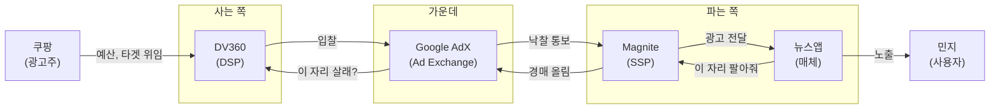

민지가 뉴스앱을 엽니다. 기사와 기사 사이에 320×100 크기의 빈 배너 한 칸이 잠깐 보이는데 이 칸이 광고로 채워지기까지 **약 0.1초**가 걸립니다. 눈을 한 번 깜빡이기도 전에 끝나는 시간입니다.

그 0.1초 동안 광고주(예: 쿠팡)와 민지의 화면 사이에는 **중개인 세 곳**이 끼어듭니다. 바로 DSP 와 SSP, 광고 거래소(Ad Exchange)입니다. 이름은 낯설지만 세 곳이 맡은 일은 단순합니다.

이 글은 세 중개인이 각각 무슨 일을 하는지 실제 회사 이름과 함께 설명하고 그 0.1초 동안 데이터가 오가는 순서를 가상의 시간표로 다시 구성한 뒤, 광고주가 낸 돈 ₩1,000 가운데 매체(뉴스앱처럼 광고 자리를 파는 곳)에 얼마가 도착하는지 직접 계산해 봅니다.

> 한 줄 요약: SSP 는 매체 편에서 광고 자리를 파는 대리인, DSP 는 광고주 편에서 광고 자리를 사는 대리인, 광고 거래소는 두 대리인의 주문이 만나 낙찰이 정해지는 경매장입니다. 이 세 역할을 서로 다른 회사가 맡기 때문에 돈이 회사 사이를 넘어갈 때마다 수수료로 한 번씩 깎입니다. 이 글이 정한 예시 요율로 계산하면 광고주가 낸 ₩1,000 가운데 매체에 도착하는 돈은 ₩544 입니다.

---

## 1. SSP, DSP, 광고 거래소가 하는 일

**광고 한 칸을 사고파는 데에는 파는 쪽 대리인과 사는 쪽 대리인, 그리고 두 대리인의 주문이 만나는 경매장이 따로따로 있습니다.**

세 이름이 한꺼번에 나와 낯설다면 누가 누구의 주문을 받는지부터 보면 됩니다. 매체(뉴스앱)는 「이 빈자리 좀 팔아 줘」 하며 광고 자리를 **SSP** 에 맡깁니다. 광고주(쿠팡)는 「좋은 자리 좀 사 줘」 하며 예산과 타겟(광고를 보여 줄 사람의 조건)을 **DSP** 에 맡깁니다.

두 주문은 노출(광고가 화면에 한 번 뜨는 일) 한 건마다 실시간으로 만나고 그 자리에서 낙찰(경매에서 이긴 쪽이 그 자리를 사 가는 것)이 정해집니다. 이렇게 두 주문이 만나는 곳이 **광고 거래소(Ad Exchange)** 입니다. 이 글은 표와 코드를 비롯해 여러 곳에서 광고 거래소를 줄여 Exchange 라고도 적습니다.

이 경매는 광고 지면(광고가 들어갈 자리)이 열릴 때마다 사람이 아니라 소프트웨어가 자동으로 진행합니다.

그래서 세 곳의 관계를 억지로 외우지 않아도 됩니다. **판다(SSP), 산다(DSP), 만난다(Exchange)**, 이 세 낱말이면 충분합니다. 2절부터 4절까지 세 곳을 하나씩 자세히 봅니다.

---

## 2. SSP — 파는 쪽(매체)의 판매 대리인

**SSP(Supply-Side Platform)는 매체 편에 서서 매체의 광고 자리를 가장 높은 값에 팔아 주는 판매 대리인입니다.** 광고 자리를 시장에 내놓는 쪽이 매체라서 매체 편 플랫폼의 이름에는 Demand(수요)가 아니라 Supply(공급)가 붙습니다.

뉴스앱이나 유튜브 같은 매체에는 팔아야 할 광고 자리(지면)가 넘쳐나는데 그 자리를 살 광고주는 수천 곳이라 매체가 광고주 한 곳 한 곳과 직접 계약하고 단가를 협상할 수는 없습니다. SSP 는 이 일을 매체 대신 맡아 매체의 재고(인벤토리, 매체가 팔 수 있는 광고 자리 전체)를 모두 받아 거래소 경매에 올리고 가장 비싸게 사겠다는 쪽에 팝니다.

SSP 가 실제로 하는 일은 세 가지입니다.

- **바닥값(Floor Price)을 정합니다.** 바닥값은 「이 값 밑으로는 팔지 않는다」는 최저선입니다.
- **여러 거래소에 동시에 연결합니다(헤더비딩).** 헤더비딩(Header Bidding)은 같은 광고 자리를 여러 곳에 한꺼번에 내놓아 동시에 값을 받는 방식입니다. 거래소 한 곳에만 팔면 그 거래소가 부르는 값에 묶일 수밖에 없으므로 여러 거래소에 동시에 내놓아 서로 경쟁하게 만듭니다.
- **저품질 광고와 부적절한 광고를 걸러냅니다.** 아무리 비싼 값을 부른 광고라도 매체의 브랜드를 해친다면 막아야 합니다.

이 역할을 실제로 맡은 회사는 Google Ad Manager, Magnite, PubMatic, OpenX 입니다. 국내에서는 카카오 애드핏이 매체 수익화 도구(매체가 자기 지면으로 돈을 벌도록 돕는 도구)로 비슷한 역할을 합니다.

이 가운데 **Google Ad Manager** 는 줄여서 **GAM** 이라고 부릅니다. GAM 은 매체가 자기 지면의 광고 자리를 등록해 두고 운영하는 도구로, 광고주와 직접 계약해 판 광고와 경매로 파는 광고를 한 화면에서 함께 관리합니다. 안에 구글의 광고 거래소인 AdX 가 들어 있어 GAM 하나가 SSP 와 거래소를 겸합니다. 예전 이름은 DFP 였습니다. GAM 은 개념의 이름이 아니라 제품의 이름이라 「SSP 가 무엇인가」를 설명하는 자리에서 GAM 이라고 줄여 쓰면 처음 듣는 사람은 알아듣기 어렵습니다.

이 회사들은 모두 **매체 편**이라 광고주가 돈을 얼마나 더 쓰는지에는 관심이 없고 매체가 얼마를 더 받았는지로 평가받습니다.

---

## 3. DSP — 사는 쪽(광고주)의 구매 대리인

**DSP(Demand-Side Platform)는 광고주 편에 서서 좋은 자리를 대신 자동으로 사들이는 구매 대리인이라 2절의 SSP 와 정확히 반대편에 섭니다.** 광고 자리를 사려는 쪽이 광고주라서 광고주 편 플랫폼의 이름에는 Demand(수요)가 붙습니다.

광고주(쿠팡 등)에게는 규모가 문제입니다. 같은 순간에도 전 세계에서 수많은 경매가 동시에 열려 사람이 경매마다 「이 자리를 살까 말까」를 판단할 수 없습니다. 그래서 DSP 는 광고주의 예산과 타겟, 목표(예: 광고비 1원당 매출을 뜻하는 ROAS)를 미리 입력받아 두고 그 기준에 맞는 경매에만 자동으로 입찰합니다.

DSP 안에서 실제로 돌아가는 일은 네 가지입니다.

- **타겟팅**: 이 광고를 누구에게 보여 줄지 정합니다([타겟팅 기초](post.html?id=targeting-basics)).
- **입찰가 산정**: 이 사람이 이 광고를 누를 확률을 예측하고 그 값으로 이 자리에 얼마를 부를지 매깁니다. 이 예측값을 pCTR(predicted Click-Through Rate, 예측 클릭률)이라고 부릅니다.
- **예산 배분(Pacing)**: 하루 예산이 오전에 몰리지 않도록 하루 동안 고르게 나눠 씁니다.
- **Bid Shading**: 내가 매긴 가치보다 살짝 낮춰 부릅니다.

pCTR 을 어떻게 예측하는지는 [pCTR](post.html?id=pctr-prediction) 글이, 얼마나 낮춰 부르는지는 [Bid Shading](post.html?id=bid-shading-censored) 글이 따로 깊게 다룹니다.

실제 DSP 회사로는 Google DV360, The Trade Desk(TTD), Criteo, Amazon DSP 가 있습니다. 국내에서 광고주 입장에서 쓰는 DSP 성격의 도구로는 네이버 GFA 와 카카오모먼트가 있습니다. **광고주가 직접 들어가 쓰는 화면이 DSP** 라고 기억해 두면 뒤의 13절에 모은 헷갈리는 점들을 정리하기가 쉬워집니다.

---

## 4. 광고 거래소 — 가운데 경매장

**광고 거래소는 SSP(팔 사람)와 DSP(살 사람)가 만나는 중립 시장으로, 광고 노출이 1건 생길 때마다 그 자리에서 바로 실시간 경매가 열립니다.** 이렇게 노출 한 건마다 여는 경매를 실시간 경매, RTB(Real-Time Bidding)라고 부릅니다.

중립 시장이 따로 필요한 까닭은 연결의 수에 있습니다. 파는 쪽 수천 곳과 사는 쪽 수천 곳이 서로 1:1 로 연결을 맺으면 관리해야 할 접점이 감당할 수 없을 만큼 늘어나므로 거래소가 가운데에서 표준 규격인 OpenRTB(입찰을 묻고 답하는 메시지의 형식을 정한 공개 규격)로 양쪽을 한 번에 매칭해 줍니다. 그래서 SSP 는 거래소 한 곳에만 연결해도 사실상 대부분의 DSP 에 재고를 보여 줄 수 있습니다.

Exchange 는 짧은 시간 안에 여러 DSP 에게 「이 자리 살래?」 하고 요청을 보낸 뒤 들어온 입찰 가운데 가장 높은 값을 낙찰시킵니다. 이긴 쪽이 실제로 얼마를 내는지는 경매 방식에 따라 다릅니다. 1등가 경매에서는 이긴 쪽이 자기가 부른 값을 그대로 내고 2등가 경매에서는 2등이 부른 값에 맞춰 냅니다. 방식에 따라 내는 값이 왜 달라지는지는 [2등 가격 경매](post.html?id=second-price-auction) 글에서 따로 다룹니다.

실제 거래소 회사로는 Google AdX, Magnite, OpenX, Index Exchange 가 있습니다. 이 가운데 Google AdX 는 2018년 무렵 Google Ad Manager 브랜드로 통합되었습니다. Exchange 는 **낙찰을 정하는 자리**이며 SSP 와 DSP 어느 편도 들지 않습니다.

:::deep 더 깊이 — 광고 네트워크(Ad Network)와 광고 거래소의 차이
광고 네트워크와 광고 거래소는 이름도 비슷하고 겉으로 하는 일도 비슷해 보여서 초심자가 가장 자주 헷갈리는 쌍 가운데 하나입니다. 그래도 원래 두 곳은 **재고를 누가 소유하느냐**가 다른, 서로 다른 사업 모델이었습니다.

두 모델 가운데 먼저 나온 **광고 네트워크**는 작은 매체 여러 곳의 남는 자리를 모두 사들여 재고로 쌓아 두고 그 자리들을 묶어 광고주에게 되팝니다. 네트워크가 재고를 직접 떠안으므로 못 팔면 네트워크가 손해를 봅니다. 대신 매체는 자리가 팔릴지 안 팔릴지 걱정할 필요가 없었습니다.

**광고 거래소**는 그 반대입니다. 재고를 사서 쌓아 두지 않고 실시간 경매가 열리는 장을 마련해 낙찰만 정하므로 재고 위험(자리를 못 팔았을 때 손해를 보는 위험)은 여전히 매체(정확히는 SSP 를 거쳐 파는 매체)가 집니다.

그런데 실무에서는 두 모델의 경계가 많이 흐려졌습니다. Google 의 광고 상품군은 네트워크로 출발했지만 지금은 거래소 기능(AdX)까지 한 회사 브랜드 안에 들어 있습니다. Magnite, PubMatic 같은 회사도 재고를 사들이는 거래와 실시간 경매 중개를 함께 합니다. 게다가 헤더비딩이 널리 퍼지면서 지면 하나를 여러 거래소와 네트워크에 동시에 내놓는 방식이 표준이 되었습니다. 그래서 요즘은 「이 회사가 네트워크인가 거래소인가」보다 「이 거래에서 재고 위험을 누가 지는가」를 물어야 실제 구조에 더 가까이 갑니다.
:::

---

## 5. 한 장면으로 본 0.1초 — 요청부터 노출까지

**민지가 뉴스앱을 켠 순간부터 광고가 화면에 뜰 때까지 데이터는 정확히 아래 순서로 오갑니다.** 2~4절의 회사 이름을 넣어 한 장면으로 다시 구성하면 쿠팡은 DSP 인 DV360 에 예산과 타겟을 맡기고 뉴스앱은 SSP 인 Magnite 에 광고 자리를 맡기며 경매는 Google AdX 에서 열립니다.



그림은 누가 누구와 연결되는지만 보여 주므로 화살표 하나하나에서 무엇이 오가고 시간이 얼마나 쌓이는지는 아래 표로 따라갑니다. 표의 시간은 실제로 측정한 값이 아니라 자릿수 감을 잡으려고 가정한 가상의 타임라인입니다.

| 단계 | 누가 → 누구에게 | 무엇을 보냄 | 누적 시간(ms) |
|---|---|---|---|
| 1 | 사용자 → 매체 | 뉴스앱 페이지 요청 | 0 |
| 2 | 매체 → SSP | 지면 정보 + 바닥값(₩800) | 5 |
| 3 | SSP → Exchange | 경매 등록 요청 | 10 |
| 4 | Exchange → DSP 여러 곳 | Bid Request(지면, 사용자 세그먼트, 바닥값) | 15 |
| 5 | DSP들 → Exchange | pCTR 계산 후 Bid Response(입찰가) | 65 |
| 6 | Exchange (내부) | 최고가 비교 + 2등가 계산 | 75 |
| 7 | Exchange → SSP | 낙찰 통보(낙찰자 + 낙찰가 ₩1,150) | 80 |
| 8 | SSP → 매체 → 사용자 | 광고 크리에이티브 전달 + 렌더링 | 100 |

표는 위에서 아래로 시간이 흐릅니다. 민지의 페이지 요청(0ms)이 매체와 SSP 를 거쳐 10ms 에 Exchange 의 경매로 등록되고 15ms 에 Exchange 가 DSP 여러 곳에 Bid Request 를 보냅니다. Bid Request 는 Exchange 가 보내는 입찰 요청으로, 표의 괄호대로 지면 정보와 사용자 세그먼트(비슷한 특성으로 모은 사용자 그룹)와 바닥값을 담습니다. DSP 가 입찰가를 담아 돌려주는 답은 Bid Response(입찰 응답)입니다. 응답이 모인 뒤에는 Exchange 가 낙찰자를 정해 80ms 에 SSP 에 알립니다. 마지막으로 SSP 가 광고 크리에이티브(이미지나 문구 같은 광고 소재)를 매체에 넘기고 매체가 그 광고를 민지의 화면에 렌더링(화면에 그리는 일)하면 100ms 가 됩니다.

표에서는 5번째 줄을 가장 눈여겨봅니다. 요청이 4번째 줄의 15ms 에 나가고 응답이 5번째 줄의 65ms 에 모이니 전체 **100ms 의 절반인 50ms(15ms→65ms)** 가 DSP 들의 응답을 기다리는 데 쓰입니다. 이 50ms 는 DSP 마다 「이 사람이 이 광고를 누를 확률」(3절의 pCTR)을 계산하는 데 걸리는 시간입니다. 나머지 단계의 시간은 대부분 네트워크 왕복과 비교, 통보에 들어갑니다.

7번째 줄의 낙찰가 ₩1,150 에도 설명이 필요합니다. 예를 들어 DV360 이 ₩1,200 을 불러 이겼다고 해 봅니다. 2등가 규칙이라면 낙찰자는 자기가 부른 값을 다 내지 않으므로 DV360 은 ₩1,200 이 아니라 2등 입찰가에 맞춘 **₩1,150** 만 냅니다. 이 결정은 6번째 줄, Exchange 안에서 최고가를 비교하고 2등가를 계산할 때 일어납니다.

4번째 줄과 5번째 줄을 함께 보면 DSP 가 여러 곳인데도 시간이 크게 늘지 않는데, Exchange 가 DSP 들에게 요청을 **동시에(병렬로)** 보내기 때문입니다. 한 곳씩 차례로 물었다면 100ms 는 어림도 없었습니다. 요청을 동시에 보내는 구조가 있어서 이 속도가 나옵니다.

이 병렬 경매는 직접 눌러 보면 감이 더 잘 옵니다. 아래 데모에서 바닥값(데모 화면의 Floor Price)을 올리거나 경매 방식을 1등가와 2등가 사이에서 바꿔 보며 DSP 들의 입찰가가 실시간으로 어떻게 움직이는지 확인합니다.

<div class="demo-embed-wrap">
<iframe class="demo-embed" src="demo-rtb.html?embed=1" height="560" loading="lazy" title="RTB 경매 미니 데모"></iframe>
<a class="demo-embed-open" href="demo-rtb.html" target="_blank" rel="noopener">↗ 전체 데모로 열기</a>
</div>

---

## 6. 100ms 안에 끝내야 하는 이유

**사람은 0.1초 안팎의 지연은 잘 느끼지 못하지만 그보다 길어지면 화면이 버벅인다고 느끼므로 광고를 골라 화면에 띄우는 일은 이 시간 안에 끝나야 합니다.** 광고를 골라 화면에 띄우는 이 일을 광고 서빙이라고 부릅니다. 광고 서빙을 100ms 안에 끝내야 하는 까닭은 두 가지입니다. 첫째는 방금 본 사람의 체감 속도입니다.

둘째 까닭은 돈입니다. 광고 자리 하나에 쓰는 시간이 길어질수록 그 사이에 사용자가 페이지를 떠날 수도 있고 광고가 뜨지 않은 채로 스크롤해 지나칠 수도 있는데, 그러면 매체는 팔 수 있었던 자리 하나를 그냥 잃습니다. 그래서 거의 모든 Exchange 가 **콜아웃 타임아웃**이라는 시간 제한을 둡니다. 콜아웃(callout)은 Exchange 가 DSP 들에게 입찰 요청을 보내는 일입니다. 콜아웃 타임아웃은 그 응답을 기다려 주는 최대 시간이라 이 시간 안에 응답하지 못한 DSP 는 자동으로 탈락합니다.

이 타임아웃 값은 회사마다, 지면마다 달라서 공개된 숫자 하나로 못 박기 어렵고 업계에서는 대략 수십~수백 ms 사이로 폭넓게 알려져 있습니다. 5절 표에서 DSP 응답에 배정한 50ms 도 이 폭 안에 있는 예시일 뿐이고 특정 회사에서 측정한 값이 아닙니다.

이 시간 예산(광고 한 건을 처리하는 데 쓸 수 있는 시간)은 **DSP 하나하나가 아니라 DSP 전체에 똑같이 걸립니다**. 어떤 DSP 의 pCTR 모델이 아무리 정교해도 타임아웃 안에 응답을 내놓지 못하면 그 정교함은 쓸모가 없습니다. 그래서 DSP 엔지니어링에서는 요청을 받고 응답을 돌려주기까지 걸리는 시간인 **응답 지연(latency)** 을 모델 정확도 못지않게 무겁게 다룹니다.

---

## 7. 수수료(Take Rate) — 광고주의 ₩1,000, 매체에 도착하는 몫

**광고주가 낸 돈은 DSP, Exchange, SSP 를 거치는 동안 단계마다 조금씩 깎입니다. 이렇게 깎이는 비율을 모두 합친 것을 take rate 라고 부릅니다.** take rate 가 낮을수록 광고주가 낸 돈이 매체에 더 많이 도착합니다.

SSP 도 DSP 도 Exchange 도 수익이 있어야 운영되는 회사라 중간에서 수수료를 떼는 일 자체는 당연합니다. 다만 이 수수료는 **한눈에 보이지 않습니다**. 광고주는 「₩1,000 을 썼다」는 사실만 알고 매체는 「얼마를 받았다」는 사실만 압니다. 그 사이 몇 단계에서 얼마씩 떼였는지는 각 거래의 계약 당사자만 압니다.

이렇게 불투명하다 보니 업계 바깥에서 돈이 실제로 얼마나 새는지 추적하려는 조사가 여러 차례 있었습니다. 자주 인용되는 예는 영국 광고주협회(ISBA)가 PwC 와 함께 2020년 무렵 진행한 프로그래매틱 공급망 조사입니다. 프로그래매틱(programmatic)은 1절에서 본 것처럼 소프트웨어가 자동으로 광고를 사고파는 방식을, 공급망은 광고주의 돈이 여러 중개 회사를 거쳐 매체에 닿기까지의 경로를 말합니다. 미국의 ANA(전미광고주협회)도 비슷한 문제의식으로 여러 조사를 해 왔습니다.

이런 조사들은 대체로 「광고주가 쓴 돈 가운데 매체에 도착하는 몫은 대략 절반 안팎」이라는 쪽으로 결론을 냅니다. 다만 조사마다 방법론과 표본이 달라 실제로 인용되는 비율은 문헌에 따라 40%대부터 60%대까지 폭이 큽니다. 이 비율은 정확한 업계 표준값이라기보다 **「생각보다 많이 샌다」는 방향으로 읽는 편이 안전합니다**.

아래 표는 이 구조를 이해하려고 만든 예시 계산입니다. 단계마다 붙은 수수료율은 이 글이 임의로 정한 예시 수치이고 실제 어느 회사의 공개 요율도 아닙니다.

| 단계 | 누가 떼어가나 | 이 단계 수수료율(예시) | 남는 금액 |
|---|---|---|---|
| 0 | 광고주 지출 | — | ₩1,000 |
| 1 | DSP 수수료 | 20% | ₩800 |
| 2 | Exchange 수수료 | 15% | ₩680 |
| 3 | SSP 수수료 | 20% | ₩544 |
| 4 | 매체 실수령 | — | **₩544** |

표는 위에서 아래로 읽습니다. 광고주가 쓴 ₩1,000 에서 DSP 가 20% 를 떼면 ₩800 이 남습니다. Exchange 는 처음 ₩1,000 이 아니라 남은 ₩800 에서 15% 를 떼므로 ₩680 이 남고 SSP 가 그 ₩680 에서 다시 20% 를 떼면 매체에 도착하는 돈은 **₩544** 입니다.

단계마다 붙은 요율과 달리 처음 지출 대비 실제로 사라진 비율을 실효(effective) take rate 라고 합니다. 이 예시에서는 ₩1,000 가운데 ₩544 만 매체에 도착하므로 실효 take rate 는 (₩1,000 − ₩544) ÷ ₩1,000 = **45.6%** 입니다. 세 번의 수수료가 남은 금액에 차례로 곱해져 쌓이므로 단계마다 15~20% 로 크지 않아 보여도 세 단계를 지나면 절반 가까이가 사라집니다. 다음 절에서는 이 계산을 파이썬 함수로 만들어 중개 단계가 늘거나 줄 때 이 숫자가 어떻게 움직이는지 봅니다.

---

## 8. 파이썬으로 계산한 매체 몫과 take rate

**take rate 구조는 결국 비율을 몇 번 곱하느냐의 문제라 코드로 만들어 두면 중개 단계가 늘거나 줄 때 매체 몫이 어떻게 바뀌는지 바로 비교할 수 있습니다.**

아래 코드는 표준 라이브러리만으로 7절 표와 같은 예시 수수료율(20%, 15%, 20%)을 넣어 먼저 표의 숫자를 검산한 뒤 중개 단계를 하나 추가하거나 뺀 경우와 비교합니다.

코드는 주석에 적은 대로 세 단계로 나뉩니다. 1단계의 `take_home` 은 단계마다 남은 금액에 (1 − 수수료율)을 곱해 다음 단계로 넘기면서 단계별 잔액을 `trail` 리스트에 차례로 남깁니다. `effective_take_rate` 는 7절의 실효 take rate 처럼 광고주 지출 대비 중간에서 사라진 비율을 계산합니다. 2단계는 7절 표와 같은 중개 세 곳(DSP 20%, Exchange 15%, SSP 20%)을 거친 잔액을 찍습니다. 3단계는 리셀러(남의 재고를 받아 다시 파는 중개 회사)가 하나 끼어 중개가 4곳이 되는 경우와 Exchange 를 빼고 PMP(Private Marketplace, 비공개 시장)로 직거래해 중개가 2곳이 되는 경우를 기본 3단계와 비교합니다.

```python
# 하는 일: 광고주가 쓴 1,000원이 중개 몇 곳을 거쳐 매체에 얼마로 도착하는지 계산한다.

# 1단계: 지출과 수수료를 떼는 함수를 둔다
# 중개마다 남은 금액에서 자기 몫을 떼고 넘긴다. 수수료율은 이 글에서 쓰는 예시값이고, 특정 회사의 공개 요율이 아니다.
SPEND = 1_000  # 광고주가 이 노출 1건에 쓴 돈(원)

def take_home(spend, fee_rates):
    """각 단계가 '남은 금액'에서 fee_rate만큼 뗀 뒤 다음 단계로 넘긴다.
    반환값: (매체가 최종적으로 받는 금액, 단계별 잔액 리스트)."""
    remaining = spend
    trail = [remaining]
    for rate in fee_rates:
        remaining *= (1 - rate)
        trail.append(remaining)
    return remaining, trail

def effective_take_rate(spend, publisher_revenue):
    # 광고주 지출 대비, 중간에서 사라진 비율
    return (spend - publisher_revenue) / spend

# 2단계: 중개 세 곳을 거친 잔액을 찍는다
# DSP 20%, Exchange 15%, SSP 20% 는 예시 수치다.
base_rates = [0.20, 0.15, 0.20]
publisher_revenue, trail = take_home(SPEND, base_rates)

print("기본 3단계 검산")
for step, amount in enumerate(trail):
    print(f"  단계 {step}   잔액 {amount:8,.0f}원")
print(f"실효 take rate {effective_take_rate(SPEND, publisher_revenue):.1%}")

# 3단계: 중개 수를 바꿔 비교한다
# 리셀러가 하나 끼어 넷이 되거나, Exchange 를 빼고 PMP 로 직거래해 둘이 되는 경우다.
scenarios = {
    "기본 3단계(DSP, Exchange, SSP)": [0.20, 0.15, 0.20],
    "리셀러 추가 4단계(+10%p 단계)": [0.20, 0.15, 0.10, 0.20],
    "Exchange 생략 2단계(PMP 직거래)": [0.20, 0.20],
}

print()
print("중개 단계별 비교")
for name, rates in scenarios.items():
    revenue, _ = take_home(SPEND, rates)
    rate = effective_take_rate(SPEND, revenue)
    print(f"  {name:<28} 매체 실수령 {revenue:6,.0f}원   take rate {rate:5.1%}")

# 출력:
# 2단계 뜻: 남은 돈에서 차례로 떼니 1,000원이 800원, 680원을 거쳐 544원이 된다. 중간에서 45.6% 가 사라진다.
# 기본 3단계 검산
#   단계 0   잔액    1,000원
#   단계 1   잔액      800원
#   단계 2   잔액      680원
#   단계 3   잔액      544원
# 실효 take rate 45.6%
# 3단계 뜻: 리셀러가 끼면 매체 몫이 490원으로 줄고, Exchange 를 빼면 640원으로 늘어난다. 중개가 하나 늘 때마다 take rate 가 오른다.
#
# 중개 단계별 비교
#   기본 3단계(DSP, Exchange, SSP)   매체 실수령    544원   take rate 45.6%
#   리셀러 추가 4단계(+10%p 단계)         매체 실수령    490원   take rate 51.0%
#   Exchange 생략 2단계(PMP 직거래)     매체 실수령    640원   take rate 36.0%
```

2단계 출력은 잔액이 단계 0 의 1,000원에서 800원, 680원을 거쳐 단계 3 의 544원이 되고 실효 take rate 가 45.6% 로 찍혀 7절 표의 계산과 똑같습니다.

3단계 출력에서는 리셀러가 하나 끼자 매체 실수령이 ₩544 에서 ₩490 으로 줄고 take rate 는 45.6% 에서 51.0% 로 올랐는데, 코드가 Exchange 와 SSP 사이에 10% 를 떼는 단계를 하나 끼워 넣어 ₩680 이 SSP 에 닿기 전에 한 번 더 깎이기 때문입니다. 반대로 Exchange 를 건너뛰는 **PMP 직거래**로 Exchange 의 15% 단계가 빠지면 매체 몫은 ₩640 까지 오르고 take rate 는 36.0% 로 내려갑니다. 출력 위의 「3단계 뜻」 주석이 말하듯 중개가 하나 늘 때마다 take rate 가 오르므로 중개 단계 하나하나가 곧 돈입니다.

이 코드에서는 `trail` 을 눈여겨봅니다. 단계마다 잔액을 리스트로 남겨 두면 몇 번째 단계에서 얼마가 빠졌는지 나중에 그대로 추적할 수 있으므로 실무에서 이 구조를 그대로 로그로 남겨 두면 광고주가 「내 돈이 어디서 새는지」 물을 때 답할 수 있는 최소한의 근거가 됩니다.

---

## 9. 서로 다른 회사로 나뉜 세 역할 [무대: 열린 RTB]

**SSP, Exchange, DSP 가 서로 다른 회사라서 계약도 수수료도 데이터도 회사 경계를 넘을 때마다 끊깁니다. 회사가 이렇게 나뉘어 있으니 7절의 take rate 도 여러 단계로 쌓입니다.**

이렇게 서로 다른 회사들이 공개 규격으로 연결되어 실시간 경매를 하는 시장을 열린 RTB 라고 부릅니다. Magnite 도 The Trade Desk 도 Google 과는 다른 독립된 회사라 거래 하나마다 별도의 계약과 별도의 수수료율이 붙습니다.

이 여러 회사는 4절에서 본 **OpenRTB** 라는 공개 규격으로 연결됩니다. OpenRTB 는 5절 표의 Bid Request 와 Bid Response 형식을 표준으로 정해 두어서 Magnite 가 올린 경매에 DV360 도 TTD 도 똑같은 방식으로 응답할 수 있습니다.

회사가 나뉘어 있으면 수수료가 여러 번 쌓일 뿐 아니라 **아무도 전체를 다 보지 못합니다**. 광고주는 자기가 낸 돈이 어느 SSP 를 거쳤는지 다 알기 어렵습니다. 매체 쪽에서도 자기 지면을 어느 DSP 가 얼마에 사 갔는지 낱낱이 확인하기 어렵습니다.

최근 몇 년 사이에 생긴 `ads.txt` 와 `sellers.json` 같은 공급망 투명성 규격은 이 구조적인 불투명함을 조금이라도 줄이려는 시도입니다. `ads.txt` 는 매체가 자기 지면을 팔아도 되는 회사를 적어 공개하는 파일이고 `sellers.json` 은 SSP 나 거래소가 자기를 거쳐 파는 판매자를 적어 공개하는 파일입니다.

열린 RTB 의 「깨끗한 3분할」(파는 쪽, 중개, 사는 쪽)은 그 자체로 장점이면서 비용입니다. 회사마다 자기 일에 전문화할 수 있다는 장점과 회사 경계를 넘을 때마다 수수료와 불투명함이 쌓인다는 비용이 함께 옵니다.

---

## 10. 담장 안에서 보이지 않는 경계 [무대: 닫힌 생태계]

**네이버와 카카오에서는 매체, SSP, Exchange, DSP 가 모두 한 회사 안에 있으므로 회사 사이의 경계 자체가 없습니다. 회사가 나뉘어 있어야 생기는 계약과 수수료 단계도 함께 사라집니다.**

이렇게 한 회사가 모든 역할을 안에 둔 구조를 닫힌 생태계, 또는 담장 안이라고 부릅니다. 네이버 안에서 벌어지는 광고 거래를 따라가 보면 지면(네이버 서비스 화면)도, 그 자리를 경매에 올리는 로직도, 낙찰을 정하는 로직도 모두 네이버가 운영합니다. 네이버의 광고주가 손에 쥐는 도구는 **네이버 GFA** 하나뿐입니다. 카카오도 마찬가지로 지면과 매칭 로직을 모두 갖추고 있습니다. 카카오의 광고주는 **카카오모먼트**만 씁니다.

그래서 GFA 와 카카오모먼트는 겉모습은 DSP 와 비슷해도 9절에서 본 회사 사이의 경계가 없습니다. 광고주 눈에는 「사는 쪽 도구」 하나만 보입니다. SSP 수수료와 Exchange 수수료가 각각 몇 % 인지 같은 7절의 단계별 구조도 광고주에게는 아예 노출되지 않습니다. 그 몫은 모두 네이버나 카카오라는 한 회사 안에서 나누는 내부 배분일 뿐입니다.

담장 안이 나쁘다는 뜻은 아닙니다. 오히려 담장 안에서는 조인(서로 다른 데이터를 같은 키로 맞붙이는 일)이 깨끗해서 좋은 점도 많습니다. 다만 수수료를 단계별로 나눠 보는 이 글의 관점에서는 담장 안을 다르게 봐야 합니다. **닫힌 생태계는 단계별로 나눠 볼 수 있는 대상이 아니라** 한 회사가 매기는 하나의 가격일 뿐입니다.

---

## 11. 한눈 비교표

**세 역할을 한 표에 놓으면 SSP 는 파는 쪽, DSP 는 사는 쪽, Exchange 는 어느 쪽도 아닌 가운데에 서 있다는 점이 또렷해집니다.**

표는 「누구 편」 열부터 읽습니다. 이름 첫 글자의 D(Demand, 수요)와 S(Supply, 공급)가 그대로 편을 알려 주어 **D 로 시작하면 광고주 편, S 로 시작하면 매체 편**입니다. 이 구분에 익숙해지면 처음 보는 약어를 만나도 이름만 보고 어느 편인지 대략 짐작할 수 있습니다.

다만 실무의 경계는 표처럼 깔끔하지 않습니다. Magnite 와 PubMatic 은 SSP 이면서 Exchange 기능도 함께 운영해서 한 회사가 표의 두 줄에 걸쳐 있습니다. 4절의 심화 상자(광고 네트워크와 광고 거래소의 차이)에서 본 대로 이런 겹침은 「재고 위험을 누가 지는가」라는 질문으로 풀어야 실제 구조가 보입니다.

| 역할 | 누구 편 | 하는 일 | 실제 예시 | 왜 필요한가 |
|---|---|---|---|---|
| **SSP** | 매체(파는 쪽) | 지면을 모아 경매에 올려 가장 비싸게 판다 | Google Ad Manager, Magnite, PubMatic, 카카오 애드핏 | 매체가 수천 광고주와 직접 거래 못 함 |
| **DSP** | 광고주(사는 쪽) | 예산, 타겟을 받아 여러 경매에 자동 입찰 | DV360, The Trade Desk, Criteo, 네이버 GFA, 카카오모먼트 | 광고주가 수많은 경매를 못 쫓음 |
| **광고 거래소** | 중립(가운데) | 실시간 경매로 양쪽을 매칭, 낙찰 결정 | Google AdX, Magnite, OpenX, Index Exchange | 양쪽이 만날 중립 시장이 필요 |

---

## 12. 한눈 정리

**이 글에 나온 숫자만 다시 모은 표입니다. 개념 하나하나보다 숫자가 서로 어떻게 이어지는지에 더 무게를 두고 읽습니다.**

| 개념 | 뜻 | 이 글에서 본 숫자 | 핵심 |
|---|---|---|---|
| **SSP** | 매체의 판매 대리인 | 바닥값 예시 ₩800 | 파는 쪽 편 |
| **DSP** | 광고주의 구매 대리인 | 입찰 예시 ₩1,200 → 낙찰가 ₩1,150(2등가) | 사는 쪽 편 |
| **광고 거래소** | 중립 경매장 | 8단계 누적 **100ms** | 병렬 요청이라 가능한 속도 |
| **DSP 응답 시간** | 콜아웃 타임아웃 | 8단계 중 50ms(15→65ms) 소모 | 정확도 못지않게 중요한 지표 |
| **Take rate** | 중간에서 사라지는 몫 | 예시 계산 **45.6%**(₩1,000 → ₩544) | 단계 수만큼 곱으로 쌓임 |
| **단계 수의 효과** | 중개 하나 늘고 줄 때 | 4단계 51.0% / 2단계(PMP) 36.0% | 단계 = 곧 돈 |
| **업계 조사 인용치** | ISBA, ANA류 조사 | "대략 절반 안팎", 문헌마다 40%대~60%대 | 정밀한 값이 아니라 방향성으로 읽기 |

이 표에서 숫자 하나만 기억한다면 광고주가 낸 돈의 절반 가까이가 중간 세 단계에서 사라진다는 뜻의 **45.6%** 를 고릅니다. 다만 45.6% 는 이 글이 정한 예시 요율(20%, 15%, 20%)에서 나온 결과일 뿐입니다. 실제 계약서의 요율은 회사마다 다르고 대개 공개되지 않습니다.

0.1초의 속도와 45.6% 의 수수료는 같은 구조에서 함께 나온 두 결과입니다. **회사가 여러 곳으로 나뉘어 있어야 서로 경쟁하고 경쟁이 있어야 속도와 가격이 맞춰집니다.** 그 대신 회사가 나뉜 만큼 수수료 단계와 데이터 경계도 늘어납니다. 9, 10절에서 본 열린 RTB 와 닫힌 생태계의 차이는 결국 이 트레이드오프(한쪽을 얻으면 다른 쪽을 내주는 관계)의 두 극단입니다.

---

## 13. 헷갈리기 쉬운 점

- **DSP 는 광고주 편, SSP 는 매체 편입니다.** 알파벳 D 와 S 가 그대로 편을 알려 주므로 D=Demand(수요=광고주), S=Supply(공급=매체)로 외우면 헷갈리지 않습니다.
- **SSP 와 광고 거래소의 경계는 실무에서 흐려져 있습니다.** Magnite 와 PubMatic 은 SSP 이면서 Exchange 역할도 겸합니다. 그래서 회사 이름표보다 「재고 위험을 누가 지는가」를 물어야 합니다.
- **DSP ≠ 광고 네트워크.** 광고 네트워크는 재고를 사들여 되파는 쪽이고 DSP 는 경매가 열릴 때마다 한 건씩 자동으로 입찰합니다. DSP 와 광고 네트워크는 등장한 시기도 재고를 다루는 방식도 다릅니다.
- **담장 안에서는 이 세 역할이 보이지 않습니다.** 네이버 GFA 와 카카오모먼트는 광고주에게 「사는 쪽 도구」 하나로만 보이고 SSP 와 Exchange 에 해당하는 몫은 회사 안에 묻힙니다.
- **이 글의 take rate 숫자(45.6%)는 업계 표준값이 아닙니다.** 예시 요율로 계산한 결과일 뿐이며 실제 조사들은 40%대부터 60%대까지 폭넓게 다른 숫자를 보고합니다.

---

## 더 깊이 보기

- Ad Network와 Ad Exchange, 역사, 아키텍처까지 더 깊이 → [Ad Network vs Ad Exchange](post.html?id=ad-network-vs-exchange)
- 요청부터 노출까지 기술 상세 → [광고 서빙 플로우](post.html?id=ad-serving-flow)
- DSP는 왜 입찰가를 살짝 낮춰 부를까(Bid Shading) → [Bid Shading](post.html?id=bid-shading-censored)
- 이겨도 왜 2등 값만 낼까(2등가 경매) → [2등 가격 경매](post.html?id=second-price-auction)
- 경매 방식을 직접 눌러보며 배우기 → [RTB 경매 데모](demo-rtb.html)
- 처음이라면, 그림으로 먼저 → [쉬운 버전 '광고가 뜨기까지'](ecosystem-easy.html#rtb)
- 약어가 헷갈리면 → [쉬운 용어 사전](ecosystem-terms.html)
- 광고 ML 전체 지도에서 이 글의 위치 → [ML 엔지니어 트랙](ml-track.html)
