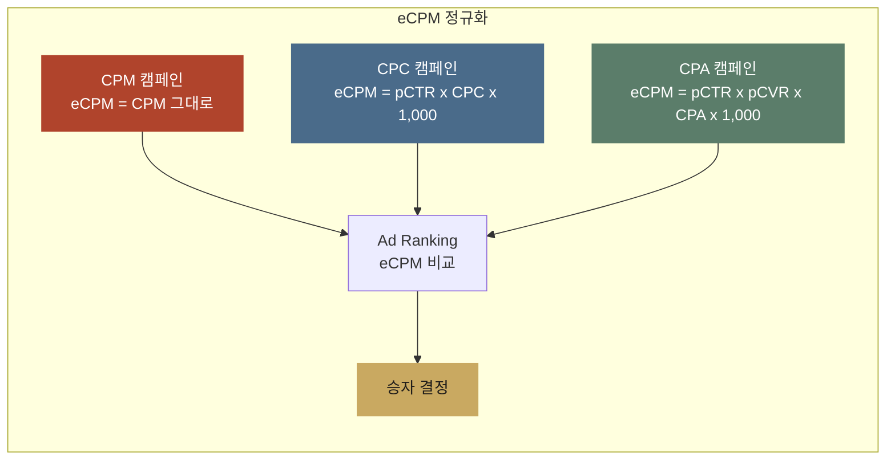
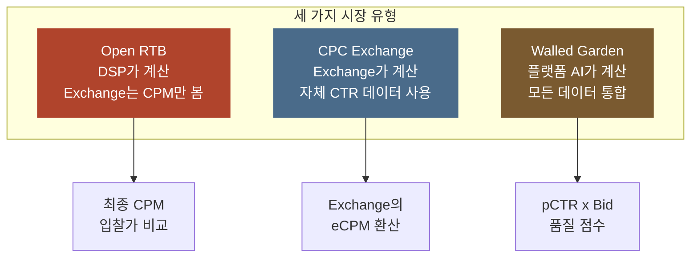
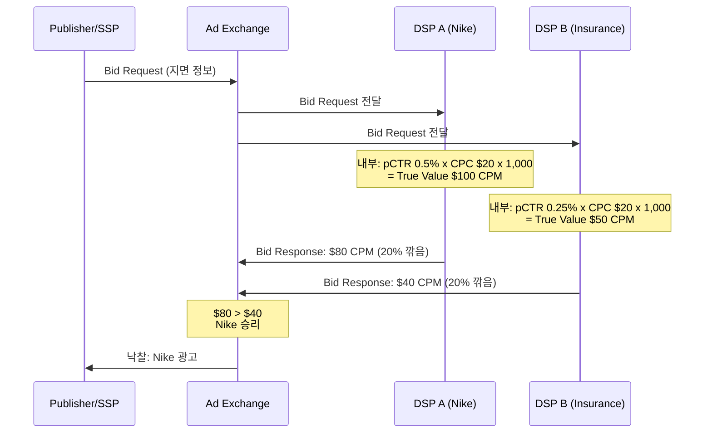
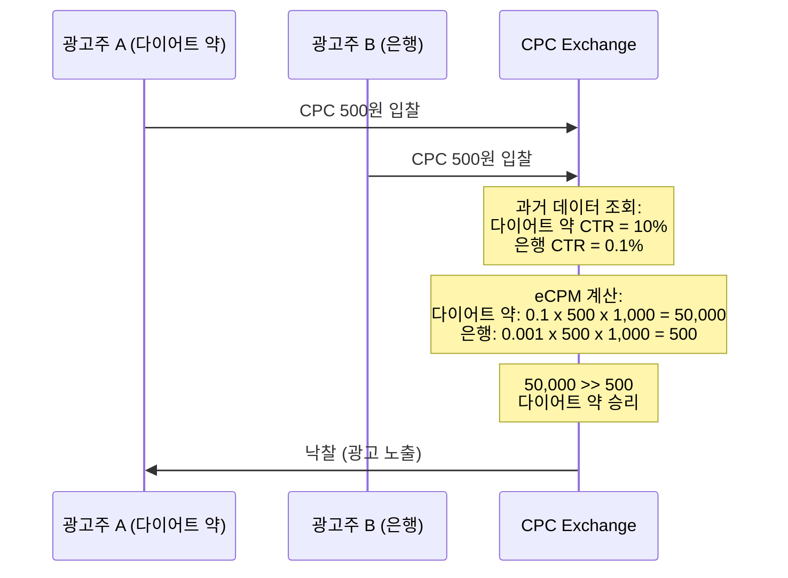

광고 경매에서 1등은 단순히 돈을 많이 낸 순서대로 정해지지 않고 경매가 열리는 시장의 유형에 따라 전혀 다른 기준으로 정해집니다. 이 글은 먼저 eCPM(광고를 1,000번 노출했을 때 기대되는 수익)의 정의와 계산법을 정리한 다음, 시장 세 곳에서 랭킹(광고 후보에 순위를 매기는 일)이 어떻게 달라지는지 비교합니다. 세 시장은 여러 회사가 광고 자리를 실시간 경매(RTB, Real-Time Bidding)로 사고파는 열린 RTB(Open RTB), 입찰을 클릭당 금액으로 받는 거래소인 CPC Exchange, 플랫폼 한 곳이 광고를 사는 쪽과 파는 쪽과 경매를 모두 맡는 닫힌 생태계(Walled Garden)입니다.

---

## 1. eCPM 의 정의와 공식

**eCPM 은 광고 하나를 1,000번 노출했을 때 플랫폼이 기대할 수 있는 수익이며 광고 플랫폼은 돈을 내는 방식이 서로 다른 캠페인을 이 값 하나로 비교합니다.**

광고주는 캠페인(입찰 조건과 예산을 정해 등록한 광고 단위)마다 무엇에 돈을 낼지 정하는데, 이 방식을 과금 모델이라고 부릅니다. 이 글에는 과금 모델이 세 가지 나옵니다. CPM(Cost Per Mille)은 노출(광고가 화면에 한 번 보이는 것) 1,000번마다, CPC(Cost Per Click)는 클릭 한 번마다, CPA(Cost Per Action)는 전환 한 번마다 정한 금액을 내는 방식입니다. 전환은 광고를 본 유저가 구매나 가입처럼 광고주가 바라는 행동까지 하는 것을 말합니다. 세 과금 모델의 금액은 노출, 클릭, 전환이라는 서로 다른 단위에 붙어 있어 금액만 보고는 어느 캠페인이 플랫폼에 돈을 더 많이 벌어 주는지 알 수 없는데, eCPM(effective Cost Per Mille)은 이런 캠페인들을 하나의 기준으로 비교하려고 광고 플랫폼이 쓰는 1,000회 노출당 기대 수익입니다.

### CPC 캠페인의 기본 공식

CPC 로 돈을 내는 캠페인에서는 노출 한 번에 클릭이 나올 확률에 클릭 한 번의 금액을 곱한 값이 노출 한 번의 기대 수익이므로, 여기에 1,000 을 곱해 노출 1,000번 단위로 바꾼 값이 eCPM 입니다.

$$eCPM = pCTR \times CPC \times 1{,}000$$

pCTR(predicted Click-Through Rate)은 예측 클릭률로, 광고를 한 번 보여 줬을 때 클릭이 일어날 확률을 모델이 미리 예측한 값이며 0.01 이면 1% 를 뜻합니다. CPC 는 클릭 한 번에 광고주가 내는 클릭당 비용입니다. 식 끝의 1,000 은 Mille, 즉 1,000회 노출 단위로 환산하기 위한 상수입니다. 세 값을 곱한 eCPM 을 말로 풀면 「이 광고를 1,000번 노출했을 때 플랫폼이 벌 수 있는 기대 수익」이 됩니다.

### CPA 과금으로 넓힌 공식

CPA 과금에서는 전환이 일어나야 돈을 내므로 노출에서 클릭을 거쳐 전환까지 가는 확률을 차례로 모두 곱합니다.

$$eCPM = pCTR \times pCVR \times CPA \times 1{,}000$$

pCVR(predicted Conversion Rate)은 예측 전환율로, 클릭한 사람이 전환까지 할 확률을 모델이 예측한 값입니다. 식의 CPA 는 전환 한 번에 내는 전환당 비용을 가리킵니다. pCTR 이 2%, pCVR 이 5%, CPA 가 10,000원인 캠페인을 예로 들어 계산하면 다음과 같습니다.

$$eCPM = 0.02 \times 0.05 \times 10{,}000 \times 1{,}000 = 10{,}000\text{원}$$

노출 1,000번이면 2% 인 20번이 클릭되고 그 20번 가운데 5% 인 1번이 전환된다고 예측되는데, 전환 1번마다 10,000원을 받으므로 이 캠페인이 1,000회 노출에서 플랫폼에 벌어 줄 것으로 기대되는 수익은 약 10,000원입니다.

### "effective" 의 뜻

eCPM 의 "e" 는 effective 의 머리글자로 「실질적」이라는 뜻입니다. 실제로는 CPM 으로 돈을 내지 않는 캠페인도 CPM 과 같은 단위로 환산했다는 표시라서, CPC 캠페인이든 CPA 캠페인이든 eCPM 이라는 공통 기준으로 바꾸면 서로 비교할 수 있습니다.

> DSP 는 광고주를 대신해 경매에 입찰하는 시스템입니다. DSP 안에서 광고 후보에 순위를 매기는 Ad Ranking 단계는 노출 한 번이 광고주에게 얼마의 가치인지를 참 가치(True Value)로 계산하는데, eCPM 은 그 계산의 중심에 있습니다. eCPM 이 광고 시스템 전체 파이프라인의 어디에 놓이는지는 [광고 기술 생태계 전체 지도](post.html?id=adtech-ecosystem-map)에서 확인할 수 있습니다.

---

## 2. CPM 과 eCPM 의 차이 — 사후 측정과 사전 예측

**CPM 은 캠페인이 끝난 뒤 실제로 쓴 돈과 실제 노출 수로 계산하는 값이고 eCPM 은 노출을 결정하기 전에 pCTR 예측과 입찰가로 계산하는 값이라서, 노출하기 전에 정하는 광고 랭킹은 eCPM 을 기준으로 삼습니다.**

CPM 과 eCPM 은 이름이 비슷해도 본질부터 다른 지표입니다. 가장 큰 차이는 계산하는 시점입니다. 여기서 CPM 은 실제 지출로 계산하는 실적 지표이고 3절에서 CPM 캠페인이 미리 정해 내는 CPM 입찰가와는 다릅니다. 아래 표는 두 지표를 여섯 항목으로 나란히 놓습니다.

| 구분 | CPM | eCPM |
|------|-----|------|
| **정식 명칭** | Cost Per Mille | effective Cost Per Mille |
| **계산 시점** | 사후 (캠페인 종료 후) | 사전 (노출 결정 전) |
| **공식** | $\frac{\text{실제 지출}}{\text{실제 노출 수}} \times 1{,}000$ | $pCTR \times CPC \times 1{,}000$ |
| **성격** | 후행 지표 (backward-looking) | 선행 지표 (forward-looking) |
| **용도** | 캠페인 성과 리포팅, 매체 수익 분석 | 실시간 광고 랭킹, 입찰 의사결정 |
| **데이터 요구** | 실제 발생한 비용과 노출 | pCTR 모델 예측값 + 입찰가 |

CPM 은 실제로 쓴 돈을 실제 노출 수로 나누고 1,000 을 곱한 값이라 캠페인이 끝나야 계산할 수 있는 후행 지표(backward-looking, 지나간 결과를 돌아보는 지표)이며 캠페인 성과 리포트나 매체(광고 자리를 파는 앱이나 사이트)의 수익 분석에 쓰입니다. 반면 eCPM 은 pCTR 모델의 예측값과 입찰가(광고주가 경매에 써내는 금액)만 있으면 노출을 결정하기 전에 계산할 수 있는 선행 지표(forward-looking, 앞으로의 결과를 내다보는 지표)라서 실시간 광고 랭킹과 입찰 결정에 쓰입니다.

### 랭킹을 정하는 시점과 두 지표

광고 시스템은 노출이 일어나기 전에 어떤 광고를 보여 줄지 순위를 정합니다. 그 순간에는 아직 노출이 없어 「실제 CPM」을 계산할 수 없으므로 앞으로 생길 수익을 예측하는 eCPM 이 랭킹의 기준이 됩니다.

캠페인 A 와 B 의 값으로 두 지표를 나란히 계산해 보겠습니다.

| 지표 | 캠페인 A | 캠페인 B |
|------|---------|---------|
| 과금 모델 | CPC | CPC |
| CPC 입찰가 | 500원 | 1,000원 |
| pCTR (예측) | 4% | 1% |
| **eCPM** | $0.04 \times 500 \times 1{,}000 = $ **20,000원** | $0.01 \times 1{,}000 \times 1{,}000 = $ **10,000원** |
| 캠페인 종료 후 실제 CTR | 3.5% | 1.2% |
| **실제 CPM (사후)** | $0.035 \times 500 \times 1{,}000 = $ **17,500원** | $0.012 \times 1{,}000 \times 1{,}000 = $ **12,000원** |

캠페인 A 는 CPC 입찰가 500원에 pCTR 이 4% 라서 eCPM 이 0.04 × 500 × 1,000 = 20,000원입니다. 캠페인 B 는 입찰가가 1,000원으로 A 보다 높은데도 pCTR 이 1% 라서 eCPM 이 10,000원에 그치므로 eCPM 기준으로는 A 가 이깁니다(20,000 > 10,000).

캠페인이 끝난 뒤 측정한 실제 CTR(노출 가운데 실제로 클릭된 비율)은 A 가 3.5%, B 가 1.2% 였습니다. 실제 CTR 에 같은 입찰가와 1,000 을 곱한 실제 CPM 은 A 가 17,500원, B 가 12,000원으로 사후에도 A 가 더 높았습니다(17,500 > 12,000). 다만 pCTR 예측(A 는 4%)과 실제 CTR(A 는 3.5%) 사이에는 늘 오차가 있어서 A 의 eCPM 20,000원과 실제 CPM 17,500원처럼 두 값이 정확히 같지는 않습니다. eCPM 이 얼마나 정확한지는 pCTR 모델의 예측 정확도에 직접 달려 있습니다.

---

## 3. 과금 모델이 다른 캠페인의 정규화

**CPM, CPC, CPA 캠페인이 같은 광고 자리를 두고 경쟁할 때는 모든 캠페인을 eCPM 으로 바꿔 「1,000회 노출당 플랫폼 기대 수익」이라는 한 단위로 비교합니다. 이 글의 예시에서는 eCPM 이 150,000원인 CPA 캠페인 C 가 이깁니다.**

현실의 광고 거래소(Ad Exchange)에서는 CPM, CPC, CPA 로 과금하는 캠페인이 같은 지면(광고가 실리는 자리)을 놓고 동시에 경쟁합니다. 광고 거래소는 광고 자리를 놓고 경매를 여는 곳으로 이 글에서는 줄여서 Exchange 라고 부릅니다. 입찰 금액이 노출 1,000번, 클릭 한 번, 전환 한 번처럼 서로 다른 단위에 붙어 있어 금액끼리 크기를 그대로 비교하면 공정하지 않으므로 모든 캠페인을 eCPM 으로 바꿔 같은 단위로 맞춥니다. 이렇게 단위가 다른 값을 한 단위로 맞추는 일을 정규화라고 부릅니다.

### 세 캠페인의 경쟁 예시

같은 지면에 CPM 캠페인 A, CPC 캠페인 B, CPA 캠페인 C 가 들어왔다고 놓고 세 캠페인의 eCPM 을 계산하면 아래 표와 같습니다.

| 캠페인 | 과금 모델 | 입찰 정보 | pCTR | pCVR | eCPM 계산 | eCPM |
|--------|----------|----------|------|------|-----------|------|
| A | CPM | CPM 8,000원 | - | - | CPM 그대로 사용 | **8,000원** |
| B | CPC | CPC 2,000원 | 5% | - | $0.05 \times 2{,}000 \times 1{,}000$ | **100,000원** |
| C | CPA | CPA 50,000원 | 3% | 10% | $0.03 \times 0.1 \times 50{,}000 \times 1{,}000$ | **150,000원** |

A 는 처음부터 노출 1,000번에 8,000원을 내는 CPM 입찰이라 eCPM 도 8,000원 그대로입니다. B 는 pCTR 5% 에 CPC 2,000원이라 0.05 × 2,000 × 1,000 = 100,000원이 나옵니다. C 는 노출 1,000번에서 pCTR 3% 인 30번이 클릭되고 그중 pCVR 10% 인 3번이 전환되며 전환마다 50,000원을 받으므로 0.03 × 0.1 × 50,000 × 1,000 = 150,000원이 되어 승자는 CPA 캠페인 C 입니다.

CPA 과금은 전환이 실제로 일어나야만 비용을 청구하므로 광고주 입장에서 50,000원은 「비싸 보이는」 금액이지만 플랫폼 입장에서 기대 수익으로 환산하면 세 캠페인 가운데 가장 높은 값입니다.

### 수식으로 정리한 정규화 과정

아래 그림은 과금 모델마다 eCPM 을 구하는 식과 그 eCPM 을 Ad Ranking 단계에서 비교해 승자를 정하는 흐름을 보여 줍니다.



세 식은 모두 결과를 「1,000회 노출당 플랫폼 기대 수익」이라는 같은 단위로 내놓기 때문에 이 정규화로 공정하게 비교할 수 있습니다. 과금 모델이 무엇이든 플랫폼은 기대 수익이 가장 높은 광고를 고릅니다.

같은 계산을 코드로 옮겨 과금 방식에 따라 eCPM 을 구하는 함수 하나로 세 캠페인을 한 지면에서 비교해 봅니다.

```python
# 하는 일: 과금 방식이 다른 캠페인 셋(CPM, CPC, CPA)의 입찰을 eCPM 으로 바꿔 한 지면에서 비교한다.
# 1단계: 과금 방식별 eCPM 함수를 만든다
# eCPM 은 1,000회 노출당 기대 수익이다. CPC 는 클릭 확률을, CPA 는 전환 확률까지 곱해 같은 단위로 맞춘다.
def compute_ecpm(bid_type, bid, pCTR=None, pCVR=None):
    """과금 모델별 eCPM 정규화: 1,000회 노출당 기대 수익"""
    if bid_type == "CPM":
        return bid                            # CPM은 그대로
    elif bid_type == "CPC":
        return pCTR * bid * 1000              # 클릭 확률 × CPC × 1000
    elif bid_type == "CPA":
        return pCTR * pCVR * bid * 1000       # 클릭 × 전환 확률 × CPA × 1000
    raise ValueError(f"Unknown: {bid_type}")

# 2단계: 세 캠페인을 같은 지면에서 비교한다
campaigns = [
    {"name": "캠페인A(CPM)", "type": "CPM", "bid": 8000},
    {"name": "캠페인B(CPC)", "type": "CPC", "bid": 2000, "pCTR": 0.05},
    {"name": "캠페인C(CPA)", "type": "CPA", "bid": 50000,
     "pCTR": 0.03, "pCVR": 0.10},
]

results = []
for c in campaigns:
    ecpm = compute_ecpm(c["type"], c["bid"], c.get("pCTR"), c.get("pCVR"))
    results.append((c["name"], ecpm))
    print(f"  {c['name']}: eCPM = {ecpm:,.0f}원")

winner = max(results, key=lambda x: x[1])
print(f"\n  승자: {winner[0]} (eCPM {winner[1]:,.0f}원)")

# 출력:
# 2단계 뜻: eCPM 으로 바꾸면 A 는 8,000원, B 는 100,000원, C 는 150,000원이라 CPA 캠페인 C 가 이긴다. 과금 모델이 달라도 eCPM 으로 공정하게 비교할 수 있다.
#   캠페인A(CPM): eCPM = 8,000원
#   캠페인B(CPC): eCPM = 100,000원
#   캠페인C(CPA): eCPM = 150,000원
#
#   승자: 캠페인C(CPA) (eCPM 150,000원)
```

코드는 캠페인A(CPM) 8,000원, 캠페인B(CPC) 100,000원, 캠페인C(CPA) 150,000원을 찍고 승자로 캠페인C(CPA)를 골라 위 표와 같은 결과를 냅니다. 이 비교의 결과는 pCTR 과 pCVR 모델이 얼마나 정확한지에 달려 있습니다. 모델이 클릭률을 실제보다 높게 예측하면(과대예측) eCPM 이 커져 그 광고는 실제 수익에 맞는 순위보다 높은 순위를 받습니다. 높은 자리에 노출되어도 클릭이 일어나지 않아 수익이 기대에 못 미치므로(6절 ①) 이 오류는 플랫폼 매출 손실로 이어집니다.

---

## 4. 세 가지 시장에서 1등을 정하는 방식

**eCPM 이라는 개념은 세 시장에서 같지만 누가 eCPM 을 계산하고 어떤 데이터를 쓰는지는 시장마다 완전히 달라서, 같은 광고 두 개를 두고도 시장에 따라 1등이 바뀔 수 있습니다.**

1절부터 3절까지는 eCPM 을 계산하는 공식을 다뤘습니다. 실제 시장에서는 그 계산을 DSP 가 하기도 하고 경매를 여는 Exchange 나 플랫폼이 하기도 합니다. 계산에 쓰는 데이터도 시장마다 다릅니다. 아래 그림은 세 시장에서 누가 eCPM 을 계산하는지와 마지막에 무엇을 비교하는지를 나란히 보여 줍니다.



그림대로 열린 RTB 에서는 DSP 가 eCPM 을 계산할 뿐 Exchange 는 최종 CPM 입찰가만 봅니다. CPC Exchange 에서는 Exchange 가 자체 CTR 데이터로 eCPM 을 환산합니다. 닫힌 생태계에서는 플랫폼의 AI 모델이 모든 데이터를 합쳐 pCTR × Bid 로 품질 점수를 매깁니다. 세 시장을 4.1 부터 4.3 까지 차례로 봅니다.

### 4.1 최종 CPM 입찰가로 정하는 열린 RTB [무대: 열린 RTB]

**열린 RTB 에서 Exchange 는 DSP 마다 내는 최종 CPM 입찰가 하나만 비교할 뿐, 그 입찰가 뒤에 있는 pCTR 과 참 가치 계산은 볼 수 없습니다.**

열린 RTB 에서 각 DSP 는 자기 pCTR 모델로 노출의 참 가치를 계산한 뒤 그 값을 그대로 내지 않고 Bid Shading(참 가치보다 낮춰 입찰하는 전략) 같은 방법으로 낮춘 CPM 입찰가를 Exchange 에 냅니다. Exchange 는 이렇게 들어온 최종 CPM 입찰가만 보므로 DSP 안에서 pCTR 을 어떻게 계산했는지도, 참 가치를 어떻게 냈는지도 알 수 없습니다.

아래 그림은 Nike 광고를 내는 DSP A 와 보험(Insurance) 광고를 내는 DSP B 가 같은 지면에 입찰하는 순서를 보여 줍니다.



매체나 SSP(매체를 대신해 광고 자리를 파는 시스템)가 지면 정보를 담은 입찰 요청(Bid Request)을 Exchange 에 보내면 Exchange 는 그 요청을 두 DSP 에 전달합니다. DSP A 는 내부에서 pCTR 0.5% 에 CPC `$20` 과 1,000 을 곱해 참 가치를 CPM `$100` 으로, DSP B 는 pCTR 0.25% 로 CPM `$50` 으로 계산합니다. 두 DSP 는 각자 참 가치에서 20% 를 깎은 `$80` 과 `$40` 을 입찰 응답(Bid Response)으로 보냅니다. Exchange 는 `$80` 이 `$40` 보다 크므로 Nike 의 승리로 정하고 매체에 Nike 광고의 낙찰(경매에서 이겨 광고를 내보낼 권리를 얻는 것)을 알립니다.

같은 경매를 표로 놓으면 이렇습니다.

| 항목 | DSP A (Nike) | DSP B (Insurance) |
|------|-------------|-------------------|
| 내부 pCTR 예측 | 0.5% | 0.25% |
| CPC 입찰가 | `$20` | `$20` |
| 내부 eCPM 계산 | `0.005 x $20 x 1,000 = $100` | `0.0025 x $20 x 1,000 = $50` |
| Exchange에 제출하는 CPM 입찰가 | `$80` (Bid Shading 으로 20% 깎음) | `$40` (Bid Shading 으로 20% 깎음) |
| Exchange가 보는 값 | `$80 CPM` | `$40 CPM` |
| **결과** | **승리** | 패배 |

표에서 Exchange 는 「Exchange가 보는 값」 줄의 `$80 CPM` 과 `$40 CPM` 두 값만 비교합니다. 그 위 줄에 있는 pCTR 예측과 내부 eCPM 계산은 DSP 안에서만 일어나 Exchange 에게 보이지 않습니다. 또 DSP 는 [Bid Shading](post.html?id=bid-shading-censored) 같은 전략으로 참 가치보다 낮게 입찰하므로 DSP 가 낸 CPM 입찰가 `$80` 은 DSP 안에서 계산한 eCPM `$100` 과 다릅니다.

이 구조에서 위험은 DSP 의 pCTR 모델에 있습니다. 모델이 부정확하면 DSP 는 노출의 가치를 잘못 매긴 입찰가를 내는데, 과대예측하면 가치보다 비싸게 입찰해(과다입찰) 손해를 보고 반대로 실제보다 낮게 예측하면(과소예측) 이길 수 있었던 경매를 놓치는 기회손실이 생깁니다.

열린 RTB 에서는 이 위험이 DSP 한 곳의 문제로 끝나지 않습니다. Exchange 는 DSP 마다 낸 최종 CPM 입찰가 하나만 보지만 그 숫자 뒤에는 회사마다 다른 pCTR 모델과 참 가치 계산법과 Bid Shading 전략이 겹겹이 쌓여 있습니다. 같은 지면에 DSP 다섯 곳이 입찰하면 서로 다른 랭킹 기준 다섯 개가 동시에 작동합니다. Exchange 도 광고주도 각 DSP 안의 계산 로직을 들여다볼 수 없어서 「왜 이 광고가 이겼는가」의 답은 이긴 DSP 만 압니다. 시장 전체로 보면 최종 결과는 여러 겹의 블랙박스(안의 계산이 밖에서 보이지 않는 장치)를 지나 나온 값입니다.

### 4.2 Exchange 가 과거 데이터로 eCPM 을 환산하는 CPC Exchange

**CPC Exchange 에서는 입찰자가 클릭당 금액만 내면 Exchange 가 자기가 쌓아 둔 과거 노출과 클릭 데이터로 eCPM 을 환산하므로, 같은 CPC 를 내도 Exchange 의 기록에서 CTR 이 높은 광고가 이깁니다.**

CPC Exchange 에서 광고주는 클릭 한 번에 낼 CPC 금액만 입찰합니다. 입찰을 받은 다음 단계는 열린 RTB 와 결정적으로 다릅니다. 이 시장에서는 eCPM 환산을 Exchange 가 자체 데이터로 합니다. Exchange 는 광고마다 과거 노출과 클릭 기록을 쌓아 두고 있으므로 그 기록에서 얻은 자체 CTR 추정치를 씁니다.

아래 예시에서는 광고주 A(다이어트 약)와 광고주 B(은행)가 똑같이 CPC 500원을 입찰합니다.



Exchange 는 과거 데이터에서 다이어트 약 광고의 CTR 10% 와 은행 광고의 CTR 0.1% 를 찾아 eCPM 을 다이어트 약은 0.1 × 500 × 1,000 = 50,000 으로, 은행은 0.001 × 500 × 1,000 = 500 으로 계산합니다. 50,000 이 500 보다 훨씬 크므로 Exchange 는 다이어트 약 광고를 낙찰시켜 노출합니다.

표로 옮기면 다음과 같습니다.

| 항목 | 광고주 A (다이어트 약) | 광고주 B (은행) |
|------|---------------------|----------------|
| CPC 입찰가 | 500원 | 500원 |
| Exchange의 과거 CTR 데이터 | **10%** | **0.1%** |
| Exchange의 eCPM 계산 | $0.1 \times 500 \times 1{,}000 = $ **50,000원** | $0.001 \times 500 \times 1{,}000 = $ **500원** |
| **결과** | **승리** | 패배 |

Exchange 의 기록에서 다이어트 약 광고의 클릭률(10%)이 은행 광고(0.1%)보다 100배 높으므로 두 광고주가 똑같이 CPC 500원을 입찰해도 eCPM 은 50,000원과 500원으로 100배 차이가 납니다. 플랫폼이 기대할 수 있는 수익도 그만큼 다이어트 약 광고가 압도적으로 큽니다.

이처럼 CPC Exchange 에서는 Exchange 가 쌓아 둔 과거 CTR 기록이 순위를 정하므로, 광고주가 높은 CPC 를 입찰해도 Exchange 의 데이터에서 그 광고의 CTR 이 낮다고 판단하면 순위가 밀릴 수 있습니다. 클릭률이 높은 소재(광고에 쓰는 이미지나 문구)를 만들수록 같은 CPC 로도 더 많은 노출을 얻으므로 광고주에게는 광고 품질을 개선할 동기가 생깁니다.

### 4.3 플랫폼 AI 모델이 모든 것을 평가하는 닫힌 생태계 [무대: 닫힌 생태계]

**닫힌 생태계에서는 플랫폼이 자체 pCTR 모델의 예측값을 광고주의 입찰가에 곱한 Ranking Score 로 순위를 정하므로, 이 글의 예시에서는 떡볶이집이 입찰가를 3배 높게 써도 클릭 가능성이 10배 높게 예측된 파스타집에게 집니다.**

닫힌 생태계(네이버, 카카오, 구글, 메타 등)는 플랫폼 한 곳이 DSP 와 Exchange 와 Publisher(광고 자리를 가진 매체) 역할을 모두 겸하는 시장이라, 플랫폼은 유저 데이터부터 광고 성과 데이터까지 모든 정보를 쓸 수 있습니다. 이 플랫폼은 자체 pCTR 모델을 운영하며 광고주의 입찰가에 그 모델의 pCTR 예측값을 곱한 품질 반영 점수로 순위를 정하는데, 이 점수를 Ranking Score 라고 부릅니다.

$$\text{Ranking Score} = pCTR_{\text{platform}} \times \text{Bid}$$

식에서 platform 이 붙은 pCTR 은 플랫폼의 모델이 예측한 클릭 확률이고 Bid 는 광고주의 입찰가입니다. 음식점 검색 광고로 계산해 보겠습니다.

| 항목 | 광고주 A (파스타집) | 광고주 B (떡볶이집) |
|------|-------------------|-------------------|
| 입찰가 | 1,000원 | 3,000원 |
| 플랫폼 pCTR 예측 | **10%** | **1%** |
| Ranking Score | $0.1 \times 1{,}000 = $ **100** | $0.01 \times 3{,}000 = $ **30** |
| **결과** | **승리** | 패배 |

떡볶이집은 3,000원으로 파스타집(1,000원)보다 3배 높은 금액을 입찰했습니다. 그런데 플랫폼의 pCTR 모델이 파스타집의 클릭 가능성은 10%, 떡볶이집은 1% 로 예측해 파스타집을 10배 높게 보았습니다. 그래서 파스타집의 Ranking Score 0.1 × 1,000 = 100 이 떡볶이집의 0.01 × 3,000 = 30 보다 커 파스타집이 이깁니다. 이 구조는 다음 세 가지를 뜻합니다.

- **돈만으로는 1등이 되기 어렵습니다.** 플랫폼이 pCTR 로 품질이 낮다고 본 광고는 입찰가를 높게 써도 순위에서 밀릴 수 있습니다.
- **순위를 정하는 절대적 권한은 플랫폼의 pCTR 모델에 있습니다.** 광고주는 그 모델이 무엇을 기준으로 광고를 평가하는지 정확히 알 수 없습니다.
- **유저 경험을 보호하는 효과가 있습니다.** 유저가 관심이 없어 클릭률이 낮은 광고가 입찰가만 높게 써서 위쪽 자리에 노출되는 일을 막습니다.

4.1 의 열린 RTB 와 비교하면 닫힌 생태계에서는 구조가 정반대로 고정됩니다. pCTR 모델도, Ranking Score 공식도, 그 점수에 곱하는 보정 계수(점수를 조정하려고 추가로 곱하는 값, 6절 ③)도 모두 플랫폼 한 회사가 정하므로 이 랭킹 기준은 단순한 기술 선택이 아니라 사실상 정책이 됩니다. 플랫폼이 pCTR 가중치를 오늘 조금만 바꿔도 어느 업종이 유리해지는지가 전부 달라집니다. 열린 RTB 처럼 여러 회사의 기준이 겹쳐 결과가 흐려지는 구조가 아니라 단 하나의 기준이 시장 전체에 그대로 적용되는 구조입니다. 광고주에게는 그 기준을 미리 예측하거나 이의를 제기할 마땅한 방법이 없습니다.

> 닫힌 생태계가 어떻게 짜여 있고 열린 RTB 와 무엇이 다른지는 [닫힌 생태계 포스트](post.html?id=walled-garden)에서 더 깊이 다룹니다.

이제 4.1 부터 4.3 까지 본 세 시장의 랭킹 식에 같은 광고 두 개를 넣어 시장마다 누가 이기는지 코드로 비교합니다. A(고품질)는 CPC 1,000원에 pCTR 0.10, B(고입찰)는 CPC 3,000원에 pCTR 0.01 입니다. 열린 RTB 에서 Exchange 에 내는 최종 CPM 입찰가는 코드에서 A 는 8,000 으로, B 는 25,000 으로 정해져 있습니다.

```python
# 하는 일: 고품질 광고 A 와 고입찰 광고 B 를 세 시장 유형의 랭킹 식으로 점수 매겨, 누가 이기는지 비교한다.
def ranking_comparison():
    """세 시장 유형에서 동일 광고주의 랭킹 결과 비교"""
    ads = {
        "A(고품질)": {"cpc": 1000, "pCTR": 0.10, "cpm": 8000},
        "B(고입찰)": {"cpc": 3000, "pCTR": 0.01, "cpm": 25000},
    }
    markets = {
        "Open RTB":      lambda a: a["cpm"],                  # 입찰가만
        "CPC Exchange":  lambda a: a["pCTR"] * a["cpc"] * 1000,  # eCPM
        "Walled Garden": lambda a: a["pCTR"] * a["cpc"],      # pCTR × Bid
    }

    for market, score_fn in markets.items():
        scores = {name: score_fn(ad) for name, ad in ads.items()}
        winner = max(scores, key=scores.get)
        parts = "  ".join(f"{n}={s:,.0f}" + (" ← 승" if n == winner else "")
                         for n, s in scores.items())
        print(f"  {market:15s}: {parts}")

ranking_comparison()

# 출력:
# 뜻: 입찰가만 보는 Open RTB 에서는 고입찰 B 가 25,000 으로 이기고, pCTR 을 곱하는 CPC Exchange 와 Walled Garden 에서는 고품질 A 가 이긴다. 돈이 결정하느냐, 품질이 결정하느냐의 차이다.
#   Open RTB       : A(고품질)=8,000  B(고입찰)=25,000 ← 승
#   CPC Exchange   : A(고품질)=100,000 ← 승  B(고입찰)=30,000
#   Walled Garden  : A(고품질)=100 ← 승  B(고입찰)=30
```

찍힌 세 줄 가운데 입찰가만 보는 Open RTB 줄에서는 CPM 25,000 을 낸 고입찰 B 가 8,000 의 A 를 이깁니다. Open RTB 줄의 8,000 과 25,000 은 두 DSP 가 낸 입찰가를 가정한 값입니다. 4.1 처럼 DSP 가 eCPM 에서 20% 를 깎아 입찰하면 A 는 80,000, B 는 24,000 을 내 Open RTB 에서도 A 가 이깁니다. pCTR 을 곱하는 CPC Exchange 줄에서는 100,000 대 30,000 으로, Walled Garden 줄에서는 100 대 30 으로 고품질 A 가 이기는데, Walled Garden 식은 1,000 을 곱하지 않아 점수가 작게 나올 뿐 A 가 이기는 결과는 CPC Exchange 줄과 같습니다. 같은 두 광고인데도 시장에 따라 돈이 승자를 정하기도 하고 품질이 정하기도 합니다.

### 4.4 세 시장을 한 표로 비교

아래 표는 4.1 부터 4.3 까지 본 세 시장을 승자 결정 기준부터 주요 리스크까지 일곱 가지 항목으로 나란히 놓습니다.

| 비교 항목 | 열린 RTB | CPC Exchange | 닫힌 생태계 |
|----------|----------|-------------|---------------|
| **승자 결정 기준** | 최종 CPM 입찰가 | Exchange가 환산한 eCPM | 플랫폼 pCTR x Bid |
| **eCPM 계산 주체** | DSP (내부) | Exchange | 플랫폼 |
| **pCTR의 역할** | DSP 내부 의사결정 | Exchange의 과거 데이터 기반 | 플랫폼 AI 모델 기반 |
| **공정성 메커니즘** | 시장 경쟁 (복수 DSP) | Exchange 데이터 객관성 | 플랫폼 모델의 품질 평가 |
| **입찰자 투명성** | 높음 (DSP가 자체 모델 통제) | 중간 (Exchange 데이터 의존) | 낮음 (블랙박스 모델) |
| **품질 반영도** | 간접적 (DSP 판단) | 직접적 (CTR 기반 환산) | 직접적 (pCTR 가중) |
| **주요 리스크** | DSP pCTR 모델 오류 | Exchange 데이터 편향 | 플랫폼 모델 독점적 권한 |

열린 RTB 에서 오른쪽 두 시장으로 가면 Exchange 나 플랫폼이 CTR 을 점수에 직접 곱하므로 승자를 정할 때 「품질」의 비중이 커지고 「돈」만으로는 이기기 어려워집니다. 열린 RTB 에서는 DSP 가 알아서 pCTR 을 입찰가에 반영할 뿐 Exchange 가 그렇게 하라고 강제하지 않습니다. CPC Exchange 에서는 Exchange 가 직접 CTR 을 반영합니다. 닫힌 생태계에서는 입찰가에 pCTR 을 곱하는 일을 플랫폼이 직접 맡아 품질이 낮은 광고가 구조적으로 불리한 점수를 받습니다.

---

## 5. eCPM 최적화 — 플랫폼의 전략과 광고주의 전략

**eCPM 은 플랫폼과 광고주 모두에게 최적화 대상이지만 두 입장에서 최적화의 뜻이 다릅니다. 플랫폼에게는 pCTR 을 정확하게 예측해 매출을 올리는 일이고 광고주에게는 같은 예산으로 더 높은 순위를 얻는 일입니다.**

5.1 은 플랫폼의 전략을, 5.2 는 광고주의 전략을 봅니다.

### 5.1 플랫폼 관점 — 매출로 이어지는 pCTR 정확도

플랫폼의 총 수익은 노출마다 eCPM 을 1,000 으로 나눈 기대 수익을 모두 더한 값입니다.

$$\text{Revenue} = \sum_{i=1}^{N} \frac{eCPM_i}{1{,}000} = \sum_{i=1}^{N} pCTR_i \times Bid_i$$

식에서 i 는 노출 하나하나를, N 은 노출의 수를 가리킵니다. 노출마다 eCPM 이 pCTR 에 따라 달라지므로 pCTR 모델이 정확할수록 플랫폼은 다음 세 가지를 얻습니다.

1. **올바른 랭킹 결정.** 실제로 클릭될 광고가 위쪽 자리에 노출되므로 클릭에서 나오는 수익이 늘어납니다.
2. **과소예측 방지.** 가치가 높은 광고가 실제 가치보다 낮은 eCPM 을 받아 순위에서 밀리는 손실을 줄입니다.
3. **과대예측 방지.** 클릭되지 않을 광고가 위쪽 자리에 노출되어 수익 없이 지면만 쓰는 낭비를 막습니다.

아래 데모는 pCTR 모델의 편향(예측이 실제보다 몇 % 높거나 낮은지)을 슬라이더로 바꿔 가며 정확도가 매출에 실제로 얼마나 영향을 주는지 보여 줍니다.

<div class="demo-embed-wrap">
<iframe class="demo-embed" src="demo-pctr-impact.html?embed=1" height="560" loading="lazy" title="pCTR 정확도와 매출 영향 미니 데모"></iframe>
<a class="demo-embed-open" href="demo-pctr-impact.html" target="_blank" rel="noopener">↗ 전체 데모로 열기</a>
</div>

pCTR 예측과 eCPM 계산은 입찰 요청이 올 때마다 실시간으로 해야 하므로 아래 네 가지 요구사항을 맞춰야 합니다.

| 요구사항 | 수치 | 이유 |
|---------|------|------|
| 레이턴시 | 10ms 이내 | RTB 타임아웃 100ms 중 DSP 내부 처리(모델 추론 포함)에 할당 가능한 시간 |
| QPS | 수만~수십만 | 초당 처리해야 할 입찰 요청(Bid Request) 수 |
| 후보 수 | 수백 개/요청 | 하나의 지면에 경쟁하는 광고 후보 |
| 모델 갱신 | 일 1회 이상 | CTR 패턴 변화를 반영하기 위해 |

레이턴시는 요청을 받고 응답할 때까지 걸리는 시간이고 RTB 타임아웃은 경매가 응답을 기다려 주는 최대 시간입니다. RTB 타임아웃 100ms 가운데 모델 추론(학습한 모델로 예측값을 계산하는 일)을 포함한 DSP 내부 처리에 할당할 수 있는 시간이 10ms 이내라서 모델의 레이턴시도 그 안에 들어와야 합니다. QPS(Queries Per Second)는 초당 처리해야 하는 입찰 요청 수로 수만에서 수십만에 이릅니다. 요청 하나마다 그 지면을 두고 경쟁하는 광고 후보가 수백 개 있습니다. 모델은 CTR 패턴이 바뀌는 것을 반영하려고 하루에 한 번 이상 갱신합니다.

이 조건 안에서 pCTR 모델을 어떤 아키텍처로 만들고 어떻게 서빙(학습한 모델을 띄워 실시간 요청에 예측값을 돌려주는 일)할지는 따로 깊게 볼 주제라서 [모델 서빙 아키텍처 포스트](post.html?id=model-serving-architecture)에서 다룹니다.

### 5.2 광고주 관점 — 같은 예산으로 더 높은 랭킹

광고주 입장에서 eCPM 공식을 다시 보겠습니다.

$$eCPM = pCTR \times Bid \times 1{,}000$$

광고주가 eCPM 을 높이는 방법은 이 식에서 곱하는 값 가운데 입찰가(Bid)를 올리는 방법과 pCTR 을 올리는 방법 두 가지입니다.

**방법 1: 입찰가 인상**

입찰가를 올리는 방법은 가장 단순하지만 올린 만큼 비용도 선형으로 늘어나서 예산이 한정된 상황에서는 오래 쓸 수 있는 방법이 아닙니다.

**방법 2: pCTR 개선 (광고 품질 개선)**

pCTR 이 높아지면 입찰가를 올리지 않고도 eCPM 이 높아집니다. 2절의 두 캠페인이 그 예로, 캠페인 A 는 입찰가가 500원으로 B(1,000원)보다 낮았지만 pCTR 이 4% 로 B(1%)보다 높아서 eCPM 이 20,000원으로 B 의 10,000원보다 높았습니다. pCTR 을 올리는 구체적인 전략은 아래 표의 네 가지입니다.

| 전략 | 설명 | pCTR 영향 |
|------|------|----------|
| **소재 최적화** | A/B 테스트로 클릭률 높은 광고 소재 선별 | CTR 2~3배 차이 가능 |
| **타겟팅 정밀화** | 관심사 높은 유저에게만 노출 | 관련성 높은 유저 = 높은 CTR |
| **랜딩 페이지 개선** | 빠른 로딩, 명확한 CTA | 일부 플랫폼은 랜딩 품질도 반영 |
| **시간대/지면 최적화** | CTR이 높은 시간대와 지면에 집중 | 같은 소재도 맥락에 따라 CTR 변동 |

표의 A/B 테스트는 광고 소재 여러 개를 사람들에게 나눠 보여 주고 클릭률이 높은 소재를 고르는 실험을 말합니다. 랜딩 페이지는 광고를 클릭했을 때 열리는 페이지이고 CTA(Call To Action)는 구매나 가입 같은 다음 행동을 권하는 버튼이나 문구입니다.

광고주가 품질을 개선하면 「pCTR 상승 → 같은 입찰가로 더 높은 순위 → 더 많은 노출 → 플랫폼의 수익 증가」가 차례로 일어나므로 이 구조는 광고주와 플랫폼 양쪽 모두에게 이득입니다. 그래서 닫힌 생태계 플랫폼들은 「품질 점수」를 강조합니다.

---

## 6. eCPM 의 한계

**eCPM 은 광고 랭킹의 중심 지표이지만 만능은 아니어서 실무에서는 pCTR 예측 오류, 단기 수익 편향, 공정성, 클릭 너머의 가치라는 네 가지 한계를 마주합니다.**

아래 ①부터 ④까지가 그 한계이고 ⑤는 그중 ②와 ③을 숫자로 확인합니다.

### ① pCTR 예측 오류의 증폭

eCPM 은 pCTR 에 선형으로 비례하므로 pCTR 의 오류가 eCPM 의 오류로 그대로 전파됩니다. 입찰가가 1,000원일 때 세 가지 상황을 비교하면 다음과 같습니다.

| 상황 | pCTR 예측 | 실제 CTR | eCPM (Bid 1,000원) | 실제 가치 |
|------|----------|---------|-------------------|----------|
| 과대예측 | 5% | 1% | 50,000원 | 10,000원 |
| 정확 | 2% | 2% | 20,000원 | 20,000원 |
| 과소예측 | 0.5% | 2% | 5,000원 | 20,000원 |

과대예측 줄은 실제 CTR 이 1% 인 광고를 5% 로 예측한 경우라 eCPM 이 0.05 × 1,000 × 1,000 = 50,000원으로 계산되지만 실제 가치는 0.01 × 1,000 × 1,000 = 10,000원입니다. 과소예측 줄은 실제 CTR 2% 를 0.5% 로 낮게 예측해 eCPM 이 5,000원으로 실제 가치 20,000원보다 낮게 나옵니다. 과대예측된 광고가 1위를 차지하면 노출은 되어도 클릭이 일어나지 않으니 플랫폼이 거두는 수익은 기대보다 적습니다. 반대로 과소예측된 광고는 실제 가치가 높은데도 eCPM 이 낮게 나와 노출 기회를 잃습니다. 그래서 pCTR 모델에서는 Calibration(예측 확률과 실제 확률의 일치도)이 AUC(클릭할 광고를 클릭하지 않을 광고보다 높게 매기는 정도를 보는 지표)만큼 중요한 지표입니다.

### ② 단기 수익 편향 (Short-term Revenue Bias)

eCPM 은 지금 이 노출에서 바로 생기는 수익만 계산에 넣으므로 시간이 지나서야 나타나는 아래 세 가지 장기 가치는 담지 못합니다.

- **유저 LTV (Lifetime Value)**: 유저 한 사람이 오랜 기간 플랫폼에 주는 가치입니다. 지금은 클릭률이 낮더라도 길게 보면 그 유저의 가치가 높을 수 있습니다.
- **브랜드 광고의 가치**: 광고가 바로 클릭으로 이어지지 않아도 브랜드 인지도(사람들이 그 브랜드를 알아보는 정도)를 높이는 효과가 있습니다.
- **유저 이탈 리스크**: eCPM 이 높은 광고라도 유저 경험을 해치면 길게 보아 플랫폼 트래픽이 줄어듭니다.

### ③ 공정성 문제 (Fairness)

eCPM 만으로 순위를 순수하게 정하면 특정 광고주나 카테고리가 지면을 독점할 수 있습니다. 금융, 보험 광고처럼 전환 하나의 가치가 높아 eCPM 이 높게 나오는 경향이 있는 카테고리가 그런 예인데, 이런 광고가 지면을 차지하면 다음 세 가지 일이 생깁니다.

- 유저가 특정 카테고리의 광고만 되풀이해서 보게 됩니다.
- 중소 광고주에게는 진입 장벽(새로 들어와 경쟁하기 어려운 정도)이 높아집니다.
- 광고 다양성이 떨어져 길게 보면 유저 경험이 나빠집니다.

이런 문제 때문에 실무에서는 eCPM 에 보정 요소를 곱해 최종 점수(Final Score)를 만듭니다.

$$\text{Final Score} = eCPM \times \alpha_{\text{diversity}} \times \beta_{\text{pacing}} \times \gamma_{\text{policy}}$$

- $\alpha_{\text{diversity}}$ : 카테고리와 광고주가 고르게 섞이도록 맞추는 다양성 보정
- $\beta_{\text{pacing}}$ : 하루 예산을 하루 동안 고르게 나눠 쓰게 하는 예산 페이싱
- $\gamma_{\text{policy}}$ : 민감한 카테고리를 제한하는 것 같은 정책적 가중치

:::deep 더 깊이 — 랭킹 점수를 로그 공간에서 계산하는 까닭

③의 Final Score 는 eCPM 하나에 보정 계수 α, β, γ 세 개를 차례로 곱해 얻습니다. CPA 캠페인이라면 그 eCPM 부터가 pCTR × pCVR × CPA × 1,000 처럼 여러 항을 곱한 값입니다. 실무 랭킹 점수는 이처럼 확률과 계수 대여섯 개를 한 번에 곱해 넣는 경우가 흔합니다.

곱셈을 그대로 쌓으면 불편한 점이 두 가지 생깁니다. 첫째로 1 보다 작은 값을 여러 번 곱할수록 결과가 빠르게 0 에 가까워집니다. 곱하는 항이 아주 많아지면 결과가 부동소수점(컴퓨터가 실수를 저장하는 방식)으로 나타낼 수 있는 가장 작은 양수보다 작아져 0 이 될 수 있습니다(언더플로). 둘째로 모델 가운데에는 출력을 확률이 아니라 로그 오즈(log-odds) 눈금으로 내놓는 것이 있는데, 그런 출력은 곱셈식에 그대로 섞어 쓰기가 어색합니다.

그래서 실무에서는 점수를 그대로 곱하지 않고 항마다 로그를 취해 더합니다.

$$\log(\text{Final Score}) = \log(eCPM) + \log(\alpha_{\text{diversity}}) + \log(\beta_{\text{pacing}}) + \log(\gamma_{\text{policy}})$$

로그는 입력이 커지면 출력도 언제나 커지는 단조증가 함수라서 A 가 B 보다 크면 log A 도 항상 log B 보다 큽니다. 그러니 로그 공간(항마다 로그를 취한 값으로 계산하는 방식)에서 매긴 순위는 원래 점수의 순위와 정확히 같고 1등도 바뀌지 않으므로, 곱셈을 덧셈으로 바꾸는 이 변환은 안전합니다.

덧셈으로 바꾸면 0 에 가까워지는 곱을 직접 다루지 않으니 곱이 0 이 되는 언더플로를 피할 수 있습니다. 그래서 대규모 랭킹 시스템의 점수 계산기는 겉으로 적힌 곱셈 공식과 달리 실제로는 로그값을 더하는 코드로 구현되곤 합니다.
:::

### ④ 반영하지 못하는 클릭 너머의 가치

CPC, CPA 캠페인의 eCPM 은 클릭 확률(pCTR)에서 출발하는데, 광고의 가치가 늘 클릭에서만 나오지는 않습니다. 클릭 말고 다른 곳에서 가치가 생기는 경우를 들면 다음 세 가지가 있습니다.

- **View-through Conversion**: 광고를 클릭하지 않고 보기만 한 사람이 나중에 직접 검색해서 전환하는 경우
- **Assisted Conversion**: 처음 본 광고로 상품이나 브랜드를 알게 된 사람이 다른 경로로 들어와 전환하는 경우
- **Engagement Quality**: 같은 클릭 한 번이라도 페이지에 30초 머문 클릭과 들어오자마자 떠난 클릭은 가치가 다르다는 점

일부 플랫폼은 이 한계를 보완하려고 클릭 말고도 체류 시간(페이지에 머문 시간), 스크롤 깊이(페이지를 얼마나 아래까지 내려 봤는지), 영상 시청 완료율 같은 신호를 함께 보고 그 신호를 eCPM 계산에 반영하는 방향으로 가고 있습니다.

### ⑤ 기준에 따라 바뀌는 승자

②와 ③에서 말로 본 한계가 실제 순위를 바꾸는지 숫자로 확인하려고 같은 광고 후보 4개에 랭킹 기준 3가지를 그대로 적용합니다. 순수 eCPM 은 1절의 eCPM 을 그대로 씁니다. 품질 가중은 ③의 Final Score 아이디어를 단순하게 줄여 eCPM 에 품질계수(광고의 품질을 숫자로 매긴 계수) 하나만 곱합니다. LTV 기준은 [LTV 포스트](post.html?id=ltv-ad-ranking)의 LTV(Long Term Value, 광고 노출 1회의 장기적 순가치) 정의를 그대로 따라 eCPM 에서 사용자 비용(β)을 뺍니다. ②의 유저 LTV(Lifetime Value)와는 뜻이 다릅니다. 사용자 비용은 그 광고를 보여 줘서 유저에게 생기는 부담을 돈으로 환산한 값입니다. 여기의 β 는 ③의 $\beta_{\text{pacing}}$ 과 기호만 같을 뿐 다른 값입니다.

| 후보 | pCTR | 입찰가 | 순수 eCPM | 품질계수 | 품질 가중 점수 | 사용자 비용(β) | LTV 점수 |
|---|---|---|---|---|---|---|---|
| A(반짝세일 쿠폰) | 8.0% | 500원 | 40,000 | 0.60 | 24,000 | 32,000원 | 8,000 |
| B(구독 서비스) | 2.5% | 1,400원 | 35,000 | 0.90 | 31,500 | 500원 | **34,500** |
| C(대출 광고) | 3.0% | 2,400원 | **72,000** | 0.40 | 28,800 | 48,000원 | 24,000 |
| D(지역 맛집) | 5.0% | 750원 | 37,500 | 1.20 | **45,000** | 6,000원 | 31,500 |

표에서 1등은 기준마다 다릅니다. 순수 eCPM 으로는 입찰가가 2,400원으로 가장 높은 대출 광고(C)가 0.03 × 2,400 × 1,000 = 72,000 으로 1위입니다. 품질 가중으로는 eCPM 이 37,500 으로 중간이지만 품질계수가 1.20 으로 가장 높은 지역 맛집(D)이 37,500 × 1.20 = 45,000 으로 앞섭니다. LTV 기준에서는 순수 eCPM 이 35,000 으로 네 후보 가운데 가장 낮던 구독 서비스(B)가 사용자 비용(β)이 500원으로 가장 작아 35,000 − 500 = 34,500 으로 장기 순가치가 가장 큽니다.

같은 계산을 코드로 돌려 기준마다 네 후보의 순위를 한 줄씩 찍어 봅니다.

```python
# 하는 일: 같은 광고 후보 4개에 랭킹 기준 셋을 적용해 1등이 바뀌는지 본다.
# 1단계: 광고 후보 4개를 둔다
# 광고마다 pCTR, CPC, 품질계수, 사용자 비용(beta)을 담는다.
ads = {
    "A(반짝세일 쿠폰)": {"pctr": 0.080, "cpc": 500,  "quality": 0.60, "beta": 32_000},
    "B(구독 서비스)":   {"pctr": 0.025, "cpc": 1400, "quality": 0.90, "beta": 500},
    "C(대출 광고)":     {"pctr": 0.030, "cpc": 2400, "quality": 0.40, "beta": 48_000},
    "D(지역 맛집)":     {"pctr": 0.050, "cpc": 750,  "quality": 1.20, "beta": 6_000},
}

# 2단계: 세 랭킹 기준을 만든다
# 기준은 순수 eCPM(돈), 품질 가중(eCPM x 품질계수), LTV 기준(eCPM - 사용자 비용) 셋이다.
def ecpm(a):
    return a["pctr"] * a["cpc"] * 1000   # 순수 eCPM: pCTR x Bid x 1,000 (1절)

criteria = {
    # 세 기준 모두 같은 eCPM에서 출발하지만, 그 위에 더하는 항이 다르다.
    "순수 eCPM": lambda a: ecpm(a),                    # eCPM 그대로 -- 돈이 전부
    "품질 가중":  lambda a: ecpm(a) * a["quality"],    # x 품질계수(③ Final Score 아이디어 단순화)
    "LTV 기준":  lambda a: ecpm(a) - a["beta"],        # - 사용자 비용(beta) -> LTV 포스트 참고
}

# 3단계: 기준마다 순위를 찍는다
for name, score_fn in criteria.items():
    scores = {ad: score_fn(v) for ad, v in ads.items()}
    ranked = sorted(scores, key=scores.get, reverse=True)
    line = "  ".join(f"{ad}={scores[ad]:,.0f}" + (" <- 1위" if ad == ranked[0] else "")
                     for ad in ranked)
    print(f"{name:10s}: {line}")

# 출력:
# 3단계 뜻: 돈만 보면 대출 광고 C 가 72,000 으로 1위지만, 품질을 곱하면 지역 맛집 D 가, 사용자 비용을 빼면 구독 서비스 B 가 1위다. 기준만 바꿔도 1위가 셋 다 다르다.
# 순수 eCPM   : C(대출 광고)=72,000 <- 1위  A(반짝세일 쿠폰)=40,000  D(지역 맛집)=37,500  B(구독 서비스)=35,000
# 품질 가중     : D(지역 맛집)=45,000 <- 1위  B(구독 서비스)=31,500  C(대출 광고)=28,800  A(반짝세일 쿠폰)=24,000
# LTV 기준    : B(구독 서비스)=34,500 <- 1위  D(지역 맛집)=31,500  C(대출 광고)=24,000  A(반짝세일 쿠폰)=8,000
```

찍힌 세 줄에서도 표와 같이 순수 eCPM 은 C(대출 광고)가 72,000 으로, 품질 가중은 D(지역 맛집)가 45,000 으로, LTV 기준은 B(구독 서비스)가 34,500 으로 1위입니다. 순수 eCPM 1위였던 대출 광고(C)는 품질계수 0.40 을 곱하면 28,800 으로, 사용자 비용 48,000원을 빼면 24,000 으로 줄어 두 기준 모두에서 3위로 내려갑니다.

세 기준은 모두 그럴듯한 규칙인데도 승자가 매번 바뀝니다. 입찰가만 높은 대출 광고(C)는 품질이나 LTV 가 점수에 들어가는 순간 1위 자리를 내줍니다. 반대로 구독 서비스(B)는 당장 버는 돈이 적어 순수 eCPM 으로는 4위였지만 오래 남는 광고라서 LTV 기준에서만 1등을 합니다. 어떤 기준을 쓸지 정하는 일은 그 자체로 플랫폼의 가치판단입니다. LTV 를 구체적으로 계산하는 방법은 [LTV 포스트](post.html?id=ltv-ad-ranking)에서 더 다룹니다.

---

## 마무리

1. **eCPM 은 「돈」과 「품질」을 숫자 하나에 담은 지표입니다.** 과금 모델이 CPM, CPC, CPA 로 서로 다른 캠페인을 같은 기준으로 비교해 이 지면을 누가 차지할지 정합니다.

2. **CPM 은 지나간 결과를, eCPM 은 앞으로의 기대를 봅니다.** 광고 랭킹은 노출하기 전에 정해야 하므로 캠페인이 끝나야 나오는 사후 지표 CPM 이 아니라 미리 예측하는 eCPM 이 결정의 기준이 됩니다.

3. **품질을 누가 평가하는지는 시장 유형마다 다릅니다.** 열린 RTB 에서는 DSP 가 내부에서 pCTR 을 입찰가에 반영합니다. CPC Exchange 에서는 Exchange 가 과거 데이터로 판단합니다. 닫힌 생태계에서는 플랫폼의 AI 모델이 절대적 권한을 가집니다.

4. **4.4 비교표에서 열린 RTB 보다 오른쪽 두 시장의 품질 비중이 큽니다.** 열린 RTB 에서는 돈만으로도 이길 수 있지만 닫힌 생태계에서는 입찰가가 3배 높아도 pCTR 이 10배 낮으면 집니다. 이 구조가 광고주에게 광고 품질을 개선할 인센티브를 줍니다.

5. **eCPM 이 얼마나 정확한지는 pCTR 모델의 정확도에 직접 달려 있습니다.** 플랫폼이든 DSP 든 더 좋은 pCTR 모델을 가진 쪽이 랭킹을 더 잘 정하고 그 결과 더 높은 수익을 얻습니다.

DSP 의 입찰 전략은 두 단계로 정리됩니다. 먼저 eCPM 으로 이 노출이 「얼마의 가치가 있는가」를 계산한 다음 Bid Shading 으로 「실제로 얼마를 입찰할 것인가」를 정합니다. 낙찰자가 자기 입찰가를 그대로 내는 1st Price Auction(1등 가격 경매)에서 DSP 가 eCPM 을 바탕으로 입찰가를 최적화하는 방법은 [Bid Shading 포스트](post.html?id=bid-shading-censored)에서 따로 다룹니다.

---

## 더 깊이 보기

- pCTR이 입찰가, 순위를 결정하는 과정 → [pCTR: 누를 확률이 왜 돈이 되는가](post.html?id=pctr-prediction)
- 애드테크 생태계 전체 지도에서 eCPM의 위치 → [광고 기술 생태계 전체 지도](post.html?id=adtech-ecosystem-map)
- 담장 안 생태계의 구조를 더 깊이 → [Walled Garden](post.html?id=walled-garden)
- eCPM 너머, LTV 기준으로 랭킹을 다시 짜는 법 → [LTV: 광고 랭킹의 진짜 기준](post.html?id=ltv-ad-ranking)
- DSP가 eCPM을 실제 입찰가로 바꾸는 법 → [Bid Shading](post.html?id=bid-shading-censored)
- pCTR 모델을 실시간으로 서빙하는 구조 → [모델 서빙 아키텍처](post.html?id=model-serving-architecture)
- pCTR 정확도가 매출에 주는 영향(데모) → [pCTR Impact](demo-pctr-impact.html)
- 광고 ML 전체 지도에서 이 글의 위치 → [ML 엔지니어 트랙](ml-track.html)
