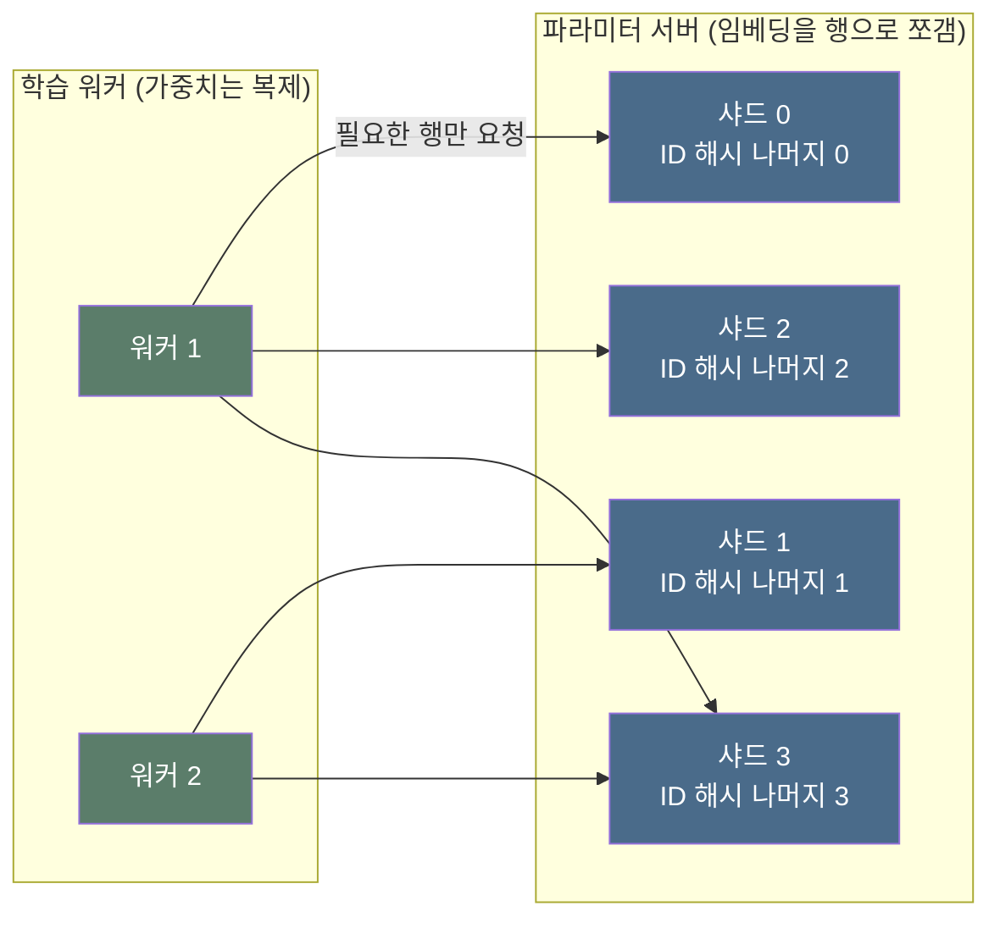

광고 서버 안에는 아주 큰 조회표가 하나 들어 있습니다. 조회표는 키를 넣으면 그 키에 적힌 값을 돌려주는 표입니다. 이 표의 키는 유저 ID 와 광고 ID 이고 값은 사람이 읽어서는 뜻을 알 수 없는 숫자 32개입니다. ID 를 넣으면 그 ID 의 임베딩 벡터, 다시 말해 모델이 그 ID 를 나타내도록 학습한 숫자 32개가 나옵니다.

문제는 크기입니다. 키는 2억 개가 넘는 데다 매일 수만 개가 새로 생기고 수만 개가 죽어(더는 요청에 나오지 않아) 키 목록이 날마다 바뀝니다. 그리고 이 표를 초당 수만 번 조회해야 합니다. 이런 표를 **임베딩 테이블(embedding table)** 이라고 부릅니다.

왜 이런 표가 필요한지는 [Deep CTR 모델](post.html?id=deep-ctr-models) 편에서 다뤘습니다. 벡터에 숫자를 몇 개 둘지(차원)는 [CTR 피처 엔지니어링](post.html?id=ctr-feature-engineering) 편에서 정합니다. 이 글은 그다음 단계인 **이미 정해진 테이블을 매일 어떻게 운영하는지**만 봅니다.

> 한 줄 요약: 임베딩 테이블은 ID 마다 숫자 한 줄이 적힌 아주 큰 조회표입니다. 서빙(실제 요청에 점수를 매기는 일)에 쓰는 값만 담으면 27.7GB 인 테이블이 학습 때는 Adam 옵티마이저(값을 고치는 알고리즘)의 상태까지 더해 83.2GB 가 됩니다. 그래서 서버 한 대에 들어가지 않아 여러 대로 쪼갭니다. 학습 배치(한 번에 함께 학습하는 데이터) 하나가 건드리는 줄은 0.0005% 뿐이라 그 줄만 고칩니다(희소 갱신). 더는 요청에 나오지 않는 죽은 줄은 계속 버려야 합니다. ID 를 행 번호로 바꾸는 매핑과 숫자 행렬의 버전이 다르면 조회가 오류 없이 남의 줄을 읽으므로 매핑과 행렬은 모델과 한 세트로 배포해야 합니다.

---

## 1. 매핑과 행렬, 두 조각으로 된 테이블

**임베딩 테이블은 겉보기에는 표 하나지만 실제로는 ID 를 행 번호로 바꾸는 매핑과 그 행 번호로 숫자를 찾는 행렬, 두 조각으로 되어 있습니다.**

이 구분이 글 전체의 뼈대입니다. 첫째 조각인 매핑은 `ad_000812 → 5번 행` 처럼 ID 마다 행 번호를 하나씩 정해 둔 대응표입니다. 둘째 조각인 행렬은 그 5번 행에 적힌 숫자 32개, 즉 그 ID 의 실제 값을 담습니다. 학습은 행렬의 숫자만 고치는데 사고는 매핑에서 더 자주 납니다(7절). 이 글에서 줄과 행은 같은 말로, 테이블의 가로 한 줄을 뜻합니다.

테이블도 하나가 아닙니다. 아래 표처럼 유저, 광고 소재, 캠페인, 지면 슬롯, 상품 카테고리마다 테이블이 따로 있고 크기와 성격이 제각각입니다. 광고 소재는 광고로 내보내는 이미지와 문구 한 벌, 캠페인은 광고주가 예산과 기간을 정해 운영하는 광고 단위, 지면 슬롯은 매체 화면에서 광고가 실리는 자리입니다. 카테고리 테이블은 5만 줄밖에 되지 않아 서버마다 전체를 올려도 되지만 유저 테이블은 2억 줄이라 그렇게 할 수 없습니다.

| 테이블 | 행 수 | ID 수명 | 성격 |
|---|---|---|---|
| 유저 ID | 2억 | 수년 | 크고, 조회는 요청당 1번 |
| 광고 소재 | 3,000만 | 며칠~몇 달 | 조회가 후보 수만큼 늘어난다 |
| 캠페인 | 300만 | 몇 달 | 소재보다 오래 산다 |
| 지면 슬롯 | 500만 | 수년 | 거의 안 죽는다 |
| 상품 카테고리 | 5만 | 영구 | 작아서 전체를 복제 |

(위 수치는 모두 가상 데이터입니다. 사내에서 측정한 값이 아니라 테이블마다 규모만 맞춘 값입니다.)

표의 마지막 열은 이 글의 차례와 거의 같습니다.

- 유저 테이블처럼 큰 테이블은 쪼개야 합니다(2절, 3절).
- 소재 테이블처럼 조회가 많은 테이블에는 캐시(자주 찾는 값을 가까운 메모리에 따로 두는 것)가 필요합니다(6절). 소재 테이블은 후보(요청 하나에서 점수를 매겨 볼 광고)마다 한 번씩 조회하므로 조회가 후보 수만큼 늘어납니다.
- 소재처럼 수명이 짧은 테이블은 죽은 줄을 계속 버려야 합니다(5절).

---

## 2. 서버 한 대를 넘는 학습 메모리

**테이블 크기는 행 수, 차원, 값 하나의 바이트 수 3개를 곱하면 나옵니다. 그런데 학습에서는 옵티마이저 상태 때문에 여기에 3배(Adam 기준)가 붙습니다.**

서빙에 필요한 크기만 계산하고 이 3배를 놓치면 서빙은 잘 되는데 학습 작업은 메모리가 모자라 시작조차 하지 못하는 일이 자주 생깁니다.

서빙만 보면 계산은 단순합니다. 서빙은 파라미터(학습으로 정해지는 값)만 메모리에 두면 됩니다. 값 하나를 FP32(32비트 부동소수점 형식)로 저장하면 4바이트가 드므로 유저 테이블은 2억 줄 × 32차원 × 4바이트로 256억 바이트, 1GB 를 1,024 × 1,024 × 1,024 바이트로 잡으면 23.8GB 입니다. 아래 코드에 넣은 테이블 4개를 다 합쳐도 27.7GB 라서 램 128GB 서버 한 대에 들어갈 것처럼 보입니다.

학습은 다릅니다. 옵티마이저는 기울기(값을 어느 방향으로 얼마나 고쳐야 예측 오차가 줄어드는지 알려 주는 값)를 보고 파라미터를 고치는 알고리즘인데, 값마다 상태를 따로 저장합니다. Adam 은 1차 모멘트(기울기의 이동 평균)와 2차 모멘트(기울기 제곱의 이동 평균)를 값마다 하나씩 저장해 값 하나가 숫자 3개가 되므로 27.7GB 가 83.2GB 로 늘어납니다.

카드에서는 서빙만 보면 한 대에 들어가는 테이블이 학습에서는 3배가 되어 서버 두 대로 나뉘는 흐름을 보면 됩니다.

<div class="demo-embed-wrap">
<iframe class="demo-embed" src="demo-serving-cards.html?embed=1&card=embtable" height="480" loading="lazy" title="2억 줄을 서버에 나눠 담는다"></iframe>
<a class="demo-embed-open" href="demo-serving-cards.html" target="_blank" rel="noopener">↗ 카드 다섯 장 전체로 열기</a>
</div>

아래 코드는 테이블 4개의 파라미터 메모리를 곱해 더한 다음 옵티마이저마다 학습 메모리와 필요한 샤드 수를 구합니다. 이어서 유저 수와 차원을 바꿔 가며 서버 한 대의 한계를 어디서 넘는지 봅니다. 샤드(shard)는 테이블을 여러 서버에 나눠 담을 때 서버 한 대가 맡는 부분입니다. 서버 한 대가 임베딩에 내줄 수 있는 몫은 램 전부를 쓸 수 없어 64GB(가상)로 두었습니다.

```python
# 하는 일: 임베딩 테이블 넷의 파라미터 메모리를 곱해 더하고, 옵티마이저마다 학습 메모리와 샤드 수를 구한 뒤, 유저 수와 차원을 바꿔 서버 한 대 한계를 어디서 넘는지 본다.
import math

# 1단계: 서버 한 대의 몫과 테이블 넷을 둔다
# 서빙은 파라미터만 들면 되지만 학습은 옵티마이저 상태까지 든다. 표준 라이브러리만 쓴다.
GB = 1024 ** 3
SERVER_GB = 64        # 서버 한 대가 임베딩에 내줄 수 있는 몫(가상). 램 전부는 못 쓴다.

# 가상 테이블 구성 — (이름, 행 수, 차원). 자리 크기만 맞춘 값이고 사내에서 측정한 값이 아니다.
tables = [("유저 ID", 200_000_000, 32), ("광고 소재", 30_000_000, 32),
          ("지면 슬롯", 5_000_000, 16), ("카테고리", 50_000, 16)]


# 2단계: 행 수와 차원으로 GB 를 구하는 함수를 만든다
def gb(rows, dim, nbytes):
    """행 수 × 차원 × 값 하나의 바이트 → GB."""
    return rows * dim * nbytes / GB


# 3단계: 테이블마다 파라미터 메모리를 구해 더한다
total = 0.0
for name, rows, dim in tables:
    g = gb(rows, dim, 4)                       # FP32 = 값 하나에 4바이트
    total += g
    print("%13s행 x %2d차원 = %7.3f GB  %s" % (format(rows, ","), dim, g, name))
print("파라미터 합계 %20.3f GB" % total)

# 4단계: 옵티마이저마다 학습 메모리와 샤드 수를 구한다
# 학습 때는 옵티마이저가 값 하나마다 상태를 더 들고 있어서, 그 개수가 그대로 배수가 된다. SGD 는 상태가 없어 1배, Adagrad 는 누적 제곱합 1개로 2배, Adam 은 모멘트 2개로 3배다.
for opt, mult in (("SGD", 1), ("Adagrad", 2), ("Adam", 3)):
    need = total * mult
    print("학습 %-8s x%d → %6.1f GB, 샤드 %d대" % (opt, mult, need, math.ceil(need / SERVER_GB)))

# 5단계: 유저 수와 차원을 바꿔 한계선을 본다
# 유저 테이블만 건드려 서버 한 대의 한계선을 어디서 넘는지 본다. 기준은 학습(Adam)이다.
rest = total - gb(200_000_000, 32, 4)
for users in (100_000_000, 200_000_000, 500_000_000):
    cells = []
    for dim in (16, 32, 64):
        need = (gb(users, dim, 4) + rest) * 3
        cells.append("%2d차원 %6.1fGB %s" % (dim, need, "OK" if need <= SERVER_GB else "쪼갠다"))
    print("유저 %3d백만 | %s" % (users // 1_000_000, " | ".join(cells)))

# 출력:
# 3단계 뜻: FP32 로 담으면 파라미터만 27.719 GB 이고, 그중 유저 ID 테이블이 23.842 GB 로 가장 크다.
#   200,000,000행 x 32차원 =  23.842 GB  유저 ID
#    30,000,000행 x 32차원 =   3.576 GB  광고 소재
#     5,000,000행 x 16차원 =   0.298 GB  지면 슬롯
#        50,000행 x 16차원 =   0.003 GB  카테고리
# 파라미터 합계               27.719 GB
# 4단계 뜻: SGD 와 Adagrad 는 샤드 1대에 들어가고, Adam 은 83.2 GB 가 되어 샤드 2대로 나눠야 한다.
# 학습 SGD      x1 →   27.7 GB, 샤드 1대
# 학습 Adagrad  x2 →   55.4 GB, 샤드 1대
# 학습 Adam     x3 →   83.2 GB, 샤드 2대
# 5단계 뜻: Adam 기준으로 유저 100백만은 32차원까지, 200백만은 16차원까지 한 대에 들어가고, 500백만은 16차원으로도 쪼갠다.
# 유저 100백만 | 16차원   29.5GB OK | 32차원   47.4GB OK | 64차원   83.2GB 쪼갠다
# 유저 200백만 | 16차원   47.4GB OK | 32차원   83.2GB 쪼갠다 | 64차원  154.7GB 쪼갠다
# 유저 500백만 | 16차원  101.0GB 쪼갠다 | 32차원  190.4GB 쪼갠다 | 64차원  369.3GB 쪼갠다
```

3단계 줄을 보면 FP32 로 담은 파라미터는 27.719GB 이고 그 가운데 유저 ID 테이블이 23.842GB 로 가장 큽니다.

4단계 줄은 값 하나마다 저장하는 숫자의 개수(파라미터 자신과 옵티마이저 상태)가 그대로 배수가 된다는 계산입니다. SGD(기울기에 일정한 비율을 곱해 바로 값을 고치는 방식)는 상태가 없어 1배인 27.7GB, Adagrad 는 누적 제곱합(기울기 제곱을 계속 더한 값) 1개를 두어 2배인 55.4GB 라서 둘 다 64GB 안에 들어가 샤드 1대면 됩니다. Adam 은 모멘트 2개를 두어 3배인 83.2GB 가 됩니다. 샤드 수는 필요한 메모리를 64GB 로 나눠 올림한 값이라 83.2GB 는 샤드 2대로 나눠야 합니다.

5단계 줄은 학습(Adam)을 기준으로 유저 테이블만 바꿔 본 결과입니다. 유저 1억 명은 32차원(47.4GB)까지, 2억 명은 16차원(47.4GB)까지 한 대에 들어갑니다. 반면 2억 명에 32차원이면 83.2GB, 5억 명은 16차원으로도 101.0GB 라서 쪼개야 합니다. 유저 수와 차원을 곱한 값이 같으면 메모리도 같으므로 1억 명의 64차원과 2억 명의 32차원이 똑같이 83.2GB 입니다.

이 세 줄이 실무에서 마주치는 상황에 가깝습니다. 유저 수는 우리가 정하는 값이 아니어서 한 대의 한계를 넘으면 남는 길은 차원을 줄이거나 테이블을 쪼개거나(3절) 값 하나의 정밀도를 낮추는(10절) 3가지뿐입니다.

---

## 3. 행 단위 샤딩

**임베딩 테이블만 여러 서버에 쪼개 담고 나머지 모델 가중치는 서버마다 복제합니다. 쪼갤 때는 반드시 행 단위로 나눕니다.**

2절처럼 학습 메모리가 서버 한 대를 넘으면 테이블을 여러 대에 나눠 담아야 하는데, 무엇을 어떤 기준으로 나누느냐에 따라 조회 한 번에 드는 왕복 횟수와 서버마다 몰리는 요청 수가 달라집니다.

모델에서 임베딩 테이블을 뺀 나머지는 작습니다. MLP(행렬 곱셈 층을 여러 개 쌓은 신경망 부분) 몇 층은 다 합쳐도 수십 MB 라서 워커(학습 계산을 맡는 서버)마다 복제해도 됩니다. 그래서 임베딩 테이블만 여러 대에 나눠 두는데, 이렇게 테이블만 들고 있는 서버를 **파라미터 서버**라고 부릅니다. 워커는 계산만 하고 파라미터 서버는 테이블만 맡습니다.

쪼개는 기준은 행입니다. 조회 단위가 행 하나라서 `ad_000812` 의 값을 알려면 그 행의 숫자 32개를 모두 받아야 하는데, 32개 가운데 절반이 다른 서버에 있으면 조회 한 번에 왕복(요청을 보내고 답을 받기까지)이 두 번 필요합니다.

아래 그림에서 학습 워커 2대는 필요한 행만 파라미터 서버의 샤드 4개에 요청합니다. 어느 행이 어느 샤드에 들어갈지는 ID 를 해시(ID 를 고르게 흩어진 정수로 바꾸는 함수)한 값을 샤드 수로 나눈 나머지로 정합니다.



나누는 규칙도 따져 봐야 합니다. ID 번호순으로 연속 구간씩 나누면 안 되는데, 광고 ID 는 대개 순번이라 최근 소재가 뒷번호에 모이고 요청은 최근 소재에 쏠리기 때문입니다. 그러면 요청이 마지막 샤드에만 몰리고 나머지 샤드에는 거의 가지 않습니다. 그래서 ID 해시의 나머지로 행을 흩어 두어 인기 ID 를 여러 샤드로 퍼뜨립니다. 그래도 한 줄에만 유별나게 요청이 몰리면 그 줄만 여러 샤드에 복제해 읽기를 나눕니다.

---

## 4. 학습 배치가 건드리는 0.0005% 와 희소 갱신

**임베딩 테이블의 줄은 아주 드물게 갱신되므로 학습 코드가 이 사실을 모르고 테이블 전체를 고치면 하루치 데이터를 하루 안에 학습하지 못합니다.**

배치(값을 한 번 고치는 학습 스텝마다 함께 넣는 데이터) 1,024건, 다시 말해 노출 로그(광고가 한 번 보일 때마다 남는 기록) 1,024건이 들어왔다고 해 보겠습니다. 유저 행은 많아야 1,024줄이라 2억 줄 가운데 0.0005% 만 등장합니다. 광고 행은 인기 소재가 겹쳐서 827줄뿐입니다. 나머지 99.999% 의 줄은 이번 배치의 예측에 쓰이지 않았으므로 기울기가 0 입니다.

그래서 갱신도 건드린 줄만 해야 합니다. 이렇게 이번 배치에 나온 줄만 고치는 방식을 **희소 갱신(sparse update)** 이라고 부릅니다. 반대로 테이블 전체를 순회하며 모든 줄을 고치는 방식은 밀집 갱신이라고 부르는데, 학습 프레임워크(학습 코드를 돌리는 라이브러리)가 임베딩을 그냥 큰 행렬로 보면 밀집 갱신이 됩니다.

아래 코드는 배치 1,024건이 유저 테이블과 광고 테이블의 몇 줄을 건드리는지 센 다음 희소 갱신과 밀집 갱신의 하루 비용을 비교합니다. 유저는 배치 안에서 거의 겹치지 않으니 균등하게, 광고는 인기 쏠림이 심하므로 상위 순위에 몰리게 뽑습니다. 같은 줄이 여러 번 뽑히면 한 줄로 셉니다. 메모리 대역폭(1초에 메모리와 CPU 사이를 오갈 수 있는 바이트 수)은 50GB/s 로, 하루 스텝 수는 초당 2스텝씩 하루 내내 돌린 172,800 으로 두었습니다(모두 가상 값).

```python
# 하는 일: 학습 배치 1,024건이 임베딩 테이블의 몇 줄을 건드리는지 세고, 건드린 줄만 고치는 희소 갱신과 전체를 순회하는 밀집 갱신의 하루 비용을 비교한다.
import random

random.seed(42)

# 1단계: 테이블 크기와 배치, 대역폭, 하루 스텝 수를 둔다
# 배치가 건드리는 줄의 비율이 곧 희소 갱신과 밀집 갱신의 비용 차이다. 수치는 가상이고, 표준 라이브러리만 쓴다.
USER_ROWS = 200_000_000    # 유저 테이블 행 수 (가상)
AD_ROWS = 30_000_000       # 광고 소재 테이블 행 수 (가상)
DIM = 32
BATCH = 1_024              # 배치 한 번에 들어가는 노출 로그 수
BW_GBPS = 50               # 서버 메모리 대역폭 50GB/s (가상)
STEPS = 172_800            # 초당 2스텝을 하루 내내 돌린다고 하자

# 2단계: 배치 하나가 건드리는 유저 줄과 광고 줄을 센다
# 같은 줄을 여러 번 뽑으면 한 줄로 센다.
# 유저는 배치 안에서 거의 겹치지 않으니 균등하게 뽑는다.
users = [random.randrange(USER_ROWS) for _ in range(BATCH)]
# 광고는 인기 쏠림이 심하다. rank = N^u (u는 0~1 균등)로 상위 쏠림을 흉내 낸다.
ads = [int(AD_ROWS ** random.random()) for _ in range(BATCH)]

u, a = len(set(users)), len(set(ads))
print("배치 %s건이 건드리는 줄" % format(BATCH, ","))
print("  유저 %4d줄 / %s줄 = %.7f%%" % (u, format(USER_ROWS, ","), 100 * u / USER_ROWS))
print("  광고 %4d줄 / %s줄 = %.7f%%  (인기 소재가 겹쳐 %d건이 중복)"
      % (a, format(AD_ROWS, ","), 100 * a / AD_ROWS, BATCH - a))

# 3단계: 옵티마이저가 한 스텝에서 만지는 값의 개수를 두 방식으로 센다
sparse = (u + a) * DIM                        # 건드린 줄만
dense = (USER_ROWS + AD_ROWS) * DIM           # 테이블 전체
print("\n한 스텝에서 만지는 값 %s개(희소) vs %s개(밀집) → %s배"
      % (format(sparse, ","), format(dense, ","), format(round(dense / sparse), ",")))

# 4단계: 메모리를 오가는 바이트로 하루치 시간을 구한다
# 시간을 좌우하는 것은 곱셈이 아니라 메모리를 오가는 바이트다. Adam 은 값 하나에 파라미터, 1차 모멘트, 2차 모멘트를 각각 읽고 써서 메모리 이동이 6번이다.
for label, values in (("희소", sparse), ("밀집", dense)):
    sec = values * 4 * 6 / 1024 ** 3 / BW_GBPS
    print("%s 갱신 %10.4f GB 이동 → %9.3f ms/스텝 → 하루 %s스텝에 %8.1f초"
          % (label, values * 4 * 6 / 1024 ** 3, sec * 1000, format(STEPS, ","), sec * STEPS))
print("밀집은 하루치가 %.1f일 걸린다 — 학습이 트래픽을 영원히 못 따라잡는다"
      % (dense * 4 * 6 / 1024 ** 3 / BW_GBPS * STEPS / 86_400))

# 출력:
# 2단계 뜻: 배치 1,024건이 건드리는 유저 줄은 1024줄로 전체의 0.0005120% 다. 광고는 인기 소재가 겹쳐 827줄뿐이다.
# 배치 1,024건이 건드리는 줄
#   유저 1024줄 / 200,000,000줄 = 0.0005120%
#   광고  827줄 / 30,000,000줄 = 0.0027567%  (인기 소재가 겹쳐 197건이 중복)
# 3단계 뜻: 건드린 줄만 고치면 한 스텝에 59,232개, 테이블 전체를 순회하면 7,360,000,000개라 124,257배 차이 난다.
#
# 한 스텝에서 만지는 값 59,232개(희소) vs 7,360,000,000개(밀집) → 124,257배
# 4단계 뜻: 하루 172,800스텝에 희소 갱신은 4.6초, 밀집 갱신은 568542.5초가 든다. 밀집은 하루치가 6.6일 걸려 학습이 트래픽을 따라잡지 못한다.
# 희소 갱신     0.0013 GB 이동 →     0.026 ms/스텝 → 하루 172,800스텝에      4.6초
# 밀집 갱신   164.5088 GB 이동 →  3290.176 ms/스텝 → 하루 172,800스텝에 568542.5초
# 밀집은 하루치가 6.6일 걸린다 — 학습이 트래픽을 영원히 못 따라잡는다
```

2단계 줄을 보면 유저 줄은 1024줄로 전체의 0.0005120% 입니다. 광고 줄은 1,024건 가운데 197건이 이미 뽑힌 인기 소재와 겹쳐 827줄, 0.0027567% 입니다.

3단계 줄은 옵티마이저가 한 스텝에서 만지는 값의 개수를 셉니다. 희소 갱신은 건드린 줄 (1,024 + 827) 에 32차원을 곱한 59,232개만 만지는 반면 밀집 갱신은 테이블 전체 (2억 + 3,000만) 줄에 32차원을 곱한 7,360,000,000개를 만지므로 두 방식은 124,257배 차이가 납니다.

4단계 줄은 이 차이를 하루 시간으로 바꿉니다. 갱신에 드는 시간은 곱셈 횟수가 아니라 메모리를 오가는 바이트 수로 정해지는데, Adam 은 값 하나마다 파라미터, 1차 모멘트, 2차 모멘트를 각각 읽고 써서 메모리 이동이 6번이므로 값 하나에 4바이트 × 6번 = 24바이트가 움직입니다. 희소 갱신은 59,232개 × 24바이트 = 0.0013GB 를 옮기므로 대역폭 50GB/s 로 한 스텝에 0.026ms, 하루 172,800스텝을 다 돌려도 4.6초면 끝납니다. 밀집 갱신은 한 스텝에 164.5088GB 를 옮기느라 3290.176ms 가 듭니다. 하루 172,800스텝이면 568542.5초라서 날짜로 바꾸면 마지막 줄대로 6.6일입니다.

약 12만 배라는 배수보다 마지막 줄이 더 큰 문제입니다. 밀집 갱신으로 짜면 하루치 스텝에 6.6일이 들어 학습이 트래픽을 영원히 따라잡지 못합니다. 아예 돌릴 수 없다는 뜻입니다.

옵티마이저 선택도 여기서 달라집니다. Adam 은 원래 정의상 매 스텝 모든 값의 2차 모멘트에 1 보다 작은 수를 곱해 조금씩 감쇠시키므로 건드린 줄만 갱신하면 그 정의와 달라집니다. Adagrad 는 감쇠 없이 기울기 제곱합을 쌓기만 하므로 기울기가 0 인 줄은 제곱합도 값도 바뀌지 않아 건드린 줄만 갱신해도 원래 수식과 정확히 같습니다. 그래서 임베딩에는 Adagrad 계열이 오래 쓰였습니다.

희소하다는 사실은 워커를 여러 대 쓰는 방식도 바꿉니다. 동기 학습(모든 워커가 기울기를 낼 때까지 기다렸다가 모아서 한 번에 반영하는 방식)에서는 건드리지 않은 줄까지 모아 합치는 통신이 낭비입니다. 비동기 학습(워커마다 처리한 만큼 바로 반영하는 방식)에서는 다른 워커가 고친 값을 보지 못하고 낡은 값으로 계산할 위험이 있습니다. 그런데 워커 16대가 각자 1,024건을 처리해도 2억 줄의 유저 테이블에서 서로 겹치는 줄은 거의 없습니다. 겹치는 줄이 없으면 낡은 값도 생기지 않으므로 실무에서는 두 방식을 섞어 MLP 는 동기로 모으고 임베딩만 비동기로 맡깁니다.

---

## 5. ID 의 수명과 버리는 규칙

**줄을 하나도 지우지 않으면 테이블은 줄지 않고 커지기만 하므로(단조 증가) 어떤 줄을 지울지 정하는 규칙이 곧 테이블 크기를 관리하는 방법입니다.**

광고 소재는 계속 새로 생기고 죽습니다. 캠페인이 끝나면 그 소재는 다시 나오지 않는데 테이블의 줄은 그대로 남으므로 두 달 뒤에는 2절의 메모리 계산이 틀리고 세 달 뒤에는 서버가 모자랍니다.

버리는 규칙은 크게 3가지입니다. **빈도 컷**은 등장 횟수가 적은 줄을, **LRU**(Least Recently Used)는 마지막 등장이 오래된 줄을, **TTL**(Time To Live)은 최근 며칠 안에 등장하지 않은 줄을 버립니다. 남기는 기준으로 바꿔 말하면 빈도 컷과 LRU 는 목표 크기를 정해 두고 각각 등장 횟수가 많은 순서와 마지막 등장일이 늦은 순서로 그만큼 남깁니다. TTL 은 크기 대신 기간을 정해 그 기간 안에 나온 줄을 모두 남깁니다.

아래 코드로 3가지 규칙이 실제로 얼마나 다른지 측정해 봅니다. 소재 풀 30만 개에서 30일 동안 하루 5만 건씩 노출을 뽑아 로그를 만든 뒤, 소재 테이블을 목표 3만 줄로 줄일 때 빈도 컷, LRU, TTL 3일, 그리고 비교용 무작위가 남긴 줄이 다음 날 노출을 얼마나 덮는지 비교합니다. 소재마다 인기도는 순위가 뒤로 갈수록 빠르게 작아지게 두었습니다(1/rank^1.1). 생긴 날과 캠페인 길이도 소재마다 달라서 30일 동안 소재가 계속 새로 생기고 끝납니다. 목표는 지난 로그를 맞히는 것이 아니라 앞으로 들어올 노출을 덮는 것이므로 채점은 31일째 노출로 합니다.

```python
# 하는 일: 30일치 로그로 소재 테이블을 목표 3만 줄로 줄일 때 빈도 컷, LRU, TTL, 무작위가 남긴 줄이 다음 날 노출을 얼마나 덮는지 비교한다.
import random

random.seed(42)

# 1단계: 소재 풀과 기간, 하루 노출 수, 목표 크기, TTL 을 둔다
# 테이블을 목표 크기로 줄일 때 어떤 줄을 버려야 손해가 적은지 본다. 수치는 가상이다.
N_IDS = 300_000          # 광고 소재 풀 (가상)
DAYS = 30                # 30일 동안 로그를 쌓는다
REQ = 50_000             # 하루 노출 5만 건 (빨리 끝나는 규모로 줄였다)
TARGET = 30_000          # 목표 테이블 크기
TTL = 3                  # TTL 정책: 최근 3일 안에 등장한 줄만 남긴다

# 2단계: 소재마다 인기도와 생긴 날, 끝나는 날을 정한다
# 인기도는 1/rank^1.1 이고, 수명은 캠페인 길이라 제각각이다. 생긴 날이 다르다는 게 중요하다. 소재는 계속 새로 생기고 캠페인이 끝나면 안 나온다.
pop, born, died = [], [], []
for i in range(N_IDS):
    pop.append(1.0 / (i + 10) ** 1.1)
    b = random.randrange(-60, DAYS)
    born.append(b)
    died.append(b + random.choice([7, 14, 30, 90, 365]))

# 3단계: 등장 횟수와 마지막 등장 일을 담을 목록과, 그날 살아 있는 소재를 뽑는 함수를 만든다
seen = [0] * N_IDS       # 총 등장 횟수 → 빈도 컷의 기준
last = [-999] * N_IDS    # 마지막 등장 일 → LRU, TTL의 기준


def sample(day, n):
    """그날 살아 있는 소재만 인기도에 비례해 n건 뽑는다."""
    alive = [i for i in range(N_IDS) if born[i] <= day < died[i]]
    return random.choices(alive, weights=[pop[i] for i in alive], k=n)


# 4단계: 30일 동안 로그를 쌓고 등장한 소재 수를 찍는다
for day in range(DAYS):
    for i in sample(day, REQ):
        seen[i] += 1
        last[i] = day

logged = [i for i in range(N_IDS) if seen[i] > 0]
print("30일 로그에 등장한 소재 %s개 → %s개만 남긴다(%.0f%%)"
      % (format(len(logged), ","), format(TARGET, ","), 100 * TARGET / len(logged)))

# 5단계: 정책 넷으로 남길 집합을 만든다
# 정책마다 남기는 기준이 다르다. 빈도 컷은 총 등장 횟수가 큰 순으로, LRU 는 마지막 등장 일이 큰 순으로 목표 크기만큼 남기고, TTL 은 최근 3일 안에 나온 줄을 전부 남기며, 무작위는 목표 크기만큼 임의로 뽑는다.
policies = [("빈도 컷", sorted(logged, key=lambda i: (-seen[i], i))[:TARGET]),
            ("LRU", sorted(logged, key=lambda i: (-last[i], -seen[i], i))[:TARGET]),
            ("TTL %d일" % TTL, [i for i in logged if last[i] >= DAYS - TTL]),
            ("무작위", random.sample(logged, TARGET))]

# 6단계: 다음 날 트래픽으로 정책을 채점한다
# 과거를 맞히는 게 아니라 미래를 덮는 게 목표라서, 31일째 노출로 채점한다.
future = sample(DAYS, REQ)
print("31일째 노출 %s건, 서로 다른 소재 %s개\n" % (format(len(future), ","), format(len(set(future)), ",")))
print("정책        남긴 줄   커버   못 찾음   평균 등장   31일에 살아 있음")
for name, keep in policies:
    ks = set(keep)
    hit = sum(1 for i in future if i in ks)
    alive = sum(1 for i in keep if died[i] > DAYS)
    print("%-9s %7s개 %5.1f%% %8s건 %8.1f회 %14.1f%%"
          % (name, format(len(keep), ","), 100 * hit / len(future), format(len(future) - hit, ","),
             sum(seen[i] for i in keep) / len(keep), 100 * alive / len(keep)))

# 출력:
# 4단계 뜻: 30일 동안 등장한 소재는 122,788개이고, 그중 30,000개(24%)만 남긴다.
# 30일 로그에 등장한 소재 122,788개 → 30,000개만 남긴다(24%)
# 6단계 뜻: 무작위는 31일째 노출의 25.2% 만 덮지만, 나머지 정책 셋은 85.3% 에서 86.0% 를 덮는다. 빈도 컷이 남긴 줄은 31일에 81.0% 만 살아 있고, LRU 는 96.8% 가 살아 있다.
# 31일째 노출 50,000건, 서로 다른 소재 14,736개
#
# 정책        남긴 줄   커버   못 찾음   평균 등장   31일에 살아 있음
# 빈도 컷       30,000개  86.0%    6,984건     44.9회           81.0%
# LRU        30,000개  85.3%    7,357건     37.8회           96.8%
# TTL 3일     32,001개  85.5%    7,263건     35.5회           96.7%
# 무작위        30,000개  25.2%   37,387건     13.6회           77.2%
```

4단계 줄을 보면 30일 동안 한 번이라도 등장한 소재는 122,788개인데 그 가운데 30,000개, 24% 만 남깁니다. 31일째 노출 50,000건에 나온 서로 다른 소재는 14,736개입니다.

6단계 표의 열은 이렇게 읽습니다. 커버(커버율)는 31일째 노출 50,000건 가운데 남긴 줄에서 찾을 수 있는 노출의 비율로 높을수록 좋습니다. 못 찾음은 남긴 줄에 없어 찾지 못한 노출 건수입니다. 평균 등장은 남긴 줄이 30일 동안 등장한 횟수의 평균입니다. 31일에 살아 있음은 남긴 줄 가운데 31일째에도 캠페인이 끝나지 않은 소재의 비율로 높을수록 좋습니다.

먼저 무작위와 나머지 규칙의 차이가 눈에 들어옵니다. 똑같이 3만 줄을 남겼는데 커버는 무작위가 25.2%, 빈도 컷이 86.0% 입니다. 노출이 소수의 인기 소재에 심하게 쏠려 있으므로 그 소재를 골라 남기면 4분의 1만 남겨도 트래픽의 86% 를 덮습니다.

규칙 3가지 사이의 차이는 뜻밖에 작아서 커버가 빈도 컷 86.0%, TTL 85.5%, LRU 85.3% 로 0.7%p(퍼센트포인트) 안에 모두 들어옵니다. 실제 차이는 뒤쪽 두 열에 있습니다. 빈도 컷은 30일 동안의 총 등장 횟수로 고르기 때문에 오래전에 인기 있었던 소재도 자리를 차지합니다. 그래서 빈도 컷이 남긴 줄은 평균 등장이 44.9회로 가장 많지만 31일에 살아 있는 줄이 81.0% 라 나머지 19% 는 이미 캠페인이 끝나 죽은 소재입니다. 반면 LRU 가 남긴 줄은 96.8% 가 살아 있습니다. TTL 은 기간만 정할 뿐 크기를 정하지 못해서 3일로 잘랐더니 목표 3만 줄보다 많은 3만 2천 줄(32,001개)이 남았습니다. 실무에서는 테이블 크기를 LRU 로 맞추고 새 ID 는 최소 등장 횟수를 넘길 때까지 테이블에 넣지 않습니다.

지운 ID 가 다시 오면 테이블에 그 ID 의 줄이 없습니다. 이때 쓰는 줄이 **OOV 행**(out-of-vocabulary)으로, 테이블에 등록되지 않은 ID 전부가 함께 쓰는 한 줄입니다. 조회는 성공하고 점수도 나오지만 OOV 행에는 그 광고만의 정보가 담겨 있지 않습니다. 위 실험의 LRU 테이블에서는 31일째 노출 50,000건 가운데 7,357건, 전체의 14.7% 가 이 상태였습니다. 이런 요청은 카테고리, 광고주 같은 상위 정보에 기대야 합니다.

---

## 6. 서빙 때 흩어지는 임베딩 조회

**서빙의 임베딩 조회는 읽는 양이 아니라 흩어짐이 문제입니다. 필요한 바이트는 적은데 그 바이트를 가져오는 거리가 깁니다.**

요청 하나가 만드는 조회 횟수를 세어 보면 문제가 보입니다. 후보 광고가 2,000개면 소재, 캠페인, 카테고리 테이블을 후보마다 한 번씩, 테이블마다 2,000번 조회합니다.

| 테이블 | 조회 대상 | 요청당 조회 수 |
|---|---|---|
| 유저 | 요청한 유저 1명 | 1 |
| 유저 행동 시퀀스 | 최근 클릭 50개 | 50 |
| 지면 슬롯 | 노출 자리 1개 | 1 |
| 광고 소재 | 후보 2,000개 | 2,000 |
| 캠페인 | 후보의 캠페인 | 2,000 |
| 상품 카테고리 | 후보의 카테고리 | 2,000 |
| **합계** | | **6,052** |

(가상 데이터입니다. 후보 수와 시퀀스 길이는 서비스마다 다릅니다.)

표에서 유저 행동 시퀀스(유저의 최근 클릭 기록)는 최근 클릭 50개를 하나씩 조회하므로 50번이고 소재, 캠페인, 카테고리가 2,000번씩이라 다 더하면 요청 하나에 1 + 50 + 1 + 2,000 × 3 = 6,052번입니다.

왕복 한 번을 0.15ms 로만 잡아도 6,052 × 0.15ms 로 약 900ms 가 걸리므로 이 6,052번을 원격 샤드에 하나씩 물어보는 방식은 쓸 수 없습니다. 그래서 샤드별로 ID 를 모아 한 번에 요청하는데, 샤드가 8개면 왕복도 8번으로 줄어듭니다. 루프 안에서 한 건씩 조회하는 코드가 가장 흔한 성능 사고입니다.

같은 서버의 메모리에서 읽어도 흩어짐은 남습니다. CPU 는 메모리를 64바이트 단위로 읽는데, 이 단위를 캐시 라인(cache line)이라고 부릅니다. 32차원 FP32 행은 32 × 4바이트 = 128바이트라 행의 시작이 캐시 라인 경계에 맞으면 라인 2개에 딱 들어갑니다. 그런데 행이 라인 경계에 맞지 않게 놓이면 128바이트를 읽으려고 라인 3개, 192바이트를 옮겨야 합니다. 그래서 행 길이를 캐시 라인의 배수로 맞추고 행의 시작을 경계에 맞춰 정렬해 둡니다.

이런 흩어짐 때문에 인기 ID 만 모델 서버 프로세스 안의 메모리에 두고 나머지는 원격에 두는 2계층 구성이 나옵니다. 캐시 적중률(찾는 ID 가 프로세스 안에 있는 비율)과 그만큼 줄어드는 지연은 [광고 모델 서빙 아키텍처](post.html?id=model-serving-architecture) 편에서, 테이블을 저장하고 갱신하는 계층은 [Feature Store와 실시간 서빙](post.html?id=feature-store-serving) 편에서 다뤘습니다.

---

## 7. 모델과 테이블을 한 세트로 배포하는 버전 관리

**매핑과 행렬의 버전이 서로 다르면 같은 ID 가 남의 줄의 값을 가리키는데, 이때 아무 오류도 나지 않습니다.**

1절에서 학습은 행렬만 고치는데 사고는 매핑에서 더 자주 난다고 했습니다. 배포할 때 매핑과 행렬의 짝이 맞지 않아도 조회는 성공합니다. 5번 행을 달라고 하면 5번 행을 주기 때문인데, 그 행이 남의 줄이라는 사실은 아무도 모릅니다. 죽은 ID 를 지우고 매핑을 다시 만들면 지운 자리 뒤쪽의 번호가 전부 밀리므로 ID 를 3% 만 지워도 거의 모든 줄의 번호가 바뀝니다.

아래 코드는 소재 3% 가 끝나고 매핑을 다시 만든 날 어제 매핑으로 오늘 행렬을 읽으면 점수 분포와 상위 순위가 어떻게 되는지 봅니다. 먼저 어제 ID 10만 개를 정렬해 0번부터 번호를 준 어제 매핑을 만듭니다. 하루 뒤 3% 가 끝나고 새 ID 5천 개가 들어오면 매핑을 다시 만듭니다. 이때 죽은 ID 의 빈 행을 없애고 남은 ID 에 번호를 다시 매기는 일을 압축이라고 부릅니다. 행렬은 오늘 매핑 기준으로 학습됐다고 두고 후보 광고 2,000개를 두 매핑으로 각각 채점합니다.

```python
# 하는 일: 소재 3% 가 끝나고 매핑을 다시 만든 날, 어제 매핑으로 오늘 행렬을 읽으면 점수 분포와 상위 순위가 어떻게 되는지 비교한다.
import random

random.seed(42)

# 1단계: 어제 ID 10만 개와 어제 매핑을 만든다
# 매핑과 행렬의 버전이 어긋나도 예외는 안 난다. 값만 남의 것이 된다. 그걸 보려고 어제 매핑부터 둔다.
N, DIM, DIE, BORN = 100_000, 16, 0.03, 5_000   # 어제 ID 10만 개, 3% 종료, 신규 5천 (가상)

old = ["ad_%06d" % i for i in range(N)]
v1 = {ad: r for r, ad in enumerate(sorted(old))}          # 어제 매핑: 정렬해 0번부터 번호를 준다

# 2단계: 하루 뒤 매핑을 다시 만들고, 행 번호가 그대로인 ID 를 센다
# 하루가 지나 일부가 죽고 새 ID 가 들어온다. 매핑을 다시 만들며 빈 행을 없앤다(압축).
dead = set(random.sample(old, int(N * DIE)))
alive = [a for a in old if a not in dead] + ["ad_%06d" % (N + i) for i in range(BORN)]
v2 = {ad: r for r, ad in enumerate(sorted(alive))}        # 오늘 매핑

sur = [a for a in old if a not in dead]                   # 죽지 않고 살아남은 ID
same = sum(1 for a in sur if v1[a] == v2[a])
print("살아남은 %s개 중 행 번호가 그대로인 것 %d개 (%.2f%%)"
      % (format(len(sur), ","), same, 100 * same / len(sur)))

# 3단계: 오늘 매핑 기준의 행렬과 유저 벡터를 만들고, 점수를 매기는 함수를 만든다
# 행렬은 v2 기준으로 학습됐다고 하자. 매핑만 v1 이면 조회가 남의 줄을 읽어 온다.
table = [[random.gauss(0, 0.5) for _ in range(DIM)] for _ in range(len(alive))]
user = [random.gauss(0, 0.5) for _ in range(DIM)]
score = lambda row: sum(x * y for x, y in zip(user, row))

# 4단계: 후보 2,000개를 두 매핑으로 채점해 점수 분포를 비교한다
cands = random.sample(sur, 2_000)                         # 이번 요청의 후보 광고 2,000개
right = [score(table[v2[a]]) for a in cands]              # 매핑도 v2 — 정상
wrong = [score(table[v1[a]]) for a in cands]              # 매핑만 v1 — 어긋남

for label, v in (("정상 ", right), ("어긋남", wrong)):
    m = sum(v) / len(v)
    sd = (sum((x - m) ** 2 for x in v) / len(v)) ** 0.5
    print("%s 평균 %+.4f, 표준편차 %.4f, 최댓값 %+.4f" % (label, m, sd, max(v)))

# 5단계: 두 순위의 상위가 얼마나 겹치는지 센다
# 분포는 정상과 같아 보이는데 순위가 남의 것인지 확인한다.
rt = sorted(range(len(cands)), key=lambda i: -right[i])
wt = sorted(range(len(cands)), key=lambda i: -wrong[i])
print("Top-10 겹침 %d개, Top-100 겹침 %d개"
      % (len(set(rt[:10]) & set(wt[:10])), len(set(rt[:100]) & set(wt[:100]))))

# 출력:
# 2단계 뜻: 다시 번호를 매기면, 살아남은 97,000개 가운데 행 번호가 그대로인 것은 53개, 0.05% 뿐이다.
# 살아남은 97,000개 중 행 번호가 그대로인 것 53개 (0.05%)
# 4단계 뜻: 어긋난 매핑으로 채점해도 평균 -0.0004, 표준편차 0.6980 으로 정상(-0.0024, 0.6933)과 거의 같아, 분포로는 사고를 알아챌 수 없다.
# 정상  평균 -0.0024, 표준편차 0.6933, 최댓값 +2.0844
# 어긋남 평균 -0.0004, 표준편차 0.6980, 최댓값 +2.4388
# 5단계 뜻: 그런데 상위 10개는 하나도 겹치지 않고 상위 100개도 3개만 겹친다. 내보내는 광고가 남의 광고다.
# Top-10 겹침 0개, Top-100 겹침 3개
```

2단계 줄을 보면 살아남은 97,000개 가운데 행 번호가 그대로인 ID 는 53개, 0.05% 뿐입니다. 새 번호는 정렬 순서대로 다시 매겨지므로 처음 지운 ID 보다 뒤에 있던 ID 는 모두 앞에서 지운 개수만큼 번호가 밀립니다. 번호가 그대로인 53개는 처음 지운 ID 보다 앞에 있던 ID 입니다.

이 실험에서는 점수 분포부터 봅니다. 4단계 줄에서 매핑이 맞는 「정상」은 평균 -0.0024, 표준편차 0.6933, 최댓값 +2.0844 이고 어제 매핑으로 읽은 「어긋남」은 평균 -0.0004, 표준편차 0.6980, 최댓값 +2.4388 입니다. 어제 매핑이 가리키는 줄도 같은 행렬의 다른 줄이라 값의 분포가 같으므로 평균과 표준편차가 거의 같고 최댓값도 비슷합니다. 그래서 분포만 보는 모니터링은 이 사고를 잡지 못합니다.

그런데 5단계 줄에서 두 순위의 상위를 비교하면 점수 상위 10개(Top-10)는 하나도 겹치지 않고 상위 100개(Top-100)도 3개만 겹칩니다. 우리가 내보내는 광고가 남의 광고라는 뜻입니다.

막는 방법은 3가지입니다. 첫째, 모델과 매핑과 행렬을 **한 아티팩트로 묶어**(함께 배포하는 파일 세트 하나로 만들어) 배포하고 롤백(문제가 생겼을 때 이전 버전으로 되돌리는 일)할 때도 세 가지를 함께 되돌립니다. 둘째, 매핑 지문(CRC32, 매핑 내용으로 계산한 32비트 체크섬)을 헤더에 담아 두고 서버가 매핑을 불러올 때 지문을 맞춰 보아 다르면 서버가 시작되지 않게 합니다. 셋째, 압축을 미룹니다. 죽은 행을 지우지 않고 비워 두면 번호가 흔들리지 않습니다. 위 코드처럼 10만 개 가운데 3% 인 3,000행이 하루에 죽어도 빈 행 메모리는 3,000행 × 16차원 × 4바이트로 0.18MB 라서 1년(365일)을 모아도 67MB 뿐입니다. 그래서 압축은 분기(3개월)에 한 번, 모델을 처음부터 다시 학습하는 날에만 합니다. 새 ID 를 테이블 뒤에만 붙이는 증분 배포는 기존 번호가 밀리지 않아 안전합니다([온라인 학습과 지연 피드백](post.html?id=online-learning-delayed-feedback)의 증분 학습과 짝이 맞습니다).

---

## 8. 담장 안의 유저 테이블에 쓰는 자원 [무대: 닫힌 생태계]

**로그인 ID 는 어제도 오늘도 같으므로 유저 줄이 오래 살고 미리 계산해 둔 벡터를 캐시에 올려 둘 수 있습니다.**

담장 안(닫힌 생태계)은 회사가 자기 서비스 안의 지면에 광고를 파는 구조입니다. 이런 회사는 유저를 로그인 계정으로 알아봅니다. 그 ID 는 몇 년을 사는데, 이 안정성이 운영을 세 군데에서 편하게 만듭니다.

첫째, 유저 줄이 학습될 시간을 충분히 받습니다. 한 유저가 한 달에 수백 번 등장하면 그 줄의 숫자 32개가 실제로 그 사람을 나타낼 만큼 학습됩니다. 둘째, 줄을 지우는 퇴출 기준이 트래픽이 아니라 계정 상태입니다. 탈퇴하거나 오래 휴면한 계정의 줄을 지우면 되므로 5절의 LRU 를 급하게 돌릴 필요가 없습니다. 셋째, 벡터를 찾아올 키인 로그인 ID 가 흔들리지 않으므로 미리 계산해 둔 벡터를 캐시에 올려 둘 수 있습니다. 이 이득은 [Two-Tower Retrieval](post.html?id=two-tower-retrieval) 편에서 다뤘습니다.

그래서 담장 안의 메모리 예산은 유저 테이블로 몰립니다. 2절에서 유저 테이블이 파라미터 27.719GB 가운데 23.842GB, 전체의 86% 를 차지한 것도 우연이 아닙니다. 대신 줄이 오래 사는 만큼 오래된 취향도 남아서 3년 전 관심사가 지금 벡터에 섞여 있습니다.

---

## 9. 열린 RTB 에서 한 번 쓰고 버려지는 유저 줄 [무대: 열린 RTB]

**쿠키(브라우저에 저장되는 식별자)가 며칠 만에 바뀌면 유저 줄은 학습될 시간을 받지 못합니다. 그래서 테이블에 쓰는 자원을 광고, 지면, 문맥으로 옮깁니다.**

열린 RTB(실시간 입찰, real-time bidding)는 여러 매체의 광고 자리를 노출 한 번마다 경매에 부치는 시장입니다. 이 시장에서 광고주를 대신해 광고를 사는 플랫폼이 DSP(Demand-Side Platform)인데, DSP 는 남의 쿠키를 봅니다. 쿠키는 브라우저마다 다르고 수명이 짧아서(아래 표에서는 며칠) 유저 임베딩이 학습과 서빙 두 군데에서 동시에 망가집니다. 학습에서는 한 쿠키의 줄이 한두 번만 등장해 초기값(학습을 시작할 때 무작위로 채운 값)에서 거의 움직이지 않습니다. 서빙에서는 쿠키가 바뀌어 어제 만든 줄을 찾을 키가 없는 경우가 많습니다.

한두 번 등장한 ID 에 숫자 32개를 배정하는 일은 순수한 낭비라서 DSP 의 테이블 예산은 수명이 긴 테이블로 갑니다. 도메인(광고가 실리는 사이트 주소)과 슬롯 위치는 몇 년을 삽니다. 광고 소재도 DSP 가 맡은 자기 캠페인의 소재라서 오래 관리합니다. 문맥(시간대, 디바이스, 지면 카테고리)은 아예 죽지 않습니다.

| 차이 | 닫힌 생태계 | 열린 RTB (DSP) |
|---|---|---|
| **유저 테이블 비중** | 전체의 80% 이상 | 10% 이하 또는 없음 |
| **유저 ID 수명** | 수년 (로그인 계정) | 며칠 (쿠키) |
| **유저 줄의 평균 등장** | 수백 회 | 1~2회 |
| **가장 큰 테이블** | 유저 ID | 광고 소재 + 지면 |
| **퇴출 기준** | 탈퇴, 장기 휴면 | 캠페인 종료, LRU |

(위 수치는 가상 데이터이고 방향만 실무와 같습니다.)

담장 안에서 만든 모델을 DSP 에 그대로 옮기면 유저 테이블이 학습되지 못한 채 메모리만 차지합니다. 반대로 DSP 의 설계를 담장 안에 가져오면 오래 학습된 유저 줄이라는 가장 좋은 신호를 버립니다.

---

## 10. FP32 에서 FP16, int8 로 낮추는 정밀도

**정밀도(값 하나를 몇 바이트로 저장하는가)를 낮추면 메모리는 바이트 수에 비례해 정직하게 줄어듭니다. 문제는 그때 어느 줄의 점수가 먼저 망가지느냐입니다.**

2절 끝에 남은 3가지 길 가운데 마지막이 정밀도를 낮추는 방법입니다. 값 하나를 꼭 4바이트(FP32)로 저장할 까닭은 없습니다. FP16(16비트 부동소수점, 2바이트)이면 반, int8(8비트 정수, 1바이트)이면 4분의 1입니다. int8 로 27.7GB 가 7GB 가 되면 2절의 고민은 대부분 사라집니다. 다만 임베딩은 학습 파라미터라서 학습은 FP32 로 하고 다 학습한 뒤 서빙용으로만 정밀도를 낮춥니다.

int8 로 낮출 때는 정할 것이 하나 있습니다. 스케일(정수 1칸이 실수로 얼마인지 정한 눈금)을 행마다 따로 잡을지, 테이블 전체가 하나를 함께 쓸지입니다. 테이블 전체가 함께 쓰는 공용 스케일이 저장 공간을 덜 쓰는데, 사고는 바로 여기서 납니다.

:::deep 더 깊이 — int8 양자화의 스케일과 제로포인트
int8 양자화(quantization)는 실수 값의 범위를 정수 256단계에 밀어 넣는 일입니다. 임베딩 값은 0 을 중심으로 대칭으로 퍼져 있어서 보통 제로포인트 $z$(실수 0 에 대응하는 정수)를 0 으로 두는 대칭(symmetric) 방식을 쓰는데, 이 방식은 스케일 하나만 정하면 됩니다.

$$s = \frac{\max |x|}{127}, \qquad \hat{x} = s \cdot \mathrm{clip}(\mathrm{round}(x/s),\, -127,\, 127)$$

식의 스케일 $s$ 는 절댓값이 가장 큰 값을 127 로 나눈 값입니다. 값 $x$ 를 $s$ 로 나눠 반올림한 정수를 저장했다가 되읽을 때 그 정수에 $s$ 를 곱한 $\hat{x}$ 를 씁니다.

값이 한쪽으로 치우쳐 있다면 최솟값과 최댓값을 모두 쓰는 비대칭 방식이 낫습니다. 이때는 스케일을 $s = (x_{\max} - x_{\min})/255$ 로 잡고 $z$ 를 0 이 아닌 값으로 옮깁니다. 저장한 정수 $q$ 를 되돌릴 때는 $\hat{x} = s\,(q - z)$ 로 계산합니다. 대신 $z \ne 0$ 이면 정수 내적에 보정항이 붙어 계산이 느려집니다.

행별 스케일은 행마다 스케일 하나(FP32, 4바이트)를 더 저장합니다. 32차원 int8 행은 32바이트라 4바이트가 붙으면 12.5% 가 늘어나는데, 아래 표에서 7.0GB(공용)와 7.9GB(행별)의 차이가 이 4바이트입니다.
:::

아래 코드는 광고 벡터 2,000개를 FP32, FP16, int8 행별, int8 공용 4가지로 담아 테이블 크기, 점수 오차, 상위 순위가 얼마나 유지되는지 비교합니다. 코드는 실제 테이블처럼 행마다 벡터 길이(L2 노름, 숫자 32개를 제곱해 더한 값의 제곱근)를 크게 다르게 만듭니다. 실제 테이블에서는 자주 학습된 ID 일수록 벡터가 길어지는 경향이 있습니다. 점수는 유저 벡터 하나와 광고 벡터의 내적(같은 자리의 숫자끼리 곱해 더한 값)입니다.

```python
# 하는 일: 광고 벡터 2,000개를 FP32, FP16, int8(행별, 공용) 넷으로 담아 테이블 크기, 점수 오차, 상위 순위 유지를 비교한다.
import math
import random
import struct

random.seed(42)

# 1단계: 유저 벡터 하나와 길이가 제각각인 광고 벡터 2,000개를 만들고, 길이 범위와 공용 스케일을 찍는다
# FP32 에서 FP16, int8 로 갈수록 메모리는 값 하나의 바이트 수에 비례해 줄어드는데, 점수는 어디서 어긋나는지 본다. 공용 스케일은 테이블에서 가장 큰 값 하나로 정한다.
DIM = 32
N = 2_000                # 광고 벡터 2,000개를 유저 벡터 하나로 채점한다
ROWS = 235_000_000       # 전체 테이블 행 수 (가상)

user = [random.gauss(0, 0.5) for _ in range(DIM)]
# 실제 테이블은 행마다 벡터 길이가 크게 다르다. 자주 학습된 ID일수록 길어지는 경향이 있다.
ads = []
for _ in range(N):
    mag = math.exp(random.gauss(0, 1.0))                     # 이 행 전체의 길이를 정하는 배수
    ads.append([mag * random.gauss(0, 0.5) for _ in range(DIM)])
norms = [math.sqrt(sum(x * x for x in a)) for a in ads]
shared = max(abs(x) for row in ads for x in row) / 127.0     # 공용 스케일은 최댓값 하나가 정한다
print("행 벡터 길이 최소 %.3f, 최대 %.1f → %.0f배 차이, 공용 스케일 %.6f"
      % (min(norms), max(norms), max(norms) / min(norms), shared))


# 2단계: FP16, int8 로 바꾸는 함수와 내적 함수를 만든다
# struct 의 'e' 포맷이 IEEE 754 반정밀도(FP16)라 실제 반올림을 그대로 재현한다.
def fp16(v):
    """FP16으로 반올림했다 다시 읽는다. 유효 자리가 소수 3~4자리로 줄어든다."""
    return [struct.unpack("e", struct.pack("e", x))[0] for x in v]


def int8(v, scale=None):
    """스케일이 없으면 그 행의 최댓값으로 잡는다(행별). 주면 그 값을 쓴다(공용)."""
    s = scale or max(abs(x) for x in v) / 127.0
    return [max(-127, min(127, round(x / s))) * s for x in v]


def dot(a, b):
    return sum(x * y for x, y in zip(a, b))


# 3단계: FP32 로 매긴 기준 순위를 둔다
# 상위 10, 100, 500 의 집합과, 길이가 긴 절반의 집합을 미리 만든다.
base = [dot(user, a) for a in ads]
rank0 = sorted(range(N), key=lambda i: -base[i])
tops = {k: set(rank0[:k]) for k in (10, 100, 500)}
long_half = set(sorted(range(N), key=lambda i: -norms[i])[:N // 2])

# 4단계: 정밀도 넷으로 크기, 상대오차, 순위 유지, 긴 벡터와 짧은 벡터의 오차를 비교한다
# 정밀도마다 행 하나에 저장되는 바이트를 함께 둔다. 행별 스케일은 스케일(FP32 4바이트)도 같이 저장해야 한다.
variants = [("FP32 (기준)", DIM * 4, ads), ("FP16", DIM * 2, [fp16(a) for a in ads]),
            ("int8 행별", DIM + 4, [int8(a) for a in ads]),
            ("int8 공용", DIM, [int8(a, shared) for a in ads])]

print("\n정밀도        크기   상대오차   Top-10 Top-100 Top-500   긴 벡터  짧은 벡터")
for name, row_bytes, table in variants:
    score = [dot(user, a) for a in table]
    rel = [abs(s - b) / abs(b) for s, b in zip(score, base)]
    rank = sorted(range(N), key=lambda i: -score[i])
    keep = [len(tops[k] & set(rank[:k])) for k in (10, 100, 500)]
    # 같은 오차를 긴 벡터 절반과 짧은 벡터 절반으로 나눠 본다. 여기서 정체가 드러난다.
    hi = sum(rel[i] for i in long_half) / len(long_half)
    lo = sum(rel[i] for i in set(range(N)) - long_half) / (N - len(long_half))
    print("%-11s %5.1fGB %8.2f%%  %3d/10 %4d/100 %4d/500 %8.2f%% %8.2f%%"
          % (name, ROWS * row_bytes / 1024 ** 3, 100 * sum(rel) / N,
             keep[0], keep[1], keep[2], 100 * hi, 100 * lo))

# 출력:
# 1단계 뜻: 행 벡터 길이가 0.072 에서 59.6 까지 824배 차이 나는데, 공용 스케일은 가장 큰 값 하나가 정해 0.228337 이다.
# 행 벡터 길이 최소 0.072, 최대 59.6 → 824배 차이, 공용 스케일 0.228337
# 4단계 뜻: FP16 은 크기가 14.0GB 로 반인데 상대오차 0.15% 에 순위가 그대로다. int8 은 행별 스케일이면 상대오차 4.00% 에 Top-500 의 499개를 지키지만, 공용 스케일이면 상대오차가 158.34% 로 커지고 짧은 벡터는 273.74% 에 이른다.
#
# 정밀도        크기   상대오차   Top-10 Top-100 Top-500   긴 벡터  짧은 벡터
# FP32 (기준)    28.0GB     0.00%   10/10  100/100  500/500     0.00%     0.00%
# FP16         14.0GB     0.15%   10/10  100/100  500/500     0.14%     0.17%
# int8 행별       7.9GB     4.00%   10/10  100/100  499/500     3.59%     4.40%
# int8 공용       7.0GB   158.34%   10/10   98/100  475/500    42.95%   273.74%
```

1단계 줄을 보면 행 벡터 길이가 0.072 에서 59.6 까지 824배 차이가 납니다. 공용 스케일은 테이블에서 가장 큰 값 하나를 127 로 나눠 정하므로 0.228337 입니다.

4단계 표의 크기는 전체 테이블 행 수(가상)에 정밀도마다 행 하나의 바이트를 곱한 값입니다. 상대오차는 정밀도를 낮춘 점수와 FP32 점수의 차이를 FP32 점수의 크기로 나눠 평균한 값으로, 0 에 가까울수록 좋습니다. Top-10, Top-100, Top-500 은 FP32 로 매긴 상위 10개, 100개, 500개 가운데 몇 개가 그대로 상위에 남았는지입니다. 마지막 두 열은 상대오차를 벡터 길이가 긴 절반과 짧은 절반으로 나눠 본 값입니다.

FP16 은 사실상 공짜입니다. 크기가 FP32 의 28.0GB 에서 14.0GB 로 반이 되는데도 상대오차는 0.15% 이고 순위 변화는 0건이므로 서빙 테이블은 FP16 이 기본값에 가깝습니다.

int8 은 스케일을 어떻게 잡느냐에 따라 결과가 크게 다릅니다. 행별 스케일은 7.9GB 에 상대오차 4% 이고 Top-500 가운데 499개가 그대로입니다. 공용 스케일은 7.0GB 로 가장 작지만 상대오차가 158% 로 커지는데, 그 까닭은 마지막 두 열에 있습니다. 긴 벡터는 43% 만 틀리는데 짧은 벡터는 274% 틀립니다.

공용 스케일은 테이블에서 가장 큰 값 하나가 정하므로 정수 1칸이 0.228337 이나 되는데, 이 눈금으로 짧은 벡터를 측정하면 값 대부분이 0 아니면 1 로 반올림되어 서로 구분되지 않습니다. 가장 짧은 벡터는 길이가 0.072 라서 숫자 32개 가운데 어느 것도 절댓값이 0.072 를 넘지 못하는데, 0.072 를 0.228337 로 나누면 0.5 보다 작으므로 반올림하면 32개가 모두 0 이 됩니다.

벡터가 긴 줄은 자주 학습된 인기 ID 이고 짧은 줄은 등장이 적은 롱테일(long tail)입니다. 즉 공용 스케일은 **인기 광고는 지키고 롱테일만 망가뜨립니다.** 이 손상은 지표에 잘 잡히지 않습니다. 그사이 새 광고주의 소재가 조용히 손해를 봅니다.

---

## 헷갈리기 쉬운 점

- **테이블 크기와 학습 메모리는 서로 다른 숫자입니다.** 서빙에서 27.7GB 인 테이블이 학습에서는 83.2GB 가 되므로 용량 계획을 서빙 기준으로 세우면 학습 작업이 시작되지 못합니다.
- **희소 갱신은 나중에 하는 최적화가 아니라 처음부터 지켜야 하는 전제입니다.** 밀집 갱신으로 짜면 하루치 학습에 6.6일이 걸리므로 임베딩 갱신은 「일단 돌리고 나중에 최적화」가 통하지 않는 드문 자리입니다.
- **ID 를 지워도 모델은 그 광고에 점수를 냅니다.** 지운 ID 는 OOV 행으로 조회되므로 퇴출을 세게 걸어도 겉으로는 잘 보이지 않습니다. 그래서 커버율을 따로 측정해야 합니다.
- **매핑 버전 불일치는 오류가 아니라 침묵으로 나타납니다.** 점수 분포가 정상과 거의 같아 모니터링에는 걸리지 않으므로 배포 시점에 매핑 지문으로 막아야 합니다.
- **「int8 은 정확도를 거의 깎지 않는다」는 말에는 조건이 붙습니다.** 스케일을 행마다 잡았을 때의 이야기입니다. 공용 스케일에서는 롱테일의 상대오차가 세 자릿수 퍼센트(이 글에서는 짧은 벡터 274%)까지 커집니다.

---

## 더 깊이 보기

- 이 테이블이 왜 필요한지, 모델 안에서 어떻게 쓰이는지 → [Deep CTR 모델](post.html?id=deep-ctr-models)
- 차원 정하기, 해싱 트릭, 시퀀스 피처 → [CTR 피처 엔지니어링](post.html?id=ctr-feature-engineering)
- 임베딩으로 후보를 검색하는 법 → [Two-Tower Retrieval](post.html?id=two-tower-retrieval)
- 캐시 적중률, 배칭, p99 같은 서빙 일반론 → [광고 모델 서빙 아키텍처](post.html?id=model-serving-architecture)
- 광고 ML 전체 지도에서 이 글의 위치 → [ML 엔지니어 트랙](ml-track.html)
