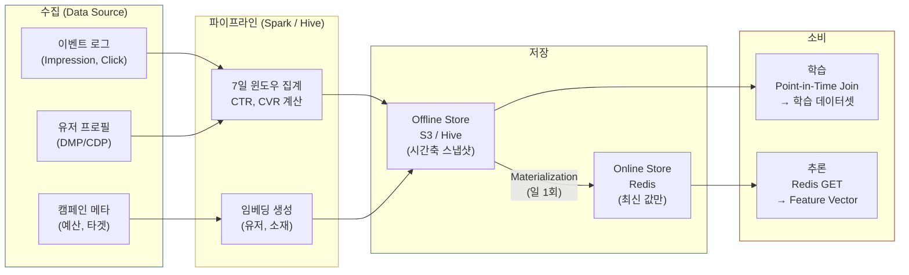
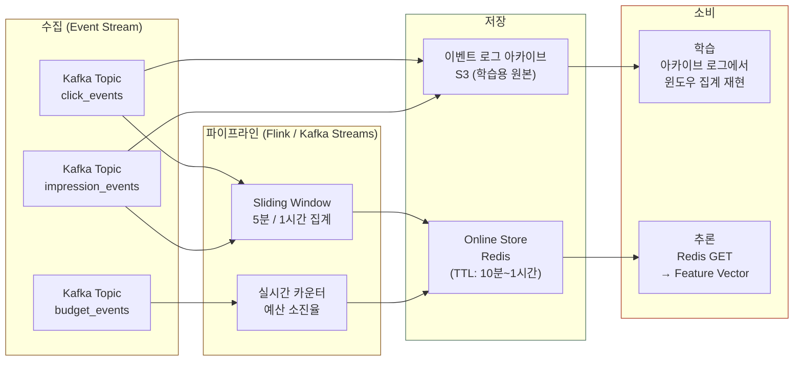
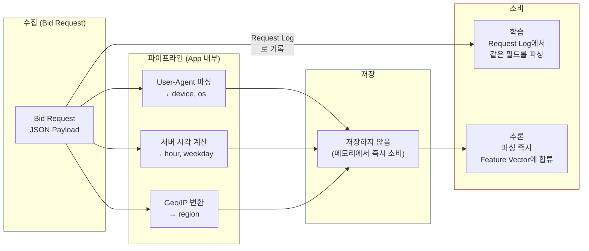

모델을 만드는 사람은 pCTR 모델의 AUC 를 0.01 올리려고 몇 주를 씁니다. pCTR 은 광고가 한 번 노출됐을 때 클릭될 확률을 모델이 예측한 값이고 AUC 는 클릭이 난 노출에 클릭이 나지 않은 노출보다 높은 pCTR 을 주었는지를 세는 지표라 1 에 가까울수록 좋습니다. 그런데 이렇게 다듬은 모델도 광고 요청이 올 때마다 **100ms 안에 피처를 모아 추론하는 시스템**이 없으면 실제 광고를 내보내는 운영 환경(프로덕션)에서 아무 일도 하지 못합니다. 여기서 피처는 모델이 예측에 쓰는 입력값이고 추론은 학습을 마친 모델로 예측값을 계산하는 일입니다. 이 글은 광고 ML 시스템의 **데이터 공급망**을 따라가며 피처가 어디서 만들어지고 어디에 저장되며 서빙(실제 광고를 고를 때 모델을 쓰는 일) 때 어떻게 꺼내지는지를 차례로 봅니다.

> [생태계 전체 지도](post.html?id=adtech-ecosystem-map)에서는 피처 스토어(Feature Store)가 한 줄로만 나왔는데, 이 글은 그 한 줄을 펼쳐서 자세히 들여다봅니다.

> **골라 읽는 법** — 절이 8개인 긴 글이라 처음부터 다 읽지 않고 필요한 절만 골라 읽어도 됩니다.
>
> - 피처가 만들어져 모델에 닿기까지의 전체 경로와 요청 한 건의 시간 예산 → 1~2절
> - 피처를 만드는 세 갈래 파이프라인(배치, 스트리밍, 실시간)과 파이프라인마다 다른 생애주기 → 3~4절
> - 피처 스토어 아키텍처와 신선도(피처 값이 얼마나 최근 것인가)의 맞바꿈 → 5~6절
> - 장애가 났을 때의 대응과 대신 쓰는 값 → 7절

---
## 1. 피처 서빙(Feature Serving)의 전체 조감도

**모델은 피처를 학습할 때 한 번, 광고를 고를 때 한 번, 이렇게 두 번 꺼내 쓰는데 두 번의 값이 조금이라도 다르면 오류 없이 틀린 값을 냅니다. 피처 스토어(Feature Store)는 학습과 서빙이 같은 정의와 같은 값을 보게 만들어 두 번의 값을 같게 맞추는 장치입니다.**

모델이 「이 사람이 이 광고를 누를 확률」을 계산하려면 입력으로 넣을 재료가 있어야 합니다. 나이, 관심사, 어제 본 것, 지금 시각 같은 값이 그 재료이고 이 재료를 **피처(feature)** 라고 부릅니다.

피처는 **두 번 꺼내 써야** 해서 문제가 생깁니다. 한 번은 과거 기록으로 모델을 가르치는 학습 때이고 또 한 번은 실제로 광고를 고르는 서빙 때인데, 두 번 꺼낸 값이 조금이라도 다르면 모델은 경고 하나 없이 조용히 틀립니다.

피처 스토어는 학습과 서빙이 같은 피처 정의와 같은 값을 보게 해서 두 번의 값을 같게 맞춥니다. 이 글은 피처 스토어가 어떻게 생겼는지, 그리고 요청 하나에 100밀리초 안에 재료를 꺼내 오려면 무엇을 포기해야 하는지를 다룹니다. 첫 카드는 이름이 같은 피처가 학습 때와 서빙 때 다른 값을 받으면 같은 사람의 pCTR 과 입찰가가 얼마나 달라지는지 보여 주며 같은 계산은 5절에서 숫자로 한 단계씩 다시 따라갑니다.

<div class="demo-embed-wrap">
<iframe class="demo-embed" src="demo-serving-cards.html?embed=1&card=skew" height="480" loading="lazy" title="같은 피처 이름, 다른 값"></iframe>
<a class="demo-embed-open" href="demo-serving-cards.html" target="_blank" rel="noopener">↗ 카드 다섯 장 전체로 열기</a>
</div>

모델을 돌리는 서버 이야기는 [모델(Model) Serving Architecture](post.html?id=model-serving-architecture) 편에 있고 이 글은 그 모델에 넣을 **재료를 꺼내 오는 과정**을 다룹니다. 재료가 만들어지기 전에 로그가 들어오는 파이프라인은 [광고 로그 파이프라인](post.html?id=ad-log-pipeline) 편에서 볼 수 있습니다.

아래 그림은 광고 ML 시스템에서 피처가 지나가는 전체 경로를 위에서 아래로 4층으로 나눠 그립니다.

<div class="chart-layer">
  <div class="chart-layer-title">DATA SOURCES</div>
  <div class="chart-layer-row">
    <div class="chart-layer-group">
      <div class="chart-layer-group-label">이벤트 로그</div>
      <div class="chart-layer-items">
        <span class="chart-layer-item blue">Impression</span>
        <span class="chart-layer-item blue">Click</span>
        <span class="chart-layer-item blue">Conversion</span>
      </div>
    </div>
    <div class="chart-layer-group">
      <div class="chart-layer-group-label">유저 프로필</div>
      <div class="chart-layer-items">
        <span class="chart-layer-item purple">DMP / CDP</span>
        <span class="chart-layer-item purple">Audience Segment</span>
      </div>
    </div>
    <div class="chart-layer-group">
      <div class="chart-layer-group-label">캠페인 메타</div>
      <div class="chart-layer-items">
        <span class="chart-layer-item orange">예산</span>
        <span class="chart-layer-item orange">타겟</span>
        <span class="chart-layer-item orange">소재</span>
      </div>
    </div>
    <div class="chart-layer-group">
      <div class="chart-layer-group-label">실시간 컨텍스트</div>
      <div class="chart-layer-items">
        <span class="chart-layer-item green">디바이스</span>
        <span class="chart-layer-item green">시간</span>
        <span class="chart-layer-item green">지면</span>
      </div>
    </div>
  </div>
  <div class="chart-layer-arrow">&#8595;</div>
  <div class="chart-layer-title">FEATURE PIPELINES</div>
  <div class="chart-layer-row">
    <div class="chart-layer-group">
      <div class="chart-layer-group-label">배치 파이프라인(Batch Pipeline) (수 시간)</div>
      <div class="chart-layer-items">
        <span class="chart-layer-item yellow">Spark / Hive</span>
        <span class="chart-layer-item yellow">집계, 통계, 임베딩</span>
      </div>
    </div>
    <div class="chart-layer-group">
      <div class="chart-layer-group-label">스트리밍 파이프라인(Streaming Pipeline) (수 분)</div>
      <div class="chart-layer-items">
        <span class="chart-layer-item orange">Flink / Kafka</span>
        <span class="chart-layer-item orange">윈도우 집계</span>
      </div>
    </div>
    <div class="chart-layer-group">
      <div class="chart-layer-group-label">실시간(Real-Time) (요청 시점)</div>
      <div class="chart-layer-items">
        <span class="chart-layer-item green">Application 내부</span>
        <span class="chart-layer-item green">파싱, 변환</span>
      </div>
    </div>
  </div>
  <div class="chart-layer-arrow">&#8595;</div>
  <div class="chart-layer-title">FEATURE STORE</div>
  <div class="chart-layer-row">
    <div class="chart-layer-group">
      <div class="chart-layer-group-label">피처 명세 목록(Feature Registry)</div>
      <div class="chart-layer-items">
        <span class="chart-layer-item purple">스키마</span>
        <span class="chart-layer-item purple">버전</span>
        <span class="chart-layer-item purple">메타데이터</span>
      </div>
    </div>
    <div class="chart-layer-group">
      <div class="chart-layer-group-label">오프라인 저장소(Offline Store) (학습용)</div>
      <div class="chart-layer-items">
        <span class="chart-layer-item blue">S3 / Hive</span>
        <span class="chart-layer-item blue">Point-in-Time</span>
      </div>
    </div>
    <div class="chart-layer-group">
      <div class="chart-layer-group-label">온라인 저장소(Online Store) (서빙용)</div>
      <div class="chart-layer-items">
        <span class="chart-layer-item cyan">Redis</span>
        <span class="chart-layer-item cyan">DynamoDB</span>
      </div>
    </div>
  </div>
  <div class="chart-layer-arrow">&#8595;</div>
  <div class="chart-layer-title">ONLINE SERVING (~10ms)</div>
  <div class="chart-layer-row">
    <div class="chart-layer-group">
      <div class="chart-layer-group-label">피처 조회(Feature Lookup)</div>
      <div class="chart-layer-items">
        <span class="chart-layer-item cyan">Key: user_id, ad_id</span>
      </div>
    </div>
    <div class="chart-layer-group">
      <div class="chart-layer-group-label">피처 벡터(Feature Vector) 조합</div>
      <div class="chart-layer-items">
        <span class="chart-layer-item cyan">Pre-computed + On-the-fly</span>
      </div>
    </div>
    <div class="chart-layer-group">
      <div class="chart-layer-group-label">모델 추론(Model Inference)</div>
      <div class="chart-layer-items">
        <span class="chart-layer-item pink">pCTR</span>
        <span class="chart-layer-item pink">pCVR</span>
      </div>
    </div>
    <div class="chart-layer-group">
      <div class="chart-layer-group-label">DSP Bidder</div>
      <div class="chart-layer-items">
        <span class="chart-layer-item pink">참 가치(True Value) &rarr; Bid Shading</span>
      </div>
    </div>
  </div>
</div>

맨 위층 데이터 원천(DATA SOURCES)에는 노출(Impression), 클릭, 전환(구매처럼 광고주가 바라는 행동) 같은 이벤트 로그가 있습니다. 유저 프로필은 DMP 나 CDP(유저의 관심사와 속성 같은 프로필 데이터를 모아 관리하는 플랫폼)와 오디언스 세그먼트(비슷한 유저를 모은 그룹)에서 옵니다. 캠페인 메타는 예산, 타겟, 소재(광고에 쓰는 이미지나 문구)입니다. 실시간 컨텍스트는 디바이스, 시간, 지면(광고가 실리는 자리)처럼 요청과 함께 들어오는 정보입니다.

둘째 층의 세 갈래 피처 파이프라인이 이 원천으로 피처를 만듭니다. 배치(Batch) 파이프라인은 대용량 데이터를 한꺼번에 계산하는 Spark 나 Hive 로 몇 시간마다 집계, 통계, 임베딩(유저나 광고를 숫자 여러 개짜리 벡터로 나타낸 값)을 계산합니다. 스트리밍(Streaming) 파이프라인에서는 이벤트를 받아 차례로 넘겨주는 메시지 큐 Kafka 가 이벤트를 전하고 이벤트가 오는 대로 계산하는 스트림 처리 엔진 Flink 가 몇 분짜리 윈도우(최근 5분처럼 정해 둔 시간 구간)로 집계합니다. 실시간(Real-Time) 파이프라인은 요청이 온 시점에 애플리케이션 안에서 요청을 파싱하고 변환합니다.

셋째 층의 피처 스토어는 세 부분으로 되어 있습니다. 피처 명세 목록(Feature Registry)은 피처마다 스키마, 버전, 메타데이터를 적어 둡니다. 오프라인 저장소(Offline Store)는 학습용으로 S3 나 Hive 에 피처를 과거 시점별로 남겨 두어 Point-in-Time 조회, 다시 말해 과거 어느 시점의 값을 그대로 꺼내는 조회를 할 수 있게 합니다. 온라인 저장소(Online Store)는 서빙용으로 Redis 나 DynamoDB 같은 Key-Value 저장소(키 하나로 값을 바로 찾는 저장소)에 최신 값을 둡니다.

맨 아래층 온라인 서빙(ONLINE SERVING)은 ~10ms 안에 끝나야 하는 단계입니다. `user_id` 와 `ad_id` 를 키로 피처를 조회(Feature Lookup)하고 미리 계산해 둔 값(Pre-computed)과 요청 때 바로 계산한 값(On-the-fly)을 합쳐 피처 벡터(Feature Vector)를 만듭니다. 이 벡터로 모델 추론을 해서 pCTR 과 pCVR(클릭한 사람이 전환까지 갈 확률)을 냅니다. 마지막으로 DSP(광고주를 대신해 광고 자리마다 입찰하는 시스템)의 입찰기(DSP Bidder)가 참 가치(True Value, 노출 한 번이 광고주에게 주는 가치)를 구하고 Bid Shading(참 가치를 그대로 내지 않고 그보다 낮춰 부르는 방법)으로 입찰가를 정합니다.

그림의 흐름은 두 단계로 요약됩니다. **세 갈래의 피처 파이프라인**(배치, 스트리밍, 실시간)이 피처 스토어 하나로 모이고 서빙 시점에는 이 피처들이 피처 벡터(모델에 넣는 숫자 목록) 하나로 조합됩니다.

### 광고 요청 1건에 필요한 피처 분류

광고 요청 한 건에 들어가는 피처는 아래 5가지 종류입니다. 표는 종류마다 예시, 만드는 방식, 갱신 주기, 저장 위치를 보여 주는데 컨텍스트 피처만 요청 시점에 계산해 바로 쓰고 나머지 4가지는 배치나 스트리밍으로 미리 만들어 온라인 저장소에 넣어 둡니다.

| 피처 유형 | 예시 | 생성 방식 | 갱신 주기 | 저장 위치 |
|-----------|------|----------|----------|----------|
| **유저 피처** | 과거 7일 CTR, 관심사 세그먼트, 최근 본 카테고리 | 배치 / 스트리밍 | 수 시간 ~ 수 분 | 온라인 저장소 |
| **광고 피처** | 광고 과거 CTR, 소재 임베딩, 캠페인 잔여 예산 | 배치 / 스트리밍 | 수 시간 ~ 수 분 | 온라인 저장소 |
| **지면 피처** | 지면 카테고리, 평균 CTR, 광고 슬롯 위치 | 배치 | 수 시간 | 온라인 저장소 |
| **컨텍스트 피처** | 디바이스, OS, 시간대, 요일, 지역 | 실시간 | 요청 시점 | 계산 후 즉시 사용 |
| **교차 피처** | 유저×광고 과거 노출 횟수, 유저×카테고리 선호도 | 배치 / 스트리밍 | 수 시간 ~ 수 분 | 온라인 저장소 |

예시 칸의 CTR 은 노출 가운데 클릭이 난 비율입니다. 교차 피처는 유저와 광고, 유저와 카테고리처럼 두 대상을 짝지어 짝마다 값을 따로 두는 피처라서 「유저×광고 과거 노출 횟수」는 같은 유저에게 같은 광고가 지금까지 몇 번 나갔는지를 담습니다.

---

## 2. 광고 요청 한 건에서 피처가 모이는 과정

**입찰 요청 한 건이 도착하면 DSP 는 유저, 광고, 지면, 컨텍스트 피처를 모아 피처 벡터를 만들고 모델 추론과 입찰 로직까지 마치는 데 ~5-8ms 를 씁니다. 그 가운데 피처 조회는 여러 조회를 동시에 보내는 병렬 조회로 ~1ms 에 끝냅니다.**

유저가 페이지를 열면 그 광고 자리에 얼마를 낼지 묻는 입찰 요청(Bid Request)이 DSP 에 도착하고 DSP 는 짧은 시간 안에 여러 곳에 있는 피처를 모아 답해야 합니다. 아래 타임라인은 입찰 요청이 도착한 순간부터 피처를 조합하고 모델 추론을 마친 뒤 입찰 로직까지 끝내는 DSP 내부 처리를 차례로 그린 그림이고 목표 시간은 ~10ms 이내입니다.

<div class="chart-timeline">
  <div style="display:flex; justify-content:space-between; align-items:center; margin-bottom:8px;">
    <span style="font-size:0.85rem; font-weight:700; color:var(--text-primary);">DSP 내부 처리 타임라인</span>
    <span style="font-size:0.75rem; color:var(--text-muted);">목표: ~10ms 이내</span>
  </div>
  <div style="font-size:0.72rem; color:var(--text-muted); margin-bottom:4px;">1. 입찰 요청 수신 &rarr; 피처 Gateway</div>
  <div class="chart-timeline-bar">
    <div class="chart-timeline-segment blue" style="width:12%;">유저 피처<br/>0.5ms</div>
    <div class="chart-timeline-segment cyan" style="width:14%;">광고 피처 N개<br/>1ms</div>
    <div class="chart-timeline-segment purple" style="width:8%;">지면 피처<br/>0.5ms</div>
    <div class="chart-timeline-segment green" style="width:4%;">컨텍스트<br/>0.1ms</div>
    <div class="chart-timeline-segment orange" style="width:8%;">벡터(Vector) 조합<br/>0.5ms</div>
    <div class="chart-timeline-segment pink" style="width:38%;">모델 추론 (pCTR, pCVR)<br/>2-5ms</div>
    <div class="chart-timeline-segment" style="width:16%; background:rgba(176,38,255,0.5);">Bid Logic<br/>1ms</div>
  </div>
  <div class="chart-timeline-labels">
    <span>0ms</span>
    <span>|</span>
    <span style="color:var(--accent-primary); font-weight:600;">병렬 조회 구간 (~1ms)</span>
    <span>|</span>
    <span>5ms</span>
    <span>|</span>
    <span>8ms</span>
    <span>|</span>
    <span>10ms</span>
  </div>
  <div class="chart-timeline-legend">
    <div class="chart-timeline-legend-item">
      <div class="chart-timeline-legend-dot" style="background:rgba(54,162,235,0.7);"></div>
      <span>피처 조회 (Redis)</span>
    </div>
    <div class="chart-timeline-legend-item">
      <div class="chart-timeline-legend-dot" style="background:rgba(75,192,192,0.6);"></div>
      <span>실시간 계산 (CPU only)</span>
    </div>
    <div class="chart-timeline-legend-item">
      <div class="chart-timeline-legend-dot" style="background:rgba(255,159,64,0.6);"></div>
      <span>벡터 조합 (메모리)</span>
    </div>
    <div class="chart-timeline-legend-item">
      <div class="chart-timeline-legend-dot" style="background:rgba(255,99,132,0.6);"></div>
      <span>모델 추론 (GPU/CPU)</span>
    </div>
    <div class="chart-timeline-legend-item">
      <div class="chart-timeline-legend-dot" style="background:rgba(176,38,255,0.5);"></div>
      <span>입찰 로직</span>
    </div>
  </div>
</div>

막대의 앞쪽 4칸인 유저 피처(0.5ms), 후보 광고 N개의 광고 피처(1ms), 지면 피처(0.5ms), 컨텍스트(0.1ms)는 한꺼번에 진행하는 병렬 조회 구간이라서, 이 구간은 그중 가장 오래 걸리는 광고 피처 조회가 끝나는 1ms 에 함께 끝납니다. 그 뒤로 피처를 이어 붙이는 벡터 조합(0.5ms), 모델 추론(2-5ms), Bid Logic(1ms)이 차례로 이어집니다. Bid Logic 은 모델이 낸 pCTR 과 pCVR 로 참 가치를 구하고 Bid Shading 으로 입찰가를 정하는 입찰 로직 단계입니다. 범례의 색은 Redis 에서 읽는 피처 조회, CPU 로만 하는 실시간 계산, 메모리 안의 벡터 조합, GPU 나 CPU 에서 도는 모델 추론, 입찰 로직을 구분합니다.

카드에서는 타임라인 맨 앞에서 하루 한 번 만드는 배치 표, 매 분 갱신하는 스트림 카운터, 요청에서 바로 읽는 값까지 세 갈래의 피처가 한 요청 안에서 모이는 자리를 보면 됩니다.

<div class="demo-embed-wrap">
<iframe class="demo-embed" src="demo-ops-cards.html?embed=1&card=threefeeds" height="480" loading="lazy" title="세 갈래 피처가 한 벡터로 모이는 자리"></iframe>
<a class="demo-embed-open" href="demo-ops-cards.html" target="_blank" rel="noopener">↗ 카드 여섯 장 전체로 열기</a>
</div>

### 시간 예산 분배

아래 표는 단계마다 걸리는 시간을 중앙값(p50, 요청의 절반이 이보다 빨리 끝나는 값)으로 적었습니다.

| 단계 | 소요 시간 (p50) | 비고 |
|------|----------------|------|
| 피처 조회 (병렬) | ~1ms | Redis MGET, 네트워크 왕복 포함 |
| 컨텍스트 피처 계산 | ~0.1ms | CPU 연산만 (I/O 없음) |
| 피처 벡터 조합 | ~0.5ms | 메모리 내 concat + 정규화 |
| 모델 추론 | ~2-5ms | 모델 복잡도에 비례 |
| Bid Logic | ~1ms | 참 가치 + Shading |
| **합계** | **~5-8ms** | DSP 내부 처리 총합 |

합계 ~5-8ms 는 피처 조회 ~1ms, 컨텍스트 피처 계산 ~0.1ms, 벡터 조합 ~0.5ms, Bid Logic ~1ms 에 모델 추론 ~2-5ms 를 더한 값입니다. 모델 추론은 모델이 복잡할수록 길어지므로 합계도 모델이 복잡할수록 8ms 쪽에 가까워집니다. 피처 조회 ~1ms 에는 Redis MGET(키 여러 개의 값을 한 번의 왕복으로 읽는 명령)의 네트워크 왕복 시간까지 들어 있습니다. 컨텍스트 피처 계산은 CPU 연산만 하고 I/O(디스크나 네트워크를 거치는 입출력)가 없어서 ~0.1ms 로 짧습니다. 벡터 조합은 메모리 안에서 피처를 이어 붙이고(concat) 정규화(값의 범위를 맞추는 변환)하는 단계입니다.

피처 조회를 ~1ms 에 끝내려면 병렬 조회가 필요합니다. 유저, 광고, 지면, 컨텍스트 피처를 하나씩 차례로(순차적으로) 가져오면 4ms 가 들지만 네 가지 조회를 동시에 보내는 병렬 조회로 가져오면 1ms 에 끝납니다. 순차와 병렬의 차이인 3ms 가 후보 광고 수를 2배 이상 늘릴 여유를 만듭니다.

### 실전 예시: Redis 에서 피처를 조회하는 명령

아래는 입찰 요청(유저 `U98712`, 후보 광고 A001, A002, A003, 지면 S50)이 도착했을 때 피처 Gateway(요청을 받아 피처를 모아 주는 서버)가 Redis 에 보내는 명령입니다. HGETALL 은 해시(Hash, 키 하나에 필드와 값의 쌍을 여러 개 담는 Redis 자료형)에서 그 키의 필드를 모두 읽는 명령입니다. 후보 광고 3개는 Pipeline(명령 여러 개를 모아 한 번에 보내는 방식)으로 한꺼번에 조회합니다.

```bash
# 1. Bid Request 수신: user_id=U98712, ad_candidates=[A001, A002, A003], slot=S50

# 2a. 유저 피처 조회 (Hash)
HGETALL user:U98712
# → {
#     "ctr_7d": "0.023",         ← 최근 7일 CTR
#     "click_count_5m": "3",     ← 최근 5분 클릭 수 (Streaming)
#     "interest": "auto,finance", ← 관심사 세그먼트
#     "embedding": "[0.12, -0.34, ...]"  ← 유저 임베딩 (128차원)
#   }

# 2b. 광고 피처 일괄 조회 (Pipeline)
HGETALL ad:A001
HGETALL ad:A002
HGETALL ad:A003
# → 각 광고별 { "historical_ctr": "0.045", "creative_emb": "[...]", "budget_remain": "0.73" }

# 2c. 지면 피처 조회
HGETALL slot:S50
# → { "category": "news", "avg_ctr": "0.031", "position": "above_fold" }

# 2d. 컨텍스트 피처 (Redis 조회 아님 — 요청 데이터에서 직접 파싱)
# device=mobile, os=iOS, hour=14, weekday=Thu, geo=KR
```

주석의 → 뒤가 명령마다 돌아오는 값입니다. 유저 키 `user:U98712` 에서는 최근 7일 CTR 0.023, 스트리밍으로 갱신하는 최근 5분 클릭 수 3, 관심사 세그먼트 auto,finance, 128차원 유저 임베딩이 나옵니다. 광고 키마다 과거 CTR(예: 0.045), 소재 임베딩, 잔여 예산 비율(예: 0.73)이 나오고 지면 키 `slot:S50` 에서는 카테고리 news, 평균 CTR 0.031, 위치 `above_fold`(스크롤하지 않아도 보이는 화면 윗부분)가 나옵니다. 컨텍스트 피처(device=mobile, os=iOS, hour=14, weekday=Thu, geo=KR)는 Redis 를 조회하지 않고 요청 데이터에서 바로 파싱합니다.

이렇게 모은 피처는 아래처럼 피처 벡터 하나로 이어 붙입니다(concat). 이 블록은 합친 모양을 간략히 보여 주기만 하므로 돌려도 아무것도 찍지 않습니다.

```python
# 하는 일: 유저, 광고, 지면, 컨텍스트 피처를 pCTR 모델에 넣을 피처 벡터 하나로 합친 모양을 간략히 보여 주며, 돌려도 찍는 것은 없다.
feature_vector = {
    # 유저 피처 (Batch + Streaming)
    "user_ctr_7d": 0.023,
    "user_click_count_5m": 3,
    "user_interest_auto": 1,    # one-hot
    "user_interest_finance": 1, # one-hot
    "user_embedding": [0.12, -0.34, ...],  # 128dim

    # 광고 피처 (Batch)
    "ad_historical_ctr": 0.045,
    "ad_creative_embedding": [0.08, 0.21, ...],  # 64dim
    "ad_budget_remain_ratio": 0.73,

    # 지면 피처 (Batch)
    "slot_category_news": 1,    # one-hot
    "slot_avg_ctr": 0.031,
    "slot_position_above_fold": 1,

    # 컨텍스트 피처 (Real-Time)
    "device_mobile": 1,
    "os_ios": 1,
    "hour_of_day": 14,
    "is_weekday": 1,
}
# 이 벡터가 pCTR 모델에 들어가 pCTR(user=U98712, ad=A001) = 0.038 같은 값을 낸다.
```

관심사 auto,finance 는 `user_interest_auto` 와 `user_interest_finance` 두 칸에 1 이 들어가는 one-hot(값의 종류마다 칸을 하나씩 두고 해당하는 칸에만 1 을 넣는 방식)으로 바뀝니다. 지면 카테고리 news, 디바이스 mobile, OS iOS 도 같은 방식으로 해당 칸에 1 이 들어갑니다. 주석의 괄호(Batch, Streaming, Real-Time)는 그 피처를 만든 파이프라인입니다. 블록 끝 주석대로 이 벡터를 pCTR 모델에 넣으면 pCTR(user=U98712, ad=A001) = 0.038 같은 값이 나옵니다.

---

## 3. 배치(오프라인), 스트리밍(Near-Real-Time), 실시간 피처 파이프라인 [무대: 공통]

**피처마다 값이 얼마나 최근 것이어야 하는지(신선도)가 다르고 신선하게 만들수록 비용이 듭니다. 그래서 실무에서는 피처를 신선도에 따라 나눠 수 시간에서 1일 주기의 배치, 수 초에서 수 분 주기의 스트리밍, 요청 시점에 계산하는 실시간, 이렇게 세 파이프라인에서 따로 만듭니다.**

제목의 오프라인은 배치 파이프라인을, Near-Real-Time 은 스트리밍 파이프라인을 가리킵니다. 제목 끝의 [무대: 공통] 은 이 절의 내용이 광고가 거래되는 두 무대, 다시 말해 닫힌 생태계(담장 안, 사용자가 로그인해 쓰는 플랫폼이 광고 경매까지 직접 돌리는 곳)와 열린 RTB(남이 운영하는 거래소에 입찰을 넣는 곳)에 모두 통한다는 표시입니다.

피처를 파이프라인 하나로 다 만들 수는 없을까요? 피처마다 「언제까지 신선해야 하는가」가 달라서 그렇게 할 수 없습니다. 「이 유저의 지난 30일 구매 횟수」는 오늘 아침 값과 지금 값이 거의 같으므로 하루에 한 번 계산해도 충분하지만 「이 유저가 지금 세션에서 본 광고 수」는 초 단위로 바뀌므로 어제 계산한 값은 쓸모가 없습니다.

여기서 맞바꿈(trade-off)이 하나 생기는데 신선하게 만들려면 비싸집니다. 하루에 한 번 배치로 돌리면 큰 계산도 싸게 할 수 있지만 초 단위로 갱신하려면 스트리밍 인프라를 구성해 쉬지 않고 돌려야 합니다. 그래서 실무에서는 **피처를 신선도별로 나눠 신선도마다 다른 파이프라인에서 만듭니다.**

카드에서는 세 갈래가 각각 어떤 피처를 맡는지와 만든 값을 얼마나 오래된 채로 쓰는지를 보면 됩니다.

<div class="demo-embed-wrap">
<iframe class="demo-embed" src="demo-feature-cards.html?embed=1&card=threepipes" height="480" loading="lazy" title="피처는 신선도별로 다른 길에 탄다"></iframe>
<a class="demo-embed-open" href="demo-feature-cards.html" target="_blank" rel="noopener">↗ 카드 여섯 장 전체로 열기</a>
</div>

아래 카드 3장은 세 파이프라인이 각각 다른 시간 해상도(값을 다시 계산하는 간격)의 피처를 맡는다는 점을 처리 엔진, 저장소, 장점, 한계, 장애 영향으로 나란히 비교합니다.

<div class="chart-cards">
  <div class="chart-card">
    <div class="chart-card-header">
      <div class="chart-card-icon yellow">B</div>
      <div>
        <div class="chart-card-name">배치 파이프라인</div>
        <div class="chart-card-subtitle">수 시간 ~ 1일 주기</div>
      </div>
    </div>
    <div class="chart-card-body">
      <div class="chart-card-row">
        <span class="chart-card-row-label">처리 엔진</span>
        <span class="chart-card-row-value">Spark, Hive, BigQuery</span>
      </div>
      <div class="chart-card-row">
        <span class="chart-card-row-label">저장소</span>
        <span class="chart-card-row-value">S3/Hive &rarr; Redis</span>
      </div>
      <div class="chart-card-row">
        <span class="chart-card-row-label">장점</span>
        <span class="chart-card-row-value">복잡한 집계, 대용량</span>
      </div>
      <div class="chart-card-row">
        <span class="chart-card-row-label">한계</span>
        <span class="chart-card-row-value">데이터 지연 (stale)</span>
      </div>
      <div class="chart-card-row">
        <span class="chart-card-row-label">장애 영향</span>
        <span class="chart-card-row-value">성능 서서히 저하</span>
      </div>
    </div>
    <div class="chart-card-tags">
      <span class="chart-card-tag">유저 7일 CTR</span>
      <span class="chart-card-tag">광고 과거 성과</span>
      <span class="chart-card-tag">유저 임베딩</span>
    </div>
  </div>
  <div class="chart-card">
    <div class="chart-card-header">
      <div class="chart-card-icon orange">S</div>
      <div>
        <div class="chart-card-name">스트리밍 파이프라인</div>
        <div class="chart-card-subtitle">수 초 ~ 수 분 주기</div>
      </div>
    </div>
    <div class="chart-card-body">
      <div class="chart-card-row">
        <span class="chart-card-row-label">처리 엔진</span>
        <span class="chart-card-row-value">Flink, Kafka Streams</span>
      </div>
      <div class="chart-card-row">
        <span class="chart-card-row-label">저장소</span>
        <span class="chart-card-row-value">Redis 직접 기록</span>
      </div>
      <div class="chart-card-row">
        <span class="chart-card-row-label">장점</span>
        <span class="chart-card-row-value">최신 트렌드 반영</span>
      </div>
      <div class="chart-card-row">
        <span class="chart-card-row-label">한계</span>
        <span class="chart-card-row-value">인프라 복잡도 높음</span>
      </div>
      <div class="chart-card-row">
        <span class="chart-card-row-label">장애 영향</span>
        <span class="chart-card-row-value">입찰 정확도 하락</span>
      </div>
    </div>
    <div class="chart-card-tags">
      <span class="chart-card-tag">최근 5분 CTR</span>
      <span class="chart-card-tag">예산 소진율</span>
      <span class="chart-card-tag">트렌딩 카테고리</span>
    </div>
  </div>
  <div class="chart-card">
    <div class="chart-card-header">
      <div class="chart-card-icon green">RT</div>
      <div>
        <div class="chart-card-name">실시간</div>
        <div class="chart-card-subtitle">요청 시점 (0ms 지연)</div>
      </div>
    </div>
    <div class="chart-card-body">
      <div class="chart-card-row">
        <span class="chart-card-row-label">처리 엔진</span>
        <span class="chart-card-row-value">애플리케이션 내부</span>
      </div>
      <div class="chart-card-row">
        <span class="chart-card-row-label">저장소</span>
        <span class="chart-card-row-value">저장 안 함 (즉시 소비)</span>
      </div>
      <div class="chart-card-row">
        <span class="chart-card-row-label">장점</span>
        <span class="chart-card-row-value">지연 없음, I/O 없음</span>
      </div>
      <div class="chart-card-row">
        <span class="chart-card-row-label">한계</span>
        <span class="chart-card-row-value">단순 계산만 가능</span>
      </div>
      <div class="chart-card-row">
        <span class="chart-card-row-label">장애 영향</span>
        <span class="chart-card-row-value">파싱 실패 &rarr; 입찰 불가</span>
      </div>
    </div>
    <div class="chart-card-tags">
      <span class="chart-card-tag">디바이스 타입</span>
      <span class="chart-card-tag">시간대</span>
      <span class="chart-card-tag">지면 URL</span>
    </div>
  </div>
</div>

배치 파이프라인은 Spark, Hive, BigQuery 로 계산해 S3/Hive 에 쌓은 값을 Redis 로 옮깁니다. 복잡한 집계와 대용량 계산에 강한 대신 다음 계산 전까지는 지난 값을 그대로 쓰므로 데이터가 늦게 반영됩니다(stale, 값이 지금보다 오래된 상태). 배치에 장애가 나면 값이 점점 더 오래되면서 성능이 서서히 떨어집니다. 스트리밍 파이프라인은 Flink 나 Kafka Streams(Kafka 위에서 도는 스트림 처리 라이브러리)로 계산한 값을 Redis 에 직접 기록합니다. 최신 흐름을 반영하는 장점이 있지만 인프라가 복잡합니다. 스트리밍에 장애가 나면 최근 행동이 빠지므로 입찰 정확도가 떨어집니다. 실시간 파이프라인은 애플리케이션 안에서 요청을 읽고 저장 없이 바로 쓰므로 지연과 I/O 가 없지만 단순한 계산만 할 수 있습니다. 실시간 파싱이 실패하면 그 피처를 만들 수 없어 입찰도 할 수 없습니다.

### 피처별 파이프라인 매핑 예시

아래 목록은 피처마다 어느 파이프라인에서 어떻게 만드는지 적은 예시입니다.

```text
[Batch]  유저 과거 7일 CTR         ← Spark에서 일 1회 집계
[Batch]  광고 소재 임베딩            ← 모델 학습 후 업데이트
[Batch]  유저 관심사 세그먼트        ← DMP/CDP 연동, 일 1회 갱신

[Stream] 유저 최근 5분 클릭 수      ← Flink 윈도우 집계, Redis INCR
[Stream] 광고 최근 1시간 CTR        ← Sliding window, 매 분 갱신
[Stream] 캠페인 잔여 예산 비율      ← 소진 이벤트 실시간 차감

[RT]     디바이스 타입 (mobile/desktop)  ← Bid Request User-Agent 파싱
[RT]     시간대 (hour_of_day)            ← 서버 시각 기준 계산
[RT]     지면 URL 카테고리               ← URL 패턴 매칭 또는 lookup
```

[Batch] 줄의 세 피처는 Spark 의 일 1회 집계, 모델 학습 뒤 업데이트, DMP/CDP 연동의 일 1회 갱신처럼 배치 작업이 돌 때만 바뀝니다. [Stream] 줄의 세 피처는 분 단위 이하로 바뀌며 Flink 의 윈도우 집계와 Redis INCR(키에 든 숫자를 1 올리는 명령), 매 분 다시 계산하는 Sliding window(구간을 조금씩 밀며 다시 집계하는 윈도우), 소진 이벤트가 올 때마다 남은 예산을 깎는 방식으로 갱신됩니다. [RT] 줄의 세 피처는 입찰 요청의 User-Agent(브라우저와 기기 정보를 담은 문자열)와 서버 시각에서 그 자리에서 계산하고 지면 URL 은 패턴 매칭이나 lookup(미리 만든 표에서 찾아보기)으로 카테고리를 정합니다.

---

## 4. 파이프라인별 피처 생애주기(Lifecycle) — 수집 → 저장 → 학습 → 추론

**같은 피처라도 학습 때와 추론 때 읽는 곳이 다릅니다. 배치 피처는 학습이 오프라인 저장소를 읽고 추론이 온라인 저장소를 읽습니다. 스트리밍 피처는 학습 때 원본 이벤트 로그로 같은 윈도우 집계를 다시 계산합니다. 실시간 피처는 저장소 없이 학습 때 요청 로그를 같은 방식으로 파싱합니다.**

1절의 조감도는 전체를 한눈에 보여 주지만 피처 하나가 어떤 경로를 지나는지는 잘 보이지 않습니다. 이 절은 **배치, 스트리밍, 실시간 피처를 하나씩 따로** 따라가며 피처의 생애주기(Lifecycle)를 봅니다. 생애주기는 피처가 수집되어 파이프라인을 지나 저장되고 학습과 추론에 쓰이기까지의 경로입니다.

### 4-1. 배치 피처의 생애주기

아래 그림은 배치 피처의 경로입니다. 이벤트 로그와 유저 프로필은 Spark/Hive 의 7일 윈도우 집계에서 CTR 과 CVR(클릭 가운데 전환한 비율)로 계산됩니다. 캠페인 메타는 유저와 소재의 임베딩 생성에 쓰입니다. 두 계산의 결과는 오프라인 저장소에 쌓였다가 하루에 한 번 온라인 저장소로 옮겨집니다.



그림에서 오프라인 저장소(S3/Hive)는 피처 값을 시각과 함께 시간축 스냅샷(시점마다 찍어 둔 값)으로 쌓고 온라인 저장소(Redis)는 최신 값만 둡니다. 그래서 배치 피처는 학습과 추론이 **같은 피처 정의**를 쓰면서도 읽는 저장소가 다릅니다. 학습은 과거 그 시점의 값을 복원해야 하므로 오프라인 저장소를 읽습니다. 추론은 지금 값이 필요하므로 온라인 저장소에서 Redis GET 으로 읽습니다. 오프라인 저장소의 값을 온라인 저장소로 복사해 맞추는 작업을 Materialization 이라고 부르며 이 그림에서는 하루에 한 번 돕니다. 그림의 학습 칸에 있는 Point-in-Time Join 은 노출이나 클릭이 일어난 그 시점의 피처 값을 찾아 붙이는 조인입니다. 이 글은 이 조인을 그 시점으로 되돌려 잇기라고 부르고 5절에서 자세히 봅니다.

카드에서는 정의가 하나뿐인 피처(유저 7일 클릭률)를 학습은 오프라인 저장소에서, 서빙은 온라인 저장소에서 읽는 모습을 볼 수 있습니다.

<div class="demo-embed-wrap">
<iframe class="demo-embed" src="demo-feature-cards.html?embed=1&card=twostores" height="480" loading="lazy" title="같은 피처인데 읽는 곳이 둘"></iframe>
<a class="demo-embed-open" href="demo-feature-cards.html" target="_blank" rel="noopener">↗ 카드 여섯 장 전체로 열기</a>
</div>

### 4-2. 스트리밍 피처의 생애주기

스트리밍 피처는 Kafka 토픽(같은 종류의 이벤트가 쌓이는 Kafka 의 채널) `click_events`, `impression_events`, `budget_events` 로 들어온 이벤트에서 만듭니다. 아래 그림처럼 Flink 나 Kafka Streams 가 클릭과 노출을 5분이나 1시간 단위의 Sliding Window 로 집계하고 예산 이벤트로 예산 소진율을 세어 Redis 에 씁니다. 클릭과 노출 이벤트의 원본은 따로 S3 에 아카이브(학습용으로 오래 보관)합니다.



그림의 Redis 에는 TTL(Time To Live, 키를 저장한 뒤 자동으로 지우기까지의 시간)이 10분에서 1시간까지 걸려 있습니다. 추론은 Flink 가 이벤트를 받는 대로 계산해 Redis 에 넣어 둔 값을 읽지만 학습은 원본 이벤트 로그를 다시 읽어 **같은 윈도우 집계를 재현**해야 합니다. 추론과 학습이 같은 피처를 서로 다른 경로에서 계산하는 이 불일치가 학습과 서빙의 피처 어긋남(Training-Serving Skew, 학습 때 본 피처 값과 서빙 때 받는 값이 다른 현상)의 주요 원인입니다.

Flink 는 Redis 에 바로 쓰고 Redis 의 값은 TTL 이 지나면 사라지는데, 학습은 무엇을 읽어야 할까요? Kafka 에서 나온 이벤트는 **두 갈래**로 가므로 학습도 같은 이벤트를 읽을 수 있습니다.

1. **추론 경로:** Kafka → Flink 의 윈도우 집계 → Redis → 모델이 이 값을 읽습니다
2. **학습 경로:** Kafka → 원본 이벤트를 손대지 않고 S3/Hive 에 아카이브합니다

Redis 의 값은 TTL 이 지나면 지워져 학습 데이터로 쓸 수 없으므로 학습은 아카이브한 원본 이벤트를 Spark 같은 배치 도구로 다시 읽어 같은 윈도우 로직을 재현합니다. 아래 SQL 은 「2026-04-10 14:00 에 유저 U98712 의 최근 5분 클릭 수」를 다시 계산하는 쿼리입니다.

```sql
-- 학습 시: "2026-04-10 14:00에 유저 U98712의 최근 5분 클릭 수"를 재현
SELECT user_id, COUNT(*) AS click_count_5m
FROM click_events_archive
WHERE user_id = 'U98712'
  AND event_time BETWEEN '2026-04-10 13:55:00' AND '2026-04-10 14:00:00'
GROUP BY user_id
-- → "그 시점에 Redis에 들어있었을 값"을 과거 데이터로부터 복원
```

WHERE 절이 `click_events_archive` 에서 13:55:00 부터 14:00:00 까지의 클릭만 세므로, 결과 `click_count_5m` 은 그 시점에 Redis 에 들어 있었을 값을 과거 데이터로 복원한 값입니다.

### 4-3. 실시간 피처의 생애주기

실시간 피처는 입찰 요청의 JSON 을 앱 안에서 바로 파싱해 만듭니다. 아래 그림처럼 User-Agent 를 파싱해 device 와 os 를, 서버 시각에서 hour 와 weekday 를, Geo/IP 변환으로 region 을 얻습니다.



그림의 저장 칸이 「저장하지 않음」인 것처럼 실시간 피처는 저장소를 거치지 않고 메모리에서 바로 쓰입니다. 추론 때는 입찰 요청을 직접 파싱하고 학습 때는 요청 로그(Request Log)에 기록해 둔 같은 필드를 파싱합니다.

저장소가 없으면 학습은 어디서 같은 값을 얻을까요? 입찰 요청 자체를 **요청 로그**로 따로 기록해 둡니다. 이 기록은 추론에 쓰는 경로와 별개입니다.

1. **추론 경로:** 입찰 요청 JSON → 앱 안에서 파싱 → 곧바로 피처 벡터에 들어갑니다
2. **학습 경로:** 입찰 요청 JSON → 요청 로그로 S3 에 기록 → 학습할 때 같은 방식으로 파싱합니다

아래는 S3 에 저장된 요청 로그 한 건과 학습 때 같은 파싱 로직을 적용해 얻는 값입니다.

```json
// Request Log (S3에 저장됨)
{
  "request_id": "req-abc123",
  "user_id": "U98712",
  "timestamp": "2026-04-10T14:00:00Z",
  "user_agent": "Mozilla/5.0 (iPhone; ...)",
  "page_url": "https://news.example.com/auto",
  "slot_id": "S50",
  "geo": "KR"
}
// 학습 시 같은 파싱 로직 적용:
// user_agent → device=mobile, os=iOS
// timestamp  → hour=14, weekday=Thu
// page_url   → category=auto
```

주석처럼 `user_agent` 에서는 device 와 os 가, `timestamp` 에서는 hour 와 weekday 가, `page_url` 의 경로 /auto 에서는 category=auto 가 나옵니다. 학습 때도 추론 때와 같은 파싱 로직을 쓰므로 두 경로에서 같은 필드가 같은 피처 값이 됩니다.

> **공통 원칙:** Redis 의 TTL 은 수 분에서 수 시간이라 Redis 의 값은 학습 데이터의 원본이 될 수 없습니다. 그래서 추론용 값을 Redis 에 쓰는 피처든 아예 저장하지 않는 피처든 학습에 필요한 원본 데이터는 반드시 **S3/Hive 같은 영구 저장소에 따로 기록**합니다.

### 4-4. 통합 비교: 학습과 추론에서 피처를 가져오는 곳

아래 카드 2장은 세 종류의 피처를 학습과 추론에서 각각 어디서 가져오는지와 학습과 추론 각각의 시간 제약, 지킬 원칙을 나란히 놓습니다.

<div class="chart-cards two-col">
  <div class="chart-card">
    <div class="chart-card-header">
      <div class="chart-card-icon blue">T</div>
      <div>
        <div class="chart-card-name">학습 (Training)</div>
        <div class="chart-card-subtitle">과거 데이터에서 피처 복원</div>
      </div>
    </div>
    <div class="chart-card-body">
      <div class="chart-card-row">
        <span class="chart-card-row-label">배치 피처</span>
        <span class="chart-card-row-value">오프라인 저장소 (S3/Hive) → 그 시점으로 되돌려 잇기(Point-in-Time Join)</span>
      </div>
      <div class="chart-card-row">
        <span class="chart-card-row-label">스트리밍 피처</span>
        <span class="chart-card-row-value">이벤트 로그 아카이브 → 윈도우 집계 재현</span>
      </div>
      <div class="chart-card-row">
        <span class="chart-card-row-label">실시간 피처</span>
        <span class="chart-card-row-value">요청 로그 → 같은 파싱 로직 적용</span>
      </div>
      <div class="chart-card-row">
        <span class="chart-card-row-label">시간 제약</span>
        <span class="chart-card-row-value">없음 (오프라인, 수 시간 OK)</span>
      </div>
      <div class="chart-card-row">
        <span class="chart-card-row-label">핵심 원칙</span>
        <span class="chart-card-row-value">미래 데이터 절대 사용 금지 (leakage)</span>
      </div>
    </div>
  </div>
  <div class="chart-card">
    <div class="chart-card-header">
      <div class="chart-card-icon pink">I</div>
      <div>
        <div class="chart-card-name">추론 (Inference)</div>
        <div class="chart-card-subtitle">실시간으로 피처 조합</div>
      </div>
    </div>
    <div class="chart-card-body">
      <div class="chart-card-row">
        <span class="chart-card-row-label">배치 피처</span>
        <span class="chart-card-row-value">온라인 저장소 (Redis) → HGETALL</span>
      </div>
      <div class="chart-card-row">
        <span class="chart-card-row-label">스트리밍 피처</span>
        <span class="chart-card-row-value">온라인 저장소 (Redis) → HGETALL (별도 Key)</span>
      </div>
      <div class="chart-card-row">
        <span class="chart-card-row-label">실시간 피처</span>
        <span class="chart-card-row-value">입찰 요청 → 즉석 파싱 (I/O 없음)</span>
      </div>
      <div class="chart-card-row">
        <span class="chart-card-row-label">시간 제약</span>
        <span class="chart-card-row-value">~10ms 이내 (전체 입찰 예산)</span>
      </div>
      <div class="chart-card-row">
        <span class="chart-card-row-label">핵심 원칙</span>
        <span class="chart-card-row-value">병렬 조회 + Fallback 필수</span>
      </div>
    </div>
  </div>
</div>

학습은 오프라인에서 돌아서 시간 제약이 없고 수 시간이 걸려도 괜찮습니다. 대신 과거 데이터에서 피처를 복원할 때 미래 데이터는 절대 쓰지 않습니다. 미래 데이터가 학습 데이터에 섞이는 일을 leakage 라고 부르며 5절에서 자세히 봅니다. 추론은 ~10ms 안에 피처를 조합해야 하므로 병렬 조회와 Fallback(피처가 제때 오지 않을 때 대신 쓰는 값으로 넘어가는 장치, 7절)이 필수입니다. 스트리밍 피처도 배치 피처처럼 Redis 에서 HGETALL 로 읽지만 배치 피처와 다른 Key 에 담겨 있습니다(까닭은 5절의 데이터 구조에서 봅니다).

### 4-5. 피처별 전체 생애주기 매트릭스

아래 표는 피처 10개를 한 줄씩 놓고 수집 소스, 저장 위치, 학습 때와 추론 때 읽는 곳, 갱신 주기까지 수집에서 추론에 이르는 전체 경로를 한 번에 보여 줍니다.

| 피처 | 파이프라인 | 수집 소스 | 저장 위치 | 학습 시 읽는 곳 | 추론 시 읽는 곳 | 갱신 주기 |
|------|-----------|----------|----------|---------------|---------------|----------|
| 유저 7일 CTR | **배치** | Click/Impression 로그 | 오프라인: S3, 온라인(Online): Redis | S3 (Point-in-Time Join) | Redis `user:{id}` | 일 1회 |
| 유저 임베딩 (128d) | **배치** | 유저 행동 로그 전체 | 오프라인: S3, 온라인: Redis | S3 (모델 학습 시점 스냅샷) | Redis `user:{id}` | 일 1회 |
| 광고 과거 CTR | **배치** | Impression/Click 로그 | 오프라인: S3, 온라인: Redis | S3 (Point-in-Time Join) | Redis `ad:{id}` | 1시간~일 1회 |
| 소재 임베딩 (64d) | **배치** | 광고 소재 이미지/텍스트 | 오프라인: S3, 온라인: Redis | S3 (모델 학습 시점) | Redis `ad:{id}` | 소재 변경 시 |
| 유저 최근 5분 클릭 수 | **스트리밍** | Kafka click_events | 온라인: Redis (TTL 10분) | 이벤트 로그 → 윈도우 재현 | Redis `user:{id}:rt` | 5분 |
| 광고 최근 1시간 CTR | **스트리밍** | Kafka impression/click | 온라인: Redis (TTL 2시간) | 이벤트 로그 → 윈도우 재현 | Redis `ad:{id}:rt` | 1분 |
| 캠페인 잔여 예산 | **스트리밍** | Kafka budget_events | 온라인: Redis (TTL 30분) | 이벤트 로그 → 소진 재현 | Redis `campaign:{id}` | 실시간 |
| 디바이스 타입 | **실시간** | 입찰 요청 UA | 저장 안 함 | 요청 로그 파싱 | 입찰 요청 즉석 파싱 | 요청마다 |
| 시간대 (hour) | **실시간** | 서버 시각 | 저장 안 함 | 요청 로그 파싱 | 서버 시각 계산 | 요청마다 |
| 지면 URL 카테고리 | **실시간** | 입찰 요청 URL | 저장 안 함 | 요청 로그 파싱 | URL 패턴 매칭 | 요청마다 |

> **표에서 읽을 패턴:** 배치 피처는 학습과 추론의 계산 로직이 같고 **읽는 저장소만 다릅니다**(학습은 S3, 추론은 Redis). 스트리밍 피처는 추론 때 Flink 가 실시간으로 계산하고 **학습 때는 원본 로그로 다시 계산합니다**. 실시간 피처는 **저장소가 아예 없어서** 학습과 추론 모두 원본(요청 로그와 입찰 요청)에서 파싱합니다.

---

## 5. 피처 스토어 아키텍처의 구성

**피처 스토어는 피처 명세 목록, 오프라인 저장소, 온라인 저장소, Materialization 으로 학습과 서빙에서 같은 피처를 보장하는 시스템입니다. 피처 정의를 한 곳에서 관리해 로직 어긋남을 막고 그 시점으로 되돌려 잇기로 시간 어긋남을 막지만 분포 어긋남은 막을 수 없어 모니터링으로 감지합니다.**

피처 스토어는 값을 넣어 두는 단순한 저장소가 아니라 **학습과 서빙에서 같은 피처를 보장**하는 시스템입니다. 아래 그림은 그 구성을 위에서부터 그립니다. 맨 위에 중앙 메타데이터인 피처 명세 목록이 있고 그 아래에 학습용 오프라인 저장소와 서빙용 온라인 저장소가 나란히 있습니다. Materialization 은 두 저장소의 값을 맞추는 동기화 단계입니다. 맨 아래의 소비자는 모델 학습, 모델 서빙, 분석과 디버깅이며 각자 필요한 저장소를 읽습니다.

<div class="chart-arch">
  <div class="chart-arch-section">
    <div class="chart-arch-section-header">
      <span class="chart-arch-section-icon">1</span>
      <span class="chart-arch-section-title purple">피처 명세 목록 (중앙 메타데이터)</span>
    </div>
    <div class="chart-arch-grid">
      <div class="chart-arch-node">
        <div class="chart-arch-node-name">피처 스키마</div>
        <div class="chart-arch-node-desc">이름, 타입, 차원</div>
      </div>
      <div class="chart-arch-node">
        <div class="chart-arch-node-name">버전 관리</div>
        <div class="chart-arch-node-desc">v1 &rarr; v2 마이그레이션</div>
      </div>
      <div class="chart-arch-node">
        <div class="chart-arch-node-name">Data Lineage</div>
        <div class="chart-arch-node-desc">원본 &rarr; 변환 &rarr; 피처</div>
      </div>
      <div class="chart-arch-node">
        <div class="chart-arch-node-name">오너십</div>
        <div class="chart-arch-node-desc">팀, 담당자, SLA</div>
      </div>
    </div>
  </div>
  <div class="chart-arch-connector">&#8595;</div>
  <div class="chart-arch-row">
    <div class="chart-arch-section">
      <div class="chart-arch-section-header">
        <span class="chart-arch-section-icon">2</span>
        <span class="chart-arch-section-title blue">오프라인 저장소 (학습용)</span>
      </div>
      <div class="chart-arch-grid">
        <div class="chart-arch-node">
          <div class="chart-arch-node-name">Hive / S3</div>
          <div class="chart-arch-node-desc">Point-in-Time 쿼리</div>
        </div>
        <div class="chart-arch-node">
          <div class="chart-arch-node-name">학습 데이터셋</div>
          <div class="chart-arch-node-desc">Label + 피처 잇기(Join)</div>
        </div>
      </div>
    </div>
    <div class="chart-arch-section">
      <div class="chart-arch-section-header">
        <span class="chart-arch-section-icon">S</span>
        <span class="chart-arch-section-title blue">온라인 저장소 (서빙용)</span>
      </div>
      <div class="chart-arch-grid">
        <div class="chart-arch-node">
          <div class="chart-arch-node-name">Redis / DynamoDB</div>
          <div class="chart-arch-node-desc">Key-Value 조회</div>
        </div>
        <div class="chart-arch-node">
          <div class="chart-arch-node-name">로컬 캐시(Local Cache)</div>
          <div class="chart-arch-node-desc">Hot 피처 캐싱</div>
        </div>
      </div>
    </div>
  </div>
  <div class="chart-arch-connector">&#8595;</div>
  <div class="chart-arch-section">
    <div class="chart-arch-section-header">
      <span class="chart-arch-section-icon">3</span>
      <span class="chart-arch-section-title orange">Materialization (오프라인 &rarr; 온라인 동기화)</span>
    </div>
    <div class="chart-arch-grid">
      <div class="chart-arch-node">
        <div class="chart-arch-node-name">동기화 Job</div>
        <div class="chart-arch-node-desc">주기적 오프라인 &rarr; 온라인 복사</div>
      </div>
      <div class="chart-arch-node">
        <div class="chart-arch-node-name">일관성 검증</div>
        <div class="chart-arch-node-desc">값 분포, null 비율, 범위 체크</div>
      </div>
    </div>
  </div>
  <div class="chart-arch-connector">&#8595;</div>
  <div class="chart-arch-section">
    <div class="chart-arch-section-header">
      <span class="chart-arch-section-icon">4</span>
      <span class="chart-arch-section-title pink">소비자 (Consumers)</span>
    </div>
    <div class="chart-arch-grid">
      <div class="chart-arch-node">
        <div class="chart-arch-node-name">모델 학습</div>
        <div class="chart-arch-node-desc">오프라인 저장소 읽기</div>
      </div>
      <div class="chart-arch-node">
        <div class="chart-arch-node-name">모델 서빙</div>
        <div class="chart-arch-node-desc">온라인 저장소 읽기</div>
      </div>
      <div class="chart-arch-node">
        <div class="chart-arch-node-name">분석 / 디버깅</div>
        <div class="chart-arch-node-desc">오프라인 저장소 읽기</div>
      </div>
    </div>
  </div>
</div>

### 주요 컴포넌트

**피처 명세 목록**은 피처 스토어의 카탈로그(무엇이 어디에 있는지 적은 목록)입니다. 모든 피처의 이름, 타입, 차원, 만드는 파이프라인, 담당 팀을 한곳에서 관리하며 새 피처를 등록하면 스키마(이름, 타입, 차원 같은 모양의 정의) 검증이 파이프라인에 자동으로 적용됩니다. 그림의 버전 관리(v1 → v2 마이그레이션)는 피처 정의가 바뀔 때의 버전을, Data Lineage 는 피처가 어떤 원본에서 어떤 변환을 거쳐 나왔는지를, 오너십은 담당 팀과 담당자와 SLA(서비스 수준 약속)를 적어 둡니다.

**오프라인 저장소**는 Hive 나 S3 에 피처를 시각(timestamp)과 함께 저장합니다. 학습 데이터를 만들 때는 「이 유저가 이 광고를 본 시점에 피처 값이 무엇이었는가」를 정확히 복원해야 하므로 **그 시점으로 되돌려 잇기**가 꼭 필요합니다. 미래 데이터가 섞이면 data leakage(예측 시점 뒤의 정보가 학습 데이터에 새어 들어가는 일)가 생깁니다.

**온라인 저장소**는 Redis 나 DynamoDB 에 최신 피처 값을 Key-Value 로 저장합니다. 서빙 때 `GET user:12345` 한 번으로 유저의 전체 피처 벡터를 가져오며 목표는 p99 레이턴시(거의 모든 요청이 이 시간 안에 끝나는 기준) 1ms 이내입니다. 그림의 온라인 저장소 칸에 있는 로컬 캐시(Local Cache)는 자주 쓰는(Hot) 피처를 서빙 서버 가까이에 복사해 두는 캐시이고 7절의 장애 대응에서 다시 나옵니다.

**Materialization Job** 은 오프라인 저장소의 피처를 온라인 저장소로 동기화(복사해 같은 값으로 맞춤)합니다. 동기화하면서 **피처 일관성 검증**(값 분포, null 비율, 범위 체크)을 해서 오프라인과 온라인의 피처가 일치하는지 확인합니다.

### 학습과 서빙의 피처 어긋남: 피처 스토어가 푸는 근본 문제

피처 스토어가 없던 시절에는 학습 코드와 서빙 코드가 같은 피처를 따로 계산하는 일이 일상이었습니다. 아래는 유저의 7일 CTR 피처 하나를 학습 코드(Python)와 서빙 코드(Java)가 따로 계산한 예입니다.

```text
# 학습 코드 (Python)
user_ctr = clicks_7d / impressions_7d          # 0으로 나누기 처리 없음

# 서빙 코드 (Java)  
user_ctr = clicks_7d / max(impressions_7d, 1)  # 0으로 나누기 방지
```

학습 코드는 7일 노출 수가 0 인 유저에서 0 으로 나누기를 처리하지 않는데 서빙 코드는 분모를 최소 1 로 바꿔 막으므로, 같은 피처인데 두 코드의 계산 로직이 다릅니다. 이렇게 같은 피처의 값이 학습과 서빙에서 달라지는 현상이 **학습과 서빙의 피처 어긋남**입니다. 어긋남(Skew)은 원인에 따라 아래 3가지로 나뉩니다.

| 어긋남(Skew) 유형 | 원인 | 결과 |
|-----------|------|------|
| **로직 어긋남** | 학습/서빙 코드가 다른 언어, 로직 | 동일 입력에 다른 피처 값 → 모델 성능 저하 |
| **시간 어긋남** | 학습 시 미래 데이터 포함 (data leakage) | 오프라인 AUC 높지만 온라인 성능 낮음 |
| **분포 어긋남** | 학습 데이터와 서빙 데이터의 분포 차이 | 입력 분포가 벗어나면 예측 신뢰도 하락 |

로직 어긋남은 학습과 서빙의 코드가 언어나 로직이 달라 같은 입력에 다른 피처 값이 나오는 경우라서 모델 성능이 떨어집니다. 시간 어긋남은 학습 데이터에 미래 데이터가 섞인(data leakage) 경우라서 오프라인 AUC 는 높은데 온라인 성능은 낮게 나옵니다. 분포 어긋남은 학습 데이터와 서빙 데이터의 분포가 다른 경우로, 입력 분포가 학습 때를 벗어나면 예측을 믿기 어려워집니다.

피처 스토어는 **피처 정의를 한 곳에서 관리**해 학습과 서빙이 같은 계산을 쓰게 하므로 로직 어긋남을 막습니다. 시간 어긋남은 **그 시점으로 되돌려 잇기**로 막습니다. 분포 어긋남은 막을 수 없어 모니터링으로 감지하며 7절의 피처 Drift 모니터링이 그 방법입니다.

#### 숫자로 보는 시간 어긋남 — 하루 지난 값을 쓸 때 달라지는 pCTR 과 입찰가

표의 「성능 저하」라는 말만으로는 얼마나 나빠지는지 알 수 없으므로 피처 하나로 직접 계산해 봅니다. 피처는 「이 유저의 지난 7일 클릭 수」 하나입니다. 학습 때는 배치가 어젯밤 자정을 기준으로 계산한 값을 쓰고 서빙 때는 Redis 카운터가 지금 이 순간의 값을 주므로 **정의는 똑같고 기준 시점만 다릅니다.**

아래 코드는 유저 10명마다 자정 기준 값(배치값)과 지금 값(배치값에 오늘 클릭을 더한 실제값)을 같은 pCTR 모델에 넣어 pCTR 과 입찰가가 얼마나 다른지 구합니다. 모델은 logit(확률로 바꾸기 전의 점수) = -4.0 + 0.22 × 클릭 수 를 로지스틱 함수(어떤 값이든 0 과 1 사이의 확률로 바꾸는 함수)에 넣는 단순한 식입니다. 계수 0.22 는 클릭이 1회 늘 때 오즈(클릭할 확률을 클릭하지 않을 확률로 나눈 값)가 약 1.25배가 되는 세기입니다. 입찰가는 pCTR 에 클릭당 가치 1,000원을 곱해 노출당 기대수익(원)으로 계산합니다. 차이 칸의 %p(퍼센트포인트)는 두 퍼센트 값의 차이를 나타냅니다.

```python
# 하는 일: 학습은 어젯밤 자정 기준 배치값으로, 서빙은 지금 이 순간 값으로 같은 피처를 계산할 때, 유저 10명의 pCTR 과 입찰가가 얼마나 어긋나는지 구한다.
import math

# 1단계: 유저 10명의 배치값과 오늘 클릭을 둔다
# 피처는 "이 유저의 지난 7일 클릭 수" 하나다. 학습 때는 하루 한 번 배치로 계산해 어젯밤 자정 기준 값이 하루 종일 쓰이고, 서빙 때는 Redis 카운터로 실시간 집계한 지금 값을 쓴다. 정의는 같은데 기준 시점이 다르다. 이게 training-serving skew 다.
# 행마다 (유저, 자정 기준 7일 클릭수, 자정 이후 오늘 추가된 클릭수)를 적는다.
users = [
    ("u01",  2, 0),   # 조용한 유저 — 어긋남 없음
    ("u02",  5, 1),
    ("u03",  1, 4),   # 오늘 갑자기 활발해진 유저
    ("u04", 12, 0),
    ("u05",  3, 7),   # 오늘 폭발 — 어긋남 최대
    ("u06",  8, 2),
    ("u07",  0, 3),   # 어제까지 클릭 0 → 배치값은 0
    ("u08", 15, 1),
    ("u09",  6, 0),
    ("u10",  4, 5),
]

# 2단계: 클릭수로 pCTR 을 내는 로지스틱 함수와 클릭당 가치를 둔다
# 클릭수가 많을수록 pCTR 이 오르게 학습된 아주 단순한 모델이다. logit = -4.0 + 0.22 * clicks_7d 이고, 계수 0.22 는 클릭수 1회가 늘 때 오즈가 약 1.25배가 되는 정도의 세기다.
W0, W_CLICKS = -4.0, 0.22

def pctr(clicks):
    """로지스틱 함수로 확률을 만든다. 1/(1+e^-z)."""
    z = W0 + W_CLICKS * clicks
    return 1.0 / (1.0 + math.exp(-z))

# 입찰가 = pCTR × 클릭당가치(1,000원) × 1000 / 1000  → 노출당 기대수익(원)
CLICK_VALUE = 1000

# 3단계: 유저마다 배치값과 실제값으로 pCTR 과 입찰가를 비교한다
print("유저   배치값  실제값  학습가정pCTR  서빙실제pCTR   입찰가(배치)  입찰가(실제)   차이")
gap_sum = bid_gap_sum = 0.0
worst = None
for uid, batch_clicks, today_clicks in users:
    real_clicks = batch_clicks + today_clicks   # 서빙 시점의 진짜 값
    p_batch = pctr(batch_clicks)                # 배치값으로 예측하면
    p_real  = pctr(real_clicks)                 # 진짜 값으로 예측하면
    bid_batch = p_batch * CLICK_VALUE
    bid_real  = p_real * CLICK_VALUE
    gap = (p_real - p_batch) * 100              # %p 차이
    gap_sum += abs(gap)
    bid_gap_sum += abs(bid_real - bid_batch)
    if worst is None or abs(gap) > abs(worst[1]):
        worst = (uid, gap, bid_batch, bid_real)
    print(f"{uid}    {batch_clicks:5d}  {real_clicks:5d}    {p_batch*100:8.3f}%    {p_real*100:8.3f}%"
          f"    {bid_batch:9.2f}원  {bid_real:9.2f}원  {gap:+7.3f}%p")

# 4단계: 평균 오차와 가장 심한 유저를 찍는다
n = len(users)
print()
print(f"평균 절대 오차       {gap_sum/n:.3f}%p")
print(f"평균 입찰가 오차     {bid_gap_sum/n:.2f}원 (노출 1건당)")
print(f"가장 심한 유저       {worst[0]} — pCTR {worst[1]:+.3f}%p, 입찰가 {worst[2]:.2f}원 → {worst[3]:.2f}원")

# 5단계: 하루 1,000만 노출이면 이 오차가 얼마가 되는지 구한다
print()
DAILY = 10_000_000
print(f"하루 {DAILY:,}회 노출 기준 입찰가 왜곡 총량 {bid_gap_sum/n*DAILY/100_000_000:.1f}억원")
print("→ 피처 정의가 같아도 '기준 시점'이 다르면 이만큼 어긋난다.")

# 출력:
# 3단계 뜻: 오늘 클릭이 없는 u01, u04, u09 는 어긋남이 +0.000%p 다. 배치값 3, 실제값 10 인 u05 는 배치값으로 pCTR 3.422% 를 찍지만 실제로는 14.185% 다.
# 유저   배치값  실제값  학습가정pCTR  서빙실제pCTR   입찰가(배치)  입찰가(실제)   차이
# u01        2      2       2.765%       2.765%        27.65원      27.65원   +0.000%p
# u02        5      6       5.215%       6.416%        52.15원      64.16원   +1.201%p
# u03        1      5       2.231%       5.215%        22.31원      52.15원   +2.984%p
# u04       12     12      20.424%      20.424%       204.24원     204.24원   +0.000%p
# u05        3     10       3.422%      14.185%        34.22원     141.85원  +10.763%p
# u06        8     10       9.622%      14.185%        96.22원     141.85원   +4.564%p
# u07        0      3       1.799%       3.422%        17.99원      34.22원   +1.624%p
# u08       15     16      33.181%      38.225%       331.81원     382.25원   +5.044%p
# u09        6      6       6.416%       6.416%        64.16원      64.16원   +0.000%p
# u10        4      9       4.229%      11.712%        42.29원     117.12원   +7.483%p
# 4단계 뜻: 평균 절대 오차는 3.366%p 로 작아 보이지만, 가장 심한 u05 는 입찰가가 34.22원에서 141.85원으로 오른다.
#
# 평균 절대 오차       3.366%p
# 평균 입찰가 오차     33.66원 (노출 1건당)
# 가장 심한 유저       u05 — pCTR +10.763%p, 입찰가 34.22원 → 141.85원
# 5단계 뜻: 하루 10,000,000회 노출이면 입찰가 왜곡이 모두 3.4억원이 된다.
#
# 하루 10,000,000회 노출 기준 입찰가 왜곡 총량 3.4억원
# → 피처 정의가 같아도 '기준 시점'이 다르면 이만큼 어긋난다.
```

찍힌 표의 유저 10명은 가상 데이터이지만 출력을 읽는 방법은 실제 데이터와 같습니다.

u01, u04, u09 는 오늘 클릭이 0 이라 배치값과 실제값이 같으므로 차이가 **+0.000%p** 입니다. 이렇게 오늘 클릭이 없는 조용한 유저에게는 배치값이 그대로 맞습니다. 반면 u05 는 자정 기준 3회였는데 오늘 7회를 더 눌러 실제값이 10 입니다. 배치값 3 을 넣으면 logit 이 -4.0 + 0.22 × 3 이라 pCTR 이 3.422% 이고 실제값 10 을 넣으면 -4.0 + 0.22 × 10 이라 14.185% 이므로, 모델은 u05 를 3회짜리 유저로 보고 pCTR 을 약 3.4% 로 내는데 진짜 값을 넣으면 약 14.2% 입니다. 입찰가로 옮기면 3.422% × 1,000원 = 34.22원과 14.185% × 1,000원 = 141.85원이라 **약 34원과 약 142원으로 4배 차이**가 납니다.

어긋남은 한쪽 방향으로만 납니다. 배치값은 언제나 지금보다 과거의 값이라 **오늘 활발해진 유저를 언제나 낮게 봅니다**(과소평가). 출력의 차이 칸도 모두 0 이거나 + 입니다. 배치값으로 입찰하면 오늘 가장 많이 누른 u05 에게 141.85원 대신 34.22원, 4분의 1쯤만 부릅니다. 4단계가 찍은 평균 절대 오차(유저마다 차이의 크기를 평균한 값)는 3.366%p, 반올림해 3.4%p 라 작아 보이지만 오차는 하필 가장 값비싼 유저에게 몰려 있습니다.

5단계는 이 오차를 하루 규모로 키웁니다. 노출 1건당 평균 입찰가 오차 33.66원에 하루 노출 10,000,000회를 곱하면 입찰가 왜곡이 모두 3.4억원입니다. 피처 정의가 같아도 기준 시점이 다르면 이만큼 달라집니다.

스트리밍 인프라는 비용이 들지만 피처를 신선하게 유지해 이 왜곡을 줄여 줍니다. 그래서 비용을 치르고 신선한 피처를 위한 스트리밍 인프라를 구성합니다.

:::deep 더 깊이 — 그 시점으로 되돌려 잇기(Point-in-Time Join)로 미래 데이터를 막는 조인

학습 데이터를 만들 때 가장 흔한 사고는 「8월 1일 클릭」에 「8월 3일 시점의 피처」를 붙이는 일입니다. 이렇게 만든 데이터로 학습한 모델은 미래를 본 채로 시험을 치르므로 오프라인 성능은 근사하게 나오지만 실제 서빙에서는 크게 떨어집니다. 그래서 학습 데이터에는 「이 유저가 이 광고를 본 **그 시점**의 피처」를 정확히 복원해 붙여야 하며 미래 데이터가 섞이면 data leakage 입니다.

아래 SQL 은 노출 이벤트(`impression_events`)마다 이벤트 시각과 같거나 그보다 앞선 피처 스냅샷 가운데 가장 최근 것만 붙여 3월 한 달(2026-03-01 ~ 2026-03-31)의 학습 데이터를 만듭니다.

```sql
-- 학습 데이터 생성: 클릭 이벤트 + 해당 시점의 피처 조합
SELECT
    e.user_id,
    e.ad_id,
    e.timestamp AS event_time,
    e.clicked AS label,

    -- Point-in-Time Join: 이벤트 시점 직전의 피처만 사용
    f.user_ctr_7d,
    f.user_click_count_5m,
    f.ad_historical_ctr,
    f.slot_avg_ctr

FROM impression_events e
LEFT JOIN feature_snapshots f
  ON  e.user_id = f.user_id
  AND e.ad_id   = f.ad_id
  AND f.snapshot_time = (
      -- 이벤트 시점 이전의 가장 최근 스냅샷
      SELECT MAX(snapshot_time)
      FROM feature_snapshots
      WHERE user_id = e.user_id
        AND ad_id   = e.ad_id
        AND snapshot_time <= e.timestamp  -- 핵심: 미래 데이터 차단
  )

WHERE e.date BETWEEN '2026-03-01' AND '2026-03-31'
```

서브쿼리(쿼리 안의 쿼리)의 `snapshot_time <= e.timestamp` 조건이 이벤트 시각보다 뒤의 스냅샷을 걸러 내고 `MAX(snapshot_time)` 이 남은 스냅샷 가운데 가장 최근 것을 고르므로, 노출마다 그 시각까지 있던 피처만 붙습니다.

**잘못된 Join**: 아래처럼 `snapshot_time` 조건 없이 최신 피처 테이블(`feature_latest`)을 그대로 붙이면 data leakage 가 생깁니다.

```sql
-- 위험: snapshot_time 조건 없이 최신 피처를 그냥 가져오는 경우
LEFT JOIN feature_latest f ON e.user_id = f.user_id
-- → 3월 1일 이벤트에 3월 31일 피처가 붙음
-- → 오프라인 AUC 0.82 → 온라인 AUC 0.74 (성능 급락)
```

주석대로 3월 1일 이벤트에 3월 31일 피처가 붙어 학습이 미래 값을 보게 되므로 오프라인 AUC 0.82 가 온라인에서는 0.74 로 크게 떨어집니다.
:::

### 실전 예시: 온라인 저장소의 데이터 구조

아래는 온라인 저장소인 Redis 에 피처를 저장하는 Key-Value 구조의 예입니다. 키는 `{entity_type}:{entity_id}` 꼴로 대상의 종류(user, ad)와 ID 를 콜론으로 붙여 만듭니다. TTL 은 피처 갱신 주기의 2배로 잡아서 다음 갱신이 조금 늦어도 값이 먼저 지워지지 않게 여유(안전 마진)를 둡니다.

```text
Key 설계: {entity_type}:{entity_id}
TTL: 피처 갱신 주기의 2배 (안전 마진)

┌──────────────────────────────────────────────────────┐
│  Key: user:U98712          TTL: 48h (Batch 피처)     │
│  ┌──────────────────┬────────────────────────────┐   │
│  │ ctr_7d           │ 0.023                      │   │
│  │ interest         │ auto,finance               │   │
│  │ embedding        │ [0.12, -0.34, 0.56, ...]   │   │
│  │ updated_at       │ 2026-04-10T06:00:00Z       │   │
│  └──────────────────┴────────────────────────────┘   │
├──────────────────────────────────────────────────────┤
│  Key: user:U98712:rt       TTL: 10m (Streaming 피처) │
│  ┌──────────────────┬────────────────────────────┐   │
│  │ click_count_5m   │ 3                          │   │
│  │ last_click_cat   │ auto                       │   │
│  │ updated_at       │ 2026-04-10T14:32:15Z       │   │
│  └──────────────────┴────────────────────────────┘   │
├──────────────────────────────────────────────────────┤
│  Key: ad:A001              TTL: 24h                  │
│  ┌──────────────────┬────────────────────────────┐   │
│  │ historical_ctr   │ 0.045                      │   │
│  │ creative_emb     │ [0.08, 0.21, -0.15, ...]   │   │
│  │ budget_remain    │ 0.73                        │   │
│  └──────────────────┴────────────────────────────┘   │
└──────────────────────────────────────────────────────┘
```

`user:U98712` 키는 하루에 한 번 갱신하는 Batch 피처를 담아 TTL 이 24시간의 2배인 48h 입니다. `user:U98712:rt` 키는 5분마다 갱신하는 Streaming 피처(최근 5분 클릭 수와 마지막 클릭 카테고리)를 담아 TTL 이 5분의 2배인 10m 입니다. 두 종류를 한 키에 담고 그 키에 Streaming 피처의 훨씬 짧은 TTL(10분)을 걸면 10분 뒤 키가 만료될 때 Batch 피처까지 함께 사라집니다. 그래서 Batch 피처와 Streaming 피처를 **별도 Key** 로 나눠 Streaming 키가 만료돼도 Batch 키는 남게 합니다.

---

## 6. 피처 신선도(Freshness)와 지연(Latency)의 트레이드오프 [무대: 닫힌 생태계]

**피처를 자주 갱신하면 모델 성능이 오른다는 생각은 직관적이지만 비용과 복잡도도 함께 오르므로 갱신 주기는 피처가 변하는 속도에 맞춰 피처마다 다르게 정합니다. 로그인 ID 로 유저 피처를 미리 계산해 둘 수 있는 담장 안은 이 맞바꿈에서 더 유리한 출발선에 섭니다. 쿠키가 매번 바뀌는 열린 RTB 의 DSP 는 같은 신선도를 담장 안보다 비싸게 사야 합니다.**

담장 안에서는 신선도와 지연의 맞바꿈이 한쪽으로 유리하게 기웁니다. 로그인 ID 가 안정적이라 **유저 피처를 미리 계산해 캐시(자주 쓰는 값을 빨리 꺼내도록 따로 둔 저장 공간)에 올려 둘 수 있습니다.** 요청이 오면 꺼내 쓰기만 하므로 조회 시간이 거의 들지 않습니다.

열린 RTB 의 DSP 는 그렇게 할 수 없습니다. 쿠키(브라우저에 저장해 두는 식별 값)가 매번 달라 미리 계산한 피처를 찾을 **키 자체가 일정하지 않으므로** 요청 시점에 만들어야 하는 피처가 훨씬 많고 100밀리초 예산이 더 빠듯합니다. 열린 RTB 의 DSP 가 같은 신선도를 원하면 담장 안보다 비싼 값을 치러야 합니다.

아래의 트레이드오프는 두 무대 모두에 적용되며 출발선만 다릅니다.

「피처를 더 자주 갱신하면 모델 성능이 올라간다」는 생각은 직관적이지만 갱신을 자주 할수록 비용과 복잡도도 함께 올라갑니다. 카드는 피처마다 갱신 주기가 요청마다, 1분, 5분, 1시간, 1일 가운데 어디에 놓이는지 보여 줍니다.

<div class="demo-embed-wrap">
<iframe class="demo-embed" src="demo-feature-cards.html?embed=1&card=freshness" height="480" loading="lazy" title="갱신 주기는 피처마다 정한다"></iframe>
<a class="demo-embed-open" href="demo-feature-cards.html" target="_blank" rel="noopener">↗ 카드 여섯 장 전체로 열기</a>
</div>

<div class="chart-js-container">
  <canvas id="freshnessChart" height="280"></canvas>
</div>

### 피처별 권장 갱신 주기 가이드라인

아래 표는 피처마다 권장 갱신 주기와 그 근거를 적었습니다.

| 피처 | 권장 갱신 주기 | 근거 |
|------|--------------|------|
| 유저 관심사 세그먼트 | 1일 | 관심사는 천천히 변함, 배치로 충분 |
| 유저 임베딩 | 1일 | 모델 재학습 주기와 동기화 |
| 유저 과거 7일 CTR | 1일 | 7일 윈도우 → 1일 지연은 ~14% 오차 |
| 광고 과거 CTR | 1시간 ~ 1일 | 새 광고는 빠른 갱신 필요, 성숙 광고는 1일 OK |
| 유저 최근 클릭 수 | 5분 | 직전 행동이 다음 클릭에 강한 영향 |
| 캠페인 잔여 예산 | 1분 | 예산 소진 속도에 따라 입찰 조절 필수 |
| 디바이스 / 시간대 | 실시간 | 요청마다 달라지는 값, 계산 비용 극히 낮음 |

유저 과거 7일 CTR 의 근거 「7일 윈도우 → 1일 지연은 ~14% 오차」는 7일 윈도우 가운데 하루가 늦게 반영된다는 뜻이라 1 ÷ 7 로 약 14% 입니다. 광고 과거 CTR 은 1시간에서 1일 사이인데 새 광고는 빨리 갱신해야 하고 성숙한 광고는 1일이면 됩니다. 유저 최근 클릭 수는 직전 행동이 다음 클릭에 강하게 영향을 주므로 5분, 캠페인 잔여 예산은 예산이 소진되는 속도에 맞춰 입찰을 조절해야 하므로 1분으로 짧게 잡습니다. 디바이스와 시간대는 요청마다 달라지지만 계산 비용이 아주 낮아 실시간으로 만듭니다.

### 신선도가 pCTR 에 주는 영향의 직관적 예시

유저가 오전에 자동차 관련 기사를 10개 클릭했다고 해 봅시다.

- **24시간 전 CTR 피처**: 어제까지의 행동만 담아 오전에 생긴 자동차 관심을 모릅니다 → 자동차 광고의 pCTR 을 실제보다 낮게 추정합니다 → 입찰 기회를 놓칩니다
- **5분 전 CTR 피처**: 직전의 클릭 패턴을 담아 자동차 관심을 알아챕니다 → 자동차 광고의 pCTR 을 정확히 추정합니다 → 알맞은 가격에 입찰해 낙찰(경매에서 이겨 광고를 내보냄)합니다

두 피처의 이 차이를 메우려고 **스트리밍 파이프라인**을 둡니다. 다만 모든 피처를 5분마다 갱신할 필요는 없습니다. 위 표처럼 **피처가 변하는 속도에 맞춰 갱신 주기를 피처마다 다르게 정하는 편**이 비용에 비해 효과적입니다.

### 실전 예시: 신선도가 입찰가에 주는 영향 (숫자 시뮬레이션)

같은 유저 U98712 에게 자동차 광고 A001 을 보여 줄 때 피처 갱신 주기에 따라 입찰가가 어떻게 달라지는지 따라가 봅니다.

**상황**: 유저는 오전 10시부터 자동차 기사를 집중해서 클릭하고 있고 지금은 오후 2시입니다.

표의 참 가치는 pCTR × pCVR × CPA 로 구합니다. pCVR 0.12 는 클릭한 사람이 전환할 확률이고 CPA `$50` 은 전환 한 건당 금액입니다.

| | 배치 Only (24시간) | + 스트리밍 (5분) |
|---|---|---|
| **user_ctr_7d** | 0.023 (어제 기준) | 0.023 (동일) |
| **user_click_count_5m** | 0 (피처 없음) | 3 (직전 5분) |
| **user_interest_auto** | 0 (어제엔 관심 없었음) | 1 (오늘 클릭 패턴 반영) |
| **pCTR 예측** | 0.018 | 0.042 |
| **참 가치** (pCTR × pCVR × CPA) | `$0.018 × 0.12 × $50 = $0.108` | `$0.042 × 0.12 × $50 = $0.252` |
| **Bid Shading 후 입찰가** | `$0.076` | `$0.177` |
| **시장 평균가** | `$0.15` | `$0.15` |
| **결과** | **패찰** (입찰가 < 시장가) | **낙찰** (입찰가 > 시장가) |

배치만 쓰는 왼쪽 열은 `user_click_count_5m` 이 피처가 없어 0 이고 `user_interest_auto` 도 어제 기준이라 0 이며 pCTR 예측은 0.018 입니다. 참 가치는 `$0.018 × 0.12 × $50 = $0.108` 이고 Bid Shading 을 거친 입찰가 `$0.076` 은 시장 평균가 `$0.15` 보다 낮아 패찰(경매에서 짐)합니다. 스트리밍을 더한 오른쪽 열은 `user_click_count_5m` 이 직전 5분의 3, `user_interest_auto` 가 오늘 클릭 패턴을 반영한 1 이 되어 pCTR 이 0.042 입니다. 참 가치는 `$0.252`, 입찰가는 `$0.177` 로 `$0.15` 보다 높아 낙찰합니다.

스트리밍 피처 하나(`user_click_count_5m`)를 더하면 pCTR 이 0.018 에서 0.042 로 오르고 입찰가가 `$0.076` 에서 `$0.177` 로 바뀌어 **패찰이 낙찰로 바뀝니다**.

입찰 한 건의 이 차이가 하루 수억 건의 입찰에서 되풀이되면 스트리밍 파이프라인을 도입한 ROI(들인 비용에 비해 얻는 수익)가 분명해집니다.

---

## 7. 장애 시나리오와 신뢰성(Reliability)

**피처 스토어는 광고 입찰의 크리티컬 패스(입찰 요청 하나를 처리할 때 반드시 거쳐 가는 경로)에 놓여 있어 장애가 곧 매출 손실입니다. 다만 장애가 나도 대신 쓸 값이 있으면 정확도만 떨어질 뿐 입찰과 매출은 이어지므로, 장애에서는 무엇으로 대신하는지를 먼저 봅니다.**

피처 스토어는 입찰 요청마다 거쳐 가는 길 위에 있으므로 피처 스토어의 장애는 바로 매출 손실로 이어집니다. 장애를 볼 때는 장애가 났는지보다 장애가 났을 때 무엇으로 대신하는지를 먼저 봅니다. 온라인 저장소 전체가 죽으면 대신할 것이 없어 입찰이 멈추지만 스트리밍 파이프라인이 멈춰 실시간으로 갱신되던 피처만 끊기면 배치 피처로 대신해 계속 입찰할 수 있습니다. 이때 정확도는 떨어져도 매출은 이어집니다. 그래서 아래 표에서는 증상보다 마지막 칸의 대응 전략을 봅니다.

카드 한 장으로 피처가 제시간에 오지 않았을 때 위에서부터 차례로 무엇을 대신 넣는지 확인할 수 있습니다.

<div class="demo-embed-wrap">
<iframe class="demo-embed" src="demo-feature-cards.html?embed=1&card=fallback" height="480" loading="lazy" title="피처가 안 올 때 무엇을 넣나"></iframe>
<a class="demo-embed-open" href="demo-feature-cards.html" target="_blank" rel="noopener">↗ 카드 여섯 장 전체로 열기</a>
</div>

### 장애 유형별 영향과 대응

| 장애 유형 | 증상 | 영향 | 대응 전략 |
|-----------|------|------|----------|
| **온라인 저장소 전체 장애** | 피처 조회 실패 | 모든 입찰 중단 | Multi-AZ 복제, 핫 스탠바이 |
| **온라인 저장소 지연** | p99 레이턴시 급증 | 입찰 타임아웃 증가 → Win Rate 하락 | 타임아웃 설정 + 기본값(Default Value) 폴백 |
| **배치 파이프라인 지연** | 피처가 점점 stale | 모델 정확도 서서히 저하 | Freshness 모니터링 + 알림 |
| **스트리밍 파이프라인 장애** | 실시간 피처 갱신 중단 | 최근 행동 미반영 → 개인화 품질 하락 | 배치 피처로 자동 폴백 |
| **특정 피처 null 급증** | 파이프라인 버그/스키마 변경 | 모델 입력 오류 → 비정상 예측 | null 비율 모니터링 + 임계치 알림 |
| **피처 값 분포 이상** | 업스트림 데이터 변경 | 예측값 편향 → 과대/과소 입찰 | 피처 Drift 감지 (PSI, KL Divergence) |

표의 6가지 장애 가운데 모든 입찰을 멈추는 장애는 온라인 저장소 전체 장애 하나입니다. 나머지 5가지에서는 입찰이 이어지는 대신 Win Rate(입찰 가운데 낙찰한 비율)나 모델 정확도, 개인화 품질이 떨어지거나 예측이 비정상이 되거나 한쪽으로 치우칩니다. 대응 칸의 Multi-AZ 복제는 데이터센터 구역(AZ, Availability Zone) 여러 곳에 복제본을 두는 방식입니다. 핫 스탠바이는 바로 넘겨받을 수 있게 켜 둔 예비 서버를 말합니다. 타임아웃 설정과 기본값(Default Value) 폴백은 정한 시간 안에 응답이 없으면 더 기다리지 않고 미리 정한 기본값을 쓰는 방식입니다. PSI 와 KL Divergence 는 두 분포가 얼마나 다른지 나타내는 지표이며 PSI 는 아래 피처 Drift 모니터링에서 다시 봅니다.

### Fallback 전략 계층

아래 4단계는 피처를 조회할 때 위에서부터 차례로 시도하는 순서입니다.

<div class="chart-steps">
  <div style="font-size:0.85rem; font-weight:700; color:var(--text-primary); margin-bottom:12px;">피처 조회 요청 발생 시 Fallback 순서</div>

  <div class="chart-step">
    <div class="chart-step-indicator">
      <div class="chart-step-dot green">1</div>
      <div class="chart-step-line"></div>
    </div>
    <div class="chart-step-content">
      <div class="chart-step-title">온라인 저장소 최신 피처 사용</div>
      <div class="chart-step-desc">정상 경로. Redis/DynamoDB에서 최신 피처를 조회합니다. p99 레이턴시 1ms 이내.</div>
      <span class="chart-step-badge green">정상 &mdash; 최고 품질</span>
    </div>
  </div>
  <div class="chart-step">
    <div class="chart-step-indicator">
      <div class="chart-step-dot yellow">2</div>
      <div class="chart-step-line"></div>
    </div>
    <div class="chart-step-content">
      <div class="chart-step-title">로컬 캐시에서 캐시된 피처 사용</div>
      <div class="chart-step-desc">온라인 저장소 장애 또는 타임아웃 시, 로컬에 캐싱된 이전 값을 사용합니다. 약간 stale하지만 유효합니다.</div>
      <span class="chart-step-badge yellow">경고 &mdash; 약간 stale</span>
    </div>
  </div>
  <div class="chart-step">
    <div class="chart-step-indicator">
      <div class="chart-step-dot orange">3</div>
      <div class="chart-step-line"></div>
    </div>
    <div class="chart-step-content">
      <div class="chart-step-title">기본값 사용</div>
      <div class="chart-step-desc">캐시도 없을 때, 미리 정의된 글로벌 평균/중앙값을 사용합니다. 개인화 품질 하락.</div>
      <span class="chart-step-badge orange">위험 &mdash; 개인화 없음</span>
    </div>
  </div>
  <div class="chart-step">
    <div class="chart-step-indicator">
      <div class="chart-step-dot pink">4</div>
    </div>
    <div class="chart-step-content">
      <div class="chart-step-title">해당 피처 제외 (Degraded Model)</div>
      <div class="chart-step-desc">기본값도 없으면 해당 피처 없이 추론합니다. 예측 품질 크게 저하되지만, 입찰은 유지됩니다.</div>
      <span class="chart-step-badge pink">심각 &mdash; 품질 저하</span>
    </div>
  </div>
</div>

아래 계층으로 내려갈수록 예측 품질은 떨어지지만 **입찰 자체를 멈추는 것보다는 낫습니다**. 2단계의 로컬 캐시는 5절에서 본 서빙 서버 가까이의 캐시입니다. 4단계의 Degraded Model 은 받지 못한 피처를 빼고 추론하는 모델입니다. 기본값이 없으면 3단계를 쓸 수 없어 예측 품질이 크게 떨어지는 4단계로 내려가므로, 피처 스토어를 설계할 때 모든 피처에 기본값을 정해 두는 편이 안전합니다.

### 피처 Drift 모니터링

프로덕션에서 피처의 분포가 학습 때와 달라지는 일을 피처 Drift 라고 합니다. 피처 분포가 변하면 모델 성능이 떨어지므로 아래 지표로 변화를 감지합니다. 표의 알림 기준은 예시입니다.

| 지표 | 설명 | 알림 기준 (예시) |
|------|------|----------------|
| **PSI (Population Stability Index)** | 학습 데이터 대비 서빙 데이터의 분포 변화 | PSI > 0.2 → 경고 |
| **Null 비율** | 피처 값이 null인 요청 비율 | 평소 대비 3배 이상 → 경고 |
| **값 범위** | min/max/mean의 이동 | 이동평균 대비 3σ 이탈 → 경고 |
| **Freshness** | 피처의 마지막 갱신 시각 | 기대 주기 대비 2배 초과 → 경고 |

PSI(Population Stability Index)는 학습 데이터와 서빙 데이터의 분포를 구간별로 비교해 얼마나 변했는지를 숫자 하나로 나타낸 값입니다. 클수록 많이 변했다는 뜻이며 표의 예시 기준에서는 0.2 를 넘으면 경고를 냅니다. 나머지 기준을 조건 그대로 읽으면 Null 비율은 평소의 3배 이상이면, 값 범위는 min, max, mean 이 이동평균에서 3σ(표준편차의 3배) 넘게 벗어나면, Freshness 는 마지막 갱신에서 지난 시간이 기대 주기의 2배를 넘으면 경고합니다.

---

## 마무리

1. **피처 파이프라인은 세 갈래입니다.** 배치(수 시간), 스트리밍(수 분), 실시간(요청 시점)이 각각 다른 시간 해상도의 피처를 맡으므로 피처마다 값이 변하는 속도에 맞춰 파이프라인을 고릅니다.

2. **레이턴시는 병렬 조회로 줄입니다.** 10ms 예산 안에서 유저, 광고, 지면 피처를 하나씩 차례로 가져오면 시간이 모자라므로 병렬 조회와 로컬 캐시(local caching)로 I/O 를 최소화합니다.

3. **학습과 서빙의 피처 어긋남은 피처 스토어가 해결합니다.** 피처 명세 목록으로 피처 정의를 중앙에서 관리해 학습과 서빙이 같은 정의를 쓰게 합니다. 그 시점으로 되돌려 잇기로 data leakage 를 막습니다.

4. **신선도(Freshness)는 높을수록 무조건 좋지는 않습니다.** 피처마다 알맞은 갱신 주기가 다르므로 인프라 복잡도와 비용에 비해 성능이 얼마나 나아지는지 따져 주기를 피처마다 다르게 정합니다.

5. **장애 대비는 설계 단계에서 합니다.** 온라인 저장소에 장애가 나면 로컬 캐시 → 기본값 → Degraded 모델로 이어지는 fallback 계층을 미리 만들어 두고 피처 Drift 모니터링으로 문제를 일찍 감지합니다.

> 이 글은 [광고 기술 생태계 전체 지도](post.html?id=adtech-ecosystem-map)에서 DSP 안에 있는 「피처 스토어」 노드 하나를 크게 펼쳐 보았습니다. 그 피처를 받아 모델을 실제로 돌리는 서버는 [모델 Serving Architecture](post.html?id=model-serving-architecture) 편에서 다룹니다.