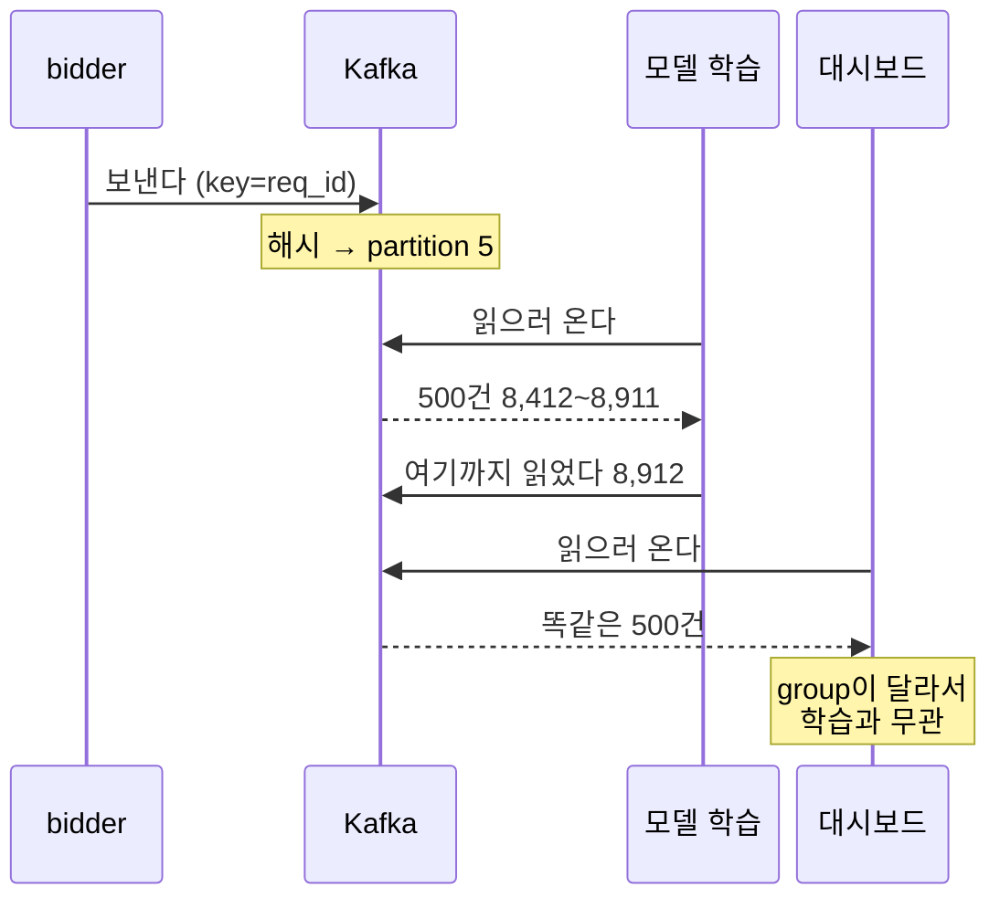
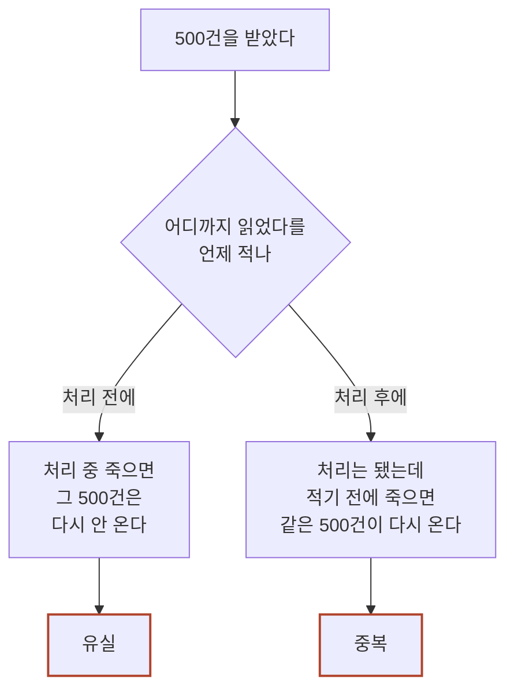

지훈 씨가 앞 글에서 따라온 클릭 한 건이 광고를 탭한 지 1,112 밀리초 만에 브로커(Kafka 서버)에 도착했습니다. 클릭 줄이 놓인 자리는 `topic` `ad.click`, `partition` 5, `offset` 8,412 입니다. 세 이름을 풀면 topic 은 같은 종류의 줄을 모아 두는 이름, partition 은 topic 하나를 여러 갈래로 나눈 것, offset 은 partition 안에서 줄마다 0부터 매기는 번호입니다.

그런데 이 줄에는 **"광고 9931 이 눌렸다"는 사실만 있고 그 광고가 왜 그 사람에게 나갔는지는 없어서** 지훈 씨가 이 줄 하나만 열어 봐서는 쓸 데가 없습니다. 광고가 그 사람에게 나간 까닭은 40분 전 응찰(들어온 입찰 요청에 낼 가격을 계산해 답하는 일) 때 만들어진 다른 줄에 들어 있습니다.

**따로 놓인 두 줄을 어떻게 다시 붙일까요? 그리고 왜 같은 줄을 네 팀이 각자 읽을까요?**

이 글은 Kafka 브로커의 안쪽을 들여다봅니다. 글에는 topic, partition, consumer group(줄을 읽어 가는 팀 하나), offset 4가지 이름이 나오는데 **4가지 모두 위의 두 질문에 답하는 데 쓰입니다.** 그 이름들을 보기 전에 Kafka 없이 로그를 나르면 어디서 문제가 생기는지부터 봅니다.

> **한 줄 요약:** Kafka 는 보내는 쪽이 한 번 쓴 로그를 여러 팀이 각자 읽어 가는 로그 보관소로, 보내는 쪽과 읽는 쪽이 서로를 몰라도 되게 떼어 놓는 일만 합니다. topic, partition, consumer group, offset 4가지는 그 떼어 놓기를 어떻게 하는지에 붙은 이름입니다.

> **골라 읽는 법** — 절이 7개입니다.
>
> - Kafka 없이 로그를 나를 때 생기는 문제 → 1절
> - topic 을 나누는 기준과 partition 개수 → 2절
> - 네 팀이 같은 줄을 각자 읽는 구조 → 3절
> - 어디까지 읽었는지 적는 시점 → 4절
> - 줄을 브로커에 남겨 두는 기간 → 5절
> - 노출 줄과 클릭 줄을 이어 붙인 학습 데이터 → 6절
> - 자주 하는 실수 4가지 → 7절

이 글의 숫자는 모두 설명을 위해 지어낸 값입니다. 그중 하루 노출 2억 2,800만 줄(초당 2,639건)과 클릭 228만 건은 앞 글들에서 쓴 값을 그대로 가져왔습니다.

---

## 1. Kafka 없이 로그를 나를 때 문제가 생기는 자리

**Kafka 없이 로그를 4곳에 나르는 방법도 3가지가 있는데, 3가지 모두 평소에는 돌아가지만 저마다 다른 자리에서 줄을 잃습니다.**

광고가 한 번 노출되면 그 사실을 알아야 하는 곳은 [데이터 파이프라인 입문](post.html?id=pipeline-push-and-pull) 편에서 본 4곳입니다. 4곳은 아래 표처럼 필요한 것도 기다릴 수 있는 시간도 서로 다릅니다.

| 읽는 곳 | 무엇이 필요한가 | 언제까지 |
|---|---|---|
| 실시간 대시보드 | 몇 건인지만 | 2초 |
| 예산 소진 확인 | 캠페인별 누적 금액 | 5초 |
| 광고주 리포트 | 광고별로 정확히 나뉜 수치 — 그대로 청구서가 됩니다 | 5분 |
| 모델 학습 | 하루치 전체. 빠지면 안 됩니다 | 다음 날 새벽 |

광고가 노출됐다는 사실을 적는 노출 줄에는 아래 줄의 `pctr` 처럼 응찰을 계산한 프로세스 안에서만 알 수 있는 값이 들어가야 하므로 노출 줄은 `bidder`(응찰을 계산하는 서버 프로세스)가 직접 만듭니다.

```json
{"req_id":"r-8f21","ad_id":9931,"slot":"main_top","media":"A앱","pctr":0.0213,"bid":182.4,"ts":1786864101}
```

`req_id` 는 광고 요청마다 붙는 번호로, 6절에서 노출 줄과 클릭 줄을 이어 붙일 때 이 값을 씁니다. `pctr` 0.0213 은 응찰 때 모델이 예측한 클릭 확률(pCTR)이고 `bid` 182.4 는 응찰에 낸 가격입니다.

**`bidder` 는 입찰 요청 하나에 12 밀리초 안에 답해야 합니다.** 이 시간 예산은 [로드밸런서, Ingress, API Gateway](post.html?id=gateway-ingress-router) 편에서 정한 값입니다. 12 밀리초를 넘긴 응답은 매체(광고 지면을 파는 앱, 이 줄에서는 `media` 의 A앱)가 버리므로 아래 3가지 방법의 결과도 모두 이 제약이 정합니다.

### ① `bidder` 가 4곳을 직접 호출하는 방법

줄이 생기면 `bidder` 가 그 자리에서 4곳에 HTTP 요청을 보내 알리는 방법이 가장 먼저 떠오릅니다. 읽는 팀이 새로 생기면 그 팀의 주소를 한 줄 추가하면 됩니다.

**이 방법은 시간에서 막힙니다.** 12 밀리초 가운데 앞단(요청이 `bidder` 에 닿기 전에 지나는 자리)이 1.4 밀리초를 쓰고 `bidder` 의 응찰 계산에는 상한 10 밀리초가 잡혀 있습니다. 여기에 사내망 왕복과 받는 쪽 처리를 합친 호출 한 번을 2 밀리초로 잡으면 4곳을 한 번씩 부르는 데 2 × 4 = 8 밀리초가 들므로 모두 더한 1.4 + 10 + 8 = **19.4 밀리초**가 예산 12 밀리초를 넘깁니다.

호출 한 번을 0.4 밀리초까지 줄여도 4번이면 0.4 × 4 = 1.6 밀리초라 합계 1.4 + 10 + 1.6 = 13.0 밀리초로 여전히 12 밀리초 안에 들어오지 않습니다. 게다가 0.4 밀리초는 **우리가 관리하지 않는 4곳의 서버가 모두 빠르게 답할 때에만 나오는 값**입니다.

응답을 기다리지 않고 보내기만 하면 12 밀리초는 지켜지지만 대신 줄을 쌓아 두는 일이 `bidder` 안으로 들어옵니다. 받는 팀 하나가 20초 동안 배포하면 그동안에도 노출은 초당 2,639건씩 생기므로 2,639 × 20 = 52,780줄이 `bidder` 메모리에 쌓입니다. 그러면 `bidder` 가 몇 줄까지 쌓아 둘지, 넘치면 버릴지, 재시도를 몇 번 할지를 정해야 하는데 **이 답이 받는 쪽마다 다릅니다.** 광고주 리포트로 가는 줄은 한 건도 버리면 안 되지만 대시보드로 가는 줄은 버려도 되므로 줄을 쌓고 버리고 재시도하는 코드를 받는 쪽마다 따로 4벌 만들어야 합니다.

그리고 줄을 쌓아 두는 이 큐(보낼 줄을 순서대로 모아 두는 메모리 공간)는 `bidder` 프로세스 안에 있습니다. `bidder` 도 하루 4번 배포하는데 **배포로 프로세스가 내려갈 때 큐에 남아 있던 줄도 함께 사라집니다.**

### ②와 ③에서 문제가 생기는 자리

나머지 2가지 방법은 어디서 문제가 생기는지만 표로 봅니다. ②는 `bidder` 가 줄을 자기 서버의 파일에 쓰고 5분마다 다른 곳으로 옮기는 방법이고 ③은 줄을 DB 에 바로 넣는 방법입니다.

| 방법 | 어디서 문제가 생기나 |
|---|---|
| ② 파일에 쓰고 5분마다 옮깁니다 | 오토스케일이 30대를 20대로 줄이면 아직 안 옮긴 줄이 같이 사라집니다. 대당 평균 13,200줄이면 10대에서 132,000줄입니다. 그리고 파일에는 "누가 어디까지 읽었나"가 없어서, 파일 이름 규칙이 네 팀과의 계약이 됩니다 |
| ③ DB 에 바로 넣습니다 | 네 팀이 찾는 조건이 달라 인덱스가 넷 필요합니다. 줄 하나를 넣을 때 다섯 군데를 건드리고, 광고주 리포트가 마감에 하루치 2.28억 줄을 스캔하는 동안 그 쓰기 지연이 오릅니다. 튜닝으로 안 없어집니다 — 리포트는 1년 남기길 원하고 대시보드는 테이블이 작아야 빠릅니다 |

표의 ② 칸에 나온 오토스케일은 부하에 따라 서버 대수를 자동으로 늘리고 줄이는 기능입니다. 오토스케일이 `bidder` 30대를 20대로 줄이면 빠지는 10대에 아직 옮기지 않은 줄이 남아 있다가 서버와 함께 사라지는데, 한 대에 평균 13,200줄이 남아 있었다면 13,200 × 10 = 132,000줄입니다. 그리고 파일에는 「누가 어디까지 읽었나」를 적는 자리가 없어서 파일 이름을 짓는 규칙이 곧 네 팀과 맺은 계약이 됩니다.

③에서는 네 팀이 줄을 찾는 조건이 서로 달라 인덱스(조건에 맞는 줄을 빨리 찾으려고 따로 만들어 두는 자료 구조)가 4개 필요하므로 줄 하나를 넣을 때마다 테이블 1곳과 인덱스 4개를 합쳐 5군데를 건드립니다. 게다가 광고주 리포트가 마감 때 하루치 2.28억 줄을 스캔(테이블을 처음부터 끝까지 읽는 일)하는 동안에는 같은 DB 에 줄을 넣는 데 걸리는 시간인 쓰기 지연이 올라갑니다. 리포트는 줄을 1년 동안 남기기를 원하고 대시보드는 테이블이 작아야 빠르므로 이 문제는 튜닝으로도 없어지지 않습니다.

**3가지 방법 모두 받는 쪽이 하나 늘 때마다 보내는 쪽도 따라 바뀝니다.** ①에서는 `bidder` 가 4곳의 주소와 재시도 정책을 직접 들고 있습니다. ②에서는 파일 이름과 옮기는 주기를 보내는 쪽과 받는 쪽이 맞춰야 하고 ③에서는 인덱스와 보존 기간(줄을 며칠 동안 남겨 둘지)을 네 팀이 합의해야 합니다.

3가지 방법은 평소에는 멀쩡하다가 특정 순간에만 줄을 잃는다는 점도 같습니다. 이런 손실은 평균을 그린 그래프에는 보이지 않고 배포한 시각, 서버 대수를 줄인 시각, 리포트 마감 시각에 맞춰 봐야 보입니다.

**그러면 받는 쪽을 하나 더 만들 것이 아니라 보내는 쪽과 받는 쪽 사이에 자리 하나를 두어야 합니다.** 보내는 쪽은 그 자리에만 쓰고 받는 쪽은 그 자리에서만 읽으므로 두 쪽은 서로를 몰라도 되는데, **Kafka 가 정확히 그 자리를 맡습니다.**

## 2. topic 과 partition — 줄이 쌓이는 자리

**topic 은 줄을 종류별로 담는 이름이고 그 안은 partition 여러 개로 나뉩니다. partition 개수가 처리량의 상한을 정하고 key(줄마다 붙여 보내는 값)가 순서가 지켜지는 범위를 정합니다.**

1절에서 `bidder` 와 받는 쪽 사이에 Kafka 를 두기로 했으니 이제 `bidder` 가 Kafka 에 무엇을 넘기는지, 넘긴 줄이 Kafka 안 어디에 쌓이는지를 살펴봅니다. 먼저 보내는 쪽(producer)부터 봅니다.

**Kafka 로 줄을 보내는 일은 따로 띄운 서버가 아니라 `bidder` 프로세스 안에서 도는 라이브러리(Kafka 클라이언트)가 맡습니다.** `bidder` 에는 의존성 한 줄과 클라이언트 객체 하나만 추가됩니다. `bidder` 가 클라이언트에 넘기는 값도 어느 topic 에 보낼지, 어떤 key 를 붙일지, 무슨 값을 보낼지 3가지뿐이고 **그 안에 받는 쪽의 주소는 없습니다.** 1절 ①에서 `bidder` 가 들고 있던 4곳의 주소, 상태, 재시도 정책이 여기서 모두 빠집니다.

보내는 함수는 응답을 기다리지 않고 줄을 버퍼(보내기 전에 줄을 모아 두는 메모리)에 넣자마자 돌아옵니다. 실제 전송은 뒤에서 여러 줄을 모은 배치(batch)로 나가므로 1절 ①에서 예산을 넘기게 만든 호출 4번의 8 밀리초가 여기서는 응찰 시간 계산에 들어가지 않습니다. 다만 **어디까지 기다렸다가 성공으로 볼지는 설정 한 줄(`acks`)로 정합니다.** 브로커에 보내기만 하면 끝으로 볼 수도 있고 복제본(같은 partition 의 줄을 다른 브로커에도 저장해 둔 사본)까지 받았는지 확인한 뒤에 성공으로 볼 수도 있습니다. 이 줄은 1절 표에서 수치가 그대로 청구서가 되는 광고주 리포트도 읽으므로 우리는 복제본까지 받았는지 확인합니다. **한 topic 을 여러 팀이 읽으면 그중 가장 엄격한 읽는 쪽에 맞춥니다.**

### topic 을 나누는 기준

노출만 필요한 대시보드가 클릭 줄과 전환 줄까지 읽은 다음 걸러 내지 않도록 topic 을 노출 `ad.impression`, 클릭 `ad.click`, 전환(광고를 본 사람이 구매 같은 목표 행동까지 한 일) `ad.conversion` 3개로 나눕니다.

**topic 은 읽는 팀이 아니라 사건의 종류로 나눕니다.** 리포트용으로 `ad.impression.report` 같은 topic 을 따로 만들면 같은 줄이 읽는 팀 수만큼 복사되어 디스크 사용량과 쓰기가 그만큼 늘어납니다. 그리고 네 벌의 내용이 서로 달라지기 시작하면 어느 벌이 맞는지 아무도 알 수 없습니다. 더 큰 대가는 그다음에 옵니다. **topic 이름에 받는 팀 이름이 들어가는 순간 보내는 쪽은 어느 팀의 topic 에 쓸지를 골라야 해서 다시 받는 쪽을 알게 됩니다.** 1절에서 Kafka 로 없앤, 보내는 쪽이 받는 쪽을 아는 구조가 그대로 돌아옵니다.

### partition 개수

partition 은 topic 하나를 여러 갈래로 나눈 것으로, 들어온 줄은 그중 한 partition 의 끝에 붙고 붙은 자리마다 offset 이라는 번호를 받습니다.

**한 팀 안에서 partition 하나는 읽는 사람 한 명만 맡습니다.** 여기서 팀은 3절에서 볼 consumer group 이고 읽는 사람 한 명은 consumer(Kafka 에서 줄을 읽어 가는 프로그램) 하나입니다. 그래서 한 팀이 읽는 사람을 partition 개수보다 많이 띄워도 남는 사람은 맡을 partition 이 없어 놀게 되므로 **partition 개수가 처리량의 상한이 됩니다.**

**partition 최소치 = 초당 들어오는 줄 ÷ 한 명의 초당 처리량**

읽는 사람 한 명이 초당 800줄을 처리한다고 하겠습니다. 평소에는 초당 2,639건이 들어오므로 2,639 ÷ 800 = 3.3 이라 partition 4개면 되지만 저녁 피크(하루 중 유입이 가장 많은 때)에는 평균의 3배인 2,639 × 3 = 7,917건이 들어와 7,917 ÷ 800 = 9.9 라 10개가 필요합니다. **partition 개수는 피크를 기준으로 정해야 하므로 계산으로 나온 답은 10개인데, 우리는 2개를 여유로 두어 12개로 잡습니다.** 나중에 partition 개수를 바꾸면 같은 요청의 줄이 가는 partition 이 달라지므로 처음부터 여유를 둡니다. 자세한 설명은 key 를 본 다음 이 절 끝에서 합니다.

partition 을 아예 100개로 잡아 두면 어떨까 싶지만 그러면 보내는 쪽에 대가가 2가지 생깁니다. 첫째, 보내는 쪽 클라이언트는 partition 마다 배치 버퍼를 하나씩 두므로 `bidder` 30대가 partition 100개로 보내면 버퍼가 30 × 100 = 3,000개입니다. 둘째, `bidder` 한 대가 만드는 줄은 초당 2,639건을 30대가 나눈 초당 88줄쯤인데 88줄을 partition 100개로 나누면 버퍼 하나에 초당 0.88줄만 들어와 **배치가 줄 하나짜리가 되어** 여러 줄을 모아 보내는 효과가 사라집니다. partition 이 12개면 버퍼 하나에 초당 88 ÷ 12 = 7.3줄이 들어와 그나마 몇 줄씩 모여서 나갑니다.

아래 그림은 partition 12개로 정한 `ad.impression` topic 입니다. offset 은 partition 마다 0부터 따로 셉니다. 우리 요청 `r-8f21` 의 노출 줄은 partition 5 에 놓였습니다.

<figure style="text-align:center; margin:2rem 0;">
<svg viewBox="0 0 500 310" role="img" aria-label="topic ad.impression 하나가 partition 12개로 갈라져 있고, partition 마다 줄이 왼쪽부터 차례로 붙어 있는 그림. 줄마다 0부터 세는 offset 번호가 붙어 있고 partition 마다 붙은 줄 수가 다르다. partition 5 의 offset 7 자리에 r-8f21 이 굵게 표시돼 있다." style="width:100%; max-width:500px; height:auto; font-family:var(--font-sans)">
<defs>
<marker id="kf3-arr" markerWidth="9" markerHeight="9" refX="7.5" refY="3" orient="auto"><path d="M0,0 L7.5,3 L0,6 Z" style="fill:var(--accent-primary)"/></marker>
</defs>
<text x="6" y="20" style="font-size:12.5px; fill:var(--text-muted)">topic</text>
<text x="52" y="20" style="font-size:13px; fill:var(--text-primary); font-family:var(--font-mono)">ad.impression</text>
<rect x="4" y="28" width="492" height="276" rx="10" style="fill:none; stroke:var(--text-muted); stroke-width:1.3; stroke-dasharray:6 4"/>
<g style="fill:var(--bg-secondary); stroke:var(--border-color); stroke-width:1.5">
<rect x="92" y="38" width="28" height="18" rx="4"/><rect x="124" y="38" width="28" height="18" rx="4"/><rect x="156" y="38" width="28" height="18" rx="4"/><rect x="188" y="38" width="28" height="18" rx="4"/><rect x="220" y="38" width="28" height="18" rx="4"/><rect x="252" y="38" width="28" height="18" rx="4"/><rect x="284" y="38" width="28" height="18" rx="4"/>
<g style="stroke:none; fill:var(--text-muted); font-family:var(--font-mono); font-size:12.5px; text-anchor:middle"><text x="6" y="51.5" style="font-size:12.5px; text-anchor:start; font-family:var(--font-sans)">partition 0</text><text x="106" y="51.5">0</text><text x="138" y="51.5">1</text><text x="170" y="51.5">2</text><text x="202" y="51.5">3</text><text x="234" y="51.5">4</text><text x="266" y="51.5">5</text><text x="298" y="51.5">6</text></g>
<rect x="92" y="60" width="28" height="18" rx="4"/><rect x="124" y="60" width="28" height="18" rx="4"/><rect x="156" y="60" width="28" height="18" rx="4"/><rect x="188" y="60" width="28" height="18" rx="4"/><rect x="220" y="60" width="28" height="18" rx="4"/>
<g style="stroke:none; fill:var(--text-muted); font-family:var(--font-mono); font-size:12.5px; text-anchor:middle"><text x="6" y="73.5" style="font-size:12.5px; text-anchor:start; font-family:var(--font-sans)">partition 1</text><text x="106" y="73.5">0</text><text x="138" y="73.5">1</text><text x="170" y="73.5">2</text><text x="202" y="73.5">3</text><text x="234" y="73.5">4</text></g>
<rect x="92" y="82" width="28" height="18" rx="4"/><rect x="124" y="82" width="28" height="18" rx="4"/><rect x="156" y="82" width="28" height="18" rx="4"/><rect x="188" y="82" width="28" height="18" rx="4"/><rect x="220" y="82" width="28" height="18" rx="4"/><rect x="252" y="82" width="28" height="18" rx="4"/><rect x="284" y="82" width="28" height="18" rx="4"/><rect x="316" y="82" width="28" height="18" rx="4"/>
<g style="stroke:none; fill:var(--text-muted); font-family:var(--font-mono); font-size:12.5px; text-anchor:middle"><text x="6" y="95.5" style="font-size:12.5px; text-anchor:start; font-family:var(--font-sans)">partition 2</text><text x="106" y="95.5">0</text><text x="138" y="95.5">1</text><text x="170" y="95.5">2</text><text x="202" y="95.5">3</text><text x="234" y="95.5">4</text><text x="266" y="95.5">5</text><text x="298" y="95.5">6</text><text x="330" y="95.5">7</text></g>
<rect x="92" y="104" width="28" height="18" rx="4"/><rect x="124" y="104" width="28" height="18" rx="4"/><rect x="156" y="104" width="28" height="18" rx="4"/><rect x="188" y="104" width="28" height="18" rx="4"/><rect x="220" y="104" width="28" height="18" rx="4"/><rect x="252" y="104" width="28" height="18" rx="4"/>
<g style="stroke:none; fill:var(--text-muted); font-family:var(--font-mono); font-size:12.5px; text-anchor:middle"><text x="6" y="117.5" style="font-size:12.5px; text-anchor:start; font-family:var(--font-sans)">partition 3</text><text x="106" y="117.5">0</text><text x="138" y="117.5">1</text><text x="170" y="117.5">2</text><text x="202" y="117.5">3</text><text x="234" y="117.5">4</text><text x="266" y="117.5">5</text></g>
<rect x="92" y="126" width="28" height="18" rx="4"/><rect x="124" y="126" width="28" height="18" rx="4"/><rect x="156" y="126" width="28" height="18" rx="4"/><rect x="188" y="126" width="28" height="18" rx="4"/>
<g style="stroke:none; fill:var(--text-muted); font-family:var(--font-mono); font-size:12.5px; text-anchor:middle"><text x="6" y="139.5" style="font-size:12.5px; text-anchor:start; font-family:var(--font-sans)">partition 4</text><text x="106" y="139.5">0</text><text x="138" y="139.5">1</text><text x="170" y="139.5">2</text><text x="202" y="139.5">3</text></g>
<rect x="92" y="148" width="28" height="18" rx="4"/><rect x="124" y="148" width="28" height="18" rx="4"/><rect x="156" y="148" width="28" height="18" rx="4"/><rect x="188" y="148" width="28" height="18" rx="4"/><rect x="220" y="148" width="28" height="18" rx="4"/><rect x="252" y="148" width="28" height="18" rx="4"/><rect x="284" y="148" width="28" height="18" rx="4"/><rect x="316" y="148" width="28" height="18" rx="4" style="stroke:var(--accent-primary); stroke-width:2"/>
<g style="stroke:none; fill:var(--text-muted); font-family:var(--font-mono); font-size:12.5px; text-anchor:middle"><text x="6" y="161.5" style="font-size:12.5px; text-anchor:start; font-family:var(--font-sans)">partition 5</text><text x="106" y="161.5">0</text><text x="138" y="161.5">1</text><text x="170" y="161.5">2</text><text x="202" y="161.5">3</text><text x="234" y="161.5">4</text><text x="266" y="161.5">5</text><text x="298" y="161.5">6</text><text x="330" y="161.5">7</text></g>
<rect x="92" y="170" width="28" height="18" rx="4"/><rect x="124" y="170" width="28" height="18" rx="4"/><rect x="156" y="170" width="28" height="18" rx="4"/><rect x="188" y="170" width="28" height="18" rx="4"/><rect x="220" y="170" width="28" height="18" rx="4"/><rect x="252" y="170" width="28" height="18" rx="4"/>
<g style="stroke:none; fill:var(--text-muted); font-family:var(--font-mono); font-size:12.5px; text-anchor:middle"><text x="6" y="183.5" style="font-size:12.5px; text-anchor:start; font-family:var(--font-sans)">partition 6</text><text x="106" y="183.5">0</text><text x="138" y="183.5">1</text><text x="170" y="183.5">2</text><text x="202" y="183.5">3</text><text x="234" y="183.5">4</text><text x="266" y="183.5">5</text></g>
<rect x="92" y="192" width="28" height="18" rx="4"/><rect x="124" y="192" width="28" height="18" rx="4"/><rect x="156" y="192" width="28" height="18" rx="4"/><rect x="188" y="192" width="28" height="18" rx="4"/><rect x="220" y="192" width="28" height="18" rx="4"/><rect x="252" y="192" width="28" height="18" rx="4"/><rect x="284" y="192" width="28" height="18" rx="4"/><rect x="316" y="192" width="28" height="18" rx="4"/>
<g style="stroke:none; fill:var(--text-muted); font-family:var(--font-mono); font-size:12.5px; text-anchor:middle"><text x="6" y="205.5" style="font-size:12.5px; text-anchor:start; font-family:var(--font-sans)">partition 7</text><text x="106" y="205.5">0</text><text x="138" y="205.5">1</text><text x="170" y="205.5">2</text><text x="202" y="205.5">3</text><text x="234" y="205.5">4</text><text x="266" y="205.5">5</text><text x="298" y="205.5">6</text><text x="330" y="205.5">7</text></g>
<rect x="92" y="214" width="28" height="18" rx="4"/><rect x="124" y="214" width="28" height="18" rx="4"/><rect x="156" y="214" width="28" height="18" rx="4"/><rect x="188" y="214" width="28" height="18" rx="4"/><rect x="220" y="214" width="28" height="18" rx="4"/>
<g style="stroke:none; fill:var(--text-muted); font-family:var(--font-mono); font-size:12.5px; text-anchor:middle"><text x="6" y="227.5" style="font-size:12.5px; text-anchor:start; font-family:var(--font-sans)">partition 8</text><text x="106" y="227.5">0</text><text x="138" y="227.5">1</text><text x="170" y="227.5">2</text><text x="202" y="227.5">3</text><text x="234" y="227.5">4</text></g>
<rect x="92" y="236" width="28" height="18" rx="4"/><rect x="124" y="236" width="28" height="18" rx="4"/><rect x="156" y="236" width="28" height="18" rx="4"/><rect x="188" y="236" width="28" height="18" rx="4"/><rect x="220" y="236" width="28" height="18" rx="4"/><rect x="252" y="236" width="28" height="18" rx="4"/><rect x="284" y="236" width="28" height="18" rx="4"/>
<g style="stroke:none; fill:var(--text-muted); font-family:var(--font-mono); font-size:12.5px; text-anchor:middle"><text x="6" y="249.5" style="font-size:12.5px; text-anchor:start; font-family:var(--font-sans)">partition 9</text><text x="106" y="249.5">0</text><text x="138" y="249.5">1</text><text x="170" y="249.5">2</text><text x="202" y="249.5">3</text><text x="234" y="249.5">4</text><text x="266" y="249.5">5</text><text x="298" y="249.5">6</text></g>
<rect x="92" y="258" width="28" height="18" rx="4"/><rect x="124" y="258" width="28" height="18" rx="4"/><rect x="156" y="258" width="28" height="18" rx="4"/><rect x="188" y="258" width="28" height="18" rx="4"/><rect x="220" y="258" width="28" height="18" rx="4"/><rect x="252" y="258" width="28" height="18" rx="4"/>
<g style="stroke:none; fill:var(--text-muted); font-family:var(--font-mono); font-size:12.5px; text-anchor:middle"><text x="6" y="271.5" style="font-size:12.5px; text-anchor:start; font-family:var(--font-sans)">partition 10</text><text x="106" y="271.5">0</text><text x="138" y="271.5">1</text><text x="170" y="271.5">2</text><text x="202" y="271.5">3</text><text x="234" y="271.5">4</text><text x="266" y="271.5">5</text></g>
<rect x="92" y="280" width="28" height="18" rx="4"/><rect x="124" y="280" width="28" height="18" rx="4"/><rect x="156" y="280" width="28" height="18" rx="4"/><rect x="188" y="280" width="28" height="18" rx="4"/><rect x="220" y="280" width="28" height="18" rx="4"/><rect x="252" y="280" width="28" height="18" rx="4"/><rect x="284" y="280" width="28" height="18" rx="4"/><rect x="316" y="280" width="28" height="18" rx="4"/>
<g style="stroke:none; fill:var(--text-muted); font-family:var(--font-mono); font-size:12.5px; text-anchor:middle"><text x="6" y="293.5" style="font-size:12.5px; text-anchor:start; font-family:var(--font-sans)">partition 11</text><text x="106" y="293.5">0</text><text x="138" y="293.5">1</text><text x="170" y="293.5">2</text><text x="202" y="293.5">3</text><text x="234" y="293.5">4</text><text x="266" y="293.5">5</text><text x="298" y="293.5">6</text><text x="330" y="293.5">7</text></g>
</g>
<line x1="430" y1="157" x2="352" y2="157" style="stroke:var(--accent-primary); stroke-width:2" marker-end="url(#kf3-arr)"/>
<text x="434" y="161.5" style="font-size:12.5px; fill:var(--accent-primary); font-family:var(--font-mono)">r-8f21</text>
</svg>
<figcaption style="margin-top:0.75rem; font-size:0.9rem; color:var(--text-muted)">네모 하나가 줄 하나이고 그 안의 숫자가 offset 입니다. offset 은 partition 마다 0부터 따로 셉니다. partition 3 의 4번과 partition 8 의 4번은 아무 관계가 없는 두 줄입니다. 굵게 두른 것이 우리 요청 r-8f21 입니다.</figcaption>
</figure>

### 줄이 들어갈 partition 을 정하는 방법

줄이 어느 partition 으로 갈지는 보내는 쪽이 붙인 key 로 정해지고 계산은 아래 한 줄입니다.

**partition 번호 = key 의 해시 ÷ partition 수의 나머지**

해시는 key 값을 정해진 함수로 계산해 얻은 정수입니다. 같은 key 는 언제나 같은 해시가 나오므로 partition 개수가 그대로인 동안에는 늘 같은 partition 으로 갑니다. **줄이 이렇게 partition 여러 개로 흩어지므로 Kafka 는 topic 전체의 순서를 지켜 주지 않고 한 partition 안의 순서만 지켜 줍니다.** partition 이 12개면 줄은 12갈래로 따로 쌓이는데 12갈래 사이의 순서에는 아무 약속이 없습니다.

**key 를 고르면 무엇을 단위로 순서가 지켜질지도 함께 정해집니다.** key 후보 3가지로 10만 줄을 partition 12개에 넣어 보면 partition 마다 쌓이는 줄 수와 순서가 지켜지는 범위가 아래처럼 달라집니다. 최대÷최소는 가장 많이 쌓인 partition 의 줄 수를 가장 적게 쌓인 partition 의 줄 수로 나눈 값이라 1 에 가까울수록 고르게 퍼졌다는 뜻입니다.

| key 후보 | 가장 많은 곳 | 가장 적은 곳 | 최대÷최소 | 순서가 지켜지는 범위 |
|---|---|---|---|---|
| `req_id` (전부 다른 값) | 8,496줄 | 8,174줄 | 1.04배 | 같은 `req_id` 안에서만 |
| `ad_id` (상위 5개가 40%) | 21,191줄 | 4,690줄 | **4.52배** | 같은 `ad_id` 안에서만 |
| key 없음 | 8,334줄 | 8,333줄 | 1.00배 | 없습니다 |

`ad_id` 를 key 로 쓰면 상위 5개 광고가 줄의 40% 를 차지해서 가장 많은 partition 에 21,191줄, 가장 적은 partition 에 4,690줄이 쌓여 21,191 ÷ 4,690 = 4.52배로 벌어집니다. **21,191줄이 몰린 partition 을 맡은 한 명만 밀리는데, 한 partition 은 한 팀 안에서 한 명만 맡으므로 사람을 더 붙여도 그 partition 은 여전히 한 명이 처리합니다.** key 없이 보내면 10만 줄이 8,334줄과 8,333줄로 가장 고르게 퍼지는 대신 순서가 지켜지는 범위가 없습니다.

**우리는 key 로 `req_id` 를 고릅니다.** `req_id` 는 값이 전부 달라서 1.04배로 고르게 퍼졌을 뿐이고 늘 고르게 퍼진다는 약속은 없습니다. `req_id` 를 key 로 써서 약속받는 성질은 **같은 요청의 노출과 클릭이 같은 partition 에 간다**는 한 가지이며 그 덕분에 6절의 이어 붙이기가 그 partition 안에서 끝납니다.

**partition 개수를 처음부터 12개로 정해 두는 까닭도 여기에 있습니다.** 나중에 partition 을 24개로 늘리면 key 의 해시를 12로 나눈 나머지 대신 24로 나눈 나머지로 partition 을 정하므로 같은 key 의 줄이 예전과 다른 partition 으로 가기 시작합니다. 24로 나눈 나머지는 12로 나눈 나머지와 같거나 거기에 12를 더한 값이라 10만 줄 가운데 **절반이 다른 partition 으로 옮겨 가는데** 옮겨 간 줄은 예전 partition 에 남은 같은 key 의 줄과 더 이상 한 partition 안에 이어서 놓이지 않습니다. 게다가 partition 은 늘릴 수만 있고 줄일 수는 없습니다. 그래서 계산으로 나온 답은 10개였지만 처음부터 여유를 두어 12개로 잡았습니다.

아래 데모에서는 partition 수, consumer 수, key 를 바꿔 가며 남는 consumer 가 생기는 지점과 key 에 따라 줄이 퍼지는 모양, partition 수를 바꿀 때 다른 partition 으로 옮겨 가는 줄을 보면 됩니다.

<div class="demo-embed-wrap">
<iframe class="demo-embed" src="demo-kafka-partition.html?embed=1" height="620" loading="lazy" title="Kafka Partition 놀이터"></iframe>
<a class="demo-embed-open" href="demo-kafka-partition.html" target="_blank" rel="noopener">↗ 전체 데모로 열기 (가이드 투어 포함)</a>
</div>

## 3. consumer group — 줄을 읽는 팀

**consumer group 은 줄을 읽어 가는 팀 하나입니다. group 이 다르면 같은 줄을 각자 빠짐없이 읽고 한 group 안에서는 읽는 사람들이 partition 12개를 나눠 맡습니다.**

읽는 쪽 클라이언트 설정에는 `group.id` 라는 값이 있는데 **이 값이 같은 consumer 끼리는 한 팀이 되고 값이 다르면 다른 팀이 됩니다.** 1절의 4곳은 같은 노출 줄을 저마다 읽어야 하므로 서로 다른 `group.id` 4개를 씁니다.

| 읽는 곳 | 인원 | 한 명당 partition | 왜 그 인원인가 |
|---|---|---|---|
| 실시간 대시보드 | 6 | 2개 | 몇 초 안에 숫자가 올라가야 합니다 |
| 예산 소진 확인 | 6 | 2개 | 늦으면 예산을 넘겨 씁니다 |
| 광고주 리포트 | 12 | 1개 | 마감이 밀리면 안 되니 상한까지 채웠습니다 |
| 모델 학습 | 4 | 3개 | 하루 한 번 몰아 읽어 평시 유입만 따라가면 됩니다 |

표의 한 명당 partition 열은 partition 12개를 인원으로 나눈 값이라 어느 행이든 인원과 곱하면 12로 돌아옵니다. 대시보드는 6명 × 2개, 광고주 리포트는 12명 × 1개, 모델 학습은 4명 × 3개입니다. **팀마다 인원을 정하는 규칙도 2절의 partition 개수 공식과 같습니다.** 그 팀이 감당해야 할 초당 줄 수를 한 명의 초당 처리량으로 나누어 인원을 정합니다. 인원의 상한은 partition 개수입니다. 모델 학습은 하루 한 번 몰아 읽어서 평시 유입인 초당 2,639건만 따라가면 되므로 2,639 ÷ 800 = 3.3 이라 4명입니다.

광고주 리포트 팀에 13번째 사람을 붙이면 어떻게 될까요? partition 12개가 이미 한 명씩에게 맡겨져 있고 한 partition 은 한 팀 안에서 한 명만 맡으므로 **13번째는 받을 partition 이 없어 아무것도 하지 않고 놉니다.**

**group 과 group 사이에는 다른 규칙이 적용됩니다.** 아래 그림의 모델 학습과 대시보드는 서로 다른 group 이라 서로를 모르는 채로 partition 5 의 같은 줄 500건을 각자 받아 갑니다.



그림에서 모델 학습은 offset 8,412 부터 8,911 까지 500건을 받은 뒤 다음에 읽을 번호 8,912 를 「여기까지 읽었다」로 적습니다. 모델 학습이 8,912 를 적어도 group 이 다른 대시보드가 적어 둔 번호는 그대로입니다. **브로커는 줄이 읽혔다고 해서 그 줄을 지우지 않습니다.**

그래서 적어 둔 번호를 예전 번호로 되돌려 이미 읽은 줄을 다시 읽는 되감기도 됩니다. 모델 학습이 피처(모델에 넣는 입력 값) 하나를 바꿔 3일치를 다시 읽는다면 하루 2억 2,800만 줄의 3일치인 6억 8,400만 줄을 읽는데, 그동안에도 광고주 리포트가 적어 둔 번호는 제자리에 그대로 있습니다. **1절 ③처럼 DB 에 바로 넣었다면 이 6.84억 줄 스캔이 리포트 쿼리와 같은 테이블 위에서 돌아야 했습니다.**

**1절에서 정한 「한 번 쓰고 각자 읽는다」가 여기서 실제로 동작합니다.** 브로커에 있는 줄은 한 벌뿐이고 group 마다 따로 가진 값은 줄의 사본이 아니라 「어디까지 읽었나」를 적은 번호 하나입니다.

## 4. offset — 어디까지 읽었는지 적는 번호

**offset 은 partition 안의 줄 번호이고 group 마다 「어디까지 읽었나」를 이 번호로 따로 적습니다. 처리하기 전에 적는지 처리한 뒤에 적는지가 사고 때 줄을 잃을지(유실) 두 번 받을지(중복)를 정합니다.**

group 이 「여기까지 읽었다」는 번호를 적는 일을 commit 이라고 합니다. 읽는 쪽 프로세스가 죽었다가 다시 뜨면 마지막으로 commit 한 번호부터 줄을 다시 받으므로 **줄을 처리하는 일과 commit 하는 일 가운데 무엇을 먼저 하느냐 하나로 결과가 정해집니다.** 500건을 받은 뒤 commit 을 처리 전에 하는 경우와 처리 후에 하는 경우를 나란히 그리면 아래와 같습니다.



처리 전에 적으면 500건을 처리하는 도중에 죽었을 때 commit 한 번호가 이미 500건 다음을 가리키고 있어서 그 500건이 다시 오지 않으므로 유실이 생깁니다. 처리 후에 적으면 처리는 끝났지만 적기 전에 죽었을 때 commit 한 번호가 500건 앞에 그대로 있어서 같은 500건이 다시 와 중복이 생깁니다. 처리 전에 적는 방식을 at-most-once(많아야 한 번 처리), 처리 후에 적는 방식을 at-least-once(적어도 한 번 처리)라고 부릅니다.

**두 방식 모두 사고를 피하지 못하고 어떤 사고를 낼지만 고를 수 있습니다.** 광고주 리포트 group 이 하루에 겪는 양을 세어 봅니다. 리포트 group 은 한 번에 500건씩 받아 처리하며 배포 2번과 장애 1번으로 하루 3번 죽는다고 하겠습니다.

| 방식 | 하루 유실 | 하루 중복 | 금액으로 |
|---|---|---|---|
| 처리 전에 적기 | 750건 | 0건 | 1,368원 |
| 처리 후에 적기 | 0건 | 750건 | 1,368원 |

**표의 금액만 보면 고칠 까닭이 없습니다.** 노출 한 건의 값을 클릭 단가 182.4원에 클릭률 1.00% 를 곱한 1.824원으로 치면 750건은 750 × 1.824 = 1,368원입니다. 하루 매출 4억 1,587만 원과 비교하면 0.0003% 에 그칩니다.

**두 사고는 금액이 아니라 사고의 성질 때문에 가볍게 볼 수 없습니다.** 유실은 매체가 자기 쪽에서 센 노출 수를 가져와 맞춰 볼 때 비로소 보입니다. 중복은 이미 청구서로 나간 돈이라 다음 달에 빼야 합니다.

클라이언트가 정해진 시간 간격마다 commit 을 알아서 해 주는 auto commit 설정을 켜면 되지 않을까 싶지만 **auto commit 은 새로운 선택지가 아니라 위 2가지 가운데 「처리 후에 적기」에 속합니다.** 그래서 중복은 그대로 남는 데다 아직 commit 되지 않은 미확정 구간이 배치 하나에서 시간 간격 하나로 길어져 하루 중복이 750건에서 1,650건으로 늘어납니다. 게다가 commit 시점을 코드가 정할 수 없어서 「이 500건을 다 넣었으니 이제 올린다」 같은 코드를 쓸 수 없습니다.

### 네 팀이 고른 commit 시점

4곳은 유실과 중복 가운데 무엇을 받아들일 수 있는지에 따라 commit 시점을 아래처럼 고릅니다.

| 읽는 곳 | 언제 적나 | 왜 |
|---|---|---|
| 실시간 대시보드 | 처리 전 | 최근 5분만 보는 화면이라 750건 유실은 다음 갱신에 사라집니다 |
| 예산 소진 확인 | 처리 후 | 덜 세는 것보다 두 번 세는 쪽이 안전합니다 |
| 모델 학습 | 처리 후 | 중복이 클릭률을 아래로 밀지만 2.28억 줄에 750건이면 소수점 아래입니다 |
| 광고주 리포트 | 처리 후 + `req_id` 유니크 키 | 유실도 중복도 안 되니 둘 중 하나를 고르는 대신 처리 쪽에서 막습니다 |

**이 가운데 광고주 리포트만은 commit 시점 하나로 끝내지 않습니다.** 나머지 3곳은 무엇을 잃어도 되는지가 정해져 있어서 commit 시점을 고르는 설정 한 줄로 끝납니다. 리포트는 유실도 중복도 안 되므로 줄을 넣는 테이블에 `req_id` 유니크 키를 걸어 **같은 `req_id` 가 이미 있으면 아무 일도 하지 않게** 만듭니다. 유니크 키는 같은 값이 두 번 들어가지 못하게 막는 제약입니다. 이렇게 하면 리포트는 처리 후에 적으므로 줄을 잃지 않고 같은 500건이 다시 와도 이미 들어간 줄은 다시 들어가지 않아 중복도 생기지 않습니다. 같은 줄을 여러 번 넣어도 한 번 넣은 것과 결과가 같은 이 성질을 멱등성(idempotency)이라고 부릅니다.

3절의 되감기는 다시 읽으려는 3일치가 아직 브로커에 남아 있을 때만 할 수 있습니다. 줄을 브로커에 얼마나 남겨 둘지는 5절에서 정합니다.

## 5. 보존 기간 — 지나간 줄을 다시 읽을 수 있는 까닭

**Kafka 는 줄이 읽혔는지가 아니라 나이나 크기를 보고 줄을 지우므로 모델 학습이 사흘 멈췄다가 돌아와도 되감아 읽을 수 있습니다.**

3절에서 브로커는 줄이 읽혔다고 지우지 않는다고 했는데, 그러면 줄을 언제 지우는지가 남습니다. 네 group 이 모두 읽은 뒤에도 줄은 제자리에 있고 브로커는 **줄이 얼마나 오래됐는지와 얼마나 쌓였는지** 2가지만 봅니다. 나이 기준의 기본값은 7일입니다.

보존 기간을 며칠로 할지는 디스크가 감당하는지와 되감기에 충분한지를 함께 보고 정합니다. 계산에는 노출 하루 2.28억 줄, 클릭 하루 228만 줄, 한 줄 200바이트, 복제 3벌(같은 줄을 서로 다른 브로커 3대에 한 벌씩 저장), 브로커 6대, 대당 디스크 500GB 를 씁니다.

| 보존 | 합계 | 브로커 한 대 | 디스크 500GB 대비 |
|---|---|---|---|
| 3일 | 414.5 GB | 69.1 GB | 14% |
| **7일** | **967.2 GB** | **161.2 GB** | **32%** |
| 14일 | 1,934.4 GB | 322.4 GB | 64% |
| 30일 | 4,145.0 GB | 690.8 GB | **138% — 안 들어갑니다** |

7일 행을 따라가면 하루에 쌓이는 줄은 노출 2.28억 줄과 클릭 228만 줄을 더한 만큼인데 여기에 한 줄 200바이트, 복제 3벌, 7일을 곱하면 합계 967.2 GB 입니다. 브로커 6대가 나눠 들면 한 대에 161.2 GB 라 대당 디스크 500GB 의 32% 를 씁니다.

**우리는 보존 기간을 기본값과 같은 7일로 둡니다.** 7일이면 3절에서 예로 든 3일치 되감기를 하고도 나흘이 남습니다.

「그냥 30일 남기면 되지 않나」라는 물음에는 표의 마지막 행이 답합니다. 30일이면 디스크가 7일의 4.3배가 되어 브로커 한 대가 690.8GB 를 들고 있어야 하는데 디스크는 대당 500GB 라 138% 로 들어가지 않습니다. 14일은 64% 로 들어가기는 하지만 **그러려면 늘어난 7일로 막을 수 있는 사고가 무엇인지 답할 수 있어야 합니다.**

아래 그림에서는 보존 7일 아래에서 학습이 3일 멈추면 3일치가 모두 남아 있고 10일 멈추면 앞 3일치가 이미 없다는 점을 보면 됩니다.

<figure style="text-align:center; margin:2rem 0;">
<svg viewBox="0 0 520 214" role="img" aria-label="시간축 위에 보존 윈도우 7일을 놓은 그림. 첫 줄은 브로커에 남아 있는 구간, 둘째 줄은 학습이 3일 멈춘 구간, 셋째 줄은 10일 멈춘 구간이다. 셋째 줄의 앞 3일치만 보존 윈도우 왼쪽으로 넘어가 있다." style="width:100%; max-width:500px; height:auto; font-family:var(--font-sans)">
<defs>
<marker id="kf6-arr" markerWidth="9" markerHeight="9" refX="7.5" refY="3" orient="auto"><path d="M0,0 L7.5,3 L0,6 Z" style="fill:var(--text-muted)"/></marker>
</defs>
<text x="8" y="24" style="font-size:13px; fill:var(--text-primary)">① 브로커에 남아 있는 것</text>
<rect x="44" y="32" width="133" height="26" rx="9" style="fill:none; stroke:var(--state-bad); stroke-width:1.8; stroke-dasharray:6 4"/>
<text x="110" y="50" text-anchor="middle" style="font-size:12.5px; fill:var(--state-bad)">지워짐</text>
<rect x="177" y="32" width="311" height="26" rx="9" style="fill:var(--bg-secondary); stroke:var(--accent-primary); stroke-width:2"/>
<text x="332" y="50" text-anchor="middle" style="font-size:13px; fill:var(--text-primary)">보존 7일 — 그대로 있습니다</text>
<text x="8" y="84" style="font-size:13px; fill:var(--text-primary)">② 학습이 3일 멈췄습니다</text>
<text x="345" y="106" text-anchor="end" style="font-size:12.5px; fill:var(--text-muted)">전부 보존 윈도우 안</text>
<rect x="355" y="90" width="133" height="22" rx="9" style="fill:var(--bg-tertiary); stroke:var(--accent-primary); stroke-width:2"/>
<text x="421" y="106" text-anchor="middle" style="font-size:12.5px; fill:var(--text-primary)">3일치</text>
<text x="8" y="138" style="font-size:13px; fill:var(--text-primary)">③ 학습이 10일 멈췄습니다</text>
<rect x="44" y="144" width="133" height="22" rx="9" style="fill:none; stroke:var(--state-bad); stroke-width:1.8; stroke-dasharray:6 4"/>
<text x="110" y="160" text-anchor="middle" style="font-size:12.5px; fill:var(--state-bad)">앞 3일치가 없습니다</text>
<rect x="177" y="144" width="311" height="22" rx="9" style="fill:var(--bg-secondary); stroke:var(--border-color); stroke-width:1.5"/>
<text x="332" y="160" text-anchor="middle" style="font-size:12.5px; fill:var(--text-primary)">뒤 7일치만 남았습니다</text>
<line x1="36" y1="186" x2="510" y2="186" style="stroke:var(--text-muted); stroke-width:1.2" marker-end="url(#kf6-arr)"/>
<g style="stroke:var(--text-muted); stroke-width:1.2"><line x1="44" y1="182" x2="44" y2="190"/><line x1="177" y1="182" x2="177" y2="190"/><line x1="355" y1="182" x2="355" y2="190"/><line x1="488" y1="182" x2="488" y2="190"/></g>
<g style="font-size:12.5px; fill:var(--text-muted); text-anchor:middle"><text x="44" y="204">10일 전</text><text x="177" y="204">7일 전</text><text x="355" y="204">3일 전</text><text x="488" y="204">지금</text></g>
</svg>
<figcaption style="margin-top:0.75rem; font-size:0.9rem; color:var(--text-muted)">세 줄 다 오른쪽 끝이 지금이고 왼쪽으로 갈수록 오래된 줄입니다. 점선 상자는 브로커에 이미 없는 구간입니다.</figcaption>
</figure>

**밀린 줄이 보존 윈도우(브로커에 줄이 남아 있는 7일) 안에 있어도 저절로 따라잡히지는 않습니다.** 밀린 줄을 읽는 동안에도 새 줄이 초당 2,639건씩 들어오므로 읽는 사람들이 처리하는 양 가운데 2,639건만큼은 새 줄을 따라가는 데 쓰이고 남는 만큼만 밀린 양을 줄입니다. 모델 학습 group 은 4명이라 초당 800줄씩 4명이 읽어도 그 남는 만큼으로 3일치 6억 8,400만 줄을 따라잡는 데 **14.1일**이 걸립니다. 12명까지 늘려야 **1.1일**로 줄어드는데 12명을 넘기면 2절에서 본 대로 남는 사람은 놀기만 하므로 **되감는 속도의 상한도 partition 개수가 정합니다.**

리포트처럼 줄을 1년 동안 들고 있어야 하는 일은 Kafka 가 아니라 Kafka 뒤에 있는 데이터 웨어하우스(분석용 데이터를 모아 두는 저장소)가 맡습니다. **Kafka 의 보존 기간은 줄을 오래 보관하는 기간이 아니라 읽는 쪽이 늦어도 되는 기한입니다.**

## 6. 노출 줄과 클릭 줄을 이어 붙인 학습 데이터

**노출 줄은 모델에 넣는 입력 X 가 되고 클릭 줄은 모델이 맞힐 정답 y 가 됩니다. 두 줄을 `req_id` 로 이어 붙이면 학습 데이터 한 줄이 되는데, 클릭이 노출보다 늦게 와서 이어 붙이기가 어렵습니다.**

도입의 첫 질문인 「따로 놓인 두 줄을 어떻게 다시 붙일까」에 이 절이 답합니다. `bidder` 가 만든 노출 줄에는 사용자가 클릭했는지가 없습니다. 클릭했다는 사실은 같은 `req_id` 를 단 줄로 `ad.click` 에 따로 들어옵니다. 지훈 씨가 앞 글에서 따라온 줄이 바로 그 클릭 줄입니다.

읽는 쪽은 Kafka 에서 값만 받지 않고 **그 값이 어디에 어떻게 놓였는지가 함께 붙은 레코드(record)를 받습니다.** 지훈 씨의 클릭 레코드는 아래와 같습니다.

```text
topic     ad.click
partition 5
offset    8412
key       r-8f21
value     {"event":"click","ad_id":9931,"slot":"main_top","req_id":"r-8f21",…}
```

**이 레코드의 `offset` 8412 는 보내는 쪽이 만든 값이 아닙니다.** 보내는 쪽은 2절에서 본 대로 topic, key, value(줄의 내용) 3가지만 넘겼고 8412 는 브로커가 이 줄을 partition 5 의 끝에 붙이면서 매긴 번호입니다.

group 이 commit 해 둔 offset 은 앞 글에서 본 수집 에이전트의 위치 파일(파일을 몇 바이트째까지 읽었는지 적어 두는 파일)과 같은 일을 하고 **저장되는 자리만 다릅니다.** 위치 파일은 에이전트가 도는 인스턴스(서버 한 대)의 디스크에 있어서 인스턴스가 사라지면 함께 없어지지만 commit 해 둔 offset 은 브로커에 남습니다.

노출 줄과 클릭 줄을 `req_id` 로 이어 붙인 학습 데이터 한 줄은 아래와 같습니다.

```json
{"req_id":"r-8f21","ad_id":9931,"slot":"main_top","media":"A앱","bid":182.4,"y":1}
```

**지훈 씨가 세 편에 걸쳐 따라온 그 탭은 이 줄에서 `y:1` 한 글자로 남았습니다.** 노출 줄에 있던 `pctr` 0.0213 이 이 줄에서 빠진 것도 눈에 띄는데, `pctr` 은 응찰 때 모델이 낸 예측이라 X 에 그대로 넣지 않습니다. 모델의 예측을 다시 입력으로 넣어 학습하면 **모델이 자기가 낸 출력을 다시 배우는 순환이 생깁니다.**

하루치로 세면 클릭 228만 줄을 노출 2억 2,800만 줄로 나눈 **1.00%** 가 클릭률입니다. pCTR 모델(노출 한 건이 클릭될 확률을 예측하는 모델)은 이 1.00% 를 맞히려고 학습합니다.

**2절에서 key 로 `req_id` 를 고른 덕을 여기서 봅니다.** 같은 요청의 노출과 클릭이 같은 번호의 partition 에 있으면 이어 붙이기가 partition 하나 안에서 끝나는데, 그러려면 두 topic 이 같은 key 를 쓸 것, 두 topic 의 partition 개수가 모두 12일 것, **두 topic 에 보내는 쪽이 같은 방식으로 해시할 것**, 이 3가지 조건이 모두 맞아야 합니다.

세 번째 조건이 잘 빠집니다. `ad.impression` 에는 `bidder` 가 줄을 넣고 `ad.click` 에는 앞 글의 변환기(Logstash)가 줄을 넣어 보내는 서비스가 2개입니다. **서비스가 2개면 Kafka 클라이언트도 2가지일 수 있는데 해시 함수는 클라이언트마다 달라서** 같은 `r-8f21` 을 서로 다른 partition 번호로 보내는 조합이 실제로 있습니다. 3가지 조건이 모두 맞을 때에만 노출과 클릭이 같은 번호의 partition 에 놓여 이어 붙이기가 partition 하나 안에서 끝납니다.

### 노출 줄을 들고 클릭을 기다리는 시간

지훈 씨의 클릭은 노출 40분 뒤에 눌렸으므로 노출 줄을 40분 넘게 들고 기다려야 클릭 줄과 짝이 맞습니다. **노출 줄을 들고 클릭을 기다리는 시간을 윈도우(window)라고 부릅니다.** 얼마나 오래 기다릴지가 윈도우의 크기입니다.

윈도우를 얼마로 잡느냐에 따라 놓치는 클릭 수와 학습이 보는 클릭률이 아래처럼 달라지는데, 놓치는 클릭은 적을수록, 학습이 보는 클릭률은 하루 전체의 1.00% 에 가까울수록 좋습니다.

| 윈도우 | 놓치는 클릭 | 학습이 보는 클릭률 |
|---|---|---|
| 5분 | 205,200건 | 0.910% |
| 1시간 | 41,040건 | 0.982% |
| **3시간** | **13,680건** | **0.994%** |
| 24시간 | 2,280건 | 0.999% |

3시간 행을 따라가면 하루 클릭 228만 건 가운데 노출 3시간이 지난 뒤에 눌려 윈도우 밖으로 나간 클릭이 13,680건이라, 228만 건에서 13,680건을 뺀 클릭을 노출 2억 2,800만 줄로 나눈 학습 클릭률이 0.994% 입니다.

**우리는 윈도우를 3시간으로 잡습니다.** 24시간으로 늘리면 놓치는 클릭이 13,680건에서 2,280건으로 줄어 13,680 − 2,280 = 11,400건을 더 건집니다. 그러나 11,400건은 클릭 228만 건의 0.5% 에 그치는데 그 0.5% 를 얻으려고 학습 데이터 확정이 24 − 3 = 21시간 늦어집니다.

아래 그림에서 같은 노출에 딸린 클릭은 윈도우 3시간 안에 오면 `y = 1`, 밖에 오면 `y = 0` 이 됩니다.

<figure style="text-align:center; margin:2rem 0;">
<svg viewBox="0 0 520 206" role="img" aria-label="노출 한 줄에서 화살표 둘이 아래 클릭 줄 두 개로 내려가는 그림. 왼쪽 클릭은 윈도우 세로선 안쪽에 있고, 오른쪽 클릭은 세로선 바깥에 점선 상자로 놓여 있다." style="width:100%; max-width:500px; height:auto; font-family:var(--font-sans)">
<defs>
<marker id="kf7-arr" markerWidth="9" markerHeight="9" refX="7.5" refY="3" orient="auto"><path d="M0,0 L7.5,3 L0,6 Z" style="fill:var(--accent-primary)"/></marker>
</defs>
<text x="270" y="20" text-anchor="middle" style="font-size:13px; fill:var(--accent-primary)">윈도우 3시간</text>
<line x1="270" y1="26" x2="270" y2="166" style="stroke:var(--accent-primary); stroke-width:2; stroke-dasharray:6 4"/>
<text x="8" y="44" style="font-size:12.5px; fill:var(--text-muted); font-family:var(--font-mono)">ad.impression</text>
<rect x="22" y="50" width="76" height="26" rx="9" style="fill:var(--bg-secondary); stroke:var(--accent-primary); stroke-width:2"/>
<text x="60" y="68" text-anchor="middle" style="font-size:13px; fill:var(--text-primary)">노출</text>
<line x1="60" y1="76" x2="104" y2="104" style="stroke:var(--accent-primary); stroke-width:2" marker-end="url(#kf7-arr)"/>
<line x1="62" y1="76" x2="358" y2="104" style="stroke:var(--accent-primary); stroke-width:2" marker-end="url(#kf7-arr)"/>
<text x="8" y="102" style="font-size:12.5px; fill:var(--text-muted); font-family:var(--font-mono)">ad.click</text>
<rect x="69" y="108" width="76" height="26" rx="9" style="fill:var(--bg-secondary); stroke:var(--border-color); stroke-width:1.5"/>
<text x="107" y="126" text-anchor="middle" style="font-size:13px; fill:var(--text-primary)">클릭</text>
<rect x="325" y="108" width="76" height="26" rx="9" style="fill:none; stroke:var(--state-bad); stroke-width:1.8; stroke-dasharray:6 4"/>
<text x="363" y="126" text-anchor="middle" style="font-size:13px; fill:var(--state-bad)">클릭</text>
<text x="107" y="152" text-anchor="middle" style="font-size:12.5px; fill:var(--text-primary)">윈도우 안, y = 1</text>
<text x="363" y="152" text-anchor="middle" style="font-size:12.5px; fill:var(--state-bad)">윈도우 밖, y = 0</text>
<line x1="30" y1="178" x2="500" y2="178" style="stroke:var(--text-muted); stroke-width:1.2"/>
<g style="stroke:var(--text-muted); stroke-width:1.2"><line x1="60" y1="174" x2="60" y2="182"/><line x1="270" y1="174" x2="270" y2="182"/><line x1="480" y1="174" x2="480" y2="182"/></g>
<g style="font-size:12.5px; fill:var(--text-muted); text-anchor:middle"><text x="60" y="198">노출 시각</text><text x="270" y="198">3시간 뒤</text><text x="480" y="198">6시간 뒤</text></g>
</svg>
<figcaption style="margin-top:0.75rem; font-size:0.9rem; color:var(--text-muted)">가로축은 노출 시각부터 측정한 시간입니다. 화살표 2개는 같은 노출에 딸린 클릭이고 도착 시각만 다릅니다.</figcaption>
</figure>

**윈도우가 지난 뒤에 온 클릭도 버리지 않고 과금과 리포트에는 그대로 셉니다.** 다만 학습 데이터에서는 그 노출이 이미 `y=0` 으로 확정된 뒤입니다.

반대로 윈도우를 5분으로 줄이면 학습 데이터의 클릭률이 1.00% 가 아니라 0.910% 로 보여 9% 가 깎인 값이 되는데 **모델은 그 깎인 0.910% 를 맞히도록 학습합니다.** 그래서 윈도우는 파이프라인의 설정값이 아니라 무엇을 클릭으로 볼지를 정하는 **라벨(모델이 맞힐 정답) 정의**입니다.

윈도우의 시간은 앞 글에서 정한 `event_time`(기기가 찍은 클릭 시각)으로 측정합니다. 서버에 도착한 시각으로 측정하면 지하철에서 사흘 늦게 온 클릭이 노출 40분 뒤에 눌렸는데도 사흘 뒤의 클릭으로 보여 윈도우 밖으로 밀려나고 **눌린 광고가 안 눌린 것으로 학습됩니다.**

## 7. 자주 하는 실수 4가지

**"Kafka 는 큐다"는 반만 맞습니다.** partition 안에서 줄이 들어온 순서대로 쌓이는 점은 큐와 같지만 큐에서는 꺼낸 줄이 없어지고 Kafka 에서는 읽어도 줄이 없어지지 않습니다. Kafka 가 줄을 지우는 기준은 읽혔는지가 아니라 나이나 크기라서 3절의 되감기가 됩니다. Kafka 를 큐로만 알고 있으면 「다시 읽으면 되지 않나」라는 생각 자체가 떠오르지 않습니다.

**partition 개수가 한 group 의 최대 병렬도입니다.** 최대 병렬도는 한 group 안에서 동시에 일할 수 있는 읽는 사람 수의 상한입니다. 읽는 사람을 아무리 늘려도 partition 개수를 넘는 사람은 맡을 partition 이 없어 놉니다. 읽기가 밀리면 사람부터 늘리는 것이 첫 반응인데 **12명을 넘기는 순간부터는 그 반응이 듣지 않습니다.** 그때는 partition 을 늘려야 하는데 partition 을 늘리는 순간 2절에서 본 것처럼 같은 key 의 줄이 다른 partition 으로 옮겨 가는 재배치가 일어납니다.

**key 없이 보내면 순서가 지켜지지 않습니다.** 줄은 partition 12개에 가장 고르게 퍼지지만 같은 요청의 노출과 클릭이 서로 다른 partition 으로 가므로 6절의 이어 붙이기가 partition 하나 안에서 끝나지 못하고 partition 12개를 모두 뒤져야 합니다.

**밀린 양(consumer lag)을 봐야 합니다.** 밀린 양은 partition 에 마지막으로 쌓인 줄의 번호와 그 group 이 commit 해 둔 번호의 차이입니다. 이 값이 계속 늘면 그 group 은 들어오는 양을 따라가지 못하고 있다는 뜻입니다. 5절의 보존 윈도우 안에 따라잡지 못하면 그만큼은 지워져 영영 읽지 못합니다. **평균 지연 그래프에는 이 문제가 보이지 않고 밀린 양에서만 보입니다.**

## 한눈 정리

| 질문 | 한 줄 답 |
|---|---|
| Kafka 가 왜 필요한가 | 보내는 쪽과 읽는 쪽을 떼어 놓으려고. 받는 쪽이 늘어도 보내는 쪽이 바뀌지 않습니다 |
| topic 을 무엇으로 나누나 | 사건 종류로. 읽는 팀 이름을 넣으면 보내는 쪽이 다시 받는 쪽을 알게 됩니다 |
| partition 을 몇 개로 | 피크 유입 ÷ 한 명 처리량. 계산으로는 10개이고 여유를 두어 12개로 잡았습니다 |
| key 는 무엇으로 | `req_id`. 같은 요청의 노출과 클릭이 같은 partition 에 갑니다 |
| consumer group 이 뭔가 | 읽는 팀 하나. group 이 다르면 같은 줄을 각자 빠짐없이 읽습니다 |
| 어디까지 읽었다를 언제 적나 | 처리 전이면 유실, 처리 후면 중복. 사고의 종류만 고를 수 있습니다 |
| 며칠 들고 있나 | 7일. 장기 보관 기간이 아니라 읽는 쪽이 늦어도 되는 기한입니다 |
| 노출과 클릭을 어떻게 붙이나 | `req_id` 로. 윈도우는 3시간이고 시각은 `event_time` 으로 측정합니다 |

## 더 깊이 보기

- 앞 글인 [로그 수집](post.html?id=log-hops-to-kafka) 편은 이 글이 시작한 자리까지 오는 길입니다. 같은 클릭 한 건이 자리마다 어떤 모양이었는지를 봅니다.
- 이 다음은 [데이터 파이프라인 설계](post.html?id=data-pipeline-design) 편입니다. Kafka 앞뒤에 무엇을 세울지를 읽는 쪽의 마감에서 거꾸로 짭니다.
- 읽는 쪽이 여섯, 일곱으로 늘 때는 [데이터 유통 층](post.html?id=data-distribution-layer) 편을 봅니다.
- 6절이 만든 학습 한 줄의 X 쪽 — 학습 피처와 서빙 피처가 어긋나는 자리는 [Feature Store](post.html?id=feature-store-serving) 편에 있습니다.
- 윈도우의 확대판 — 클릭은 3시간이지만 전환은 며칠이 걸리는 이야기는 [지연 피드백과 온라인 학습](post.html?id=online-learning-delayed-feedback) 편입니다.
- 입찰 한 건이 남기는 로그 열 종은 [광고 시스템 로그 파이프라인](post.html?id=ad-log-pipeline) 편이 정리했습니다.
- [로그가 모델이 되기까지 데모](demo-log-to-model.html) — 이 글 뒤의 아홉 단계를 넘겨 보는 화면입니다.
