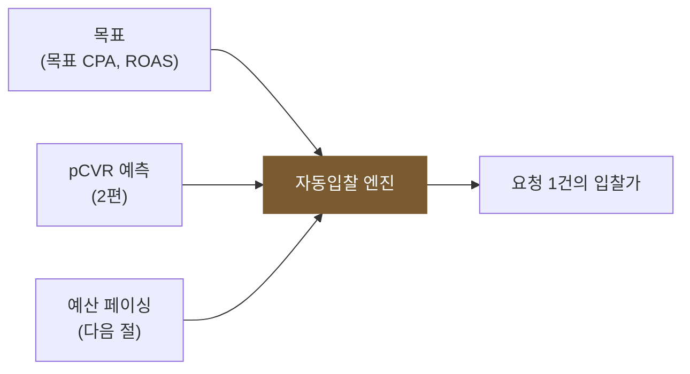
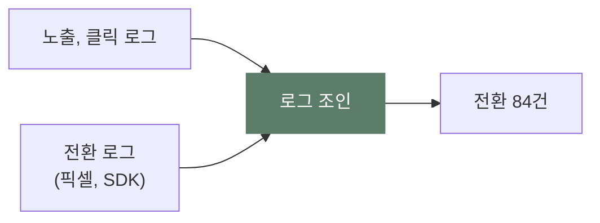

작은 온라인 편집숍을 운영하는 지수 씨는 카카오모먼트에서 캠페인 하나를 켰습니다. 카카오모먼트는 광고주가 캠페인을 만들고 입찰가나 목표를 입력하면 나머지를 시스템이 대신 처리하는 카카오의 광고 콘솔입니다. 캠페인은 목표와 예산을 정해 광고를 내보내는 단위입니다. 지수 씨가 이 캠페인에 건 목표는 "전환당 비용(CPA) 1만 원, 하루 예산 100만 원"이었습니다. 전환은 광고를 본 사람이 구매나 가입처럼 광고주가 바라는 행동을 한 일입니다. 전환당 비용(CPA)은 쓴 광고비를 전환 수로 나눈 값이라 CPA 가 낮을수록 같은 돈으로 얻는 전환이 많습니다. 버튼을 누르고 나자 지수 씨가 할 일은 거기서 끝났습니다.

며칠 뒤 광고 성과를 보여 주는 대시보드를 열어 보니 이상한 점이 눈에 띄었습니다. 월요일에는 정오가 되기도 전에 예산이 바닥났는데 화요일에는 자정이 다 되도록 30만 원이 쓰이지 않은 채 남아 있었습니다. 리포트 맨 아래에는 "전환 84건"이라는 숫자도 찍혀 있었습니다. 이 84건은 정말 광고 덕분에 생긴 전환일까요?

이 글은 대시보드가 남긴 질문 3가지를 다룹니다. 세 질문은 입찰에서 얼마를 부를지, 예산을 언제 쓸지, 리포트의 숫자를 믿어도 될지입니다. 카카오 광고를 다룬 [1편](post.html?id=kakao-ads-products)에서는 무엇이 팔리는지를, [2편](post.html?id=kakao-ads-prediction-targeting)에서는 누구에게 보여 줄지를 봤습니다. 이 글은 그다음 순서로, 보여 줄 사람을 골랐다면 얼마를 부르고 예산을 어떻게 나누고 효과를 어떻게 측정하는지까지 보며 이야기를 마무리합니다.

> 들어가기 전에 — 카카오는 자동입찰의 내부 알고리즘과 예산을 시간에 나눠 쓰는 정확한 페이싱 규칙, 수수료 구조를 공개하지 않았습니다. 이 글은 상품 화면에 실제로 보이는 기능 이름(자동입찰, 목표 CPA 설정 등)은 그대로 쓰고 대신 공개되지 않은 내부 동작은 "업계에서 보통 이렇게 만든다"는 통념으로만 설명하며 통념이라는 점을 밝힙니다. 글에 나오는 수치는 모두 이해를 도우려고 만든 가상의 예시이고 실제 카카오의 입찰가, 전환율, CPA 가 아닙니다.

> **한 줄 요약:** 자동입찰은 광고주가 정한 목표(목표 CPA, 또는 광고비 대비 매출인 ROAS) 하나를 받아 광고 자리가 생길 때마다 들어오는 요청의 입찰가를 시스템이 대신 정하는 기능입니다. 그 계산에는 이 사람이 전환할 확률의 예측값(pCVR)과 하루 예산을 시간에 걸쳐 나눠 쓰는 예산 페이싱이 함께 들어갑니다. 목표를 너무 낮게(타이트하게) 걸면 입찰에서 계속 져서 예산조차 다 쓰지 못합니다. 그렇게 얻은 전환 수는 전환의 공을 어느 광고에 줄지 정해 둔 규칙으로 센 숫자(어트리뷰션)일 뿐입니다. 광고가 정말 만든 전환(증분)이 몇 건인지는 그 숫자와 다른 질문입니다.

---

## 1. 목표를 받아 입찰가를 대신 정하는 자동입찰

**카카오모먼트의 자동입찰에서 광고주는 목표 CPA 를 입력해 목표만 정하고 그 뒤의 계산과 나머지 수십만 번의 입찰은 모두 시스템에 맡깁니다.**

지수 씨가 입력한 값은 목표 CPA 1만 원과 하루 예산 100만 원 2개뿐이었습니다. 그런데 광고가 뜨는 배너 자리 하나를 두고 벌어지는 경쟁은 하루에도 수십만 번입니다. 그때마다 사람이 입찰가(경매에서 그 자리를 사려고 부르는 값)를 정할 수는 없으므로 시스템이 대신 계산합니다. 카카오모먼트가 실제로 제공하는 이 기능의 이름이 **자동입찰**입니다.

자동입찰이 입찰가를 계산하는 재료는 2가지입니다. 첫째 재료는 "이 사람이 살 확률"인 pCVR 입니다. pCVR(predicted conversion rate)은 광고를 본 이 사람이 전환할 확률을 모델이 미리 예측한 값입니다. 이 확률을 맞히는 법은 [2편](post.html?id=kakao-ads-prediction-targeting)에서 봤습니다. 둘째 재료는 "지금 예산을 얼마나 급하게 써야 하는가"를 정하는 예산 페이싱입니다. 광고를 띄울 자리가 하나 생길 때마다 시스템에는 광고 요청이 1건 들어옵니다. 두 재료를 합쳐야 이 요청 1건의 입찰가 하나가 나옵니다.

아래 그림은 목표, pCVR 예측, 예산 페이싱 3가지가 자동입찰 엔진으로 들어가 요청 1건의 입찰가가 되는 흐름을 보여 줍니다.



같은 계산을 열린 RTB 에서 하면 사정이 다릅니다. 열린 RTB(Real-Time Bidding)는 지면(광고가 실리는 자리)의 주인, 거래소, 광고주 쪽 입찰 시스템이 서로 다른 회사로 나뉜 시장에서 광고 자리를 실시간 경매로 사고파는 방식입니다. 이 시장에서 광고주를 대신해 입찰가를 정하는 시스템을 DSP(Demand-Side Platform)라고 부릅니다. 열린 RTB 의 DSP 는 경쟁자가 얼마를 부를지 모르므로 경쟁자들의 입찰가가 어느 값에 얼마나 몰려 있는지(분포)를 추정해서 이 계산을 직접 짜야 합니다. 이 추정은 입찰가를 이길 만큼만 깎는 기법을 다룬 [Bid Shading](post.html?id=bid-shading-censored) 편에서 본 문제 그대로입니다.

카카오 같은 담장 안에서는 플랫폼이 모든 입찰가를 직접 보고 있으므로 이 추정 자체가 필요 없습니다. 담장 안은 지면을 가진 회사가 경매를 직접 열고 광고주들의 입찰가와 로그까지 모두 자기 시스템 안에 두는 곳이며 이 블로그의 무대 표시로는 닫힌 생태계입니다. 그곳의 광고주는 목표만 말하면 되고 나머지는 시스템이 압니다. 두 무대의 차이는 6, 7절에서 자세히 봅니다. 두 절의 제목 끝에 붙은 대괄호는 그 절이 어느 무대의 이야기인지 표시합니다.

---

## 2. 표① — 언제 쓰느냐에 따라 달라지는 하루 예산의 전환 수

**같은 하루 예산 100만 원이라도 시간대마다 얼마씩 나눠 쓰느냐에 따라 총 전환 수가 크게 달라집니다. 예산의 크기가 아니라 나누는 방식이 문제입니다.**

지수 씨의 월요일 예산은 모자라서가 아니라 너무 이르게 다 써 버려서 정오도 되기 전에 바닥났습니다. 오전에 트래픽(들어오는 광고 요청의 양)이 많다고 오전에 예산을 다 쓰면 정작 전환이 잘 되는 저녁 시간대에는 입찰할 돈이 남지 않습니다. 하루 예산을 시간에 걸쳐 어떻게 나눠 쓸지 정하는 이 문제를 **예산 페이싱**(budget pacing)이라고 부릅니다.

아래 **표①**은 예산 페이싱을 가상의 숫자로 보여 줍니다. 하루를 4시간씩 6개 시간대로 나누고 시간대마다 전환율(CVR, conversion rate)이 다르다고 가정했습니다. 표①의 계산에서 전환율은 클릭 한 번이 전환으로 이어지는 비율이라 전환율이 높을수록 같은 클릭 수에서 나오는 전환이 많습니다. 전환율은 저녁 시간대(16~20시)가 가장 높습니다. 퇴근 뒤 카카오톡을 스크롤하는 시간이라고 보면 그럴듯합니다. **표의 숫자는 모두 가상입니다.** 실제 카카오의 시간대별 전환율이 아닙니다.

세 전략을 비교합니다. 전략 A 인 **아침에 다 소진**은 00~12시의 시간대 3개에 예산을 몰아 쓰고 12시 이후 시간대에는 0원을 배정합니다. 전략 B 인 **균등 분배**는 시간대 6개에 똑같이 나눕니다. 전략 C 인 **성과 가중 배분**은 전환율이 높은 시간대일수록 예산을 더 많이 배정합니다. 계산을 단순하게 하려고 클릭 한 번에 내는 돈인 클릭당 비용(CPC)은 모든 시간대에서 500원으로 같다고 두었습니다. 표의 A, B, C 열은 전략마다 시간대에 배정한 금액입니다. 맨 아래 줄에는 그 배분으로 얻는 총 전환 수를 적었습니다.

| 시간대 | 전환율(CVR) | A: 아침에 다 소진 | B: 균등 분배 | C: 성과 가중 배분 |
|---|---|---|---|---|
| 00~04시(심야) | 0.8% | 333,333원 | 166,667원 | 80,808원 |
| 04~08시(새벽) | 1.0% | 333,333원 | 166,667원 | 101,010원 |
| 08~12시(오전) | 1.5% | 333,333원 | 166,667원 | 151,515원 |
| 12~16시(오후) | 2.2% | 0원 | 166,667원 | 222,222원 |
| 16~20시(저녁) | 2.6% | 0원 | 166,667원 | 262,626원 |
| 20~24시(밤) | 1.8% | 0원 | 166,667원 | 181,818원 |
| **총 전환 수** | — | **22.0건** | **33.0건** | **37.8건** |

같은 100만 원을 썼는데 총 전환은 22.0건에서 37.8건까지 벌어집니다. 시간대 하나의 전환 수는 배정한 돈을 CPC 500원으로 나눈 클릭 수에 그 시간대의 전환율을 곱한 값이라, 같은 돈이라도 전환율이 높은 시간대에 쓸수록 전환이 많이 나옵니다. 아침에 다 소진은 333,333원씩을 전환율이 0.8%, 1.0%, 1.5% 로 하루 중 가장 낮은 00~12시의 시간대 3개에 모두 써서 22.0건에 그칩니다. 12~24시에는 0원을 배정하므로 전환율이 2.6% 로 가장 높은 저녁 시간대를 전부 놓치는데, 12~24시의 전환율 2.2%, 2.6%, 1.8% 는 모두 00~12시의 어느 시간대보다도 높습니다.

균등 분배는 시간대마다 166,667원씩 써서 저녁을 놓치는 손실을 막고 33.0건을 얻지만 전환율이 0.8% 인 심야에도 2.6% 인 저녁과 똑같이 166,667원을 씁니다. 성과 가중 배분은 전환율에 비례해 나누므로 전환율이 심야(0.8%)의 3배가 넘는 저녁(2.6%)에 심야의 80,808원보다 3배 넘게 많은 262,626원을 배정합니다. **돈을 잘 팔리는 시간대에 더 많이 썼으므로 성과 가중 배분이 37.8건으로 세 전략 가운데 가장 많은 전환을 만들었습니다.**

---

## 3. 세 전략의 총 전환 수를 비교하는 파이썬 코드

**표①의 계산을 파이썬으로 옮기면 총 전환을 세는 함수는 그대로 두고 배분만 바꿔도 결과가 얼마나 벌어지는지 직접 돌려 확인할 수 있습니다.**

아래 코드는 세 전략의 총 전환을 같은 함수로 세어 표①의 맨 아래 줄을 다시 얻고 성과 가중 배분이 다른 두 전략보다 몇 % 많은지 찍으려고 돌립니다. 코드는 표①과 똑같이 시간대별 전환율, 하루 예산 100만 원, 시간대와 상관없이 500원인 CPC 를 가정합니다. 파이썬을 설치하면 함께 들어 있는 표준 라이브러리만 쓰므로 복사해 그대로 돌리면 표①의 숫자가 똑같이 나옵니다.

```python
# 하는 일: 하루 예산 100만 원을 아침 소진, 균등 분배, 성과 가중 배분 세 가지로 시간대 6개에 나눠 쓸 때 총 전환 수를 비교한다.
# 1단계: 예산, CPC, 시간대별 전환율을 둔다
# 모든 수치는 가상의 예시다(실제 카카오 데이터 아님). 표준 라이브러리만 쓴다.
BUDGET = 1_000_000          # 하루 예산(원) - 가상
CPC = 500                   # 클릭당 비용(원) - 전 시간대 동일하다고 가정(단순화, 가상)

# 4시간 단위 6개 시간대의 전환율(CVR). 저녁(16-20시) 피크, 새벽 저조 - 가상.
dayparts = [
    ("00-04시(심야)", 0.008),
    ("04-08시(새벽)", 0.010),
    ("08-12시(오전)", 0.015),
    ("12-16시(오후)", 0.022),
    ("16-20시(저녁)", 0.026),
    ("20-24시(밤)",   0.018),
]

# 2단계: 배분액으로 총 전환 수를 구하는 함수를 만든다
def total_conversions(alloc):
    """시간대별 배분액(alloc, 원)으로 총 전환 수를 계산."""
    total = 0.0
    for (name, cvr), budget_i in zip(dayparts, alloc):
        clicks = budget_i / CPC
        total += clicks * cvr
    return total

# 3단계: 세 전략의 배분을 만든다
# 배분 방식만 다르고, 총 전환은 같은 함수로 센다.

# 전략 A: 아침에 다 소진 - 00~12시 세 구간에 몰아쓰고 12시 이후는 0
alloc_a = [BUDGET / 3, BUDGET / 3, BUDGET / 3, 0, 0, 0]
# 전략 B: 균등 분배 - 6개 시간대에 똑같이
alloc_b = [BUDGET / 6] * 6
# 전략 C: 성과 좋은 시간대 가중 - CVR에 비례해서 배분
cvr_sum = sum(cvr for _, cvr in dayparts)
alloc_c = [BUDGET * (cvr / cvr_sum) for _, cvr in dayparts]

# 4단계: 전략마다 총 전환을 찍고 가중 배분의 차이를 비교한다
for label, alloc in [("아침에 다 소진", alloc_a), ("균등 분배", alloc_b), ("성과 가중 배분", alloc_c)]:
    total = total_conversions(alloc)
    print(f"{label:<12} 총 전환 {total:5.2f}건")

total_a, total_b, total_c = (total_conversions(a) for a in (alloc_a, alloc_b, alloc_c))
print(f"\n가중 배분이 균등 대비 {(total_c/total_b - 1)*100:+.1f}%,"
      f" 아침 소진 대비 {(total_c/total_a - 1)*100:+.1f}%")

# 출력:
# 4단계 뜻: 아침에 다 쓰면 22.00건, 균등 분배는 33.00건, 성과 가중 배분은 37.84건이다. 가중 배분은 균등보다 +14.7%, 아침 소진보다 +72.0% 많다.
# 아침에 다 소진     총 전환 22.00건
# 균등 분배        총 전환 33.00건
# 성과 가중 배분     총 전환 37.84건
#
# 가중 배분이 균등 대비 +14.7%, 아침 소진 대비 +72.0%
```

찍힌 총 전환은 아침에 다 소진 22.00건, 균등 분배 33.00건, 성과 가중 배분 37.84건이며 표①의 22.0건, 33.0건, 37.8건은 이 값을 소수점 한 자리로 적은 값입니다. 마지막 줄은 성과 가중 배분의 37.84건이 균등 분배의 33.00건보다 +14.7%, 아침에 다 소진의 22.00건보다 +72.0% 많다는 뜻입니다.

코드에서 살펴볼 곳은 `alloc_c` 를 만드는 줄과 `total_conversions` 함수 2군데입니다. `alloc_c` 줄은 전환율 6개를 더한 `cvr_sum` 으로 시간대마다 전환율을 나눈 비율만큼 예산을 배정하므로 전환율이 높은 시간대일수록 받는 금액이 큽니다. 표①의 C 열 금액이 이 줄에서 나옵니다.

`total_conversions` 함수는 시간대마다 배분액을 CPC 로 나눠 클릭 수를 구하고 거기에 전환율을 곱해 더하므로 배분이 어떻게 생겼든 총 전환은 이 함수 하나로 셉니다. 그래서 세 전략은 시간대 6개에 나눈 금액 6개를 순서대로 담은 목록, 곧 **배분 벡터 하나만 다릅니다.**

:::deep 더 깊이 — 예산을 균등하게만 쓰면 안 되는 까닭
표①에서 균등 분배(33.0건)는 아침에 다 소진(22.0건)보다 낫지만 성과 가중 배분(37.8건)은 균등 분배보다 또 낫습니다. 시간대마다 **기대 가치**가 달라서 똑같이 나누는 균등 분배는 처음부터 최선이 아닙니다.

기대 가치는 그 시간대에 1원을 썼을 때 생기는 전환의 양입니다. 이 글의 가정에서는 CPC 가 모든 시간대에서 500원으로 같으므로 1원이 만드는 전환은 그 시간대의 전환율에 비례합니다. 그래서 저녁(2.6%)의 기대 가치는 심야(0.8%)의 3배가 넘습니다. 기대 가치가 서로 다른데 같은 돈을 쓰면 기대 가치가 낮은 시간대에 쓴 돈은 사실 낭비에 가깝습니다.

이 배분 문제는 [2편](post.html?id=kakao-ads-prediction-targeting)에서 이미 본 문제와 뼈대가 같습니다. 2편은 타겟 방식마다 CPA 가 다를 때 예산을 어떻게 나눠야 총 전환이 가장 많은지를 그리디(greedy, 매번 지금 가장 좋아 보이는 곳부터 고르는 방식)로 풀었습니다. 여기서는 배분하는 대상이 타겟 방식에서 시간대로 바뀌었을 뿐입니다. 기대 가치가 높은 곳에 예산을 더 쓴다는 방향은 같습니다. 다만 2편의 그리디는 타겟마다 도달 한도까지만 채우는데 표①의 모델에는 시간대 한도가 없어서 C 는 전환율에 비례해 나눈 단순한 예시입니다.

실무에서 이 배분을 계산하는 방식은 이 글의 단순한 비례 배분보다 정교하며 [Auto-Bidding](post.html?id=auto-bidding-pacing)에서 자세히 다뤘습니다. 대표적인 방법은 PID 컨트롤러와 라그랑주 승수법입니다. PID 컨트롤러는 목표값과 지금 값의 차이를 보고 출력을 계속 고치는 제어 방식입니다. 라그랑주 승수법은 예산 같은 제약 조건이 붙은 최적화 문제를 푸는 수학 기법입니다. 이런 방법은 매 순간 남은 예산과 남은 시간, 지금까지의 소진 속도를 보고 입찰 강도를 실시간으로 조절합니다. 기대 가치가 높은 곳에 예산을 더 쓴다는 원리는 같지만 기대 가치가 높은 시간대를 미리 표로 알 수 없으므로 계속 관측하며 조절할 뿐입니다.
:::

---

## 4. 표② — 목표 CPA 를 낮출 때의 승률, 예산 소진율, 실제 CPA

**시스템은 목표 CPA 가 낮을수록 더 보수적으로 입찰해서 목표가 너무 낮으면 입찰에서 계속 지고 예산 자체를 다 쓰지 못합니다.**

2절의 예산 페이싱이 예산을 언제 쓸지의 문제라면 목표 CPA 는 입찰에서 얼마나 공격적으로 부를지의 문제입니다. 업계에서 일반적인 방식으로는 자동입찰의 입찰가가 대략 **목표 CPA × pCVR** 로 정해지며 1절에서 본 재료 2가지 가운데 pCVR 이 이 곱셈에 들어갑니다. 5절 시뮬레이션에서 pCVR 의 평균값인 0.02(2%)를 예로 들면, 목표 CPA 를 10,000원으로 건 캠페인에서 pCVR 이 0.02 인 요청의 입찰가는 10,000 × 0.02 = 200원입니다. 목표를 낮게 걸면 같은 요청의 입찰가도 그만큼 낮아지고 낮은 입찰가는 경매에서 자주 집니다.

아래 **표②**는 이 관계를 가상의 시뮬레이션으로 보여 줍니다. 목표 CPA 를 4단계로 바꿔 가며 승률, 예산 소진율, 전환 수, 실제 CPA 를 계산했습니다. **표의 숫자는 모두 가상의 모델 결과입니다.** 실제 카카오 자동입찰의 수치가 아닙니다. 승률은 들어온 요청 가운데 입찰에서 이긴 요청의 비율입니다. 예산 소진율은 예산 가운데 실제로 쓴 비율인데, 5절 코드는 가장 느슨한 15,000원 시나리오가 쓴 돈을 가상의 예산 기준선으로 두므로 15,000원 줄이 100.0% 가 됩니다. 실제 CPA 는 목표와 달리 결과로 나온 CPA 로, 실제로 쓴 돈을 전환 수로 나눈 값입니다.

| 목표 CPA | 승률 | 예산 소진율 | 전환 수 | 실제 CPA |
|---|---|---|---|---|
| 3,000원 (매우 타이트) | 3.7% | 1.5% | 163건 | 2,469원 |
| 6,000원 (타이트) | 32.9% | 22.5% | 1,379건 | 4,396원 |
| 10,000원 (적당) | 70.3% | 65.7% | 2,875건 | 6,167원 |
| 15,000원 (느슨) | 90.3% | 100.0% | 3,643건 | 7,405원 |

맨 위 줄을 보면 목표를 3,000원까지 낮췄을 때 승률은 3.7% 로 떨어지고 예산은 1.5% 밖에 쓰지 못합니다. 화요일에 30만 원이 남은 지수 씨의 캠페인도 이 줄과 같은 구조일 수 있습니다. 그렇다면 페이싱이 문제가 아니라 목표 자체가 너무 낮아서 애초에 이길 입찰이 적었다는 뜻입니다. [2편](post.html?id=kakao-ads-prediction-targeting)에서 본 맞춤타겟(광고주가 직접 올린 자기 고객 명단으로 만드는 타겟)도 같은 모양으로, 정확도는 1등이었는데도 예산의 극히 일부만 쓰고 말았습니다. 광고가 닿을 수 있는 사람의 수인 도달이 좁으면 정확해도 전환 물량이 나오지 않습니다.

반대로 목표를 15,000원까지 풀면 승률이 90.3% 까지 오르고 기준선으로 둔 지출이라 소진율이 100% 이며 전환 수도 3,643건으로 네 시나리오 가운데 가장 많습니다. 목표를 10,000원에서 15,000원으로 올릴 때 실제 CPA 도 6,167원에서 7,405원으로 오르지만 낙찰하면 입찰가보다 낮은 시장가만 내므로 7,405원은 여전히 목표 15,000원보다 낮습니다. **목표를 풀어도 실제 CPA 가 목표까지 치솟지는 않습니다.** 대신 상대적으로 비싼 기회까지 더 많이 받아들이면서 물량이 늘어납니다.

---

## 5. 목표 CPA 시뮬레이션 파이썬 코드 — 승률, 소진율, 실제 CPA

**표②의 네 줄은 업계 통념을 본뜬 단순한 예시 모델을 파이썬으로 돌려 얻은 값이며 실제 카카오 알고리즘에서 나온 값이 아닙니다.**

모델의 가정은 4가지입니다. 첫째, 광고 요청마다 그 요청에서 이기는 데 필요한 가격인 시장가(market clearing price)가 있습니다. 둘째, 자동입찰은 입찰가를 목표 CPA × 예측 pCVR 로 정합니다. 셋째, 입찰가가 시장가 이상이면 낙찰(경매에서 이김)입니다. 넷째, 단순하게 만들려고 담장 안 자동입찰은 낙찰에 필요한 만큼만 낸다고 두었습니다.

코드는 하루 광고 요청 20만 건을 만들고 요청마다 시장가와 pCVR 을 하나씩 뽑습니다. 시장가는 중앙값(크기순으로 늘어놓았을 때 가운데 값)이 약 150원인 로그정규분포에서 뽑습니다. 로그정규분포는 값이 늘 0 보다 크고 큰 값으로 꼬리가 길게 늘어진 분포입니다. pCVR 은 평균 0.02, 표준편차(값이 평균에서 흩어진 정도) 0.003 인 정규분포에서 뽑되 0.002 밑으로는 내려가지 않게 막습니다. 시드(난수를 만드는 시작값)를 고정해 두었으므로 몇 번을 돌려도 같은 숫자가 나옵니다. 아래 코드는 이렇게 만든 같은 요청 20만 건에 목표 CPA 4가지를 차례로 걸어 표②의 네 줄을 찍으려고 돌립니다.

```python
# 하는 일: 하루 광고 요청 20만 건에 목표 CPA 를 3,000원, 6,000원, 10,000원, 15,000원으로 걸어 승률, 예산 소진율, 전환 수, 실제 CPA 가 어떻게 움직이는지 시뮬레이션한다.
import random
random.seed(3)

# 1단계: 시장가와 예측 pCVR 분포를 두고 요청 20만 건을 만든다
# 전부 가상의 예시 모델이다. 카카오 실제 자동입찰 알고리즘이 아니라 업계에서 흔히 쓰는 방식을 본떴다. 매 요청마다 이기는 데 필요한 시장가(market clearing price)가 있다고 둔다. 표준 라이브러리만 쓰고 시드를 고정한다.
N = 200_000                      # 하루 광고 요청 수(가상)
MU, SIGMA = 5.0106, 0.5          # 시장가 로그정규분포 파라미터 - 중앙값 약 150원(가상)
CVR_MEAN, CVR_SD = 0.02, 0.003   # 요청별 예측 pCVR 평균/표준편차(가상)

market_price = [random.lognormvariate(MU, SIGMA) for _ in range(N)]
pcvr = [max(0.002, random.gauss(CVR_MEAN, CVR_SD)) for _ in range(N)]

# 2단계: 목표 CPA 하나로 하루를 시뮬레이션하는 함수를 만든다
# 자동입찰은 bid = 목표CPA x 예측 pCVR 로 입찰가를 정한다(2편의 pCVR 예측이 재료). 시장가보다 bid 가 높으면 낙찰이고, 담장 안 자동입찰은 딱 필요한 만큼만 낸다고 가정한다.
def simulate(target_cpa):
    wins = spend = conv = 0.0
    for price, p in zip(market_price, pcvr):
        bid = target_cpa * p           # bid = 목표CPA x pCVR
        if bid >= price:                # 시장가를 넘으면 낙찰
            wins += 1
            spend += price              # 딱 필요한 만큼만 지불(가정)
            conv += p
    return wins, spend, conv

# 3단계: 목표 CPA 넷으로 돌려 표를 찍는다
targets = [3_000, 6_000, 10_000, 15_000]
results = [(t,) + simulate(t) for t in targets]
baseline_spend = results[-1][2]   # 가장 느슨한 시나리오의 지출 = 가상의 예산 기준선

print("목표CPA   승률     예산소진율   전환수     실제CPA")
for target, wins, spend, conv in results:
    print(f"{target:>7,}원  {wins/N:>6.1%}   {spend/baseline_spend:>8.1%}   "
          f"{conv:>7.1f}건   {spend/conv:>9,.0f}원")

# 출력:
# 3단계 뜻: 목표를 3,000원으로 낮추면 승률 3.7%, 예산소진율 1.5% 에 그친다. 15,000원까지 풀면 승률 90.3% 에 예산을 100.0% 쓰지만, 실제 CPA 는 7,405원으로 목표보다 낮다.
# 목표CPA   승률     예산소진율   전환수     실제CPA
#   3,000원    3.7%       1.5%     162.9건       2,469원
#   6,000원   32.9%      22.5%    1378.5건       4,396원
#  10,000원   70.3%      65.7%    2874.9건       6,167원
#  15,000원   90.3%     100.0%    3643.5건       7,405원
```

찍힌 승률, 예산 소진율, 실제 CPA 는 표②와 같고 전환 수는 162.9건, 1378.5건, 2874.9건, 3643.5건처럼 소수점까지 나옵니다. `conv += p` 줄이 낙찰한 요청마다 전환 1건을 세는 대신 그 요청의 pCVR 을 더해 기대 전환 수(확률을 더해 얻는 평균적인 전환 수)를 쌓으므로 전환 수에 소수점이 붙습니다.

평균적인 요청 하나를 따라가 보면 목표 CPA 가 10,000원일 때 pCVR 0.02 인 요청의 입찰가는 200원으로 시장가 중앙값 약 150원보다 높아 이 요청이 이길 확률은 절반을 넘습니다. 실제로 이 목표의 승률은 70.3% 입니다. 목표를 3,000원으로 낮추면 같은 요청의 입찰가가 중앙값 약 150원에 한참 못 미치는 값으로 떨어지므로 이기는 요청이 드물어지고 승률이 3.7% 에 그칩니다.

코드에서 눈여겨볼 줄은 2개입니다. `bid = target_cpa * p` 는 목표 CPA 에 예측 pCVR 을 곱해 입찰가를 만들므로 목표가 같아도 pCVR 이 높은 요청일수록 입찰가가 높습니다. `spend += price` 는 낙찰하면 입찰가가 아니라 시장가만큼만 낸다는 가정을 옮긴 줄입니다. 1절에서 말한 "플랫폼이 모든 입찰가를 보고 있다"는 사실을 이기는 데 필요한 만큼만 받는다는 가정으로 바꿔 코드에 넣었습니다.

네 줄을 나란히 보면 목표를 낮출수록 승률과 소진율이 함께 떨어집니다. 3,000원에서는 승률 3.7%, 소진율 1.5% 이고 15,000원에서는 승률 90.3%, 소진율 100% 입니다. 그런데 네 경우 모두 실제 CPA 가 목표보다 낮습니다. **승률과 물량은 목표에 따라 크게 움직이지만 실제 CPA 는 목표를 넘지 않는 범위 안에서만 움직입니다.** 이 모델은 단순화한 예시일 뿐이며 실제 카카오 시스템이 이 공식 그대로 계산한다는 뜻이 아닙니다.

---

## 6. 담장 안 자동입찰이 하는 일 [무대: 닫힌 생태계]

**카카오의 자동입찰은 모든 광고의 입찰가를 직접 보면서 값을 정하므로 어림짐작이 없지만 광고주는 그 계산 과정을 들여다볼 수 없습니다.**

열린 RTB 의 DSP 는 경쟁자가 얼마를 부를지 모르는 채로 입찰가를 정해야 하지만 카카오모먼트의 자동입찰은 사정이 다릅니다. 노출, 클릭, 구매 로그는 물론 같은 지면에 몰린 다른 광고주의 입찰가까지 모두 한 회사의 시스템 안에 있으므로 "이 정도면 이긴다"는 계산에 추정이 끼어들 필요가 없습니다. 같은 까닭으로 1편의 표①에서는 패찰가(경매에서 진 광고들이 부른 값) 4개까지 전부 볼 수 있었습니다.

담장 안의 이 이점은 페이싱에도 그대로 이어집니다. 남은 예산과 남은 시간, 지금까지의 소진 속도도 플랫폼이 모두 실시간으로 보고 있으므로 2절 표①처럼 시간대별 배분을 세밀하게 조절할 수 있습니다. 시간대별 전환율 데이터가 이미 시스템 안에 있으니 광고주가 시간대별 전환율을 직접 추정해 배분을 짤 필요도 없습니다.

다만 이 편리함에는 대가가 따릅니다. 지수 씨는 목표 CPA 를 입력하는 화면과 그 결과로 나온 리포트만 볼 수 있고 어떤 요청에 얼마를 불렀는지, 왜 화요일에 예산이 남았는지 같은 중간 계산은 볼 수 없습니다. **정보는 모두 광고주가 아니라 플랫폼에 있습니다.** 담장 안 자동입찰의 트레이드오프(하나를 얻는 대신 다른 하나를 내주는 관계)가 여기에 있습니다. 어림짐작은 사라지지만 그 자리를 블랙박스(안에서 어떤 계산이 일어나는지 밖에서 볼 수 없는 시스템)가 대신 채웁니다.

---

## 7. 열린 RTB 에서 광고주가 직접 깎아야 하는 입찰가 [무대: 열린 RTB]

**열린 RTB 에서는 이 모든 계산을 광고주 쪽 DSP 가 직접 맡아야 하는데, 패찰한 경매에서는 경쟁자가 얼마를 불렀는지조차 알 수 없습니다.**

같은 "목표 CPA 자동입찰"을 열린 RTB 에서 하려면 DSP 가 훨씬 많은 것을 스스로 풀어야 합니다. 열린 RTB 에서는 낙찰가(이긴 경매에서 낸 가격)는 보이지만 패찰가는 보이지 않습니다. 패찰한 경매에서 DSP 는 이긴 광고가 낸 값이 자기 입찰가보다 높았다는 사실만 압니다. 이렇게 정확한 값 대신 범위만 남는 데이터를 **Censored Data**(중도절단 데이터)라고 부릅니다. Censored Data 는 [Bid Shading](post.html?id=bid-shading-censored)에서 다룬 문제입니다. DSP 는 경쟁자들의 입찰가 분포를 통계로 추정해야 "이 정도면 이긴다"는 값을 겨우 알 수 있습니다.

페이싱도 사정이 비슷합니다. 2절 표①처럼 시간대별 전환율을 볼 수는 있지만 그 데이터가 카카오만큼 촘촘하지 않습니다. 사파리와 파이어폭스가 서드파티 쿠키를 막고 iOS 의 ATT 가 식별자를 막으면서 시간대별 성과를 사람 단위로 연결하는 일 자체가 어려워졌습니다. 서드파티 쿠키는 사용자가 들어간 사이트가 아니라 다른 회사의 도메인이 브라우저에 남기는 기록입니다. 식별자는 여러 사이트와 앱을 오가는 사람을 같은 사람으로 알아보게 해 주는 번호를 말합니다. ATT(App Tracking Transparency)는 앱이 광고 식별자를 읽기 전에 사용자 동의를 받게 하는 iOS 의 규칙입니다. 이 이야기는 [2편](post.html?id=kakao-ads-prediction-targeting)에서 이미 다뤘습니다.

그래서 열린 RTB 는 카카오와 목표가 같아도 방법이 다릅니다. 두 곳 모두 **1st Price 경매에서 과다 지불을 막는다**는 목표는 똑같습니다. 1st Price 경매는 낙찰자가 자기가 부른 입찰가를 그대로 내는 경매입니다. 그래서 이기는 데 필요한 값보다 높게 부르면 그 차이만큼 더 냅니다. 이렇게 더 낸 돈이 과다 지불입니다. 카카오는 모든 입찰가를 보고 있으니 정보만으로 계산을 끝내지만 열린 RTB 는 패찰해서 보이지 않는 가격을 통계로 메우는 추정으로 이 문제를 풉니다. 담장 안과 밖은 결국 **무엇을 볼 수 있느냐**로 나뉩니다.

---

## 8. 성과 측정 — 진짜 효과가 아닌 전환 수

**광고주 웹사이트의 카카오 픽셀과 앱의 SDK 가 잡은 "전환 84건"은 정해 둔 규칙으로 센 숫자입니다. 광고가 없었어도 그중 몇 건은 일어났을 수 있습니다. 그 차이를 측정하려면 이 글의 내용만으로는 부족합니다.**

지수 씨가 리포트 맨 아래에서 본 "전환 84건"이 어떻게 만들어지는지부터 봅니다. 구매, 가입 같은 전환은 광고주 웹사이트에 심는 **카카오 픽셀**과 앱에 심는 **SDK** 를 거쳐 카카오로 들어옵니다. 픽셀은 웹페이지에 넣어 두면 방문자가 구매나 가입을 했다는 신호를 광고 플랫폼으로 보내는 작은 코드입니다. SDK(Software Development Kit)는 앱에 넣는 개발 도구 모음이고 앱에서 같은 신호를 보냅니다.

받은 전환 신호는 노출, 클릭 로그와 조인되어 "어느 광고의 전환인가"로 묶입니다. 조인(join)은 두 로그에서 같은 사람의 기록을 찾아 하나로 합치는 일입니다. 아래 그림은 노출, 클릭 로그와 픽셀, SDK 의 전환 로그가 로그 조인을 거쳐 "전환 84건"이 되는 흐름을 보여 줍니다.



로그를 사람 단위로 연결하는 방법은 [광고 로그 파이프라인](post.html?id=ad-log-pipeline)에 있습니다. 그런데 이 84건은 전환 하나의 공을 어느 광고에 줄지 정하는 **어트리뷰션 규칙**이 만든 숫자입니다. 공을 마지막 클릭에 몰아줄지, 전환 전에 거쳐 간 접점(그 사람이 본 광고와 누른 광고)에 나눠 줄지에 따라 같은 로그에서도 다른 숫자가 나옵니다. 이 규칙과 그 함정은 [어트리뷰션 입문](post.html?id=attribution-basics)에서 자세히 다뤘습니다. **어트리뷰션 계산은 이 글에서 되풀이하지 않습니다.**

정말 알고 싶은 질문은 따로 있습니다. "광고가 없었어도 84건 가운데 몇 건은 일어났을까?"라는 질문입니다. 이 답을 얻으려면 비교하려고 일부러 광고를 보여 주지 않은 대조군, 다른 말로 **홀드아웃**이 필요합니다. 홀드아웃을 어떻게 설계하는지는 무작위로 나눈 집단을 비교하는 실험을 다룬 [RCT](post.html?id=rct-randomized-experiment)에 있습니다. 어트리뷰션이 센 전환 수와 광고가 실제로 만든 증분이 얼마나 다른지는 [어트리뷰션 입문 7절](post.html?id=attribution-basics)에 이미 계산해 두었습니다.

그래서 지수 씨의 "전환 84건"에 정직하게 답하면 이렇습니다. **84건이라는 숫자는 진짜지만 84건 모두가 광고 덕분이라는 뜻은 아닙니다.** 그 가운데 얼마가 진짜 증분인지는 카카오 픽셀 리포트만 봐서는 알 수 없고 홀드아웃을 돌려야 나옵니다.

---

## 9. 한눈 정리

| 개념 | 뜻 | 이 글에서 본 숫자 | 기억할 점 |
|---|---|---|---|
| 자동입찰 | 목표를 받아 입찰가를 대신 정하는 기능 | 입찰가 ≈ 목표 CPA × pCVR | 재료는 pCVR 예측과 예산 페이싱 |
| 예산 페이싱 | 하루 예산을 시간에 걸쳐 나눠 쓰는 일 | 아침 소진 22건 vs 가중 배분 37.8건 | 균등 분배도 아침 소진보다는 낫지만 최선은 아님 |
| 목표 CPA | 입찰 강도를 정하는 값 | 3,000원→소진율 1.5% / 15,000원→100% | 너무 낮추면 예산을 다 쓰지 못함 |
| 실제 CPA | 목표와 달리 결과로 나온 값 | 네 시나리오 모두 목표보다 낮음 | 목표는 상한이고 실제값이 아님 |
| 담장 안 자동입찰 | 플랫폼이 모든 입찰가를 보고 대신 정함 | 추정 없이 계산이 끝남 | 어림짐작이 없는 대신 블랙박스 |
| 열린 RTB Bid Shading | DSP 가 패찰가 없이 직접 추정함 | Censored Data | 어림짐작이 불가피 |
| 어트리뷰션 vs 증분 | 규칙으로 센 숫자 vs 광고가 실제로 만든 효과 | 전환 84건 ≠ 증분 84건 | 증분은 홀드아웃으로만 측정 |

---

## 10. 헷갈리기 쉬운 점

- **목표 CPA 를 낮게 건다고 늘 좋지는 않습니다.** 표②에서 본 대로 목표가 너무 낮으면 승률이 떨어져 예산의 극히 일부만 쓰는 데 그치고 전환 수 자체도 적어집니다.
- **예산이 남는다고 늘 페이싱 문제는 아닙니다.** 2절은 예산을 언제 쓰는지를, 4절은 애초에 이길 입찰이 부족한지를 다뤘습니다. 두 문제는 원인이 다릅니다.
- **이 모델에서는 실제 CPA 가 목표 CPA 를 넘지 않습니다.** 표②의 네 시나리오 모두 실제 CPA 가 목표보다 낮았습니다. pCVR 예측이 틀리지 않는다고 두었기 때문입니다. 목표 CPA 는 시스템이 넘지 않으려는 상한에 가깝습니다.
- **담장 안이라고 해서 광고주가 모든 것을 알지는 못합니다.** 플랫폼은 모든 입찰가를 보지만 광고주에게 보이는 화면은 목표 입력창과 리포트뿐입니다. 계산 과정은 블랙박스입니다.
- **전환 수가 많다고 해서 광고 효과도 크다고 볼 수는 없습니다.** 픽셀과 SDK 가 잡은 숫자는 어트리뷰션 규칙으로 센 결과이고 그 안에는 광고가 없었어도 일어났을 전환이 섞여 있을 수 있습니다.

---

## 더 깊이 보기

- 무엇이 팔리고 eCPM으로 어떻게 순위가 매겨지나 → [1편: 카카오 광고 상품 지도](post.html?id=kakao-ads-products)
- 무엇으로 확률을 맞히고 누구를 겨냥하나 → [2편: 카카오는 무엇으로 광고를 고르나](post.html?id=kakao-ads-prediction-targeting)
- 예산 페이싱의 PID, 라그랑주 산수 → [Auto-Bidding 과 예산 페이싱](post.html?id=auto-bidding-pacing)
- 패찰가 없이 입찰가를 추정하는 법 → [Bid Shading: Censored Data](post.html?id=bid-shading-censored)
- 어트리뷰션 규칙과 증분의 차이 → [어트리뷰션 입문](post.html?id=attribution-basics)
- 홀드아웃 실험을 제대로 설계하는 법 → [RCT: 무작위 실험](post.html?id=rct-randomized-experiment)
- 광고 ML 전체 지도에서 이 글의 위치 → [ML 엔지니어 트랙](ml-track.html)
