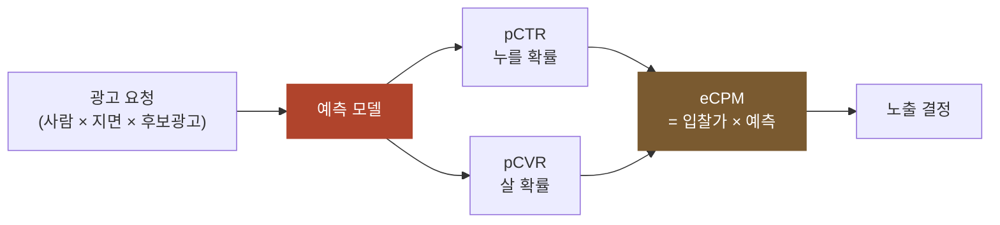
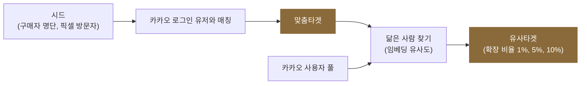

카카오톡 지갑 탭을 열자 낯선 배너가 떠 있었습니다. 배너에 뜬 광고는 캠핑 의자였습니다. 이틀 전에 카카오페이로 캠핑장 예약금을 냈는데 그 결제를 지켜본 곳은 카카오 한 곳뿐입니다. 그런데 다른 앱을 켜면 이렇게 최근 결제와 맞아떨어지는 광고가 뜨는 일이 잘 생기지 않습니다.

1편에서는 이 배너 한 칸이 어떻게 팔리는지 봤습니다. 그 자리를 원하는 여러 광고는 eCPM 이라는 점수 순으로 정렬됐고 이 점수 `입찰가 × pCTR` 이 가장 높은 광고가 자리를 가져갔습니다. 입찰가는 광고주가 클릭 한 번에 내겠다고 부른 값이고 pCTR 은 「이 사람이 이 광고를 누를 확률」을 모델이 예측한 값입니다. 그렇다면 카카오는 이 확률을 무엇으로 맞힐까요? 애초에 광고를 「누구에게 보여 줄지」는 어떻게 좁힐까요?

이번 편은 이 두 질문만 다룹니다. 첫째로 pCTR 과 pCVR 을 예측하는 모델이 무엇을 재료로 쓰는지 봅니다. pCVR 은 광고를 누른 사람이 구매나 가입처럼 광고주가 바라는 행동인 전환까지 할 확률을 예측한 값입니다. 둘째로 타겟팅(광고를 보여 줄 사람을 고르는 일)에서 맞춤타겟과 유사타겟이 도달과 정확도를 어떻게 맞바꾸는지 봅니다. 맞춤타겟은 광고주가 올린 고객 명단으로 사람을 고르고 유사타겟은 그 명단과 닮은 사람까지 넓힙니다. 도달은 광고가 닿는 사람 수이고 정확도는 고른 사람이 실제로 반응하는 정도입니다.

> 들어가기 전에 — 카카오는 실제 모델 구조, 피처(모델에 넣는 입력값), 타겟 정확도, 데이터 규모를 공개하지 않았습니다. 이 글은 맞춤타겟, 유사타겟처럼 상품 화면에 실제로 보이는 기능 이름은 그대로 쓰는 대신 화면 뒤의 내부 구현은 업계에서 흔히 쓰는 방식으로만 설명합니다. 글에 나오는 숫자도 모두 이해를 돕기 위해 만든 **가상의 예시**이고 실제 카카오의 pCTR, 도달, 전환율이 아닙니다.

앞 편인 [1편: 카카오 광고 상품 지도](post.html?id=kakao-ads-products)를 먼저 읽으면 흐름이 이어집니다. 절 제목 끝의 대괄호는 그 절이 어느 무대의 이야기인지 표시합니다. 닫힌 생태계는 카카오처럼 한 회사가 노출부터 로그인, 결제까지 모두 보는 곳입니다. 열린 RTB 는 여러 회사의 광고 자리와 광고가 거래소에서 실시간 경매(RTB, Real-Time Bidding)로 만나는 시장입니다.

> 한 줄 요약: 카카오의 예측은 처음부터 로그인 데이터(같은 로그인 ID 로 묶인 여러 서비스의 검색, 결제 같은 기록)를 바탕으로 하므로 익명 트래픽(로그인하지 않은 방문)만 보는 예측과 출발선이 다릅니다. 타겟을 좁힐수록 전환율은 오르지만 도달은 줄어듭니다. 유사타겟이 그 사이를 메웁니다. 다만 예측이 정교해도 예측한 숫자를 실제 확률에 맞추는 보정(Calibration)이 없으면 소용이 없습니다. 1편에서 본 낙찰자(경매에서 자리를 따낸 광고) 뒤집힘이 담장 안, 곧 닫힌 생태계에서도 그대로 벌어집니다.

---

## 1. 광고를 고르는 예측, pCTR 과 pCVR

**비즈보드 배너 한 칸이든 검색 결과 위 광고 한 줄이든, 그 자리를 두고 벌어지는 경쟁은 결국 확률 하나의 싸움입니다.**

광고 자리 하나에 여러 광고가 몰리면 시스템은 그중 하나를 골라야 하는데 1편에서 본 기준은 `eCPM = 입찰가 × 예상 반응률` 이었습니다. 여기서 예상 반응률이 pCTR(predicted Click-Through Rate), 우리말로 예상 클릭률입니다. 캠페인의 목표가 전환이면 이 식에 pCVR(예상 전환율)을 한 번 더 곱합니다. 광고 요청은 광고 자리가 하나 생길 때 그 자리를 채울 광고를 달라고 들어오는 요청입니다. 시스템은 광고 요청이 올 때마다 그 자리를 보게 될 사람 한 명 한 명을 놓고 이 확률을 새로 계산합니다.

pCTR 을 잘 맞히려는 모델은 단순한 회귀에서 시작해서 피처 조합을 자동으로 찾는 FM, FM 에 딥러닝을 결합한 DeepFM, 사람마다 다른 관심사에 주목하는 DIN 으로 이어지며 「더 정확한 pCTR」을 향해 발전했습니다. 그 계보는 [pCTR: 이 사람이 누를까](post.html?id=pctr-prediction) 편에, 모델 구조가 발전한 과정은 [Deep CTR 모델](post.html?id=deep-ctr-models) 편에 정리돼 있습니다. 이 글은 모델 구조보다 그 모델이 무엇을 재료로 쓰는지에 집중합니다.

클릭 데이터는 흔하고 전환 데이터는 드물어서 클릭에서 배운 패턴을 전환 예측이 빌려 쓰는 편이 유리하므로 카카오처럼 클릭과 전환을 둘 다 신경 쓰는 광고에서는 두 확률을 따로 학습하지 않습니다. 한 모델이 여러 과제(태스크)를 함께 배우는 이런 구조를 [멀티태스크 러닝](post.html?id=multi-task-learning)이라고 부릅니다. ESMM(Entire Space Multi-Task Model)과 MMoE(Multi-gate Mixture-of-Experts) 같은 모델이 이 문제를 풉니다. ESMM 은 노출 전체에서 클릭과 전환을 함께 배우는 모델입니다. MMoE 는 모델 안에 작은 신경망인 전문가(expert)를 여러 개 두고 태스크마다 다른 전문가 조합을 쓰는 구조입니다.

아래 그림은 광고 요청 하나가 노출 결정에 이르는 흐름입니다. 요청은 사람, 지면(광고가 실리는 자리), 후보 광고의 조합으로 예측 모델에 들어갑니다. 모델이 낸 pCTR 과 pCVR 이 입찰가와 곱해져 eCPM 이 되면 그 점수로 노출할 광고가 정해집니다.



같은 모델 구조라도 어디서 돌리느냐에 따라 재료인 데이터가 달라서 결과도 달라집니다. 다음 절에서 그 차이를 숫자로 봅니다.

---

## 2. 로그인 데이터로 달라지는 예측의 출발점 [무대: 닫힌 생태계]

**같은 광고를 서로 다른 사람에게 보여 줄 때, 로그인 데이터가 붙기 전에는 다들 비슷해 보이던 pCTR 추정치가 로그인 데이터가 붙는 순간 사람마다 벌어집니다.**

로그인하지 않은 사람에게 광고를 보여 줘야 한다면 모델이 가진 단서는 거의 없습니다. 이 지면, 이 시간대, 이 광고 카테고리의 평균 클릭률 정도가 전부라서 로그인 전 예측은 사람마다 큰 차이 없이 그 광고 카테고리의 「평균」 근처에 몰립니다.

카카오는 사정이 다릅니다. 톡, 다음, 페이, T, 맵이 같은 로그인 ID 로 묶여 있어서 이 사람이 최근 무엇을 검색했고 무엇을 결제했는지 압니다. 어떤 톡채널에 관심을 보였는지도 피처가 됩니다. 여러 서비스의 데이터를 한 ID 로 합친 결과가 그대로 예측의 재료로 들어옵니다. 이 이점은 [닫힌 생태계(Walled Garden)](post.html?id=walled-garden) 편에서 다뤘습니다.

아래 **표①**은 같은 광고 5개를 서로 다른 사람에게 보여 줄 때의 pCTR 예측을 두 조건에서 비교합니다. 한 조건은 익명 트래픽만 있을 때, 다른 조건은 로그인 기반 관심, 행동 피처가 붙었을 때입니다. 마지막 열에는 로그인 뒤의 예측을 바꾼 신호를 적었습니다. **전부 가상의 수치이고** 실제 카카오 모델의 출력이 아닙니다.

| # | 광고 | 익명 트래픽만 있을 때 pCTR | 로그인 기반 피처 추가 후 pCTR | 근거가 된 신호 |
|---|---|---|---|---|
| 1 | 캠핑용품 | 1.2%(카테고리 평균) | **3.8%** | 최근 카카오페이로 캠핑장 결제 |
| 2 | 유아용품 | 1.2%(카테고리 평균) | **4.5%** | 최근 유아용품 결제 이력 |
| 3 | 항공권 | 1.2%(카테고리 평균) | **3.1%** | 최근 카카오T로 공항 픽업 예약 |
| 4 | 카드사 신규가입 | 1.2%(카테고리 평균) | **0.4%** | 이미 해당 카드 보유(무관심 신호) |
| 5 | 뷰티 브랜드 | 1.2%(카테고리 평균) | **0.9%** | 관련 카테고리 행동 전혀 없음 |

표①을 「로그인 데이터가 있으면 pCTR 이 항상 오른다」로 읽으면 틀립니다. 1번 캠핑용품은 최근 카카오페이로 캠핑장을 결제한 신호가 붙어 1.2% 에서 3.8% 로 올랐습니다. 반면 4번 카드사 신규가입은 이미 해당 카드를 가진 사람이라는 무관심 신호가 잡혀 1.2% 에서 0.4% 로, 5번 뷰티 브랜드는 관련 카테고리 행동이 전혀 없어 1.2% 에서 0.9% 로 오히려 내려갔습니다.

익명일 때는 광고 5개의 예측이 모두 카테고리 평균인 1.2% 근처에 뭉쳐 있다가 진짜 신호가 들어오자 관심 있는 사람은 위로, 무관심한 사람은 아래로 벌어졌습니다. 「예측의 출발점부터 다르다」는 말은 이 차이를 가리킵니다. 익명 상태의 예측은 사실 평균으로 짐작하는 데 가깝습니다. 로그인 데이터가 그 짐작을 진짜 예측으로 바꿉니다.

다만 이 신호를 0.1초 안에 조립하는 일은 또 다른 공학 문제입니다. 미리 계산해 둔 값을 아주 짧은 지연으로 꺼내 와야 하는데 Feature Store 가 이 역할을 합니다. Feature Store 는 모델에 넣을 피처를 미리 계산해 저장해 두는 저장소입니다. 구조는 [Feature Store](post.html?id=feature-store-serving) 편에서 자세히 다뤘습니다.

---

## 3. 좁힐수록 오르는 전환율과 줄어드는 도달 — 타겟 방식과 표②

**「누구에게 보여 줄지」를 좁히는 일은 공짜가 아닙니다. 정확도를 얻는 대신 도달을 대가로 치릅니다.**

카카오모먼트에서 광고주가 고르는 오디언스(audience, 광고를 보여 줄 사람의 집합)는 크게 4가지입니다.

- **데모그래픽**은 나이, 성별, 지역 같은 규칙으로 나눈 세그먼트(공통 조건으로 묶은 사용자 그룹)입니다.
- **관심사**는 카테고리에 관심을 보인 신호로 사람을 묶습니다.
- **맞춤타겟**은 광고주가 직접 올리는 자기 고객 리스트로 만듭니다.
- **유사타겟**은 맞춤타겟과 닮은 사람까지 넓힌 오디언스입니다.

4가지 모두 [세그멘테이션](post.html?id=audience-segmentation) 편에서 다룬 세그먼트 유형의 응용입니다. 그중 유사타겟은 이미 아는 고객과 닮은 사람을 찾는 기법인 [Lookalike Modeling](post.html?id=lookalike-modeling)이 실제 상품이 된 예입니다.

아래 카드에서는 광고주가 올린 고객 명단을 플랫폼이 자사 로그인 유저와 하나씩 맞춰 보고 맞은 사람만 맞춤타겟으로 남기는 과정을 보면 됩니다.

<div class="demo-embed-wrap">
<iframe class="demo-embed" src="demo-targeting-cards.html?embed=1&card=custom" height="480" loading="lazy" title="광고주가 올린 목록을 회원과 맞춘다"></iframe>
<a class="demo-embed-open" href="demo-targeting-cards.html" target="_blank" rel="noopener">↗ 카드 아홉 장 전체로 열기</a>
</div>

4가지 방식을 나란히 놓으면 뚜렷한 패턴이 보입니다. 아래 **표②**는 같은 캠페인을 6가지 방식으로 돌렸을 때 도달 규모와 전환율(CVR, Conversion Rate)이 어떻게 바뀌는지 비교합니다. 유사타겟은 맞춤타겟과 닮았다고 인정하는 범위인 확장 비율에 따라 1%, 5%, 10% 의 3줄로 나눴으므로 4가지 방식이 6줄이 됩니다(확장 비율은 5절에서 자세히 봅니다). 여기서 전환율은 도달한 사람 가운데 전환하는 사람의 비율입니다. 그래서 4절의 계산은 도달에 전환율을 곱해 전환 수를 구합니다. **이 표도 가상의 수치이고** 실제 도달, 전환율이 아닙니다.

| 타겟 방식 | 도달 규모 | 전환율(CVR) |
|---|---|---|
| 데모그래픽(연령, 성별, 지역) | 5,000,000명 | 0.25% |
| 관심사(카테고리 관심 신호) | 1,600,000명 | 0.60% |
| 유사타겟 10% | 1,400,000명 | 0.90% |
| 유사타겟 5% | 700,000명 | 1.50% |
| 유사타겟 1% | 150,000명 | 3.20% |
| 맞춤타겟(내 고객 리스트) | 80,000명 | 4.50% |

표를 위에서 아래로 읽으면 도달은 줄고 전환율은 오릅니다. 맨 위 데모그래픽의 500만 명에는 광고와 무관한 사람까지 섞여 있어서 전환율이 0.25% 로 낮습니다. 맨 아래 맞춤타겟의 8만 명은 이미 이 브랜드를 아는 사람들이라 전환율이 4.50% 로 높습니다. 4.50% 를 0.25% 로 나누면 18 이므로 맞춤타겟의 전환율은 데모그래픽의 18배입니다. 유사타겟 1%, 5%, 10% 는 그 사이에 놓입니다. 확장 비율이 1%, 5%, 10% 로 커질수록 맞춤타겟에서 멀어지고 데모그래픽에 가까워져서 전환율이 3.20%, 1.50%, 0.90% 로 내려갑니다.

그런데 표를 전환율 숫자로만 읽으면 함정에 빠집니다. 전환율이 가장 높은 타겟이라고 해서 가장 좋은 타겟이라는 보장은 없습니다. 도달이 너무 작으면 전환율이 높아도 총 전환 건수 자체가 적을 수 있습니다. 다음 절에서 이 점을 직접 계산해 확인합니다.

---

## 4. 파이썬으로 계산한 총 전환 — 가장 정확한 타겟과 최선의 타겟

**표②의 도달에 전환율을 곱해 총 전환 수를 구하면 전환율이 가장 높은 맞춤타겟보다 유사타겟 10% 의 총 전환이 많습니다. 정해진 예산도 한 타겟에 몰아주기보다 전환 1건당 비용이 낮은 타겟부터 채울 때 이 글의 세 전략 가운데 전환이 가장 많이 나옵니다.**

3절의 함정을 확인하려면 전환율 대신 실제로 몇 건이 전환되는지를 봐야 합니다. 계산은 두 단계입니다.

- **(a) 타겟마다 총 전환 수와 CPA 를 구합니다.** 총 전환 수는 도달에 전환율을 곱한 값입니다. CPA(Cost Per Action)는 전환 1건당 비용입니다. 그 타겟을 다 소진하는 데, 곧 도달 인원 모두에게 광고를 보여 주는 데 드는 비용을 총 전환 수로 나눠 구합니다. CPA 는 낮을수록 같은 돈으로 전환을 더 많이 얻습니다. 비용은 도달 인원을 1,000 으로 나눈 값에 CPM(노출 1,000명당 단가)을 곱해 잡았습니다. 좁은 타겟일수록 경쟁이 몰려 CPM 이 비싸진다고 가정했으므로 CPM 은 데모그래픽이 3천 원으로 가장 싸고 맞춤타겟이 1만 2천 원으로 가장 비쌉니다.
- **(b) 예산 2천만 원을 나눕니다.** 예산이 2천만 원으로 고정됐을 때 어떤 조합이 총 전환을 가장 많이 만드는지 그리디(greedy, 그때그때 가장 나아 보이는 선택부터 하는 방법)로 배분해 봅니다. 여기서는 CPA 가 낮은 타겟부터 그 타겟을 다 소진할 때까지 예산을 채우고 다음 타겟으로 넘어갑니다.

아래 코드는 (a) 의 계산으로 전환율이 가장 높아 가장 정확한 타겟인 맞춤타겟이 총 전환 수로도 최선인지 확인한 뒤 (b) 의 예산 2천만 원을 세 전략에 각각 맡겨 총 전환을 비교합니다. 세 전략은 맞춤타겟에만 예산을 몰아주는 전략 1(정확도 최우선), 데모그래픽에만 몰아주는 전략 2(도달 최우선), CPA 가 낮은 타겟부터 채우는 전략 3(효율순 그리디 배분)입니다. 표준 라이브러리만 쓰므로 따로 설치할 것 없이 그대로 복사해 실행하면 `# 출력:` 아래와 같은 값이 나옵니다.

```python
# 하는 일: 카카오모먼트의 타겟 방식 6개를 표2의 가상 도달과 전환율로 비교해 가장 정확한 타겟이 총 전환 수로도 최선인지 보고, 예산 2천만 원을 세 전략에 각각 맡겼을 때의 총 전환을 비교한다.
# 1단계: 타겟 방식 6개의 도달, 전환율, CPM 을 둔다
# 표준 라이브러리만 쓴다.

# 타겟 방식 | 도달 규모(명) | 전환율(CVR) | CPM(노출 1,000명당 비용, 원) - 전부 가상 수치.
targets = [
    ("데모그래픽",    5_000_000, 0.0025,  3_000),
    ("관심사",        1_600_000, 0.0060,  4_000),
    ("유사타겟 10%",  1_400_000, 0.0090,  5_000),
    ("유사타겟 5%",     700_000, 0.0150,  6_500),
    ("유사타겟 1%",     150_000, 0.0320,  9_000),
    ("맞춤타겟",         80_000, 0.0450, 12_000),
]

# 2단계: 타겟마다 다 소진했을 때의 전환 수와 CPA 를 구한다
def full_stats(name, reach, cvr, cpm):
    max_conv = reach * cvr            # 이 타겟을 100% 소진했을 때 전환 수
    max_cost = reach / 1000 * cpm     # 100% 소진에 드는 비용
    cpa = max_cost / max_conv         # 전환 1건당 비용
    return {"name": name, "reach": reach, "cvr": cvr, "cpm": cpm,
            "max_conv": max_conv, "max_cost": max_cost, "cpa": cpa}

stats = [full_stats(*t) for t in targets]

print("[표2 그대로 - 타겟 방식별 총 전환 수와 CPA]")
for s in stats:
    print(f"  {s['name']:<10s} 도달 {s['reach']:>9,}명  전환율 {s['cvr']*100:4.2f}%  "
          f"총전환 {s['max_conv']:>7,.0f}건  CPA {s['cpa']:>7,.1f}원")

# 3단계: CPA 1등과 총전환 1등을 비교한다
# (a) 가장 정확한 타겟이 최선인가를 본다. CPA 가 가장 좋은 맞춤타겟과 총 전환이 가장 많은 유사10% 를 비교한다.
best_cpa = min(stats, key=lambda s: s["cpa"])
best_volume = max(stats, key=lambda s: s["max_conv"])
print(f"\n[정리] CPA 1등: {best_cpa['name']}(전환 {best_cpa['max_conv']:,.0f}건) "
      f"vs 총전환 1등: {best_volume['name']}(전환 {best_volume['max_conv']:,.0f}건)")

# 4단계: CPA 낮은 순으로 예산을 채우는 그리디 함수를 만든다
# (b) 예산이 고정일 때 최적 조합을 찾는다. 각 타겟의 최대 소진 한도까지 채운다.
def greedy_allocate(stats, budget):
    order = sorted(stats, key=lambda s: s["cpa"])  # 효율(CPA) 좋은 순
    remaining = budget
    total_conv = 0.0
    plan = []
    for s in order:
        if remaining <= 0:
            plan.append((s["name"], 0, 0.0))
            continue
        spend = min(remaining, s["max_cost"])          # 이 타겟에 쓸 돈(한도 내)
        reach_used = spend / (s["cpm"] / 1000)         # 그 돈으로 사는 도달 인원
        conv = reach_used * s["cvr"]
        total_conv += conv
        remaining -= spend
        plan.append((s["name"], spend, conv))
    return plan, total_conv, budget - remaining

# 5단계: 예산 2천만 원으로 그리디 배분을 돌린다
BUDGET = 20_000_000  # 가상의 고정 예산(원)
plan, total_conv, spent = greedy_allocate(stats, BUDGET)

# 6단계: 전략 1, 맞춤타겟에만 몰아준다
print(f"\n[전략 1] 정확도 최우선 - 맞춤타겟에만 예산 {BUDGET:,}원을 몰아준다")
custom = next(s for s in stats if s["name"] == "맞춤타겟")
spend_custom = min(BUDGET, custom["max_cost"])
conv_custom = spend_custom / (custom["cpm"] / 1000) * custom["cvr"]
print(f"  실제로 쓴 돈 {spend_custom:,.0f}원 (나머지 {BUDGET - spend_custom:,.0f}원은 살 사람이 없어 못 씀)")
print(f"  전환 {conv_custom:,.0f}건")

# 7단계: 전략 2, 데모그래픽에만 몰아준다
print(f"\n[전략 2] 도달 최우선 - 데모그래픽에만 예산 {BUDGET:,}원을 몰아준다")
demo = next(s for s in stats if s["name"] == "데모그래픽")
spend_demo = min(BUDGET, demo["max_cost"])
conv_demo = spend_demo / (demo["cpm"] / 1000) * demo["cvr"]
print(f"  실제로 쓴 돈 {spend_demo:,.0f}원 (나머지 {BUDGET - spend_demo:,.0f}원은 도달이 다 차서 못 씀)")
print(f"  전환 {conv_demo:,.0f}건")

# 8단계: 전략 3, 효율순 그리디 배분의 결과를 찍는다
print(f"\n[전략 3] 효율순 그리디 배분 - CPA 낮은 타겟부터 한도까지 채우고 다음으로 넘어간다")
for name, spend, conv in plan:
    print(f"  {name:<10s} 배정 {spend:>11,.0f}원  전환 {conv:>8,.1f}건")
print(f"  -> 총 소진 {spent:,.0f}원 / 예산 {BUDGET:,}원, 총 전환 {total_conv:,.1f}건, "
      f"블렌디드 CPA {spent/total_conv:,.1f}원")

# 출력:
# 2단계 뜻: 타겟을 다 소진하면 총 전환은 유사타겟 10% 가 12,600건으로 가장 많고, CPA 는 맞춤타겟이 266.7원으로 가장 낮다.
# [표2 그대로 - 타겟 방식별 총 전환 수와 CPA]
#   데모그래픽      도달 5,000,000명  전환율 0.25%  총전환  12,500건  CPA 1,200.0원
#   관심사        도달 1,600,000명  전환율 0.60%  총전환   9,600건  CPA   666.7원
#   유사타겟 10%   도달 1,400,000명  전환율 0.90%  총전환  12,600건  CPA   555.6원
#   유사타겟 5%    도달   700,000명  전환율 1.50%  총전환  10,500건  CPA   433.3원
#   유사타겟 1%    도달   150,000명  전환율 3.20%  총전환   4,800건  CPA   281.2원
#   맞춤타겟       도달    80,000명  전환율 4.50%  총전환   3,600건  CPA   266.7원
# 3단계 뜻: CPA 1등인 맞춤타겟은 전환이 3,600건뿐이고, 총전환 1등은 유사타겟 10% 의 12,600건이다.
#
# [정리] CPA 1등: 맞춤타겟(전환 3,600건) vs 총전환 1등: 유사타겟 10%(전환 12,600건)
# 6단계 뜻: 맞춤타겟에만 몰아주면 960,000원만 쓰고 19,040,000원이 남아, 전환이 3,600건에 그친다.
#
# [전략 1] 정확도 최우선 - 맞춤타겟에만 예산 20,000,000원을 몰아준다
#   실제로 쓴 돈 960,000원 (나머지 19,040,000원은 살 사람이 없어 못 씀)
#   전환 3,600건
# 7단계 뜻: 데모그래픽에만 몰아주면 15,000,000원을 쓰고 도달이 다 차서, 전환은 12,500건이다.
#
# [전략 2] 도달 최우선 - 데모그래픽에만 예산 20,000,000원을 몰아준다
#   실제로 쓴 돈 15,000,000원 (나머지 5,000,000원은 도달이 다 차서 못 씀)
#   전환 12,500건
# 8단계 뜻: CPA 낮은 순으로 채우면 예산 20,000,000원을 다 쓰고 총 전환이 40,710.0건, 블렌디드 CPA 가 491.3원이다. 데모그래픽에는 0원이 간다.
#
# [전략 3] 효율순 그리디 배분 - CPA 낮은 타겟부터 한도까지 채우고 다음으로 넘어간다
#   맞춤타겟       배정     960,000원  전환  3,600.0건
#   유사타겟 1%    배정   1,350,000원  전환  4,800.0건
#   유사타겟 5%    배정   4,550,000원  전환 10,500.0건
#   유사타겟 10%   배정   7,000,000원  전환 12,600.0건
#   관심사        배정   6,140,000원  전환  9,210.0건
#   데모그래픽      배정           0원  전환      0.0건
#   -> 총 소진 20,000,000원 / 예산 20,000,000원, 총 전환 40,710.0건, 블렌디드 CPA 491.3원
```

찍힌 값에서 볼 곳은 두 군데입니다.

첫째는 `[정리]` 줄로, CPA 가 가장 낮은 타겟은 맞춤타겟(266.7원)인데 총 전환이 가장 많은 타겟은 유사타겟 10%(12,600건)입니다. 맞춤타겟으로 계산해 보면 도달 80,000명을 1,000 으로 나눈 80 에 CPM 1만 2천 원을 곱한 960,000원이 다 소진하는 비용입니다. 총 전환은 80,000명에 전환율 4.50% 를 곱한 3,600건이므로 CPA 는 960,000원을 3,600건으로 나눈 266.7원입니다. 맞춤타겟은 전환율이 가장 높아도 도달이 8만 명뿐이라 다 소진해도 전환이 3,600건에 그칩니다. 유사타겟 10% 는 전환율이 0.90% 여도 1,400,000명에게 닿아 총 전환이 12,600건으로 더 많습니다. 가장 정확한 타겟과 총 전환으로 가장 남는 타겟이 서로 다를 수 있습니다.

둘째는 세 전략의 비교입니다. 전략 1 처럼 맞춤타겟에만 몰아주면 96만 원을 쓴 뒤 더 광고를 보여 줄 사람이 없어 나머지 1,904만 원을 그냥 남긴 채 전환 3,600건에 그칩니다. 전략 2 처럼 데모그래픽에 몰아줘도 500만 명에게 다 보여 주는 1,500만 원에서 도달이 다 차서 500만 원을 남긴 채 전환 12,500건으로 끝납니다. 두 전략 모두 예산을 다 쓰지 못합니다.

CPA 가 낮은 순서로 채우는 그리디 배분(전략 3)만 2천만 원을 남김없이 씁니다. 전략 3 은 맞춤타겟에 960,000원, 유사타겟 1% 에 1,350,000원, 유사타겟 5% 에 4,550,000원, 유사타겟 10% 에 7,000,000원을 차례로 다 쓴 뒤 남은 6,140,000원을 관심사에 씁니다. 데모그래픽은 CPA 가 가장 높아 차례가 오기 전에 예산이 떨어지므로 0원을 받습니다. 전환은 3,600건, 4,800건, 10,500건, 12,600건에 관심사의 9,210.0건이 더해져 40,710.0건으로 세 전략 가운데 가장 많습니다. 쓴 돈 전체를 전환 전체로 나눈 평균 CPA 를 블렌디드 CPA 라고 합니다. 전략 3 의 블렌디드 CPA 는 20,000,000원을 40,710.0건으로 나눈 491.3원입니다.

실무에서는 한 타겟에 예산을 모두 걸지 않습니다. 효율이 좋은 타겟부터 순서대로 채운 조합이 한 타겟에 몰아준 전략을 이깁니다.

---

## 5. 유사타겟을 만드는 과정 — 시드와 확장 비율

**유사타겟은 광고주가 이미 아는 사람들(시드)에서 출발해 그 사람들과 닮은 사람을 카카오의 사용자 풀에서 찾아 넓히는 확장 작업입니다.**

표②의 유사타겟 3줄은 모두 같은 과정으로 만듭니다. 과정은 3단계입니다.

1. 광고주가 구매자 이메일, 전화번호 해시(원래 값을 알아볼 수 없게 바꾼 문자열)나 픽셀(광고주 웹사이트에 설치해 방문을 기록하는 코드)이 모은 방문자 목록 같은 자기 고객 명단을 카카오에 올립니다. 이 명단이 **시드(seed)**입니다.
2. 카카오는 시드와 실제로 대응하는 자사 로그인 유저를 찾아 **맞춤타겟**을 만듭니다.
3. 맞춤타겟과 「닮은」 사람을 전체 사용자 풀에서 찾아 넓히면 **유사타겟**이 됩니다.

카카오는 「닮음」을 정확히 어떤 기법으로 측정하는지 공개하지 않았습니다. 업계에서 일반적으로 쓰는 방식은 이렇습니다. 사용자 한 명을 숫자 여러 개로 된 벡터인 임베딩(embedding)으로 나타내면 비슷한 사용자끼리 벡터가 가깝게 놓입니다. 이 방식은 시드 사용자들의 평균 벡터를 구해 그 벡터와 가까운 순서로 후보를 뽑습니다. 자세한 계산법은 [Lookalike Modeling](post.html?id=lookalike-modeling) 편에서 다룹니다.

아래 카드에서는 시드와 닮은 정도로 사용자 풀 전체의 순위를 매긴 뒤 앞에서부터 확장 비율만큼 잘라 유사타겟을 만드는 차례를 보면 됩니다. 카드의 도달 숫자는 타겟팅 기초 트랙에서 쓴 값이라 이 글의 표②와 조금 다릅니다.

<div class="demo-embed-wrap">
<iframe class="demo-embed" src="demo-targeting-cards.html?embed=1&card=lookalike" height="480" loading="lazy" title="시드에서 닮은 사람으로 넓힌다"></iframe>
<a class="demo-embed-open" href="demo-targeting-cards.html" target="_blank" rel="noopener">↗ 카드 아홉 장 전체로 열기</a>
</div>

아래 그림은 같은 과정을 흐름으로 그렸습니다. 시드는 카카오 로그인 유저와 매칭되어 맞춤타겟이 됩니다. 이 맞춤타겟을 기준으로 카카오 사용자 풀에서 임베딩 유사도(두 벡터가 얼마나 가까운지)로 닮은 사람을 찾아 확장 비율 1%, 5%, 10% 의 유사타겟을 만듭니다.



유사타겟의 결과는 시드의 크기에 크게 좌우됩니다. 시드가 수백 명 이하로 너무 적으면 그 사람들의 공통점이 진짜 패턴인지 우연인지 구분할 수 없습니다. 예를 들어 시드 300명 가운데 다수가 우연히 같은 시간대에 접속했다면 모델이 그 시간대를 「닮음」의 기준으로 잘못 배울 수 있습니다.

반대로 시드가 수백만 명으로 너무 많으면 서로 다른 유형의 사람이 섞여 평균 자체가 흐려집니다. 앞에서 본 업계의 방식은 시드의 평균 벡터에 가까운 순서로 후보를 뽑는데 럭셔리 구매자와 초특가 사냥꾼이 한 시드에 섞이면 그 평균은 둘 중 누구도 대표하지 못하는 지점에 놓입니다. 그래서 실무에서는 시드를 수만에서 수십만 명 사이로 맞추는 기준을 흔히 씁니다.

확장 비율(1%, 5%, 10%)은 시드에서 얼마나 멀리 떨어진 사람까지 「닮았다」고 인정할지를 정하는 설정값 하나입니다. 비율을 늘리면 도달은 커지지만 시드와의 유사성이 옅어져 전환율이 떨어집니다. 표②에서 유사타겟 1% 는 150,000명에 전환율 3.20%, 10% 는 1,400,000명에 전환율 0.90% 입니다. 이 값을 어디에 맞출지는 캠페인 목표에 달려 있습니다. 전환이 급하면 좁게 잡고 인지도(사람들이 브랜드를 아는 정도)가 목표면 넓게 잡습니다.

---

## 6. 랭킹은 맞고 절댓값이 틀린 예측 — 남은 문제, 캘리브레이션

**pCTR 이 순서를 잘 맞혀도 값의 크기(절댓값)가 틀리면 낙찰자가 바뀝니다. 1편에서 본 「10% 오차」 사고는 담장 안에서도 똑같이 벌어질 수 있습니다.**

예측을 정교하게 만든 뒤에도 남는 문제가 하나 있습니다. 1편 [카카오 광고 상품 지도](post.html?id=kakao-ads-products)의 표①에서는 광고 5개가 eCPM 으로 경쟁했습니다. 그때 1위였던 광고의 pCTR 예측이 실제보다 10% 높았다는 사실이 나중에 밝혀지자 낙찰자가 아예 다른 광고로 바뀌었습니다. 카카오는 노출 1,000회당 900원, 4% 를 손해 봤습니다. 그 사고는 순서를 못 맞혀서 일어난 일이 아닙니다. 순서(랭킹)는 맞았지만 크기(절댓값)가 실제보다 크게 잡혀 있었습니다.

예측한 숫자를 실제 확률에 맞추는 이 일을 보정, 또는 캘리브레이션이라고 부릅니다. pCTR 모델을 AUC 로만 평가하면 이 사고를 잡지 못합니다. AUC(Area Under the ROC Curve)는 클릭한 노출과 클릭하지 않은 노출을 하나씩 짝지었을 때 클릭한 노출의 예측이 더 높은 비율입니다. 그래서 AUC 는 「클릭한 노출의 예측이 안 클릭한 노출보다 높았나」만 봅니다. 모든 예측값에 같은 배수를 곱해도 어느 쪽이 높은지는 그대로라 AUC 는 전혀 달라지지 않습니다. 그런데 입찰가는 pCTR 의 절댓값에 그대로 비례하므로 실무에서는 AUC 와 별개로 COPC 나 P/O Ratio 처럼 절댓값 자체를 측정하는 지표를 하나 더 봅니다. COPC(Click Over Predicted Click)는 실제 클릭 수를 예측 클릭 수로 나눈 값이고 P/O Ratio 는 예측을 실제로 나눈 값이라 두 지표 모두 1 에 가까울수록 예측의 크기가 실제와 맞습니다.

담장 안이라고 이 문제에서 자유롭지는 않습니다. 오히려 담장 안에서는 표①, 표②에서 본 것처럼 예측이 사람과 타겟 방식마다 세밀하게 나뉘어 있어서 어느 한쪽이 조금만 틀려도 순위가 쉽게 뒤집힙니다. 로그인 데이터로 예측을 정교하게 만들어도 보정 하나가 빠지면 그 노력이 그대로 낙찰가(경매에서 자리를 따낸 광고가 치르는 값) 오차로 새어 나갑니다.

:::deep 더 깊이 — 담장 안에서도 캘리브레이션을 실무에서 챙기는 까닭
1편의 사고를 숫자로 다시 보면 B(카드사)의 예측 pCTR 은 1.6% 였는데 실제로는 1.44% 여서 모델이 실제보다 크게 예측했습니다(10% 과대예측). 이 오차 하나로 eCPM 순위 1위가 D(이커머스)로 바뀌었습니다. 담장 안에서는 노출, 클릭, 구매 로그(서비스가 사용자 행동을 남긴 기록)가 전부 한 회사 안에 모여 있습니다. 자기 로그만 보면 되므로 이런 오차를 발견하고 고치는 일 자체는 열린 RTB 보다 쉽습니다.

다만 「쉽다」가 「저절로 된다」는 뜻은 아닙니다. 표①에서 봤듯 로그인 데이터가 붙으면 예측치가 사람마다 0.4% 부터 4.5% 까지 크게 벌어지는데 이렇게 넓은 구간에 걸친 예측일수록 구간별로 쪼개서 봐야 합니다. 신규 유저나 특정 지면처럼 특정 구간에서만 유독 과대예측이나 과소예측(실제보다 작게 예측하는 것)이 몰리는 경우가 흔합니다. 전체 평균으로는 보정이 잘 된 것처럼 보여도 세그먼트 하나를 열어 보면 크게 틀어져 있을 수 있습니다.

그래서 실무에서는 전체를 합쳐 계산한 비율 하나만 보지 않고 지면, 기기, 시간대, 오디언스 유형별로 쪼개서 모니터링합니다. 표②의 6가지 타겟 방식도 그 자체로 모니터링 기준 하나가 될 수 있습니다. 예를 들어 맞춤타겟에서는 보정이 맞는데 유사타겟 10% 에서는 틀어져 있다면 그 구간만 따로 재보정해야 합니다. 자세한 보정 기법과 모니터링 파이프라인은 [Calibration](post.html?id=calibration) 편에 정리돼 있습니다.
:::

---

## 7. 열린 RTB 에서 이 표들이 나오지 않는 까닭 [무대: 열린 RTB]

**표①, 표②를 만들 수 있었던 까닭은 하나뿐입니다. 카카오는 노출부터 로그인, 결제까지 전부 한 회사 안에서 보고 있었습니다.**

열린 RTB 의 광고주는 이런 표를 이만큼 깨끗하게 만들지 못합니다. 광고주가 보는 유저 정보는 대개 서드파티 쿠키나 광고 식별자에서 옵니다. 서드파티 쿠키는 사용자가 들어간 사이트가 아니라 광고 회사처럼 다른 도메인이 브라우저에 남기는 작은 기록입니다. 광고 식별자는 스마트폰 운영체제가 광고용으로 기기마다 붙이는 번호입니다. 이 쿠키와 식별자는 브라우저나 기기가 바뀌면 끊기므로 같은 사람이라도 폰에서 한 번, PC 에서 또 한 번 다른 사람으로 보일 수 있습니다. 표①에서 본 「로그인 기반 피처」에 해당하는 정보 자체가 부실하고 아예 없는 경우도 많습니다.

게다가 iOS 의 ATT(앱 추적 동의)와 사파리, 파이어폭스의 서드파티 쿠키 차단이 이 부실함을 더 키웁니다. ATT 는 앱이 광고 식별자로 사용자를 추적하기 전에 동의를 받게 하는 규칙입니다. 이 흐름은 [닫힌 생태계](post.html?id=walled-garden) 편에서 이미 다뤘습니다. 열린 RTB 의 타겟팅은 원래도 남의 신호에 기댔는데 그 신호 자체가 계속 줄어드는 중입니다. 유사타겟에 해당하는 기능도 마찬가지로, 시드는 있어도 확장에 쓸 재료가 얇아졌습니다.

그래서 열린 RTB 의 광고주는 같은 타겟팅을 하려 해도 더 거친 도구를 씁니다. 자체 데이터가 있는 광고주라면 픽셀이나 SDK(앱에 넣어 설치, 구매 같은 행동을 기록하는 코드 모음)로 사용자를 모아 시드를 만들지만 그 시드가 플랫폼의 전체 사용자 풀과 얼마나 잘 이어질지는 담장 안처럼 보장되지 않습니다. 정확도의 출발점 자체가 다르다는 말은 바로 이 차이를 가리킵니다.

---

## 8. 한눈 정리

| 개념 | 뜻 | 이 글에서 본 숫자 | 핵심 |
|---|---|---|---|
| 1st-party 신호 | 로그인 기반 관심, 행동 피처 | 캠핑 1.2%→3.8%, 카드 1.2%→0.4% | 데이터가 붙으면 사람마다 달라진다 |
| 타겟 스펙트럼 | 데모그래픽→관심사→유사타겟→맞춤타겟 | 도달 500만→8만 명, 전환율 0.25%→4.50% | 좁힐수록 정확, 좁힐수록 작아짐 |
| 총 전환 vs CPA | 도달×전환율 | 맞춤타겟 CPA 1위(266.7원) vs 유사10% 전환량 1위(12,600건) | 가장 정확한 게 늘 최선은 아님 |
| 예산 배분 | CPA 낮은 순 그리디 채우기 | 2천만 원 → 전환 40,710건 | 한 타겟 올인보다 조합이 이김 |
| 유사타겟 확장 | 시드 → 닮은 사람 찾기 | 시드가 너무 작아도, 너무 커도 문제 | 확장 비율이 정밀도와 도달을 맞바꾸는 설정 |
| 캘리브레이션 | 예측 절댓값을 실제에 맞추기 | 1편 10% 오차 → 낙찰자 교체 | 담장 안이라도 안 하면 돈이 샘 |

---

## 9. 헷갈리기 쉬운 점

- **타겟을 좁힐수록 무조건 좋아지지는 않습니다.** 맞춤타겟은 표②에서 전환율이 4.50% 로 가장 높지만 도달이 80,000명뿐이라 4절의 파이썬 계산에서 총 전환이 3,600건으로 6개 가운데 꼴찌였습니다. 도달이 너무 작으면 높은 정확도로도 총량에서 이기지 못합니다.
- **1st-party 데이터라고 프라이버시 문제가 없지는 않습니다.** 회사가 자기 서비스에서 사용자에게 직접 모은 1st-party 데이터라도 사용자가 동의한 범위 안에서만 써야 하는 점은 같습니다. 톡, 페이, T 를 넘나드는 활용에는 오히려 더 넓은 동의가 필요할 수 있습니다.
- **로그인 데이터가 붙는다고 pCTR 이 늘 오르지는 않습니다.** 표①의 4, 5번인 카드사 신규가입과 뷰티 브랜드는 무관심 신호가 잡히자 1.2% 에서 각각 0.4% 와 0.9% 로 오히려 내려갔습니다. 로그인 데이터는 예측을 위로 올리는 역할이 아니라 사람마다 나눠 놓는 역할을 합니다.
- **유사타겟은 시드를 그대로 복사하지 않습니다.** 시드와 닮은 새로운 사람을 찾아 넓히는 확장입니다. 시드에 든 사람들에게 다시 광고를 보여 주고 싶으면 맞춤타겟을 쓰면 됩니다.
- **예측이 정교해도 보정이 안 되면 소용이 없습니다.** 담장 안이라 데이터가 좋아도 1편에서 본 것처럼 pCTR 의 절댓값이 틀리면 낙찰자가 바뀝니다. 정확한 예측(순서를 잘 맞히는 예측)과 정직한 확률(크기까지 실제와 맞는 확률)은 서로 다른 문제입니다.

---

## 더 깊이 보기

- 이 예측이 실제로 팔리는 자리 → [1편: 카카오 광고 상품 지도](post.html?id=kakao-ads-products)
- 입찰, 페이싱, 측정으로 마무리하는 이야기 → [3편: 카카오에서 캠페인이 굴러가는 법](post.html?id=kakao-ads-bidding-measurement)
- pCTR, pCVR의 기초와 계보 → [pCTR: 이 사람이 누를까](post.html?id=pctr-prediction)
- 예측 절댓값을 실제에 맞추는 법 → [Calibration(확률 보정): AUC가 높아도 돈을 잃는 이유](post.html?id=calibration)
- 세그먼트 유형과 만드는 법 → [오디언스 세그멘테이션](post.html?id=audience-segmentation)
- 유사타겟의 수학적 디테일 → [Lookalike Modeling](post.html?id=lookalike-modeling)
- 광고 ML 전체 지도에서 이 글의 위치 → [ML 엔지니어 트랙](ml-track.html)
