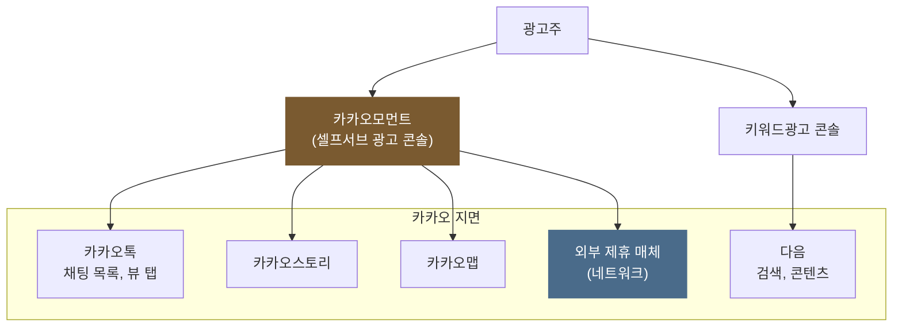
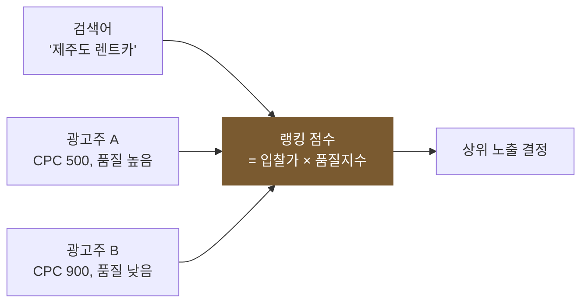

카카오톡을 켜면 채팅 목록 맨 위에 배너가 하나 떠 있습니다. 어제 여행 앱 광고가 있던 그 자리에 오늘은 카드 광고가 걸려 있습니다. 왜 매번 다른 광고가 하필 지금 뜰까요?

답은 단순합니다. 그 배너 자리 하나를 두고 화면 뒤에서 여러 광고가 저마다 값을 부르고 있었습니다. 그렇게 부른 값을 한 가지 기준으로 매겨 높은 순서로 정렬하는 방법은 이 블로그에서 이미 **eCPM 랭킹**이라는 이름으로 배웠습니다. eCPM 은 어떤 광고를 1,000번 노출할 때(광고가 화면에 1,000번 보일 때) 플랫폼이 그 광고로 벌 것으로 기대하는 금액입니다. eCPM 랭킹은 이 금액이 큰 순서로 광고의 순위를 매기는 방법입니다.

이 글은 카카오가 실제로 파는 광고 상품인 비즈보드(채팅 목록 맨 위의 배너), 카카오모먼트(광고주가 광고를 사는 관리 화면인 콘솔), 키워드광고(다음 검색 결과 위의 광고), 톡채널 메시지(채널을 추가한 사용자에게 보내는 메시지)를 하나씩 설명하고 상품마다 이 블로그에서 배운 어떤 개념이 실제로 돌아가는 모습인지 연결합니다. 광고를 사는 콘솔부터 경매와 지면까지 카카오가 왜 자기 회사 안에 다 두는지, 그 구조는 [닫힌 생태계(Walled Garden)](post.html?id=walled-garden) 편에서 이미 다뤘습니다. 이 글은 그 구조 안에서 **무엇이 팔리고 어떻게 순위가 매겨지는지**를 상품과 지면(광고가 뜨는 자리)을 중심으로 봅니다.

> 들어가기 전에 — 이 글은 카카오가 공개한 광고 상품이 일반적으로 어떻게 작동하는지만 다룹니다. 카카오의 내부 모델과 알고리즘 구현은 공개돼 있지 않아서 「이런 문제에는 보통 어떤 기법을 쓰는가」를 이 블로그의 개념 글과 연결하는 방식으로 설명합니다. 글에 나오는 숫자도 모두 이해를 돕기 위해 만든 **가상의 예시**이며 실제 낙찰가(경매에서 이긴 광고가 치른 값)나 단가가 아닙니다.

처음이라면 [광고 시스템 입문](post.html?id=adtech-30min-primer)을 먼저 읽어 두면 이 글에 나오는 광고 용어가 한결 편합니다.

> 한 줄 요약: 카카오의 광고 상품은 새로운 개념이 아니라 이 블로그에서 배운 **eCPM 랭킹**이 실제 지면에서 돌아가는 모습입니다. 비즈보드 배너 한 칸도 결국 **입찰가 × pCTR**(광고가 한 번 보였을 때 클릭될 확률을 모델이 예측한 값)로 순위를 매기는 문제입니다. 그 예측이 10% 만 틀려도 낙찰자(경매에서 이겨 자리를 가져가는 광고)가 바뀝니다.

---

## 1. 지면, 상품, 도구로 나눠 보는 카카오 광고

**카카오 광고는 광고가 뜨는 자리(지면)와 광고주가 사는 것(상품)과 상품을 사는 방법(도구)이 뒤섞여 불려서 헷갈리는데, 이 세 가지를 나눠 보면 단순해집니다.**

먼저 **지면**은 광고가 뜨는 자리입니다. 카카오톡의 채팅 목록과 뷰 탭, 다음의 검색 결과와 콘텐츠, 카카오스토리, 카카오맵이 모두 지면이며 카카오와 제휴한 다른 회사의 매체인 외부 제휴 매체(네트워크)도 지면에 들어갑니다.

다음으로 **상품**은 광고주가 실제로 돈을 내고 사는 대상입니다. 이 글이 다루는 상품은 비즈보드, 카카오모먼트로 집행하는 디스플레이와 동영상 광고, 키워드광고, 톡채널 메시지의 4가지가 전부입니다. 집행은 광고를 실제로 내보내는 일을 말합니다. 디스플레이 광고는 그림이나 배너로 보여 주는 광고입니다.

마지막으로 **도구**는 상품을 사는 방법입니다. 광고주는 대부분 **카카오모먼트**라는 셀프서브 콘솔에서 캠페인을 만들고 입찰을 걸며 키워드광고를 살 때만 전용 콘솔을 따로 씁니다. 셀프서브 콘솔은 광고주가 직접 들어가 캠페인과 입찰을 설정하는 관리 화면입니다. 캠페인은 광고주가 목표와 예산과 보여 줄 대상을 정해 운영하는 광고 설정 한 건을 말합니다. 입찰은 광고 자리에 얼마를 내겠다고 값을 부르는 일입니다.

아래 그림은 광고주에서 출발한 화살표가 두 콘솔을 거쳐 카카오 지면에 닿는 길을 그렸습니다.



그림의 흐름은 광고주에서 입찰을 대신 걸어 주는 콘솔을 거쳐 카카오가 소유한 지면으로 이어지는데, [Ad Serving Flow](post.html?id=ad-serving-flow) 편에서 본 흐름을 카카오에 옮겨 놓은 모양입니다. 다만 광고주와 지면 사이에 있던 거래소와 SSP 가 여기서는 **한 회사 안**에 들어와 있습니다. 거래소(Ad Exchange)는 여러 광고주 쪽 입찰을 받아 경매로 1등을 고르는 곳입니다. SSP(Supply-Side Platform)는 지면 주인을 대신해 광고 자리를 파는 플랫폼입니다. 이 단계들이 모두 한 회사 안에 있다는 점이 [닫힌 생태계](post.html?id=walled-garden) 편의 요점이었습니다. 이 블로그는 이렇게 한 회사가 모든 단계를 맡는 구조의 안쪽을 「담장 안」, 여러 회사가 나눠 맡는 바깥을 「담장 밖」이라고 부릅니다.

---

## 2. 비즈보드 한 칸을 두고 겨루는 광고 5개

**비즈보드 한 칸을 두고 벌어지는 경쟁은 이 블로그에서 배운 eCPM 랭킹 계산을 그대로 따릅니다.**

**비즈보드**는 카카오톡 채팅 목록 맨 위에 뜨는 배너입니다. 한국에서 카카오톡이 닿는 사람의 수(도달력)를 생각하면 아주 눈에 잘 띄는 자리입니다. 배너를 누르면 톡채널, 톡스토어, 애드뷰(화면 전체로 열리는 랜딩 페이지), 비즈니스폼 같은 곳으로 연결됩니다.

이 한 칸을 여러 광고주가 원하는데 값을 부르는 단위가 광고주마다 다릅니다. 어떤 광고주는 CPM(노출 1,000회마다 내는 값)으로 부르고 어떤 광고주는 CPC(클릭 한 번마다 내는 값)로 부릅니다. 아래 표①의 과금방식(광고주에게 돈을 매기는 방식) 열이 이 단위입니다. 표①의 A(뷰티 브랜드)는 노출 1,000회에 9,000원을, B(카드사)는 클릭 한 번에 1,500원을 부르는데 두 값은 단위가 달라 어느 쪽이 큰지 바로 비교할 수 없습니다. 그래서 단위가 다른 입찰을 한 순위표에 정렬하려면 공통 기준이 필요한데 그 기준이 **eCPM** 입니다.

eCPM 은 `eCPM = 입찰가 × 예상 반응률 × 1000` 으로 환산한 값입니다. 식의 예상 반응률이 한 줄 요약에서 본 **pCTR**(예상 클릭률)입니다. CPC 입찰가에 pCTR 을 곱하면 노출 한 번에서 기대하는 값이 나오고 여기에 1,000 을 곱하면 CPM 과 같은 단위인 노출 1,000회당 값이 됩니다. CPM 입찰은 처음부터 노출 1,000회당 값이라 계산 없이 그대로 씁니다. 자세한 계산은 [eCPM과 광고 랭킹](post.html?id=ecpm-ranking) 편에 있으니 여기서는 비즈보드라는 실제 지면에서 확인만 합니다.

아래 **표①**은 비즈보드 한 칸을 두고 겨루는 후보 광고 5개를 eCPM 순서로 정렬한 표입니다. 숫자는 **전부 가상**이라 실제 낙찰가나 입찰가가 아닙니다. 순위는 입찰가 열이 아니라 eCPM 열의 순서를 따릅니다.

| 순위 | 광고주 | 과금방식 | 입찰가 | 예측 pCTR | eCPM 계산 | eCPM |
|---|---|---|---|---|---|---|
| 1위 | B(카드사) | CPC | 1,500원 | 1.6% | 1,500 × 0.016 × 1,000 | **24,000원** |
| 2위 | D(이커머스) | CPC | 900원 | 2.5% | 900 × 0.025 × 1,000 | **22,500원** |
| 3위 | C(모바일 게임) | CPC | 700원 | 3.2% | 700 × 0.032 × 1,000 | **22,400원** |
| 4위 | E(교육 앱) | CPC | 2,200원 | 0.9% | 2,200 × 0.009 × 1,000 | **19,800원** |
| 5위 | A(뷰티 브랜드) | CPM | 9,000원 | – | 그대로 사용 | **9,000원** |

표의 eCPM 계산 열을 1위 B(카드사)로 따라가 보면, B 는 클릭 한 번에 1,500원을 부르고 pCTR 이 1.6% 라서 eCPM 이 1,500 × 0.016 × 1,000 = 24,000원입니다. 그런데 입찰가와 순위를 나란히 놓고 보면 직관과 반대인 곳이 두 군데 있습니다.

A(뷰티 브랜드)는 입찰가만 보면 9,000원으로 가장 높은데도 꼴찌입니다. A 처럼 CPM 으로 부른 광고는 클릭이 나든 안 나든 노출 자체에 값을 매기므로 클릭될 확률이 높아도 그 덕을 보지 못합니다. 그래서 A 의 9,000원은 그대로 eCPM 이 되고 클릭당 1,500원을 부른 B 의 eCPM 24,000원에 크게 못 미칩니다. 반대로 C(모바일 게임)는 입찰가가 700원으로 가장 낮지만 pCTR 이 3.2% 로 가장 높아 700 × 0.032 × 1,000 = 22,400원으로 3위까지 올라옵니다.

**eCPM 은 광고주가 「얼마를 부르나」가 아니라 그 광고가 「얼마나 벌어 줄 것 같나」를 묻습니다.** 비즈보드 한 칸은 eCPM 랭킹이 실제 지면에서 돌아가는 사례입니다. 이 글은 3절과 8절, 9절에서도 표①을 다시 씁니다.

---

## 3. 파이썬으로 뽑은 낙찰자와 pCTR 예측 오차 10%

**표①의 계산을 코드로 옮기면 1위 광고의 실제 pCTR 이 예측보다 10% 낮을 때 낙찰자가 왜 바뀌는지 출력으로 확인할 수 있습니다.**

실시간 서빙(광고 요청이 올 때마다 그 자리에서 낙찰자를 정하는 시스템)은 pCTR 의 **예측**값만으로 낙찰자를 정하고 실제 클릭률은 나중에야 일부만 알게 됩니다. 아래 코드는 이 시차를 예측 기준 랭킹과 실제 기준 랭킹, 두 번의 계산으로 흉내 냅니다.

코드가 하는 일은 두 부분입니다. (a)에서는 표① 그대로 후보 5개의 eCPM 을 계산해 낙찰자를 뽑습니다. (b)에서는 1위였던 B(카드사)의 실제 pCTR 이 나중에 알고 보니 예측보다 10% 낮았던 경우를 그 실제 값으로 다시 계산해 순위가 어떻게 바뀌는지 봅니다. (a)는 주석의 4단계, (b)는 5단계이고 6단계는 두 결과를 비교해 플랫폼이 놓친 몫을 계산합니다. 외부 패키지 없이 표준 라이브러리만 쓰므로 복사해 실행하면 아래 `# 출력:` 과 같은 값이 찍힙니다.

```python
# 하는 일: 비즈보드 한 칸을 두고 겨루는 후보 5개의 eCPM 으로 낙찰자를 뽑고, 1위 광고의 실제 pCTR 이 예측보다 10% 낮았다면 낙찰자가 바뀌고 플랫폼이 얼마를 놓치는지 센다.
# 1단계: 과금방식에 따라 eCPM 을 내는 함수를 만든다
# 표준 라이브러리만 쓴다.
def ecpm(billing, bid, pctr=None):
    """billing이 CPM이면 입찰가 그대로, CPC면 pCTR × 입찰가 × 1000."""
    if billing == "CPM":
        return bid
    if billing == "CPC":
        return pctr * bid * 1000
    raise ValueError(f"알 수 없는 과금방식: {billing}")

# 2단계: 후보 5개의 과금방식, 입찰가, pCTR 을 둔다
# 가상의 예시 숫자다 — 실제 카카오 비즈보드 단가, 낙찰 사례가 아니다.
candidates = [
    {"name": "A(뷰티)",      "billing": "CPM", "bid": 9000, "pctr": None},
    {"name": "B(카드사)",    "billing": "CPC", "bid": 1500, "pctr": 0.016},
    {"name": "C(모바일게임)", "billing": "CPC", "bid": 700,  "pctr": 0.032},
    {"name": "D(이커머스)",  "billing": "CPC", "bid": 900,  "pctr": 0.025},
    {"name": "E(교육앱)",    "billing": "CPC", "bid": 2200, "pctr": 0.009},
]

# 3단계: eCPM 순으로 정렬하는 함수를 만든다
def rank(cands, pctr_key="pctr"):
    scored = [(c["name"], ecpm(c["billing"], c["bid"], c[pctr_key])) for c in cands]
    return sorted(scored, key=lambda x: x[1], reverse=True)

# 4단계: 예측 pCTR 로 랭킹을 매긴다
# (a) 실시간 서빙이 실제로 쓰는 값이다.
predicted = rank(candidates)
print("[예측 pCTR 기준 랭킹 - 실시간 서빙이 실제로 쓰는 값]")
for i, (name, score) in enumerate(predicted, 1):
    print(f"  {i}위 {name:10s} eCPM {score:8,.0f}원")
print(f"  -> 낙찰자: {predicted[0][0]}\n")

# 5단계: B 의 pCTR 을 실제 값으로 바꿔 다시 매긴다
# (b) 사실 B(카드사)의 진짜 pCTR 은 예측보다 10% 낮았다(모델이 과대예측). 예측 1.6% 가 실제로는 1.6% * 0.9 = 1.44% 다.
true_candidates = [dict(c) for c in candidates]
for c in true_candidates:
    if c["name"] == "B(카드사)":
        c["true_pctr"] = c["pctr"] * 0.9   # 예측보다 10% 낮은 실제값
    else:
        c["true_pctr"] = c["pctr"]

actual = rank(true_candidates, pctr_key="true_pctr")
print("[실제(참값) pCTR 기준 랭킹 - B의 예측이 10% 과대했다고 밝혀진 뒤]")
for i, (name, score) in enumerate(actual, 1):
    print(f"  {i}위 {name:10s} eCPM {score:8,.0f}원")
print(f"  -> '진짜' 승자였어야 할 광고: {actual[0][0]}\n")

# 6단계: 낙찰자가 바뀌었는지와 플랫폼이 놓친 몫을 센다
# 낙찰자가 B 에서 바뀌었는지, 바뀌었다면 플랫폼이 얼마를 손해봤는지 계산한다.
predicted_winner, predicted_top_score = predicted[0]
true_score_of_predicted_winner = next(
    score for name, score in actual if name == predicted_winner
)
true_winner, true_top_score = actual[0]

print("[정리]")
print(f"  예측 기준 낙찰자         : {predicted_winner} (예측 eCPM {predicted_top_score:,.0f}원)")
print(f"  같은 광고의 실제 eCPM    : {true_score_of_predicted_winner:,.0f}원")
print(f"  10% 오차가 드러난 뒤 1위 : {true_winner} (eCPM {true_top_score:,.0f}원)")
loss = true_top_score - true_score_of_predicted_winner
print(f"  플랫폼이 노출 1,000회당 놓친 몫 : {loss:,.0f}원 ({loss / true_top_score:.1%})")
assert predicted_winner != true_winner  # 이 예시는 낙찰자가 바뀌는 경우를 보여주기 위한 것

# 출력:
# 4단계 뜻: 예측 pCTR 로는 B(카드사)가 eCPM 24,000원으로 1위라 낙찰자가 된다. 2위 D 는 22,500원, 3위 C 는 22,400원이다.
# [예측 pCTR 기준 랭킹 - 실시간 서빙이 실제로 쓰는 값]
#   1위 B(카드사)     eCPM   24,000원
#   2위 D(이커머스)    eCPM   22,500원
#   3위 C(모바일게임)   eCPM   22,400원
#   4위 E(교육앱)     eCPM   19,800원
#   5위 A(뷰티)      eCPM    9,000원
#   -> 낙찰자: B(카드사)
#
# 5단계 뜻: B 의 pCTR 을 10% 낮추면 B 는 21,600원으로 3위가 되고, D(이커머스)가 22,500원으로 1위에 오른다.
# [실제(참값) pCTR 기준 랭킹 - B의 예측이 10% 과대했다고 밝혀진 뒤]
#   1위 D(이커머스)    eCPM   22,500원
#   2위 C(모바일게임)   eCPM   22,400원
#   3위 B(카드사)     eCPM   21,600원
#   4위 E(교육앱)     eCPM   19,800원
#   5위 A(뷰티)      eCPM    9,000원
#   -> '진짜' 승자였어야 할 광고: D(이커머스)
#
# 6단계 뜻: 플랫폼은 노출 1,000회당 900원, 오차가 드러난 뒤 1위인 D(이커머스) eCPM 22,500원의 4.0% 를 놓친다.
# [정리]
#   예측 기준 낙찰자         : B(카드사) (예측 eCPM 24,000원)
#   같은 광고의 실제 eCPM    : 21,600원
#   10% 오차가 드러난 뒤 1위 : D(이커머스) (eCPM 22,500원)
#   플랫폼이 노출 1,000회당 놓친 몫 : 900원 (4.0%)
```

출력의 `[정리]` 부분을 보면 예측 기준 낙찰자는 eCPM 24,000원의 B(카드사)인데 같은 광고의 실제 eCPM 은 21,600원이며 10% 오차를 반영한 뒤의 1위는 eCPM 22,500원의 D(이커머스)입니다. B 의 숫자를 한 단계씩 따라가면 예측 pCTR 1.6% 에 0.9 를 곱해 실제 pCTR 1.44% 가 나옵니다. 입찰가 1,500원에 1.44% 와 1,000 을 곱한 실제 eCPM 은 21,600원입니다. 그래서 B 는 D 의 22,500원은 물론 C(모바일 게임)의 22,400원보다도 낮아져 3위로 내려갑니다. **낙찰자는 B 에서 D 로 바뀝니다.** 예측이 정확했다면 D 가 낙찰되어 22,500원을 벌 수 있었으므로 카카오는 이 노출 1,000회당 22,500원에서 21,600원을 뺀 900원을 손해 봅니다. 900원을 22,500원으로 나누면 4.0% 이며 출력의 마지막 줄 「900원 (4.0%)」이 이 값입니다.

코드에서 눈여겨볼 곳은 두 군데입니다.

첫째는 `ecpm` 함수로, 과금방식이 CPM 이면 입찰가를 그대로 돌려주고 CPC 면 입찰가에 pCTR 과 1000 을 곱해 노출 1,000회당 기대값으로 바꿉니다. 그래서 과금방식이 섞여 있어도 함수 하나로 모든 입찰을 정규화할 수 있습니다. 정규화는 단위가 다른 값을 같은 기준으로 맞추는 일입니다.

둘째는 `true_pctr` 로, B 만 예측값에 0.9 를 곱한 값이 들어가고 나머지 후보는 예측값이 그대로 들어갑니다. 코드는 같은 `rank` 함수를 `pctr` 로 한 번, `true_pctr` 로 한 번 돌려 예측 기준 랭킹과 실제 기준 랭킹을 따로 만듭니다.

900원의 손해는 담장 안이라서 생긴 손해가 아닙니다. **담장 안이든 밖이든 pCTR 예측이 틀리면 돈이 샙니다.** 다만 담장 안에서는 이 손해가 예측 정확도 하나의 문제로만 남습니다. 이번 손해는 [eCPM과 광고 랭킹](post.html?id=ecpm-ranking) 편에서 다룬 예측 오류 증폭(pCTR 오차가 eCPM 오차로 그대로 전파되어 순위와 매출이 달라지는 일)이 카카오라는 구체적인 지면에서 일어난 사례일 뿐입니다.

---

## 4. 카카오모먼트 — 자사 지면 안에서만 경매에 참가하는 DSP

**카카오모먼트는 광고주가 직접 입찰을 거는 콘솔이지만 그 입찰이 들어가는 경매장은 카카오 바깥에 없습니다.**

[30분 입문](post.html?id=adtech-30min-primer) 편은 DSP(Demand-Side Platform)를 광고주 대신 입찰을 결정하는 시스템으로 소개했는데 카카오모먼트가 바로 그 역할을 합니다. 광고주가 캠페인을 만들고 타겟(광고를 보여 줄 사람)을 정한 뒤 입찰가나 목표를 입력하면 나머지는 시스템이 대신합니다.

그런데 카카오모먼트는 열린 RTB(Open RTB)의 DSP 와 크게 다른 점이 하나 있습니다. 열린 RTB 는 DSP, 거래소, SSP, 지면 주인이 각각 다른 회사인 시장에서 노출 한 번마다 실시간 경매(RTB, Real-Time Bidding)를 여는 방식입니다. 이 시장의 DSP 는 바깥 거래소 여러 곳에 동시에 입찰하지만 카카오모먼트는 **카카오 자사 지면 안에서 열리는 경매**에만 참가해 경매장이 하나뿐입니다.

모먼트에서 광고주가 고르는 항목을 이 블로그에서 배운 개념으로 옮기면 아래 표와 같습니다. 왼쪽 열의 선택마다 이어지는 개념 글을 오른쪽 열에 적었습니다.

| 모먼트에서 고르는 것 | 실제로 정하는 것 | 관련 개념 글 |
|---|---|---|
| 캠페인 목표(전환, 방문, 도달) | 무엇을 최적화할지 | [Auto-Bidding](post.html?id=auto-bidding-pacing) |
| 게재 지면(톡, 다음, 스토리, 네트워크) | 인벤토리 선택 | [광고 네트워크(Ad Network) vs Exchange](post.html?id=ad-network-vs-exchange) |
| 오디언스(데모, 맞춤, 유사) | 누구에게 보여줄지 | [세그멘테이션](post.html?id=audience-segmentation) |
| 입찰, 과금(CPC, CPM, CPA) | 얼마를 어떻게 낼지 | [eCPM 랭킹](post.html?id=ecpm-ranking) |

표의 낱말을 몇 개 풀어 둡니다. 캠페인 목표의 전환은 광고를 본 사람이 구매나 가입처럼 광고주가 바라는 행동을 하는 일입니다. 도달은 광고가 닿는 사람의 수를 뜻합니다. Auto-Bidding 은 이런 목표를 받아 시스템이 입찰가를 대신 정하는 자동입찰입니다. 인벤토리는 광고를 걸 수 있는 지면과 그 노출 물량을 말합니다. 오디언스는 광고를 보여 줄 사람들입니다. 세그멘테이션은 사용자를 비슷한 사람끼리 나누는 일입니다. 오디언스 칸의 데모는 나이와 성별 같은 인구 통계로, 맞춤은 광고주가 가진 고객 명단으로, 유사는 그 명단과 닮은 사람으로 대상을 정합니다. 과금 칸의 CPA 는 전환 한 건마다 값을 내는 방식입니다.

게재 지면에서 「네트워크」를 고르면 이야기가 달라집니다. 광고가 카카오 자사 매체를 넘어 외부 제휴 매체까지 나가므로 이 순간 구조는 순수한 담장 안에서 **하이브리드**로 바뀝니다. 자사 프리미엄 지면(카카오가 직접 가진 인기 지면)은 내부 경매로 팔고 외부 네트워크는 좀 더 열린 방식으로 운영하는 이 하이브리드 전략은 [닫힌 생태계](post.html?id=walled-garden) 편에 이미 정리돼 있습니다.

이 콘솔에서 「무엇을, 누구에게」 보여 줄지 고르는 방법은 이 시리즈의 2편에서 다룹니다. 이 절에서는 카카오모먼트가 **DSP 역할을 하지만 경매장은 하나뿐**이라는 사실만 기억하면 됩니다.

---

## 5. 키워드광고 — 검색어로 의도를 먼저 받는 광고

**다음 검색창에 입력한 단어가 그 자체로 가장 강력한 신호라서 검색광고는 순위를 매기는 방식부터 배너와 다릅니다.**

다음(Daum) 검색창에 「제주도 렌트카」를 치면 검색 결과 위에 광고가 붙는데, 이 광고가 **키워드광고**입니다. 키워드광고는 배너 광고와 크게 다른 점이 하나 있습니다. 배너는 「이 사람이 이 광고에 관심이 있을까」를 시스템이 추정해야 하지만 검색광고에서는 사용자가 검색어로 **의도를 이미 입력**했습니다.

[닫힌 생태계](post.html?id=walled-garden) 편이 「검색 의도가 최강 피처」라고 한 말이 바로 이 차이를 가리킵니다. 피처는 모델이 예측에 쓰는 입력값입니다. 검색 의도는 사용자가 무엇을 찾는지를 말합니다.

그래서 검색광고는 보통 이런 방식으로 순위를 매깁니다. 같은 키워드를 산 광고주끼리만 경쟁하므로 경쟁 범위부터 좁습니다. 순위도 입찰가 순이 아니라 **입찰가 × 품질(예상 클릭률 등)**로 정해지므로 입찰가가 낮아도 관련성이 높은 광고가 위로 갈 수 있습니다.

아래 그림은 검색어 하나에 광고주 두 곳이 들어왔을 때 상위 노출이 무엇으로 정해지는지 보여 줍니다.



그림의 랭킹 점수는 입찰가에 품질지수를 곱한 값입니다. 품질지수는 광고의 관련성을 예상 클릭률 같은 값으로 매긴 점수로, 2절의 pCTR 과 같은 부류의 지표입니다. 광고주 A 는 「CPC 500, 품질 높음」이고 광고주 B 는 「CPC 900, 품질 낮음」이라 A 가 더 낮게 불렀지만 품질은 더 높습니다.

결국 이 그림도 2절과 같은 계산이라 입찰가만으로는 순위가 정해지지 않고 pCTR 같은 품질 지표를 곱해야 순위가 나옵니다. 이 산수는 [eCPM과 광고 랭킹](post.html?id=ecpm-ranking) 편에 자세히 있습니다.

---

## 6. 톡채널 메시지 — 노출 대신 발송을 파는 상품

**비즈보드, 카카오모먼트, 키워드광고가 광고를 보여 주는 상품이라면 톡채널 메시지는 메시지를 보내는 상품이라 성격이 다릅니다.**

비즈보드, 카카오모먼트, 키워드광고는 채널과 관계없는 낯선 사람에게도 노출됩니다. 반면 **톡채널 메시지**는 그 채널을 이미 추가한 사용자, 곧 친구를 맺은 사용자에게만 갑니다. 받는 사람이 친구로 한정되므로 도달 범위는 좁지만 관계가 있는 사람들이라 반응이 다를 수 있습니다.

여기서 질문이 하나 생깁니다. 누구에게, 언제, 어떤 메시지를 보내야 반응이 좋을까요? 친구가 10만 명이라도 아무에게나 다 보내면 차단(채널을 막는 것)과 이탈(채널을 떠나는 것)을 부르므로 **보낼 대상을 고르는 일** 자체가 하나의 문제가 됩니다.

보낼 대상을 고르는 일은 4절 표에서 본 [세그멘테이션](post.html?id=audience-segmentation) 문제이며 좁혀 말하면 이미 알고 있는 좋은 고객과 닮은 사람을 찾는 [Lookalike](post.html?id=lookalike-modeling) 문제이기도 합니다. 「이 사람이 이 메시지에 반응할까」를 맞히는 일은 다시 예측 모델의 몫인데, 이 부분은 2편에서 이어서 자세히 다룹니다.

과금은 보낸 메시지 단위로 매겨지지만 정확한 단가가 시기와 상품 구성에 따라 계속 바뀌므로 이 글에는 금액을 적지 않고 구조만 봅니다. 구조로 보면 톡채널 메시지는 **노출을 두고 겨루는 경매가 아니라 보낼 대상을 고르는 문제**입니다.

---

## 7. 상품 4개 비교표

**상품 4개를 한 표에 놓으면 이 시리즈가 앞으로 무엇을 다룰지 보입니다.**

지금까지 본 비즈보드, 카카오모먼트, 키워드광고, 톡채널 메시지를 한 표로 모았습니다. 상품마다 「무엇을 파는가」, 「과금 기준」, 「우리가 배운 개념」, 어느 글로 이어지는지를 적은 「더 읽기」, 이렇게 네 열을 채웠습니다.

| 상품 | 무엇을 파는가 | 과금 기준 | 우리가 배운 개념 | 더 읽기 |
|---|---|---|---|---|
| 비즈보드 | 채팅 목록 상단 배너 노출(사실상 슬롯 1개) | 노출, 클릭 단위 실시간 입찰 + 기간 단위 예약 | eCPM 랭킹 — 한 슬롯을 둔 경매 | [eCPM 랭킹](post.html?id=ecpm-ranking) |
| 카카오모먼트 디스플레이 | 톡, 다음, 스토리, 맵, 네트워크의 배너, 동영상 노출 | 캠페인 목표별 CPC, CPM, CPA | 셀프서브 DSP + 오디언스 타겟팅 | [닫힌 생태계](post.html?id=walled-garden) |
| 키워드광고 | 다음 검색결과 상단 텍스트 광고 클릭 | CPC(입찰가 × 품질지수) | 검색 의도 기반 랭킹 | [eCPM 랭킹](post.html?id=ecpm-ranking) |
| 톡채널 메시지 | 채널을 추가한 대상에게 메시지 발송 1건 | 발송 건당 비용 | 오디언스 세그멘테이션, 유사타겟 | [세그멘테이션](post.html?id=audience-segmentation) |

단가는 시기와 상품 구성에 따라 계속 바뀌므로 과금 기준 열에도 정확한 단가 대신 구조만 적었습니다. 표를 위에서 아래로 읽으면 노출(비즈보드), 노출과 행동(모먼트), 클릭(키워드광고), 관계(톡채널) 순서로 상품마다 「무엇을 대가로 돈을 받는가」가 조금씩 옮겨 갑니다.

이 시리즈는 이 표에서 출발합니다. 다음 편은 「무엇을(pCTR)」과 「누구에게(타겟팅)」를 자세히 다루고 마지막 편은 「얼마를(자동입찰)」과 「정말 효과였나(측정)」를 다룹니다.

---

## 8. 열린 RTB 의 같은 배너 자리 [무대: 열린 RTB]

**같은 배너 한 칸이 열린 RTB 시장의 지면이었다면 표①은 애초에 존재할 수 없습니다.**

제목 끝의 `[무대: 열린 RTB]` 는 이 절이 4절에서 풀이한 열린 RTB 시장의 이야기라는 표시입니다. 다음 9절 제목의 `[무대: 닫힌 생태계]` 는 카카오처럼 한 회사가 모든 단계를 맡는 담장 안의 이야기를 뜻합니다.

표①에서 우리는 후보 5개의 입찰가와 pCTR 을 전부 봤습니다. 순위와 낙찰가는 물론 패찰한(경매에서 진) 광고 4개의 정확한 값까지 다 봤는데, 그럴 수 있었던 까닭은 **우리가 카카오의 자리에 서 있었기 때문** 하나뿐입니다.

열린 RTB 에서는 이 표 전체를 보는 참가자가 아무도 없습니다. 광고주를 대신해 입찰하는 DSP 가 여러 회사이고 그 DSP 들의 입찰을 모으는 SSP 와 거래소도 또 다른 회사입니다. 지면 주인인 퍼블리셔(광고 자리를 가진 앱이나 웹사이트의 주인)까지 더하면 세 곳이 모두 서로 남남입니다. 광고주가 낸 돈은 이 여러 단계를 거치는 동안 수수료로 조금씩 떼여 퍼블리셔에게 그대로 가지 않습니다.

더 큰 차이는 따로 있습니다. 이 시장에서 참가자 한 곳이 보는 결과는 「내가 이겼다」나 「졌다」뿐입니다. 진 쪽은 얼마에 졌는지조차 알 수 없습니다. 입찰가를 이기는 데 필요한 만큼만 깎는 기법을 다룬 [Bid Shading](post.html?id=bid-shading-censored) 편은 이 문제를 censored data 문제라고 불렀습니다. censored data 는 값 자체 대신 「내 입찰가보다 높았다」 같은 경계만 관측된 데이터입니다. 표①로 말하면 B 가 24,000원에 낙찰됐다는 결과는 볼 수 있어도 D 가 22,500원을 불렀다는 사실은 아무도 보지 못합니다.

그래서 표①은 카카오라는 한 회사 안에 서 있었기에 가능했던 특권적인 관찰입니다. 다음 9절에서는 이 특권으로 정확히 무엇을 할 수 있는지 봅니다.

---

## 9. 담장 안에서 보이는 낙찰가와 패찰가 [무대: 닫힌 생태계]

**카카오는 낙찰가뿐 아니라 패찰가(경매에서 진 광고가 부른 값)까지 다 보고 그 정보로 지면을 예약 판매와 경매 두 갈래로 나눠 파는 일도 스스로 정합니다.**

담장 안에서는 노출, 클릭, 입찰 기록이 모두 한 회사의 로그(서비스가 사용자 행동과 거래를 남긴 기록)라서 따로 조인할 필요가 없습니다. 조인은 서로 다른 로그를 같은 사용자나 같은 광고를 기준으로 이어 붙이는 작업입니다. [닫힌 생태계](post.html?id=walled-garden) 편에서 다룬 정보 통합(여러 서비스와 단계의 데이터가 한 회사 안에 모이는 것)의 이점이 여기서도 그대로 작동합니다. 표①의 입찰 5개를 전부 관측할 수 있었던 까닭도 같습니다.

이 이점은 두 갈래로 쓰입니다. 첫째로 eCPM 랭킹 자체를 실시간으로 튜닝(조금씩 조정)할 수 있으며 예측이 자꾸 틀리는 광고주가 있으면 즉시 잡아낼 수도 있습니다. 둘째로 지면을 어떻게 나눠 팔지도 스스로 정할 수 있습니다. 일부는 미리 정한 값으로 예약 판매하고 나머지만 표①처럼 실시간 경매에 부치는 식입니다. 두 물량이 한 지면에서 어떻게 함께 팔리는지는 아래 「더 깊이」에서 다룹니다.

물론 한계도 있습니다. 담장 안에서 볼 수 있는 범위는 **담장 안까지**입니다. 카카오가 보는 입찰은 카카오 지면의 입찰뿐이라 같은 사용자가 카카오 밖에서 무엇을 봤는지는 알 수 없습니다. 이 한계는 카카오라는 담장 하나의 문제가 아니라 모든 담장에 공통된 한계입니다.

:::deep 더 깊이 — 예약(CPT) 물량과 경매 물량이 함께 팔리는 방식
카카오 비즈보드 같은 인기 지면은 실제로 두 갈래로 팔립니다. 하나는 정해진 시간대에 그 자리를 한 광고주가 전부 독점하는 **보장형**입니다. 보장형은 시간 단위로 값을 매기므로 흔히 **CPT**(Cost Per Time)라고 부릅니다. 다른 하나는 노출이 날 때마다 실시간으로 경쟁하는 **성과형**이며 표①에서 본 방식이 이쪽입니다.

두 갈래가 같이 있는 데는 까닭이 있습니다. 브랜드 광고주(제품과 브랜드를 널리 알리려는 광고주)는 도달과 주목도가 목적이라 경쟁자와 자리를 나눠 갖지 않고 「이 시간엔 무조건 내 광고만」 뜨기를 원합니다. 반면 퍼포먼스 광고주(클릭이나 구매 같은 성과를 노리는 광고주)는 효율이 목적이라 「이 조건에 맞는 사람에게만, 필요한 만큼만」 노출되기를 원합니다. 두 요구가 서로 다르므로 어느 한 방식만으로는 둘 다 만족시킬 수 없습니다.

두 갈래를 함께 파는 방법은 순서에 있습니다. 예약 물량을 먼저 확정해 빼 둔 다음 남은 재고(아직 팔리지 않은 노출 물량)만 표①과 같은 경매로 돌립니다.

가상의 숫자로 예를 들어 보겠습니다. 비즈보드 하루 노출량 가운데 40% 를 예약으로 이미 채웠다면 실시간 경매의 몫은 나머지 60% 뿐입니다. 이 60% 의 기대 eCPM 이 22,000원대라고 해 봅시다. 표①에서도 2위 D 와 3위 C 의 eCPM 이 22,500원과 22,400원으로 22,000원대였습니다. 예약가(예약 판매에 매긴 값)가 22,000원대보다 낮으면 같은 물량을 경매로 팔 때 더 벌 것으로 기대되므로 플랫폼은 그 물량을 경매로 더 돌리고 싶어집니다. 반대로 예약가가 더 높다면 예약을 더 받는 편이 이득입니다.

그래서 바로 이 경계에서 **예약을 얼마나 잡을지**라는 판단이 생깁니다. 예약을 많이 잡으면 매출을 미리 예측할 수 있고 브랜드 광고주를 오래 붙잡지만 경매에 남는 재고가 줄어 수요가 몰리는 시즌에는 더 높은 eCPM 을 놓칠 수 있습니다. 반대로 예약을 적게 잡으면 경매의 기대 수익은 커지지만 「이 시간 독점」을 원하는 브랜드 수요 자체를 잃을 수 있습니다.

결국 이 결정도 예측 문제로 돌아옵니다. 예약 비율을 정하려면 「이 물량을 경매에 넘기면 대략 얼마가 나올까」를 미리 가늠해야 하는데, 이 가늠도 수요 예측(앞으로 들어올 광고 수요와 그 값을 미리 추정하는 일)입니다. [헤더비딩](post.html?id=header-bidding)은 담장 밖의 여러 SSP 를 동시에 겨루게 해 이 판단을 시장에 맡기지만 담장 안에서는 예약과 경매 가운데 무엇을 고를지 회사가 직접 판단합니다. 겨루는 대상은 달라도 「같은 자리를 여럿에게 겨루게 해 값을 찾는다」는 원리는 같습니다.
:::

---

## 10. 한눈 정리

이 글에서 본 개념과 숫자를 한 표로 모았습니다.

| 개념 | 뜻 | 이 글에서 본 숫자 | 핵심 |
|---|---|---|---|
| 비즈보드 | 채팅 목록 상단 배너 슬롯 | 5개 후보 중 eCPM 24,000원이 1위 | eCPM 랭킹의 실물 |
| eCPM 랭킹 | 입찰가 × pCTR로 순위 매기기 | B 24,000 > D 22,500 > C 22,400 | 입찰가만으론 순위 안 정해짐 |
| 예측 오차의 대가 | pCTR 예측이 실제와 다를 때 | 10% 과대예측 → 낙찰자 B에서 D로 | 담장 안이라도 예측이 곧 돈 |
| 카카오모먼트 | 자사 지면 전용 셀프서브 DSP | 톡, 다음, 스토리, 맵, 네트워크 | 경매장이 하나뿐인 DSP |
| 키워드광고 | 검색 의도 기반 랭킹 | 입찰가 × 품질지수 | 낮은 입찰가도 품질로 역전 |
| 예약(CPT) vs 경매 | 같은 지면, 두 판매 방식 | 예약 40% + 경매 60%(가상) | 예약 비율도 결국 수요 예측 문제 |
| 열린 RTB 대조 | 표①이 왜 담장 안에서만 가능한가 | 패찰가 4개까지 전부 관측 | 밖에선 censored data |

---

## 11. 헷갈리기 쉬운 점

- **카카오모먼트는 DSP 일까요?** 반은 맞고 반은 틀립니다. 광고주 대신 입찰을 걸어 준다는 점은 DSP 와 같지만 외부 거래소로 나가지 않고 카카오 자사 지면 안에서만 경매에 참가한다는 점이 열린 RTB 의 DSP 와 다릅니다.
- **eCPM 랭킹이 「공정하다」는 뜻은 아닙니다.** eCPM 랭킹은 돈(입찰가)과 품질(pCTR)을 섞은 규칙일 뿐이며 그 규칙이 어떤 광고를 구조적으로 유리하게 만들 수도 있습니다.
- **비즈보드가 전부 실시간 경매로 팔리지는 않습니다.** 보장형(CPT)과 성과형이 같은 지면을 나눠 씁니다. 두 방식의 비율은 플랫폼이 판단해 정합니다.
- **담장 안이라고 경쟁이 없지는 않습니다.** 예약 물량과 경매 물량이 같은 자리를 두고 비교됩니다. 겨루는 대상이 담장 밖이 아니라 안에 있을 뿐입니다.
- **키워드광고에서는 돈을 많이 낸 광고가 무조건 1등이 되지는 않습니다.** 품질지수가 곱해지므로 입찰가가 낮아도 관련성이 높으면 위로 갈 수 있습니다.
- **pCTR 예측이 조금만 틀려도 낙찰자가 바뀝니다.** 담장 안이라 정보가 많아도 예측 자체가 틀리면 소용이 없습니다. 3절에서 표①로 계산해 확인한 그대로입니다.

---

## 더 깊이 보기

- 예측, 타겟팅으로 이어지는 다음 이야기 → [2편: 카카오는 무엇으로 광고를 고르나](post.html?id=kakao-ads-prediction-targeting)
- 입찰, 측정으로 마무리하는 이야기 → [3편: 카카오에서 캠페인이 굴러가는 법](post.html?id=kakao-ads-bidding-measurement)
- eCPM 계산과 세 시장 비교 → [eCPM과 광고 랭킹](post.html?id=ecpm-ranking)
- pCTR이 왜 돈인지 더 깊이 → [pCTR: 이 사람이 누를까](post.html?id=pctr-prediction)
- 왜 카카오, 네이버는 모든 단계를 자사 안에 두는가 → [Walled Garden](post.html?id=walled-garden)
- 광고 ML 전체 지도에서 이 글의 위치 → [ML 엔지니어 트랙](ml-track.html)
