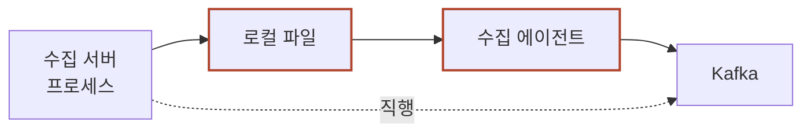

앞 글에서 클릭 한 건이 지나는 여섯 자리를 배운 지훈 씨가 숫자 하나를 직접 세어 봤습니다. 앱이 보낸 이벤트(광고가 보이거나 눌린 일 한 건)를 받아 파일에 적는 수집 서버에는 어제 하루 동안 **5,928만 줄**이 쌓였는데, 같은 하루의 이벤트를 세는 대시보드(지표를 숫자와 그래프로 보여 주는 화면)에는 **2억 3,028만 건**이 찍혀 있습니다.

같은 하루를 셌는데도 파일의 줄 수와 대시보드의 건수는 4배 가까이 차이 납니다. 그렇다고 어느 한쪽 숫자가 틀리지도 않았고 중간에 이벤트가 빠지거나 늘어나지도 않았습니다.

**한 줄이 어느 자리에서 네 건이 될까요?**

앞 글은 클릭 한 건이 지나는 여섯 자리를 데이터가 움직이는 **방향**으로 살펴봤는데, 앞 자리가 데이터를 밀어 보내는지 뒤 자리가 가지러 가는지가 그 방향입니다. 이 글은 같은 클릭을 자리마다 열어 데이터의 **모양**을 봅니다. 무엇이 붙고 무엇이 사라지는지 확인하면서 클릭이 Kafka(받은 이벤트를 디스크에 쌓아 두고 여러 곳이 각자 읽어 가게 하는 시스템)에 닿을 때까지 따라갑니다. 위 질문의 답도 이 글이 여는 자리 가운데 한 곳에 있습니다.

> **한 줄 요약:** 같은 클릭 한 건이 앱에서는 메모리에 든 객체로, 수집 서버의 파일에서는 타입(숫자인지 글자인지 같은 값의 종류)이 없는 텍스트 한 줄로, 변환기(텍스트를 필드로 나누고 타입을 붙이는 프로그램)를 지난 뒤에는 타입이 붙은 필드 15개짜리 JSON(이름과 값을 짝지어 적는 텍스트 형식)으로 자리마다 모양을 바꿔 가며 머뭅니다. 어디에 어떤 모양으로 머무느냐가 그 자리에서 잃을 수 있는 것을 정하는데, 메모리에 있는 데이터는 그 프로그램이 죽을 때 함께 사라지고 수집 서버의 파일처럼 디스크에 있는 데이터는 프로그램이 죽어도 남아 있다가 인스턴스(서버 한 대)가 사라질 때 함께 사라집니다. 앱이 노출(광고가 화면에 보인 일) 4건을 요청 하나에 담아 보내고 파일을 읽어 넘기는 수집 에이전트가 그 줄을 4건으로 쪼개므로, 대시보드의 이벤트 수가 파일의 줄 수보다 4배 가까이 많습니다.

> **골라 읽는 법** — 절이 8개입니다.
>
> - 앱 안에서 이벤트가 만들어져 서버로 가는 과정 → 1, 2절
> - 수집 서버의 데이터에 타입이 없는 까닭 → 3절
> - 파일을 거쳐 보내는 설계와 바로 보내는 설계의 비교 → 4절
> - 노출 한 줄이 4건으로 나뉘는 자리 → 5절
> - 변환기가 붙이고 지우는 것과 두 시각 → 6절
> - 여섯 자리의 모양, 크기, 머무는 시간을 모은 표 → 7절
> - 자주 밟는 함정 4가지 → 8절

이 글이 따라가는 클릭은 앞 글의 클릭과 완전히 같은 한 건입니다. 2026년 8월 16일 16시 48분 21초에 누군가 A앱 메인 상단에 뜬 광고 `9931` 을 눌렀습니다. 이 광고는 그보다 40분 전인 16시 08분에 화면에 떴습니다. 사용자는 앱을 켜 둔 채 두었다가 돌아와서 광고를 눌렀습니다. 노출과 클릭 사이의 이 40분은 6절에서 두 시각의 용도를 설명할 때 다시 나옵니다.

이 글의 숫자는 설명을 위해 지어낸 값입니다. 다만 바이트 수는 지어낸 값이 아니라 지어낸 문자열을 실제로 세어 얻은 값입니다.

---

## 1. 이벤트를 만드는 앱 안의 SDK

**이벤트는 수집 서버가 아니라 앱 안의 SDK(앱에 넣어 쓰는 광고 라이브러리)가 만듭니다. SDK 는 이벤트 가운데 클릭만 만들자마자 바로 보냅니다.**

지훈 씨가 센 5,928만 줄은 수집 서버의 파일에 쌓여 있지만 그 줄에 담긴 이벤트는 서버에 닿기 전에 사용자의 폰 안에서 만들어집니다.

사용자가 광고를 탭(손가락으로 화면을 누르는 동작)하면 앱에 붙은 광고 SDK 가 그 탭을 받아 객체 하나를 만듭니다. 객체는 프로그램이 메모리 안에 값을 이름과 함께 담아 둔 데이터입니다. 아래 클릭 객체에는 이름이 붙은 값인 필드가 7개 있습니다.

```text
ClickEvent(event="click", ad_id=9931, slot="main_top", req_id="r-8f21",
           ts=1786866501234, tz=540, sdk="3.2.1")
```

위 객체의 필드 가운데 `event="click"` 은 이벤트 종류, `ad_id=9931` 은 광고 번호, `slot="main_top"` 은 지면(광고가 실리는 화면 위 위치)인 메인 상단, `sdk="3.2.1"` 은 SDK 버전을 담습니다. `ts` 는 탭한 시각을 밀리초 단위의 숫자로 적은 값이며 이 숫자를 시각으로 바꾸면 16:48:21.234 가 됩니다. `tz=540` 은 기기의 시간대가 UTC(세계 표준시)보다 540분, 곧 9시간 앞선 UTC+9 임을 나타냅니다.

`req_id="r-8f21"` 은 이 광고를 내려 준 광고 요청(앱이 지면에 띄울 광고를 받으려고 보내는 요청)에 붙은 번호입니다. 나중에 같은 광고의 노출 줄과 클릭 줄을 이어 붙일(조인할) 때 두 줄이 같은 광고 요청에서 나왔는지 맞춰 보는 키가 `req_id` 라서 **`req_id` 는 이 글에서 가장 오래 따라다니는 값입니다.**

**SDK 는 노출과 클릭을 서로 다른 방식으로 보냅니다.** 노출은 큐(보낼 이벤트를 차례로 모아 두는 대기열)에 모았다가 여러 건을 묶어 보내지만 클릭은 만들자마자 그대로 보내는데, 탭 바로 다음에 일어나는 일 때문입니다. 광고를 탭하면 랜딩 페이지(광고를 누르면 열리는 페이지)가 열리면서 앱은 백그라운드(화면에서 내려가 사용자가 보지 않는 상태)로 내려갑니다. 백그라운드에서 앱이 얼마나 더 실행될지는 앱이 아니라 OS 가 정하므로 클릭을 큐에 넣어 두면 큐에서 나가기 전에 앱이 멈춰 끝내 보내지 못할 수 있습니다.

**한 건을 잃었을 때 잃는 것도 노출과 클릭이 서로 다릅니다.** 노출은 한 건이 빠져도 다음 노출이 곧 들어오지만 클릭은 한 건 한 건이 그대로 정산(광고주에게 청구할 금액을 계산하는 일)과 학습 라벨(모델이 맞혀야 할 정답으로 여기서는 광고가 눌렸는지 여부)에 들어갑니다. 같은 SDK 의 같은 큐에서 다루는 이벤트라도 이렇게 다르니 보내는 방식도 다릅니다. 노출은 큐에 10건이 차거나 마지막 전송 뒤 5초가 지나면 그때까지 모인 노출을 한 번에 보냅니다.

지하철에서 네트워크가 끊겼을 때처럼 전송이 실패하면 SDK 는 그 이벤트를 디스크 큐(폰의 저장 공간에 두는 큐)에 적습니다. 앱 메모리에만 있는 메모리 큐는 앱이 죽으면 함께 사라지지만 디스크 큐는 앱이 죽어도 남아 있다가 다음에 앱이 실행될 때 남은 이벤트부터 보내므로, **사용자가 사흘 뒤에 앱을 열면 그 이벤트도 사흘 늦게 서버에 도착합니다.** 며칠 늦게 도착하는 로그가 생기는 첫 번째 원인이 이 디스크 큐입니다.

이렇게 늦게 도착하는 이벤트가 있으므로 SDK 는 이벤트가 일어난 시각을 기기에서 찍어 보냅니다. 서버에 도착한 시각으로 날짜를 매기면 16일에 눌린 이 클릭이 사흘 뒤 날짜로 들어가 실제로 눌린 16일의 집계(날짜별로 이벤트를 세어 합친 값)에서는 빠지고 사흘 뒤 날짜의 집계는 그만큼 늘어납니다. 대신 기기 시계가 틀리면 `ts` 도 함께 틀리므로 서버는 자기 시계로 측정한 시각을 따로 적는데, 그 시각은 3절의 로그 줄에서 봅니다.

## 2. HTTP 요청 한 번과 재전송 중복

**전송은 HTTP 요청 한 번입니다. SDK 는 응답을 못 받으면 같은 요청을 다시 보내므로 서버에 같은 이벤트가 두 번 들어오는 중복이 생깁니다.**

SDK 가 만든 객체는 아래 HTTP 요청(앱이 서버에 보내는 메시지) 하나에 담겨 서버로 건너갑니다. 요청의 첫 줄에는 메서드(서버에 시키는 동작의 종류) `POST` 와 주소 `/v1/events` 가 있습니다. 그 아래 `이름: 값` 꼴의 줄들은 요청에 대한 정보를 적는 헤더이고 빈 줄 다음의 JSON 한 줄은 서버에 실제로 보내는 데이터인 본문입니다.

```text
POST /v1/events HTTP/1.1
Host: log.adsvc.example
Content-Type: application/json
User-Agent: AdSDK/3.2.1 (iPhone; iOS 19.2)
X-Timezone: 540

{"event":"click","ad_id":9931,"slot":"main_top","req_id":"r-8f21","ts":1786866501234}
```

**요청 본문은 85바이트로 1절의 객체 110바이트보다 25바이트 작은데 대부분은 객체의 필드 7개 가운데 `tz` 와 `sdk` 가 본문에서 빠진 몫입니다.** 두 값은 한 세션(앱을 켜서 쓰는 한 번의 사용) 안에서는 바뀌지 않으니 이벤트마다 본문에 되풀이해 담을 이유가 없어 요청 헤더로 올렸습니다. `tz` 의 값은 위 `X-Timezone` 헤더에 540 으로 들어 있고 `sdk` 의 값은 `User-Agent` 헤더(요청을 보낸 앱과 기기를 적는 헤더)에 있는 `AdSDK/3.2.1` 에 그대로 들어 있습니다.

서버의 응답은 `HTTP/1.1 204 No Content` 한 줄이고 본문이 없습니다. 204 는 요청을 받았고 돌려줄 본문은 없다는 뜻의 상태 코드입니다. 본문에 `{"ok":true}` 를 담아 돌려줄 수도 있으며 그 본문은 11바이트입니다. 하루 요청 5,928만 번에 11바이트를 곱하면 응답 본문만 하루 652 MB 인데 이 데이터 요금은 사용자가 냅니다. SDK 는 서버가 받았다는 사실만 알면 되므로 응답은 본문을 돌려주지 않는 204 로 정했습니다.

**재전송이 있으면 중복도 생깁니다.** SDK 는 요청이 서버에 닿지 못한 경우와 서버가 이미 받아 놓고 응답만 늦은 경우를 구별할 방법이 없으므로, 2초 안에 204 를 받지 못하면 서버가 이미 받은 경우에도 같은 요청을 다시 보냅니다. 응답만 늦은 경우라면 클릭 한 번이 서버에 두 줄로 들어옵니다. [API 연동 실무](post.html?id=api-kinds-and-contracts) 편 5절에서 본 재전송 중복이 여기서도 똑같이 생깁니다.

중복된 두 번째 줄을 걸러 낼 값은 1절의 객체에 이미 들어 있습니다. **광고 요청 하나에서 나오는 클릭은 한 번뿐이므로 `req_id` 와 이벤트 종류 두 값이 같으면 같은 클릭으로 알아볼 수 있습니다.** 다시 보낸 요청도 두 값이 처음 요청과 같으니 받는 쪽은 `req_id` 가 `r-8f21` 이고 이벤트 종류가 `click` 인 줄이 두 번째로 들어오면 그 줄을 버립니다. 받는 쪽이 요청이 도착할 때마다 번호를 새로 붙이면 다시 보낸 요청도 새 번호를 받아 처음 요청과 다른 건으로 보이므로 이렇게 걸러 낼 수 없습니다.

이 요청이 폰을 떠나 응답이 돌아오기까지 걸리는 왕복 시간은 168 밀리초이고 그 안에 DNS 조회(서버 이름으로 IP 주소를 찾는 일), TLS 연결(암호화된 연결을 맺는 일), 전송, 서버 처리가 모두 들어 있습니다.

## 3. 수집 서버의 타입 없는 텍스트 한 줄

**수집 서버 안의 데이터는 타입이 없는 텍스트 한 줄이라 이 자리에서 `9931` 은 숫자가 아니라 글자 4개입니다.**

2절의 요청이 수집 서버에 닿으면 이벤트는 처음으로 서버의 파일에 한 줄로 적히는데, 이 줄에 적힌 값은 아직 숫자로 쓸 수 없는 글자일 뿐입니다.

수집 서버로는 nginx(널리 쓰는 웹서버 프로그램)를 쓰고 요청을 받을 때마다 아래 `log_format` 설정에 적은 형식대로 파일에 한 줄을 적게 해 두었습니다. `log_format` 은 로그 한 줄에 어떤 값을 어떤 순서로 적을지 정하는 nginx 설정이며 `$` 로 시작하는 낱말은 요청마다 nginx 가 값을 채워 넣는 변수입니다. 형식 이름 `collect` 뒤의 `escape=none` 은 요청 본문 안의 따옴표를 nginx 가 `\x22` 로 바꾸지 않고 그대로 적게 하는 설정입니다.

```text
log_format collect escape=none '$remote_addr $time_iso8601 $request_method $uri $status '
                               '$request_time "$http_user_agent" $request_body';
```

2절의 요청이 들어오면 이 형식에 따라 파일 끝에 아래 줄이 붙습니다.

```text
121.130.8.24 2026-08-16T16:48:21+09:00 POST /v1/events 204 0.002 "AdSDK/3.2.1 (iPhone; iOS 19.2)" {"event":"click","ad_id":9931,"slot":"main_top","req_id":"r-8f21","ts":1786866501234}
```

이 줄은 183바이트인데 뒤쪽 중괄호 안의 85바이트가 2절의 요청 본문 그대로이므로, 183에서 85를 뺀 앞쪽 98바이트가 서버가 붙인 부분입니다. 서버가 붙인 값은 보낸 IP(`121.130.8.24`), 받은 시각(`2026-08-16T16:48:21+09:00`), 메서드(`POST`), 경로(`/v1/events`), 상태 코드(`204`), 처리 시간(`0.002`초), 앱 이름표까지 7개입니다. 앱 이름표는 2절 요청의 `User-Agent` 헤더 값인 `"AdSDK/3.2.1 (iPhone; iOS 19.2)"` 를 이 글에서 부르는 이름입니다.

`$time_iso8601` 은 서버 시계로 측정한 시각이라 1절에서 서버가 따로 적는다고 한 시각이 바로 이 값입니다. 다만 값이 초까지만 있어서 밀리초가 필요하면 `$msec` 변수를 형식에 추가해야 합니다.

**수집 서버가 적은 이 줄에는 타입이 없습니다.** `9931` 도 `204` 도 `0.002` 도 모두 글자로 적혀 있어서 파일 안의 `9931` 은 `9`, `9`, `3`, `1` 네 글자가 이어진 문자열일 뿐입니다. 그래서 `ad_id` 를 숫자로 쓰려면 누군가 이 문자열을 정수로 바꿔야 하고 그 일은 6절의 변환기가 맡습니다.

타입을 따지지 않으므로 이 자리에서는 숫자로 담긴 `"ad_id":9931` 과 문자열로 담긴 `"ad_id":"9931"` 이 따옴표 2개만 다른 두 줄일 뿐입니다. **그래서 앱이 `ad_id` 를 문자열로 잘못 담아 보내도 이 자리에서는 아무 오류도 나지 않습니다.** 잘못 담긴 값은 6절의 변환기에서 처음 걸립니다.

이 줄에서 빠진 값도 하나 있습니다. 2절에서 헤더로 올린 두 값 가운데 `sdk` 는 앱 이름표 안의 `AdSDK/3.2.1` 로 이 줄에 다시 들어왔지만 `tz` 는 들어오지 않았는데, 이 서비스가 한국 한 곳만 대상으로 해서 `tz` 값이 모두 540 이기 때문입니다. 다만 다른 시간대의 사용자가 들어오는 날부터 `tz` 를 적기 시작해도 그 앞에 쌓인 줄에는 `tz` 가 영영 비어 있으므로 **`tz` 를 빼는 결정은 되돌리기 어렵습니다.**

**이 자리에서는 버퍼(쓸 데이터를 메모리에 잠시 모아 두는 공간)에 있던 줄을 잃을 수 있습니다.** nginx 설정에 `buffer=32k` 를 주면 nginx 는 줄을 32KB 까지 메모리에 모았다가 한 번에 파일에 쓰는데, 줄마다 디스크에 쓰지 않으니 디스크 쓰기 호출이 줄어 초당 수백 줄을 훨씬 적은 비용으로 처리합니다. 대신 모아 둔 32KB 는 워커 프로세스(nginx 가 요청을 처리하려고 띄운 실행 중인 프로그램)의 메모리 안에 있으므로 워커가 죽으면 함께 사라집니다. 32KB 를 클릭 줄 하나의 183바이트로 나누면 이렇게 없어질 수 있는 줄은 최대 **179줄**입니다.

줄을 버퍼에 모았다가 한꺼번에 쓰는 방식은 nginx 가 정한 동작입니다. 애플리케이션이 파일에 직접 쓰는 경우에는 버퍼를 얼마나 크게 둘지와 언제 파일로 내보낼지를 그 애플리케이션 코드가 정하므로, **「로그는 버퍼에 모였다가 나간다」를 모든 서버에 맞는 성질로 일반화하면 틀립니다.** 그래서 지금 쓰는 그 제품의 설정 한 줄을 직접 확인해야 합니다.

파일 끝에 붙은 3절의 줄은 수집 에이전트가 읽어 갈 때까지 그 파일에서 기다립니다. 줄을 파일에 한 번 거치게 하는 까닭은 4절에서 봅니다.

## 4. 파일 경유와 직행의 비교

**파일을 한 번 거치면 Kafka 가 멈춰도 113시간을 버티고 프로세스 안에서 바로 보내는 직행은 10.9분을 버팁니다. 그 113시간의 대가로 이벤트는 파일에서 640 밀리초를 기다립니다.**

3절의 줄은 일단 파일 끝에 붙었습니다. 수집 서버 프로세스 안에 Kafka 로 보내는 코드를 넣어 이벤트를 바로 보내면 로컬 파일과 수집 에이전트 두 자리가 한꺼번에 빠지므로 언뜻 보면 파일을 거칠 이유가 없어 보입니다. 이 글은 이렇게 파일을 거치지 않고 프로세스 안에서 Kafka 로 바로 보내는 설계를 직행이라고 부르고 파일을 한 번 거치는 설계를 파일 경유라고 부릅니다.

아래 그림에 두 경로를 함께 그렸습니다.



그림에서 실선을 따라가는 경로가 이 글의 파일 경유이고 점선이 직행입니다. 테두리가 굵은 두 칸인 로컬 파일과 수집 에이전트는 직행에서 빠지는 자리입니다.

아래 표는 두 설계를 Kafka 까지 걸리는 시간, Kafka 가 멈췄을 때 버티는 시간, 장애마다 잃는 것, 쓸 수 있는 언어로 나란히 비교합니다. 첫 줄은 수집 서버가 요청 처리를 끝낸 뒤 이벤트가 Kafka 에 닿기까지 걸리는 시간이라 짧을수록 좋고 둘째 줄은 Kafka 가 멈췄을 때 데이터를 잃지 않고 버티는 시간이라 길수록 안전합니다.

| | 파일 경유 | 프로세스 안에서 직행 |
|---|---|---|
| 요청 처리를 끝낸 뒤 Kafka 까지 | **942 ms** | **256 ms** |
| Kafka 가 멈추면 버티는 시간 | 디스크 100GB → **113시간** | 메모리 512MB → **10.9분** |
| 수집 서버가 죽으면 | 파일은 남습니다 | 버퍼가 사라집니다 |
| 인스턴스가 사라지면 | 파일도 같이 사라집니다 | 같습니다 |
| 디스크가 차면 | 쓰기가 실패해 로그가 끊깁니다 | 영향 없습니다 |
| 언어 | 무관합니다 | Kafka 클라이언트가 있는 언어여야 합니다 |

첫 줄의 시간부터 보면 직행의 256 밀리초는 7절 표에 나오는 변환기의 220 밀리초에 브로커로 보내는 36 밀리초를 더한 값입니다. 파일 경유의 942 밀리초는 이 256 밀리초에 파일에서 기다리는 640 밀리초와 수집 에이전트에서 쓰는 46 밀리초를 더한 값이므로, 942에서 256을 뺀 차이 686 밀리초는 직행에서 이 두 자리가 모두 빠진 만큼이고 나머지 구간은 두 설계가 같습니다.

**Kafka 가 멈춘 동안 쌓이는 양이 두 설계에서 다르므로 버티는 시간도 크게 차이 납니다.** 파일에는 요청 하나가 텍스트 한 줄로 쌓이는데 줄 크기는 줄 종류마다 다릅니다. 하루 5,700만 개가 쌓이는 노출 줄은 5절에서 볼 대로 노출 4건을 담아 한 줄이 394바이트이고 하루 228만 개가 쌓이는 클릭 줄은 한 줄이 183바이트입니다. 두 줄 종류의 하루치 바이트를 더해 초당으로 바꾸면 259 KB 가 파일에 쌓이므로 100GB 디스크를 다 채우기까지 113시간이 걸립니다.

직행은 쌓이는 단위가 다릅니다. 직행에서는 수집 서버 프로세스가 텍스트 줄이 아니라 타입이 붙은 JSON 을 메모리에 들고 있는데, 이 JSON 은 줄마다가 아니라 이벤트마다 하나씩 생깁니다. 하루 2억 3,028만 건은 초당 2,665건이고 JSON 한 건이 309바이트이므로, 2,665건에 309바이트를 곱한 초당 804 KB 가 쌓여 512MB 메모리를 10.9분 만에 다 채웁니다.

**이 글은 파일 경유를 고릅니다.** 표의 여러 줄 가운데 근거는 Kafka 가 멈추면 버티는 시간 한 줄입니다. Kafka 브로커(Kafka 에서 이벤트를 받아 디스크에 저장하는 서버)가 밤에 멈추고 아침에 사람이 알아챈다면 그때 직행의 10.9분은 이미 한참 지났지만 파일 경유의 113시간은 아직 지나지 않았습니다.

직행의 메모리를 키우면 되지 않느냐고 물을 수 있습니다. 512MB 를 8GB 로 올리면 버티는 시간은 10.9분에서 2.9시간으로 늘지만 표의 세 번째 줄인 「수집 서버가 죽으면」 줄은 그대로입니다. **프로세스가 죽으면 8GB 버퍼도 전부 사라지는데, 수집 서버는 배포(새 버전을 올리는 일)할 때마다 프로세스를 내립니다.** 그래서 Kafka 가 멈춘 동안 버티려고 키운 버퍼가 배포 한 번에 비워집니다. 버퍼 크기를 키워도 프로세스가 죽을 때 무엇이 살아남느냐는 바뀌지 않습니다.

그렇다고 직행이 틀린 설계는 아니며 직행이 나은 경우가 세 가지 있습니다.

- 파일에서 기다리는 640 밀리초를 쓸 수 없을 만큼 지연 요구가 빡빡한 경로
- 디스크가 없거나 디스크 쓰기가 막힌 컨테이너(앱을 격리해 실행하는 환경)
- 수집 서버가 이미 Kafka 클라이언트(Kafka 와 데이터를 주고받는 라이브러리)가 있는 언어로 짜여 있는 곳

**두 설계 가운데 하나를 고르는 기준은 「Kafka 가 30분 멈춰도 괜찮은가」 하나입니다.** 30분은 브로커 한 대가 멈춘 것을 사람이 알아채고 대응을 시작하기까지 걸리는 시간으로 잡은 값이고 직행이 버티는 10.9분보다 깁니다. Kafka 가 30분 멈춰도 괜찮다면 직행을 골라도 잃을 것이 없고 괜찮지 않다면 640 밀리초를 내고 파일을 거치므로, 이 선택은 어느 쪽이 옳은 설계냐가 아니라 **지연과 유실 가운데 무엇을 받아들이느냐**입니다.

## 5. 한 줄을 네 건으로 쪼개는 수집 에이전트

**수집 에이전트는 세 가지 일을 합니다. 파일 끝을 따라 새 줄을 읽고 어디까지 읽었는지 적어 두며 여러 건이 묶여 온 줄을 건마다 쪼갭니다.**

수집 에이전트는 수집 서버와 같은 인스턴스(서버 한 대)에서 따로 실행되는 프로세스로 파일 끝을 계속 지켜보다가 새 줄이 붙으면 읽어서 변환기로 보냅니다. 읽은 줄은 envelope 에 담아 보내는데, envelope 은 원문 줄을 손대지 않고 그대로 감싼 뒤 읽은 시각, 기계 이름, 파일 위치를 덧붙인 JSON 입니다. 에이전트가 3절의 183바이트 클릭 줄을 envelope 에 담으면 아래처럼 346바이트가 됩니다.

```json
{"@timestamp":"2026-08-16T07:48:22.104Z","host":{"name":"web-03"},"log":{"file":{"path":"/var/log/nginx/event.log"},"offset":88213},"message":"121.130.8.24 2026-08-16T16:48:21+09:00 POST /v1/events 204 0.002 \"AdSDK/3.2.1 (iPhone; iOS 19.2)\" {\"event\":\"click\",\"ad_id\":9931,\"slot\":\"main_top\",\"req_id\":\"r-8f21\",\"ts\":1786866501234}"}
```

읽은 시각은 `@timestamp` 에, 기계 이름은 `host` 아래 `name` 의 `web-03` 에, 파일 위치는 `log` 아래의 `file.path`(파일 경로)와 `offset`(그 파일에서 몇 바이트째인지) 88213 에 들어 있고 **원문 줄은 `message` 필드에 문자열 그대로 들어 있습니다.** `@timestamp` 는 끝의 `Z` 가 뜻하는 UTC 기준 시각이라 한국 시간으로 바꾸면 16:48:22.104 입니다. 따옴표 앞마다 붙은 역슬래시(`\`)는 문자열 안에 따옴표를 넣으려고 붙인 표시일 뿐이고 원문의 글자는 바뀌지 않았습니다.

에이전트는 아래에서 볼 노출 줄의 `e` 배열을 건마다 나누는 것 말고는 줄의 내용을 해석하지 않는데, 해석하려면 로그 형식을 알아야 하고 그러면 로그 형식이 바뀔 때마다 에이전트도 고쳐야 하기 때문입니다.

**도입의 질문에 대한 답이 이 자리에 있습니다.** 파일에 쌓이는 줄은 초당 686줄인데 Kafka 로 나가는 이벤트는 초당 2,665건입니다. 줄 수와 건수의 차이는 에이전트가 줄을 읽어 내보내는 이 자리에서 벌어집니다.

이 글의 클릭은 줄 하나에 이벤트 한 건만 담겨 있어 쪼갤 것이 없지만 노출은 다릅니다. 이 클릭의 광고가 화면에 뜬 16시 08분에 SDK 가 보낸 노출 요청은 파일에 아래 줄로 남았습니다.

```text
121.130.8.24 2026-08-16T16:08:26+09:00 POST /v1/events 204 0.004 "AdSDK/3.2.1 (iPhone; iOS 19.2)" {"event":"imp","e":[{"req_id":"r-8f21","ad_id":9931,"slot":"main_top","ts":1786864101118},{"req_id":"r-9d55","ad_id":8820,"slot":"feed_2","ts":1786864101173},{"req_id":"r-4a17","ad_id":7715,"slot":"feed_7","ts":1786864101241},{"req_id":"r-2e93","ad_id":6604,"slot":"feed_12","ts":1786864101305}]}
```

이 줄의 본문은 `e` 배열(값 여러 개를 순서대로 담는 목록) 안에 노출 4건을 담고 있으며 줄 전체는 394바이트입니다. **배열의 첫 원소는 `req_id` 가 `r-8f21` 입니다.** 40분 뒤에 눌리는 이 글의 클릭과 `req_id` 가 같으니 그 클릭으로 이어지는 바로 그 노출입니다. 나머지 3건은 같은 화면의 다른 지면(`feed_2`, `feed_7`, `feed_12`)에 뜬 노출이라 `req_id` 가 저마다 다른데, `req_id` 는 광고 요청 하나에 하나씩 붙는 번호이고 지면마다 광고 요청이 따로 나가기 때문입니다.

4건의 `ts` 는 모두 16:08:21 안에 있는데 서버가 받은 시각은 16:08:26 으로 5초 늦습니다. 1절에서 본 대로 SDK 는 노출을 큐에 모았다가 10건이 차거나 마지막 전송 뒤 5초가 지나면 보내는데, 이 요청은 담긴 노출이 4건이라 10건 조건이 아니라 5초 조건으로 나갔습니다.

에이전트는 이 줄의 `e` 배열을 열어 **원소 하나마다 레코드(다음 자리로 넘기는 데이터 한 건) 하나를 만들어 내보냅니다.** 그래서 노출 줄 하나가 4건이 됩니다. 클릭 줄에는 `e` 배열이 없으므로 한 건 그대로 지나갑니다. 하루치를 줄 종류별로 세면 아래 표와 같습니다.

| 줄 종류 | 하루 줄 수 | 한 줄에 든 이벤트 | 하루 이벤트 |
|---|---|---|---|
| 노출 요청 | 5,700만 | 4 | 2억 2,800만 |
| 클릭 요청 | 228만 | 1 | 228만 |
| **합계** | **5,928만** | | **2억 3,028만** |

노출 요청은 하루 5,700만 줄이고 한 줄에 4건씩 들어 있으므로 노출 이벤트는 5,700만에 4를 곱한 2억 2,800만 건입니다. 여기에 한 줄에 한 건인 클릭 228만 건을 더하면 2억 3,028만 건이 되어 지훈 씨가 대시보드에서 본 숫자와 같습니다. 줄 수로는 노출 5,700만 줄과 클릭 228만 줄을 더한 5,928만 줄이 파일에 쌓였습니다. 하루치를 초당으로 바꾸면 파일에는 686줄이 들어오고 Kafka 로는 2,665건이 나갑니다.

**쪼갤 때 `req_id` 를 새로 매기면 안 됩니다.** 배열 원소마다 들어 있던 `req_id` 를 그대로 레코드에 담아 내보내야 2절의 중복 걸러 내기와 6절의 노출과 클릭 이어 붙이기가 둘 다 제대로 동작하는데, 두 작업 모두 원래의 `req_id` 로 같은 건을 찾기 때문입니다.

**에이전트는 어디까지 읽었는지를 따로 파일에 적어 둡니다.** 이 글은 그 파일을 위치 파일이라고 부릅니다. 위치 파일에서 한 행을 꺼내 보면 읽고 있는 파일의 경로, inode(파일 시스템이 파일마다 붙이는 고유 번호), offset 이 적혀 있습니다.

```text
/var/log/nginx/event.log   inode=8391204   offset=48,271,104
```

`offset=48,271,104` 는 그 파일에서 몇 바이트째까지 읽었는지를 적은 값이라 에이전트가 재시작하면 48,271,104 바이트 지점부터 이어 읽습니다. **이 값이 없으면 에이전트는 파일을 처음부터 다시 읽거나 파일 끝으로 건너뜁니다.** 처음부터 다시 읽으면 이미 보낸 줄을 또 보내 중복이 생기고 끝으로 건너뛰면 아직 안 읽은 줄을 놓쳐 유실이 생깁니다.

어디까지 읽었는지 적어 두는 장치는 Kafka 에만 있지 않고 Kafka 앞의 이 자리에도 있습니다. 다음 글에서 볼 Kafka 의 offset 과 하는 일은 같고 저장되는 곳만 다른데, **Kafka 의 offset 은 브로커에 있고 위치 파일은 에이전트가 실행되는 인스턴스의 로컬 디스크에 있습니다.** 그래서 인스턴스가 사라지면 위치 파일도 함께 사라지는데 4절 표에서 두 설계의 결과가 같았던 「인스턴스가 사라지면」 줄이 바로 이 경우입니다.

**로테이션(로그 파일을 일정 시간마다 새 파일로 바꾸는 일)에는 함정이 있습니다.** 한 시간마다 옛 파일의 이름을 바꾸고 같은 이름 `/var/log/nginx/event.log` 로 새 파일을 만들므로 이름은 그대로여도 inode 가 달라집니다. 그래서 위치 파일은 파일을 이름이 아니라 inode 로 기록합니다. 문제는 옛 파일의 끝부분에서 생깁니다. 에이전트가 이름이 바뀐 16시 파일의 마지막 몇 KB 를 아직 읽지 않았을 때 그 파일이 지워지면 그만큼의 줄은 Kafka 로 가지 못합니다. **이런 파일은 대개 디스크를 비우는 cron(정해진 시각마다 명령을 실행하는 스케줄러) 작업이 지우는데 cron 은 에이전트에게 파일을 다 읽었는지 물어보지 않습니다.**

envelope 은 아직 원문 줄을 문자열로 들고 있습니다. 이 문자열에 타입을 붙이고 밖에서 값을 가져와 채우는 일은 6절의 변환기가 합니다.

## 6. 타입을 붙이고 두 시각을 나누는 변환기

**변환기는 쪼개기, 타입 붙이기, 보강(밖에서 값을 가져와 붙이는 일), 지우기, 검증의 다섯 가지 작업으로 envelope 을 타입이 붙은 JSON 으로 바꿉니다.**

envelope 안의 `ad_id` 는 아직 문자열이라 숫자로 다룰 수 없고 `campaign_id` 나 `cost` 같은 값은 envelope 에 들어 있지도 않습니다.

아래 표는 다섯 가지 작업이 이 클릭 줄에서 각각 무엇을 하는지 보여 줍니다. 첫 줄의 쪼개기는 5절의 에이전트가 배열을 건마다 나눈 일과 달리 `message` 문자열 한 줄을 필드로 나누는 일(파싱)입니다. 마지막 줄의 스키마는 필드마다 이름과 타입을 정해 둔 약속입니다.

| 작업 | 이 줄에서 무슨 일이 | 결과 |
|---|---|---|
| 쪼개기 | `message` 문자열을 필드로 엽니다 | envelope 필드 4개 → 원문이 열립니다 |
| 타입 붙이기 | 문자열을 숫자로 | `"9931"` → `9931` |
| 보강 | 밖에서 값을 가져와 붙입니다 | 앱 이름표 → `device`, `os` / IP → 그대로 / `ad_id` → `campaign_id`, `advertiser_id`, `cost`, `media` |
| 지우기 | 이벤트와 무관한 것 | `ts` 이름(값은 `event_time` 으로), envelope 필드 |
| 검증 | 스키마에 안 맞으면 뺍니다 | 기기 시계가 서버보다 앞서면 따로 뺍니다 |

다섯 가지 작업을 모두 거치면 클릭 줄은 아래 JSON 이 됩니다.

```json
{"event":"click","ad_id":9931,"slot":"main_top","req_id":"r-8f21","campaign_id":5502,"advertiser_id":311,"cost":182.4,"media":"A앱","client_ip":"121.130.8.24","device":"iPhone","os":"iOS 19.2","event_time":"2026-08-16T16:48:21+09:00","ingest_time":"2026-08-16T16:48:22.104+09:00","status":204,"latency_ms":2}
```

변환 전의 envelope 과 비교하면 세 가지가 바뀌었습니다. 필드가 15개가 되었고 크기는 346바이트에서 309바이트로 오히려 37바이트 줄었으며 **숫자가 생겼습니다.** 변환 전에는 `204` 도 `0.002` 도 글자였지만 이제 `"status":204` 와 `"latency_ms":2` 처럼 따옴표 없는 숫자로 들어 있습니다. 필드가 늘었는데도 크기가 줄어드는데, envelope 은 원문을 감싸느라 커졌고 변환기는 안 쓸 것을 버리기 때문입니다.

15개 필드는 세 곳에서 가져온 필드와 서버가 알던 값으로 나뉩니다. 원문을 열어 나온 필드가 5개, 앱 이름표에서 꺼낸 `device` 와 `os` 가 2개, 캠페인 표와 광고 메타(광고 번호마다 캠페인 같은 정보를 적어 둔 저장소)를 읽어 채운 `campaign_id`, `advertiser_id`, `cost`, `media` 가 4개이고 서버가 알던 값이 4개라 5 + 2 + 4 + 4 = 15 입니다.

변환하면서 사라지는 것도 있습니다. 폰 시계가 찍은 `ts` 는 `event_time` 으로 이름을 바꿔 들고 가므로 `ts` 라는 이름이 사라지고 envelope 필드는 들고 가지 않습니다. 버리면 어떤 값이 몇 건 틀렸는지 알 방법이 없으므로 **검증에 걸린 줄은 버리지 않고 따로 모읍니다.**

**보강은 변환기 밖의 저장소를 부르는 일입니다.** `ad_id` 9931 에서 `campaign_id` 5502 를 얻으려면 광고 메타를 읽어야 하므로 그 저장소가 느려지면 변환이 밀리고 변환이 밀리면 에이전트도 파일을 덜 읽습니다. **덜 읽힌 만큼 줄이 파일에 쌓이는데, 4절에서 계산한 113시간의 여유가 바로 이런 때 쓰입니다.** 조회가 막힌 동안 들어온 줄은 디스크의 파일에 남아 있지만 메모리 직행이었다면 버퍼가 10.9분 만에 넘칩니다.

광고 메타는 자주 바뀌지 않으므로 캐시(자주 읽는 값을 가까운 곳에 복사해 두는 것)를 붙이면 조회가 느려지는 문제는 대부분 해결됩니다. 대신 광고 메타가 바뀌었는데 캐시에 옛 값이 남아 있으면 틀린 `campaign_id` 가 줄에 들어갑니다. **한 번 들어간 뒤에는 그 줄을 고쳐 쓸 수 없으므로 줄을 다시 만들어 새로 넣는 수밖에 없습니다.**

### 두 시각의 용도

**변환기가 나눈 두 시각은 이 절의 내용 가운데 가장 오래 남습니다.** 아래 표에 두 시각의 값과 누가 찍는지, 믿을 수 있는지를 나란히 적었습니다.

| 이름 | 값 | 누가 찍나 | 믿을 수 있나 |
|---|---|---|---|
| `event_time` | 16:48:21 | 기기 | 기기 시계가 틀리면 틀립니다 |
| `ingest_time` | 16:48:22.104 | 우리 서버 | 서버 시계라 믿을 수 있습니다 |

**두 시각은 쓰는 곳이 정해져 있습니다.** 저장소를 날짜별로 나눌 때는 `ingest_time` 을 쓰고 노출과 클릭을 이어 붙이는 윈도우(노출 뒤 얼마 안에 눌린 클릭까지 그 노출의 클릭으로 칠지 정한 시간 폭)를 측정할 때는 `event_time` 을 씁니다. 두 시각을 바꿔 쓰면 양쪽이 모두 깨집니다.

저장소의 날짜를 `event_time` 으로 나누면 1절의 디스크 큐 때문에 문제가 생깁니다. 사흘 늦게 도착한 클릭이 사흘 전 날짜에 들어가므로 **집계를 이미 끝낸 날의 파일이 다시 커집니다.** 그래서 저장소 파일은 `ingest_time` 의 날짜로 나누고 클릭이 어느 날 눌렸는지 세는 집계에는 1절에서 본 대로 `event_time` 을 씁니다.

반대로 노출과 클릭을 이어 붙이는 윈도우를 `ingest_time` 으로 측정하면 이어 붙이기가 깨집니다. 이 글의 클릭은 16시 08분의 노출 뒤 40분 만에 눌렸는데, 이 클릭이 지하철에서 보내지지 못하고 사흘 뒤에 도착했다고 해 보겠습니다. `event_time` 으로 측정하면 노출과 클릭의 간격은 40분이지만 `ingest_time` 으로 측정하면 사흘이라 클릭이 윈도우 밖으로 밀려나므로 **실제로 눌린 클릭을 모델은 안 눌린 것으로 학습합니다.** 이 경우는 8절에서 다시 다룹니다.

변환기를 지난 309바이트 JSON 은 이제 Kafka 로 넘어갑니다. 넘어간 뒤의 일은 다음 글에서 이어서 봅니다. 다만 브로커는 이 JSON 을 다른 레코드와 함께 배치(레코드 여러 개를 모은 단위)로 묶어 압축해 두므로 브로커 디스크에 실제로 저장되는 크기는 309바이트보다 훨씬 작습니다.

## 7. 여섯 자리 비교표

**이벤트 한 건은 탭에서 Kafka 도달까지 여섯 자리를 거치는데 자리마다 어디에 어떤 모양으로 머무느냐가 달라 잃을 수 있는 것도 다릅니다.** 이 글의 여섯 자리는 탭에서 Kafka 도달까지를 나눈 것이라 Kafka 와 그 뒤에서 데이터를 읽어 가는 쪽까지 세는 앞 글의 여섯 자리와 다릅니다.

1절부터 6절까지 연 여섯 자리를 아래 표 한 장에 모으면 자리마다 데이터의 모양, 크기, 머무는 시간, 그 자리에서 죽을 때 사라지는 것을 나란히 비교할 수 있습니다.

| # | 어디 | 무슨 모양 | 크기 | 머뭅니다 | 여기서 죽으면 사라지는 것 |
|---|---|---|---|---|---|
| ① | 앱 SDK 큐 | 객체 | 110 B | 클릭 0초, 노출 최대 5초 | 앱이 죽으면 메모리 큐에 있던 것 |
| ② | 네트워크 | HTTP 요청 본문 | 85 B | 168 ms | 응답을 못 받으면 재전송 → 중복 |
| ③ | 수집 서버 | 텍스트 한 줄 | 183 B | 2 ms | 로그 버퍼 32KB(최대 179줄) |
| ④ | 로컬 파일 | 텍스트 한 줄 | 183 B | 640 ms | 인스턴스가 사라지면 안 읽은 끝부분 |
| ⑤ | 수집 에이전트 | envelope 에 담긴 원문 | 346 B | 46 ms | 위치 파일과 같이 사라지면 위치 |
| ⑥ | 변환기 | 타입이 붙은 JSON | 309 B | 220 ms | 조회 저장소가 느려지면 밀립니다 |

표의 「머뭅니다」 열을 ①부터 ⑥까지 더하면 클릭은 ①에서 0초를 머무므로 0 + 168 + 2 + 640 + 46 + 220 = 1,076 밀리초입니다. 여기에 변환기에서 브로커로 보내는 36 밀리초를 더하면 **탭에서 Kafka 도달까지 1,112 밀리초**입니다. 다음 글이 첫 줄에 쓰는 1,112 밀리초가 이 계산에서 나옵니다.

**크기를 ①부터 ⑥까지 위에서 아래로 따라가면 envelope 에서 가장 커졌다가 변환기에서 줄어듭니다.** 앱의 객체 110바이트로 출발한 클릭은 ⑤ 수집 에이전트의 envelope 에서 346바이트로 가장 커지고 ⑥ 변환기에서 309바이트로 줄어듭니다.

<figure style="text-align:center; margin:2rem 0;">
<svg viewBox="0 0 510 290" role="img" aria-label="여섯 자리를 위에서 아래로 쌓은 지도. 자리마다 왼쪽에 이름과 머무는 시간이 있고 오른쪽에 크기 막대가 있다. 막대 길이는 바이트에 비례해서 수집 에이전트의 346바이트가 가장 길고 HTTP 요청 본문의 85바이트가 가장 짧다. 맨 아래 점선은 탭에서 브로커 도달까지 1,112 밀리초라는 경계다." style="width:100%; max-width:500px; height:auto; font-family:var(--font-sans)">
<defs>
<marker id="lh7-arr" markerWidth="9" markerHeight="9" refX="7.5" refY="3" orient="auto"><path d="M0,0 L7.5,3 L0,6 Z" style="fill:var(--accent-secondary)"/></marker>
</defs>
<text x="6" y="14" style="font-size:12.5px; fill:var(--text-muted)">자리와 머무는 시간</text>
<text x="506" y="14" text-anchor="end" style="font-size:12.5px; fill:var(--text-muted)">크기 — 바이트에 비례</text>
<line x1="14" y1="35" x2="14" y2="215" style="stroke:var(--border-color); stroke-width:1.5"/>
<line x1="14" y1="226" x2="14" y2="248" style="stroke:var(--accent-secondary); stroke-width:1.5" marker-end="url(#lh7-arr)"/>
<g style="fill:var(--bg-secondary); stroke:var(--border-color); stroke-width:1.2">
<circle cx="14" cy="35" r="9"/><circle cx="14" cy="71" r="9"/><circle cx="14" cy="107" r="9"/><circle cx="14" cy="143" r="9"/><circle cx="14" cy="179" r="9"/><circle cx="14" cy="215" r="9"/>
</g>
<g style="font-size:12.5px; fill:var(--text-secondary); text-anchor:middle">
<text x="14" y="39.5">①</text><text x="14" y="75.5">②</text><text x="14" y="111.5">③</text><text x="14" y="147.5">④</text><text x="14" y="183.5">⑤</text><text x="14" y="219.5">⑥</text>
</g>
<g style="font-size:12.5px; fill:var(--text-primary)">
<text x="30" y="39">앱 SDK 큐</text><text x="30" y="75">네트워크</text><text x="30" y="111">수집 서버</text><text x="30" y="147">로컬 파일</text><text x="30" y="183">수집 에이전트</text><text x="30" y="219">변환기</text>
</g>
<g style="font-size:12.5px; fill:var(--text-muted)">
<text x="30" y="54">클릭 0초, 노출 최대 5초</text><text x="30" y="90">168 ms</text><text x="30" y="126">2 ms</text><text x="30" y="162">640 ms</text><text x="30" y="198">46 ms</text><text x="30" y="234">220 ms</text>
</g>
<g style="fill:var(--bg-tertiary); stroke:var(--border-color); stroke-width:1.5">
<rect x="290" y="29" width="53" height="12" rx="2"/><rect x="290" y="65" width="41" height="12" rx="2"/><rect x="290" y="101" width="88" height="12" rx="2"/><rect x="290" y="137" width="88" height="12" rx="2"/>
</g>
<rect x="290" y="173" width="166" height="12" rx="2" style="fill:var(--bg-secondary); stroke:var(--accent-primary); stroke-width:2.5"/>
<rect x="290" y="209" width="148" height="12" rx="2" style="fill:var(--bg-secondary); stroke:var(--accent-secondary); stroke-width:2.5"/>
<g style="font-size:12.5px; fill:var(--text-secondary); font-family:var(--font-mono); text-anchor:end">
<text x="506" y="39">110 B</text><text x="506" y="75">85 B</text><text x="506" y="111">183 B</text><text x="506" y="147">183 B</text><text x="506" y="183">346 B</text><text x="506" y="219">309 B</text>
</g>
<line x1="6" y1="256" x2="506" y2="256" style="stroke:var(--accent-secondary); stroke-width:1.5; stroke-dasharray:6 4"/>
<text x="30" y="274" style="font-size:12.5px; fill:var(--accent-secondary)">탭 → Kafka 도달 1,112 ms = 1,076 + 보내는 36</text>
<text x="506" y="274" text-anchor="end" style="font-size:12.5px; fill:var(--text-muted)">그중 640 ms 가 파일 대기</text>
</svg>
<figcaption style="margin-top:0.75rem; font-size:0.9rem; color:var(--text-muted)">탭에서 Kafka 도달까지 1,112 밀리초 가운데 640 밀리초를 로컬 파일에서 기다리므로 가장 오래 머무는 자리는 로컬 파일입니다. 4절의 파일 경유는 이 640 밀리초를 내고 Kafka 가 멈춰도 113시간을 버티는 여유를 얻었습니다.</figcaption>
</figure>

아래 데모는 수집 서버와 파일을 한 층으로 합치고 Kafka 브로커와 consumer(Kafka 에서 데이터를 읽어 가는 프로그램)를 층으로 더해 여섯 층으로 그립니다. 자리 사이에 있는 네트워크와 브로커로 보내는 시간은 층이 없어 데모에 나오지 않습니다. 데모에서는 에이전트나 Kafka 를 직접 멈췄을 때 그 앞 층에 데이터가 쌓이는 순간을 보면 됩니다.

<div class="demo-embed-wrap">
<iframe class="demo-embed" src="demo-log-hops.html?embed=1" height="890" loading="lazy" title="로그 여섯 층 흐름 데모"></iframe>
<a class="demo-embed-open" href="demo-log-hops.html" target="_blank" rel="noopener">↗ 전체 데모로 열기</a>
</div>

## 8. 자주 밟는 함정 4가지

4가지 모두 두 자리가 맞닿는 경계에서 생기는 함정이라 **자리 하나만 보고 있으면 보이지 않습니다.**

**「수집 서버가 로그를 만든다」**

로그는 앱 안의 SDK 가 만들고 수집 서버는 받은 것을 적을 뿐인데, 이 순서를 뒤집어 외우면 수집 서버 앞쪽에 보이지 않는 구간이 생깁니다. 수집 서버 그래프는 평평한데 실제 클릭은 줄어드는 일이 그래서 생깁니다.

**SDK 가 만들지 않았거나 네트워크에서 보내지 못한 이벤트는 수집 서버에 애초에 오지 않습니다.** 오지 않은 이벤트는 수집 서버가 셀 수 없으므로 그 구간에서 빠진 이벤트는 어느 지표에도 나오지 않습니다. 이 구간을 보려면 SDK 가 이벤트를 몇 건 만들었고 몇 건 보냈는지를 따로 담아 보내야 합니다. [API 기초](post.html?id=api-basics) 편 9절에서 앱이 센 건수와 서버가 센 건수가 달랐던 문제가 여기서도 똑같이 생깁니다.

**「수집 단계의 숫자는 숫자다」**

3절의 로그 줄에서 `9931` 은 글자 4개였고 5절의 envelope 안에서도 그대로 문자열이므로 **타입은 6절의 변환기에서 처음 생깁니다.**

6절보다 앞에서 집계하면 값을 숫자가 아니라 문자열로 비교합니다. 문자열 정렬은 값의 크기가 아니라 앞 글자부터 글자 순서로 비교하므로 `"1000"` 은 첫 글자 `1` 이 `9` 보다 앞서서 `"999"` 보다 앞에 옵니다. 앱이 `"ad_id":"9931"` 처럼 문자열로 잘못 담아 보내도 3절의 수집 서버에서는 아무 오류도 나지 않습니다.

**두 시각을 바꿔 쓰는 실수**

날짜를 나눌 때는 `ingest_time`, 이어 붙이는 윈도우를 측정할 때는 `event_time` 을 쓰는데, 두 시각을 바꿔 쓰면 결과가 조용히 깨집니다.

윈도우를 `ingest_time` 으로 측정하면 디스크 큐에 걸려 사흘 늦게 온 클릭은 노출 40분 뒤에 눌렸는데도 사흘 뒤의 클릭으로 보여 윈도우 밖으로 밀려나므로 그 노출은 학습에서 안 눌린 노출이 됩니다. **이때 오류는 나지 않습니다.** 파이프라인은 끝까지 돌고 밖으로는 모델이 조금 나빠지는 것 말고 아무 변화도 보이지 않습니다.

**그래프에 잡히지 않는 파일 경유 자리의 유실**

4절에서 고른 파일 경유가 7절 표의 ④ 로컬 파일과 ⑤ 수집 에이전트 두 자리를 만들었고 유실은 이 두 자리 사이에서 생깁니다. 다만 두 경우를 나눠서 봐야 합니다.

**에이전트만 죽는 경우는 유실이 아닙니다.** 위치 파일이 남아 있으면 에이전트가 다시 떠서 적어 둔 offset 부터 이어 읽으므로 줄이 늦게라도 도착합니다. 인스턴스 전체가 사라지면 사정이 다른데, 아직 읽지 않은 파일 끝부분과 위치 파일이 함께 없어지므로 그 줄은 끝내 오지 않습니다.

인스턴스가 사라져 생긴 유실은 평균 그래프에 잡히지 않는데, 초당 2,665건 가운데 몇십 건이 빠져도 그래프의 선이 움직이지 않기 때문입니다. 그래서 **인스턴스가 줄어든 시각을 봐야 합니다.** 오토스케일(부하에 따라 인스턴스 수를 자동으로 늘리고 줄이는 기능)이 인스턴스를 줄인 시각에 맞춰 그 인스턴스의 마지막 줄을 확인해야 유실이 보입니다.

## 한눈 정리

| 질문 | 한 줄 답 |
|---|---|
| 이벤트를 누가 만드나 | 앱 안의 SDK 입니다. 수집 서버는 받아 적습니다 |
| 왜 클릭만 즉시 보내나 | 탭하면 앱이 백그라운드로 내려가 큐 안에서 못 보내고 끝날 수 있습니다 |
| 수집 서버 안의 `9931` 은 | 숫자가 아니라 글자 4개입니다. 타입은 변환기에서 붙습니다 |
| 왜 파일을 한 번 거치나 | Kafka 가 멈춰도 113시간을 버팁니다. 직행은 10.9분입니다 |
| 한 줄이 언제 네 건이 되나 | 에이전트가 묶여 온 노출 배열을 쪼갤 때입니다 |
| 두 시각을 어디에 쓰나 | 날짜별로 나눌 때는 `ingest_time`, 이어 붙이는 윈도우는 `event_time` |
| 탭에서 Kafka 까지 | 1,112 밀리초. 그중 640이 파일에서 기다린 시간입니다 |

## 더 깊이 보기

- 이 다음은 [Kafka 기초](post.html?id=kafka-log-pipeline) 편입니다. 이 글이 브로커 문 앞에서 끝난 자리에서 시작해 topic, partition, consumer group, offset 을 봅니다.
- 앞 글인 [데이터 파이프라인 입문](post.html?id=pipeline-push-and-pull) 편은 같은 클릭 한 건을 모양이 아니라 **방향**으로 봅니다. 누가 밀고 누가 가지러 가는지입니다.
- 2절의 재전송과 중복은 [API 연동 실무](post.html?id=api-kinds-and-contracts) 편 5절이 전환 1,000건으로 값을 냅니다.
- 수집 계층의 나머지 — 스키마가 바뀌는 동안 읽는 쪽을 안 깨는 방법은 [광고 로그 시스템 설계](post.html?id=ad-log-system) 편에 있습니다.
- 이 글은 클릭 하나를 따라갔습니다. 입찰 한 건이 남기는 로그 열 종은 [광고 시스템 로그 파이프라인](post.html?id=ad-log-pipeline) 편이 정리했습니다.
- 이어 붙이는 윈도우의 확대판 — 클릭은 3시간이지만 전환은 며칠이 걸리는 이야기는 [지연 피드백과 온라인 학습](post.html?id=online-learning-delayed-feedback) 편입니다.
