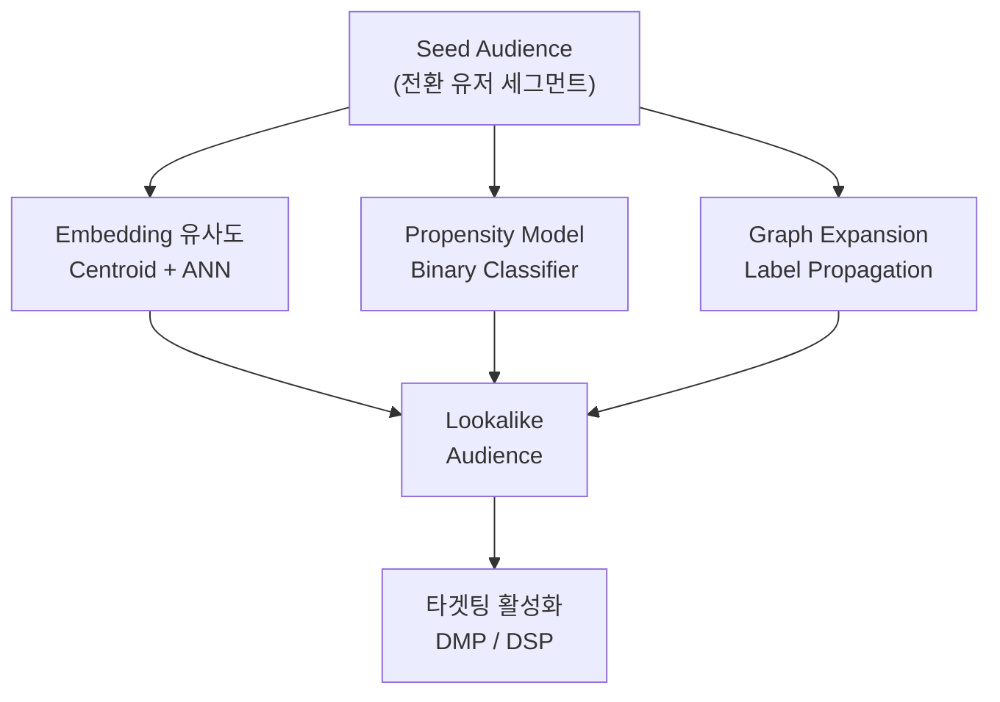
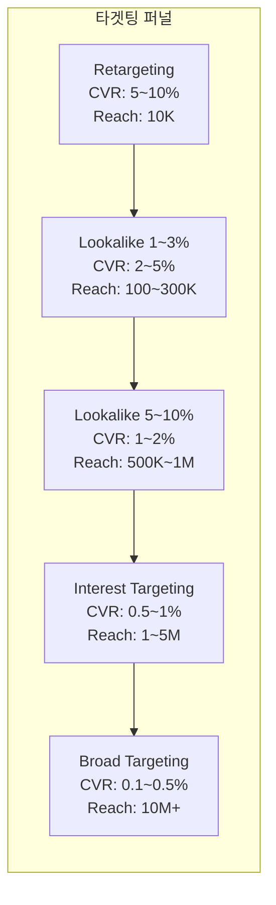
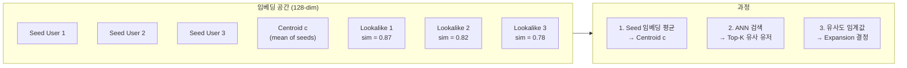
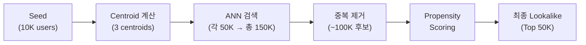
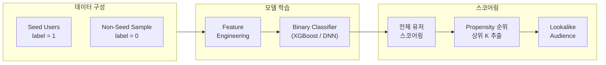
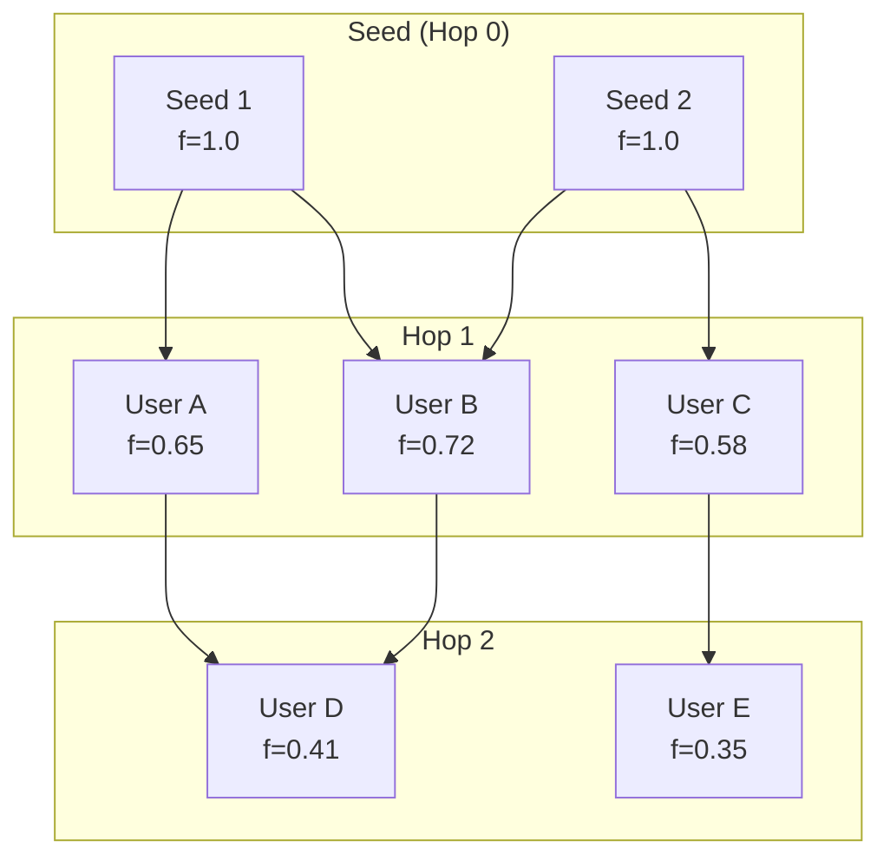
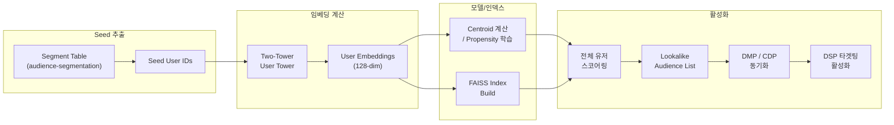
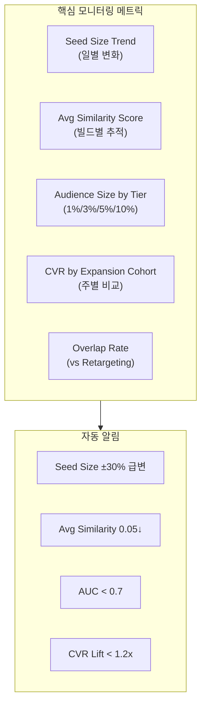

광고주가 보유한 전환 유저는 1,000명입니다. 이 1,000명과 "비슷한" 유저 10만~100만 명을 찾아 타겟팅하면 어떨까요?

전환 유저는 구매나 가입처럼 광고주가 바라는 행동을 끝까지 마친 유저입니다. 타겟팅은 광고를 보여 줄 유저를 고르는 일입니다. 위 질문을 푸는 기법이 **Lookalike 모델링(Lookalike Modeling)**이며 "알려진 좋은 유저(Seed)"에서 출발해 그들과 닮은 "아직 발견되지 않은 좋은 유저"로 타겟팅을 넓힙니다. Lookalike 는 이미 사이트를 방문하거나 전환한 유저에게 광고를 다시 보여 주는 리타겟팅 다음으로 ROI(Return On Investment, 쓴 광고비에 비해 거둔 수익)가 가장 높은 타겟팅 전략입니다. 개념은 단순하지만 구현에는 임베딩 공간의 기하학, 분류 모델의 편향, 그래프 전파의 수렴 조건까지 얽혀 있어 까다롭습니다.

시드(Seed)는 닮은 유저를 찾는 출발점이 되는 "알려진 좋은 유저"의 목록으로, 광고주가 올린 고객 목록이나 [오디언스 세그멘테이션](post.html?id=audience-segmentation)에서 만든 세그먼트(공통 조건으로 고른 유저 그룹)가 시드가 됩니다. [Ad Tech 개발 레이어](post.html?id=adtech-dev-layers)에서는 Lookalike 가 타겟팅 레이어의 핵심 모듈로 나옵니다. 시드와 다른 유저가 얼마나 닮았는지 계산하려면 유저마다 숫자 벡터가 있어야 하는데, 그 벡터인 유저 임베딩(유저 한 명을 고정된 길이의 숫자 목록으로 바꾼 것)은 [Two-Tower 모델(Two-Tower Model)](post.html?id=two-tower-retrieval)이 만듭니다.

이 글은 시드에서 닮은 유저를 찾는 접근법 3가지를 다룹니다. 시드 유저들의 중심과 가까운 유저를 고르는 Embedding 유사도, 유저가 살 것 같은 정도를 점수로 매기는 성향 모델(Propensity Model), 유저 사이의 관계를 따라 시드라는 표시(레이블)를 퍼뜨리는 그래프 확장(Graph Expansion)입니다. 시드를 구성하는 일부터 프로덕션 파이프라인까지 엔지니어 관점에서 전 과정을 다룹니다.

---

## 1. 접근법, 플랫폼, 타겟팅 전략 비교 (Executive Summary)

**Lookalike 모델링의 접근법은 크게 Embedding 유사도, 성향 모델, 그래프 확장의 3가지이며 실무에서는 하나만 쓰기보다 조합하는 방식이 강력합니다. 같은 Lookalike 라도 플랫폼마다 쓰는 데이터와 광고주가 제어할 수 있는 정도가 크게 다릅니다.**

세 접근법은 입력으로 받는 데이터와 처리할 수 있는 유저 규모가 서로 다릅니다. 자세한 구현으로 들어가기 전에 접근법마다 핵심 아이디어, 입력 데이터, 프로덕션 특성을 먼저 비교합니다.

### 세 가지 접근법 비교

표의 확장성은 처리할 수 있는 유저 규모입니다. 정밀도(Precision)@1% 는 점수가 높은 앞 1% 유저 가운데 실제로 좋은 유저가 얼마나 들어 있는지로, 높을수록 좋습니다. 중심점(Centroid)은 시드 유저 임베딩의 평균 위치이며 ANN(Approximate Nearest Neighbor)은 가장 가까운 벡터를 정확도를 조금 양보하는 대신 빠르게 찾는 검색입니다. 이진 분류는 두 값 가운데 하나를 맞히는 분류로, 여기서는 유저가 시드인지 아닌지를 맞힙니다.

| 접근법 | 핵심 아이디어 | 입력 데이터 | 확장성 | 정밀도(Precision)@1% | 구현 복잡도 |
|--------|-------------|-----------|--------|-------------|-----------|
| **Embedding 유사도** | 시드 중심(Centroid)과 ANN 거리 | 유저 임베딩 (128~256-dim) | 매우 높음 (ANN으로 수억 유저 처리) | 높음 | 중간 |
| **성향 모델** | 시드 vs 시드 아닌 사람(Non-Seed) 이진 분류 | 유저 피처 전체 (수백~수천 차원) | 높음 (배치 스코어링) | 매우 높음 | 중간 |
| **그래프 확장** | 관계 그래프 Label Propagation | 소셜/행동 그래프 | 중간 (그래프 크기 제약) | 높음 | 높음 |

Embedding 유사도는 입력이 128~256차원 유저 임베딩이며 ANN 으로 수억 유저를 처리할 수 있어 확장성이 매우 높고 정밀도@1% 도 높습니다. 성향 모델은 수백~수천 차원의 유저 피처 전체를 받아 시드와 시드 아닌 사람(Non-Seed)을 나누는 이진 분류기를 학습합니다. 전체 유저의 점수를 주기적으로 한꺼번에 계산하는 배치 스코어링으로 확장성이 높고 정밀도@1% 는 세 방법 가운데 가장 높은 "매우 높음"입니다. 그래프 확장은 소셜 관계나 행동으로 유저를 연결한 그래프를 따라 시드 표시를 이웃으로 퍼뜨리는 Label Propagation 을 씁니다. 그래프 크기에 제약을 받아 확장성은 중간이고 구현 복잡도는 높습니다.

### 멀티 플랫폼 Lookalike 비교

같은 Lookalike 라도 플랫폼마다 기반 기술과 광고주가 제어할 수 있는 수준이 크게 다릅니다. 표의 확장(Expansion)은 시드에서 닮은 유저로 오디언스를 넓히는 일입니다. 1st-party 는 회사가 자기 서비스에서 직접 모은 데이터이고 3rd-party data 는 다른 회사가 여러 사이트에서 모아 파는 데이터입니다. DSP(Demand-Side Platform)는 광고주를 대신해 여러 매체의 광고 자리에 입찰하는 플랫폼이며 TTD(The Trade Desk)와 DV360 이 그 예입니다.

| 플랫폼 | 기술 기반 | 데이터 소스 | 확장(Expansion) 옵션 | 광고주 제어 | 한계 |
|--------|---------|-----------|---------------|-----------|------|
| **Meta (Facebook)** | Social + 관심사 그래프(Interest Graph) + ML | 로그인 기반 cross-platform | 1~10% 슬라이더 | 높음 (소스/비율 선택) | 닫힌 생태계(Walled Garden) 내부만 |
| **Google** | Search/Browse history + ML | Google Account cross-service | 자동 (Performance Max) | 낮음 (자동화 위주) | 유사 오디언스(Similar Audiences) 폐지 |
| **DSP (TTD, DV360)** | 3rd-party data + ML | Cookie/MAID (제한적) | 커스텀 비율 설정 | 중간 | Safari/Firefox cookie 차단, ATT 영향 직격 |
| **네이버/카카오** | 1st-party 통합 데이터 | 검색+쇼핑+콘텐츠 | 플랫폼 제공 옵션 | 중간 | 플랫폼 외부 활용 불가 |

Meta 는 로그인 기반으로 여러 서비스에 걸친 데이터를 쓰고 광고주가 소스를 고르고 비율을 1~10% 슬라이더로 정할 수 있어 제어 수준이 높지만 그 Lookalike 는 닫힌 생태계(Walled Garden) 안에서만 쓸 수 있습니다. 닫힌 생태계는 광고를 사고파는 시스템을 모두 자기 안에 두고 자기 서비스의 로그인 데이터로 광고를 운영하는 플랫폼입니다. Google 은 자동화 캠페인인 Performance Max 안에서 확장을 자동으로 하므로 광고주 제어가 낮습니다. 표의 한계 칸처럼 Google 은 유사 오디언스(Similar Audiences)를 폐지했습니다. DSP 는 3rd-party data 와 제한적으로만 쓸 수 있는 쿠키, MAID(모바일 기기에 붙은 광고 식별자)에 기대며 확장 비율을 직접 설정할 수 있고 광고주 제어는 중간입니다. 대신 Safari 와 Firefox 의 cookie 차단과 Apple 의 ATT(앱이 유저를 추적하려면 유저의 허락을 받게 한 정책)에 영향을 바로 받습니다. 네이버와 카카오는 검색, 쇼핑, 콘텐츠를 합친 1st-party 데이터를 쓰고 확장은 플랫폼이 제공하는 옵션에서 고르며 광고주 제어는 중간이지만 플랫폼 밖에서는 활용할 수 없습니다.

아래 그림처럼 세 접근법은 모두 같은 시드(전환 유저 세그먼트)에서 출발해 Lookalike 로 찾은 유저 목록인 Lookalike 오디언스를 만듭니다. 만든 오디언스는 DMP(오디언스 데이터를 모아 관리하는 플랫폼)나 DSP 에서 타겟팅 대상으로 활성화됩니다.



> **실무에서는 접근법 하나보다 조합이 강력합니다.** Embedding 유사도는 빠르고 성향 모델은 정밀하므로, Embedding 유사도로 후보 풀을 빠르게 만든 다음 성향 모델로 그 후보의 순위를 다시 매기면 속도와 정밀도를 같이 얻습니다. 대형 플랫폼이 공개한 시스템 논문들도 한 방법만 쓰지 않습니다.

### Lookalike 와 다른 타겟팅 전략 비교

다른 타겟팅 전략과 비교하면 Lookalike 가 어디에 있고 왜 가치가 있는지 더 분명해집니다. 표의 도달 범위(Reach)는 광고가 닿을 수 있는 유저 수, 전환율(CVR)은 광고를 본 유저 가운데 전환한 비율, CPA(Cost Per Acquisition)는 전환 1건을 얻는 데 든 광고비로 낮을수록 좋습니다. Lookalike 1~3% 는 전체 모집단에서 시드와 가장 닮은 앞 1~3% 를 담은 오디언스입니다(6절). Interest Targeting 은 특정 관심사를 가진 유저를 고르는 타겟팅입니다.

| 타겟팅 전략 | 대상 | 도달 범위 | 전환율 | CPA | 주요 한계 |
|-----------|------|---------|-------|-----|---------|
| **Retargeting** | 이미 방문/전환한 유저 | 매우 좁음 | 매우 높음 | 매우 낮음 | 규모 확장 불가, 기존 유저만 |
| **Lookalike 1~3%** | 시드와 유사한 신규 유저 | 좁~중간 | 높음 | 낮음 | 시드 품질에 의존 |
| **Lookalike 5~10%** | 시드와 느슨하게 유사한 유저 | 중간~넓음 | 중간 | 중간 | 시그널 희석 |
| **Interest Targeting** | 특정 관심사 유저 | 넓음 | 낮~중간 | 중간~높음 | 관심사 ≠ 구매 의도 |
| **넓은 타겟팅(Broad Targeting)** | 전체 모집단 | 매우 넓음 | 낮음 | 높음 | 비효율적 지출 |

표는 도달이 매우 좁은 리타겟팅(Retargeting)부터 전체 모집단을 대상으로 하는 넓은 타겟팅(Broad Targeting)까지 도달 순서로 놓았습니다. 아래로 내려갈수록 전환율은 매우 높음에서 낮음으로 떨어지고 CPA 는 매우 낮음에서 높음으로 오릅니다.

리타겟팅은 전환율이 가장 높지만 이미 사이트를 방문한 유저만 대상으로 하므로 **규모를 넓힐 수 없습니다**. Lookalike 는 리타겟팅 다음으로 높은 전환율을 내면서 **신규 유저로 넓힐 수 있는** 대표적인 전략이라서 "리타겟팅 다음으로 가장 높은 ROI" 를 내는 전략으로 불립니다.

아래 퍼널은 다섯 전략마다 CVR 과 도달 숫자를 붙였습니다.



퍼널에서 리타겟팅은 CVR 5~10% 에 도달이 10K(1만 명)이고 Lookalike 1~3% 는 CVR 2~5% 에 도달 100~300K 입니다. Lookalike 1~3% 의 도달 100~300K 는 6절에서 쓰는 모집단 10M(천만 명)의 1~3% 와 같습니다. 넓은 타겟팅은 도달이 10M+ 로 가장 넓지만 CVR 이 0.1~0.5% 로 가장 낮습니다. 퍼널을 따라가면 도달이 넓어질수록 CVR 이 낮아지는 흐름이 숫자로도 보입니다.

---

## 2. 시드 오디언스: Lookalike 의 출발점

**Lookalike 의 성능은 모델 아키텍처보다 시드의 품질에 더 크게 좌우되므로 시드를 어떤 유저로 채울지 먼저 정하고 확장하기 전에 지표 3가지로 시드의 품질을 진단합니다.**

시드에 넣은 유저가 Lookalike 가 찾을 "좋은 유저"의 본보기가 되므로, "좋은 유저"를 정확하게 정의하지 못하면 아무리 정교한 확장 알고리즘을 써도 "좋은 유저와 비슷한 유저"를 찾을 수 없습니다. 이 절은 시드를 고르는 전략, 시드의 품질을 평가하는 방법, 유저마다 가치를 가중치로 주는 방법을 차례로 다룹니다.

### 2-1. 시드 선정 전략

시드에 어떤 유저를 넣느냐에 따라 Lookalike 가 찾아오는 유저의 방향이 완전히 달라집니다. 아래 표는 시드 유형 4가지를 정의, 장점, 위험으로 비교합니다.

| 시드 유형 | 정의 | 장점 | 위험 |
|----------|------|------|------|
| **전체 전환자** | 구매/가입 완료 유저 전체 | 데이터 풍부, 통계적 안정성 | 저가치 전환(쿠폰 사냥꾼 등) 포함 가능 |
| **High-LTV 전환자** | 상위 20% LTV 유저 | 고품질 시그널, 고가치 유저 발굴 | 시드 크기 작음 → 오버피팅 위험 |
| **특정 이벤트** | 장바구니 추가, 앱 설치 등 | 캠페인 목적에 특화 | 최종 전환과 괴리 가능 |
| **기존 세그먼트** | RFM Champions, VIP 등급 등 | 이미 검증된 비즈니스 그룹 | 이미 알려진 유저만 (신규 패턴 부재) |

전체 전환자는 구매나 가입을 마친 유저 전부라 데이터가 풍부하고 통계적으로 안정적이지만 쿠폰이 있을 때만 사는 쿠폰 사냥꾼 같은 저가치 전환이 섞일 수 있습니다. High-LTV 전환자는 LTV(Lifetime Value, 유저 한 명이 오랜 기간에 걸쳐 광고주에게 가져다주는 가치)가 상위 20% 인 유저라 고품질 시그널로 고가치 유저를 찾을 수 있는 대신, 시드가 작아져 학습 데이터의 우연한 특징까지 외우는 오버피팅의 위험이 있습니다. 특정 이벤트 시드는 장바구니 추가나 앱 설치처럼 캠페인 목적에 맞춘 행동을 고르지만 최종 전환과 거리가 생길 수 있습니다. 기존 세그먼트는 RFM(최근 구매, 구매 빈도, 구매 금액으로 고객 등급을 매기는 방법)의 최상위 등급인 Champions 나 VIP 등급처럼 이미 검증된 비즈니스 그룹이지만 이미 알려진 유저만 담겨 새로운 패턴이 없습니다.

**최적 시드 크기**: 시드는 최소 1,000명이 필요하고 결과가 가장 좋은 구간(Sweet Spot)은 **1만~10만 명**입니다.

- **너무 작은 시드 (< 1,000명)**: 유저가 적으면 몇 명이 우연히 같은 시간대에 접속한 것 같은 공통점까지 패턴으로 학습할 위험이 높아 노이즈에 오버피팅합니다.
- **너무 큰 시드 (> 100만 명)**: "전환 유저"라는 레이블 하나에 너무 다양한 행동 패턴이 들어가 시그널이 희석되므로 중심점(Centroid)은 아무 유저도 대표하지 못하는 "평균의 함정"에 빠집니다.
- **1만~10만 명**: 통계적으로 충분히 안정적이면서도 전환 유저의 핵심 패턴이 희석되지 않는 구간입니다.

이런 시드는 SQL 조건으로 유저를 고르는 Rule-based 세그먼트, RFM 스코어링, 비슷한 유저끼리 모으는 ML 클러스터링으로 만들며 3가지 모두 [오디언스 세그멘테이션](post.html?id=audience-segmentation)에서 다뤘습니다. Lookalike 는 이렇게 세그멘테이션이 만든 결과를 입력으로 받는 **하류(Downstream) 프로세스**입니다.

> 시드를 정의할 때는 "전환 유저 전체"를 따져 보지 않고 시드로 쓰는 실수가 가장 흔합니다. 프로모션 기간에 가입한 유저, 체험으로 한 번만 산 유저, 환불한 유저가 섞이면 시드 유저끼리 닮은 정도인 동질성(Homogeneity)이 급격히 떨어지므로, 첫 번째 최적화로 **전환의 "질"을 기준으로 시드를 필터링**합니다.

### 2-2. 시드 품질 평가

시드를 정의했으면 확장하기 전에 반드시 품질을 진단해야 합니다. 품질이 낮은 시드를 그대로 확장하면 시드에 섞인 노이즈까지 넓게 퍼뜨리는 "노이즈의 확대 재생산"이 일어납니다.

**진단 지표 3가지**:

1. **Homogeneity (동질성)**: 임베딩 공간에서 시드 유저끼리 짝을 지어 구한 cosine similarity 의 평균입니다. cosine similarity 는 두 벡터가 가리키는 방향이 얼마나 같은지를 -1 에서 1 사이 값으로 나타내며 1 에 가까울수록 닮았습니다. 시드가 동질적일수록 중심점이 의미 있는 중심을 나타냅니다.

$$\text{Homogeneity}(S) = \frac{1}{|S|^2} \sum_{i,j \in S} \text{sim}(u_i, u_j)$$

식의 $|S|$ 는 시드 유저 수이고 짝 $(i, j)$ 는 자기 자신과의 짝까지 $|S|^2$ 개라서 모든 짝의 유사도를 더해 $|S|^2$ 로 나누면 평균이 됩니다.

2. **Signal Strength**: 시드의 전환율(CVR)을 전체 모집단의 전환율로 나눈 비율입니다. 이 비율이 높을수록 시드에 담긴 "좋은 유저" 시그널이 뚜렷합니다.

$$\text{Signal Strength} = \frac{\text{CVR}_{\text{seed}}}{\text{CVR}_{\text{population}}}$$

Signal Strength 가 3 이면 시드의 전환율이 모집단 전환율의 3배라는 뜻이며 아래 표의 CVR Uplift 가 이 비율입니다.

3. **피처(Feature) Distribution**: 피처는 모델이 입력으로 쓰는 유저 속성입니다. 핵심 피처의 분포는 전체 모집단보다 좁아야 하는데, 예를 들어 시드 유저의 앱 사용 시간이 전체보다 분산(값이 평균에서 퍼진 정도)이 낮으면 시드에 일관된 행동 패턴이 있다는 뜻입니다.

세 지표와 시드 크기에 Good 과 Bad 의 기준을 붙이면 아래 표와 같습니다. 표의 Intra-similarity 는 1번의 동질성, CVR Uplift 는 2번의 Signal Strength, 피처 Variance 는 3번 분포가 퍼진 정도입니다.

| 진단 지표 | Good 시드 | Bad 시드 | 주요 원인 |
|-----------|-----------|---------|----------|
| Intra-similarity | > 0.3 | < 0.15 | 이질적 유저 혼합 (LTV 편차 큼) |
| CVR Uplift | > 3x | < 1.5x | 시그널 약함 (정의 기준 느슨) |
| Size | 10K ~ 100K | < 1,000 or > 1M | 너무 작거나 너무 큼 |
| 피처 Variance | 낮음 (집중된 분포) | 높음 (분산 분포) | 정의 기준 불명확 / 프로모션 유저 포함 |

기준은 지표마다 따로 있습니다. Intra-similarity 는 0.3 을 넘으면 Good, 0.15 아래면 Bad 이고 Bad 의 주요 원인은 LTV 편차가 큰 이질적 유저의 혼합입니다. CVR Uplift 는 3x 를 넘으면 Good, 1.5x 아래면 Bad 이고 Bad 의 주요 원인은 정의 기준이 느슨해서 약해진 시그널입니다. 크기는 10K~100K(1만~10만 명)가 Good 이고 1,000 미만이거나 1M(100만) 초과면 Bad 입니다. 피처 Variance 는 낮게 집중된 분포가 Good, 높게 퍼진 분포가 Bad 이며 정의 기준이 불명확하거나 프로모션 유저가 섞였을 때 높아집니다.

**Bad 시드로 진단했을 때의 조치**:
- Intra-similarity < 0.15 → 시드 안에 이질적인 유저가 섞였다는 뜻이라 시드를 K-Means(가까운 점끼리 K개 그룹으로 나누는 클러스터링)로 서브클러스터로 나누고 클러스터마다 별도 시드로 분리합니다
- CVR Uplift < 1.5x → 정의 기준이 느슨하다는 뜻이라 전환 기준을 강화합니다. 예를 들어 1회 구매 대신 2회 이상 재구매를 시드 조건으로 둡니다
- Size < 1,000 → 시드를 모으는 시간 윈도우를 30일에서 90일로 넓히거나 이벤트 기준을 완화합니다
- Feature Variance 높음 → 이상치 유저를 걸러내거나 하위 시드(Sub-seed)로 분리합니다

### 2-3. 가치로 가중한 시드 (Value-Based Seed)

2-1 과 2-2 의 시드는 유저가 시드에 속하는지 아닌지(binary)만 따지므로 시드 유저는 가치와 상관없이 모두 같은 가중치를 받습니다. 여기서 한 걸음 더 나아가 **시드 유저마다 가치(value)를 가중치로 반영**하는 방법이 있으며 Facebook 의 "Value-Based Lookalike" 가 대표적인 예입니다. 가중치를 반영한 중심점은 이렇게 계산합니다.

$$c_{\text{weighted}} = \frac{\sum_{i \in S} w_i \cdot u_i}{\sum_{i \in S} w_i}$$

식의 $w_i$ 는 유저 $i$ 의 LTV 또는 구매 금액이고 $u_i$ 는 그 유저의 임베딩입니다. 분자는 임베딩마다 가중치를 곱해 더한 값, 분모는 가중치의 합이라서 $w_i$ 가 모두 같으면 3-2 의 단순 평균과 같아지고 가치가 큰 유저일수록 중심점이 그 유저의 임베딩 쪽으로 더 많이 옮겨 갑니다.

그래서 중심점이 고가치 유저 쪽으로 편향된 Lookalike 는 "전환 유저와 유사한 유저"가 아니라 "**고가치 전환 유저**와 유사한 유저"를 찾습니다. 광고비 대비 매출인 ROAS(Return On Ad Spend)를 최적화하는 캠페인에서 이 방법이 특히 효과적입니다.

가중치에는 [고객 LTV(Lifetime Value)](post.html?id=ltv-ad-ranking) 예측값을 씁니다. LTV 예측이 정확할수록 Value-Based Lookalike 도 정확해지므로 LTV 모델을 개선하면 Lookalike 성능도 함께 올라가는 선순환이 생깁니다.

**성향 모델에서의 Value-Based 접근**:

성향 모델은 4절에서 다룰 이진 분류 대신 유저의 LTV 금액을 맞히는 **회귀(Regression)**로 다시 정의할 수 있습니다.

$$\hat{v}(x) = f(x; \theta)$$

식의 $\hat{v}$ 는 모델 $f$ 가 유저 피처 $x$ 와 학습된 파라미터 $\theta$ 로 예측한 LTV 입니다. 학습할 때 시드 유저에게는 실제 LTV 를 레이블로, 시드 아닌 사람에게는 0 을 레이블로 줍니다. 그렇게 학습한 모델이 예측한 $\hat{v}$ 가 큰 순서로 Lookalike 를 구성하면 높은 LTV 가 기대되는 유저가 위쪽에 놓입니다. 두 방식을 나란히 놓으면 아래와 같습니다.

| 방식 | 목적 | Seed 레이블 | 결과물 |
|------|------|-----------|-------|
| Binary Lookalike | "Seed와 유사한" 유저 | 0 / 1 | Propensity Score (유사 확률) |
| Value-Based Lookalike | "고가치 Seed와 유사한" 유저 | LTV 금액 (연속값) | Expected Value (기대 가치) |

Binary Lookalike 는 시드 레이블이 0 과 1 이라 결과가 "시드와 유사할 확률"인 Propensity Score 입니다. Value-Based Lookalike 는 레이블이 LTV 금액이라 결과가 기대 가치(Expected Value)입니다.

---

## 3. Embedding 기반 Lookalike

**Embedding 기반 Lookalike 는 시드 유저 임베딩의 중심점에서 가까운 유저를 Lookalike 로 고르는 방법이며 가장 직관적이고 구현이 빠릅니다.**

유저를 벡터 공간의 점으로 놓으면 행동이 비슷한 유저끼리 가까이 모이므로 시드 유저의 중심점과 가까운 유저는 시드와 행동이 비슷한 유저입니다. 이 방법의 가장 큰 장점은 재활용입니다. 새 모델 없이 [Two-Tower Model](post.html?id=two-tower-retrieval)이 이미 학습해 둔 유저 임베딩을 그대로 씁니다.

### 3-1. Two-Tower 임베딩 공간 활용

Two-Tower 모델에서 유저 쪽 신경망인 User Tower 는 클릭 이력, 검색 쿼리, 구매 패턴 같은 유저의 행동 데이터를 입력받아 대부분의 값이 0 이 아닌 숫자로 채워진 고밀도 벡터(Dense Vector)를 출력합니다. 이 벡터 공간에서는 **행동 패턴이 비슷한 유저일수록 가까이 위치**합니다.

$$u_i = f_{\text{user}}(x_i; \theta_{\text{user}}) \in \mathbb{R}^d$$

식에서 $f_{\text{user}}$ 는 User Tower, $x_i$ 는 유저 $i$ 의 피처, $\theta_{\text{user}}$ 는 학습된 파라미터입니다. 결과 $u_i$ 는 실수 $d$ 개로 된 벡터이며 임베딩 차원 $d$ 는 보통 128~256 입니다.

광고 Retrieval(수많은 광고 가운데 유저에게 보여 줄 후보를 먼저 골라내는 단계)을 위해 이미 학습된 Two-Tower 모델의 유저 임베딩에는 유저가 광고에 반응한 패턴이 이미 인코딩되어 있어서 **새로운 모델이 필요 없습니다**. Lookalike 용 모델을 따로 학습하지 않고 이 임베딩을 그대로 쓰면 됩니다.

다만 한계도 있습니다. Two-Tower 임베딩은 광고 클릭과 전환을 예측하도록 최적화되었을 뿐 "유저 간 유사도"를 목적 함수로 직접 학습하지 않았으므로 Lookalike 전용 임베딩이 더 나은 결과를 줄 수 있습니다. Contrastive Learning(닮아야 할 쌍은 가깝게, 닮지 않은 쌍은 멀게 학습하는 방법)으로 전환 유저끼리의 유사도를 최대로 키운 모델이 그런 예입니다. 그래도 실무에서 이 차이는 대개 시드 품질이 주는 영향보다 작으므로 **첫 버전은 Two-Tower 임베딩으로 시작**하는 편이 합리적입니다.

### 3-2. 시드 중심점 계산과 ANN 검색

시드 유저 집합 $S = \{u_1, u_2, \ldots, u_n\}$ 이 주어지면 먼저 시드를 대표하는 중심점을 계산하고 전체 유저 풀에서 그 중심점과 가까운 유저를 ANN 검색으로 찾습니다.

**Mean Centroid** (가장 기본적인 방법): 모든 시드 유저의 임베딩을 더해 시드 유저 수 $|S|$ 로 나누는 단순 평균입니다.

$$c = \frac{1}{|S|} \sum_{i \in S} u_i$$

단순 평균은 직관적이지만 시드 안에 서로 멀리 떨어진 유저 그룹이 섞여 있으면 평균이 어느 그룹에도 없는 빈 자리에 놓이므로 시드가 동질적(Homogeneous)일 때만 효과적입니다(3-3).

아래 카드에서는 중심점 하나에서 닮은 사람을 자르는 순서를 보면 됩니다.

<div class="demo-embed-wrap">
<iframe class="demo-embed" src="demo-data-model-cards.html?embed=1&card=centroid" height="480" loading="lazy" title="시드 평균 하나에서 닮은 사람을 찾는다"></iframe>
<a class="demo-embed-open" href="demo-data-model-cards.html" target="_blank" rel="noopener">↗ 카드 여덟 장 전체로 열기</a>
</div>

**Cosine Similarity** (유사도 계산): 두 벡터의 내적 $u^T c$ 를 두 벡터 길이의 곱으로 나눈 값입니다.

$$\text{sim}(u, c) = \frac{u^T c}{\|u\| \cdot \|c\|}$$

길이로 나누므로 벡터의 길이와 상관없이 방향만 비교하며 같은 방향이면 1, 직각이면 0 입니다. 전체 유저 풀에서 중심점과의 cosine similarity 가 높은 유저가 Lookalike 후보가 됩니다.

**Top-K ANN 검색** (효율적 확장):

$$\text{Lookalike}(S, k) = \text{TopK}_{u \notin S}\left(\text{sim}(u, c)\right)$$

식은 시드에 들어 있지 않은 유저($u \notin S$) 가운데 중심점과의 유사도가 가장 높은 $k$ 명을 고른다는 뜻입니다. 수억 명의 유저 풀에서 모든 유저와 유사도를 하나씩 계산하는 brute-force 로 Top-K 를 구하면 시간이 너무 오래 걸리므로 대신 ANN 인덱스를 씁니다. FAISS, ScaNN 같은 벡터 검색 라이브러리의 ANN 인덱스는 수밀리초 만에 Top-K 를 뽑으며 이 인덱스는 [Two-Tower Model](post.html?id=two-tower-retrieval)에서 다뤘습니다.

아래 그림은 128차원 임베딩 공간에서 시드 유저 3명의 임베딩을 평균해 중심점 c 를 만들고 ANN 검색으로 유사 유저를 찾은 뒤 유사도 임계값으로 확장 범위를 정하는 과정입니다.



그림의 Lookalike 1~3 은 중심점과의 유사도가 0.87, 0.82, 0.78 이라서 이 순서로 후보에 오릅니다.

**확장 비율 제어**: 유사도 임계값(threshold)을 올리거나 내려서 Lookalike 크기를 조절합니다. 임계값을 높이면 시드와 매우 유사한 소수만 들어와 정밀도는 높고 도달은 좁아집니다(High Precision, Low Reach). 임계값을 낮추면 더 넓은 범위가 들어와 정밀도는 낮고 도달은 넓어집니다(Low Precision, High Reach). 그림의 값으로 따라가면, 임계값이 0.78 과 0.82 사이일 때는 0.87 과 0.82 인 Lookalike 1, 2 만 들어오고 0.78 아래로 내려가면 Lookalike 3 까지 들어옵니다. Facebook 의 "1~10% 슬라이더" 가 안에서 하는 일이 바로 이 임계값 조절입니다.

### 3-3. 이질적 시드를 위한 Multi-Centroid

단순 평균 중심점(Mean Centroid)은 성격이 다른 유저 그룹이 섞인 이질적(Heterogeneous) 시드에서 실패합니다. 예를 들어 쇼핑몰의 전환 유저 시드에 "명품 구매자"와 "초특가 사냥꾼"이 함께 섞여 있으면, 두 그룹의 임베딩은 벡터 공간에서 아주 다른 자리에 있으므로 두 그룹의 평균인 중심점은 **어느 그룹에도 속하지 않는 빈 공간**에 놓입니다.

이 현상을 "평균의 함정(Averaging Fallacy)"이라 부릅니다. 평균이 의미를 가지려면 분포의 봉우리가 하나인 단봉(Unimodal)이어야 하는데, 이질적 시드는 그룹마다 봉우리가 생기는 다봉(Multimodal) 분포라 평균이 어느 봉우리에도 놓이지 않습니다.

그래서 Multi-Centroid 는 시드 임베딩에 K-Means 클러스터링을 적용해 K개의 서브클러스터를 찾고 서브클러스터마다 중심점을 잡아 ANN 검색을 따로 돌립니다.

$$\{c_1, c_2, \ldots, c_K\} = \text{K-Means}(\{u_i\}_{i \in S}, K)$$

$$\text{Lookalike}_{\text{multi}}(S, k) = \bigcup_{j=1}^{K} \text{TopK}_{u \notin S}\left(\text{sim}(u, c_j)\right)$$

첫 식은 시드 유저 임베딩 $\{u_i\}$ 를 K-Means 로 K개 그룹으로 나눠 그룹마다 중심점 $c_1, \ldots, c_K$ 를 얻는다는 뜻입니다. 둘째 식은 중심점마다 따로 ANN 검색을 해서 시드에 없는 유저 가운데 유사도 Top-K 를 뽑고 그 결과를 모두 합친다($\bigcup$)는 뜻이며 합칠 때 중복은 제거합니다. 최종 순위는 유저마다 여러 중심점과의 유사도 가운데 가장 높은 값으로 정합니다.

$$\text{score}(u) = \max_{j=1}^{K} \text{sim}(u, c_j)$$

유저는 자기와 가장 가까운 서브클러스터 중심점과의 유사도로 평가받으므로, 명품 구매자와 닮은 유저도 초특가 사냥꾼과 닮은 유저도 각자 자기 그룹의 중심점 덕분에 높은 점수를 받습니다.

**K 선택**: K 는 보통 3~5 로 시작합니다. K 가 너무 크면 서브클러스터 하나에 든 시드가 너무 작아져 의미 없는 중심점이 생깁니다. K=1 이면 서브클러스터가 하나뿐이라 단순 평균 중심점과 같습니다. Silhouette Score(점이 자기 클러스터와는 가깝고 다른 클러스터와는 먼 정도)로 최적 K 를 자동으로 찾을 수도 있지만 실무에서는 K=3 으로 시작해 Lookalike 성과를 보며 조정하는 방식이 일반적입니다.

다음 코드는 Multi-Centroid Lookalike 를 처음부터 끝까지 구현한 예시입니다. 가짜 유저 20만 명의 128차원 임베딩을 만들고 앞 3,000명을 전환 유저 시드로 둔 다음, 시드를 서브클러스터 3개로 나눠 중심점마다 FAISS 로 검색하고 시드를 뺀 Lookalike 오디언스 50,000명을 뽑습니다. 코드는 앞쪽 1만 2천 명에게만 숨어 있는 취향 군집 3개 가운데 하나의 중심을 더해 두었으므로 시드 3,000명도 저마다 세 군집 가운데 하나에 속합니다.

```python
# 하는 일: 가짜 유저 20만 명의 임베딩에서 전환 유저 3,000명을 서브클러스터 3개로 나누고, 중심점마다 FAISS 로 검색해 Seed 를 뺀 Lookalike 오디언스 50,000명을 뽑는다.
import numpy as np
import faiss
from sklearn.cluster import KMeans

# 1단계: 가짜 유저 20만 명의 임베딩을 만들고 앞 3,000명을 Seed 로 둔다
# 실전에서는 np.load(...) 로 읽고, 여기서는 재현 가능한 가짜 데이터를 쓴다.
rng = np.random.default_rng(42)
N, DIM, N_SEED = 200_000, 128, 3_000
centers = rng.normal(size=(3, DIM)).astype('float32')      # 숨어 있는 3개 취향 군집
all_embeddings = rng.normal(size=(N, DIM)).astype('float32')
all_embeddings[:12_000] += 2.0 * centers[rng.integers(0, 3, 12_000)]
all_user_ids = np.arange(N)
seed_user_ids = np.arange(N_SEED)                          # 앞 3,000명이 전환 유저
seed_embeddings = all_embeddings[seed_user_ids].copy()

# 2단계: L2 정규화로 cosine 유사도를 내적으로 바꾼다
faiss.normalize_L2(seed_embeddings)
faiss.normalize_L2(all_embeddings)

# 3단계: Multi-Centroid 로 Seed 를 서브클러스터 3개로 나눈다
K_SUB = 3
kmeans_seed = KMeans(n_clusters=K_SUB, random_state=42, n_init=10)
kmeans_seed.fit(seed_embeddings)
centroids = kmeans_seed.cluster_centers_.astype('float32')  # (K, 128)
faiss.normalize_L2(centroids)

# 4단계: FAISS 내적 인덱스를 만든다
dim = all_embeddings.shape[1]
index = faiss.IndexFlatIP(dim)
index.add(all_embeddings)

# 5단계: 중심점마다 ANN 검색을 하고 유저마다 최대 유사도를 남긴다
TOP_K = 50000  # 확장 대상 유저 수
all_scores = np.full(len(all_embeddings), -1.0)

for j in range(K_SUB):
    query = centroids[j:j+1]
    scores, indices = index.search(query, TOP_K)
    for rank in range(TOP_K):
        idx = indices[0][rank]
        score = scores[0][rank]
        all_scores[idx] = max(all_scores[idx], score)

# 6단계: Seed 를 빼고 상위 50,000명을 뽑는다
seed_user_set = set(seed_user_ids)
candidates = [
    (all_user_ids[i], all_scores[i])
    for i in range(len(all_scores))
    if all_scores[i] > 0 and all_user_ids[i] not in seed_user_set
]
candidates.sort(key=lambda x: -x[1])
lookalike_audience = candidates[:TOP_K]

print(f"Lookalike audience size: {len(lookalike_audience)}")
print(f"Top similarity: {lookalike_audience[0][1]:.4f}")
print(f"Bottom similarity: {lookalike_audience[-1][1]:.4f}")

# 출력:
# 6단계 뜻: 확장 대상은 50000명이고, 유사도는 맨 위가 0.9435, 맨 아래가 0.1246 이다.
# Lookalike audience size: 50000
# Top similarity: 0.9435
# Bottom similarity: 0.1246
```

**코드 설명**:
1. 벡터마다 길이를 1 로 맞추는 L2 정규화를 하면 cosine similarity 식의 분모가 1 이 되어 두 벡터의 내적(Inner Product)이 곧 cosine similarity 가 되므로(2단계), 내적으로 검색하는 FAISS 의 `IndexFlatIP` 를 그대로 씁니다.
2. 3단계는 K-Means 로 시드를 서브클러스터 `K_SUB = 3` 개로 나눕니다. 5단계는 중심점 하나하나를 쿼리로 넣어 ANN 검색을 합니다.
3. 5단계는 중심점마다 `TOP_K` 50,000명을 찾고 한 유저가 여러 중심점의 결과에 나오면 유사도가 가장 큰 값만 남깁니다. 위 score 식을 코드로 옮긴 이 최대값 계산이 Multi-Centroid 의 핵심 단계입니다.
4. 6단계는 시드 유저를 빼고 유사도가 큰 순서로 정렬해 앞 50,000명을 최종 Lookalike 오디언스로 삼습니다.

찍힌 값을 보면 확장 대상은 50,000명이고 유사도는 맨 위가 0.9435, 맨 아래가 0.1246 입니다. 취향 군집의 중심이 더해진 유저는 앞쪽 1만 2천 명뿐이고 그중 3,000명은 시드라 빠지므로, 50,000명의 뒤쪽은 군집과 상관없는 무작위 유저가 채워 유사도가 0.1246 까지 내려갑니다. 같은 오디언스 안에서도 뒤로 갈수록 유사도가 이만큼 떨어지며 6절에서 다룰 확장의 트레이드오프가 바로 이 숫자입니다.

프로덕션에서는 모든 벡터와 내적을 계산하는 `IndexFlatIP` 대신 `IndexIVFPQ` 같은 근사 인덱스를 써서 수억 유저 규모에서도 효율적으로 검색합니다. 인덱스를 고르는 자세한 기준은 [Two-Tower 모델](post.html?id=two-tower-retrieval)의 ANN 절에 있습니다.

### 3-4. Embedding Lookalike 의 장점과 한계

**장점**:
- **구현 속도**: Two-Tower 임베딩이 이미 있으면 중심점 계산과 ANN 검색만 추가하면 되므로 모델을 더 학습하지 않고도 몇 시간 안에 MVP(최소 기능 제품)를 만들 수 있습니다.
- **확장성**: FAISS 와 ScaNN 의 ANN 인덱스 덕분에 수억 유저 규모에서도 밀리초 단위 검색이 가능합니다.
- **해석 가능성**: "유사도 스코어"라는 직관적인 지표 하나로 Lookalike 의 품질을 설명할 수 있습니다.
- **실시간 가능**: 중심점만 메모리에 올려 두면 입찰 요청(Bid Request, 광고 자리가 생길 때마다 광고 거래소가 입찰자에게 보내는 요청) 시점에 유사도를 실시간으로 계산할 수 있습니다.

**한계**:
- **임베딩 품질 의존**: Two-Tower 가 광고 클릭 예측에 최적화되어 있어 "유저 간 유사도"와는 약간 차이가 있을 수 있습니다. 특히 행동 데이터가 부족한 Cold Start 유저의 임베딩은 불안정합니다.
- **피처 활용 제한**: 최근 검색 키워드나 디바이스 가격대처럼 임베딩에 인코딩되지 않은 피처는 직접 쓸 수 없습니다.
- **중심점 함정**: 시드가 이질적이면 평균 중심점이 의미를 잃습니다. Multi-Centroid 로 완화할 수 있지만 완전히 해결되지는 않습니다.
- **비선형 관계 미포착**: cosine similarity 는 선형 거리 지표라서 "시드와 비선형적으로 유사한" 패턴을 놓칠 수 있습니다.

많은 프로덕션 시스템은 이 한계를 두 단계(Two-Stage) 구조로 우회합니다. Embedding 기반이 후보를 빠르게 걸러내는 **1차 필터(Retrieval)**를 맡고 성향(Propensity) 기반이 남은 후보의 순서를 정밀하게 매기는 **2차 정렬(Ranking)**을 맡습니다. 아래 그림은 시드 10K 명에서 시작하는 두 단계 구조입니다.



그림을 따라가면 시드 10K 명에서 중심점 3개를 계산하고 중심점마다 ANN 으로 50K 명씩 찾아 3 × 50K = 150K 명을 모읍니다. 중복을 제거하면 후보가 약 100K 명 남고 성향 모델이 이 후보를 점수로 정렬해 앞 50K 명을 최종 Lookalike 로 고릅니다. 전체로 보면 ANN 이 후보를 10M 명에서 100K 명으로 빠르게 줄이고 성향 모델이 그 후보의 순위를 정밀하게 매기므로 이 구조는 속도와 정밀도를 함께 얻습니다.

---

## 4. 성향 기반 Lookalike

**성향 기반 Lookalike 는 "이 유저가 시드에 포함될 확률"을 예측하는 이진 분류기를 학습해 확률이 높은 유저를 뽑으며 대부분의 프로덕션 환경에서 Embedding 기반보다 정밀도가 높은 것으로 알려져 있습니다.**

Embedding 기반은 미리 학습된 임베딩 하나만 쓰므로 최근 검색 키워드처럼 임베딩에 인코딩되지 않은 피처를 직접 쓸 수 없습니다(3-4). 성향 기반은 중심점과의 "거리" 대신 시드에 포함될 "확률"을 쓰며 그 확률은 이진 분류기(Binary Classifier)가 예측합니다.

아래 그림은 시드 유저에 1, 시드 아닌 표본에 0 을 붙여 데이터를 만들고 피처를 만든 뒤, XGBoost 나 DNN 분류기를 학습해 전체 유저의 점수를 매기고 상위 K 명을 Lookalike 로 뽑는 흐름입니다.



### 4-1. 시드와 시드 아닌 사람의 이진 분류

Lookalike 를 이진 분류 문제로 다시 정의하면 학습 데이터의 레이블은 두 가지입니다.

- **Positive (label = 1)**: 시드 유저
- **Negative (label = 0)**: 일반 모집단에서 뽑은 표본 유저

$$P(\text{seed} \mid x) = \sigma(f(x; \theta))$$

식의 $x$ 는 유저 피처 벡터, $f$ 는 분류 모델, $\sigma$ 는 어떤 값이든 0 과 1 사이로 바꾸는 sigmoid 함수라서 $P(\text{seed} \mid x)$ 는 피처가 $x$ 인 유저가 시드일 확률이 됩니다. 이 확률을 성향 점수(Propensity Score)라고 부르며 모든 유저의 성향 점수를 계산해 높은 순서대로 Lookalike 오디언스를 구성합니다.

Embedding 기반과 가장 크게 다른 점은 **입력 데이터의 풍부함**입니다. Embedding 기반은 미리 학습된 고정 차원의 벡터만 쓰지만 성향 기반은 demographics(연령대, 성별, 지역 같은 인구통계), 행동 집계, 디바이스 정보, 시간대 패턴 같은 원시 피처를 전부 씁니다. 모델이 "무엇이 시드와 시드 아닌 사람을 나누는지"를 이 피처들에서 직접 학습하므로 임베딩에 포착되지 않은 패턴도 쓸 수 있습니다.

**피처 Set 구성** (예시):
- **Demographics**: 연령대, 성별, 지역
- **행동 집계**: 최근 7일, 14일, 30일 동안의 페이지뷰 수, 세션 수, 체류 시간
- **구매 패턴**: 평균 주문 금액, 구매 카테고리 분포, 구매 빈도
- **디바이스/플랫폼**: OS, 디바이스 가격대, 앱인지 웹인지
- **시간 패턴**: 주로 활동하는 시간대, 주말과 평일의 비율
- **임베딩**: Two-Tower 유저 임베딩도 피처로 추가해 Embedding 기반과 성향 기반을 합친 하이브리드로 씁니다

[피처 스토어(Feature Store)](post.html?id=feature-store-serving)는 학습과 서빙에 쓰는 피처를 한곳에 저장해 두고 꺼내 주는 시스템이며 그곳에서 관리하는 피처들이 여기서 그대로 쓰입니다.

### 4-2. 피처 Interaction 과 모델 선택

분류 모델 3가지를 장점, 한계, 적합 상황으로 비교하면 아래와 같습니다. 피처 Interaction 은 두 피처가 함께 작용할 때 생기는 효과입니다.

| 모델 | 장점 | 한계 | 적합 상황 |
|------|------|------|----------|
| **Logistic Regression** | 빠름, 해석 가능, 피처 Importance 명확 | 피처 interaction 수동 구성 필요 | 베이스라인, 해석 필요시, 빠른 이터레이션 |
| **XGBoost / LightGBM** | 피처 interaction 자동 학습, 높은 성능, 빠른 학습 | 고차원 임베딩 활용 제한적 | 대부분의 프로덕션 환경 |
| **DNN (DeepFM 등)** | 임베딩 + 피처 동시 학습, 풍부한 high-order interaction | 학습 시간 길고 해석 어려움 | 임베딩 풍부 + 대규모 데이터 |

Logistic Regression 은 빠르고 해석할 수 있으며 피처 Importance(어느 피처가 예측에 얼마나 기여했는지)가 명확하지만 피처 Interaction 을 사람이 직접 구성해야 합니다. 베이스라인이 필요할 때, 해석이 필요할 때, 빠르게 반복할 때 맞습니다. XGBoost 와 LightGBM(결정 트리를 하나씩 추가하며 앞 트리의 오차를 줄여 가는 부스팅 모델)은 피처 Interaction 을 자동으로 학습하고 성능이 높으며 학습이 빠르지만 고차원 임베딩은 제한적으로만 활용합니다. 대부분의 프로덕션 환경에 맞는 모델입니다. DNN(DeepFM 등)은 임베딩과 피처를 동시에 학습해 고차(high-order) Interaction 이 풍부하지만 학습 시간이 길고 해석이 어려우며 임베딩이 풍부하고 데이터가 대규모일 때 맞습니다.

DeepFM, DCN 의 아키텍처도 여기에 그대로 적용되며 두 모델은 [Deep CTR Models](post.html?id=deep-ctr-models)에서 다뤘습니다. CTR(광고를 본 유저 가운데 클릭한 비율) 예측과 Lookalike 는 둘 다 "유저 피처 → 이진 확률"을 예측하는 문제라서 모델 구조가 비슷하며 다른 점은 레이블의 정의(클릭이냐 시드 소속이냐)뿐입니다.

다음 코드는 XGBoost 로 성향 Lookalike 를 만드는 예시입니다. 가짜 유저 20만 명과 시드 3,000명에게 피처를 32개씩 주되 시드만 그중 8개 피처의 값을 일반 유저보다 높게 만들었습니다. Negative 는 일반 유저 가운데 시드의 10배를 무작위로 뽑고(1:10) 시드와 Negative 를 구분하는 XGBoost 를 학습한 뒤, 전체 유저의 점수를 매겨 시드를 뺀 상위 10만 명을 Lookalike 로 뽑습니다. 학습이 잘 되었는지는 검증 AUC 로 봅니다. AUC(Area Under the ROC Curve)는 시드 하나와 시드 아닌 사람 하나를 무작위로 골랐을 때 모델이 시드에 더 높은 점수를 줄 확률이라서 0.5 면 무작위로 고른 것과 같은 수준이고 1 에 가까울수록 시드와 시드 아닌 사람을 잘 구분합니다.

```python
# 하는 일: 가짜 유저 20만 명과 Seed 3,000명으로 Seed 와 일반 유저를 구분하는 XGBoost 를 학습하고, 전체 유저를 점수 매겨 Seed 를 뺀 상위 10만 명을 Lookalike 로 뽑는다.
import xgboost as xgb
import numpy as np
from sklearn.model_selection import train_test_split
from sklearn.metrics import roc_auc_score

# 1단계: Seed 와 무작위 표본으로 학습 데이터를 만든다
# Seed 는 label=1, 무작위 표본은 label=0 이다. 실전에서는 np.load(...) 로 읽고, 여기서는 재현 가능한 가짜 피처를 쓴다.
np.random.seed(42)
rng = np.random.default_rng(42)
population_features = rng.normal(size=(200_000, 32))  # (n_pop, d)
seed_features = rng.normal(size=(3_000, 32))          # (n_seed, d)
seed_features[:, :8] += 0.8      # 32개 중 8개 피처가 Seed와 일반 유저를 나눈다

# Negative sampling: 1:10 비율 (seed 대비 10배)
n_neg = len(seed_features) * 10
neg_indices = np.random.choice(len(population_features), n_neg, replace=False)
neg_features = population_features[neg_indices]

X = np.vstack([seed_features, neg_features])
y = np.array([1] * len(seed_features) + [0] * n_neg)

X_train, X_val, y_train, y_val = train_test_split(X, y, test_size=0.2, stratify=y, random_state=42)

# 2단계: XGBoost 를 학습한다
# 50라운드마다 검증 AUC 를 찍고, 20라운드 동안 나아지지 않으면 멈춘다. 돌리는 방식에 따라 마지막 줄이 [82] 로 찍히기도 하지만 학습은 83번째 라운드까지 간다.
dtrain = xgb.DMatrix(X_train, label=y_train)
dval = xgb.DMatrix(X_val, label=y_val)

params = {
    'objective': 'binary:logistic',
    'eval_metric': 'auc',
    'max_depth': 6,
    'learning_rate': 0.1,
    'scale_pos_weight': n_neg / len(seed_features),
    'subsample': 0.8,
    'colsample_bytree': 0.8,
}

model = xgb.train(
    params, dtrain,
    num_boost_round=200,
    evals=[(dval, 'val')],
    early_stopping_rounds=20,
    verbose_eval=50
)

# 3단계: 전체 유저를 점수 매긴다
all_features = np.vstack([seed_features, population_features])  # 앞 3,000행이 Seed
dall = xgb.DMatrix(all_features)
propensity_scores = model.predict(dall)

# 4단계: Seed 를 빼고 상위 10만 명을 뽑는다
top_k = 100000
ranked_indices = np.argsort(-propensity_scores)
seed_index_set = set(range(len(seed_features)))  # Seed 유저 인덱스
lookalike_indices = [i for i in ranked_indices if i not in seed_index_set][:top_k]

print(f"AUC: {roc_auc_score(y_val, model.predict(dval)):.4f}")
print(f"Lookalike top propensity: {propensity_scores[lookalike_indices[0]]:.4f}")

# 출력:
# 2단계 뜻: 검증 AUC 는 0번째 라운드 0.82460 에서 50번째 0.93412 로 오르고, 학습은 83번째 라운드 0.93408 에서 멈춘다.
# [0]	val-auc:0.82460
# [50]	val-auc:0.93412
# [83]	val-auc:0.93408
# 4단계 뜻: 검증 AUC 는 0.9341 이고, Seed 를 뺀 맨 위 유저의 성향 점수는 0.9910 이다.
# AUC: 0.9341
# Lookalike top propensity: 0.9910
```

찍힌 값을 보면 검증 AUC 는 0번째 라운드 0.82460 에서 50번째 라운드 0.93412 로 오르고 83번째 라운드 0.93408 에서 학습이 멈춥니다. 코드는 20라운드 동안 검증 AUC 가 나아지지 않으면 멈추게(`early_stopping_rounds=20`) 했으므로, 83번째 라운드에서 멈춘 학습은 그 앞 20라운드 동안 더 나아지지 않았고 200라운드를 다 채우지 않았습니다. 최종 검증 AUC 는 0.9341 이고 시드를 뺀 맨 위 유저의 성향 점수는 0.9910 입니다. AUC 0.9341 은 아래 코드 설명의 두 기준 사이에 있습니다. 0.8 이상이라 모델이 시드와 시드 아닌 사람을 잘 구분하고 0.95 보다 낮아 오히려 의심해야 하는 수준까지는 가지 않습니다.

**코드 설명**:
1. 시드(Positive)가 Negative 의 1/10 뿐인 클래스 불균형을 `scale_pos_weight` 로 보정합니다. 코드는 이 값을 Negative 수를 시드 수로 나눈 10 으로 넣어 시드 한 명에 10배 가중치를 줍니다.
2. 검증(Validation) AUC 가 0.8 이상이면 모델이 시드와 시드 아닌 사람을 잘 구분한다는 신호입니다.
3. 반대로 AUC 가 0.95 이상이면 정답을 미리 알려 주는 정보가 피처에 섞인 데이터 누출(Leakage)이거나 모델이 "이미 전환한 유저"를 외우고 있을 수 있으므로 오히려 의심해야 합니다.

### 4-3. Negative Sampling 전략

성향 모델은 시드와 Negative 의 차이를 배우므로 "시드가 아닌 유저"를 어떻게 샘플링하느냐에 따라 모델이 배우는 "차별점"이 완전히 달라집니다. 그래서 **Negative 세트 구성이 모델 성능을 크게 좌우합니다**.

**전략 3가지 비교**:

| 전략 | 방법 | 장점 | 위험 |
|------|------|------|------|
| **Random Sampling** | 전체 모집단에서 무작위 샘플 | 간단, 편향 없음 | 시드와 매우 유사한 유저가 Negative에 포함될 수 있음 |
| **Stratified Sampling** | 인구통계 분포를 유지하며 샘플 | Demographic 편향 방지 | 구현 약간 복잡 |
| **Hard Negative Mining** | 시드 근처지만 전환하지 않은 유저 샘플 | 미세한 차이 학습, 높은 정밀도 | 모델이 과도하게 보수적으로 학습할 위험 |

Random Sampling 은 전체 모집단에서 무작위로 뽑아 간단하고 편향이 없지만 시드와 매우 비슷한 유저가 Negative 에 들어갈 수 있습니다. Stratified Sampling 은 인구통계 분포를 유지하며 뽑아 Demographic 편향을 막는 대신 구현이 조금 복잡합니다. Hard Negative Mining 은 시드 근처에 있지만 전환하지 않은 유저를 골라 미세한 차이까지 학습하고 정밀도가 높지만 모델이 지나치게 보수적으로 학습할 위험이 있습니다.

선택 편향(Selection Bias) 문제도 여기에 똑같이 적용됩니다. 학습 데이터가 실제 모집단과 다르게 뽑혀 생기는 편향으로, [Negative Sampling & Bias](post.html?id=negative-sampling-bias)에서 다뤘습니다.

> Negative 샘플이 시드와 너무 비슷하면 모델이 미세한 차이만 배우고 너무 다르면 피상적인 규칙만 배우므로, 가장 좋은 Negative 는 **"시드에 가까우면서도 전환하지 않은" 유저**입니다. 실무에서는 Random Sampling 으로 시작해 피처 Importance 를 보고 Demographic 피처가 상위를 차지하면 Stratified 로 바꾸고 정밀도가 부족하면 Hard Negative 를 추가합니다. 이렇게 단계적으로 바꿔 가는 방식이 가장 효과적입니다.

**실무 Tip: Positive 대 Negative 비율의 영향**

Positive 1명에 Negative 를 몇 명 붙이느냐에 따라 AUC, 정밀도@1%, 학습 시간이 아래처럼 달라집니다.

| Positive : Negative 비율 | AUC 경향 | 정밀도@1% 경향 | 학습 시간 |
|------------------------|---------|-------------------|---------|
| 1:3 | 약간 낮음 | 높음 | 빠름 |
| 1:10 | 최적 | 최적 | 중간 |
| 1:50 | 약간 높음 | 약간 낮음 (false negative 영향) | 느림 |
| 1:100 | 높음 | 낮음 (과도한 불균형) | 매우 느림 |

대부분의 경우 **1:10 비율**이 가장 좋은 균형점입니다. 1:3 은 학습이 빠르고 정밀도@1% 가 높지만 AUC 가 약간 낮습니다. Negative 를 1:50 이나 1:100 으로 늘리면 AUC 는 약간 높음, 높음으로 오르지만 정밀도@1% 는 약간 낮음, 낮음으로 떨어지고 학습은 느림, 매우 느림이 됩니다. 정밀도를 낮추는 원인은 1:50 에서는 false negative(실제로는 시드와 닮았는데 Negative 로 들어간 유저), 1:100 에서는 과도한 불균형입니다. 비율이 너무 높으면 Negative 안에 시드와 비슷한 유저가 많이 섞입니다. 그러면 잠재적인 Lookalike 인 이 유저들을 모델이 "Negative"로 배우는 역설이 생깁니다.

---

## 5. Graph 기반 Lookalike [무대: 닫힌 생태계]

**Graph 기반 Lookalike 는 친구 관계, 공통 관심사, 공동 구매 같은 유저 사이의 연결을 따라 시드의 레이블을 퍼뜨리며 시드와 여러 경로로 이어진 유저에게 높은 점수를 줍니다.**

### 5-1. 소셜/행동 그래프 확장

그래프(Graph)는 유저를 노드(점)로 두고 유저 사이의 관계를 엣지(Edge, 선)로 연결한 구조입니다. Graph 기반 Lookalike 는 이 **관계(Edge)**를 따라 시드의 레이블을 전파합니다. 임베딩이 "개별 유저의 특성"을 담는다면 그래프는 "유저 간의 연결 구조"를 담습니다. 친구 관계, 공통 관심사, 공동 구매 이력 같은 엣지로 만든 그래프에서 시드 유저와 가까운 노드가 Lookalike 로 뽑힙니다.

**그래프 구성 (Edge 유형)**:
- **소셜 Edge**: 친구 관계나 팔로우 관계 (Facebook, 카카오)
- **관심사 Edge**: 같은 페이지에 좋아요를 누르거나 같은 카테고리를 조회한 관계
- **행동 Edge**: 같은 시간대에 앱을 쓰거나 같은 상품을 조회한 관계
- **구매 Edge**: 같은 상품이나 같은 브랜드를 구매한 관계

**Label Propagation**: 시드 노드에 레이블 1 을 붙인 뒤 엣지를 따라 그 레이블을 이웃 노드로 반복해서 전파하는 방법입니다. 반복할 때마다 노드의 값은 Zhou 외(2003)가 제안한 아래 식으로 바뀝니다.

$$f^{(t+1)} = \alpha S f^{(t)} + (1-\alpha) y$$

식의 기호는 이렇습니다.
- $S$: 정규화된 인접 행렬(Normalized Adjacency Matrix). 노드 사이에 엣지가 있는 자리에 값을 둔 인접 행렬을 노드의 연결 수로 나눠 크기를 맞춘 것이며 2절과 3절의 시드 집합 $S$ 와는 다른 기호입니다
- $y$: 처음 붙인 레이블 벡터. 시드 노드는 1, 나머지 노드는 0 입니다
- $\alpha$: 이웃에게서 받은 값을 얼마나 반영할지 정하는 전파 강도. 0.5~0.8 이 일반적이며 나머지 $1-\alpha$ 만큼은 처음 레이블 $y$ 를 다시 반영합니다
- $f^{(t)}$: $t$ 번째 반복에서 노드마다 매긴 Seed-similarity 스코어(시드와 닮은 정도)

예를 들어 $\alpha$ 가 0.5 면 시드 노드는 반복마다 이웃에게서 받은 값의 절반에 더해 처음 레이블에서 $(1 - 0.5) \times 1 = 0.5$ 를 다시 받으므로, 전파가 이어져도 시드의 값이 0 으로 사라지지 않습니다. 반복을 계속하다가 값이 더 바뀌지 않는 상태를 수렴이라고 합니다. 수렴한 뒤의 $f^*_i$ 는 노드 $i$ 가 시드와 얼마나 "가까운지"를 나타내므로 값이 높은 노드가 Lookalike 후보가 됩니다.

아래 그림에는 시드 2명에서 레이블을 퍼뜨린 뒤 노드마다 받은 점수 f 를 적었습니다. Hop 은 시드에서 엣지를 몇 번 건너야 닿는지를 뜻합니다.



User B 는 시드 1 과 시드 2 에 모두 연결되어 있어 f=0.72 로 높은 스코어를 받습니다. User D 는 시드에서 엣지를 2번 건너야 닿는 Hop 2 인데도 A 와 B 의 두 경로로 시드와 이어져 f=0.41 을 받습니다. 같은 Hop 이라면 이렇게 **다중 경로(Multi-path)**로 연결된 유저가 단일 경로 유저보다 높은 스코어를 받는다는 점이 Label Propagation 의 가장 큰 특성입니다.

**Meta(Facebook) Lookalike 가 강력한 까닭**: Meta 에는 그래프가 3가지 있습니다. 친구 연결로 된 소셜 그래프, 페이지 좋아요와 그룹 멤버십으로 된 관심사 그래프, 포스트 반응과 댓글로 된 인게이지먼트 그래프입니다. 여러 층으로 쌓인 이 그래프들이 전파 경로를 풍부하게 만들어 한 채널의 데이터로는 찾을 수 없는 유사 유저를 찾아냅니다. 그리고 [닫힌 생태계](post.html?id=walled-garden)에서 다룬 것처럼 이 그래프 데이터는 플랫폼 밖으로 나가지 않으므로 Meta 의 Lookalike 품질은 외부에서 복제할 수 없습니다.

### 5-2. GNN 임베딩과 Lookalike

위 식의 Label Propagation 은 연결 구조 $S$ 와 처음 레이블 $y$ 만 쓰고 유저의 피처는 쓰지 않는다는 한계가 있습니다. **Graph Neural Network(GNN)**는 노드마다 이웃 노드의 벡터를 모아 자기 벡터를 새로 만드는 일을 층마다 반복하는 신경망이며 GNN 을 쓰면 그래프 구조와 노드 피처를 함께 쓰는 임베딩을 학습할 수 있습니다.

**GraphSAGE** (대표적인 GNN 아키텍처): 층마다 노드 $v$ 의 이웃이 가진 임베딩을 하나로 모아(AGGREGATE) 노드 자신의 임베딩과 이어 붙인(CONCAT) 뒤 가중치 행렬을 곱하고 비선형 활성화 함수 $\sigma$ 를 적용해 다음 층의 임베딩을 만듭니다.

$$h_v^{(l+1)} = \sigma\left(W^{(l)} \cdot \text{CONCAT}\left(h_v^{(l)}, \text{AGGREGATE}\left(\{h_u^{(l)} : u \in \mathcal{N}(v)\}\right)\right)\right)$$

식의 기호는 이렇습니다.
- $h_v^{(l)}$: $l$ 번째 레이어에서 노드 $v$ 가 가진 임베딩
- $\mathcal{N}(v)$: 노드 $v$ 와 엣지로 이어진 이웃 노드의 집합
- $\text{AGGREGATE}$: 이웃 임베딩을 하나로 모으는 집계 함수 (mean, max-pool, LSTM 등)
- $\text{CONCAT}$: 노드 $v$ 자신의 임베딩 $h_v^{(l)}$ 와 이웃을 모은 결과를 하나의 벡터로 이어 붙이는 연산
- $W^{(l)}$: 학습으로 정해지는 가중치 행렬

층을 거듭하며 이웃의 이웃까지 모으는 Multi-hop 이웃 집계로 **커뮤니티 구조(Community Structure, 서로 촘촘하게 연결된 유저 그룹)**가 임베딩에 인코딩됩니다. 같은 커뮤니티에 속한 유저는 비슷한 GNN 임베딩을 가지므로 GNN 임베딩은 Two-Tower 임베딩이 포착하지 못하는 "관계 기반 유사성"을 표현합니다.

**GNN 임베딩 + Two-Tower 임베딩 결합**:

$$u_{\text{combined}} = [u_{\text{two-tower}} \| h_{\text{GNN}}]$$

두 임베딩을 이어 붙이면(concatenation) 앞부분의 Two-Tower 임베딩으로 개인의 행동 패턴을, 뒷부분의 GNN 임베딩으로 네트워크 안의 위치를 함께 봅니다. 다만 GNN 을 학습하려면 대규모 그래프 처리 인프라가 필요하므로 대부분의 in-house 팀(회사 안에서 시스템을 직접 만드는 팀)은 Two-Tower 로 시작하고 GNN 은 성숙 단계에서 도입합니다.

### 5-3. Graph 기반의 장단점과 적용 조건

Graph 기반의 장점과 한계를 관점 4가지로 나누면 아래와 같습니다.

| 관점 | 장점 | 한계 |
|------|------|------|
| **데이터 활용** | 개인 피처 없이 관계만으로 확장 가능 | 그래프 구축 자체가 어려움 (데이터 필요) |
| **Cold Start** | 연결만 있으면 신규 유저도 스코어링 가능 | Isolated 노드(연결 없음)는 스코어 0 |
| **다양성** | 피처 기반과 다른 관점의 유사 유저 발견 | 소셜 그래프 접근이 어려운 환경에서는 비실용적 |
| **정밀도** | 다중 경로 연결 시 높은 정밀도 | 전파 깊이(Hop)가 깊어지면 노이즈 증가 |

관계만 있으면 개인 피처 없이도 확장할 수 있고 연결만 있으면 신규 유저도 스코어를 받지만 그래프를 만들려면 데이터가 필요해 구축 자체가 어렵습니다. 연결이 하나도 없는 Isolated 노드는 이웃에게서 받을 값이 없어서 시드가 아닌 한 반복할 때마다 $\alpha \cdot 0 + (1 - \alpha) \cdot 0 = 0$ 이 되어 스코어가 0 입니다. 피처 기반과 다른 관점에서 유사 유저를 찾아 다양성이 있지만 소셜 그래프에 접근하기 어려운 환경에서는 실용적이지 않습니다. 다중 경로로 연결되면 정밀도가 높지만 전파 깊이(Hop)가 깊어질수록 노이즈가 늘어납니다.

**Graph 기반이 특히 유효한 조건**:
1. **소셜 플랫폼**: 친구, 팔로우 그래프가 풍부한 환경 (Meta, LinkedIn, 카카오)
2. **마켓플레이스**: 공동 구매, 공동 조회 그래프가 풍부한 환경 (쿠팡, 네이버 쇼핑)
3. **Embedding 부재**: Two-Tower 모델이 아직 없는 초기 시스템에서 관계 데이터만으로 Lookalike 를 구현할 때
4. **Cross-domain**: 여러 서비스에 걸친 유저 관계를 하나로 통합할 때 (카카오톡 + 카카오쇼핑 + 카카오맵)

> Graph 기반 Lookalike 의 현실적인 장벽은 **"그래프 데이터 확보"**입니다. Meta 처럼 소셜 그래프를 직접 가진 플랫폼은 극소수라서 나머지는 행동 기반 공동 출현(Co-occurrence, 같은 상품을 함께 보거나 사는 일) 그래프를 직접 만들어야 하는데, 이 구축 비용이 Embedding 기반이나 성향 모델보다 높습니다. 그래서 Graph 기반은 **플랫폼 사업자가 아닌 한 ROI 가 낮은 접근법**일 수 있습니다.

---

## 6. 확장 비율(Expansion Ratio): 도달과 정밀도의 트레이드오프

**확장 비율을 1% 에서 10% 로 올리면 광고가 닿는 유저 수인 도달은 10배가 되지만 광고 덕분에 늘어난 전환의 비율인 증분 리프트는 1/6 로 줄어서 확장 비율은 높을수록 좋은 값이 아니라 광고주 목표에 맞춰 고르는 값입니다.**

### 6-1. 1%, 5%, 10% 확장 비교

확장 비율은 전체 모집단 가운데 Lookalike 에 넣을 유저의 비율이며 Facebook 의 "1~10% 슬라이더" 가 대표적인 예입니다. 분모가 시드가 아니라 전체 모집단이므로, 모집단 10M(천만 명)에서 1% 는 10M × 1% = 100K(10만 명)이고 10% 는 1M(100만 명)입니다. 아래에서는 이 모집단 10M 을 기준으로 수치를 비교합니다.

아래 카드에서는 비율을 올릴 때 도달과 닮음이 어떻게 맞바뀌는지 보면 됩니다. 카드에 나오는 숫자는 타겟팅 기초 트랙에서 가져온 값이라 모집단이 이 글의 표와 다릅니다.

<div class="demo-embed-wrap">
<iframe class="demo-embed" src="demo-targeting-cards.html?embed=1&card=lookalike" height="480" loading="lazy" title="시드에서 닮은 사람으로 넓힌다"></iframe>
<a class="demo-embed-open" href="demo-targeting-cards.html" target="_blank" rel="noopener">↗ 카드 아홉 장 전체로 열기</a>
</div>

표의 증분 리프트(Incremental Lift)는 광고를 본 그룹의 전환율이 광고를 보지 않은 그룹보다 몇 % 높은지를 나타내며 클수록 광고의 효과가 큽니다(식은 8-1). CPA 변화는 전환 1건당 비용이 몇 % 오르는지, 시드 대비 CVR 은 Lookalike 의 전환율이 시드 전환율의 몇 % 인지입니다.

| 확장 | 오디언스 크기 (10M 기준) | 증분 리프트(Incremental Lift) | CPA 변화 | 시드 대비 CVR | 권장 사용처 |
|-----------|------------------------|-----------------|----------|--------------|-----------|
| **1%** | 100K | +120% | +10% | 70~80% | 퍼포먼스 (CPA 엄격) |
| **3%** | 300K | +80% | +25% | 50~60% | 균형점 (대부분의 캠페인) |
| **5%** | 500K | +50% | +40% | 35~45% | 도달 + 퍼포먼스 혼합 |
| **10%** | 1M | +20% | +70% | 20~30% | 브랜드 인지도 캠페인 |

표를 아래로 읽으면 확장이 넓어질수록 CPA 변화는 +10% 에서 +70% 로 커지고 시드 대비 CVR 은 70~80% 에서 20~30% 로 떨어집니다. 권장 사용처는 1% 가 CPA 가 엄격한 퍼포먼스 캠페인, 3% 가 대부분의 캠페인이 쓰는 균형점, 5% 가 도달과 퍼포먼스의 혼합, 10% 가 브랜드 인지도 캠페인입니다.

> 확장을 1% 에서 10% 로 늘리면 오디언스가 100K 에서 1M 으로 커져 도달(Reach)은 **10배 증가**하지만 증분 리프트는 +120% 에서 +20% 로 **1/6로 감소**합니다. 이 관계가 Lookalike 의 근본적인 트레이드오프입니다. 확장할수록 시드와의 유사성이 급격히 떨어져 결국 넓은 타겟팅과 구분이 없어지므로, "더 넓게 확장하면 더 좋은 것 아닌가?"라는 직관은 틀렸습니다.

:::deep 더 깊이 — 반경이 1.8%만 늘어도 품질이 크게 떨어지는 이유
1% 확장은 중심점에서 반경 $r_1$ 안에 있는 유저를, 10% 확장은 반경 $r_{10}$ 안에 있는 유저를 담습니다. 유저가 공간에 고르게 퍼져 있다고 가정하면 128차원 공간에서 반경 $r$ 인 영역의 볼륨은 $r^{128}$ 에 비례하므로, 10배 많은 유저를 담으려면 $(r_{10}/r_1)^{128} = 10$ 이 되어야 하고 반경은 $10^{1/128} \approx 1.018$배, 곧 1.8% 만 늘어나면 됩니다. 하지만 이 작은 반경 증가에도 중심점과의 유사도가 낮은 쪽인 유사도 분포의 꼬리(tail)에 있던 유저가 대량으로 들어오므로 평균 품질이 크게 떨어집니다.
:::

### 6-2. 광고주 목표별 최적 확장

광고주 목표마다 보는 KPI(Key Performance Indicator, 성과를 판단하는 지표)와 권장 확장 비율이 다릅니다.

| 광고주 목표 | KPI | 권장 확장 | 이유 |
|-----------|-----|---------------|------|
| **직접 반응 (DR)** | CPA, ROAS | 1~3% | 전환 품질 최우선, 비용 효율 극대화 |
| **앱 설치** | CPI, D7 Retention | 3~5% | 설치 볼륨 확보 + 리텐션 품질 균형 |
| **브랜드 인지도** | Reach, CPM | 5~10% | 도달 극대화, 전환보다 노출 중요 |
| **신규 고객 확보** | CAC, First Purchase | 1~3% | 기존 고객과 겹침 최소화 필요 |

직접 반응(DR, Direct Response) 캠페인은 광고를 보고 바로 구매 같은 행동을 하게 하는 캠페인으로 CPA 와 ROAS 를 봅니다. 전환 품질을 가장 앞에 두고 비용 효율을 최대로 높여야 하므로 권장 확장은 1~3% 입니다. 신규 고객 확보 캠페인도 신규 고객 한 명을 얻는 비용(CAC)과 첫 구매를 보며 기존 고객과의 겹침을 최소로 줄여야 해서 1~3% 입니다. 앱 설치 캠페인은 설치 1건당 비용(CPI)과 설치 7일 뒤에도 남은 유저의 비율(D7 Retention)을 보며 설치 볼륨 확보와 리텐션 품질 사이의 균형을 위해 3~5% 가 권장됩니다. 브랜드 인지도 캠페인은 도달과 노출 1,000회당 비용(CPM)을 보며 전환보다 노출이 중요해서 도달을 최대로 넓히는 5~10% 가 권장됩니다.

**실무에서의 점진적 확장(Gradual Expansion) 전략**: 비율을 한 번에 정하지 않고 1% 로 시작해 성과를 확인한 뒤 3%, 다시 성과를 확인한 뒤 5% 로 조금씩 넓히며 단계마다 CPA 와 CVR 을 모니터링합니다. CPA 가 목표치를 넘는 지점이 그 캠페인의 **최적 확장 경계**입니다. 아래 기록은 이 절차를 따라간 예입니다.

```
Expansion 1% → CPA $5.2 (OK) → 3%로 확장
Expansion 3% → CPA $6.8 (OK) → 5%로 확장
Expansion 5% → CPA $9.5 (목표 초과) → 3%로 롤백
→ 최적 Expansion: 3%
```

1% 에서 CPA 가 `$5.2`, 3% 에서 `$6.8` 로 목표를 넘지 않아 차례로 넓혔고 5% 에서 `$9.5` 로 목표를 넘자 3% 로 롤백했으므로 이 캠페인의 최적 확장 비율은 3% 입니다.

### 6-3. Tiered Lookalike 전략

Tiered Lookalike 는 확장 비율 하나를 고르는 대신 **여러 확장 레벨을 동시에 운영**하며 레벨마다 입찰과 예산 전략을 다르게 적용합니다.

| 단계(Tier) | 확장 | 입찰 전략 | 일 예산 비중 | 목적 |
|------|-----------|---------|------------|------|
| **단계 1** | 1% | 공격적 (높은 CPC/CPM) | 40% | 핵심 타겟 확보 |
| **단계 2** | 3% (1% 제외) | 보통 | 35% | 확장 + 효율 균형 |
| **단계 3** | 5% (3% 제외) | 보수적 (낮은 CPC/CPM) | 25% | 도달 확장 탐색 |

단계(Tier) 1 은 1% 에 높은 CPC(클릭 1회당 비용)나 CPM 으로 공격적으로 입찰하고 일 예산의 40% 를 써서 핵심 타겟을 확보합니다. 단계 2 는 1% 를 뺀 3% 에 보통으로 입찰하며 35% 를 써서 확장과 효율의 균형을 잡습니다. 단계 3 은 3% 를 뺀 5% 에 낮은 CPC 나 CPM 으로 보수적으로 입찰하며 25% 를 써서 도달을 더 넓힐 수 있는지 탐색합니다. 세 단계의 예산 비중을 더하면 40% + 35% + 25% = 100% 입니다.

이 전략에서는 무엇보다 **단계 간 유저 중복을 제거**합니다. 단계 2 에서 단계 1 유저를, 단계 3 에서 단계 1 과 2 의 유저를 빼면 같은 유저에게 두 번 입찰하는 카니발리제이션(같은 광고주의 캠페인끼리 서로의 전환을 빼앗는 일)을 막고 단계마다 순수한 Incremental 효과(그 단계가 더 만들어 낸 전환)를 측정할 수 있습니다.

이 전략은 Facebook 광고에서 특히 많이 씁니다. 단계마다 별도의 Ad Set(광고 세트)을 만들고 "Custom Audience 제외" 기능으로 앞 단계의 유저를 빼서 중복을 관리합니다.

---

## 7. 멀티 플랫폼 비교

**Lookalike 는 대부분의 주요 광고 플랫폼이 제공하지만 로그인 데이터가 풍부한 닫힌 생태계 플랫폼이 더 높은 품질을 내며 3rd-party cookie 에 기대는 Open Web DSP 는 cookie 차단과 ATT 로 격차가 더 벌어졌습니다.**

같은 Lookalike 라는 이름이어도 플랫폼마다 기반 기술과 데이터 소스가 달라 품질과 광고주가 제어할 수 있는 정도가 크게 다릅니다. 표의 Cross-device 는 같은 사람이 쓰는 휴대폰과 PC 를 한 사람으로 연결하는 일입니다. 결정론적 연결은 로그인 ID 처럼 확실한 키로 연결하고 확률론적 연결은 기기 신호로 같은 사람일 확률을 추정해 연결합니다.

| 구분 | Meta (Facebook) | Google | DSP (The Trade Desk 등) | 네이버/카카오 |
|------|----------------|--------|----------------------|-------------|
| **기술 기반** | Social Graph + 관심사 그래프 + ML 앙상블 | Search/Browse history + ML | 3rd-party data + ML | 1st-party 통합 데이터 + ML |
| **데이터 소스** | 로그인 기반 cross-platform (FB, IG, WhatsApp) | Google Account cross-service (Search, YouTube, Gmail) | Cookie/MAID (제한적, 소멸 중) | 검색+쇼핑+콘텐츠 (각 플랫폼 내) |
| **확장 옵션** | 1~10% 슬라이더, 국가별 설정 | 자동 (Performance Max 내 자동 확장) | 커스텀 비율 설정, 유사도 임계값 조정 | 플랫폼 제공 사전 정의 옵션 |
| **Value-Based** | 지원 (LTV 기반 가중 Lookalike) | 지원 (Smart Bidding 내 Value 최적화) | 일부 지원 (DSP에 따라 상이) | 제한적 |
| **Cross-device** | 결정론적 (로그인 기반 ID 매칭) | 결정론적 (Google Account ID) | 확률론적 (Device Graph 추정) | 결정론적 (네이버/카카오 계정 ID) |
| **한계** | 닫힌 생태계 내부 활성화만 가능 | 유사 오디언스 폐지, 자동화 위주 | Cookie 차단과 ATT로 데이터 품질 하락 | 각 플랫폼 생태계 내부로 제한 |

Meta, Google, 네이버, 카카오 같은 닫힌 생태계 플랫폼은 유저가 로그인해 남긴 풍부한 1st-party 데이터를 쓰므로 본질적으로 더 높은 품질의 Lookalike 를 제공합니다. 자세한 배경은 [닫힌 생태계](post.html?id=walled-garden)에 있습니다. 반면 Open Web DSP 는 3rd-party cookie 에 크게 기대므로 데이터 품질에서 구조적으로 불리하고 Safari 와 Firefox 의 cookie 차단과 iOS ATT 로 그 격차가 더 벌어졌습니다. 표의 Value-Based 행을 보면 2-3 의 가치 가중 Lookalike 는 Meta 와 Google 이 지원하고 DSP 는 일부만, 네이버와 카카오는 제한적으로 지원합니다. Cross-device 는 DSP 만 Device Graph 로 추정하는 확률론적 방식이고 나머지는 모두 로그인 계정 ID 로 연결하는 결정론적 방식입니다.

같은 확장 비율이라도 두 무대의 정확도는 다릅니다. 열린 RTB(Open RTB)는 여러 회사의 DSP 가 외부 광고 거래소에서 광고 자리마다 실시간 경매로 입찰하는 시장입니다. 닫힌 생태계는 로그인 ID 로 시드를 결정론적으로 붙이고 열린 RTB 는 쿠키, MAID 같은 확률적 신호에 기대므로, 같은 5% 확장에서도 열린 RTB 의 정확도가 더 빨리 떨어집니다.

> Google 은 2023년 **유사 오디언스를 폐지**하고 최적화 타겟팅, 오디언스 확장, 스마트 입찰 같은 자동화로 대체했습니다. 이 변화는 Lookalike 의 "수동 제어"가 "알고리즘 자동화"로 넘어가는 업계 트렌드를 보여 줍니다. 광고주가 확장 비율을 직접 조절하는 대신 플랫폼 알고리즘이 캠페인 목표(전환, ROAS)에 맞춰 오디언스를 자동으로 확장하므로 광고주의 제어권은 줄지만 "잘못된 확장 설정" 때문에 성능이 떨어지는 일을 막는 효과도 있습니다.

**한국 플랫폼 특수성**:

네이버는 검색과 쇼핑 데이터, 카카오는 메시징과 소셜 데이터를 바탕으로 Lookalike 를 제공합니다. 네이버의 강점은 **검색 의도(Intent) 기반 유사 유저 확장**이고 카카오의 강점은 **메시지와 소셜 관계 기반 확장**입니다. 두 플랫폼 모두 로그인으로 유저를 결정론적으로 식별할 수 있어 cross-device 매칭 품질이 높지만 플랫폼 밖의 오픈 웹에서는 쓸 수 없습니다.

---

## 8. 평가: 증분 리프트와 Overlap 분석

**Lookalike 의 효과는 광고를 본 그룹과 보지 않은 그룹의 전환율을 비교하는 증분 리프트로 측정하고 기존 리타겟팅과 겹치는 정도는 Overlap Rate 로 확인합니다.**

Lookalike 오디언스를 만들었으면 실제로 **"효과가 있는지"**를 측정해야 합니다. 그 유저들이 광고를 보지 않았어도 전환했을 수 있으므로 CVR 이 높다는 사실만으로는 충분하지 않습니다. 또 Lookalike 가 기존 리타겟팅과 지나치게 겹치면 새로운 유저를 찾는 대신 같은 유저에게 비용을 이중으로 씁니다.

### 8-1. 증분 리프트 측정

가장 믿을 만한 평가인 **골드 스탠다드**는 Lookalike 가 "광고 노출이 없었으면 전환하지 않았을 유저"를 실제로 찾아내는지를 측정합니다. 측정한 값이 아래 식의 증분 리프트입니다.

$$\text{Incremental Lift} = \frac{\text{CVR}_{\text{exposed}} - \text{CVR}_{\text{control}}}{\text{CVR}_{\text{control}}}$$

식의 $\text{CVR}_{\text{exposed}}$ 는 광고를 본 그룹의 전환율, $\text{CVR}_{\text{control}}$ 은 광고를 보지 않은 대조군(Control)의 전환율입니다. 두 전환율의 차이를 대조군 전환율로 나누므로 6-1 표의 증분 리프트 +120% 는 광고를 본 그룹의 전환율이 대조군 전환율보다 +120% 높다는 뜻입니다.

**측정 방법 3가지**:

1. **유령 광고(Ghost Ad)**: 골드 스탠다드(Gold Standard)로 꼽히는 방법입니다. Lookalike 오디언스를 광고를 보여 줄 Treatment 와 대조군(Control)으로 무작위로 나누고 Treatment 에는 실제로 광고를 노출하며 대조군은 "광고가 노출될 수 있었던 시점"만 기록하고 실제로는 노출하지 않습니다. 두 그룹은 무작위로 나뉘어 광고를 봤는지만 다르므로 두 그룹의 전환율 차이가 순수한 Incremental 효과입니다.

2. **PSA (Public Service Announcement) 대조군**: 대조군에게 광고 대신 공익 광고(PSA)를 노출하고 실제 광고를 본 그룹과의 전환율 차이를 측정합니다. 유령 광고보다 구현은 쉽지만 공익 광고 자체가 전환에 약간의 영향을 줄 수 있습니다.

3. **Geo-holdout**: 유저 한 명 단위로 실험하기 어려울 때 쓰는 대안입니다. 특정 지역에서는 Lookalike 타겟팅을 끄고 나머지 지역에서는 켠 채로 두 지역을 비교합니다.

**좋은 증분 리프트 기준**:
- **Lookalike 1%**: 증분 리프트가 100% 를 넘는 것이 일반적입니다
- **Lookalike 5%**: 증분 리프트가 30% 를 넘으면 양호합니다
- **Lookalike 10%**: 증분 리프트가 10% 를 넘으면 양호합니다
- **Lift ≤ 0%**: 광고를 본 그룹의 전환율이 대조군보다 높지 않아 Lookalike 가 효과가 없다는 뜻이므로 시드를 다시 정의하거나 접근법을 바꿔야 합니다

6-1 표의 값과 비교하면 1% 의 +120% 는 100% 를, 5% 의 +50% 는 30% 를, 10% 의 +20% 는 10% 를 넘으므로 세 비율 모두 기준을 통과합니다.

**Lift 를 측정할 때 주의할 함정**:

| 함정 | 현상 | 원인 | 해결 |
|------|------|------|------|
| Selection Bias | Lookalike CVR이 높지만 Lift는 낮음 | 원래 전환할 유저를 타겟팅 | 유령 광고 / PSA 대조군으로 순수 Lift 측정 |
| Seasonal Effect | Lift가 갑자기 급등/급락 | 프로모션, 시즌 이벤트 영향 | 충분한 기간(2주+) 평균, 전년 동기 비교 |
| Attribution Window | 같은 캠페인인데 측정 기간에 따라 Lift가 달라짐 | 전환 지연(attribution window) | View-through + Click-through 통합, 7~14일 윈도우 |
| Contamination | 대조군도 높은 CVR | 대조군 유저가 다른 채널에서 노출 | Cross-channel holdout, Geo-level 실험 |

Selection Bias 는 원래 전환할 유저를 타겟팅해서 Lookalike 의 CVR 은 높은데 Lift 는 낮게 나오는 함정이며 유령 광고나 PSA 대조군으로 순수한 Lift 를 측정해서 피합니다. Seasonal Effect 는 프로모션이나 시즌 이벤트 때문에 Lift 가 갑자기 오르내리는 경우로, 2주 이상의 충분한 기간으로 평균을 내고 전년 같은 기간과 비교합니다. Attribution Window 함정에서는 전환이 늦게 일어나는 탓에 같은 캠페인인데도 측정 기간에 따라 Lift 가 달라집니다. 이때는 광고를 보기만 한 뒤의 전환(View-through)과 클릭한 뒤의 전환(Click-through)을 함께 세고 7~14일 윈도우로 봅니다. Contamination 은 대조군 유저가 다른 채널에서 광고를 봐서 대조군의 CVR 도 높게 나오는 함정이며 채널 전체에서 대조군을 빼 두는 Cross-channel holdout 이나 지역 단위(Geo-level) 실험으로 막습니다.

### 8-2. Overlap 분석과 카니발리제이션

Lookalike 의 가치는 "새로운 유저 발굴"에 있으므로 Lookalike 오디언스가 기존 타겟팅 오디언스와 지나치게 겹치면 그 가치가 사라집니다. 겹치는 정도는 Overlap Rate 로 셉니다.

$$\text{Overlap Rate} = \frac{|\text{Lookalike} \cap \text{Retargeting}|}{|\text{Lookalike}|}$$

Overlap Rate 는 Lookalike 오디언스 가운데 리타겟팅 오디언스에도 들어 있는 유저의 비율이라서 15% 면 Lookalike 유저 100명 가운데 15명이 이미 리타겟팅 대상이라는 뜻입니다.

**건강한 Overlap 기준**:

| 비교 대상 | 건강한 Overlap | 위험 수준 | 조치 |
|----------|--------------|----------|------|
| Lookalike vs Retargeting | < 15% | > 30% | 시드에서 기존 전환자 제외, Retargeting 유저 Blocklist 적용 |
| Lookalike vs 넓은 타겟팅 | < 40% | > 60% | 확장 비율 축소, 시드 특화 |
| Lookalike 1% vs 5% | ~100% 포함 | N/A (정상) | 점진적 확장이 정상 작동 확인 |

리타겟팅과의 Overlap 은 15% 아래면 건강하고 30% 를 넘으면 위험 수준이라 시드에서 기존 전환자를 빼고 리타겟팅 유저를 Blocklist(제외 목록)에 넣습니다. 넓은 타겟팅과의 Overlap 은 40% 아래면 건강하고 60% 를 넘으면 위험 수준이라 확장 비율을 줄이고 시드를 더 특화합니다. Lookalike 1% 와 5% 사이는 약 100% 포함이 정상이라 위험 수준이 따로 없으며 이 값으로 점진적 확장이 정상 작동하는지 확인합니다.

**카니발리제이션(Cannibalization) 진단**:

카니발리제이션은 Lookalike 캠페인이 리타겟팅 캠페인의 전환을 "빼앗는" 현상입니다. 전체 전환 수는 늘지 않았는데 Lookalike 전환이 늘고 리타겟팅 전환이 줄었다면, 리타겟팅이 얻었을 전환을 Lookalike 가 가져갔을 뿐 새 전환은 생기지 않았으므로 카니발리제이션이 일어났다고 봅니다. 막는 방법은 3가지입니다.

1. **오디언스 배타적 분리**: Lookalike 에서 리타겟팅 대상 유저를 명시적으로 뺍니다
2. **빈도 제어**: 한 유저가 여러 캠페인에서 중복해서 광고를 보지 않도록 frequency cap(한 유저에게 보여 줄 노출 횟수의 상한)을 적용합니다
3. **어트리뷰션 분석**: 전환 하나에 기여한 여러 광고 접점에 공을 나눠 주는 Multi-touch attribution 으로 캠페인마다 순수한 기여분을 분리합니다

---

## 9. 프로덕션 아키텍처

**Lookalike 는 대부분 일 1회에서 주 1회 도는 배치 파이프라인으로 운영하며 10M 유저 기준으로 전체가 약 1~1.5시간 걸립니다. 실시간 스코어링은 직전 행동이 중요한 특수한 경우에만 도입해야 비용 효율적입니다. 만든 뒤에도 시드를 갱신하고 모니터링해야 성능이 유지됩니다.**

앞 절의 방법을 서비스로 돌리려면 시드를 뽑고 임베딩을 계산하고 점수를 매겨 타겟팅 시스템에 넘기는 일을 주기적으로 반복해야 합니다.

### 9-1. 배치(Batch) 파이프라인

배치(Batch) 파이프라인은 정해진 주기마다 데이터를 한꺼번에 처리하는 방식으로, 대부분의 Lookalike 시스템이 이렇게 운영됩니다. 일 1회에서 주 1회 주기로 시드를 갱신하고 임베딩과 모델을 업데이트한 뒤 Lookalike 오디언스 목록을 다시 만듭니다.

아래 그림은 세그먼트 테이블에서 시드 유저 ID 를 뽑아 Two-Tower User Tower 로 128차원 유저 임베딩을 계산하고 중심점 계산이나 성향 모델 학습과 FAISS 인덱스 빌드를 거쳐 전체 유저를 스코어링한 다음, DMP 나 CDP(고객 데이터를 한곳에 모으는 플랫폼)와 동기화해 DSP 타겟팅에 활성화하는 흐름입니다.



**시드 추출 SQL 예시**: 최근 30일 동안 2번 이상 구매한 유저 가운데 LTV 상위 20% 를 뽑는 쿼리입니다.

```sql
-- Seed 추출: 최근 30일 구매 상위 20% LTV 유저
WITH user_ltv AS (
    SELECT user_id,
           SUM(revenue) AS total_revenue,
           COUNT(*) AS purchase_count,
           NTILE(5) OVER (ORDER BY SUM(revenue) DESC) AS ltv_quintile
    FROM purchase_events
    WHERE event_date >= DATE_SUB(CURRENT_DATE, INTERVAL 30 DAY)
    GROUP BY user_id
    HAVING COUNT(*) >= 2
)
SELECT user_id
FROM user_ltv
WHERE ltv_quintile = 1;  -- 상위 20%
```

이 SQL 에 담은 설계 의도는 3가지입니다.
- `HAVING COUNT(*) >= 2`: 한 번만 구매한 1회성 구매자를 빼서 시드 품질을 높입니다
- `NTILE(5) ... ltv_quintile = 1`: 매출 합계 순서로 유저를 5개 구간으로 나눈 뒤 첫 구간인 LTV 상위 20% 만 골라 고가치(High-value) 시드를 만듭니다
- `30일 윈도우`: 최근 30일의 구매만 봐서 최신성을 확보합니다. [LTV 편](post.html?id=ltv-ad-ranking) 5절의 고객 LTV 와 연결됩니다

**전체 배치 파이프라인 실행 순서**: 10M 유저 기준으로 단계마다 걸리는 시간과 먼저 끝나야 하는 작업(의존성)은 아래와 같습니다.

| 단계 | 작업 | 소요 시간 (10M 유저 기준) | 의존성 |
|------|------|------------------------|--------|
| 1 | 시드 SQL 추출 | ~5분 | 전환 데이터 ETL 완료 |
| 2 | Two-Tower 유저 임베딩 추론 | ~30분 (GPU) | User Tower 모델 배포 |
| 3 | FAISS 인덱스 빌드 | ~10분 | 임베딩 추론 완료 |
| 4 | 중심점 계산 / 성향 모델 학습 | ~5분 / ~20분 | 시드 + 임베딩/피처 |
| 5 | 전체 유저 스코어링 | ~15분 | 모델 + 인덱스 |
| 6 | DMP/CDP 동기화 | ~10분 | 오디언스 목록 생성 |
| **전체** | | **~1~1.5시간** | |

가장 오래 걸리는 단계는 GPU 로 유저 임베딩을 추론하는 2단계(~30분)입니다. 4단계는 중심점 계산이면 ~5분, 성향 모델 학습이면 ~20분이 걸립니다. 단계를 모두 합친 전체 소요 시간은 ~1~1.5시간입니다.

### 9-2. 실시간 Lookalike 스코어링 (Real-Time Lookalike Scoring)

일부 시스템은 입찰 요청이 들어오는 시점에 Lookalike 스코어를 실시간으로 계산합니다. 배치보다 최신 데이터를 반영할 수 있지만 요청을 받을 서빙 인스턴스를 늘 띄워 두어야 해서 인프라 비용이 높습니다.

**실시간 경로**:
1. 입찰 요청을 받아 유저 ID 를 꺼냅니다
2. [피처 스토어](post.html?id=feature-store-serving)에서 그 유저의 실시간 피처를 조회합니다
3. [Two-Tower](post.html?id=two-tower-retrieval) User Tower 로 유저 임베딩을 실시간으로 계산합니다
4. 미리 메모리에 올려 둔 시드 중심점과 cosine similarity 를 계산합니다
5. 유사도를 임계값(Threshold)과 비교해 이 유저를 타겟팅할지 정합니다

배치와 실시간을 나란히 놓으면 아래와 같습니다.

| 구분 | 배치 | Real-Time |
|------|-------|-----------|
| **갱신 지연** | 시간~일 | 실시간 (ms 단위) |
| **커버리지** | 전체 유저 사전 스코어링 | 요청 시점 동적 계산 |
| **인프라 비용** | 낮음 (주기적 Spark/Dataflow) | 높음 (상시 서빙 인스턴스) |
| **정밀도** | 약간 stale (갱신 주기 만큼 지연) | 최신 임베딩 + 피처 반영 |
| **적합 사용** | 대부분의 캠페인 (일 1회 갱신 충분) | 실시간 행동 반영이 중요한 캠페인 |
| **구현 복잡도** | 중간 (배치 파이프라인) | 높음 (피처 스토어 + 모델 서빙) |

배치는 전체 유저를 미리 스코어링해 두고 갱신이 몇 시간에서 며칠 늦어 갱신 주기만큼 약간 오래된(stale) 값을 쓰지만 주기적인 Spark/Dataflow 작업이라 인프라 비용이 낮습니다. 실시간은 요청 시점에 동적으로 계산해 ms 단위로 최신 임베딩과 피처를 반영하는 대신 상시 서빙 인스턴스가 필요해 비용이 높고 피처 스토어와 모델 서빙까지 갖춰야 해서 구현이 복잡합니다.

**실무 권장**: Lookalike 오디언스의 "유저가 누구인가"는 시간 단위로 크게 변하지 않으므로 대부분의 캠페인은 배치로 충분합니다. 실시간은 방금 앱을 설치한 유저를 바로 업셀(추가 구매나 상위 상품을 권하는 것) 타겟에 넣는 것처럼 "직전 행동에 따라 동적으로 타겟팅을 결정"해야 하는 특수한 경우에만 도입해야 비용 효율적입니다.

### 9-3. 운영: 갱신 주기, 모니터링, 시드 Refresh

Lookalike 는 "한 번 만들고 끝"이 아닙니다. 시간이 지나면 시드는 오래된(stale) 목록이 되고 유저의 행동 패턴도 바뀌며 시즌과 이벤트에 따라 전환 유저의 특성이 달라지므로, 계속 운영하지 않으면 Lookalike 성능이 점진적으로 떨어집니다.

**운영 항목 및 권장 주기**: 항목마다 권장 주기, 경고를 띄울 임계값, 경고가 뜨면 할 조치는 아래와 같습니다.

| 운영 항목 | 권장 주기 | 경고 임계값 | 조치 |
|----------|---------|-----------|------|
| **시드 갱신** | 일 1회 | 시드 size ±30% 급변 | 전환 데이터 이상 확인, 프로모션 영향 필터링 |
| **모델/인덱스 리빌드** | 일 1회 | AUC < 0.7 (Propensity 기준) | 피처 드리프트 확인, 모델 재학습 |
| **Audience 크기 모니터링** | 매 빌드시 | ±20% 급변 | 임계값 조정, Seed 변화 추적 |
| **Avg Similarity 추적** | 매 빌드시 | 전주 대비 0.05 이상 하락 | 임베딩 모델 드리프트, Seed 변질 확인 |
| **CVR by Expansion Cohort** | 주 1회 | Lift < 1.2x (vs Broad) | Expansion 축소, Seed 재정의 |

시드는 일 1회 갱신하며 시드 크기가 ±30% 급변하면 전환 데이터에 이상이 없는지 확인하고 프로모션 영향을 걸러냅니다. 모델과 인덱스도 일 1회 다시 빌드하며 성향 모델 기준 AUC 가 0.7 보다 낮으면 피처 드리프트(피처 값의 분포가 학습할 때와 달라지는 것)를 확인하고 모델을 다시 학습합니다. 오디언스 크기와 평균 유사도(Avg Similarity)는 빌드할 때마다 봅니다. 크기가 ±20% 급변하면 임계값을 조정하고 시드 변화를 추적합니다. 평균 유사도가 전주보다 0.05 이상 떨어지면 임베딩 모델의 드리프트와 시드 변질을 확인합니다. 확장 비율별로 나눈 유저 그룹의 CVR(CVR by Expansion Cohort)은 주 1회 보며 넓은 타겟팅 대비 Lift 가 1.2x 보다 낮으면 확장을 줄이고 시드를 다시 정의합니다.

**Seed Freshness Decay 패턴**: 시드를 갱신하지 않으면 전환 유저의 행동 패턴은 바뀌는데 시드는 과거 시점에 멈춰 있으므로 시간이 갈수록 Lookalike 성능이 점진적으로 떨어집니다. 시드를 갱신하지 않은 기간에 따라 CVR 이 떨어지는 일반적인 패턴은 이렇습니다.

- **1~7일**: 성능이 거의 떨어지지 않습니다
- **7~14일**: CVR 이 5~10% 떨어집니다
- **14~30일**: CVR 이 15~25% 떨어집니다
- **30일+**: CVR 이 30% 이상 떨어지고 넓은 타겟팅 대비 Lift 가 급감합니다

주 1회만 갱신해도 시드가 7일보다 오래되지 않아 성능이 거의 떨어지지 않는 1~7일 구간 안에 머무르므로, 시드 갱신은 최소 주 1회, 이상적으로는 일 1회가 권장됩니다.

**Monitoring Dashboard 설계**: Lookalike 시스템이 건강한지 실시간으로 보려면 아래 지표를 대시보드에 올리고 지표가 임계값을 넘으면 자동 알림을 보냅니다.



그림의 자동 알림 4개는 위 운영 표의 임계값과 같아서 시드 크기가 ±30% 급변하거나, 평균 유사도가 0.05 떨어지거나, AUC 가 0.7 아래로 내려가거나, CVR Lift 가 1.2x 아래로 내려가면 알림이 뜹니다.

실무에서는 Airflow(작업 순서를 짜고 돌리는 도구)나 Prefect 같은 도구로 배치 파이프라인을 스케줄링하고 단계마다 메트릭을 DataDog 이나 Prometheus 에 기록하며 임계값을 넘으면 Slack 이나 PagerDuty 로 알려 빠르게 대응합니다.

**일반적인 장애 시나리오와 대응**: 자주 일어나는 장애 4가지의 증상, 근본 원인, 대응은 아래와 같습니다.

| 장애 | 증상 | 근본 원인 | 대응 |
|------|------|---------|------|
| 시드 급감 | Audience 크기 50%↓ | 전환 추적 코드 장애, ETL 실패 | 이전 빌드 롤백, 전환 파이프라인 점검 |
| Similarity 급락 | Avg sim 0.1↓ | 임베딩 모델 배포 오류, 피처 드리프트 | 임베딩 버전 확인, 이전 인덱스 롤백 |
| AUC 급락 | 성향 모델 AUC 0.6 | 피처 스키마 변경, 데이터 누락 | 피처 스토어 점검, 피처 값 분포 확인 |
| CVR Lift 소멸 | Lookalike CVR ≈ Broad CVR | 시드 품질 저하, 시장 변화 | 시드 재정의, 전환 기준 강화 |

증상의 숫자는 위 운영 표의 경고 기준을 넘어선 값입니다. 오디언스 크기 50% 감소는 ±20% 경고 기준을 넘습니다. 성향 모델 AUC 0.6 은 경고 임계값 0.7 보다 낮고 평균 유사도 0.1 하락은 경고 기준 0.05 의 2배입니다. 시드가 급감하면 전환 추적 코드 장애나 ETL(데이터를 추출해 변환하고 적재하는 작업) 실패가 원인이라 이전 빌드로 롤백하고 전환 파이프라인을 점검합니다. AUC 가 0.6 까지 내려가면 피처 스키마 변경이나 데이터 누락이 원인이라 피처 스토어를 점검하고 피처 값 분포를 확인합니다.

**A/B 테스트 프레임워크**: Lookalike 모델이나 시드 정의를 바꾸면 바꾼 버전이 정말 나은지 반드시 A/B 테스트로 검증합니다.

- **Treatment**: 새로운 Lookalike 모델이나 시드
- **대조군**: 지금 쓰고 있는 Lookalike 모델이나 시드
- **메트릭**: Incremental CPA Lift, CVR, ROAS
- **기간**: 주간 패턴이 포함되도록 최소 2주
- **통계적 유의성**: p-value(효과가 없다고 가정했을 때 이만큼 이상의 차이가 나올 확률)가 0.05 보다 작고 검정력(Power, 실제 효과가 있을 때 그 효과를 찾아낼 확률)이 최소 80%

---

## 10. 프라이버시와 미래: Cookieless 시대의 Lookalike [무대: 열린 RTB]

**프라이버시 규제와 3rd-party cookie 차단이 Lookalike 의 기반 데이터를 바꾸고 있어 Open Web DSP 의 Lookalike 가 가장 큰 타격을 받으며 앞으로의 경쟁력은 1st-party 데이터가 얼마나 풍부한지로 옮겨 갑니다.**

유럽의 GDPR, 캘리포니아의 CCPA 같은 개인정보 규제와 Apple 의 ATT(App Tracking Transparency) 정책이 Lookalike 의 기반 데이터를 근본적으로 바꾸고 있어서 Lookalike 모델링의 미래를 이야기할 때 **프라이버시 규제와 3rd-party cookie 차단**은 빼놓을 수 없는 주제입니다.

### 10-1. Cookie 차단이 Lookalike 에 미치는 영향

cookie 차단의 영향을 닫힌 생태계(표의 Walled Garden)와 Open Web DSP 로 나눠 보면 아래와 같습니다.

| 영향 | Walled Garden (Meta/Google/네이버) | Open Web DSP |
|------|-----------------------------------|-------------|
| **유저 식별** | 영향 적음 (로그인 기반) | 심각 (Cookie/MAID 의존) |
| **Seed 매칭** | 높은 매칭률 유지 | 매칭률 하락 (Safari/Firefox 이용자 손실) |
| **임베딩 품질** | 유지 (자사 데이터) | 하락 (행동 데이터 축소) |
| **Expansion 정밀도** | 유지 | 하락 |

표의 Seed 매칭은 시드 유저를 플랫폼이나 DSP 가 아는 유저와 맞춰 찾아내는 일이고 찾아낸 비율이 시드 매칭률입니다. 닫힌 생태계는 로그인으로 유저를 식별하고 자사 데이터로 임베딩을 만들므로 유저 식별에 받는 영향이 적고 시드 매칭률, 임베딩 품질, 확장 정밀도가 유지됩니다. 반면 Open Web 에서 활동하는 DSP(The Trade Desk, DV360 등)의 Lookalike 는 Cookie 와 MAID 에 기대던 유저 식별 자체가 어려워져 Safari 와 Firefox 이용자를 잃으면서 시드 매칭률이 떨어지고 행동 데이터가 줄어 임베딩과 피처의 품질도 떨어지므로 가장 큰 타격을 받습니다.

### 10-2. 대응 전략

**1st-party Data 강화**: 광고주가 직접 수집한 이메일이나 전화번호의 해시 값(원래 값을 알아볼 수 없게 바꾼 문자열)으로 시드를 구성합니다. Google 의 Customer Match 와 Meta 의 Custom Audience 가 이 방향의 대표적인 제품입니다.

**Cohort 기반 Lookalike**: 유저 한 명 단위가 아니라 관심사가 비슷한 사람들의 그룹(Cohort) 단위로 Lookalike 를 수행하며 시드의 관심사 분포와 닮은 분포를 가진 Cohort 를 고릅니다. Google 의 Topics API 가 이 방향의 시도였는데 2025년 10월에 종료가 발표됐습니다.

**Clean Room 활용**: 광고주와 플랫폼이 데이터를 서로 직접 넘기지 않고 암호화된 환경인 Clean Room 안에서 시드 매칭과 Lookalike 확장을 수행합니다. AWS Clean Rooms, Snowflake Data Clean Room, Google Ads Data Hub 가 대표적입니다.

> Cookieless 시대에는 Lookalike 의 경쟁력이 **"1st-party 데이터가 얼마나 풍부한가"**로 옮겨 갑니다. 3rd-party cookie 에 기대던 Lookalike 는 갈수록 약해지고 로그인 기반 플랫폼과 1st-party 데이터가 풍부한 광고주만 고품질 Lookalike 를 유지합니다.

---

## 마무리

Lookalike 모델링은 "알려진 좋은 유저"에서 출발해 "아직 모르는 좋은 유저"로 넓히는 문제입니다. 이 글에서 다룬 내용을 5가지로 정리합니다.

1. **Embedding 기반은 속도에서, 성향 기반은 정밀도에서 앞섭니다.** 첫 버전은 Two-Tower 임베딩과 중심점 ANN 검색으로 빠르게 론칭하고 성능을 더 올려야 하면 성향 모델(XGBoost 나 DNN)로 넘어갑니다. 두 접근법을 결합하면 속도와 정밀도를 함께 얻을 수 있습니다.

2. **Lookalike 성능의 대부분은 시드 품질이 정합니다.** 모델 아키텍처를 튜닝하기 전에 시드 정의부터 최적화해야 하며 Intra-similarity > 0.3, CVR Uplift > 3x, Size 10K~100K 가 Good 시드의 기준입니다. 첫 번째 최적화로 "전환 유저 전체" 대신 "가치 있는 전환 유저"를 시드로 정의합니다.

3. **이질적 시드에는 Multi-Centroid 가 가장 실용적인 해법입니다.** 단순 평균 중심점은 다봉 분포에서 실패하지만 Multi-Centroid 는 K-Means 로 시드를 K=3~5 개의 서브클러스터로 나눠 서브클러스터마다 ANN 검색을 하며 구현에 드는 노력에 비해 효과가 가장 높은 방식입니다.

4. **확장 비율은 "높을수록 좋은" 값이 아니라 "목표에 맞는 최적점"입니다.** 퍼포먼스 캠페인은 1~3%, 브랜드 캠페인은 5~10% 가 권장 범위입니다. 1% → 3% → 5% 로 조금씩 넓히는 점진적 확장으로 최적점을 찾다가 CPA 가 목표를 넘는 지점에서 멈춰야 합니다.

5. **Lookalike 는 만든 뒤에도 계속 운영해야 합니다.** 시드 Refresh(일 1회), 리타겟팅과의 Overlap 모니터링(< 15%), 유령 광고나 PSA 대조군으로 하는 증분 리프트 측정이 계속 필요합니다. 시드를 갱신하지 않은 채 30일이 지나면 CVR 이 30% 이상 떨어질 수 있습니다.

> Lookalike 모델링의 본질은 "알려진 좋은 유저"에서 "아직 모르는 좋은 유저"로 넓히는 일입니다. 확장의 품질은 [세그멘테이션](post.html?id=audience-segmentation)의 정밀도, [임베딩](post.html?id=two-tower-retrieval)의 표현력, 확장 비율의 절제라는 세 가지가 함께 결정합니다. 세 가지 가운데 하나라도 부족하면 Lookalike 는 "비슷한 유저"가 아니라 "그냥 아무 유저"를 타겟팅하는 비싼 넓은 타겟팅이 됩니다.

---

## 참고문헌

1. Ma, Q., Wen, M., Xia, Z., & Chen, D. (2016). "A Sub-linear, Massive-scale Look-alike Audience Extension System." *BigMine Workshop, KDD*, Yahoo. — 수억 명 규모에서 시드를 닮은 사람으로 넓히는 시스템을 다룬 초기 논문.

2. Liu, Y. et al. (2019). "Real-time Attention Based Look-alike Model for Recommender System." *KDD*, Tencent(WeChat). — Attention 기반 실시간 Lookalike, Seed 내 유저별 가중치를 동적으로 계산하는 RALM 아키텍처 제안.

3. Johnson, J. et al. (2019). "Billion-scale similarity search with GPUs." *IEEE Transactions on Big Data*. — FAISS 라이브러리의 핵심 논문. 수십억 벡터에서 밀리초 단위 ANN 검색을 가능하게 한 기술적 기반.

4. Hamilton, W. et al. (2017). "Inductive Representation Learning on Large Graphs." *NeurIPS*. — GraphSAGE 논문. 대규모 그래프에서 노드 임베딩을 효율적으로 학습하는 방법론으로, Graph 기반 Lookalike의 기술적 기반.

5. Huang, P.S. et al. (2013). "Learning Deep Structured Semantic Models for Web Search Using Clickthrough Data." *CIKM*. — DSSM/Two-Tower 아키텍처의 원조 논문. 유저-아이템 임베딩 기반 Retrieval의 출발점.

6. Zhu, X. & Ghahramani, Z. (2002). "Learning from Labeled and Unlabeled Data with Label Propagation." *CMU Technical Report*. — Label Propagation 알고리즘의 이론적 기반. Graph 기반 Lookalike에서 Seed 레이블을 전파하는 수학적 프레임워크.

7. Chen, T. & Guestrin, C. (2016). "XGBoost: A Scalable Tree Boosting System." *KDD*. — Propensity 기반 Lookalike에서 가장 널리 사용되는 모델의 핵심 논문.

8. Zhou, D. et al. (2003). "Learning with Local and Global Consistency." *NIPS*. — 5-1 전파 식의 출처(알고리즘 3단계). 반복마다 이웃에게서 받은 값과 처음 레이블을 α 대 1−α 로 섞는다.
