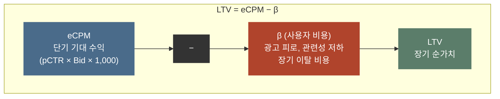
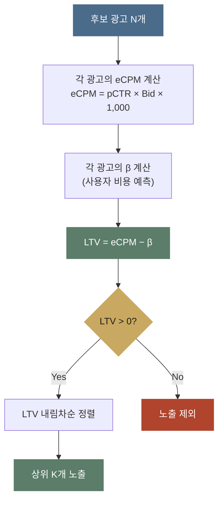
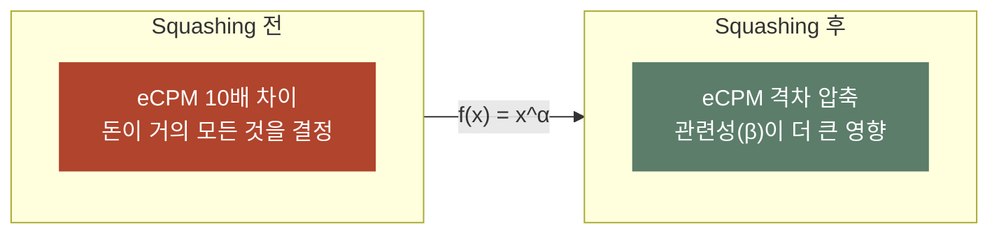

"이 광고를 1등으로 노출하면 당장 100원을 벌 수 있다. 하지만 유저가 짜증을 느끼고 내일 돌아오지 않으면?"

광고 플랫폼은 후보 광고에 순위를 매기는 랭킹으로 광고 자리를 위에서부터 채웁니다. eCPM 은 광고를 1,000번 노출했을 때 기대되는 수익입니다. 이번 노출에서 기대하는 단기 수익이라 유저가 짜증을 느껴 내일 돌아오지 않는 손해는 담지 못하므로 eCPM 순서로만 랭킹을 매기면 이 질문에 답할 수 없습니다. 이 글은 eCPM 에서 한 걸음 더 나아가 광고 노출 1회가 플랫폼에 가져다주는 **장기적 순가치**를 측정하는 LTV(Long Term Value)를 소개합니다. 그리고 큰 광고 플랫폼들이 eCPM 에서 사용자 비용(광고를 보여 줘서 유저가 치르는 부담을 돈으로 환산한 값)을 빼 랭킹을 정하는 까닭을 하나씩 풀어 봅니다.

> 이 글은 [eCPM과 광고 랭킹](post.html?id=ecpm-ranking) 포스트에서 이어지는 글이라 eCPM 을 정의하고 계산하는 법을 그 포스트에서 먼저 읽고 오면 이해하기 쉽습니다.

---

## 1. eCPM 랭킹의 한계

**eCPM 이 높은 순서로만 광고를 정렬하면 플랫폼의 단기 수익은 최대가 되지만 관련성 낮은 광고가 반복해서 노출되므로 광고 피로가 쌓여 플랫폼의 장기 매출이 줄어듭니다.**

[eCPM 포스트](post.html?id=ecpm-ranking)에서 정리한 대로 eCPM 은 **1,000회 노출당 기대 수익**입니다.

$$eCPM = pCTR \times Bid \times 1{,}000$$

식의 pCTR(predicted Click-Through Rate)은 광고를 한 번 보여 줬을 때 클릭이 일어날 확률을 모델이 미리 예측한 값입니다. Bid 는 광고주가 클릭 한 번에 내겠다고 적은 입찰가입니다. 이렇게 클릭이 일어날 때마다 돈을 내는 과금 방식을 CPC(Cost Per Click)라고 부릅니다. pCTR 에 Bid 를 곱하면 노출 한 번의 기대 수익이 나오고 여기에 1,000 을 곱해 노출 1,000번 단위로 바꾼 값이 eCPM 입니다. 후보 광고를 eCPM 이 높은 순서로 정렬하면 노출마다 기대 수익이 가장 큰 광고가 위로 올라가므로 플랫폼의 **단기 수익은 최대**가 됩니다. 그런데 단기 수익이 가장 큰 랭킹인데도 eCPM 하나만으로는 왜 부족할까요?

### 입찰가만 볼 때 생기는 일

검색어 「여행 가방」에 붙는 광고 자리를 eCPM 순서로만 채운다고 해 보겠습니다.

- 위 두 칸은 입찰가가 높은 대출 광고와 다이어트 약 광고가 가져갈 수 있습니다
- 유저가 실제로 찾던 여행용 캐리어 광고는 세 번째 칸 아래로 밀려납니다
- 당장은 대출 광고의 클릭 매출이 오르지만 유저는 이 자리에 뜨는 광고를 아예 보지 않기 시작합니다

플랫폼의 손익도 이 순서를 그대로 따라 움직입니다.

| eCPM만 최적화하면 | 결과 |
|---|---|
| 입찰가 높으면 1등 가능 | 관련성 낮은 광고 반복 노출 |
| 유저 경험 무시 | **Ad Fatigue**(광고 피로) 누적 |
| 클릭률 하락 | 광고주 ROI 악화 → 예산 삭감 |
| 트래픽 이탈 | 플랫폼 장기 매출 감소 |

표는 줄마다 왼쪽 칸에서 오른쪽 칸으로, 위 줄에서 아래 줄로 읽습니다. 표의 Ad Fatigue(광고 피로)는 같은 광고나 관련 없는 광고를 반복해서 볼 때 유저가 느끼는 짜증과 무관심이며 3절에서 다시 다룹니다. 입찰가가 높으면 1등을 할 수 있어 관련성 낮은 광고가 되풀이해 노출되는데, 유저 경험을 무시한 이런 노출이 이어지면 광고 피로가 누적됩니다. 광고 피로가 쌓여 클릭률이 떨어지면 광고주는 광고비 대비 수익인 ROI(Return On Investment)가 나빠져 예산을 줄입니다. 유저가 떠나 트래픽이 빠지면 플랫폼의 장기 매출도 감소합니다.

네 줄을 이어 읽으면 **단기 수익을 최대로 끌어올리는 랭킹이 장기 수익을 줄이는 구조**가 보입니다. 이 문제를 풀려고 나온 개념이 2절의 **LTV** 입니다.

---

## 2. LTV 의 정의

**LTV 는 광고를 노출해 버는 돈(eCPM)에서 그 노출로 잃는 가치(사용자 비용 β)를 뺀 장기적 순가치입니다. β 가 큰 광고는 순위가 내려가고 LTV 가 0 보다 작아진 광고는 아예 노출되지 않습니다.**

1절의 eCPM 랭킹은 유저가 치르는 부담을 점수에 넣지 않았습니다. LTV 는 그 부담을 돈으로 바꿔 eCPM 에서 뺍니다.

LTV 는 광고 노출 1회가 플랫폼에 가져다주는 **장기적 순가치**입니다. 아이디어가 단순해서 식도 뺄셈 하나입니다.

$$LTV = eCPM - \beta$$

- $eCPM$ : 이 광고를 노출해 지금 얻을 것으로 기대하는 **단기 기대 수익**
- $\beta$ (베타) : 같은 노출이 유저에게 지우는 부담을 돈으로 바꾼 **사용자 비용** (user cost, 또는 CPM cost)

### 직관적 해석

식을 말로 옮기면 LTV 는 「이 광고를 보여 주고 **버는 돈(eCPM)**에서 보여 줘서 **잃는 가치(β)**를 빼고 남는 몫」입니다. 아래 그림은 eCPM 에서 β 를 빼 LTV 가 나오는 차례를 보여 줍니다. β 상자에 적힌 광고 피로, 관련성 저하, 장기 이탈 비용이 β 가 돈으로 바꿔 담는 손해입니다.



### β 가 필요한 까닭

β 가 0 이면 식이 LTV = eCPM 이 되어 1절처럼 순수하게 돈만 보는 랭킹으로 돌아갑니다. β 를 식에 넣으면 광고마다 순위가 이렇게 달라집니다.

- 관련성이 낮은 광고는 β 가 커지므로 LTV 가 낮아져 순위가 밀립니다
- 관련성이 높은 광고는 β 가 작아 LTV 가 높게 나오므로 위쪽에 노출됩니다
- LTV 가 0 보다 작은 광고는 유저에게 해롭기만 한 광고로 보고 **아예 노출하지 않습니다**

4절의 숫자 예제에서는 β 가 eCPM 보다 큰 다이어트 약 광고가 셋째 줄에 해당해 노출에서 빠집니다.

β 로 순위를 고치는 이 방식은 eCPM 포스트에서 다룬 닫힌 생태계(Walled Garden, 광고를 사고파는 일과 경매를 플랫폼 한 곳이 모두 맡는 시장)의 **품질 점수**를 수학적으로 일반화한 개념입니다. 품질 점수는 플랫폼이 예측한 클릭률로 광고의 품질을 매겨 입찰가와 함께 순위에 넣는 방식이었습니다. LTV 에서는 품질이 낮은 광고의 β 가 커지므로 그 광고는 높은 입찰가를 써도 LTV 기준에서 밀릴 수 있습니다.

---

## 3. 사용자 비용(β)의 이해

**β 는 광고 노출이 유저에게 지우는 부담을 돈으로 환산한 값이며 유저 의도와 무관한 광고일수록, 같은 광고를 반복해서 보여 줄수록 커집니다. 실무에서는 과거 데이터, A/B 테스트, 유저 피드백 신호, 모델 학습 같은 방법으로 β 를 추정합니다.**

β 는 「이 광고를 보여 줬을 때 유저가 치르는 비용」을 화폐 단위로 환산한 값입니다. 유저가 직접 돈을 내지는 않지만 플랫폼 입장에서는 **장기적으로 잃게 되는 가치**입니다.

### Ad Fatigue 와 Ad Blindness

1절에서 본 광고 피로(Ad Fatigue)가 쌓이면 **Ad Blindness**(광고 무시)로 이어집니다. Ad Blindness 는 유저가 광고 영역 자체를 의식적으로 피하게 되는 현상이라 이 단계에 이른 유저는 그 자리에 오는 광고를 아예 보지 않습니다.

### β 에 영향을 주는 요소

β 의 크기를 바꾸는 요소 다섯 가지를 β 가 커지는 경우와 작아지는 경우로 나눠 보면 다음과 같습니다.

| 요소 | β가 커지는 경우 | β가 작아지는 경우 |
|------|----------------|------------------|
| **관련성** | 유저 의도와 무관한 광고 | 검색어/관심사와 정확히 매칭 |
| **빈도** | 같은 광고 반복 노출 (frequency capping 없음) | 적절한 빈도 제어 |
| **품질** | 저품질 소재, 미스리딩 제목 | 깔끔한 소재, 명확한 CTA |
| **침투성** | 전면 팝업, 자동 재생 영상 | 네이티브 광고, 자연스러운 배치 |
| **유저 맥락** | 긴급한 정보 탐색 중 광고 삽입 | 쇼핑/탐색 의도가 있는 맥락 |

표의 frequency capping 은 한 유저에게 같은 광고를 보여 주는 횟수에 상한을 두는 일입니다. CTA(Call To Action)는 「지금 구매」처럼 유저에게 다음 행동을 권하는 문구입니다. 네이티브 광고는 주변 콘텐츠와 같은 모양으로 섞여 보이는 광고를, 미스리딩 제목은 광고의 실제 내용과 다르게 읽히도록 쓴 제목을 말합니다. 침투성은 광고가 유저가 보던 화면에 얼마나 끼어드는지를 뜻합니다.

### 같은 자리, 다른 β

같은 광고 자리라도 어떤 광고가 놓이느냐에 따라 β 가 달라집니다. 검색어 「여행 가방」의 결과 맨 위 광고 한 칸으로 비교해 보겠습니다.

- **β 가 작은 경우**: 이 칸에 여행용 캐리어 광고가 들어갑니다. 유저가 찾던 상품에 가까워 광고가 검색 결과의 일부처럼 읽힙니다
- **β 가 큰 경우**: 이 칸에 관련 없는 보험 광고가 들어갑니다. 유저는 처음에는 이 칸을 건너뛰다가 다음에는 광고 영역 자체를 보지 않습니다

β 는 보험 광고 같은 광고가 유저에게 주는 이런 부담을 **돈으로 환산한 값**입니다. 추정하는 방식을 예로 들면, 이 광고 때문에 유저 한 명이 이탈할 확률에 그 유저가 남았다면 앞으로의 방문에서 나왔을 수익을 곱합니다.

### β 의 추정 방법 (일반론)

실무에서 β 를 추정하는 대표적인 접근법은 네 가지입니다.

1. **과거 데이터 기반**: 광고를 노출한 뒤 유저의 이탈률과 재방문 주기가 어떻게 바뀌었는지 측정합니다
2. **A/B 테스트**: 유저를 나눠 광고를 보여 준 그룹과 보여 주지 않은 그룹의 장기 행동을 비교합니다
3. **유저 피드백 신호**: 유저가 「광고 숨기기」나 「관련 없음」을 누른 비율을 β 의 proxy(직접 측정하기 어려운 값 대신 쓰는 지표)로 씁니다
4. **모델 학습**: 유저, 광고, 맥락의 피처(모델에 넣는 입력값)를 받아 β 를 예측하는 ML 모델을 만듭니다

아래 데모에서는 반복 노출로 유저의 반응이 식는 속도와 「적정 빈도」를 넘기 시작하는 노출 횟수를 슬라이더로 바꿔 가며 β 를 직접 실험해 볼 수 있습니다.

<div class="demo-embed-wrap">
<iframe class="demo-embed" src="demo-frequency-capping.html?embed=1" height="560" loading="lazy" title="광고 피로와 최적 빈도 상한 미니 데모"></iframe>
<a class="demo-embed-open" href="demo-frequency-capping.html" target="_blank" rel="noopener">↗ 전체 데모로 열기</a>
</div>

---

## 4. LTV 기반 랭킹이 동작하는 방식

**LTV 기반 랭킹은 후보 광고마다 eCPM 과 β 를 구해 LTV 를 계산한 뒤 LTV 가 0 보다 큰 광고만 LTV 가 높은 순서로 정렬해 위에서부터 노출합니다. 「여행 가방」 예제에서는 eCPM 이 15,000원인 다이어트 약 광고가 β 20,000원 때문에 LTV 가 음수가 되어 노출에서 빠집니다.**

검색어 「여행 가방」에 광고 3개가 들어왔을 때 2절의 식이 순위를 실제로 어떻게 바꾸는지 보려면 먼저 랭킹이 거치는 순서를 알아야 합니다. 후보 광고 N개마다 pCTR × Bid × 1,000 으로 eCPM 을 계산하고 사용자 비용 β 를 예측한 다음, eCPM 에서 β 를 빼 LTV 를 구합니다. LTV 가 0 보다 큰 광고는 LTV 가 높은 순서로 정렬하고 0 이하인 광고는 노출에서 제외한 뒤, 정렬된 광고 가운데 위에서부터 K개(보여 줄 광고 수)를 노출합니다.



### 숫자 예제: 세 광고의 경쟁

검색어 「여행 가방」을 두고 명품 가방 광고 A, 여행용 캐리어 광고 B, 다이어트 약 광고 C 가 경쟁합니다.

| 항목 | 광고 A (명품 가방) | 광고 B (여행용 캐리어) | 광고 C (다이어트 약) |
|------|------------------|---------------------|-------------------|
| Bid (CPC) | 3,000원 | 1,500원 | 5,000원 |
| pCTR | 2% | 5% | 0.3% |
| **eCPM** | $0.02 \times 3{,}000 \times 1{,}000 = $ **60,000원** | $0.05 \times 1{,}500 \times 1{,}000 = $ **75,000원** | $0.003 \times 5{,}000 \times 1{,}000 = $ **15,000원** |
| β (사용자 비용) | 25,000원 | 5,000원 | 20,000원 |
| **LTV** | 60,000 − 25,000 = **35,000원** | 75,000 − 5,000 = **70,000원** | 15,000 − 20,000 = **−5,000원** |
| **결과** | 2위 | **1위** | **노출 제외** |

광고 A 로 표의 계산을 한 번 따라가 보면 pCTR 2% 는 0.02 이므로 eCPM 은 0.02 × 3,000 × 1,000 = 60,000원이고 여기서 β 25,000원을 빼면 LTV 는 35,000원입니다.

표에서 볼 점은 세 가지입니다.

1. **eCPM 만으로 순위를 매기면 광고 B(75,000)가 1위, 광고 A(60,000)가 2위, 광고 C(15,000)가 3위**입니다. LTV 로 매겨도 1위와 2위의 순서는 같지만 3위였던 광고 C 는 LTV 가 음수라 **아예 노출되지 않습니다**.
2. 광고 C 는 eCPM 이 15,000원으로 양수라서 eCPM 랭킹에서는 노출됩니다. 하지만 「여행 가방」을 검색한 유저에게 다이어트 약 광고는 관련성이 없어 β 가 eCPM 보다 큰 20,000원으로 높게 잡히므로 **LTV < 0**, 다시 말해 「보여 주면 손해」인 광고가 됩니다.
3. 광고 B(여행용 캐리어)는 입찰가가 1,500원으로 세 광고 가운데 가장 낮지만 **검색 의도와 정확히 맞아** β 가 5,000원으로 작고 pCTR 도 5% 로 높아서 LTV 1위를 차지합니다.

아래 코드는 표의 계산을 그대로 돌려 LTV 가 음수인 광고를 빼고 남은 광고의 순위가 표와 같은지 확인합니다.

```python
# 하는 일: 검색어 「여행 가방」에 나온 광고 셋의 eCPM 에서 사용자 비용 β 를 빼 LTV 를 구하고, LTV 가 음수인 광고는 빼고 순위를 정한다.
# 1단계: LTV 를 구하는 함수를 만든다
# LTV 는 eCPM 에서 그 노출이 사용자에게 지우는 비용 β 를 뺀 값이다.
def compute_ltv(pCTR, bid, beta):
    """LTV = eCPM - β"""
    ecpm = pCTR * bid * 1000
    ltv = ecpm - beta
    return ecpm, ltv

# 2단계: 광고 셋을 둔다
# 광고마다 pCTR, 입찰가, 사용자 비용 β 를 담는다.
ads = [
    {"name": "광고A(명품 가방)",   "pCTR": 0.02, "bid": 3000, "beta": 25000},
    {"name": "광고B(여행용 캐리어)", "pCTR": 0.05, "bid": 1500, "beta": 5000},
    {"name": "광고C(다이어트 약)",  "pCTR": 0.003, "bid": 5000, "beta": 20000},
]

# 3단계: 광고마다 LTV 를 구하고 순위를 찍는다
# LTV 가 음수인 광고는 노출에서 뺀다.
print("  검색어: '여행 가방'\n")
ranked = []
for ad in ads:
    ecpm, ltv = compute_ltv(ad["pCTR"], ad["bid"], ad["beta"])
    status = "노출" if ltv > 0 else "제외 (LTV < 0)"
    print(f"  {ad['name']}: eCPM={ecpm:,.0f}원, β={ad['beta']:,.0f}원, "
          f"LTV={ltv:,.0f}원 → {status}")
    if ltv > 0:
        ranked.append((ad["name"], ltv))

ranked.sort(key=lambda x: -x[1])
print(f"\n  최종 랭킹:")
for i, (name, ltv) in enumerate(ranked, 1):
    print(f"    {i}위: {name} (LTV {ltv:,.0f}원)")

# 출력:
# 3단계 뜻: eCPM 만 보면 A 의 60,000원이 C 의 15,000원보다 훨씬 앞이고 셋 다 노출 후보다. 사용자 비용 β 를 빼면 C 는 LTV 가 -5,000원으로 음수가 되어 빠지고, B 가 70,000원으로 1위다. 지금 버는 돈과 함께 그 노출이 사용자를 얼마나 지치게 하는지가 순위를 정한다.
#   검색어: '여행 가방'
#
#   광고A(명품 가방): eCPM=60,000원, β=25,000원, LTV=35,000원 → 노출
#   광고B(여행용 캐리어): eCPM=75,000원, β=5,000원, LTV=70,000원 → 노출
#   광고C(다이어트 약): eCPM=15,000원, β=20,000원, LTV=-5,000원 → 제외 (LTV < 0)
#
#   최종 랭킹:
#     1위: 광고B(여행용 캐리어) (LTV 70,000원)
#     2위: 광고A(명품 가방) (LTV 35,000원)
```

찍힌 줄을 보면 광고 C 만 `LTV=-5,000원` 으로 음수라 「제외 (LTV < 0)」가 붙습니다. 최종 랭킹에는 LTV 70,000원인 광고 B 와 35,000원인 광고 A 만 1위와 2위로 남아 표와 같은 결과가 나옵니다. eCPM 만 볼 때는 세 광고 모두 노출 후보였지만 β 를 빼자 광고 C 가 후보에서 빠졌습니다.

---

## 5. 단기 eCPM 과 90일 LTV — 순위가 뒤집히는 경우

**단기 eCPM 으로 1위인 광고가 손님이 90일 동안 남길 가치(90일 LTV)를 기준으로 하면 4위로 밀릴 수 있습니다. 클릭은 잘 되지만 다시 사지 않는 손님을 데려오는 광고와 클릭은 적어도 계속 사는 손님을 데려오는 광고의 차이입니다.**

반값 특가 광고를 누른 손님은 오늘 확실히 사지만 그 손님 대부분은 다음 달에 정가로 같은 상품을 다시 사지 않습니다. 반대로 정기배송 광고는 오늘 클릭이 하나 적더라도 한 번 시작한 손님이 석 달 동안 매달 결제합니다.

2절의 LTV 는 eCPM 에서 **「이 광고를 보여 주는 비용(β)」을 뺀 값**이었습니다. 이 절의 90일 LTV 는 손님 한 명이 90일 동안 남기는 가치(고객 Lifetime Value)로 2절의 LTV(Long Term Value)와 다른 값입니다. 이번에는 다른 면인 **「이 클릭으로 들어온 손님이 앞으로 얼마나 오래, 얼마나 자주 다시 사는가」**, 다시 말해 가치 자체의 크기를 봅니다. β 를 빼는 방향이 아니라 입찰가 자리에 미래 가치를 넣는 방향입니다.

미래 가치를 반영하려면 eCPM 공식에서 한 곳만 고치면 됩니다. 1절의 eCPM 은 `pCTR × 입찰가 × 1,000` 이었는데, 여기서 **입찰가(이번 한 번의 즉시 가치) 대신 「이 손님이 앞으로 90일간 남길 총가치」를 넣습니다.**

$$\text{LTV 기준 점수} = pCTR \times (\text{90일 고객 LTV}) \times 1{,}000$$

이 점수는 클릭 하나가 장기적으로 얼마짜리 손님을 남기는지를 측정합니다. pCTR 은 그대로 두고 곱해지는 가치 항목만 입찰가에서 90일 고객 LTV 로 바꿨으므로 클릭이 잘 나는 광고라도 남기는 손님의 가치가 작으면 점수가 낮게 나옵니다.

광고 5개를 놓고 두 점수를 직접 비교해 보겠습니다. 표의 단기 eCPM 은 pCTR × 입찰가 × 1,000 이고 LTV 순위는 pCTR × 90일 LTV × 1,000 인 LTV 기준 점수가 높은 순서입니다. 예상 재구매율은 처음 산 손님이 90일 안에 다시 살 것으로 예상하는 비율입니다.

| 광고 | 입찰가(CPC) | pCTR | 단기 eCPM | 단기 순위 | 예상 재구매율(90일) | 90일 LTV | LTV 순위 |
|---|---|---|---|---|---|---|---|
| 반값특가 무선이어폰 | 1,500원 | 8.0% | 120,000원 | **1위** | 5% | 25,000원 | 4위 |
| 미스터리박스 반짝특가 | 1,100원 | 6.0% | 66,000원 | 2위 | 8% | 30,000원 | 5위 |
| 브랜드 비타민 3개월분 | 1,000원 | 4.0% | 40,000원 | 3위 | 50% | 52,000원 | 3위 |
| 유아용 기저귀 정기배송 | 700원 | 3.5% | 24,500원 | 4위 | 60% | 180,000원 | **1위** |
| 원두커피 정기구독 | 800원 | 3.0% | 24,000원 | 5위 | 55% | 150,000원 | 2위 |

1행 무선이어폰은 단기 eCPM 이 0.080 × 1,500 × 1,000 = 120,000원이고 입찰가 자리에 90일 LTV 25,000원을 넣은 LTV 기준 점수는 0.080 × 25,000 × 1,000 = 2,000,000 입니다. 4행 기저귀 정기배송은 단기 eCPM 이 0.035 × 700 × 1,000 = 24,500원에 그치지만 LTV 기준 점수는 0.035 × 180,000 × 1,000 = 6,300,000 으로 광고 5개 가운데 가장 큽니다.

1행과 4행을 나란히 놓으면 차이가 분명합니다. 반값특가 무선이어폰은 입찰가도 높고 클릭도 잘 되어 단기 eCPM 으로 1위지만 재구매율이 5% 뿐이라 이 손님은 대개 이번 한 번으로 끝나므로 **LTV 순위로는 4위로 내려갑니다.** 반대로 기저귀 정기배송은 입찰가도 클릭률도 낮아 단기 eCPM 이 4위지만 재구매율이 60% 이고 한 번 자리 잡은 손님이 석 달 동안 여러 번 결제하므로 **LTV 순위로는 1위로 올라옵니다.**

아래 코드는 광고 5개의 단기 eCPM 순위와 LTV 기준 점수 순위를 각각 계산해 표와 같은지, 그리고 광고마다 순위가 몇 계단 움직이는지 찍습니다.

```python
# 하는 일: 광고 5개의 단기 eCPM 순위와 90일 LTV 순위를 각각 계산해 비교한다.
# 1단계: 광고 5개를 둔다
# 표준 라이브러리만 쓰니 그대로 복붙해 돌려 볼 수 있다.
ads = [
    # 광고명, 입찰가(CPC,원), pCTR, 예상 재구매율(90일), 90일 LTV(원)
    {"name": "반값특가 무선이어폰",   "bid": 1500, "pctr": 0.080, "repurchase": 0.05, "ltv90": 25_000},
    {"name": "미스터리박스 반짝특가", "bid": 1100, "pctr": 0.060, "repurchase": 0.08, "ltv90": 30_000},
    {"name": "브랜드 비타민 3개월분", "bid": 1000, "pctr": 0.040, "repurchase": 0.50, "ltv90": 52_000},
    {"name": "유아용 기저귀 정기배송", "bid": 700,  "pctr": 0.035, "repurchase": 0.60, "ltv90": 180_000},
    {"name": "원두커피 정기구독",     "bid": 800,  "pctr": 0.030, "repurchase": 0.55, "ltv90": 150_000},
]

# 2단계: 단기 점수와 장기 점수를 구한다
# 단기 eCPM 은 이번 클릭이 지금 버는 돈이고, LTV 점수는 이번 클릭이 남기는 손님의 90일 가치다.
for ad in ads:
    ad["ecpm"] = ad["pctr"] * ad["bid"] * 1000         # 단기: 이번 클릭이 지금 버는 돈
    ad["ltv_score"] = ad["pctr"] * ad["ltv90"] * 1000  # 장기: 이번 클릭이 남기는 손님의 90일 가치

def rank_by(key):                                       # 점수 내림차순으로 순위 매기기
    ordered = sorted(ads, key=lambda a: -a[key])
    return {a["name"]: i + 1 for i, a in enumerate(ordered)}

ecpm_rank = rank_by("ecpm")
ltv_rank = rank_by("ltv_score")

# 3단계: 두 순위를 나란히 찍는다
# 단기 eCPM 순위대로 정렬하고 LTV 순위와 변동을 함께 찍는다.
print(f"{'광고':<22}{'단기eCPM':>10}{'eCPM순위':>9}{'LTV점수':>13}{'LTV순위':>8}  변동")
for ad in sorted(ads, key=lambda a: ecpm_rank[a["name"]]):
    name = ad["name"]
    delta = ecpm_rank[name] - ltv_rank[name]            # 양수면 LTV로 보면 순위가 올라간 것
    mark = f"{delta:+d}" if delta else "-"
    print(f"{name:<22}{ad['ecpm']:>9,.0f}원{ecpm_rank[name]:>7}위{ad['ltv_score']:>12,.0f}{ltv_rank[name]:>7}위  {mark}")

# 출력:
# 3단계 뜻: 단기 eCPM 1, 2위인 무선이어폰과 미스터리박스는 LTV 로 보면 4, 5위로 내려가고, 4, 5위였던 기저귀 정기배송과 원두커피 정기구독이 1, 2위로 올라온다. 비타민만 3위 그대로다.
# 광고                        단기eCPM   eCPM순위        LTV점수   LTV순위  변동
# 반값특가 무선이어폰              120,000원      1위   2,000,000      4위  -3
# 미스터리박스 반짝특가              66,000원      2위   1,800,000      5위  -3
# 브랜드 비타민 3개월분             40,000원      3위   2,080,000      3위  -
# 유아용 기저귀 정기배송             24,500원      4위   6,300,000      1위  +3
# 원두커피 정기구독                24,000원      5위   4,500,000      2위  +3
```

찍힌 표의 LTV점수 칸이 LTV 기준 점수입니다. 변동 칸을 보면 eCPM 1위였던 무선이어폰과 2위였던 미스터리박스가 둘 다 `-3` 으로 LTV 4위와 5위까지 3계단씩 떨어집니다. 두 광고는 재구매율이 5% 와 8% 로 바닥이라는 공통점이 있습니다. 반대로 재구매율이 55~60% 인 기저귀와 커피는 `+3` 으로 3계단씩 뛰어올라 1위와 2위가 됩니다. 비타민만 3위 그대로입니다. **순위를 뒤집는 변수는 입찰가 자리에 들어간 90일 LTV 입니다.**

그런데 광고를 노출하는 순간에는 그 손님이 90일 뒤에 다시 살지 아직 아무도 모르는데, 표의 90일 LTV 는 지금 당장 어떻게 알 수 있을까요?

:::deep 더 깊이 — 90일을 기다릴 수 없어 초기 신호로 LTV 를 예측하는 문제
90일 LTV 를 정말로 확인하려면 90일을 기다려야 합니다. 그런데 광고 랭킹은 지금 당장 매겨야 하는 데다 90일 뒤에는 그 광고 예산을 이미 다 써 버린 뒤라서 기다렸다가 정답을 넣는 방법은 처음부터 쓸 수 없습니다.

그래서 실무에서는 가입이나 구매 뒤 7일 동안의 행동을 피처로 삼아 **초기 신호로 미래 가치를 미리 추정하는 모델**을 씁니다. 피처는 첫 구매액, 재방문 횟수, 앱 세션 길이, 장바구니에 남긴 항목 수 같은 신호입니다. 모델은 이 피처를 받아 「이 사람의 90일 LTV 는 대략 얼마」라고 미리 예측하는데, 이런 모델을 흔히 **pLTV(predicted LTV)**라고 부릅니다.

다만 7일치 신호만으로 90일 뒤를 맞히기는 쉽지 않습니다. 반값특가 이어폰을 산 손님도 첫 7일 동안 앱을 켜 보고 리뷰를 읽는 행동은 정기구독을 시작한 손님과 크게 다르지 않을 수 있습니다. 두 손님의 진짜 차이인 재구매 여부는 한참 뒤에야 나타납니다.

이 예측 오차는 랭킹으로 그대로 이어집니다. 아래 코드는 위 표의 실제 90일 LTV 에 노이즈(무작위 오차)를 섞어 7일 신호로 만든 예측치처럼 흉내 낸 뒤, 그 예측치로 매긴 순위가 실제 순위와 얼마나 다른지 봅니다. 예측 LTV 는 실제 LTV 에 (1 + 노이즈)를 곱한 값입니다. 노이즈는 평균 0, 표준편차(값이 평균에서 흩어진 정도) 0.35 인 무작위 값입니다. 7일 신호만으로 90일 값을 맞히는 모델이라면 이 정도 오차도 낙관적입니다. 순위는 5절 본문과 같이 pCTR 에 LTV 를 곱한 점수로 매깁니다. `random.seed(6)` 으로 seed(난수의 시작값)를 고정했으므로 누가 돌려도 같은 값이 찍힙니다.

```python
# 하는 일: 7일 초기 신호로 90일 LTV 를 예측한다고 놓고, 그 예측 오차가 광고 5개의 순위를 얼마나 흔드는지 본다.
# 1단계: 광고 5개와 예측 오차를 둔다
# 표준 라이브러리만 쓰고, 노이즈는 seed 를 고정해 누가 돌려도 같게 만든다.
import random
random.seed(6)

ads = [
    {"name": "반값특가 무선이어폰",   "pctr": 0.080, "ltv90_true": 25_000},
    {"name": "미스터리박스 반짝특가", "pctr": 0.060, "ltv90_true": 30_000},
    {"name": "브랜드 비타민 3개월분", "pctr": 0.040, "ltv90_true": 52_000},
    {"name": "유아용 기저귀 정기배송", "pctr": 0.035, "ltv90_true": 180_000},
    {"name": "원두커피 정기구독",     "pctr": 0.030, "ltv90_true": 150_000},
]
NOISE = 0.35   # 7일 신호만으로 90일 값을 맞히는 모델의 예측 오차(표준편차 비율). 이 정도도 낙관적이다.

# 2단계: 실제 점수와 예측 점수로 순위를 매긴다
# 예측 LTV 는 실제 LTV 에 (1 + 노이즈)를 곱한 값이고, 노이즈는 평균 0, 표준편차 0.35 다.
# 순위는 LTV 가 아니라 pCTR 에 LTV 를 곱한 점수로 매긴다.
def rank_by(data, key):
    ordered = sorted(data, key=lambda a: -a[key])
    return {a["name"]: i + 1 for i, a in enumerate(ordered)}

for ad in ads:
    ad["score_true"] = ad["pctr"] * ad["ltv90_true"] * 1000
    predicted = max(ad["ltv90_true"] * (1 + random.gauss(0, NOISE)), 0)  # 예측이 음수일 순 없다
    ad["ltv90_pred"] = predicted
    ad["score_pred"] = ad["pctr"] * predicted * 1000

true_rank = rank_by(ads, "score_true")
pred_rank = rank_by(ads, "score_pred")

# 3단계: 두 순위를 비교해 찍는다
# 예측 순위가 실제와 다르면 표시한다.
print(f"{'광고':<22}{'실제 LTV':>11}{'예측 LTV':>11}{'실제순위':>8}{'예측순위':>8}")
for ad in sorted(ads, key=lambda a: true_rank[a["name"]]):
    name = ad["name"]
    flag = "  <- 순위 오류" if pred_rank[name] != true_rank[name] else ""
    print(f"{name:<22}{ad['ltv90_true']:>10,.0f}{ad['ltv90_pred']:>11,.0f}{true_rank[name]:>7}위{pred_rank[name]:>7}위{flag}")

# 출력:
# 3단계 뜻: 실제 순위로는 기저귀가 1위지만, 예측이 원두커피의 LTV 를 227,413 으로 과대 추정해 1위와 2위가 뒤집힌다. 광고 5개 가운데 4개의 순위가 틀린다.
# 광고                         실제 LTV     예측 LTV    실제순위    예측순위
# 유아용 기저귀 정기배송             180,000    184,607      1위      2위  <- 순위 오류
# 원두커피 정기구독                150,000    227,413      2위      1위  <- 순위 오류
# 브랜드 비타민 3개월분              52,000     37,888      3위      4위  <- 순위 오류
# 반값특가 무선이어폰                25,000     29,372      4위      3위  <- 순위 오류
# 미스터리박스 반짝특가               30,000     11,212      5위      5위
```

찍힌 표에서 「<- 순위 오류」가 붙은 줄은 5개 가운데 4개입니다. 노이즈 하나를 섞었을 뿐인데 미스터리박스를 뺀 네 광고의 순위가 모두 실제와 달라졌습니다. 맨 위에서는 예측이 원두커피의 LTV 를 실제 150,000 보다 훨씬 큰 227,413 으로 잡는 바람에 실제 1위인 기저귀(예측 184,607)와 2위인 원두커피의 자리가 뒤집혔습니다.

특히 눈여겨볼 줄은 반값특가 이어폰입니다. 실제로는 4위인데 예측 모델이 이어폰을 실제 25,000 보다 높은 29,372 로, 비타민을 실제 52,000 보다 낮은 37,888 로 잡아 3위처럼 보입니다. 이어폰처럼 클릭은 많이 끌지만 다시 사는 손님이 드문 광고를 미끼 광고라고 부르겠습니다. **재구매하지 않는 손님을 재구매할 것처럼 잘못 예측하면 미끼 광고가 LTV 랭킹에서 다시 위로 올라옵니다.** 예측이 랭킹을 좌우하는 한 예측이 틀리는 방향대로 랭킹도 함께 틀어집니다.

[pCVR 모델링](post.html?id=pcvr-modeling) 글의 「지연 전환」 절은 클릭한 사람이 구매 같은 행동까지 하는 전환이 늦게 들어오는 문제를 다뤘습니다. 오늘 모델을 학습해야 하는데 어제 클릭한 사람 가운데 나중에 살 사람의 라벨(정답)이 아직 도착하지 않은 상황입니다. 지금 랭킹을 매겨야 하는데 진짜 결과인 90일 뒤 재구매 여부가 아직 오지 않은 이 글의 문제도 뼈대가 같습니다. 다른 점은 기다려야 하는 길이인데, 전환은 길어야 며칠에서 몇 주면 대부분 들어오지만 LTV 는 기다리는 기간이 90일로 훨씬 깁니다.
:::

예측 오차 말고도 랭킹을 흔드는 변수가 하나 더 있습니다. 90일 LTV 를 정확히 예측했다고 해도 그 미래 값을 **지금 당장 얼마로 쳐줄지**는 따로 내려야 하는 정책 결정입니다.

돈은 은행 이자와 같은 이유로 지금 받는 편이 나중에 받는 것보다 낫습니다. 그래서 금융에서는 표준 관행대로 미래에 들어올 돈을 할인율(미래의 돈을 지금 가치로 바꿀 때 기간마다 깎는 비율)만큼 깎아 **현재가치(PV, Present Value)**로 환산합니다. 90일 LTV 가운데 **이미 확정된 최초 구매분**은 깎을 필요가 없지만 **아직 오지 않은 재구매분**은 할인 대상입니다.

아래 코드는 90일 LTV 를 최초 구매분과 재구매분으로 나눈 뒤 재구매분만 할인해 세 번째 순위를 만듭니다. 코드는 90일 LTV 에 재구매율을 곱한 값을 재구매분으로, 나머지를 최초 구매분으로 봅니다. 재구매분은 대략 3개월 뒤에 들어온다고 가정해 월 5% 로 세 번 할인하므로 재구매분에 곱하는 값 `discount` 는 $1 / (1 + 0.05)^3 \approx 0.864$ 입니다.

```python
# 하는 일: 90일 LTV 를 이미 확정된 최초 구매분과 아직 안 온 재구매분으로 나누고, 재구매분만 현재가치(PV)로 할인해 세 번째 순위를 만든다.
# 1단계: 광고 5개를 둔다
# 앞 표와 같은 광고 5개다.
ads = [
    {"name": "반값특가 무선이어폰",   "pctr": 0.080, "repurchase": 0.05, "ltv90": 25_000},
    {"name": "미스터리박스 반짝특가", "pctr": 0.060, "repurchase": 0.08, "ltv90": 30_000},
    {"name": "브랜드 비타민 3개월분", "pctr": 0.040, "repurchase": 0.50, "ltv90": 52_000},
    {"name": "유아용 기저귀 정기배송", "pctr": 0.035, "repurchase": 0.60, "ltv90": 180_000},
    {"name": "원두커피 정기구독",     "pctr": 0.030, "repurchase": 0.55, "ltv90": 150_000},
]

# 2단계: 할인율을 정한다
# 재구매분은 대략 3개월 뒤에 들어오니 월 5% 로 세 번 할인한다.
MONTHLY_RATE = 0.05   # 월 5% -- "미래 가치를 얼마나 믿는가"를 나타내는 값
MONTHS_OUT = 3        # 재구매분은 대략 90일(3개월) 시점에 들어온다고 가정
discount = 1 / (1 + MONTHLY_RATE) ** MONTHS_OUT   # ≈ 0.864

def rank_by(data, key):
    ordered = sorted(data, key=lambda a: -a[key])
    return {a["name"]: i + 1 for i, a in enumerate(ordered)}

# 3단계: 할인 전과 후의 점수로 순위를 매긴다
# 최초 구매분은 이미 확정이라 그대로 두고, 재구매분만 할인한다.
for ad in ads:
    ad["ltv_score"] = ad["pctr"] * ad["ltv90"] * 1000             # 할인 전(위 표의 LTV 점수와 동일)
    immediate = ad["ltv90"] * (1 - ad["repurchase"])              # 최초 구매분 -- 이미 확정, 할인 없음
    future = ad["ltv90"] * ad["repurchase"]                       # 재구매분 -- 아직 안 왔으니 할인 대상
    ad["ltv90_pv"] = immediate + future * discount
    ad["ltv_score_pv"] = ad["pctr"] * ad["ltv90_pv"] * 1000       # 할인 후

before_rank = rank_by(ads, "ltv_score")
after_rank = rank_by(ads, "ltv_score_pv")

# 4단계: 두 순위를 찍는다
print(f"{'광고':<22}{'LTV순위(할인전)':>16}{'LTV순위(할인후)':>16}")
for ad in sorted(ads, key=lambda a: before_rank[a["name"]]):
    name = ad["name"]
    flag = "  <- 순위 변동" if after_rank[name] != before_rank[name] else ""
    print(f"{name:<22}{before_rank[name]:>15}위{after_rank[name]:>15}위{flag}")

# 출력:
# 4단계 뜻: 할인하면 비타민이 3위에서 4위로, 무선이어폰이 4위에서 3위로 자리를 바꾼다. 1, 2위와 5위는 그대로다.
# 광고                          LTV순위(할인전)      LTV순위(할인후)
# 유아용 기저귀 정기배송                        1위              1위
# 원두커피 정기구독                           2위              2위
# 브랜드 비타민 3개월분                        3위              4위  <- 순위 변동
# 반값특가 무선이어폰                          4위              3위  <- 순위 변동
# 미스터리박스 반짝특가                         5위              5위
```

찍힌 결과에서는 할인 전 3위였던 비타민이 4위로, 4위였던 무선이어폰이 3위로 자리를 바꿉니다. 비타민은 재구매율이 50% 라 가치의 절반이 아직 오지 않은 미래 몫이어서 할인으로 크게 깎이지만 이어폰은 재구매율이 5% 라 가치의 95% 가 이미 확정된 최초 구매분이므로 깎일 몫이 거의 없습니다. **미래 몫이 많이 남은 광고일수록 할인율에 더 민감합니다.**

1, 2위인 기저귀와 커피는 순위가 그대로입니다. 두 광고는 LTV 기준 점수가 6,300,000 과 4,500,000 으로 3위 비타민의 2,080,000 과 처음부터 격차가 워낙 커서 월 5% 할인 정도로는 흔들리지 않습니다. 하지만 「이 예측을 반도 못 믿겠다」처럼 보수적으로 잡아 할인율을 더 올리면 격차가 작은 3위 아래는 더 흔들릴 수 있습니다. **결국 할인율은 「이 미래 값을 얼마나 믿을 것인가」를 숫자 하나로 나타낸 정책 값입니다.** 이 값을 어디에 두느냐에 따라 광고 5개의 순서는 단기 eCPM 순위, LTV 순위에 이어 세 번째로 다시 섞입니다.

---

## 6. 입찰가 격차를 압축하는 Squashing

**입찰가 차이가 지나치게 크면 관련성이 아무리 좋아 β 가 작아도 돈의 힘을 이기지 못하므로 eCPM 에 오목 함수(값이 클수록 증가분을 줄이는 함수)를 적용해 입찰가 격차를 압축합니다. 이 방법을 Squashing 이라고 부릅니다.**

LTV 공식에는 한 가지 더 생각할 점이 있습니다. 2절의 LTV 는 eCPM 에서 β 를 빼는 식이라 eCPM 부분에서 **입찰가 차이가 지나치게 크면** β 의 차이로는 그 격차를 메울 수 없습니다.

### 문제: 돈이 품질을 압도하는 경우

대기업 A 와 스타트업 B 의 광고가 맞붙은 예로 보겠습니다.

| 광고 | Bid | pCTR | eCPM | β | LTV |
|------|-----|------|------|---|-----|
| 대기업 A | 50,000원 | 1% | 500,000원 | 100,000원 | 400,000원 |
| 스타트업 B | 500원 | 10% | 50,000원 | 5,000원 | 45,000원 |

대기업 A 는 pCTR 이 1% 뿐이지만 입찰가가 50,000원이라 eCPM 이 500,000원이고 여기서 β 100,000원을 빼도 LTV 가 400,000원입니다. 스타트업 B 는 pCTR 이 10% 로 높지만 입찰가가 500원이라 eCPM 이 50,000원이고 β 5,000원을 빼면 LTV 는 45,000원입니다.

대기업 A 는 관련성이 낮아 β 가 10만원이나 되지만 입찰가가 100배 높아서 LTV 에서도 B 를 압도합니다. 유저에게는 스타트업 B 의 광고가 훨씬 유용한데도 순위는 A 가 위입니다.

### Squashing Function 의 도입

이 문제를 풀려고 eCPM 에 **오목 함수(concave function)**를 적용합니다. 오목 함수는 입력이 커질수록 같은 양을 늘려도 출력이 덜 늘어나는 함수입니다.

$$LTV = f(eCPM) - \beta$$

식의 $f$ 가 오목 함수입니다. 대표적인 형태는 지수 $\alpha$ 가 0 과 1 사이인 거듭제곱입니다.

$$f(x) = x^{\alpha}, \quad 0 < \alpha < 1$$

$\alpha = 0.5$ 로 두면 $x^{0.5}$ 는 제곱근이므로 LTV 는 eCPM 의 제곱근에서 β 를 뺀 값이 됩니다.

$$LTV = \sqrt{eCPM} - \beta$$

### Squashing 의 효과

앞의 두 광고에 $\alpha = 0.5$ 를 적용하면 다음과 같습니다.

| 광고 | eCPM | $\sqrt{eCPM}$ | β | LTV (Squashed) |
|------|------|--------------|---|-----------------|
| 대기업 A | 500,000원 | 707 | 100,000원 | **−99,293** |
| 스타트업 B | 50,000원 | 224 | 5,000원 | **−4,776** |

대기업 A 는 eCPM 500,000원의 제곱근이 707 이라 여기서 β 100,000원을 빼면 −99,293 입니다. 스타트업 B 는 eCPM 50,000원의 제곱근 224 에서 β 5,000원을 빼 −4,776 입니다.

이 예제에서는 squashing 을 극단적으로 적용해 두 광고 모두 LTV 가 음수가 되었습니다. 실제로는 $\alpha$ 와 β 의 스케일을 조정해 균형을 맞춥니다. 그래도 이 예제에서 눈여겨볼 변화는 **입찰가 격차의 압축**입니다.

- Squashing 전에는 eCPM 비율이 500,000 / 50,000 = **10배**
- Squashing 후에는 $\sqrt{eCPM}$ 비율이 707 / 224 ≈ **3.2배**

10배였던 eCPM 차이가 3.2배로 압축되므로 β(관련성)가 랭킹에 미치는 영향이 상대적으로 커집니다. 아래 그림은 같은 변화를 Squashing 전과 후로 나눠 보여 줍니다.



### 오목 함수를 쓰는 까닭

오목 함수에는 **이미 큰 값이 더 커질 때 그 증가분을 줄이는** 성질이 있습니다. 제곱근으로 계산해 보면 입력이 작을 때와 클 때 모두 4배 차이가 2배로 줄어듭니다.

- $\sqrt{100} = 10$ 과 $\sqrt{400} = 20$: 입력의 4배 차이가 출력에서는 2배로 압축
- $\sqrt{10{,}000} = 100$ 과 $\sqrt{40{,}000} = 200$: 입력이 훨씬 커도 똑같이 2배

이 성질 덕분에 입찰가가 극단적으로 높은 광고가 돈으로 얻던 우위가 줄어들어 관련성이 높은 광고가 합리적인 입찰가로도 경쟁할 수 있는 구조가 만들어집니다.

> Squashing 은 [Calibration](post.html?id=calibration) 다음 단계에서 적용합니다. Calibration(보정)은 모델이 예측한 확률이 실제 비율과 맞도록 고치는 일입니다. pCTR 이 잘 보정되어 있지 않으면 eCPM 자체가 왜곡되므로 Squashing 도 제 효과를 내지 못합니다.

---

## 7. GSP 경매의 과금과 LTV

**LTV 는 과금(광고주에게 실제로 청구하는 금액)에도 영향을 줍니다. GSP 경매(광고 자리가 여러 개인 2등 가격 경매)에서 광고주는 바로 아래 광고의 LTV 를 이기는 데 필요한 최소 금액을 내므로 4절의 광고 B 는 1,500원을 입찰하고도 800원만 냅니다.**

LTV 는 순위를 정하는 데서 끝나지 않고 광고주가 클릭마다 실제로 내는 돈까지 바꿉니다. GSP(Generalized Second Price)는 광고 자리가 여러 개일 때 쓰는 2등 가격 경매로, 이긴 광고주가 자기 입찰가가 아니라 바로 아래 순위로 정해지는 금액을 냅니다. 대부분의 CPC 기반 광고 플랫폼이 이 방식을 씁니다. 여기서는 LTV 기반 랭킹에서 GSP 과금이 어떻게 계산되는지 봅니다.

### GSP 의 기본 원칙

GSP 에서 각 자리의 광고주는 **자신의 바로 아래 순위 광고를 이기는 데 필요한 최소 금액**을 냅니다. LTV 기반 랭킹에서는 이 금액을 다음 식으로 계산합니다.

$$CPC_{\text{실제}} = \frac{LTV_{\text{next}} + \beta_{\text{me}}}{pCTR_{\text{me}} \times 1{,}000}$$

식은 내 바로 아래 광고의 LTV 를 이기는 데 필요한 최소 eCPM 을 거꾸로 계산해 그만큼의 CPC 를 낸다는 뜻입니다. 내 LTV 는 내 eCPM 에서 내 β 를 뺀 값이라 아래 광고의 LTV 를 이기려면 내 eCPM 이 $LTV_{\text{next}} + \beta_{\text{me}}$ 만큼은 되어야 합니다. eCPM 은 pCTR × CPC × 1,000 이므로 이 값을 $pCTR_{\text{me}} \times 1{,}000$ 으로 나누면 내야 할 CPC 가 나옵니다.

### 숫자 예제

4절 「여행 가방」 예제에서 1위인 광고 B 가 실제로 얼마를 내는지 계산해 보겠습니다. 식에 들어가는 값은 광고 B 의 pCTR 과 β, 그리고 바로 아래 2위인 광고 A 의 LTV 입니다.

- 1위 광고 B: pCTR 5%, β 5,000원
- 2위 광고 A: LTV 35,000원

$$CPC_{\text{B}} = \frac{35{,}000 + 5{,}000}{0.05 \times 1{,}000} = \frac{40{,}000}{50} = 800\text{원}$$

분자는 광고 A 의 LTV 35,000원에 광고 B 의 β 5,000원을 더한 40,000원이고 분모는 0.05 × 1,000 = 50 이므로, 40,000 을 50 으로 나눈 800원이 광고 B 가 실제로 내는 CPC 입니다. 광고 B 는 1,500원을 입찰했지만 실제로는 **800원만 과금**되는데, 이처럼 입찰가보다 낮은 금액을 내는 점이 GSP 의 특성입니다.

---

## 8. 닫힌 생태계에서 LTV 랭킹이 현실적인 까닭 [무대: 닫힌 생태계]

**LTV 를 추정하려면 재구매와 이탈까지 자기 로그로 오래 추적할 수 있어야 하므로 이 글에서처럼 랭킹에 LTV 를 직접 넣는 방식은 닫힌 생태계에서 훨씬 현실적입니다.**

5절 표의 「재구매율 60%」 같은 숫자를 믿으려면 그 손님이 90일 뒤에도 정말 돌아와 결제했는지를 **누군가 실제로 관찰**할 수 있어야 합니다. 네이버, 카카오 같은 담장 안(닫힌 생태계)에서는 로그인 기반이라 첫 구매와 90일 뒤 재구매가 같은 계정 ID 로 잡히므로 이 관찰이 어렵지 않습니다. 노출, 클릭, 구매, 재구매가 모두 한 회사의 로그 안에 있어서 기록을 이어 붙이는 일도 간단합니다. 전환이 어느 광고 덕인지 따지는 [어트리뷰션 글](post.html?id=attribution-basics)에서 본 대로 같은 ID 의 기록끼리 이어 붙이는 조인 한 번이면 충분합니다.

그래서 닫힌 생태계 플랫폼은 두 가지를 모두 갖습니다. 하나는 재구매 여부를 실제로 측정할 데이터이고 다른 하나는 그 데이터로 다음 광고 순위를 매길 동기입니다. 광고 하나가 데려온 손님이 90일 동안 실제로 얼마를 썼는지 자체 로그로 집계할 수 있으므로 플랫폼이 예측 모델을 직접 만들고 검증할 수 있습니다. 예측이 틀렸다면 다음 분기에 실제 재구매 데이터로 모델을 다시 맞추면 됩니다.

결국 **범위가 담장 안으로 닫혀 있어서** 이 모든 일이 가능합니다. 이 플랫폼 안에서 일어난 재구매만 측정해도 LTV 추정치가 충분히 쓸모 있으므로 담장 밖에서 이 손님이 무엇을 더 샀는지는 몰라도 상관없습니다.

---

## 9. 열린 RTB 에서 빌려 쓰는 광고주의 값 [무대: 열린 RTB]

**열린 RTB(여러 회사가 광고 자리를 실시간 경매로 사고파는 시장)에서는 전환 이후를 플랫폼이 보지 못해 손님이 90일 뒤 얼마를 썼는지 광고주만 압니다. 그래서 플랫폼은 광고주가 넘겨주는 값에 의존해야 합니다.**

열린 RTB(Open RTB)에서 DSP(광고주를 대신해 입찰하는 시스템)와 매체(광고 자리를 파는 사이트나 앱)는 클릭까지는 보지만 그 사람이 광고주의 사이트나 앱에서 90일 동안 무엇을 사고 또 샀는지는 원칙적으로 보지 못합니다. [어트리뷰션 글](post.html?id=attribution-basics)에서 본 것과 같은, 회사마다 자기 담장 안의 기록만 보이는 담장 문제입니다. 그 글에서는 여정(노출에서 구매까지 이어지는 유저의 경로)을 이어 붙이기가 어려웠다면 여기서는 여정이 끝난 뒤의 결과 자체가 보이지 않습니다.

그래서 열린 RTB 에서 LTV 기반 랭킹을 흉내 내려면 다른 방법이 필요합니다. 광고주가 전환 API(광고주 서버가 전환 정보를 플랫폼에 보내는 API)로 「이 전환의 가치는 얼마」라는 숫자를 직접 넘겨줘야 하는데, 실무에서는 이 방식을 **가치 기반 입찰(value-based bidding)**이라고 부릅니다. 플랫폼은 광고주가 넘겨준 이 숫자를 곧이곧대로 믿고 랭킹에 넣는 수밖에 없습니다.

이 방식의 문제는 두 겹입니다. 첫째, 광고주가 넘겨주는 값이 정확하고 정직하다는 보장이 없습니다. 광고주로서는 값을 실제보다 크게 신고하면 자기 광고가 유리해집니다. 둘째, 광고주 자신도 이 손님의 90일 가치를 모르는 채로 예측치를 넘기는 경우가 대부분이라 5절에서 본 예측 오차 문제가 광고주 단계에서 한 번 더 생깁니다. 결국 열린 RTB 의 LTV 랭킹은 **관측된 사실이 아니라 남이 전달한 추정치를 바탕으로 합니다.** 자기 로그라는 1차 데이터(플랫폼이 직접 모은 데이터)를 바탕으로 하는 닫힌 생태계의 LTV 와는 근본부터 다른 기반입니다.

---

## 10. 정리: eCPM vs LTV

**두 랭킹을 항목별로 나란히 놓으면 eCPM 랭킹은 단기 수익을, LTV 랭킹은 사용자 비용 β 와 미래 가치까지 반영한 장기 순가치를 최대화합니다.**

아래 표에 지금까지 본 두 랭킹의 차이를 비교 항목별로 모았습니다.

| 비교 항목 | eCPM 랭킹 | LTV 랭킹 |
|----------|----------|---------|
| **공식** | $pCTR \times Bid \times 1{,}000$ | $f(eCPM) - \beta$ |
| **최적화 목표** | 단기 수익 최대화 | 장기 순가치 최대화 |
| **사용자 경험** | 고려하지 않음 | β로 명시적 반영 |
| **관련성 낮은 광고** | 입찰가 높으면 1위 가능 | β가 커서 순위 하락 또는 노출 제외 |
| **LTV < 0인 광고** | 노출됨 (eCPM > 0이면) | **노출 제외** |
| **입찰가 격차** | 선형 반영 | Squashing으로 압축 |
| **미래 가치 반영** | 반영 안 함 (이번 클릭만) | 재구매까지 반영(5절 90일 LTV), 할인율로 신뢰도 조정 |
| **장기 효과** | 유저 이탈 → 트래픽 감소 리스크 | 유저 경험 보호 → 지속 가능한 성장 |

### 핵심 요약

1. **eCPM 은 「얼마나 벌 수 있는가」**를, LTV 는 **「벌고 나서 순수하게 남는 가치는 얼마인가」**를 나타냅니다. 두 값의 차이가 바로 사용자 비용 β 입니다.

2. **β 는 광고가 유저에게 주는 나쁜 영향**을 화폐 단위로 환산한 값입니다. 관련성이 높은 광고는 β 가 작고 관련성이 없거나 품질이 낮은 광고는 β 가 큽니다.

3. **LTV 가 0 보다 작은 광고는 노출하지 않습니다.** LTV < 0 은 「보여 주면 버는 것보다 잃는 것이 많다」는 뜻이므로 플랫폼으로서는 그 자리를 빈 지면으로 두는 편이 낫습니다.

4. **Squashing Function** 은 입찰가 격차를 압축해 돈만으로 이기는 구조를 막고 관련성 높은 광고가 합리적인 입찰가로도 경쟁할 수 있는 환경을 만듭니다.

5. LTV 는 결국 **「돈」과 「경험」의 균형점**입니다. 플랫폼에는 광고 수익이 필요하지만 유저 경험을 해치면 트래픽 자체가 줄어 장기 수익이 감소합니다. LTV 는 이 트레이드오프(하나를 얻으려면 다른 하나를 내줘야 하는 관계)를 수식 하나로 나타냅니다.

6. **eCPM 은 이번 클릭의 즉시 가치만 보지만 90일 LTV 는 그 클릭이 남기는 손님의 재구매까지 봅니다.** 다만 90일 뒤의 값을 미리 알 수 없어 예측에 기대야 하는데, 그 예측을 얼마나 믿을지 정하는 할인율이 다시 랭킹을 바꿉니다. 그리고 이런 랭킹이 가능한 것 자체가 담장 안(닫힌 생태계)이라는 조건에 기댑니다. 담장 밖에서는 플랫폼이 광고주가 넘겨주는 값에 의존할 수밖에 없습니다.

> 이 글 다음에는 두 주제가 이어집니다. DSP 가 입찰가를 최적화하는 방법은 [Bid Shading](post.html?id=bid-shading-censored)에서, 예산을 배분하는 방법은 [Auto-Bidding 과 예산 페이싱](post.html?id=auto-bidding-pacing)에서 다룹니다.

---

## 더 깊이 보기

- eCPM과 세 시장의 랭킹 방식부터 → [eCPM과 광고 랭킹](post.html?id=ecpm-ranking)
- pCTR 예측의 기초(피처, 모델, 보정) → [pCTR: '이 사람이 누를까?'를 맞히는 확률](post.html?id=pctr-prediction)
- 전환 라벨과 지연 전환(이 글의 딥다이브와 같은 뼈대) → [pCVR 모델링](post.html?id=pcvr-modeling)
- 광고가 '진짜로' 만든 가치(증분, 홀드아웃) → [어트리뷰션: 그 전환은 누구 공인가](post.html?id=attribution-basics)
- 입찰가를 실제로 최적화하는 법 → [Bid Shading](post.html?id=bid-shading-censored)
- 하루 예산을 배분하는 법 → [Auto-Bidding 과 예산 페이싱](post.html?id=auto-bidding-pacing)
- 광고 피로, 최적 빈도를 직접 실험 → [Frequency Capping 데모](demo-frequency-capping.html)
- 광고 ML 전체 지도에서 이 글의 위치 → [ML 엔지니어 트랙](ml-track.html)
