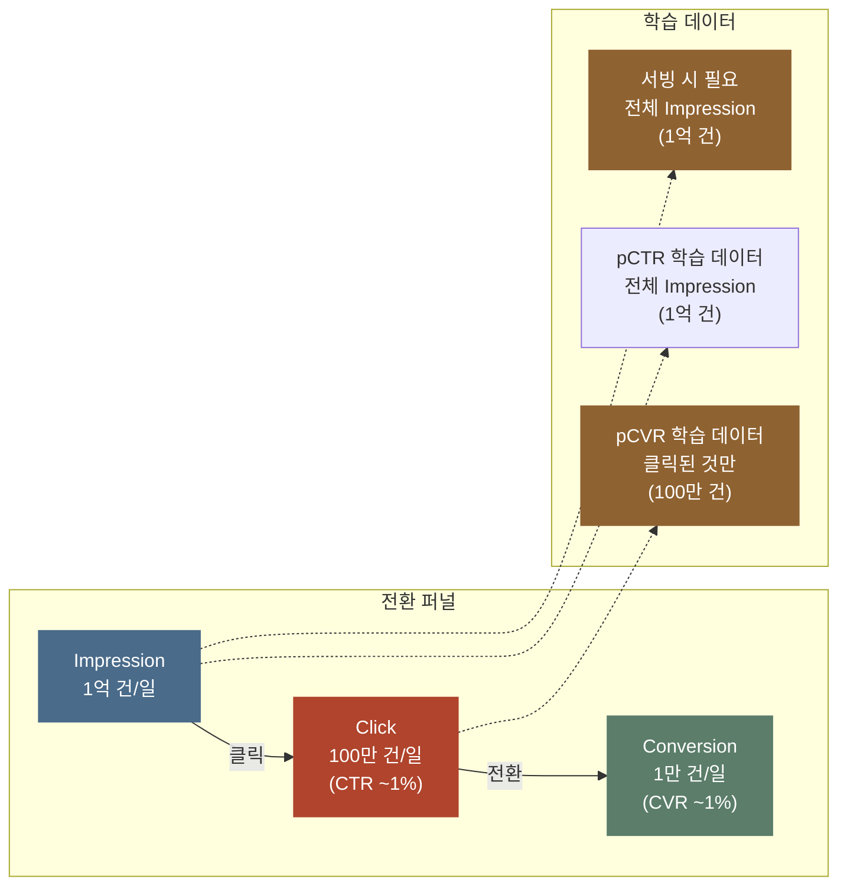
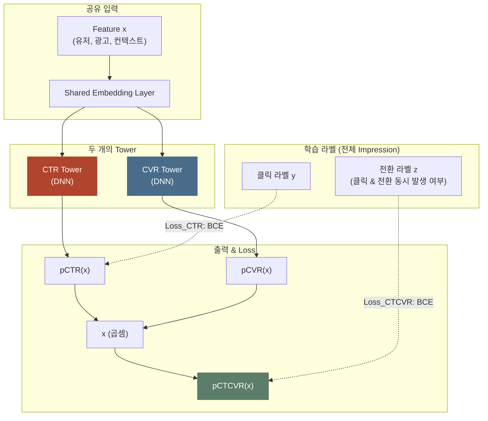
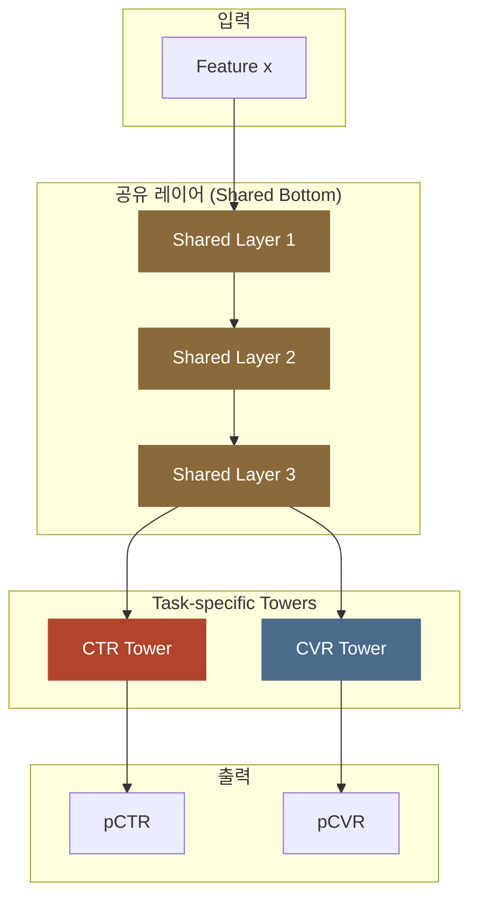
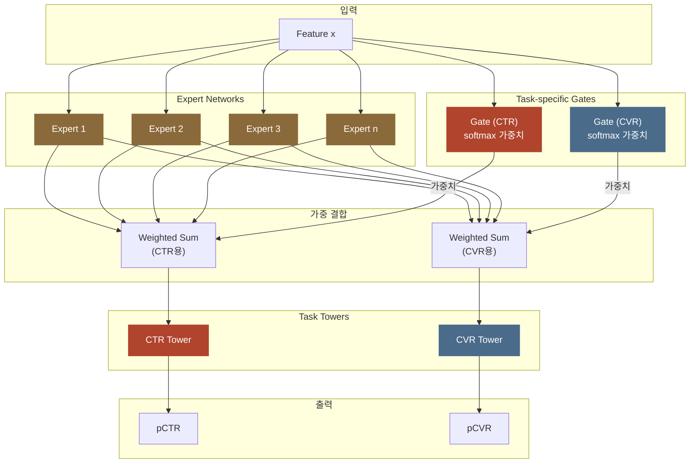
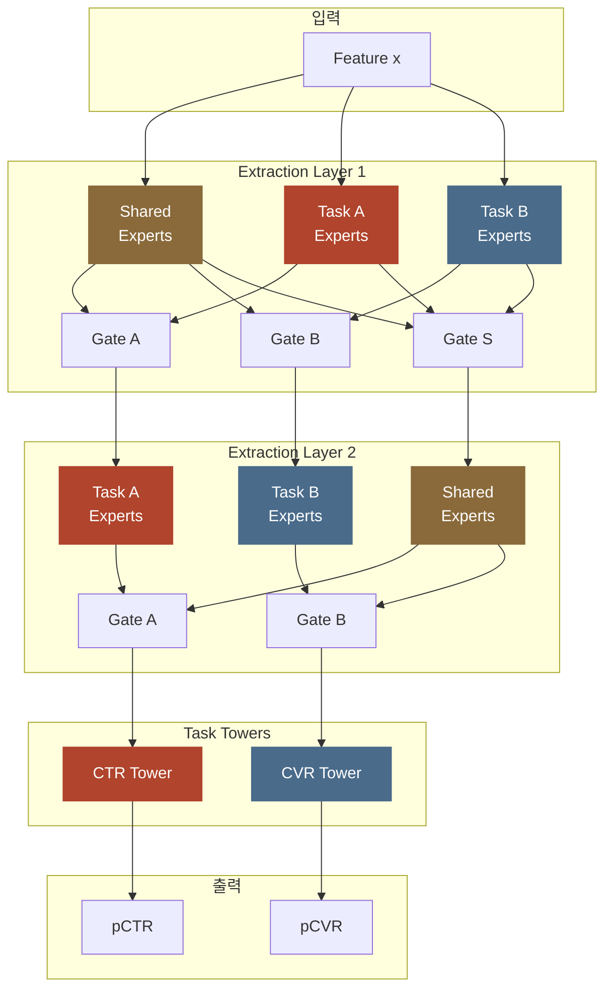

광고 시스템은 pCTR 과 pCVR 을 별개의 모델로 학습하는 경우가 많습니다. pCTR 은 광고가 한 번 노출됐을 때 클릭될 확률을 모델이 예측한 값이고 pCVR 은 그 광고를 클릭한 사람이 구매 같은 전환까지 갈 확률을 예측한 값입니다. 두 모델은 팀마다 따로 맡아 각자 최적화하고 서빙할 때(학습한 모델로 실제 요청에 점수를 낼 때) 두 결과를 조합합니다. 자연스러운 방식으로 보이지만 클릭과 전환이 서로 독립된 사건이 아니라는 데서 근본적인 문제가 생깁니다. 클릭과 전환 사이에는 노출 → 클릭 → 전환 순서로 이어지는 **순차적인 퍼널 관계**가 있어서 전환 여부는 클릭이 일어난 노출에서만 관측되는데, 이 구조를 무시하고 두 모델을 따로 학습하면 학습 데이터 자체에 편향이 생깁니다.

그 편향의 중심에 pCVR 모델의 **Sample Selection Bias(SSB)**가 있습니다. pCVR 모델은 클릭이 일어난 샘플만으로 학습하지만 서빙할 때는 노출 전체에 값을 매겨야 해서 학습 때 본 데이터와 서빙 때 만나는 데이터의 분포가 다릅니다. 이 train/serve 분포 불일치를 모델 구조로 푸는 방법이 클릭 예측과 전환 예측처럼 여러 예측 과제(태스크, Task)를 한 모델에서 같이 배우는 **멀티태스크 러닝(Multi-Task Learning)(MTL)**입니다.

> 한 줄 요약: 클릭과 전환을 **한 모델에서 같이 배우는** 데는 두 가지 까닭이 있습니다. 하나는 ESMM 처럼 pCVR 도 노출 전체에서 배우게 해서 배우는 공간을 서빙하는 공간과 맞추는 일입니다. 다른 하나는 Shared-Bottom, MMoE, PLE 처럼 데이터가 적은 태스크가 데이터가 많은 태스크의 표현(입력을 바꿔 만든 중간 값)을 빌려 쓰는 일입니다. MMoE 는 작은 신경망인 전문가를 여러 개 두고 태스크마다 다른 조합으로 섞어 쓰며 PLE 는 모든 태스크가 함께 쓰는 공용 전문가와 한 태스크만 쓰는 전용 전문가를 층으로 나눕니다. 빌려 쓰면 이득이지만 두 태스크가 상충하면(필요한 표현이 서로 다르면) 그 이득이 0 으로 사라집니다.

> SSB 와 지연 전환(전환이 며칠 뒤에야 도착하는 문제), 중복 전환(같은 구매가 두 번 잡히는 문제)의 **문제 정의**는 [pCVR 모델링](post.html?id=pcvr-modeling)에 있고 이 글은 그 문제를 **구조로 푸는 방법**만 다룹니다. 예측 하나를 맡아 확률을 내는 신경망 줄기를 타워(Tower)라고 부르는데, 각 타워 안쪽의 구조는 [Deep CTR 모델](post.html?id=deep-ctr-models)로 넘깁니다. 태스크가 여러 개면 [보정](post.html?id=calibration)도 태스크마다 따로 해야 합니다. 광고 후보를 먼저 좁히는 후보 생성 단계는 [Two-Tower 리트리벌](post.html?id=two-tower-retrieval)이 맡습니다.

> **골라 읽는 법** — 절이 15개인 긴 글이니 필요한 대목만 골라 읽어도 됩니다.
>
> - pCVR 을 따로 학습하면 안 되는 까닭 → 1~3절
> - Shared-Bottom 에서 MMoE, PLE 로 이어지는 구조의 계보 → 5, 7, 8절
> - 가상 데이터로 돌려 숫자로 확인하는 대목 → 4, 6, 11절
> - 실무에서 구조와 손실 가중치를 고르는 기준 → 9, 10절
> - 닫힌 생태계와 열린 RTB, 두 무대의 비교 → 12~13절

---
## 1. 핵심 비교: Executive Summary

**MTL 구조들이 푸는 문제는 두 가지로, pCVR 을 어디서 배울지(SSB)와 태스크들이 표현을 어떻게 나눠 쓸지(간섭)입니다. ESMM 은 앞의 문제를 풀고 Shared-Bottom, MMoE, PLE 는 뒤의 문제를 풉니다.**

표현(representation)은 모델이 입력 피처를 바꿔 만든 중간 벡터로, 그 위의 타워가 이 벡터를 받아 확률을 냅니다. 간섭은 여러 태스크가 같은 파라미터를 함께 고치면서 한 태스크의 학습이 다른 태스크의 학습을 방해하는 현상입니다. 두 문제를 구분하지 않고 섞어서 보면 아래 표가 잘 읽히지 않으므로 표를 보기 전에 먼저 나눠 두었습니다.

아래 표는 태스크 하나만 배우는 모델(Single-Task)부터 PLE 까지 6가지 접근법의 구조적 특성을 한 번에 비교합니다. 열마다 보는 것이 다른데, SSB 해결은 pCVR 이 노출 전체에서 배우는지를, 태스크 간 간섭은 한 태스크의 학습이 다른 태스크를 얼마나 방해하는지를, 파라미터 효율은 같은 일을 얼마나 적은 파라미터로 하는지를, 실무 난이도는 구현하고 운영하기가 얼마나 어려운지를 나타냅니다.

| 구조 | 아키텍처 | SSB 해결 | 태스크(Task) 간 간섭 | 파라미터 효율 | 실무 난이도 |
|------|---------|---------|-------------|-------------|-----------|
| **태스크 하나짜리 (pCTR)** | 독립 모델 | 해당 없음 | 없음 | 낮음 (별도 모델) | 매우 낮음 |
| **태스크 하나짜리 (pCVR)** | 독립 모델 (클릭 데이터만) | 미해결 | 없음 | 낮음 (별도 모델) | 낮음 |
| **ESMM** | 두 타워 + 곱셈 | 완전 해결 | 낮음 (Embedding만 공유) | 중간 (Embedding 공유) | 낮음 |
| **Shared-Bottom** | 공유 하위 레이어 + 태스크(task)별 타워 | 미해결 | 높음 (Negative Transfer) | 높음 (최대 공유) | 매우 낮음 |
| **MMoE** | 다중 전문가(Expert) + 태스크별 게이트(Gate) | 미해결 | 낮음 (게이트가 조절) | 중간 | 중간 |
| **PLE** | 공용(Shared) + 태스크 전용 전문가(Task-specific Expert), 다층 | 미해결 | 매우 낮음 | 중~낮음 (전문가 분리) | 높음 |

표는 다 외울 필요 없이 두 그룹으로 나눠 읽으면 됩니다. **ESMM 은 학습 공간을 바꾸는 구조**라 pCVR 을 클릭된 샘플 대신 노출 전체에서 배우게 만들고 **Shared-Bottom, MMoE, PLE 는 표현을 나눠 쓰는 구조**라 어느 파라미터를 어느 태스크가 얼마나 쓸지를 정합니다. 두 그룹은 이렇게 푸는 문제가 달라서 경쟁 관계가 아니며 실제 프로덕션 모델은 두 구조를 겹쳐 씁니다.

표에 처음 나온 용어도 짧게 풀어 둡니다. ESMM 행의 「Embedding만 공유」는 두 타워가 유저와 광고 같은 값을 벡터로 바꾸는 임베딩 층만 같이 쓴다는 뜻이라 간섭이 낮습니다. Shared-Bottom 행의 Negative Transfer 는 다른 태스크와 같이 배운 탓에 한 태스크의 성능이 오히려 떨어지는 현상으로 5절에서 자세히 봅니다. MMoE 와 PLE 행의 전문가(Expert)는 입력을 받아 표현을 만드는 작은 신경망이고 게이트(Gate)는 태스크마다 전문가들의 출력을 얼마씩 섞을지 정하는 장치입니다.

> SSB 를 해결하는 구조는 ESMM 하나뿐입니다. Shared-Bottom, MMoE, PLE 는 SSB 를 직접 해결하지 않는 대신 태스크 사이의 지식 공유와 간섭 조절에 초점을 맞춥니다. 그래서 실무에서는 ESMM 의 곱셈 구조(두 타워의 출력을 곱해 노출 하나가 전환까지 갈 확률을 만드는 구조로 2절과 3절에서 봅니다)를 바탕에 두고 그 위의 타워 안쪽을 MMoE 나 PLE 로 채우는 하이브리드 구성을 흔히 씁니다.

---

## 2. pCVR을 따로 학습하면 안 되는 까닭: Sample Selection Bias

**pCVR 모델은 클릭이 일어난 노출로만 배우는데 서빙에서는 노출 전체에 값을 매겨야 해서 예측하려는 확률은 같아도 학습 때 본 입력과 서빙 때 들어오는 입력의 분포가 다릅니다. ESMM 은 노출 하나가 클릭을 거쳐 전환까지 갈 확률을 pCTR 과 pCVR 의 곱으로 분해한 다음 그 곱을 노출 전체의 라벨로 학습해서 이 문제를 풉니다.**

pCVR 을 따로 학습한 모델이 왜 서빙에서 틀릴 수 있는지는 퍼널의 단계마다 학습 데이터가 얼마나 줄어드는지부터 따라가 보면 알 수 있습니다.

### 전환 퍼널과 데이터 가용성

광고의 전환 퍼널은 노출, 클릭, 전환의 세 단계이고 단계를 하나 지날 때마다 학습에 쓸 수 있는 데이터의 규모가 크게 줄어듭니다. 아래 카드에서는 pCVR 모델이 배우는 표본(클릭한 노출)과 값을 매기는 표본(노출 전체)이 서로 다르다는 점을 보면 됩니다.

<div class="demo-embed-wrap">
<iframe class="demo-embed" src="demo-training-cards.html?embed=1&card=ssb" height="480" loading="lazy" title="학습 표본과 추론 표본이 다르다"></iframe>
<a class="demo-embed-open" href="demo-training-cards.html" target="_blank" rel="noopener">↗ 카드 여섯 장 전체로 열기</a>
</div>

카드 다음 그림은 단계마다 하루 건수와 각 모델의 학습 데이터가 어디서 오는지를 보여 줍니다.



> 그림의 숫자는 설명을 위해 정한 **가상 예시**로, 노출 1억 건에 CTR(노출 가운데 클릭된 비율) 1%, CVR(클릭 가운데 전환된 비율) 1% 를 가정했습니다. 매체와 상품이 바뀌면 실제 값은 크게 달라집니다.

그림을 따라가면 노출 1억 건 가운데 CTR 1% 인 100만 건이 클릭되고 그 클릭 가운데 CVR 1% 인 1만 건이 전환됩니다. pCTR 모델은 노출 1억 건을 모두 학습에 쓰지만 pCVR 모델의 학습 데이터는 클릭된 100만 건뿐인데, 서빙할 때 pCVR 모델이 값을 매겨야 하는 대상은 다시 노출 1억 건 전체입니다.

### 문제의 본질: Train/Serve 분포 불일치

pCVR 모델을 따로 학습하면 학습 데이터는 클릭이 일어난 샘플로 한정되는데 서빙에서는 노출 전체의 전환 확률을 예측해야 하므로 학습 표본(클릭한 노출)과 추론 표본(서빙할 때 예측하는 대상인 노출 전체)이 서로 다릅니다. 학습에 들어가는 표본이 어떤 조건(여기서는 클릭)으로 골라져 예측할 표본과 달라지는 이 문제를 **Sample Selection Bias(표본 선택 편향)**라고 부릅니다.

식으로 쓰면 아래 두 줄이 됩니다. $P(A \mid B)$ 는 B 가 일어났다는 조건에서 A 가 일어날 확률이고 $x$ 는 노출 하나의 피처(유저, 광고, 컨텍스트)입니다.

- **학습할 때**: 클릭한 노출의 $x$ 만 보고 배운 전환 확률 $P(\text{Conversion}=1 \mid \text{Click}=1, x)$
- **서빙할 때**: 같은 $P(\text{Conversion}=1 \mid \text{Click}=1, x)$ 를 노출 전체의 $x$ 에서 예측해야 함

두 줄의 확률은 식이 똑같아서 예측하려는 대상은 같지만 클릭한 유저의 분포가 전체 유저의 분포와 다르므로 학습 때 모델이 본 $x$ 와 서빙 때 들어오는 $x$ 가 다릅니다. 예를 들어 특정 광고 카테고리에 관심이 높은 유저가 더 많이 클릭하므로 클릭 데이터에는 이런 유저가 노출 전체에서보다 큰 비중으로 들어가고 그 결과 클릭 데이터만 보면 그 카테고리의 전환율이 과대추정됩니다.

### ESMM의 핵심 아이디어: 곱셈 분해

ESMM 은 이 문제를 확률의 곱셈 분해로 풉니다. 확률의 곱셈 정리에 따르면 노출 하나가 클릭되고 전환까지 될 확률은 클릭될 확률에 "클릭됐다는 조건에서 전환될 확률"을 곱한 값과 같습니다.

$$P(\text{Click}=1,\;\text{Conv}=1 \mid x) = P(\text{Click}=1 \mid x) \times P(\text{Conv}=1 \mid \text{Click}=1, x)$$

광고 용어로 다시 쓰면 아래 식이 됩니다.

$$\text{pCTCVR}(x) = \text{pCTR}(x) \times \text{pCVR}(x)$$

좌변의 pCTCVR 은 노출 하나가 클릭을 거쳐 전환까지 갈 확률이라 클릭 여부와 상관없이 노출마다 정의되는 **전체 노출(Impression) 공간**의 값입니다. 라벨(학습 때 정답으로 쓰는 0 또는 1)도 노출 전체에서 바로 만들 수 있습니다. 클릭과 전환이 모두 일어난 노출은 1 이고 클릭이 없었던 노출은 0 입니다. pCVR 의 라벨은 클릭한 노출에만 있지만 pCTCVR 의 라벨은 모든 노출에 있다는 이 점을 ESMM 이 이용합니다.

---

## 3. ESMM (노출 전체에서 배우는 모델(Entire Space Multi-Task Model), Alibaba 2018)

**ESMM 은 공유 임베딩 층 위에 CTR 타워와 CVR 타워를 나란히 두고 두 출력을 곱해 pCTCVR 을 만든 뒤, 노출 전체의 클릭 라벨과 "클릭과 전환이 모두 일어났는가" 라벨로만 학습합니다. CVR 타워에는 직접 거는 손실이 없어 곱셈 노드를 거친 학습 신호로만 배우므로 노출 전체에서 학습됩니다.**

ESMM 은 2절의 곱셈 분해를 모델로 옮긴 구조로, pCVR 에 손실을 직접 걸지 않고도 pCVR 값을 얻습니다.

### 아키텍처

ESMM 은 CTR 타워(CTR Tower)와 CVR 타워(CVR Tower), 2개의 타워로 이루어집니다. 두 타워는 공유 임베딩 층(Embedding Layer) 위에 나란히 놓여 각자 pCTR 과 pCVR 을 예측합니다. 최종 출력 pCTCVR 은 두 타워의 출력을 곱해서 만듭니다. 임베딩 층은 유저나 광고 같은 값을 학습되는 숫자 벡터로 바꾸는 층인데, 두 타워가 이 층을 같이 쓰므로 클릭 라벨로 CTR 타워를 학습시키는 동안 이 층도 함께 고쳐지고 CVR 타워는 그렇게 고쳐진 벡터를 입력으로 받습니다.

아래 그림에서 실선 화살표는 예측값이 계산되는 순서이고 점선은 어느 라벨이 어느 출력에 BCE(이진 교차엔트로피) 손실을 거는지를 나타냅니다. pCVR(x) 로 들어오는 점선이 없다는 점을 기억해 두면 다음 소절이 쉬워집니다.



### Loss 함수

Loss(손실)는 모델의 예측이 라벨과 얼마나 다른지를 나타내는 값이고 학습은 이 값을 줄이는 쪽으로 파라미터를 고쳐 나갑니다. ESMM 의 Loss 는 클릭 예측의 손실과 "클릭하고 전환까지 했는가" 예측의 손실, 2개의 항으로 이루어집니다.

$$\mathcal{L} = \mathcal{L}_{CTR} + \mathcal{L}_{CTCVR}$$

$$\mathcal{L}_{CTR} = -\frac{1}{N}\sum_{i=1}^{N}\left[y_i \log(\text{pCTR}(x_i)) + (1-y_i)\log(1-\text{pCTR}(x_i))\right]$$

$$\mathcal{L}_{CTCVR} = -\frac{1}{N}\sum_{i=1}^{N}\left[z_i \log(\text{pCTCVR}(x_i)) + (1-z_i)\log(1-\text{pCTCVR}(x_i))\right]$$

두 항은 모두 BCE 로, 라벨이 0 또는 1 인 예측에 쓰는 손실입니다. $y_i$ 는 노출 $i$ 가 클릭됐는지를 나타내는 클릭 라벨이고 $z_i$ 는 노출 $i$ 에서 클릭과 전환이 모두 일어났는지를 나타내는 라벨입니다. $N$ 은 전체 노출 수라서 두 항 모두 노출 $N$ 개 전부에서 평균을 냅니다.

식을 보면 **pCVR 을 라벨과 직접 비교하는 항이 없습니다**. 기울기(gradient)는 손실을 줄이려면 파라미터를 어느 쪽으로 얼마나 고쳐야 하는지 나타내는 값입니다. 역전파는 출력 쪽에서 구한 기울기를 입력 쪽 층으로 차례로 넘기는 계산입니다. CVR 타워의 출력은 곱셈 노드에서 pCTR 과 곱해져 pCTCVR 이 된 다음에야 손실에 들어가므로 CVR 타워는 $\mathcal{L}_{CTCVR}$ 의 기울기가 역전파로 곱셈 노드를 거꾸로 지나 전달될 때만 학습됩니다. $\mathcal{L}_{CTCVR}$ 은 노출 전체에서 계산되므로 이 구조 덕분에 CVR 타워도 클릭된 샘플이 아니라 노출 전체에서 학습합니다.

:::deep 더 깊이 — 직접 손실이 없는 CVR 타워가 학습되는 원리
CVR 타워가 어떤 기울기를 받는지는 곱셈 노드의 미분을 손으로 한 번만 써 보면 알 수 있습니다. 식을 짧게 쓰려고 pCTR 을 $p$, pCVR 을 $q$ 로 두면 모델의 예측값은 $pq$ 이고 라벨은 $z$ 입니다. 이진 교차엔트로피를 먼저 $pq$ 로 미분한 다음 연쇄법칙(합성 함수의 미분은 단계마다의 미분을 곱한 것과 같다는 규칙)에 따라 $pq$ 를 $q$ 로 미분한 값 $p$ 를 곱하면 아래 식이 나옵니다.

$$\frac{\partial \mathcal{L}_{CTCVR}}{\partial q} = \frac{pq - z}{pq\,(1-pq)} \cdot p$$

식의 맨 뒤에 $p$ 가 곱해져 있으므로 CVR 타워가 받는 기울기는 **pCTR 에 비례**합니다.

이 비례 관계에서 두 가지를 알 수 있습니다. 첫째, 클릭이 없었던 노출도 라벨 0 으로 CVR 타워를 밀어 주는 기울기를 만들므로 학습이 노출 전체에서 일어납니다. 둘째, pCTR 이 아주 낮은 노출은 기울기가 $p$ 배로 줄어들어 CVR 타워를 거의 움직이지 못합니다. 그래서 ESMM 은 노출 전체를 같은 무게로 배우지 않고 **클릭 가능성으로 가중해서** 배우는데, 이 성질이 있어야 pCVR 의 뜻이 "클릭한 다음의 전환 확률"로 유지됩니다.

실무에서 자주 겪는 문제도 하나 있습니다. $pq$ 는 아주 작은 수라서 노출당 전환이 0.06% 면 $\log(1-pq)$ 항이 거의 0 이 되고 float32(단정밀도 부동소수점)로 계산하면 유효 자릿수가 사라지기 쉽습니다. 그래서 프로덕션 구현은 logit(sigmoid 를 적용하기 전의 점수) 공간에서 수치를 안정시킨 BCE 를 쓰고 두 타워의 출력을 곱할 때도 확률을 직접 곱하지 않고 log 를 더합니다.
:::

### SSB가 해결되는 까닭

기존 pCVR 모델과 ESMM 을 네 관점에서 나란히 놓았습니다. 표의 건수는 2절 그림의 가상 예시 그대로입니다.

| 관점 | 기존 pCVR 모델 | ESMM |
|------|-------------|------|
| **학습 데이터** | 클릭된 샘플만 (100만 건) | 전체 노출 (1억 건) |
| **학습 목표** | $P(\text{Conv} \mid \text{Click}, x)$ 직접 학습 | $P(\text{Click}, \text{Conv} \mid x)$를 통해 간접 학습 |
| **분포 불일치** | Train: 클릭 유저 / Serve: 전체 유저 | Train = Serve: 전체 유저 |
| **추가 이점** | 없음 | CTR의 풍부한 시그널이 공유 Embedding을 통해 CVR 타워로 전이 |

차이는 학습 데이터 줄에서 시작합니다. 기존 pCVR 모델은 클릭된 100만 건에서 $P(\text{Conv} \mid \text{Click}, x)$ 를 직접 배우므로 학습 때는 클릭한 유저만 보고 서빙 때는 전체 유저를 만납니다. 반면 ESMM 은 노출 1억 건 전체에서 $P(\text{Click}, \text{Conv} \mid x)$ 를 배우는 과정에서 pCVR 을 간접으로 얻으므로 학습 때와 서빙 때 모두 전체 유저를 봅니다. 추가 이점 줄의 공유 Embedding 은 앞 그림의 Shared Embedding Layer 라서 데이터가 많은 CTR 태스크의 신호로 학습된 임베딩을 CVR 타워도 같이 씁니다.

### Alibaba 실험 결과

Alibaba 는 Taobao 의 추천 로그로 ESMM 을 검증하면서 클릭한 샘플만으로 학습한 기존 CVR 모델(BASE)과 AUC 를 비교했습니다. AUC 는 양성 샘플(라벨 1) 하나와 음성 샘플(라벨 0) 하나를 뽑았을 때 모델이 양성에 더 높은 점수를 줄 확률이고 1 에 가까울수록 좋습니다. 아래 수치는 ESMM 의 AUC 에서 BASE 의 AUC 를 뺀 절대 차이를 %p(퍼센트포인트, AUC 를 백분율로 적었을 때의 차이)로 적은 값입니다.

- 공개 데이터셋(노출 8,400만 건): CVR 예측 AUC 가 **+2.56%p**, CTCVR 예측 AUC 가 **+3.25%p** 올랐습니다
- 프로덕션 데이터셋(노출 89억 건): CVR 예측 AUC 가 **+2.18%p**, CTCVR 예측 AUC 가 **+2.32%p** 올랐습니다
- 노출 전체에서 학습하므로 데이터가 드문 문제(Data Sparsity)도 함께 완화됐습니다. pCVR 의 학습 데이터는 클릭된 샘플뿐이라 노출보다 훨씬 적은데, 위 표의 추가 이점 줄처럼 CTR 의 풍부한 신호가 공유 Embedding 으로 CVR 타워에 전해집니다

> ESMM 의 강점은 SSB 를 구조로 해결한다는 데 있습니다. 반면 다른 MTL 아키텍처인 Shared-Bottom, MMoE, PLE 는 모두 태스크 사이의 지식 공유에 초점을 맞출 뿐 SSB 를 직접 해결하지는 않습니다. 그래서 실무에서는 ESMM 의 곱셈 구조는 그대로 두고 그 안의 타워만 MMoE 나 PLE 로 바꿔 끼우는 하이브리드를 흔히 씁니다.

---

## 4. 파이썬으로 확인하기 ① — 클릭만 보고 배운 pCVR의 오차

**같은 가상 데이터로 pCVR 을 두 방식으로 만들어 참값과 비교하면 ESMM 방식의 노출 가중 평균 오차가 클릭만 보고 배운 방식보다 15배 작습니다.**

ESMM 이 SSB 를 구조로 푼다는 말이 얼마나 큰 차이인지는 클릭만 보고 배운 pCVR 이 어느 세그먼트에서 얼마나 틀리는지를 참값을 아는 데이터로 계산해 봐야 보입니다. 비교하는 값은 두 가지로, (a) 는 클릭된 샘플만 보고 배운 pCVR 이고 (b) 는 ESMM 방식으로 노출 전체에서 얻은 pCVR 입니다.

실험 데이터는 설명을 위해 손으로 맞춘 **가상 데이터**이고 실제 로그가 아닙니다. 노출 10만 건, 클릭 2천 건, 전환 60건을 비슷한 노출끼리 모은 세그먼트 6개로 나눴고 코드 주석의 말대로 노이즈를 일부러 넣지 않아 세그먼트마다 참 CVR 이 전환 ÷ 클릭으로 딱 떨어집니다. 예를 들어 재방문 고관여 세그먼트는 노출 5,000건에 클릭이 500건이라 CTR 이 10.0% 이고 그 클릭 500건 가운데 25건이 전환돼 참 CVR 이 5.0% 입니다. 표를 위에서 아래로 내려가면 CTR 이 낮은 세그먼트일수록 참 CVR 도 낮거나 같은데, 코드 주석이 말하듯 클릭이 잘 나는 자리일수록 전환도 잘 나는 이 조건에서 SSB 가 생깁니다.

| 세그먼트 (가상 데이터) | 노출 | 클릭 | CTR | 전환 | 참 CVR |
|---|---|---|---|---|---|
| 재방문 고관여 | 5,000 | 500 | 10.0% | 25 | 5.0% |
| 관심 카테고리 | 10,000 | 600 | 6.0% | 18 | 3.0% |
| 일반 사용자 | 20,000 | 500 | 2.5% | 10 | 2.0% |
| 신규 사용자 | 25,000 | 250 | 1.0% | 5 | 2.0% |
| 저관여 지면 | 25,000 | 125 | 0.5% | 2 | 1.6% |
| 신규 지면 | 15,000 | 25 | 0.17% | 0 | 0.0% |
| **합계** | **100,000** | **2,000** | **2.0%** | **60** | — |

이 표에서는 평균 두 가지를 먼저 구분해야 합니다. **클릭 가중 평균**은 전환 60건을 클릭 2,000건으로 나눈 60 ÷ 2,000 = 3.00% 로, 세그먼트마다 클릭 수만큼 비중을 주므로 클릭이 잘 나면서 CVR 도 높은 재방문 고관여와 관심 카테고리의 값이 크게 반영됩니다. 클릭 데이터만 보는 모델은 이 3.00% 를 전체 평균이라고 믿습니다. **노출 가중 평균**은 세그먼트마다 노출 수에 참 CVR 을 곱해(재방문 고관여라면 5,000 × 5.0%) 모두 더한 뒤 노출 100,000건으로 나눈 1.85% 로, 노출 전체에 값을 매길 때 실제로 맞아야 하는 기준입니다. 두 값은 1.6배 벌어져 있고 이 격차가 이 데이터에서 SSB 의 크기입니다.

두 방식을 비교하려면 정규화를 먼저 알아야 합니다. 이 실험의 정규화(regularization)는 추정치를 선험값(prior)인 전체 평균 쪽으로 끌어당기는 힘으로, 표본이 적은 세그먼트의 값이 크게 흔들리지 않게 막습니다. 실무에서 이렇게 끌어당기는 일은 weight decay(파라미터가 커지지 않게 누르는 정규화)나 베이지안 스무딩(관측이 적은 비율을 선험값 쪽으로 당겨 추정하는 방법)이 맡습니다. 코드는 이 일을 가장 단순한 꼴로 흉내 내서 세그먼트마다 선험값으로 채운 가상의 표본 100개를 실제 표본에 섞습니다. 선험값은 (a) 가 클릭 공간의 평균 전환율 3.00% 이고 (b) 는 노출 공간의 평균인 CTR 2.00% 와 CTCVR 0.06% 입니다.

정규화를 아예 걸지 않으면 ESMM 방식이 pCTCVR(전환 ÷ 노출)을 pCTR(클릭 ÷ 노출)로 나눌 때 노출이 분자와 분모에서 지워져 전환 ÷ 클릭만 남으므로, 두 방식이 세그먼트마다 내는 추정치는 **대수적으로 똑같습니다**. 그렇다면 차이는 **몇 표본 위에서 배우는가**에서 옵니다. 클릭 공간의 표본은 2,000개이고 노출 공간의 표본은 100,000개라 노출 쪽이 50배 많으므로, 같은 100 표본을 섞어도 표본이 많은 쪽은 자기 데이터의 비중이 커서 선험값 쪽으로 훨씬 덜 끌려갑니다.

아래 코드는 두 방식에 정규화를 똑같이 100 표본만큼 걸고 세그먼트마다 (a) 와 (b) 의 pCVR 을 참 CVR 과 나란히 찍은 뒤 노출로 가중한 평균 절대오차를 비교합니다. 노출 가중 평균 절대오차는 세그먼트마다 추정치와 참값의 차이를 절댓값으로 구해 그 세그먼트의 노출 수를 곱해 더하고 노출 전체로 나눈 값이라, 노출이 많은 세그먼트에서 크게 틀릴수록 커지며 작을수록 좋습니다.

```python
# 하는 일: 노출 100,000건, 클릭 2,000건, 전환 60건을 세그먼트 6개로 쪼갠 가상 데이터로, 클릭만 보고 배운 pCVR 과 ESMM 방식으로 얻은 pCVR 을 같은 세기의 정규화 아래에서 참 CVR 과 비교한다.
import random

random.seed(42)  # 이 계산엔 난수가 없지만, 재현성 관례를 지킨다

# 1단계: 세그먼트 6개의 노출, 클릭, 전환을 둔다
# (세그먼트 이름, 노출, 클릭, 전환) 가상 데이터다. 노이즈를 일부러 넣지 않아 참 CVR 이 전환/클릭으로 딱 떨어지고, 두 방식의 차이만 남는다.
# 클릭이 잘 나는 자리일수록 전환도 잘 난다. SSB(샘플 선택 편향)가 생기는 바로 그 조건이다. 표준 라이브러리만 쓴다.
SEGMENTS = [
    ("재방문 고관여", 5_000, 500, 25),   # CTR 10.0%  CVR 5.0%
    ("관심 카테고리", 10_000, 600, 18),  # CTR  6.0%  CVR 3.0%
    ("일반 사용자", 20_000, 500, 10),    # CTR  2.5%  CVR 2.0%
    ("신규 사용자", 25_000, 250, 5),     # CTR  1.0%  CVR 2.0%
    ("저관여 지면", 25_000, 125, 2),     # CTR  0.5%  CVR 1.6%
    ("신규 지면", 15_000, 25, 0),        # CTR  0.17% CVR 0.0%  <- 클릭이 거의 없는 자리
]

# 2단계: 전체 합계와 두 평균 전환율을 찍는다
IMP = sum(s[1] for s in SEGMENTS)
CLK = sum(s[2] for s in SEGMENTS)
CVS = sum(s[3] for s in SEGMENTS)
print(f"전체   노출 {IMP:,}, 클릭 {CLK:,}, 전환 {CVS}")
print(f"클릭 가중 평균 전환율(클릭 데이터가 보는 값)  {CVS / CLK:.2%}")
print(f"노출 가중 평균 전환율(전체 노출의 실제 평균)  "
      f"{sum(i * (c / k) for _, i, k, c in SEGMENTS) / IMP:.2%}")
print()

# 3단계: 두 방식에 같은 세기의 정규화를 건다
# 정규화(선험 평균 쪽으로 끌어당기는 힘)를 두 방식에 '똑같이' 100 표본만큼 건다.
# 실무의 weight decay나 베이지안 스무딩이 하는 일을 가장 단순하게 흉내낸 것이다.
ALPHA = 100
PRIOR_CVR = CVS / CLK      # 클릭 공간의 선험값 = 3.00%
PRIOR_CTR = CLK / IMP      # 노출 공간의 선험값 = 2.00%
PRIOR_CTCVR = CVS / IMP    # 노출 공간의 선험값 = 0.06%


# 4단계: 한글 폭을 맞추는 표 칸 함수를 만든다
def cell(s, w, right=True):
    """한글을 폭 2칸으로 세서 표 칸을 맞춘다."""
    gap = " " * max(0, w - sum(2 if ord(c) > 0x2000 else 1 for c in s))
    return gap + s if right else s + gap


# 5단계: 세그먼트마다 두 방식의 pCVR 을 참 CVR 과 나란히 찍는다
print(cell("세그먼트", 16, False) + cell("노출", 7) + cell("클릭", 6)
      + cell("참CVR", 8) + cell("(a)클릭만", 11) + cell("(b)ESMM", 10))

err_a = err_b = 0.0
for name, imp, clk, cnv in SEGMENTS:
    true_cvr = cnv / clk                    # 이 가상 데이터의 참값

    # (a) 클릭만 보고 학습: 분모가 '클릭 수'다. 클릭 25건짜리 세그먼트는
    #     표본 100의 힘에 눌려 값이 거의 3.00%(클릭 평균)로 끌려간다.
    pcvr_a = (cnv + ALPHA * PRIOR_CVR) / (clk + ALPHA)

    # (b) ESMM 방식: 노출 전체에서 pCTR과 pCTCVR을 각각 학습하고, 나눠서 pCVR을 얻는다.
    #     분모가 '노출 수'라서 같은 세기의 정규화가 훨씬 약하게 작용한다.
    pctr = (clk + ALPHA * PRIOR_CTR) / (imp + ALPHA)
    pctcvr = (cnv + ALPHA * PRIOR_CTCVR) / (imp + ALPHA)
    pcvr_b = pctcvr / pctr                  # 항등식을 거꾸로 쓴 것

    err_a += imp * abs(pcvr_a - true_cvr)   # 노출 수로 가중한 절대오차
    err_b += imp * abs(pcvr_b - true_cvr)
    print(cell(name, 16, False)
          + f"{imp:>7,}{clk:>6,}{true_cvr:>8.2%}{pcvr_a:>11.2%}{pcvr_b:>10.2%}")

# 6단계: 노출로 가중한 평균 절대오차를 비교한다
print()
print(f"노출 가중 평균 절대오차   (a) {err_a / IMP * 100:.3f}%p   (b) {err_b / IMP * 100:.3f}%p")
print(f"(b)의 오차가 (a)보다 {err_a / err_b:.1f}배 작다")

# 출력:
# 2단계 뜻: 클릭 데이터가 보는 평균 전환율은 3.00% 인데, 전체 노출의 실제 평균은 1.85% 다.
# 전체   노출 100,000, 클릭 2,000, 전환 60
# 클릭 가중 평균 전환율(클릭 데이터가 보는 값)  3.00%
# 노출 가중 평균 전환율(전체 노출의 실제 평균)  1.85%
#
# 5단계 뜻: 클릭만 보고 배운 (a) 는 클릭이 적은 세그먼트일수록 3.00% 쪽으로 끌려가, 신규 지면에서 참 CVR 0.00% 를 2.40% 로 낸다. ESMM 방식의 (b) 는 신규 지면에서도 0.22% 로 참값에 가깝다.
# 세그먼트           노출  클릭   참CVR  (a)클릭만   (b)ESMM
# 재방문 고관여     5,000   500   5.00%      4.67%     4.99%
# 관심 카테고리    10,000   600   3.00%      3.00%     3.00%
# 일반 사용자      20,000   500   2.00%      2.17%     2.00%
# 신규 사용자      25,000   250   2.00%      2.29%     2.01%
# 저관여 지면      25,000   125   1.60%      2.22%     1.62%
# 신규 지면        15,000    25   0.00%      2.40%     0.22%
# 6단계 뜻: 노출로 가중한 평균 절대오차는 (a) 0.637%p, (b) 0.042%p 로, (b) 가 15.2배 작다.
#
# 노출 가중 평균 절대오차   (a) 0.637%p   (b) 0.042%p
# (b)의 오차가 (a)보다 15.2배 작다
```

결론은 출력의 맨 아래 두 줄에 있습니다. 노출 가중 평균 절대오차는 (a) 가 0.637%p, (b) 가 0.042%p 라서 (b) 의 오차가 (a) 보다 15.2배 작습니다.

세그먼트별 표에서 가장 크게 틀린 줄은 마지막 행입니다. **신규 지면은 노출이 15,000건으로 전체의 15% 인데 클릭은 25건뿐입니다.** 참 CVR 은 0.0% 인데 (a) 는 2.40% 를 냈습니다. (a) 는 이 세그먼트의 전환 0건에 클릭 평균 3.00% 짜리 가상 표본 100개를 섞어 (0 + 100 × 3.00%) ÷ (25 + 100) = 2.40% 를 얻는데, 실제 클릭이 25건뿐이라 섞어 넣은 100개가 분모의 대부분을 차지하므로 클릭 평균 3.00% 가 그 세그먼트의 값을 거의 그대로 덮어씁니다. (b) 는 노출 15,000건에 같은 100 표본을 섞어 pCTCVR 과 pCTR 을 각각 구한 뒤 나누는데, 두 값에 같이 들어 있는 분모 (15,000 + 100) 이 나눗셈에서 지워지면 (0 + 100 × 0.06%) ÷ (25 + 100 × 2.00%) = 0.06 ÷ (25 + 2) 가 남아 0.22% 가 나옵니다. 노출 공간의 선험값 2.00% 를 거치면 가상 표본 100개가 클릭 2개 분량의 무게만 가져 실제 클릭 25건이 값을 주로 정하므로 (b) 는 참값에 훨씬 가깝습니다.

오차가 어느 세그먼트에 몰렸는지도 봐야 합니다. (a) 의 오차가 큰 세그먼트는 저관여 지면(참값 1.60% 를 2.22% 로)과 신규 지면(0.00% 를 2.40% 로)처럼 전부 **노출은 많고 클릭은 적은** 자리입니다. 하필 그런 자리가 노출 예산이 많이 나가는 곳입니다. 참 CVR 이 2% 안팎인 이 데이터에서 0.637%p 는 30% 가 넘는 왜곡입니다. 입찰가는 pCTR × pCVR 에 비례하므로 pCVR 이 틀린 비율만큼 입찰가도 틀리고 그 차이가 그대로 돈 문제로 이어지는데, 자세한 계산은 [eCPM 랭킹](post.html?id=ecpm-ranking)에 있습니다.

다만 이 코드는 ESMM 의 기울기 학습을 흉내 내지 않았습니다. "학습 공간이 넓어지면 같은 정규화가 약하게 작용한다"는 메커니즘 한 가지만 떼어 내 보였고 실제 ESMM 에는 공유 Embedding 이 CTR 태스크의 풍부한 신호로 함께 학습된다는 이득이 하나 더 있습니다. 그 효과는 다음 파이썬 절인 6절에서 따로 확인합니다.

---

## 5. Shared-Bottom과 Hard Parameter Sharing

**Shared-Bottom 은 하위 레이어를 모든 태스크가 함께 쓰고 그 위에 태스크마다 타워를 두는 가장 단순한 MTL 구조입니다. 구현이 쉽고 데이터와 파라미터를 효율적으로 쓰지만 태스크끼리 원하는 표현이 상충하면 양쪽 성능이 모두 떨어지는 Negative Transfer 에 약합니다.**

ESMM 이 pCVR 을 어디서 배울지를 정했다면 남은 문제는 데이터가 적은 CVR 태스크가 CTR 태스크의 신호를 어떻게 빌려 쓰느냐입니다. 가장 단순한 답은 아래층 전체를 같이 쓰는 Shared-Bottom 입니다.

### 가장 기본적인 MTL 구조

Shared-Bottom 은 MTL 가운데 가장 단순하고 직관적인 형태로, 입력에 가까운 하위 레이어를 모든 태스크가 같이 쓰고 그 위에 태스크마다 타워를 하나씩 둡니다. 하위 레이어의 파라미터를 모든 태스크가 그대로 공유하므로 이런 방식을 Hard Parameter Sharing 이라고 부릅니다. 아래 그림에서는 피처 x 가 공유 레이어 3개를 차례로 지난 뒤 그 출력이 CTR 타워와 CVR 타워로 똑같이 들어갑니다.



### 장점

- **구현이 간단**: 태스크 하나짜리 모델이 이미 있으면 그 위에 타워만 추가하면 됩니다
- **데이터 효율적**: 하위 레이어가 모든 태스크의 데이터로 함께 학습되므로 데이터가 적은 태스크(예: CVR)도 데이터가 풍부한 태스크(예: CTR)의 신호가 담긴 공유 표현을 씁니다
- **파라미터 효율적**: 하위 레이어를 태스크마다 따로 두지 않고 한 벌만 두므로 메모리와 서빙 비용이 줄어듭니다
- **Regularization 효과**: 여러 태스크를 동시에 학습하면 각 태스크가 서로에게 regularizer(과적합을 막는 장치) 역할을 해서 overfitting(학습 데이터에만 맞고 새 데이터에는 맞지 않는 현상)을 막습니다

### 한계: Negative Transfer

Shared-Bottom 의 가장 큰 약점은 **Negative Transfer** 입니다. Negative Transfer 는 다른 태스크와 같이 배운 탓에 한 태스크의 성능이 오히려 떨어지는 현상인데, 태스크 사이의 관계가 상충하면 공유 레이어가 두 태스크를 동시에 만족시키지 못해 양쪽 성능이 모두 떨어집니다.

광고 시스템에서 흔히 나타나는 Negative Transfer 는 아래 세 가지입니다.

- **CTR 과 CVR 의 상충**: 누르게는 만들지만 사게는 못 만드는 "낚시성 크리에이티브"(광고 소재)는 CTR 이 높고 CVR 이 낮아서 공유 표현이 CTR 을 맞추는 쪽으로 끌려가면 CVR 예측이 나빠집니다
- **태스크 간 데이터 규모 차이**: CTR 데이터가 CVR 보다 100배 많아 공유 레이어로 들어오는 기울기를 CTR 이 거의 다 차지하므로 CVR 타워가 제대로 학습되지 않습니다
- **태스크 간 최적 표현의 차이**: CTR 에 유용한 low-level 표현(입력에 가까운 층이 배우는 단순한 표현, 예: 크리에이티브의 시각 피처)이 CVR 에는 불필요하거나 해로울 수 있습니다

MMoE 와 PLE 는 이 Negative Transfer 를 해결하려고 나온 구조입니다. 두 구조를 보기 전에 6절에서 공유가 언제 이득이고 언제 이득이 사라지는지를 숫자로 먼저 확인합니다.

---

## 6. 파이썬으로 확인하기 ② — 표현을 빌려 쓰는 게 이득인 조건

**CTR 에서 배운 표현을 빌려 쓰는 공유는 전환이 클릭과 같은 방향으로 정해지는 세계 A 에서는 전환을 직접 배우는 단독 학습보다 낫지만 전환이 클릭과 무관한 세계 B 에서는 전체 평균 하나만 내는 상수 예측과 비교한 이득이 사실상 0 입니다.**

공유가 늘 이득이라면 MMoE 도 PLE 도 필요 없었을 테니, 이번에는 공유의 이득이 사라지는 지점을 찾습니다. 조건 하나만 바꾼 두 세계를 나란히 돌려 비교합니다.

이번 실험도 **가상 데이터**로, 광고 200개, 노출 10만 건, 클릭 2천 건, 전환 60건짜리입니다. 광고마다 배워야 할 임베딩 값(광고 하나를 나타내는 학습되는 숫자)이 하나씩 있어 배울 파라미터가 200개인데, 전환 60건으로 200개를 채우면 광고 하나에 돌아가는 전환이 1건도 안 되어 값 하나하나가 심하게 흔들립니다. 반면 클릭 2천 건이면 광고당 10건씩이라 값이 훨씬 안정적이므로 CTR 태스크가 이 클릭으로 임베딩을 먼저 배워 두면 전환 쪽이 그 임베딩을 빌려 쓸 수 있습니다.

두 세계는 노출과 클릭까지 **완전히 같은 데이터**이고 전환 라벨만 다르게 붙였습니다.

| 세계 (가상 데이터) | 전환을 결정하는 것 | 클릭과의 관계 |
|---|---|---|
| **A 정렬** | 클릭을 잘 받는 광고가 전환도 잘 시킨다 | 같은 방향 |
| **B 상충** | 전환을 잘 시키는 광고는 클릭 성적과 무관하다 | 상관 0 |

코드에서는 광고마다 "클릭을 부르는 힘"(pull)과 "사게 만드는 힘"(sell)을 서로 독립인 난수로 두고 세계 A 는 전환 확률을 클릭과 같은 pull 로, 세계 B 는 pull 과 무관한 sell 로 정합니다.

비교하는 모델은 4개이고 성적은 평가용 데이터의 LogLoss 로 측정합니다. LogLoss 는 실제로 전환된 샘플에 낮은 확률을 주거나 전환되지 않은 샘플에 높은 확률을 줄수록 커지는 손실이고 낮을수록 좋습니다.

- **상수 예측**: 모든 광고에 전체 평균 전환율 하나를 그대로 내놓는 모델로, 아무것도 학습하지 않은 바닥선입니다
- **단독 학습**: 전환 60건만으로 광고별 임베딩 200개까지 직접 배웁니다
- **공유**: CTR 태스크가 노출 10만 건에서 배운 임베딩을 얼려서(더 고치지 않고) 쓰고 그 위에서 임베딩에 곱하는 배율과 더하는 절편, 파라미터 2개만 배웁니다
- **이상적 모델**: 참 확률을 그대로 아는 모델로 도달할 수 있는 천장입니다

결과는 상수 예측보다 LogLoss 가 몇 % 달라졌는지(상수 대비)로 읽는데, 음수의 크기가 클수록 상수 예측보다 많이 좋아졌다는 뜻입니다. 아래 코드는 두 세계에서 네 모델을 같은 평가용 데이터로 측정해 공유가 단독 학습보다 나은 조건과 그렇지 않은 조건을 비교합니다.

```python
# 하는 일: 광고 200개, 노출 10만 건의 가상 데이터로 전환을 직접 배우는 단독 학습과 CTR 에서 배운 표현을 빌려 쓰는 공유를, 클릭과 전환이 같은 방향인 세계 A 와 무관한 세계 B 에서 LogLoss 로 비교한다.
import math
import random

random.seed(42)

# 1단계: 광고 200개와 광고별 두 힘을 둔다
# 가상 데이터다. 광고마다 배울 임베딩 값이 1개씩 있으니 배울 파라미터가 200개다. 표준 라이브러리만 쓴다.
ADS, IMPS = 200, 100_000
pull = [random.gauss(0, 1) for _ in range(ADS)]   # 광고별 '클릭을 부르는 힘'
sell = [random.gauss(0, 1) for _ in range(ADS)]   # 광고별 '사게 만드는 힘' (pull과 독립)


# 2단계: 참 클릭률과 두 세계의 참 전환율을 내는 함수를 만든다
# 세계 A(정렬)는 클릭을 잘 받는 광고가 전환도 잘 시키고, 세계 B(상충)는 전환을 잘 시키는 광고가 클릭 성적과 아무 상관이 없다.
def sigmoid(z):
    return 1.0 / (1.0 + math.exp(-max(-30.0, min(30.0, z))))


# 참 모델. 상수(-5.6, -6.8, -5.0)는 클릭 2%, 전환 3%가 나오게 맞춘 값이다.
def true_ctr(ad):
    return sigmoid(2.0 * pull[ad] - 5.6)


WORLDS = {
    "A 정렬": lambda ad: sigmoid(1.8 * pull[ad] - 6.8),   # 클릭과 같은 힘을 본다
    "B 상충": lambda ad: sigmoid(1.8 * sell[ad] - 5.0),   # 클릭과 무관한 힘을 본다
}


# 3단계: 표 칸을 맞추고 LogLoss 를 측정하는 함수 둘을 만든다
def pad(s, w):
    """한글은 폭 2칸으로 세서 표를 맞춘다."""
    return s + " " * max(0, w - sum(2 if ord(c) > 0x2000 else 1 for c in s))


def logloss(rows, predict):
    tot = 0.0
    for ad, z in rows:
        p = min(max(predict(ad), 1e-9), 1 - 1e-9)
        tot += -(z * math.log(p) + (1 - z) * math.log(1 - p))
    return tot / len(rows)


# 4단계: 광고별 값을 직접 배우는 함수를 만든다
def fit_emb(rows, epochs, lr=0.1, l2=0.002):
    """pXX = sigmoid(e[광고] + b) 를 SGD로 학습한다. 광고별 값 e를 직접 배우는 방식.
    l2는 값이 무한히 커지는 것을 막는 정규화(weight decay)다."""
    e, b = [0.0] * ADS, -3.5
    idx = list(range(len(rows)))
    rnd = random.Random(7)
    for _ in range(epochs):
        rnd.shuffle(idx)
        for i in idx:
            ad, y = rows[i]
            d = sigmoid(e[ad] + b) - y            # BCE 미분은 (예측 - 라벨)로 딱 떨어진다
            e[ad] -= lr * (d + l2 * e[ad])
            b -= lr * d
    return e, b


# 5단계: 공유 표현을 얼리고 파라미터 2개만 배우는 함수를 만든다
def fit_head(rows, z, steps=300, lr=1.0):
    """공유 표현 z를 얼려 놓고 sigmoid(u*z[광고] + b)의 u, b 2개만 배운다.
    배울 게 200개에서 2개로 줄었으니, 전체 배치 경사하강으로 안정적으로 정해진다."""
    u, b, n = 0.0, -3.5, len(rows)
    for _ in range(steps):
        gu = gb = 0.0
        for ad, y in rows:
            d = sigmoid(u * z[ad] + b) - y
            gu += d * z[ad]
            gb += d
        u -= lr * gu / n
        b -= lr * gb / n
    return u, b


# 6단계: 학습용과 평가용 노출을 10만 건씩 만든다
tr = [(ad, 1 if random.random() < true_ctr(ad) else 0)
      for ad in (random.randrange(ADS) for _ in range(IMPS))]
te = [(ad, 1 if random.random() < true_ctr(ad) else 0)
      for ad in (random.randrange(ADS) for _ in range(IMPS))]
tr_clk = [ad for ad, y in tr if y == 1]
te_clk = [ad for ad, y in te if y == 1]

# 7단계: 공유할 표현을 CTR 태스크로 학습한다
# CTR 태스크를 노출 10만 건에서 학습한다. 이 결과가 '공유할 표현'이다.
# 클릭 2,000건은 CVR 입장에선 적지만, 광고 200개에 10건씩이면 임베딩을 채울 만하다.
ctr_emb, _ = fit_emb(tr, epochs=3)
mu = sum(ctr_emb) / ADS
sd = (sum((v - mu) ** 2 for v in ctr_emb) / ADS) ** 0.5
shared = [(v - mu) / sd for v in ctr_emb]   # 평균 0, 표준편차 1로 맞춰 넘긴다
print(f"노출 {len(tr):,}, 클릭 {len(tr_clk):,}, 광고 {ADS}개 (평가용 클릭 {len(te_clk):,})")

# 8단계: 두 세계에서 네 모델의 LogLoss 를 비교한다
# 공유가 정말 이득인지, 어떤 조건에서 그 이득이 사라지는지 본다. 전환 60건쯤으로 200개를 채우면 값 하나하나가 흔들린다. 클릭 2,000건쯤이면 훨씬 단단하다.
for name, p_cvr in WORLDS.items():
    tr_c = [(ad, 1 if random.random() < p_cvr(ad) else 0) for ad in tr_clk]
    te_c = [(ad, 1 if random.random() < p_cvr(ad) else 0) for ad in te_clk]
    rate = sum(z for _, z in tr_c) / len(tr_c)
    solo_e, solo_b = fit_emb(tr_c, epochs=40)   # 전환 60건으로 200개를 직접 배운다
    u, b = fit_head(tr_c, shared)               # 표현은 CTR에서 빌려 온다
    base = logloss(te_c, lambda ad: rate)
    print(f"\n세계 {name} — 학습 데이터 전환 {sum(z for _, z in tr_c)}건 (전환율 {rate:.2%})")
    for label, fn in (("상수 예측(전체 평균)", lambda ad: rate),
                      ("단독 학습(임베딩까지)", lambda ad: sigmoid(solo_e[ad] + solo_b)),
                      ("공유(CTR 표현 고정)", lambda ad: sigmoid(u * shared[ad] + b)),
                      ("이상적 모델(참 확률)", p_cvr)):
        ll = logloss(te_c, fn)
        print("  " + pad(label, 24) + f"LogLoss {ll:.4f}"
              f"   상수 대비 {(ll - base) / base:+6.1%}")

# 출력:
# 7단계 뜻: 학습용 노출 100,000건에서 클릭이 1,994건, 평가용에서 1,983건 나왔다.
# 노출 100,000, 클릭 1,994, 광고 200개 (평가용 클릭 1,983)
# 8단계 뜻: 세계 A 에서는 공유가 상수 대비 -8.5% 로 단독 학습의 -6.8% 보다 낫다. 세계 B 에서는 공유가 +0.1% 로 이득이 없고, 단독 학습이 -11.6% 로 낫다.
#
# 세계 A 정렬 — 학습 데이터 전환 61건 (전환율 3.06%)
#   상수 예측(전체 평균)    LogLoss 0.1165   상수 대비  +0.0%
#   단독 학습(임베딩까지)   LogLoss 0.1085   상수 대비  -6.8%
#   공유(CTR 표현 고정)     LogLoss 0.1066   상수 대비  -8.5%
#   이상적 모델(참 확률)    LogLoss 0.1049   상수 대비  -9.9%
#
# 세계 B 상충 — 학습 데이터 전환 65건 (전환율 3.26%)
#   상수 예측(전체 평균)    LogLoss 0.1357   상수 대비  +0.0%
#   단독 학습(임베딩까지)   LogLoss 0.1200   상수 대비 -11.6%
#   공유(CTR 표현 고정)     LogLoss 0.1359   상수 대비  +0.1%
#   이상적 모델(참 확률)    LogLoss 0.1068   상수 대비 -21.3%
```

출력의 첫 줄은 학습용 노출 100,000건에서 클릭이 1,994건, 평가용에서 1,983건 나왔다는 뜻입니다. 그 클릭에 붙은 학습용 전환은 세계 A 가 61건, 세계 B 가 65건입니다.

세계 A 부터 보면 상수 예측의 LogLoss 가 0.1165 이고 참 확률을 아는 이상적 모델이 0.1049 라서 개선의 여지는 상수 대비 -9.9% 뿐입니다. 이 여지 가운데 단독 학습은 0.1085(-6.8%)까지 내려와 69% 를 회수했고 공유는 0.1066(-8.5%)까지 내려와 85% 를 회수했습니다. 세계 A 에서는 전환도 클릭과 같은 pull 로 정해지므로 CTR 이 배운 임베딩에 전환에 필요한 정보가 이미 들어 있습니다. 그래서 전환 60건으로 200개를 직접 배우기보다 클릭 2천 건이 채워 준 표현을 빌려 쓰는 편이 낫습니다. 이 결과가 5절에서 Shared-Bottom 을 데이터 효율적이라고 한 근거입니다.

세계 B 에서는 결과가 뒤집혀 **공유가 상수 대비 +0.1% 로 이득이 사실상 0 입니다**. 세계 B 의 전환은 pull 과 무관한 sell 로 정해지므로 CTR 에서 빌려 온 표현에는 전환 정보가 없습니다. 그 위에 붙인 파라미터 2개는 그 표현을 무시하는 것 말고는 할 수 있는 일이 없어서 LogLoss 가 상수 예측의 0.1357 과 거의 같은 0.1359 에 머뭅니다. 반면 단독 학습은 상수 대비 -11.6% 를 얻었는데, 적은 전환으로 배운 흔들리는 추정치라도 전환 정보가 전혀 없는 표현보다는 낫기 때문입니다.

두 세계를 함께 보면 **공유는 두 태스크가 같은 표현을 필요로 할 때만 이득입니다**. 실제 광고 시스템은 세계 A 와 세계 B 사이 어딘가에 있습니다. 어떤 피처는 클릭과 전환 모두에 영향을 주고 어떤 피처는 한쪽에만 영향을 줍니다. 그러니 모든 표현을 공유하는 것도 모두 따로 두는 것도 답이 아닙니다. **어느 표현을 어느 태스크가 쓸지 고르는 장치**가 필요하고 다음 절 MMoE 의 게이트(Gate)가 그 장치입니다.

---

## 7. MMoE (Multi-gate Mixture-of-Experts, Google 2018)

**MMoE 는 공유 레이어 하나 대신 전문가 여러 개를 두고 태스크마다 붙은 게이트가 요청마다 전문가 출력을 섞는 비율을 정해 태스크마다 다른 표현을 만듭니다. Google 의 합성 데이터 실험에서는 두 태스크의 상관이 낮아질 때 MMoE 의 성능이 Shared-Bottom 보다 덜 떨어졌습니다.**

어느 표현을 어느 태스크가 쓸지 고르는 장치를 MMoE 는 태스크마다 하나씩 붙인 게이트로 만듭니다.

### 전문가와 게이트

MMoE 는 Shared-Bottom 의 **공유 레이어 하나** 대신 **Expert 네트워크(전문가) 여러 개**를 둡니다. 전문가는 입력 피처를 받아 표현 벡터를 내는 작은 신경망이고 아래 그림처럼 모든 전문가가 같은 입력 x 를 받습니다. 여기에 태스크마다 **자기만의 Gating Network(게이트)**를 하나씩 붙입니다. 게이트도 같은 입력 x 를 보고 전문가마다 가중치를 내서 어느 전문가를 얼마나 쓸지를 요청마다 새로 정하므로, CVR 태스크는 CTR 태스크와 다른 전문가 조합을 쓸 수 있습니다. 6절의 세계 B 에서는 CTR 이 쓰는 표현을 CVR 도 그대로 받아야 해서 공유가 실패했으므로 태스크마다 전문가 조합을 따로 고르는 게이트가 세계 B 의 문제를 푸는 장치입니다.

아래 그림에서 전문가 n 개의 출력은 CTR 용과 CVR 용 가중 합(Weighted Sum)에 똑같이 들어가지만 섞는 비율은 태스크마다 다른 게이트가 정합니다.



### 수식

전문가 망(Expert Network)이 $n$ 개 있고 각각을 $f_1$ 부터 $f_n$ 까지로 부릅니다. 태스크 $k$ 의 게이트 망(Gating Network)은 입력 $x$ 에 행렬 $W_g^k$ 를 곱해 전문가 수만큼의 점수 $n$ 개를 만들고 softmax 로 이 점수를 가중치로 바꿉니다. softmax 는 여러 점수를 모두 0 보다 크고 합이 1 인 값으로 바꾸는 함수라서 점수가 높은 전문가일수록 큰 가중치를 받습니다.

$$g^k(x) = \text{softmax}(W_g^k \cdot x) \in \mathbb{R}^n$$

태스크 $k$ 는 이 가중치로 전문가들의 출력을 섞어 자기 표현 $h^k(x)$ 를 만듭니다.

$$h^k(x) = \sum_{i=1}^{n} g_i^k(x) \cdot f_i(x)$$

$g_i^k(x)$ 는 태스크 $k$ 가 전문가 $i$ 에 주는 가중치이고 $f_i(x)$ 는 전문가 $i$ 의 출력 벡터입니다. 가중치의 합이 항상 1 이므로 $h^k(x)$ 는 전문가 출력들을 태스크 $k$ 의 가중치로 평균 낸 벡터이고 이 벡터가 태스크 $k$ 의 타워로 들어갑니다. 가중치는 입력 $x$ 가 바뀔 때마다 다시 계산되므로 같은 모델이라도 요청마다 다른 전문가 조합을 씁니다. 합이 1 로 정해져 있어서 한 전문가의 가중치가 커지면 나머지 전문가의 가중치는 그만큼 줄어듭니다.

### Shared-Bottom 대비 장점

Shared-Bottom 과 나란히 놓으면 차이가 네 관점에서 보입니다.

| 관점 | Shared-Bottom | MMoE |
|------|-------------|------|
| **표현 공유 방식** | 모든 태스크가 동일한 표현 사용 | 각 태스크가 필요한 전문가를 선택적으로 활용 |
| **태스크 간 상충 대응** | 불가 (Negative Transfer) | 게이트가 상충하는 전문가를 회피 |
| **유연성** | 없음 | 입력 $x$에 따라 동적으로 전문가 조합 변경 |
| **해석 가능성** | 낮음 | 게이트 가중치로 task-expert 관계 분석 가능 |

해석 가능성 줄은 학습이 끝난 뒤 게이트 가중치를 뽑아 보면 태스크마다 어느 전문가에 쏠리는지 보일 수 있다는 뜻입니다. 예를 들어 CTR 태스크는 "유저 행동 패턴"을 맡은 전문가에 높은 가중치를 주고 CVR 태스크는 "광고 품질"을 맡은 전문가 쪽으로 기우는 식일 수 있는데, 어느 전문가가 실제로 무엇을 맡는지는 학습해 봐야 압니다. 두 태스크가 주로 쓰는 전문가가 나뉘면 각 전문가의 파라미터로 들어오는 기울기도 주로 한 태스크에서 오므로 두 태스크의 기울기가 덜 부딪힙니다. MMoE 는 이렇게 전문가를 나눠 쓰는 방식으로 Negative Transfer 를 완화합니다.

### Google 실험 결과

Google 은 정해 둔 규칙으로 만든 합성 데이터(synthetic data)에서 두 태스크의 correlation(상관, 두 태스크의 라벨이 함께 움직이는 정도)을 직접 조절해 실험했습니다. 상관을 1, 0.9, 0.5 로 낮춰 가자 모든 모델의 성능이 내려갔지만 MMoE 가 내려간 폭은 Shared-Bottom 보다 훨씬 작았습니다. 두 모델의 차이는 실험한 상관 가운데 가장 낮은 0.5 에서 가장 컸습니다.

Census Income 은 상관을 조절한 데이터가 아니라 태스크 사이의 상관이 원래 낮은(절댓값 0.18, 0.24) 실제 데이터인데, 여기서도 MMoE 가 Shared-Bottom 보다 좋았습니다. 두 결과는 게이트가 태스크 사이의 상충을 조절한다는 근거입니다. Shared-Bottom 이 낮은 상관에서 성능을 잃는 현상은 6절 세계 B 에서 공유의 이득이 0 이 된 현상과 같습니다.

---

## 8. PLE (층으로 나눠 뽑는 구조(Progressive Layered Extraction), Tencent 2020)

**PLE 는 MMoE 의 전문가를 모든 태스크가 쓰는 공용 전문가와 한 태스크만 쓰는 태스크 전용 전문가로 나누고 이 구조를 여러 층으로 쌓아 층을 지날수록 태스크별 표현을 조금씩 더 나눕니다. Tencent 실험에서는 MMoE 보다 모든 태스크의 성능이 동시에 올랐습니다.**

MMoE 로 Negative Transfer 가 줄어도 전문가 하나하나는 여전히 모든 태스크가 함께 쓰므로 해결되지 않는 문제가 남는데, PLE 는 그 문제를 겨냥해 나왔습니다.

### MMoE의 한계

MMoE 에서는 모든 전문가가 모든 태스크에 공유되고 게이트는 전문가를 얼마나 쓸지만 조절하므로 전문가 하나하나가 특정 태스크에 특화되지는 않습니다. 그래서 아래 두 가지 문제가 남습니다.

1. **한쪽이 오르면 한쪽이 내리는 현상(Seesaw)**: 한 태스크의 성능을 올리면 다른 태스크의 성능이 떨어지는 trade-off(하나를 얻으면 다른 하나를 잃는 관계)가 완전히 없어지지 않습니다
2. **태스크 전용(Task-specific) 학습 부족**: 전문가마다 모든 태스크의 기울기가 들어오므로 한 태스크에만 쓸모 있는 표현을 깊이 있게 배우기 어렵습니다

### PLE의 구조

PLE 는 전문가를 모든 태스크가 함께 쓰는 **공용 전문가(Shared Expert)**와 한 태스크만 쓰는 **태스크 전용 전문가**로 명시적으로 나누고 이 구조를 **여러 층으로 쌓아** 층을 지날 때마다 태스크별 표현을 조금씩 더 다듬습니다.

아래 그림은 층 2개(Extraction Layer 1, 2)를 쌓은 예이고 Task A 가 CTR, Task B 가 CVR 입니다. 층 1 에서 Gate A 는 공용 전문가와 Task A 전문가의 출력만 받고 Gate B 는 공용 전문가와 Task B 전문가의 출력만 받으므로 Task A 전문가의 출력은 Gate B 로 가지 않습니다. Gate A 의 출력은 층 2 의 Task A 전문가로, Gate B 의 출력은 층 2 의 Task B 전문가로 들어갑니다. 층 1 에는 공용 전문가용 Gate S 가 하나 더 있어 공용 전문가와 두 태스크 전용 전문가의 출력을 모두 섞어 층 2 의 공용 전문가로 보냅니다. 마지막 층의 게이트 출력은 각 태스크의 타워로 갑니다.



### Extraction Network: 층으로 나눠 뽑는 구조

PLE 에서 층 하나를 이루는 Extraction Network 는 세 부분이 일을 나눠 맡습니다.

1. **공용 전문가**: 모든 태스크에 공통으로 쓸모 있는 표현을 배웁니다
2. **태스크 전용 전문가**: 자기 태스크에만 쓸모 있는 표현을 배웁니다
3. **게이트**: 태스크마다 하나씩 있어 공용 전문가와 그 태스크 전용 전문가의 출력을 가중치로 섞습니다. 다음 층이 있으면 공용 전문가용 게이트가 하나 더 있어 그 층의 모든 전문가 출력을 섞어 다음 층의 공용 전문가로 넘깁니다

이런 층을 거듭할수록 태스크별 표현이 **점진적으로** 나뉘어 하위 층에서는 주로 공통 표현을 배우고 상위 층으로 갈수록 태스크마다 고유한 표현이 따로 다듬어집니다. 이름의 Progressive(점진적)는 이렇게 한 번에 나누지 않고 층마다 조금씩 나눈다는 뜻입니다.

MMoE 와 무엇이 다른지는 표로 보는 편이 빠릅니다.

| 관점 | MMoE | PLE |
|------|------|-----|
| **전문가 구분** | 모든 전문가가 공유 | 공용 + 태스크 전용 명시 분리 |
| **Layer 수** | 단일 층 | 다층 (Progressive) |
| **태스크 전용 학습** | 게이트 가중치에 의존 | 전용 전문가가 명시적으로 학습 |
| **한쪽이 오르면 한쪽이 내리는 현상** | 부분적 완화 | 대폭 완화 |
| **파라미터 수** | 전문가 수 x 전문가 크기 | (공용 + 태스크별) 전문가 수 x Layer 수 |

파라미터 수 줄을 보면 MMoE 는 전문가 수에 전문가 크기를 곱한 만큼이고 PLE 는 공용 전문가와 태스크별 전문가를 합한 수에 층 수를 곱한 만큼이라 층을 쌓을수록 파라미터가 늘어납니다.

### Tencent 실험 결과

Tencent 는 자사의 대규모 추천 시스템에서 PLE 를 검증했습니다. 결과는 세 가지입니다.

- MMoE 와 비교해 **모든 태스크의 성능이 동시에** 올라 한쪽이 오르면 한쪽이 내리는 현상이 해소됐습니다
- 태스크 사이의 correlation 이 낮을수록 MMoE 보다 나아지는 폭이 커졌습니다
- 4주간의 온라인 A/B 테스트(실제 사용자를 두 그룹으로 나눠 기존 모델과 새 모델을 동시에 서빙하고 지표를 비교하는 실험)에서 기존 MTL 모델인 MMoE 보다 조회 수(view-count)가 +2.23%, 시청 시간(watch time)이 +1.84% 늘었습니다. 모델이 학습한 태스크는 VCR(View Completion Ratio)과 VTR(View-Through Rate)이고 두 태스크가 이 두 지표를 겨냥합니다

> PLE 가 가장 크게 기여한 점은 모든 태스크의 성능을 동시에 올릴 수 있다는 사실을 실험으로 보인 데 있습니다. 기존 MTL 에서는 한 태스크를 올리면 다른 태스크가 내려가기 일쑤였고 이 한쪽이 오르면 한쪽이 내리는 현상이 MTL 을 도입하는 데 가장 큰 장벽이었습니다.

---

## 9. 실무 선택 가이드

**구조를 고를 때 보는 기준은 태스크 수, 태스크 사이의 상관, 데이터 규모, 서빙 레이턴시의 네 가지입니다. 순서로는 ESMM 으로 SSB 를 먼저 막고 표현 공유는 태스크가 2개뿐이면 Shared-Bottom 으로 시작해 태스크가 3개 이상으로 늘거나 상관이 낮은 태스크가 끼면 MMoE 로 넘어가고 Seesaw 가 지표에서 보이면 PLE 를 검토합니다.**

앞 절까지 본 ESMM, Shared-Bottom, MMoE, PLE 가운데 무엇을 쓸지는 상황마다 다르므로 아래 표는 상황을 이 네 기준으로 나눠 구조를 추천합니다. 서빙 레이턴시는 요청 하나에 점수를 내기까지 걸리는 시간입니다.

| 상황 | 추천 구조 | 이유 |
|------|---------|------|
| 태스크가 2개이고 sequential 관계 (CTR → CVR) | **ESMM** | SSB를 구조적으로 해결, 구현 간단 |
| 태스크가 3개 이상 (CTR, CVR, 체류 시간 등) | **MMoE** 또는 **PLE** | 다수 태스크 간 게이트로 유연한 지식 공유 |
| 태스크 간 상관관계가 높음 (CTR & Like) | **Shared-Bottom** | 간단한 구조로 충분, Negative Transfer 위험 낮음 |
| 태스크 간 상관관계가 낮음 (CTR & 체류 시간) | **PLE** | 태스크 전용 전문가가 간섭을 방지 |
| 데이터 규모가 작음 (수백만 건 이하) | **Shared-Bottom** 또는 **ESMM** | 파라미터 공유로 데이터 효율 극대화 |
| 데이터 규모가 큼 (수억 건 이상) | **PLE** | 충분한 데이터로 태스크 전용 전문가 학습 가능 |
| 서빙 레이턴시가 엄격 (< 5ms) | **Shared-Bottom** 또는 **ESMM** | 파라미터 수 적음, 추론 경로 단순 |
| 서빙 레이턴시에 여유 (< 20ms) | **MMoE** 또는 **PLE** | Expert 병렬 연산으로 레이턴시 관리 가능 |

레이턴시 기준은 표의 마지막 두 줄입니다. 5ms 아래로 맞춰야 할 만큼 엄격하면 파라미터가 적고 추론 경로가 단순한 Shared-Bottom 이나 ESMM 을, 20ms 아래면 되는 여유가 있으면 전문가를 병렬로 계산해 레이턴시를 관리할 수 있는 MMoE 나 PLE 를 추천합니다.

표의 줄이 여럿 겹칠 때는 순서를 정해 두면 헤매지 않습니다. **1순위는 ESMM 으로 SSB 를 막는 일**입니다. SSB 는 성능을 조금 더 올리느냐가 아니라 학습하는 공간과 서빙하는 공간이 같으냐는 정합성 문제라서 두 공간이 다른 채로는 그 위에 어떤 구조를 붙여도 결과가 흔들립니다. 표현 공유는 그다음입니다. 태스크가 2개뿐이면 Shared-Bottom 으로 시작해도 충분합니다. 6절 세계 A 에서 봤듯 태스크들이 같은 방향으로 정렬돼 있으면 단순한 공유만으로도 이득이 큽니다. 태스크가 3개 이상으로 늘거나 상관이 낮은 태스크가 끼면 MMoE 로 넘어갑니다. 한쪽이 오르면 한쪽이 내리는 Seesaw 가 지표에서 보이기 시작하면 그때 PLE 를 검토합니다.

실무에서 가장 많이 쓰는 조합은 **ESMM + MMoE 하이브리드**입니다. 겉은 ESMM 이라 **pCTCVR = pCTR × pCVR** 구조로 SSB 를 막고 안쪽 타워는 MMoE 로 채워서 좋아요, 공유, 체류 시간 같은 추가 태스크와의 지식 공유까지 챙길 수 있습니다.

---

## 10. Loss Weighting & Task Balancing

**MTL 은 태스크마다 손실을 하나씩 계산한 뒤 가중치를 곱해 더한 값 하나로 학습하므로 그 가중치가 성능을 직접 바꿉니다. 손으로 정하는 Static Weighting 으로 시작해서 성능이 부족하면 Uncertainty Weighting 을, 태스크가 3개 이상이고 Seesaw 가 심하면 GradNorm 을 검토하며 나아졌는지는 직접 비교해 확인합니다.**

구조를 아무리 잘 잡아도 손실을 합치는 비율을 잘못 두면 한쪽 태스크가 완전히 망가지는데, 얼마나 망가지는지는 11절에서 숫자로 봅니다.

### Static Weighting

Static Weighting 은 태스크마다 손실에 곱할 가중치를 사람이 손으로 정해 두는 방식으로, 가장 단순하고 실무에서도 가장 흔합니다.

$$\mathcal{L} = w_1 \cdot \mathcal{L}_{CTR} + w_2 \cdot \mathcal{L}_{CVR} + w_3 \cdot \mathcal{L}_{engagement}$$

식의 $w_1, w_2, w_3$ 는 CTR, CVR, engagement(좋아요나 체류 시간 같은 참여 지표) 손실에 곱하는 가중치입니다. 가장 좋은 $w_1, w_2, w_3$ 를 찾으려면 후보 값의 조합을 하나씩 모두 학습해 보는 grid search 가 필요한데, 조합 수는 태스크 수만큼 곱으로 늘어납니다. 태스크마다 후보 값을 5개만 시험해도 태스크가 3개면 5 × 5 × 5 = 125가지 조합을 학습해야 합니다.

**실무 팁: 태스크마다 다른 Loss Scale(손실의 크기)에 주의**

CTR 데이터는 CVR 보다 100배 많으므로 두 태스크에 같은 가중치를 주면 CTR 손실의 gradient(기울기)가 CVR 을 압도합니다. 가장 간단하게는 각 태스크의 손실을 그 태스크의 데이터 수로 나눕니다.

$$\mathcal{L} = \frac{1}{N_{CTR}}\mathcal{L}_{CTR} + \frac{1}{N_{CVR}}\mathcal{L}_{CVR}$$

$N_{CTR}$ 과 $N_{CVR}$ 은 두 태스크의 학습 데이터 수입니다. 여기서 두 손실은 3절의 평균과 달리 샘플마다 손실을 더한 합이라 데이터가 100배 많은 CTR 손실의 합도 그만큼 큽니다. 데이터 수로 나누면 CTR 손실에는 CVR 손실보다 100배 작은 수가 곱해져 두 손실이 샘플 하나당 평균으로 맞춰집니다.

### Uncertainty Weighting (Kendall et al., 2018)

Uncertainty Weighting 은 태스크마다 **Homoscedastic Uncertainty**(입력과 상관없이 태스크마다 하나로 정해지는 불확실성) $\sigma_k$ 를 두고 이 값을 다른 파라미터처럼 학습으로 정합니다. 손실 앞에 $\frac{1}{2\sigma_k^2}$ 이 곱해지므로 불확실성이 큰 태스크일수록 가중치가 자동으로 낮아집니다. 아래 식은 Kendall 논문에서 회귀 손실을 기준으로 한 꼴입니다. 분류 손실이면 가중치가 $\frac{1}{\sigma_k^2}$ 이 됩니다.

$$\mathcal{L} = \frac{1}{2\sigma_1^2}\mathcal{L}_1 + \frac{1}{2\sigma_2^2}\mathcal{L}_2 + \log\sigma_1 + \log\sigma_2$$

- $\sigma_k$ 가 커지면(불확실성이 높으면) 그 태스크의 손실 가중치 $\frac{1}{2\sigma_k^2}$ 이 작아집니다. $\sigma_k$ 가 2배가 되면 가중치는 4분의 1 이 됩니다
- $\log\sigma_k$ 항은 $\sigma_k$ 가 무한히 커지지 않게 막는 regularizer 입니다. 이 항이 없으면 $\sigma_k$ 를 키우기만 해도 가중치가 0 에 가까워져 손실이 계속 줄어듭니다
- 장점: 가중치를 손으로 튜닝하지 않아도 됩니다
- 단점: 학습 초기에 $\sigma_k$ 가 불안정할 수 있습니다

### GradNorm (Chen et al., 2018)

GradNorm 은 학습하는 동안 태스크마다 **gradient 크기**(공유 층의 파라미터로 들어오는 기울기 벡터의 길이)를 계속 지켜보다가 gradient 가 큰 태스크의 가중치는 낮춰 모든 태스크의 gradient 크기를 비슷하게 맞춰 갑니다.

목표는 아래 식이고 GradNorm 은 모든 태스크 $k$ 가 이 식을 만족하도록 학습 스텝 $t$ 마다 가중치 $w_k(t)$ 를 업데이트합니다.

$$\|G_k^W(t)\| \approx \bar{G}(t) \times [r_k(t)]^\alpha$$

기호를 하나씩 보면 $G_k^W(t)$ 는 태스크 $k$ 의 손실에 가중치 $w_k$ 를 곱한 다음 공유 층의 파라미터 $W$ 로 구한 gradient 의 크기(weighted gradient 크기)이고 $\bar{G}(t)$ 는 모든 태스크의 gradient 크기를 평균한 값입니다.

$r_k(t)$ 는 태스크 $k$ 의 상대적 역학습 속도(relative inverse training rate)입니다. 태스크마다 지금 손실이 처음 손실의 몇 배로 남았는지를 $L_k(t)/L_k(0)$ 로 구하고 이 값을 전체 태스크의 평균으로 나누면 $r_k(t)$ 가 됩니다. 손실이 덜 줄어든 태스크, 곧 학습이 느린 태스크일수록 $r_k(t)$ 가 커지고 그 태스크의 목표 gradient 크기 $\bar{G}(t) \times [r_k(t)]^\alpha$ 도 커지므로, GradNorm 이 실제 gradient 크기를 이 목표에 맞추도록 $w_k(t)$ 를 고치면 학습이 느린 태스크가 더 큰 gradient 를 받습니다.

$\alpha$ 는 이 균형 맞추기(balancing)를 얼마나 세게 걸지 사람이 정하는 hyperparameter 이고 학습으로 정해지는 값은 태스크별 가중치 $w_k(t)$ 입니다. $\alpha$ 가 0 이면 $[r_k(t)]^0 = 1$ 이라 모든 태스크의 목표가 평균 크기 $\bar{G}(t)$ 로 같아지고 $\alpha$ 가 클수록 학습 속도 차이가 목표에 크게 반영됩니다.

### 방법 비교

세 방법을 네 관점에서 비교하면 아래 표와 같습니다.

| 방법 | 자동화 | 추가 파라미터 | 학습 안정성 | 구현 복잡도 |
|------|-------|------------|-----------|-----------|
| **Static Weighting** | 수동 | 없음 | 높음 | 매우 낮음 |
| **Uncertainty Weighting** | 자동 | Task 수만큼 | 중간 | 낮음 |
| **GradNorm** | 자동 | Task 수만큼 ($w_k$, hyperparameter $\alpha$ 1개 별도) | 중~높음 | 중간 |

추가 파라미터 줄에서 Uncertainty Weighting 은 태스크마다 $\sigma_k$ 를, GradNorm 은 태스크마다 가중치 $w_k$ 를 하나씩 학습하므로 둘 다 태스크 수만큼입니다. GradNorm 의 $\alpha$ 는 학습하지 않는 hyperparameter 1개라 따로 적었습니다.

실무에서 권하는 순서는 이렇습니다.

1. **Static Weighting 으로 시작**: 각 태스크의 손실을 데이터 수로 정규화한 다음 CTR:CVR = 1:1 로 시작합니다
2. 성능이 만족스럽지 않으면 **Uncertainty Weighting 적용**: 구현이 간단합니다. 다만 잘 튜닝한 Static Weighting 이 이런 자동 방식과 비슷하거나 더 낫다는 연구도 있으므로(Xin et al., 2022; Kurin et al., 2022) 나아졌는지는 직접 비교해 확인합니다
3. 태스크가 3개 이상이고 Seesaw 현상이 심하면 **GradNorm 검토**: 구현이 복잡해지는 만큼 이점이 있는지 A/B 테스트로 확인합니다

---

## 11. 파이썬으로 확인하기 ③ — 손실 가중치를 바꿀 때 나타나는 Seesaw

**구조와 데이터는 그대로 두고 손실 = w1 × CTR손실 + w2 × CVR손실 의 가중치만 (1,1), (1,5), (5,1) 로 바꿔 세 번 학습하면 한 태스크가 좋아질 때 다른 태스크가 나빠지는 8절의 Seesaw 가 나타납니다.**

손실 가중치를 잘못 두면 한쪽 태스크가 얼마나 망가지는지를 이 절에서 숫자로 확인합니다.

간섭이 가장 잘 보이도록 모델은 일부러 가장 극단적인 Shared-Bottom 으로 잡았습니다. 피처 4개를 받아 공유 표현 $h$ 를 만드는데 이 $h$ 가 숫자 하나뿐인 1차원 병목입니다. 두 태스크는 같은 $h$ 에 각자의 배율과 절편만 다르게 적용해 pCTR 과 pCVR 을 냅니다. 공유 표현이 숫자 하나라서 두 태스크가 $h$ 를 서로 다른 방향으로 움직이고 싶어 하면 반드시 한쪽이 양보해야 합니다.

이번 **가상 데이터**는 5절의 낚시성 크리에이티브를 숫자로 옮겼습니다. 참 모델에서 피처 x0 은 클릭 확률의 logit(sigmoid 를 적용하기 전의 점수)에 계수 +2.0 으로 들어가 클릭 확률을 크게 올리고 전환 확률의 logit 에는 계수 -1.8 로 들어가 전환 확률을 반대로 내리므로, x0 이 큰 광고는 누르게는 만들지만 사게는 못 만듭니다. 학습용 노출 4만 건 가운데 클릭은 9,454건입니다. CVR 손실은 실무의 pCVR 학습처럼 이 클릭된 행에서만 계산됩니다.

결과를 읽기 전에 알아 둘 장치가 하나 있습니다. 세 실험 모두 **가중치의 합을 2 로 맞췄는데**, 손실에 가중치를 곱하면 그 태스크의 기울기도 같은 배수로 커지므로 합을 맞추지 않으면 가중치를 키운 태스크는 학습률(한 번에 파라미터를 고치는 보폭)까지 같이 커진 효과가 나기 때문입니다. 그러면 상충 때문에 나빠졌는지 보폭이 커서 나빠졌는지 구분할 수 없습니다. 실무에서도 똑같이 겪는 실수입니다. 코드는 가중치에 2 ÷ (w1 + w2) 를 곱해 합을 맞추므로 (1,5) 는 2 ÷ 6 을 곱해 w1 이 1/3 이고 w2 가 5/3 이 됩니다.

아래 코드는 먼저 두 태스크를 하나씩만 학습한 단독 학습 기준선을 측정한 다음 가중치 세 쌍으로 학습한 결과가 그 기준선에서 얼마나 달라지는지를 테스트 LogLoss 로 비교합니다.

```python
# 하는 일: 공유 표현이 숫자 하나뿐인 Shared-Bottom 모델을 태스크 가중치 w1(CTR):w2(CVR) 1:1, 1:5, 5:1 로 학습해, 두 태스크의 LogLoss 가 단독 학습과 얼마나 달라지는지 본다.
import math
import random

random.seed(42)

# 1단계: 피처 수와 두 태스크의 참 모델을 둔다
# 모델은 가장 극단적인 Shared-Bottom 이다. 공유 표현이 숫자 하나 h 뿐이고, 두 태스크는 그 h 를 각자 배율, 절편만 바꿔 쓴다. 표준 라이브러리만 쓴다.
D = 4  # 피처 4개

# 참 모델(가상). x0에서 두 태스크가 정면으로 상충한다 -- CTR엔 +2.0, CVR엔 -1.8.
# '낚시성 크리에이티브'를 숫자로 옮긴 것이다: 누르게는 만들지만 사게는 못 만든다.
W_CTR, B_CTR = [2.0, 1.5, 0.0, 0.0], -2.2   # 노출 기준 클릭 확률
W_CVR, B_CVR = [-1.8, 0.0, 2.0, 0.0], -1.2  # 클릭한 다음의 전환 확률


# 2단계: sigmoid 와 내적 함수를 만든다
def sigmoid(z):
    z = max(-30.0, min(30.0, z))            # overflow 방지
    return 1.0 / (1.0 + math.exp(-z))


def dot(a, b):
    return sum(ai * bi for ai, bi in zip(a, b))


# 3단계: 학습용 노출 4만 건과 평가용 2만 건을 만든다
def make_rows(n):
    """노출 n건. 각 행은 (피처, 클릭여부 y, 전환여부 z).
    z는 '클릭했다면 전환했을까'이고, 실제 관측은 y==1인 행에서만 가능하다."""
    rows = []
    for _ in range(n):
        x = [random.gauss(0, 1) for _ in range(D)]
        y = 1 if random.random() < sigmoid(dot(W_CTR, x) + B_CTR) else 0
        z = 1 if random.random() < sigmoid(dot(W_CVR, x) + B_CVR) else 0
        rows.append((x, y, z))
    return rows


TRAIN, TEST = make_rows(40_000), make_rows(20_000)


# 4단계: 두 손실을 가중해 SGD 로 학습하는 함수를 만든다
# 공유 표현이 하나뿐이니, 두 태스크가 다른 방향을 원하면 반드시 한쪽이 양보해야 한다.
def train(w1, w2, epochs=5, lr=0.02):
    """손실 = w1*CTR손실 + w2*CVR손실 을 SGD로 최소화한다.
    CVR 손실은 클릭이 있었던 행(y==1)에서만 계산된다 -- 실무의 pCVR 학습과 같다."""
    rnd = random.Random(7)                  # 초기값, 셔플을 세 실험에서 똑같이 맞춘다
    ws = [rnd.gauss(0, 0.3) for _ in range(D)]   # 공유 파라미터
    cs = 0.0
    u1, b1 = rnd.gauss(0, 0.3), 0.0         # CTR 타워 (h -> pCTR)
    u2, b2 = rnd.gauss(0, 0.3), 0.0         # CVR 타워 (h -> pCVR)
    order = list(range(len(TRAIN)))
    for _ in range(epochs):
        rnd.shuffle(order)
        for i in order:
            x, y, z = TRAIN[i]
            h = math.tanh(dot(ws, x) + cs)  # 공유 표현 (1차원 병목)
            p1 = sigmoid(u1 * h + b1)
            d1 = w1 * (p1 - y)              # BCE 미분은 (예측 - 라벨)로 딱 떨어진다
            gh = d1 * u1                    # 공유 표현으로 흘러갈 gradient
            d2 = 0.0
            if y == 1:                      # CVR은 클릭된 행에서만 신호가 온다
                p2 = sigmoid(u2 * h + b2)
                d2 = w2 * (p2 - z)
                gh += d2 * u2               # 두 태스크의 gradient가 여기서 합쳐진다
            u1 -= lr * d1 * h
            b1 -= lr * d1
            if y == 1:
                u2 -= lr * d2 * h
                b2 -= lr * d2
            gz = gh * (1.0 - h * h)         # tanh의 미분
            for j in range(D):
                ws[j] -= lr * gz * x[j]
            cs -= lr * gz
    return ws, cs, u1, b1, u2, b2


# 5단계: 태스크별 테스트 LogLoss 를 측정하는 함수를 만든다
def losses(p):
    """테스트셋 LogLoss를 태스크별로 측정한다. 낮을수록 좋다."""
    ws, cs, u1, b1, u2, b2 = p
    l1 = n1 = l2 = n2 = 0.0
    for x, y, z in TEST:
        h = math.tanh(dot(ws, x) + cs)
        q1 = min(max(sigmoid(u1 * h + b1), 1e-12), 1 - 1e-12)
        l1 += -(y * math.log(q1) + (1 - y) * math.log(1 - q1))
        n1 += 1
        if y == 1:
            q2 = min(max(sigmoid(u2 * h + b2), 1e-12), 1 - 1e-12)
            l2 += -(z * math.log(q2) + (1 - z) * math.log(1 - q2))
            n2 += 1
    return l1 / n1, l2 / n2


# 6단계: 단독 학습 기준선과 가중치 셋의 LogLoss 를 비교한다
# 이것이 Negative Transfer 를 눈으로 보는 가장 작은 실험이다.
print(f"학습 노출 {len(TRAIN):,}건, 그중 클릭 {sum(r[1] for r in TRAIN):,}건")
solo_ctr = losses(train(1, 0))[0]           # 단독 학습된 CTR 모델
solo_cvr = losses(train(0, 1))[1]           # 단독 학습된 CVR 모델
print(f"단독 학습 기준선   CTR {solo_ctr:.4f}   CVR {solo_cvr:.4f}")
print(f"{'w1:w2':>7}{'CTR LogLoss':>14}{'CVR LogLoss':>14}   단독 대비")
for w1, w2 in [(1, 1), (1, 5), (5, 1)]:
    # 가중치 합을 2로 맞춘다. 안 그러면 가중치를 키운 쪽이 '학습률'까지 같이 커져,
    # 상충 때문에 나빠진 건지 보폭이 커서 나빠진 건지 구분할 수 없다.
    k = 2.0 / (w1 + w2)
    lc, lv = losses(train(w1 * k, w2 * k))
    print(f"{w1}:{w2:<5}{lc:>14.4f}{lv:>14.4f}   "
          f"CTR {lc - solo_ctr:+.4f} / CVR {lv - solo_cvr:+.4f}")

# 출력:
# 6단계 뜻: 단독 학습 기준선은 CTR 0.3370, CVR 0.3061 이다. 1:1 이면 CTR 은 -0.0042 로 조금 좋아지지만 CVR 은 +0.1557 나빠지고, 1:5 는 CVR 손해가 +0.0208 로 줄어드는 대신 CTR 이 +0.0783 나빠진다.
# 학습 노출 40,000건, 그중 클릭 9,454건
# 단독 학습 기준선   CTR 0.3370   CVR 0.3061
#   w1:w2   CTR LogLoss   CVR LogLoss   단독 대비
# 1:1            0.3328        0.4618   CTR -0.0042 / CVR +0.1557
# 1:5            0.4152        0.3269   CTR +0.0783 / CVR +0.0208
# 5:1            0.3439        0.4687   CTR +0.0069 / CVR +0.1626
```

출력의 단독 학습 기준선은 각 태스크를 혼자 학습시켜 간섭이 아예 없을 때의 LogLoss(낮을수록 좋습니다)로 CTR 0.3370, CVR 0.3061 입니다. 그 아래 세 줄의 "단독 대비" 칸은 이 기준선에서 얼마나 달라졌는지를 보여 주므로 양수면 단독 학습보다 나빠졌다는 뜻입니다. 1:1 의 CVR 을 예로 들면 0.4618 에서 0.3061 을 뺀 +0.1557 입니다.

첫 줄이 가장 눈에 띕니다. **아무 생각 없이 1:1 로 두면 CVR 이 +0.1557 나빠지는데** CTR 은 오히려 -0.0042 로 살짝 좋아집니다. 이렇게 한쪽으로 기우는 까닭은 기울기의 양에 있습니다. CTR 손실은 모든 행에서 생기지만 CVR 손실은 노출 4만 건 가운데 클릭된 24% 의 행(9,454건)에서만 생기므로 가중치가 같아도 공유 표현으로 들어오는 기울기의 총량이 애초에 CTR 쪽으로 기울어 있습니다. 그래서 1:1 은 공평한 가중치처럼 보여도 공평하지 않습니다.

CVR 에 5배를 주면(1:5) CVR 손실이 0.3269 까지 회복되어 단독 학습과의 차이가 +0.0208 로 줄지만 대신 CTR 이 +0.0783 나빠집니다. 한쪽이 오르면 한쪽이 내리는 현상이 정확히 이 모습입니다. 반대로 CTR 에 5배를 주면(5:1) CVR 이 +0.1626 으로 세 줄 가운데 가장 나빠지는데 CTR 마저 1:1 의 0.3328 보다 나쁜 0.3439 가 나옵니다. CTR 은 1:1 에서 이미 거의 최선이라 가중치를 올려도 더 얻을 것이 없다는 뜻입니다.

이 결과에서 얻을 실무 감각은 **가중치를 올려 얻는 이득과 잃는 손해가 대칭이 아니라는 점**입니다. 데이터가 적은 태스크는 가중치를 올려야 겨우 제 성능이 나오지만 데이터가 많은 태스크는 이미 포화라 올려도 거의 오르지 않습니다. 그래서 10절의 권장 순서는 "데이터 수로 정규화부터"입니다.

그리고 이 표에는 두 태스크가 모두 단독 학습만큼 좋은 줄이 없습니다. 공유 표현이 숫자 하나뿐이라 어느 가중치를 골라도 구조적으로 한쪽은 단독 학습보다 나쁘고 가중치 조절로는 어느 쪽이 손해를 볼지만 바꿀 수 있으므로, 상충 자체를 없애려면 표현을 늘려야 합니다. MMoE 의 전문가와 PLE 의 태스크 전용(task-specific) 전문가가 그렇게 늘린 표현입니다.

---

## 12. 담장 안에서는 태스크 라벨이 깨끗하다 [무대: 닫힌 생태계]

**MTL 은 모든 태스크의 라벨이 같은 노출 줄에 정확히 붙어 있다는 전제 위에 서 있는데, 노출부터 결제까지 한 회사 안에서 일어나는 담장 안에서는 이 전제가 대체로 성립합니다.**

네이버, 카카오 같은 닫힌 생태계(담장 안)는 노출, 클릭, 전환이 모두 같은 회사의 시스템을 지나는 환경이라 결제가 승인되면 정산 시스템의 주문번호가 그대로 전환 로그에 담깁니다. 그래서 "이 노출이 클릭됐고 전환까지 갔다"는 라벨을 노출 한 줄에 직접 붙일 수 있는데, 3절의 ESMM 이 학습에 쓰는 라벨 $z$ 가 정확히 이 라벨입니다. 노출 전체에 이 라벨을 매길 수 없으면 $\mathcal{L}_{CTCVR}$ 을 계산할 수 없으므로 ESMM 자체가 성립하지 않습니다.

태스크를 늘리는 일도 쉽습니다. 자사 서비스라면 좋아요, 저장, 체류 시간, 재방문이 모두 같은 유저 식별자로 한 줄에 모이므로 MMoE 나 PLE 로 태스크 5~6개를 한 모델에 붙이는 구성이 현실적입니다. 태스크 사이의 상관도 실제 데이터로 계산해 볼 수 있어서 6절의 "세계 A 인가 세계 B 인가"를 추측이 아니라 측정으로 판단할 수 있습니다.

다만 담장 안이라고 라벨이 바로 확정되지는 않습니다. 전환은 며칠에 걸쳐 도착하므로 오늘 학습하면 아직 도착하지 않은 전환이 라벨 0 으로 들어가는데, 이 지연 문제는 모델 구조로 풀리지 않는 별개의 문제라 [지연 피드백 글](post.html?id=online-learning-delayed-feedback)에서 다룹니다.

---

## 13. 열린 RTB에서는 태스크마다 라벨 품질이 다르다 [무대: 열린 RTB]

**열린 RTB 에서는 전환 신호가 남의 시스템에서 여러 경로로 뒤늦게 들어오므로 클릭 라벨과 전환 라벨의 품질이 같지 않습니다. 전환 라벨이 빠지면 ESMM 의 곱셈 구조를 타고 pCVR 도 같이 낮게 학습됩니다.**

열린 RTB(Real-Time Bidding)는 여러 회사가 노출 하나하나를 실시간 입찰로 사고파는 광고 시장이라 노출을 낙찰받은 회사와 전환이 일어나는 광고주의 시스템이 서로 다릅니다.

클릭 라벨은 열린 RTB 에서도 깨끗한데, 우리가 응찰해 낙찰된 노출과 그 노출의 클릭은 우리 서버가 직접 보기 때문입니다. 반면 전환은 MMP(앱 설치와 구매를 광고주 대신 집계하는 외부 측정 업체), 픽셀(광고주 웹페이지에 심은 추적 코드), 포스트백(광고주 쪽 서버가 전환을 알려 오는 호출)으로 광고주 쪽에서 넘어오는데, 이 과정에서 같은 구매가 두 번 잡히기도 하고 아예 잡히지 않기도 합니다. ATT(iOS 의 앱 추적 투명성 정책) 이후에는 노출 하나하나의 기록이 아니라 캠페인 단위로 합쳐진 집계만 오는 경우도 있습니다.

이 차이는 MTL 에 바로 영향을 줍니다. ESMM 이 배우는 라벨은 "이 노출이 전환으로 이어졌는가"라서 노출 하나와 전환 하나를 이어 줄 키가 없으면 그 라벨을 매길 수 없습니다. 전환 라벨이 절반만 관측되면 실제로 전환된 노출의 절반이 라벨 0 으로 들어가 pCTCVR 학습이 체계적으로 낮은 쪽으로 눌립니다. pCTR 은 깨끗한 클릭 라벨의 손실로도 학습되므로 pCTCVR = pCTR × pCVR 에서 낮아진 몫을 곱셈 구조를 타고 주로 pCVR 이 떠안아 pCVR 도 같이 눌립니다. 담장 안에서 SSB 를 풀어 주던 그 곱셈 구조가 여기서는 라벨 결손을 증폭하는 통로가 됩니다.

그래서 열린 RTB 의 실무는 태스크마다 신뢰도가 다르다는 점을 인정하고 시작해 라벨 품질이 낮은 태스크에는 손실 가중치를 낮게 둡니다. 11절에서 CVR 가중치를 1/3 로 낮춘 5:1 이 CVR 을 가장 나쁘게 만들었듯 가중치를 낮추면 그 태스크는 확실히 나빠지지만 잘못된 라벨로 공유 표현을 오염시키는 것보다는 낫습니다. 자세한 사정은 [어트리뷰션](post.html?id=attribution-basics)에 있고 전환 라벨 자체의 문제는 [pCVR 모델링](post.html?id=pcvr-modeling)에서 다뤘습니다.

---

## 마무리

멀티태스크 러닝에서 기억할 것 5가지를 정리합니다.

1. **pCVR 을 따로 학습하면 Sample Selection Bias 가 생깁니다.** 클릭된 샘플만으로 배우면 학습 때와 서빙 때의 입력 분포가 달라지는데, ESMM 은 곱셈 분해($\text{pCTCVR} = \text{pCTR} \times \text{pCVR}$)로 pCVR 도 노출 전체에서 배우게 해서 이 불일치를 구조로 해결합니다.

2. **Shared-Bottom 은 간단하지만 Negative Transfer 에 약합니다.** 태스크끼리 상충하면 공유 레이어가 양쪽 성능을 모두 나쁘게 만들고 CTR 과 CVR 처럼 데이터 규모와 최적 표현이 다른 태스크에서 특히 문제가 됩니다.

3. **MMoE 는 게이트로 Negative Transfer 를 완화합니다.** 태스크마다 자기 게이트 망으로 필요한 전문가를 골라 쓰고 태스크 사이의 correlation 이 낮을수록 Shared-Bottom 보다 이점이 큽니다.

4. **PLE 는 공용 전문가와 태스크 전용 전문가를 나눠 한쪽이 오르면 한쪽이 내리는 현상을 해소합니다.** 층을 쌓으며 태스크별(task-specific) 표현을 조금씩(progressive) 다듬어 모든 태스크의 성능을 동시에 올릴 수 있습니다.

5. **한 모델이 여러 목표를 함께 배우면 목표들이 서로에게 regularizer 역할을 해서 일반화 성능(새 데이터에서의 성능)이 올라갑니다.** MTL 의 근본적인 이점이 여기에 있고 광고 시스템처럼 여러 예측 태스크가 유저와 광고의 공통된 표현에 기대는 도메인에서 특히 강력합니다.

이 글에서 직접 돌려 본 숫자를 한 표에 모았고 모두 **가상 데이터**로 얻은 값입니다.

| 무엇을 봤나 | 조건 | 결과 |
|---|---|---|
| SSB의 크기 (4절) | 노출 10만, 클릭 2천, 전환 60 | 클릭 가중 평균 3.00% vs 노출 가중 평균 1.85% |
| 클릭만 학습 vs ESMM (4절) | 정규화를 양쪽에 100 표본씩 | 노출 가중 오차 0.637%p vs 0.042%p (15.2배) |
| 가장 크게 틀린 자리 (4절) | 노출 15,000에 클릭 25 | 참 0.00% → 클릭만 2.40% / ESMM 0.22% |
| 표현 공유, 태스크 정렬 (6절) | 전환 61건, 광고 200개 | 상수 대비 단독 -6.8% / 공유 -8.5% |
| 표현 공유, 태스크 상충 (6절) | 전환 65건, 광고 200개 | 상수 대비 단독 -11.6% / 공유 +0.1% |
| 손실 가중치 (11절) | 1:1 / 1:5 / 5:1 | CVR 손실 +0.1557 / +0.0208 / +0.1626 |

> MTL 에서 아키텍처는 문제의 일부일 뿐입니다. 태스크마다 출력 확률을 [Calibration](post.html?id=calibration)으로 따로 보정해야 하고 공유 피처는 [Feature Store](post.html?id=feature-store-serving)가 공급하며 추론 비용은 [모델 서빙](post.html?id=model-serving-architecture)에서 관리하므로, 아키텍처 선택은 이 전체 파이프라인 가운데 한 조각입니다.

---

## 더 깊이 보기

- SSB, 지연 전환, 중복 전환의 문제 정의 → [pCVR 모델링](post.html?id=pcvr-modeling)
- 각 Tower 내부 구조의 진화(LR→DeepFM→DIN) → [Deep CTR 모델](post.html?id=deep-ctr-models)
- 태스크가 여러 개면 보정도 태스크별로 → [Calibration](post.html?id=calibration)
- 후보를 먼저 좁히는 단계 → [Two-Tower 리트리벌](post.html?id=two-tower-retrieval)
- 지연 라벨로 온라인 학습하기 → [Online Learning 과 지연 피드백](post.html?id=online-learning-delayed-feedback)
- pCTR 기초부터 다시 → [pCTR 예측](post.html?id=pctr-prediction)
- 보여준 광고만 배우는 편향 → [Negative Sampling & Bias](post.html?id=negative-sampling-bias)
- pCTR × pCVR이 랭킹에 들어가는 자리 → [eCPM 랭킹](post.html?id=ecpm-ranking)
- Multi-Task 모델의 추론 비용 관리 → [모델 서빙 아키텍처](post.html?id=model-serving-architecture)
- 공유 피처를 일관되게 공급하기 → [Feature Store & Serving](post.html?id=feature-store-serving)
- 광고 ML 전체 지도에서 이 글의 위치 → [ML 엔지니어 트랙](ml-track.html)

---

### 참고문헌

- Ma, X., Zhao, L., Huang, G., Wang, Z., Hu, Z., Zhu, X., & Gai, K. (2018). *Entire Space Multi-Task Model: An Effective Approach for Estimating Post-Click Conversion Rate*. In Proceedings of the 41st International ACM SIGIR Conference on Research and Development in Information Retrieval.
- Ma, J., Zhao, Z., Yi, X., Chen, J., Hong, L., & Chi, E. H. (2018). *Modeling Task Relationships in Multi-task Learning with Multi-gate Mixture-of-Experts*. In Proceedings of the 24th ACM SIGKDD International Conference on Knowledge Discovery & Data Mining.
- Tang, H., Liu, J., Zhao, M., & Gong, X. (2020). *Progressive Layered Extraction (PLE): A Novel Multi-Task Learning (MTL) Model for Personalized Recommendations*. In Proceedings of the 14th ACM Conference on Recommender Systems.
- Kendall, A., Gal, Y., & Cipolla, R. (2018). *Multi-Task Learning Using Uncertainty to Weigh Losses for Scene Geometry and Semantics*. In Proceedings of the IEEE Conference on Computer Vision and Pattern Recognition (CVPR).
- Chen, Z., Badrinarayanan, V., Lee, C.-Y., & Rabinovich, A. (2018). *GradNorm: Gradient Normalization for Adaptive Loss Balancing in Deep Multitask Networks*. In Proceedings of the 35th International Conference on Machine Learning (ICML).
- Xin, D., Ghorbani, B., Garg, A., Firat, O., & Gilmer, J. (2022). *Do Current Multi-Task Optimization Methods in Deep Learning Even Help?* arXiv:2209.11379.
- Kurin, V., De Palma, A., Kostrikov, I., Whiteson, S., & Kumar, M. P. (2022). *In Defense of the Unitary Scalarization for Deep Multi-Task Learning*. In Advances in Neural Information Processing Systems (NeurIPS).
