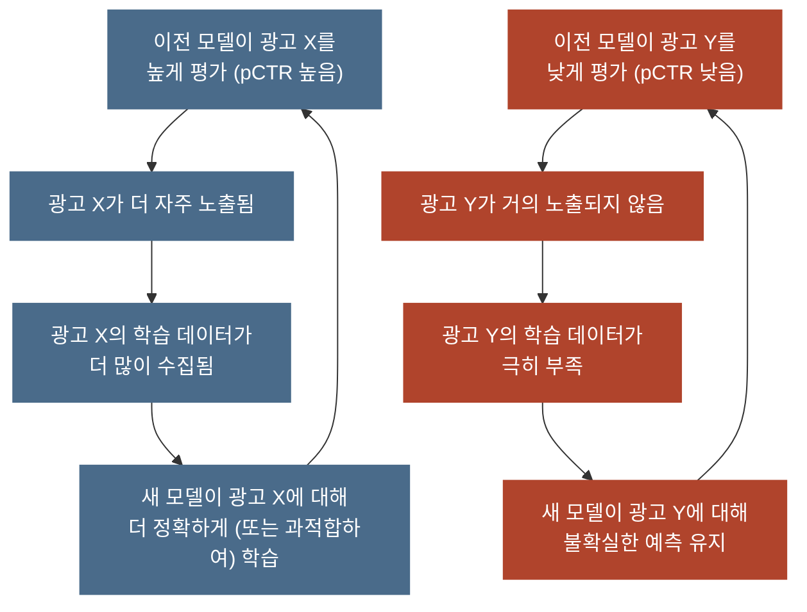

광고 로그로 클릭률(CTR)을 계산하는데 클릭한 로그는 한 줄도 빠짐없이 다 세었지만 클릭 안 한 로그는 너무 많아서 10줄 중 1줄만 골라 세었다고 해 봅시다. 클릭률은 클릭 수를 로그 수로 나눈 값인데 분모에 들어가야 할 안 눌린 로그의 90% 가 계산에서 빠졌으므로 이 방식으로 계산한 클릭률은 실제보다 훨씬 높게 나옵니다. 로그를 골라서 담으면 그 순간 비율이 실제보다 커집니다.

광고 클릭 모델의 학습 데이터도 매일 이렇게 만듭니다. 클릭은 노출 100번에 한두 번밖에 나오지 않고 안 눌린 로그는 하루에 수십억 행씩 쌓이는데, 그 로그를 전부 학습에 넣으면 시간과 비용을 감당할 수 없어 안 눌린 로그만 일부러 줄여서 학습합니다. 그 대가로 모델이 내는 예측 확률이 실제보다 커집니다. 이 글은 커진 예측을 되돌리는 공식 한 줄을 먼저 다룬 뒤, 그 공식으로도 되돌리지 못하는 더 깊은 편향으로 넘어갑니다.

pCTR(광고가 노출됐을 때 클릭될 확률을 모델이 예측한 값) 모델을 학습시키려고 impression log(광고가 노출될 때마다 클릭 여부와 함께 남는 로그)를 열었습니다. 수십억 행이 있고 피처도 풍부한데, 이 데이터에는 문제가 하나 더 숨어 있습니다. **학습 데이터의 모든 행은 "이전 모델이 노출하기로 결정한 광고"에서만 생성되었습니다.** 노출되지 않은 광고가 클릭되었을지는 영원히 알 수 없으므로 학습 데이터는 모으는 순간부터 이미 편향되어 있습니다.

**이전 모델**은 이 로그가 쌓이는 동안 실제로 광고를 내보내던 모델로, 논문에서는 로그를 만든 이 모델을 logging policy 라고 부릅니다. 광고 요청이 올 때마다 이전 모델이 후보 광고에 점수를 매겨 점수가 높은 광고만 화면에 올렸으므로, 로그에는 이전 모델이 고른 광고의 결과만 남습니다.

예를 들어 이전 모델이 러닝에 관심 있는 회원에게 러닝화 광고만 보여 주고 캠핑 의자 광고는 한 번도 보여 주지 않았다면, 로그에는 그 회원이 러닝화 광고를 눌렀는지만 남고 캠핑 의자 광고를 봤다면 눌렀을지는 어디에도 남지 않습니다. 지금 학습시키는 새 모델은 이런 로그로 배우는데, 이 모델이 서빙(학습을 마친 모델이 실제 광고 요청에 예측값을 내는 단계)에 올라가면 다음 학습에서는 이전 모델이 됩니다.

이 편향을 무시하면 어떻게 될까요? 먼저 모델의 [Calibration](post.html?id=calibration)이 깨집니다. Calibration 은 예측 확률이 실제 클릭 비율과 맞는 정도입니다. 입찰가도 pCTR 을 바탕으로 계산되므로, 입찰가를 가치보다 낮춰 정하는 [Bid Shading](post.html?id=bid-shading-censored)의 최적 입찰가도 함께 왜곡됩니다. AUC 는 클릭이 난 노출이 클릭이 나지 않은 노출보다 높은 점수를 받았는지 세는 순위 지표입니다. 그래서 AUC 가 아무리 높아도 편향된 데이터에서 학습한 확률값이 체계적으로 틀리는 문제는 그대로 남습니다. pCTR 자체가 낯설다면 [pCTR 예측 모델링](post.html?id=pctr-prediction) 글을 먼저 읽으면 됩니다.

> 한 줄 요약: 안 눌린 로그를 1/10 로 줄여 학습하면 진짜 2% 인 클릭률이 17% 로 커지지만 줄인 데이터로 학습한 모델의 출력 $q$ 와 안 눌린 로그를 남긴 비율 $r$ 을 공식 한 줄 $p = q / (q + (1-q)/r)$ 에 넣으면 원래 확률 $p$ 로 되돌아옵니다.

> **골라 읽는 법** — 절이 10개인 긴 글이라 처음부터 다 읽지 않아도 됩니다. 1절 앞의 「먼저 볼 것」에 이 글의 예시를 풀어 둔 표가 있습니다.
>
> - 편향 네 가지를 예시 숫자로 먼저 보려면 → 1절
> - 학습 데이터가 처음부터 편향되는 까닭만 → 2절
> - 과대 추정을 되돌리는 공식과 노출 편향의 보정만 → 3~4절
> - 학습 데이터를 만드는 실무 파이프라인만 → 5절
> - 두 무대(담장 안과 열린 RTB)의 비교만 → 6~7절

---

## 먼저 볼 것: 이 글에 나오는 예시

**이 글의 예시에는 회원 A, B 와 광고 X, Y 가 나옵니다. 1절에서 이 회원과 광고로 편향 네 가지를 하나씩 세어 봅니다.**

회원과 광고는 모두 설명을 위해 만든 값이며 이 글에서만 씁니다. 다른 글에도 회원 A, B 가 나오지만 이 글의 회원 A, B 와는 다른 사람입니다. 회원 A 는 한 사람이 아니라 러닝에 관심 있는 회원들을 대표하고 회원 B 는 러닝에 관심 없는 회원들을 대표하므로, 「회원 A 쪽에 1,000번 노출」은 러닝에 관심 있는 회원들이 받은 노출을 합쳐 1,000번이라는 뜻입니다. 한 사람이 같은 광고를 여러 번 보는 경우는 1절의 넷째 예시에서만 따로 다룹니다.

| 이름 | 무엇인가 | 정해 둔 값 | 어디에 나오나 |
|---|---|---|---|
| 회원 A | 러닝에 관심 있는 회원들 | 광고 X 를 처음 볼 때 진짜 클릭률 2.0% | 1절의 네 예시 전부 |
| 회원 B | 러닝에 관심 없는 회원들 | 광고 X 의 진짜 클릭률 0.2% | 1절의 첫째 예시 |
| 광고 X | 러닝화 광고 | 이전 모델이 점수를 높게 매긴 광고 | 1절, 2절의 그림 |
| 광고 Y | 캠핑 의자 광고 | 맨 위 칸에 두면 진짜 클릭률 2.0% 로 X 와 같습니다 | 1절의 둘째 예시, 2절의 그림 |
| 이전 모델 | 로그가 쌓이는 동안 광고를 내보내던 모델 | 점수가 높은 광고만 골라 보여 줬습니다 | 글 전체 |
| r = 0.1 | 안 눌린 줄을 남기는 비율 | 10줄에 1줄 | 1절의 셋째 예시, 3절 |

표의 진짜 클릭률은 「모든 경우를 구분하지 않고 보여 줬다면 나왔을 값」으로 이 글이 미리 정해 둔 값입니다. 실제 서비스에서는 아무도 이 값을 모르고 로그로 짐작할 뿐입니다. 이 글에 나오는 편향은 모두 이 진짜 값과 로그로 계산한 값이 서로 달라지는 경우입니다. 회원 A 의 2.0% 는 3절에서 만드는 가상 로그 50만 행의 전체 클릭률과 같도록 맞췄습니다.

---

## 1. 편향 네 가지 비교 (Executive Summary)

**광고 CTR 학습 데이터의 편향은 네 종류이지만 뿌리는 「누가 학습 데이터에 들어왔는가」가 공평하게 정해지지 않았다는 점 하나입니다.**

광고 CTR 모델의 학습 데이터에 영향을 주는 주요 편향 네 가지를 원인, 영향, 보정 기법, 복잡도로 나눠 아래 표에 한눈에 정리했습니다.

| 편향 유형 | 원인 | 영향 | 보정 기법 | 복잡도 |
|-----------|------|------|----------|--------|
| **Sample Selection Bias** | 모델이 선택한 광고만 노출 → 노출된 데이터만 학습 | $P(Y \mid X, O=1) \neq P(Y \mid X)$, 미노출 광고 성과 알 수 없음 | IPS, Doubly Robust | 높음 |
| **Position Bias** | 상위 위치의 광고가 더 많이 관찰됨 | 상위 광고 품질 과대추정, Rich-Get-Richer | IPS (Position), DLA, Regression EM | 중간 |
| **Negative Downsampling Bias** | 학습 효율을 위해 negative 샘플을 서브샘플링 | pCTR이 체계적으로 과대추정, Calibration 붕괴 | Log-odds Correction | 낮음 |
| **Impression Discounting** | 같은 유저에게 같은 광고 반복 노출 시 CTR 감소 | 최초 노출과 반복 노출의 CTR 혼합 → 평균 CTR 왜곡 | 노출 횟수별 보정 계수, 노출 횟수 피처 | 낮음 |

negative 샘플은 클릭이 나지 않은 로그 한 줄로, 이 글은 같은 줄을 1절에서 「안 눌린 줄」, 3절에서 「무클릭」이라고도 부릅니다. Sample Selection Bias 줄의 $P(Y \mid X, O=1) \neq P(Y \mid X)$ 는 광고가 노출된($O=1$) 경우만으로 센 클릭 확률이 노출 여부와 상관없는 클릭 확률과 같지 않다는 뜻입니다. 이 식은 4절에서 자세히 봅니다.

표의 말만으로는 실제로 무엇이 달라지는지 잘 보이지 않으므로 「먼저 볼 것」의 회원 A, B 와 광고 X, Y 로 하나씩 세어 봅니다. 네 예시는 모두 같은 순서로, 로그에 남은 것을 먼저 보고 실제로 일어난 일과 비교한 뒤 그 차이를 어디서 고치는지 적습니다.

### Sample Selection Bias: 이전 모델이 고른 짝만 남는 로그

**로그에는 이전 모델이 보여 주기로 고른 (회원, 광고) 짝의 결과만 있고 고르지 않은 짝은 결과가 아예 없어서 새 모델은 그 짝의 클릭률을 짐작으로 채웁니다.**

이전 모델은 점수가 높은 광고만 골라 보여 주는데 러닝화 광고 X 의 점수를 회원 A 쪽에는 높게, 회원 B 쪽에는 낮게 매겼으므로 X 는 A 쪽에만 1,000번 나갔고 B 쪽에는 한 번도 나가지 않았습니다. 그 자리에서 B 쪽 회원들은 다른 광고를 봤습니다.

| 회원 | 진짜 클릭률 | 이전 모델이 보여 준 횟수 | 로그에 남은 것 |
|---|---|---|---|
| 회원 A (러닝 관심) | 2.0% | 1,000번 | 클릭 20번 |
| 회원 B (관심 없음) | 0.2% | 0번 | 없음 |
| 로그로 계산한 X 의 클릭률 | | | 20 ÷ 1,000 = 2.0% |
| 두 쪽에 1,000번씩 보여 줬다면 | | | 22 ÷ 2,000 = 1.1% |

로그 자체는 틀리지 않았습니다. 표의 「로그로 계산한 X 의 클릭률」은 A 쪽 클릭 20번을 노출 1,000번으로 나눈 2.0% 로, A 쪽 회원들의 클릭률로는 정확한 값입니다. 문제는 B 쪽 칸이 비어 있다는 데 있습니다. 두 쪽에 1,000번씩 보여 줬다면 A 쪽 클릭 20번에 B 쪽 클릭 2번(1,000번의 0.2%)이 더해진 22번을 노출 2,000번으로 나눈 1.1% 가 X 의 클릭률이었을 텐데, 로그에는 B 쪽 줄이 하나도 없으므로 새 모델은 그 빈칸을 짐작으로 채웁니다. 새 모델이 X 의 평균만 배웠다면 B 같은 회원에게도 2.0% 를 매기는데, 그런 회원들은 실제로 0.2% 만 누르므로 새 모델은 B 쪽 클릭률을 열 배 높게 봅니다.

이 편향은 4절의 IPS(노출될 확률의 역수로 샘플에 가중치를 주는 보정)와 Doubly Robust(IPS 에 결과를 직접 예측하는 모델을 함께 쓰는 보정), 그리고 6절의 무작위 노출로 고칩니다. 자기 지면에 자기 광고를 붙이는 담장 안(6절)에서도, 광고주 쪽 시스템이 실시간 경매에 입찰해 남의 지면에서 광고 자리를 사 오는 열린 RTB(Real-Time Bidding)에서도 똑같이 생기는 편향입니다. 열린 RTB 에는 경매에서 진 노출이라는 한 겹이 더 있습니다(7절).

### Position Bias: 위 칸이라서 더 받는 클릭

**같은 광고라도 위 칸에 있으면 더 많이 눈에 띄어 더 많이 눌리는데, 로그는 이 자리 덕분에 받은 클릭을 광고의 실력으로 셉니다.**

이번 예시는 광고 칸이 3개인 지면입니다. 이전 모델은 점수가 높은 러닝화 광고 X 를 늘 1번 칸에, 캠핑 의자 광고 Y 를 늘 3번 칸에 두었습니다. 두 광고는 회원 A 쪽에 1,000번씩 노출됐습니다. 3번 칸은 1번 칸의 절반만 눈에 띈다고 정해 둡니다. 이 비율은 [Position Bias & ULTR](post.html?id=position-bias-ultr) 글의 위치별 표와 같습니다.

| 광고 | 이전 모델이 둔 자리 | 노출 | 클릭 | 로그로 본 클릭률 | 1번 칸에 뒀다면 |
|---|---|---|---|---|---|
| X 러닝화 | 1번 칸 | 1,000 | 20 | 2.0% | 2.0% |
| Y 캠핑 의자 | 3번 칸 | 1,000 | 10 | 1.0% | 2.0% |

두 광고를 같은 1번 칸에 두면 표의 마지막 열처럼 클릭률은 둘 다 2.0% 입니다. 그런데 Y 는 절반만 눈에 띄는 3번 칸에 있어서 1,000번 노출에서 클릭이 10번만 나와 로그로 본 클릭률이 1.0% 에 그쳤으므로, 로그만 보면 X 가 Y 보다 두 배 좋은 광고처럼 보입니다. 새 모델은 이 두 배 차이를 광고의 품질로 배워 다음에도 X 를 위 칸에 둡니다. 2절의 그림에 나오는 피드백 루프가 이렇게 시작됩니다.

이 편향을 고치는 방법은 [Position Bias & ULTR](post.html?id=position-bias-ultr) 글에 있습니다. 자리마다 눈에 띌 확률을 측정해 그 확률로 클릭을 다시 세는 IPS 와, 따로 실험하지 않고 그 확률을 모델과 함께 배우는 DLA 가 거기서 나옵니다. 광고를 어느 칸에 뒀는지는 담장 안에서는 로그에 정확히 남지만 열린 RTB 에서는 짐작만 할 수 있습니다.

### Negative Downsampling Bias: 안 눌린 줄을 줄여서 커지는 클릭률

**학습 비용을 줄이려고 안 눌린 줄만 10줄에 1줄 남기면 모델이 배우는 클릭률이 실제보다 크게 잡히지만 우리가 일부러 만든 편향이라 되돌릴 값도 알고 있습니다.**

첫째 예시에서 회원 A 쪽에 쌓인 로그 1,000줄을 그대로 가져와 클릭 20줄은 전부 남기고 안 눌린 980줄만 10줄에 1줄꼴로 남깁니다. 편향 네 가지를 정리한 표의 셋째 줄에 나오는 Negative Downsampling 은 이처럼 negative 만 일부 남기는 작업을 가리킵니다.

| 단계 | 클릭 줄 | 안 눌린 줄 | 클릭률 |
|---|---|---|---|
| 원래 로그 | 20 | 980 | 2.0% |
| 안 눌린 줄을 10줄에 1줄만 남김 | 20 | 98 | 16.9% |
| 3절의 보정식을 통과시킴 | | | 2.0% |

안 눌린 980줄에서 10줄에 1줄을 남기면 98줄이 되므로 학습 데이터는 클릭 20줄과 안 눌린 98줄을 합친 118줄입니다. 모델은 이 118줄만 보고 배우니 X 의 클릭률을 20 ÷ 118 = 16.9% 로 압니다. 16.9% 는 진짜 2.0% 의 여덟 배가 넘는 값이라 그대로 입찰에 쓰면 입찰가도 그만큼 커집니다. 다행히 안 눌린 줄을 남기는 비율은 우리가 직접 정한 값이므로, 그 값 r = 0.1 을 3절의 보정식 한 줄에 넣으면 16.9% 가 정확히 2.0% 로 돌아옵니다.

커진 클릭률은 3절의 보정식 $p = q / (q + (1-q)/r)$ 로 되돌립니다. 식의 $q$ 는 줄인 데이터로 학습한 모델의 출력, $p$ 는 되돌린 확률입니다. 담장 안이든 열린 RTB 든 같은 식을 씁니다.

### Impression Discounting: 같은 광고를 다시 볼수록 줄어드는 클릭

**같은 회원이 같은 광고를 하루에 여러 번 보면 볼 때마다 덜 누르므로, 몇 번째로 본 노출인지 빼고 평균을 내면 어느 회차와도 맞지 않는 값이 나옵니다.**

이번에는 회원 A 쪽 회원들이 오늘 X 를 한 사람당 세 번씩 봤다고 해 봅니다. 처음 볼 때의 진짜 클릭률은 2.0% 이고 볼 때마다 절반으로 줄어든다고 정해 두므로 두 번째는 1.0%, 세 번째는 0.5% 입니다. 회차마다 노출 수는 같습니다.

| 오늘 X 를 본 회차 | 진짜 클릭률 | 회차를 모르는 모델의 답 |
|---|---|---|
| 첫 번째 | 2.0% | 1.17% |
| 두 번째 | 1.0% | 1.17% |
| 세 번째 | 0.5% | 1.17% |

회차마다 노출 수가 같으므로 로그에 보이는 평균 클릭률은 세 회차의 값을 단순 평균한 (2.0% + 1.0% + 0.5%) ÷ 3 ≈ 1.17% 인데, 회차를 모르는 모델은 세 번 모두 이 평균으로 답합니다. 그 결과 모델은 첫 노출을 진짜 2.0% 보다 40% 넘게 낮게, 세 번째 노출을 진짜 0.5% 보다 두 배 넘게 높게 매깁니다. 한 사람에게 같은 광고를 정해진 기간 안에 보여 주는 횟수의 한도를 빈도 상한이라고 하며 이 예시의 빈도 상한은 하루 세 번입니다. 빈도 상한을 하루 한 번으로 줄이면 남는 노출이 첫 번째뿐이라 실제 평균은 2.0% 로 오르는데 모델은 여전히 1.17% 로 답하므로, 진짜 값과 모델의 답의 차이가 더 커집니다.

이 편향은 「오늘 이 광고를 몇 번째 보나」를 피처로 넣거나 회차별 보정 계수를 곱해서 고칩니다. 이 글에서는 더 다루지 않습니다. 회차를 세는 카운터는 [리타게팅과 빈도 상한](post.html?id=retargeting-frequency-cap) 글에 있습니다. 회차를 셀 때 쓰는 식별자는 담장 안에서는 회원 ID 이고 열린 RTB 에서는 브라우저에 저장해 두는 식별 값인 쿠키입니다. 그래서 열린 RTB 에서는 쿠키가 지워지면 회차를 처음부터 다시 셉니다.

### 네 편향의 두 갈래

네 편향은 누가 만들었는지에 따라 두 갈래로 나뉩니다. 표의 위 두 줄인 첫째와 둘째 예시는 **우리가 당하는** 편향으로, 어떤 광고를 보여 줄지는 이전 모델이 이미 정했고 그 결정은 되돌릴 수 없습니다. 아래 두 줄인 셋째와 넷째 예시는 **우리가 스스로 만든** 편향으로, 학습 비용을 줄이려고 데이터를 골라 담았거나 반복 노출로 CTR 이 달라지는 것을 회차 구분 없이 한데 섞어 평균을 냈기 때문에 생깁니다.

두 갈래는 고치는 난이도가 다릅니다. 스스로 만든 편향은 다운샘플링 비율 $r$ 처럼 되돌릴 값을 우리가 직접 정했으므로 산수로 풀리지만 당하는 편향은 되돌릴 값을 추정해야 해서 훨씬 어렵습니다. 그래서 이 글은 3절에서 쉬운 쪽인 Negative Downsampling Bias 를 먼저 끝내고 4절에서 어려운 쪽인 Sample Selection Bias 로 넘어갑니다. 3절은 안 눌린 로그를 줄여서 생기는 확률 과대 추정을 다룹니다. 4절은 새 모델이 이전 모델이 보여 준 노출로 배운 뒤 보여 준 적 없는 짝에도 점수를 매기는 데서 생기는 편향, 곧 배운 자리와 쓰는 자리가 다른 편향을 다룹니다.

이름이 비슷해 자주 헷갈리는 편향도 하나 구분해 둡니다. Position Bias 는 광고가 놓인 **자리 때문에 클릭이 왜곡되는** 문제입니다. 이 글이 집중하는 두 편향은 **표본을 골라 담아서 확률이 왜곡되는** 문제입니다. 원인이 서로 다르므로 보정법도 다릅니다.

> 이 글이 깊이 다루는 편향은 **Negative Downsampling Bias**(3절)와 **Sample Selection Bias**(4절)입니다. 위치가 만드는 편향은 [Position Bias & ULTR](post.html?id=position-bias-ultr) 글에서 다룹니다.

---

## 2. 광고 CTR 학습 데이터가 편향되는 원인

**학습 데이터는 저절로 생기지 않고 어제까지 광고를 내보내던 이전 모델이 골라 준 노출로만 만들어집니다.**

1절의 첫째 예시에서 회원 B 쪽 칸은 우연히 비지 않았습니다. 광고 시스템이 학습 데이터를 만드는 순서를 따라가 보면 이런 빈칸이 어디서 생기는지와 왜 무작위로 생기지 않는지가 보입니다.

### 관측 편향 (Observational Bias)

광고 시스템에서 학습 데이터는 아래 네 단계를 거쳐 만들어집니다.

1. 광고 요청(Ad Request)이 도착합니다.
2. 모델이 후보(Candidate) 광고 풀에 있는 광고들의 순위를 eCPM(광고 노출 1,000번당 기대 수익) 기준으로 매깁니다.
3. 순위가 높은 상위 N개 광고가 노출됩니다.
4. 노출된 광고마다 클릭했는지 안 했는지가 로그로 남습니다.

로그는 4단계에서만 남으므로 **3단계에서 탈락한 광고의 결과는 영원히 관측되지 않습니다.** 실제로 일어나지 않은 경우의 결과를 반사실(Counterfactual)이라고 합니다. 유저 $u$ 에게 광고 $a$ 가 노출되지 않았다면 「만약 노출했다면 클릭했을까?」라는 질문에 답할 데이터가 어디에도 없습니다. 이 상태를 반사실의 부재라고 부릅니다. 1절의 회원 B 쪽 칸도 X 가 B 쪽 요청에서 3단계를 통과하지 못해 비어 있었습니다.

### Missing Not At Random (MNAR)

결측값(Missing Data, 비어 있는 값)이 무작위로 생긴다는 말은 어떤 값이 빠질지가 그 값과 상관없다는 뜻입니다. 일반적인 데이터 분석에서는 결측값이 이렇게 무작위로 생기면 큰 문제가 되지 않습니다. 하지만 광고 데이터의 결측은 **체계적**인데, 노출 여부 자체를 모델의 예측값, 입찰가, 경매 결과가 정하기 때문입니다.

$$P(\text{Observed} \mid X, Y) \neq P(\text{Observed} \mid X)$$

식의 왼쪽은 피처 $X$ 와 결과 $Y$(클릭 여부)를 모두 알 때 그 줄이 관측될 확률이고 오른쪽은 $X$ 만 알 때 관측될 확률입니다. 두 사건은 한쪽을 알아도 다른 쪽의 확률이 바뀌지 않을 때 독립입니다. 이 식은 $Y$ 를 알 때와 모를 때 관측 확률이 같지 않다고 말하므로 관측 확률은 결과 $Y$ 와 독립이 아닙니다. 모델이 「이 광고는 클릭될 가능성이 높다」고 예측한 광고일수록 더 많이 노출되므로 관측 자체가 $Y$ 와 상관관계를 갖습니다. 이렇게 데이터가 무작위로 빠지지 않은 구조를 MNAR 이라고 부릅니다.

### Feedback Loop: 스스로 강해지는 편향

가장 심각한 문제는 자기 강화(Self-Reinforcing)입니다. 이전 모델이 고른 데이터로 학습한 새 모델이 다음 학습에서는 이전 모델이 되어 다시 데이터를 고르므로, 아래 그림처럼 편향이 편향을 강화합니다.



왼쪽 파란 루프에서는 이전 모델이 높게 평가한 광고 X 가 더 자주 노출되어 X 의 학습 데이터가 더 많이 모입니다. 새 모델은 X 를 더 정확하게(또는 과적합해서) 배운 뒤 다음 학습에서 이전 모델이 되어 다시 X 를 높게 평가합니다. 인기 광고의 데이터가 갈수록 풍부해지는 이 현상을 **Rich-Get-Richer** 라고 합니다. 오른쪽 빨간 루프에서는 이전 모델이 낮게 평가한 광고 Y 가 거의 노출되지 않아 학습 데이터가 극히 부족하므로 새 모델의 Y 예측도 불확실한 채로 남습니다. 데이터가 거의 없어 예측이 어려운 상태를 Cold-Start 라고 합니다. 비인기 광고가 기회조차 얻지 못해 이 상태가 풀리지 않는 현상이 **Cold-Start 고착**입니다.

두 루프가 동시에 돌면 모델은 아직 덜 보여 준 광고를 시험해 보는 탐색(Exploration) 없이 지금 좋아 보이는 광고를 계속 쓰는 활용(Exploitation)만 반복합니다. 이 반복이 [탐색과 활용](post.html?id=exploration-exploitation) 문제가 학습 데이터에 나타난 모습입니다.

---

## 3. Negative Sampling 이 필요한 이유와 방법

**안 눌린 로그를 다 쓰면 학습이 끝나지 않지만 줄이면 확률이 실제보다 크게 잡히므로, 줄여서 학습한 뒤 모델의 출력을 보정식으로 되돌립니다.**

아래 카드에서는 무클릭을 1/10 만 남기면 진짜 2% 인 클릭률이 줄인 학습 데이터에서 16.86% 로 커지지만 그 데이터로 학습한 모델의 예측은 보정식을 거쳐 1.98% 로 돌아오는 흐름을 보면 됩니다.

<div class="demo-embed-wrap">
<iframe class="demo-embed" src="demo-training-cards.html?embed=1&card=negsample" height="480" loading="lazy" title="줄이고 되돌린다"></iframe>
<a class="demo-embed-open" href="demo-training-cards.html" target="_blank" rel="noopener">↗ 카드 여섯 장 전체로 열기</a>
</div>

### 극단적 Class Imbalance 문제

학습 데이터에서 클릭이 난 줄은 positive, 클릭이 나지 않은 줄은 negative 입니다. 두 클래스 가운데 한쪽이 다른 쪽보다 훨씬 적은 상태를 Class Imbalance 라고 합니다. 광고 CTR 은 도메인에 따라 다르지만 대략 아래 범위에 있어서 positive 1개에 negative 가 적게는 20개, 많게는 1,000개 있습니다.

| 광고 유형 | 대략적 CTR | Positive:Negative 비율 |
|-----------|-----------|----------------------|
| Display 광고 | 0.1% ~ 0.5% | 1:200 ~ 1:1,000 |
| 검색 광고 | 1% ~ 5% | 1:20 ~ 1:100 |
| 소셜 피드 광고 | 0.5% ~ 2% | 1:50 ~ 1:200 |

Class Imbalance 가 이 정도로 극단적일 때 전체 데이터를 그대로 학습하면 세 가지 문제가 생깁니다.

**1. 학습 비효율.** gradient(모델의 가중치를 어느 방향으로 얼마나 고칠지 알려 주는 값)의 대부분이 「너무 쉬운」 negative 샘플에서 나옵니다. 모델은 이미 negative 라고 확신하는 이런 샘플을 거듭 학습하느라 계산 자원을 낭비합니다.

**2. 수렴 지연.** 수렴은 학습을 거듭하면서 모델의 가중치가 안정된 값에 다가가는 과정입니다. Positive 샘플이 전체의 0.1% 라면 1,000줄에 1줄꼴이라 모델이 의미 있는 positive gradient 를 받기까지 수백 배치를 기다려야 합니다. 배치는 가중치를 한 번 고칠 때 함께 쓰는 샘플들입니다.

**3. 인프라 부담.** 하루에 impression 이 수십억 건씩 생기는 시스템에서는 스토리지와 컴퓨팅 부담이 너무 커서 전체 데이터를 학습 파이프라인에 넣는 일이 현실적이지 않습니다.

### Random Negative Downsampling

이런 문제를 다루는 가장 단순하고 널리 쓰이는 전략은 **Random Negative Downsampling** 입니다. Positive 샘플은 전부 두고 negative 샘플만 비율 $r$ 로 무작위 추출하므로, $r = 0.1$ 이면 negative 10개 가운데 1개꼴로 남아 1절의 「10줄에 1줄」과 같습니다.

아래 코드는 1단계에서 이 전략을 함수로 만들고 2단계에서 CTR 0.2% 인 로그 1,000만 건을 예로 둡니다. negative 를 10% 만 남긴 뒤의 행 수와 positive 비율은 2단계 주석에 계산해 두었습니다.

```python
# 하는 일: positive 는 모두 두고 negative 만 비율 r 로 뽑는 Random Negative Downsampling 함수를 만들고, CTR 0.2% 인 로그 1,000만 건을 예로 둔다.
import numpy as np

# 1단계: negative 만 비율 r 로 남기는 함수를 만든다
def negative_downsample(labels, features, ratio=0.1, seed=42):
    """Negative 샘플을 ratio 비율로 랜덤 다운샘플링.
    
    Args:
        labels: 클릭 여부 (0 or 1)
        features: 피처 행렬
        ratio: negative 샘플링 비율 (e.g., 0.1 = 10%만 유지)
    Returns:
        샘플링된 (labels, features)
    """
    rng = np.random.RandomState(seed)
    pos_mask = labels == 1
    neg_mask = labels == 0
    
    # Positive 전부 유지
    pos_indices = np.where(pos_mask)[0]
    
    # Negative에서 ratio 비율만 랜덤 추출
    neg_indices = np.where(neg_mask)[0]
    n_keep = int(len(neg_indices) * ratio)
    sampled_neg = rng.choice(neg_indices, size=n_keep, replace=False)
    
    keep = np.concatenate([pos_indices, sampled_neg])
    return labels[keep], features[keep]

# 2단계: CTR 0.2% 인 로그 1,000만 건을 예로 둔다
# negative 를 10% 만 남기면 positive 20,000 + negative 998,000 = 1,018,000행이 남는다. 데이터 크기는 약 10배 줄고, positive 비율은 0.2% 에서 약 2% 로 오른다.
n_total = 10_000_000
n_pos = 20_000    # 0.2%
n_neg = 9_980_000 # 99.8%
```

주석의 계산을 따라가면 positive 20,000건은 그대로 남고 negative 는 10% 인 998,000건만 남아 1,018,000행이 됩니다. 1,000만 행이던 데이터가 약 10배 줄고 positive 비율은 20,000 ÷ 1,018,000 으로 0.2% 에서 약 2% 로 오릅니다.

**장점:**
- 학습 데이터의 크기가 $1/r$ 배 줄어듭니다(예: $r = 0.1$ 이면 10배).
- positive 비율이 높아져 학습 효율이 좋아집니다.
- 구현이 단순하고 시드를 고정하면 같은 결과를 다시 얻을 수 있습니다.

**문제:**
- 예측 확률이 체계적으로 실제보다 크게 나와 Calibration 이 깨집니다(Calibration 붕괴).

### Calibration 보정 (Log-odds Correction)

Negative Downsampling 을 거친 데이터로 학습한 모델이 내는 확률 $q$ 는 줄이기 전 원래 데이터에서의 확률 $p$ 와 다릅니다. 학습 데이터에서 negative 비율이 줄어 모델은 「무클릭이 원래보다 훨씬 적은 세상」을 보고 배우므로, 클릭 쪽 비중을 실제보다 높게 여겨 positive 확률을 과대추정합니다.

다행히 이 과대 추정은 아래 한 줄로 정확히 되돌릴 수 있습니다.

$$p = \frac{q}{q + \frac{1 - q}{r}}$$

식의 $r$ 은 negative sampling ratio(negative 를 남긴 비율), $q$ 는 다운샘플링 데이터로 학습한 모델의 원 출력, $p$ 는 되돌린 실제 확률입니다. $r$ 이 1 보다 작으면 분모의 $(1-q)/r$ 이 $1-q$ 보다 커서 분모 전체가 $q + (1-q) = 1$ 보다 크므로 $p$ 는 $q$ 보다 작은 쪽으로 돌아옵니다. 식이 이렇게 생긴 까닭은 odds 에 있습니다. odds 는 일어날 경우 수 대 안 일어날 경우 수의 비로, 클릭이라면 클릭 수를 무클릭 수로 나눈 값입니다. negative 만 $r$ 비율로 줄이면 odds 의 분모인 무클릭 수만 $r$ 배가 되어 odds 가 정확히 $1/r$ 배로 커지는데, 보정식은 그 odds 를 다시 $r$ 배로 되돌리는 계산을 확률로 풀어 쓴 꼴입니다. 유도 과정은 아래 접은 블록에 담았습니다.

:::deep 더 깊이 — 왜 이 한 줄로 되돌려지나 (유도, 그리고 importance weighting)
다운샘플링은 positive 는 그대로 두고 negative 만 $r$ 배로 줄이는 조작입니다. 이 조작은 확률로 보면 복잡하지만 **odds** 로 보면 아주 단순합니다.

원래 데이터의 odds 는 $\frac{p}{1-p}$ 이고 다운샘플링된 데이터의 odds 는 $\frac{q}{1-q}$ 입니다. positive 는 전부 두고 negative 만 $r$ 비율로 줄였으므로 odds 의 분모 쪽만 $r$ 배로 작아집니다.

$$\frac{q}{1-q} = \frac{1}{r} \cdot \frac{p}{1-p}$$

그래서 다운샘플링은 **odds 를 정확히 $1/r$ 배 키우는 조작**이고 이 식을 $p$ 를 구하는 꼴로 풀면 위의 보정 공식이 나옵니다. 1절의 회원 A 쪽 로그로 확인하면 odds 는 클릭 20줄 대 안 눌린 980줄에서 20줄 대 98줄로 분모만 $r$ = 0.1 배가 되어 정확히 10배가 됩니다.

로지스틱 회귀로 보면 더 분명합니다. 로지스틱 회귀는 odds 에 로그를 취한 log-odds 를 절편과 피처마다의 기울기로 이루어진 일차식으로 예측하는 모델입니다. odds 가 $1/r$ 배가 되면 log-odds 에는 $\ln(1/r)$ 만큼의 상수가 더해지므로 절편(bias) 하나만 위로 밀리고 기울기는 전혀 바뀌지 않습니다. 모든 예측의 log-odds 가 같은 상수만큼 올라가도 예측의 순서는 그대로입니다. 그래서 확률은 모두 커져도 AUC 같은 순위 지표는 이 변화를 알아채지 못합니다. 이 성질 덕분에 보정도 마지막에 한 번 되돌리기만 하면 됩니다.

**importance weighting 과의 관계.** 같은 목적은 다른 방법으로도 이룰 수 있습니다. negative 를 $r$ 배로 줄인 뒤 서빙에서 되돌리는 대신, 남긴 negative 에 가중치 $1/r$ 을 주고 학습하면 남긴 negative 1개가 원래 negative $1/r$ 개 몫을 하므로 기대 손실이 원래 데이터와 같아집니다. 그러면 모델이 처음부터 원래 분포의 확률을 배우므로 서빙에서 보정할 필요가 없습니다.

그럼 실무는 왜 가중치 대신 보정식을 쓸까요? 가중치를 크게 주면 그 샘플 하나가 gradient 를 크게 흔들어 분산이 커지고 학습이 불안해지는 반면, 보정식은 학습을 전혀 건드리지 않고 마지막에 한 번 곱하는 산수입니다. 그래서 「샘플링해서 학습하고 서빙에서 되돌린다」가 표준이 되었습니다.
:::

$r = 0.1$ 로 학습한 모델이 15% 로 예측했을 때 보정식이 원래 확률을 얼마로 되찾는지 아래 코드로 계산합니다.

```python
# 하는 일: negative 를 10% 만 남겨 학습한 모델이 15% 로 예측했을 때, 보정식으로 원래 확률을 되찾는다.
# 1단계: 다운샘플링한 모델의 출력을 원래 확률로 되돌리는 함수를 만든다
def calibrate_downsampling(q, r):
    """Downsampling된 모델 출력 q를 원래 확률 p로 보정.
    
    Args:
        q: 모델 예측 확률 (downsampled 데이터에서 학습)
        r: negative sampling ratio
    Returns:
        p: 보정된 확률
    """
    return q / (q + (1 - q) / r)

# 2단계: r = 0.1 로 학습한 모델이 15% 로 예측한 값을 보정한다
# 15% 를 그대로 쓰면 입찰가가 8.65배 과대 평가된다(0.15 / 0.017341 = 8.65).
r = 0.1  # negative 10%만 사용
q = 0.15 # 모델이 15%로 예측

p = calibrate_downsampling(q, r)
print(f"모델 출력 q = {q:.2%}")
print(f"보정 후   p = {p:.4%}")

# 출력:
# 2단계 뜻: 모델이 낸 15.00% 는 보정하면 1.7341% 다.
# 모델 출력 q = 15.00%
# 보정 후   p = 1.7341%
```

찍힌 값을 식으로 따라가면 분모는 $q$ 0.15 에 $(1 - 0.15) / 0.1 = 8.5$ 를 더한 8.65 이므로 $p$ 는 0.15 ÷ 8.65 = 0.017341, 백분율로 1.7341% 입니다. 이 분모 8.65 는 모델 출력 $q$ 가 보정한 $p$ 의 몇 배인지(0.15 ÷ 0.017341 = 8.65)와 같아서 15% 를 보정 없이 그대로 입찰에 쓰면 주석대로 입찰가가 8.65배 과대 평가됩니다.

보정을 빼먹으면 pCTR 이 체계적으로 과대추정되므로 입찰가를 정하는 바탕인 True Value = pCTR x Conversion Value(전환 가치)도 같은 배수로 과대 계산되어 결국 입찰가가 비정상적으로 높아집니다. Facebook 광고 시스템에 이 보정을 적용한 사례는 He et al. (2014)이 보고했습니다. 보정이 서빙에서 제대로 돌고 있는지는 P/O Ratio(예측 평균을 실제 클릭 비율로 나눈 값, 5절)로 확인합니다. 지표의 정의와 읽는 법은 [Calibration](post.html?id=calibration) 글에 있습니다.

> Negative Downsampling 은 학습 효율 때문에 거의 필수로 쓰이지만 **Log-odds Correction 없이 쓰면 Calibration 을 파괴하므로** 이 보정은 서빙 파이프라인에 반드시 포함되어야 합니다.

### 가상 로그 50만 행의 계산 — 2% 에서 17% 로, 다시 2% 로

**보정식이 정말 원래 확률로 되돌리는지는 진짜 클릭률을 미리 정해 둔 가상 로그 50만 행에서 직접 세어 보면 확인됩니다.**

말로만 「커진다」고 하면 얼마나 커지는지 감이 오지 않습니다. 실제 로그에서는 진짜 클릭률을 아무도 모르니 모델이 얼마나 틀렸는지도 알 수 없습니다. 그래서 진짜 클릭률을 우리가 미리 정해 둔 가상 로그를 만듭니다. 노출은 50만 건이고 세그먼트(시간대나 검색 의도 같은 기준으로 나눈 노출의 집단)는 3개이며 전체 진짜 CTR 은 2.0% 입니다. 세그먼트별 진짜 CTR 은 morning_mobile(아침 모바일) 0.5%, evening_mobile(저녁 모바일) 2.0%, search_intent(검색 의도가 있는 노출) 5.0% 이고 노출 비중이 0.50, 0.25, 0.25 라서 코드 주석대로 0.50 × 0.5% + 0.25 × 2.0% + 0.25 × 5.0% = 2.0% 가 됩니다. 이 로그에서 무클릭만 줄여 학습시킨 뒤 모델의 답을 정답과 비교하면 얼마나 틀렸는지를 정확히 측정할 수 있습니다.

아래 코드는 표준 라이브러리만 씁니다. 난수 시드를 42 로 고정했으므로 복사해서 그대로 돌리면 같은 숫자가 나옵니다. 1단계에서 로그를 만들고 2~4단계에서 무클릭을 줄이는 함수, 세그먼트별 평균 클릭률을 외우는 모델, 보정식을 차례로 만든 뒤 5단계에서 $r$ 을 1.0, 0.1, 0.01 로 바꿔 가며 보정 전후의 평균 예측을 찍고 6단계에서 $r = 0.1$ 의 세그먼트별 값을 찍습니다. 3단계의 모델은 세그먼트별 평균 클릭률을 그대로 외우므로 학습 데이터 안에서는 보정이 정확히 맞는 가장 정직한 모델이지만 코드 주석대로 그런 모델도 줄인 데이터로 학습하면 예측이 커집니다.

```python
# 하는 일: 진짜 CTR 2.0% 로 만든 가상 로그 50만 행에서 무클릭만 비율 r 로 줄여 학습하고, r 이 1.0, 0.1, 0.01 일 때 평균 예측이 얼마나 커지고 보정식이 얼마나 되돌리는지 센다.
import random

random.seed(42)  # 시드 고정 — 몇 번 돌려도 같은 숫자가 나오게

# 1단계: 진짜 클릭률을 아는 가상 로그 50만 행을 만든다
# 세그먼트 3개. 오른쪽 숫자가 '진짜 클릭률'이다.
# 우리는 정답을 알고 시작하지만, 모델은 로그만 보고 이 값을 맞혀야 한다.
SEG_CTR = {"morning_mobile": 0.005, "evening_mobile": 0.020, "search_intent": 0.050}

# 노출이 세그먼트에 나뉘는 비중.
# 가중평균이 정확히 2.0%가 되게 잡았다: 0.50*0.5% + 0.25*2.0% + 0.25*5.0% = 2.0%
SEG_SHARE = {"morning_mobile": 0.50, "evening_mobile": 0.25, "search_intent": 0.25}

N = 500_000               # 하루치 노출 로그라고 치자 (가상 데이터)
names = list(SEG_CTR)     # 세그먼트 이름 순서를 한 번 고정해 둔다
shares = [SEG_SHARE[s] for s in names]

# 로그 한 줄 = (세그먼트, 클릭했나 0/1). 실제 impression log를 흉내낸 것.
log = []
for _ in range(N):
    seg = random.choices(names, weights=shares, k=1)[0]  # 이 노출이 난 세그먼트
    y = 1 if random.random() < SEG_CTR[seg] else 0       # 진짜 확률로 클릭 추첨
    log.append((seg, y))

n_click = sum(y for _, y in log)
print(f"원본 로그 {len(log):,}행, 클릭 {n_click:,}건, CTR {n_click / len(log):.2%}")

# 세그먼트별 실제 노출 수. 서빙에서 만나는 트래픽 분포다 — 평균 예측의 가중치로 쓴다.
real_imp = {s: 0 for s in names}
for seg, _ in log:
    real_imp[seg] += 1


# 2단계: negative 만 비율 r 로 남기는 함수를 만든다
def downsample(rows, r, seed=42):
    """클릭은 전부 살리고, 무클릭은 확률 r로만 살린다.
    r=0.1이면 무클릭 10건 중 평균 1건만 학습 데이터에 남는다."""
    rng = random.Random(seed)  # 바깥 난수 상태를 건드리지 않도록 별도 난수기
    return [row for row in rows if row[1] == 1 or rng.random() < r]


# 3단계: 세그먼트별 평균 클릭률을 외우는 모델 함수를 만든다
def fit(rows):
    """세그먼트별 평균 클릭률을 그대로 외우는, 가장 정직한 모델.
    학습 데이터 안에서는 완벽히 보정된 모델이다 — 그런데도 커진다는 게 이 절의 요점."""
    imp, clk = {}, {}
    for seg, y in rows:                      # 전체를 한 번 순회한다 = 학습 1에폭에 해당
        imp[seg] = imp.get(seg, 0) + 1       # 세그먼트별 노출 수
        clk[seg] = clk.get(seg, 0) + y       # 세그먼트별 클릭 수
    return {s: clk[s] / imp[s] for s in imp}


# 4단계: 보정식과 트래픽 가중 평균 예측 함수를 만든다
# 보정식이 이 글의 핵심 한 줄이다.
def correct(q, r):
    """다운샘플링 데이터로 학습한 예측 q를 원래 확률로 되돌린다."""
    return q / (q + (1 - q) / r)


def avg_pred(model, r=None):
    """실제 트래픽 분포로 가중평균한 평균 예측. r을 주면 보정 후 값."""
    total = sum(real_imp.values())
    return sum(real_imp[s] * (model[s] if r is None else correct(model[s], r))
               for s in names) / total


# 5단계: 샘플링 비율 셋으로 학습해 보정 전후를 나란히 본다
for r in (1.0, 0.1, 0.01):
    train = downsample(log, r)
    model = fit(train)
    train_ctr = sum(y for _, y in train) / len(train)
    print(f"r={r:<5} 행 {len(train):>7,}, 학습셋 CTR {train_ctr:6.2%}"
          f", 보정 전 {avg_pred(model):6.2%}, 보정 후 {avg_pred(model, r):6.2%}")

# 6단계: r = 0.1 에서 세그먼트별로 뜯어본다
model = fit(downsample(log, 0.1))
print("\n[r=0.1] 세그먼트별, 진짜 CTR, 모델 출력, 보정 후")
for s in names:
    q = model[s]
    print(f"  {s:<15} 진짜 {SEG_CTR[s]:6.2%}, 모델 {q:6.2%}, 보정 {correct(q, 0.1):6.2%}")

ratio = avg_pred(model) / avg_pred(model, 0.1)
print(f"\n보정을 빼먹으면 평균 예측이 진짜의 {ratio:.1f}배 → 입찰가도 그만큼 커진다")

# 출력:
# 1단계 뜻: 가상 로그 500,000행에서 클릭이 9,937건 나와 CTR 이 1.99% 다.
# 원본 로그 500,000행, 클릭 9,937건, CTR 1.99%
# 5단계 뜻: 무클릭을 줄일수록 학습셋 CTR 이 16.86%, 67.05% 로 커지고 보정 전 평균 예측도 15.14%, 54.43% 로 뜬다. 보정하면 1.98%, 1.96% 로 원래의 1.99% 근처로 돌아온다.
# r=1.0   행 500,000, 학습셋 CTR  1.99%, 보정 전  1.99%, 보정 후  1.99%
# r=0.1   행  58,931, 학습셋 CTR 16.86%, 보정 전 15.14%, 보정 후  1.98%
# r=0.01  행  14,821, 학습셋 CTR 67.05%, 보정 전 54.43%, 보정 후  1.96%
# 6단계 뜻: r = 0.1 이면 세 세그먼트 모두 모델 출력이 진짜의 몇 배로 뜨고, 보정하면 0.49%, 2.05%, 4.88% 로 돌아온다. 보정을 빼먹으면 평균 예측이 진짜의 7.7배다.
#
# [r=0.1] 세그먼트별, 진짜 CTR, 모델 출력, 보정 후
#   morning_mobile  진짜  0.50%, 모델  4.69%, 보정  0.49%
#   evening_mobile  진짜  2.00%, 모델 17.33%, 보정  2.05%
#   search_intent   진짜  5.00%, 모델 33.90%, 보정  4.88%
#
# 보정을 빼먹으면 평균 예측이 진짜의 7.7배 → 입찰가도 그만큼 커진다
```

1단계는 가상 로그 500,000행에서 클릭이 9,937건 나와 CTR 이 1.99% 라고 찍었습니다. 클릭을 진짜 확률로 추첨해 만든 로그라 정해 둔 2.0% 와 꼭 같지는 않은데, 아래 표에서는 이 1.99% 를 진짜 값으로 봅니다. 5단계가 찍은 값을 표로 옮기면 아래와 같습니다. **모두 위 코드가 만든 가상 데이터입니다.**

| 샘플링 비율 $r$ | 학습셋 행 수 | 학습셋 CTR | 보정 전 평균 예측 | 보정 후 평균 예측 | 1에폭 비용(행 수 기준) |
|---|---|---|---|---|---|
| 1/1 (안 줄임) | 500,000 | 1.99% | 1.99% | 1.99% | 1.00배 |
| **1/10** | 58,931 | **16.86%** | **15.14%** | **1.98%** | 0.12배 |
| 1/100 | 14,821 | 67.05% | 54.43% | 1.96% | 0.03배 |

학습셋은 다운샘플링한 뒤 실제로 학습에 쓰는 데이터입니다. 첫 줄은 아무것도 줄이지 않은 기준선이라 학습셋 CTR 1.99% 가 진짜 값이고 모델도 1.99% 로 답합니다. 두 번째 줄은 무클릭을 1/10 로 줄인 경우로, 클릭 9,937건은 전부 남고 무클릭은 10건 중 9건이 사라져 학습셋이 58,931행이 되므로 학습셋 CTR 이 9,937 ÷ 58,931 = 16.86% 로 커집니다. 세 번째 줄처럼 1/100 까지 줄이면 학습셋 CTR 이 67% (9,937 ÷ 14,821 = 67.05%)가 되어 모델은 「클릭이 반 이상」인 이상한 세상을 보고 배웁니다.

결론은 마지막 두 열에 있습니다. 1/10 줄의 보정 전 평균 예측 15.14% 는 출력의 마지막 줄대로 진짜의 **7.7배**인데, 세그먼트별 예측 하나하나에 보정식을 한 번 통과시키자 보정 후 평균 예측이 1.98% 로 돌아와 진짜 값 1.99% 와 0.01%p 밖에 차이 나지 않습니다. 1/100 로 줄인 경우도 보정하면 1.96% 까지 돌아오는데, 진짜 값과의 차이로 남은 0.03%p 는 보정식의 오차가 아니라 학습셋이 14,821행으로 줄어 표본이 작아진 탓에 생긴 잡음입니다.

6단계의 세그먼트별 출력을 보면 보정이 어떤 계산인지 더 잘 보입니다. 진짜 0.50% 인 morning_mobile 은 모델 출력 4.69% 가 보정 후 0.49% 로 돌아왔습니다. 진짜 5.00% 인 search_intent 는 모델 출력 33.90% 가 보정 후 4.88% 가 되었습니다. 그런데 과대 추정의 배수는 세그먼트마다 달라 낮은 확률은 4.69 ÷ 0.50 으로 약 9.4배, 높은 확률은 33.90 ÷ 5.00 으로 약 6.8배 커졌습니다. 다운샘플링이 정확히 $1/r$ 배(여기서는 10배)로 키우는 값은 확률이 아니라 odds 인데, 확률이 작을 때는 odds 가 확률과 거의 같아 확률도 10배 가까이 커지고 확률이 클수록 그보다 덜 커집니다. 그래서 「전체 평균을 상수로 나누는」 식의 보정은 통하지 않고 예측 하나하나에 보정식을 따로 적용해야 합니다.

학습 비용도 같이 봅니다. 1에폭은 학습 데이터를 처음부터 끝까지 한 번 읽는 단위입니다. 1/10 로 줄이면 학습셋 행 수가 500,000 에서 58,931 로 8.5배 줄어 표의 「1에폭 비용」이 0.12배가 되고 1에폭의 스캔 시간도 대체로 그 비율만큼 줄어듭니다. 참고로 위 코드의 집계 루프 시간을 측정해 보니 50만 행은 약 0.05초, 5.9만 행은 약 0.01초였습니다(기기마다 다릅니다). 하루 수십억 행 규모에서는 이 배수가 곧바로 학습 클러스터 비용의 차이가 되고 재학습 주기도 며칠에서 몇 시간으로 줄여 줍니다.

표에는 함정이 하나 있습니다. 1/10 줄의 학습셋 CTR 16.86% 와 보정 전 평균 예측 15.14% 가 서로 다른데, 다운샘플링이 세그먼트 구성비까지 바꿔 놓았기 때문입니다. 클릭은 전부 남고 무클릭만 줄어들므로 클릭이 몰린 세그먼트일수록 학습셋에서 비중이 커집니다. 학습셋 CTR 은 이렇게 바뀐 구성비로 평균한 값이지만 평균 예측은 코드의 avg_pred 가 실제 노출 수(real_imp)로 가중평균한 값입니다. 그래서 「학습셋 평균 CTR」을 그대로 목표값으로 삼아 보정을 검산하면 맞지 않습니다. 검산은 항상 실제 트래픽 분포에서 해야 합니다.

### Hard Negative Mining

**negative 를 같은 양만큼 남기더라도 어떤 negative 를 남기는지에 따라 학습 효율이 또 한 번 달라집니다.**

Random Downsampling 은 모든 negative 샘플을 똑같이 취급합니다. 하지만 모델이 이미 negative 라고 확신하는 샘플은 또 보여 줘도 배울 것이 없으므로, 학습에 가장 쓸모 있는 negative 는 **모델이 헷갈려하는 negative**(모델 점수가 높아 positive 에 가까운 negative 샘플)입니다. 이런 negative 를 골라 먼저 남기는 방법을 Hard Negative Mining 이라고 합니다.

**전략:** 지금 학습시키는 모델로 negative 샘플마다 pCTR 을 예측하고 점수가 높은 순서대로 먼저 뽑습니다. 찾으려는 샘플이 지금 모델이 헷갈려하는 negative 이므로 로그를 만든 이전 모델이 아니라 학습 중인 모델의 점수를 씁니다.

hard_negative_sampling 함수는 뽑을 개수 k 가운데 mix_ratio(기본값 0.5)만큼을 점수가 높은 hard negative 로 뽑고 나머지는 무작위로 채웁니다.

```python
# 하는 일: 지금 학습 중인 모델이 positive 로 착각하는 negative 를 점수 순으로 먼저 뽑고, 나머지는 무작위로 채우는 Hard Negative Mining 함수를 만든다.
def hard_negative_sampling(model, neg_features, neg_labels, k, mix_ratio=0.5):
    """Hard Negative Mining: 모델이 헷갈려하는 negative 우선 추출.
    
    Args:
        model: 현재 학습된 모델
        neg_features: negative 샘플 피처
        neg_labels: negative 샘플 레이블 (모두 0)
        k: 추출할 총 샘플 수
        mix_ratio: hard negative 비율 (나머지는 random)
    Returns:
        선택된 인덱스
    """
    scores = model.predict_proba(neg_features)[:, 1]
    
    n_hard = int(k * mix_ratio)
    n_random = k - n_hard
    
    # 상위 스코어 negative: 모델이 positive로 착각하는 샘플
    hard_indices = np.argsort(scores)[-n_hard:]
    
    # 나머지는 랜덤 (분포 다양성 유지)
    remaining = np.setdiff1d(np.arange(len(neg_labels)), hard_indices)
    random_indices = np.random.choice(remaining, size=n_random, replace=False)
    
    return np.concatenate([hard_indices, random_indices])
```

무작위로 뽑는 나머지 절반은 코드 주석대로 분포의 다양성을 지킵니다.

**장점:**
- 클릭과 무클릭을 나누는 점수의 경계인 결정 경계(Decision Boundary) 부근에서 학습 효율을 최대로 끌어올립니다.
- 같은 양의 데이터로 얻는 AUC 개선 효과가 Random 보다 큽니다.

**주의점:**

| 위험 | 원인 | 대응 |
|------|------|------|
| False Negative 오염 | 레이블 노이즈로 실제 positive가 negative로 분류된 샘플이 hard negative로 선택됨 | 극단적으로 높은 스코어의 negative는 제외 (score threshold 설정) |
| 분포 왜곡 | Hard negative만 학습하면 전체 분포를 반영하지 못함 | Hard:Random 비율을 혼합 (e.g., 50:50) |
| 학습 불안정 | 매 에폭마다 hard negative가 바뀌어 loss 진동 | 주기적으로(매 N 에폭) 재추출, Curriculum Learning 적용 |

False Negative 는 실제로는 positive 인데 레이블 노이즈(잘못 붙은 레이블) 때문에 negative 로 분류된 샘플입니다. 이런 샘플이 hard negative 로 뽑히면 학습이 오염되므로, 점수가 극단적으로 높은 negative 는 기준 점수(score threshold)를 정해 뺍니다. 마지막 줄의 Curriculum Learning 은 쉬운 샘플에서 어려운 샘플 순서로 학습하는 방법으로, 매 에폭 hard negative 가 바뀌어 loss 가 진동할 때 N 에폭마다 다시 뽑는 방법과 함께 대응책으로 나옵니다.

---

## 4. Sample Selection Bias: 노출 편향의 구조적 문제

**학습 데이터에는 노출된 광고만 있어 모델이 배우는 클릭 확률은 노출됐을 때의 값으로 치우치는데, IPS 와 Doubly Robust 는 노출될 확률(propensity)을 써서 그 치우침을 보정합니다.**

### 문제 정의

학습 데이터의 구성을 식으로 쓰면 아래와 같습니다.

$$\mathcal{D}_{\text{train}} = \{(x_i, y_i) \mid O_i = 1\}$$

$O_i \in \{0, 1\}$ 는 광고 $i$ 가 노출됐으면 1 이고 아니면 0 인 노출 여부이므로 위 식의 학습 데이터 $\mathcal{D}_{\text{train}}$ 은 $O_i = 1$ 인 줄의 피처 $x_i$ 와 클릭 여부 $y_i$ 만 모은 집합입니다. 우리가 학습하고 싶은 값은 광고 $x$ 가 주어졌을 때의 클릭 확률 $P(Y \mid X)$ 인데, 실제로 학습하는 값은 광고 $x$ 가 **노출되었을 때**의 클릭 확률 $P(Y \mid X, O=1)$ 이고 두 값은 같지 않습니다.

$$P(Y \mid X, O=1) \neq P(Y \mid X)$$

1절의 첫째 예시에 대입하면 왼쪽은 이전 모델이 보여 준 회원 A 쪽 노출만으로 센 2.0% 이고 오른쪽은 회원 A, B 두 쪽에 1,000번씩 똑같이 보여 줬을 때의 1.1% 입니다.

두 확률이 같으려면 노출 여부 $O$ 가 결과 $Y$ 와 독립이어야 합니다. 노출됐는지를 알아도 클릭 확률이 바뀌지 않아야 한다는 조건입니다. 하지만 광고 시스템에서는 이전 모델의 pCTR 예측을 바탕으로 $O$ 가 정해지므로 $O$ 와 $Y$ 사이에 상관관계가 생깁니다. 차례로 보면 이렇습니다.

- 이전 모델이 pCTR 을 높게 예측한 광고일수록 $O=1$ 이 될 확률이 높습니다.
- 이전 모델이 어느 정도 정확하다면 pCTR 이 높은 광고는 실제로도 CTR 이 높을 가능성이 있습니다.
- 따라서 $P(Y=1 \mid O=1) > P(Y=1)$ 이 되어 학습 데이터의 평균 CTR 이 전체 모집단의 평균 CTR 보다 높습니다.

이 편향은 모델이 정확할수록 오히려 심해지는데, 정확한 모델일수록 진짜 CTR 이 높은 광고를 잘 골라 노출해 학습 데이터에 CTR 이 높은(high-CTR) 광고가 더 몰리기 때문입니다.

### IPS (Inverse Propensity Scoring) 보정

IPS 는 원인이 결과에 미친 효과를 데이터로 추정하는 인과추론(Causal Inference)에서 가져온 방법으로, **각 샘플에 「노출될 확률의 역수」를 가중치로 주어** Selection Bias 를 보정합니다.

노출될 확률을 Propensity Score 라고 하며 아래처럼 정의합니다.

$$e(x) = P(O = 1 \mid X = x)$$

$e(x)$ 는 피처 $x$ 를 가진 광고가 노출될 확률입니다. IPS 가중 손실 함수는 노출된 샘플마다 손실에 그 역수 $1/e(x_i)$ 를 곱해 아래처럼 평균합니다.

$$\mathcal{L}_{\text{IPS}} = \frac{1}{n} \sum_{i: O_i=1} \frac{1}{e(x_i)} \ell(f(x_i), y_i)$$

$\ell$ 은 Cross-Entropy(예측 확률이 실제 클릭 여부에서 멀수록 커지는 손실) 같은 기본 손실 함수이고 $f$ 는 학습하는 모델입니다.

**직관:** 자주 노출되는 광고는 $e(x)$ 가 높아 학습 데이터에 실제 비중보다 많이 들어 있으므로(과대 대표) 가중치를 줄입니다. 드물게 노출되는 광고는 $e(x)$ 가 낮아 실제 비중보다 적게 들어 있으므로(과소 대표) 가중치를 높입니다. 이 가중치로 「만약 모든 광고가 동등한 확률로 노출되었더라면」 관측했을 데이터 분포를 복원합니다.

이 가중 손실을 함수로 만들고 노출 확률 5개를 예로 두면 아래와 같습니다. 가중치가 끝없이 커지지 않도록 propensity 를 0.01 아래에서 잘라 쓰는데, 이렇게 자르는 방법을 Propensity Clipping 이라고 합니다.

```python
# (앞 블록에 이어서 돌린다.)
# 하는 일: propensity 의 역수로 손실을 가중하는 IPS 가중 Cross-Entropy 함수를 만들고, 노출 확률 다섯 개를 예로 둔다.
# 1단계: propensity 의 역수로 가중한 Cross-Entropy 함수를 만든다
def ips_weighted_loss(predictions, labels, propensities, clip_range=(0.01, 1.0)):
    """IPS 가중 Cross-Entropy Loss.
    
    Args:
        predictions: 모델 예측 확률
        labels: 실제 클릭 여부 (0 or 1)
        propensities: 각 샘플의 노출 확률 P(O=1|X)
        clip_range: propensity clipping 범위 (분산 제어)
    Returns:
        가중 평균 loss
    """
    # Propensity Clipping: 극단적 가중치 방지
    clipped = np.clip(propensities, clip_range[0], clip_range[1])
    weights = 1.0 / clipped
    
    # Weighted Cross-Entropy
    eps = 1e-7
    ce = -(labels * np.log(predictions + eps) +
           (1 - labels) * np.log(1 - predictions + eps))
    
    return np.mean(weights * ce)

# 2단계: 노출 확률 다섯 개를 예로 둔다
# 자주 노출되는 0.8 은 가중치가 1.25 로 작고, 드물게 노출되는 0.02 는 가중치가 50 으로 크다. 가중치가 끝없이 커지지 않게 propensity 는 0.01 아래를 자른다.
# numpy 는 이 글의 첫 블록이 불러온다.
propensities = np.array([0.8, 0.05, 0.3, 0.9, 0.02])
```

2단계 주석의 가중치를 계산해 보면 자주 노출되는 0.8 은 1 ÷ 0.8 = 1.25 로 작고 드물게 노출되는 0.02 는 1 ÷ 0.02 = 50 으로 커서 드물게 노출된 샘플의 손실이 평균에 훨씬 크게 들어갑니다.

**IPS 의 주요 문제:**

| 문제 | 설명 | 대응 |
|------|------|------|
| **Propensity 추정의 어려움** | $e(x)$를 정확히 추정하기 어려움. 경매 메커니즘, 예산, 빈도 제한 등 복잡한 요인이 관여 | 로깅된 경매 데이터에서 별도 모델로 추정 |
| **높은 분산** | $e(x)$가 작으면 $1/e(x)$가 극단적으로 커짐 | Propensity Clipping, SNIPS (Self-Normalized IPS) |
| **Support 문제** | 절대로 노출되지 않는 광고($e(x) \approx 0$)는 보정 불가 | Exploration 트래픽 확보 (랜덤 노출 실험) |

Support 문제는 절대로 노출되지 않는 광고($e(x) \approx 0$)에는 가중치를 줄 샘플이 학습 데이터에 아예 없어 IPS 로도 보정할 수 없다는 뜻입니다. 그래서 일부 노출을 무작위로 내보내는 실험으로 Exploration 트래픽을 확보해 그런 광고에도 노출 기회를 만듭니다.

**Propensity Clipping 과 SNIPS:**

$e(x)$ 가 작을 때 가중치가 극단적으로 커지는 문제를 완화하는 표준 기법은 두 가지입니다.

$$\text{Clipped IPS: } w_i = \min\left(\frac{1}{e(x_i)},\ M\right)$$

$$\text{SNIPS: } \mathcal{L}_{\text{SNIPS}} = \frac{\sum_{i} w_i \cdot \ell_i}{\sum_{i} w_i}$$

Clipped IPS 는 가중치 $w_i$ 에 상한 $M$ 을 두어 그보다 커지지 않게 합니다. SNIPS(Self-Normalized IPS)는 가중 손실의 합을 가중치의 합으로 나눠 정규화해서 분산을 줄입니다. 두 기법 모두 bias-variance tradeoff 로, 편향(추정값의 평균이 진짜 값에서 벗어난 정도)을 조금 허용하는 대신 분산(추정값이 표본에 따라 흔들리는 정도)을 크게 줄입니다.

### Doubly Robust Estimator

IPS 는 propensity $e(x)$ 가 정확해야 제대로 작동합니다. 직접 모델 예측(Direct Method)은 결과를 따로 학습한 모델의 예측값으로 채워 쓰는 방법이라 $P(Y \mid X)$ 의 추정이 정확해야 합니다. **Doubly Robust (DR) Estimator** 는 두 방법을 결합해 **둘 중 하나만 정확해도** 일관된(consistent, 표본이 늘수록 진짜 값에 가까워지는) 추정을 냅니다.

$$\hat{\mathcal{L}}_{\text{DR}} = \frac{1}{n} \sum_{i=1}^{n} \left[ \hat{\mu}(x_i) + \frac{O_i}{e(x_i)} \left( \ell_i - \hat{\mu}(x_i) \right) \right]$$

식의 기호는 다음과 같습니다.
- $\hat{\mu}(x_i)$: 직접 모델이 샘플 $i$ 의 기대 손실로 예측한 값(imputed outcome, 결과를 모를 때 대신 채워 넣는 값)
- $e(x_i)$: 샘플 $i$ 의 propensity score(노출될 확률)
- $\ell_i$: 실제로 관측된 손실로, 노출된 경우에만 있는 값
- $O_i$: 노출됐으면 1 이고 아니면 0 인 노출 여부 indicator

**직관:**
1. 먼저 모든 샘플에 직접 모델의 예측 $\hat{\mu}(x_i)$ 를 기본값으로 둡니다. 식의 대괄호 안 첫 항입니다.
2. 노출된 샘플($O_i = 1$)에서만 실제 손실과 직접 모델 예측의 **차이**(잔차, $\ell_i - \hat{\mu}(x_i)$)에 IPS 처럼 $1/e(x_i)$ 를 곱해 더합니다. 노출되지 않은 샘플은 $O_i = 0$ 이라 이 항이 0 이 됩니다.
3. 직접 모델이 정확하면 잔차가 작아 IPS 부분의 분산이 줄어듭니다.
4. IPS 의 $e(x)$ 가 정확하면 잔차 보정이 편향 없이 작동합니다.

doubly_robust_loss 함수는 이 식을 샘플마다 계산합니다. Cross-Entropy 에서 직접 모델의 기대 손실을 뺀 잔차를 구한 뒤 노출된 샘플의 잔차만 propensity(0.01 아래는 잘라서)로 나눠 기대 손실에 더하고 전체를 평균합니다.

```python
# 하는 일: 직접 모델의 기대 손실에, 노출된 샘플의 잔차를 IPS 로 보정해 더하는 Doubly Robust 손실 함수를 만든다.
def doubly_robust_loss(predictions, labels, propensities, 
                       imputed_outcomes, observed_mask):
    """Doubly Robust Loss Estimator.
    
    Args:
        predictions: 현재 모델의 예측 (학습 대상)
        labels: 실제 레이블
        propensities: P(O=1|X)
        imputed_outcomes: 직접 모델의 기대 손실 예측
        observed_mask: 노출 여부 (0 or 1)
    Returns:
        DR loss
    """
    eps = 1e-7
    # 개별 샘플 loss
    ce = -(labels * np.log(predictions + eps) +
           (1 - labels) * np.log(1 - predictions + eps))
    
    # 잔차 = 실제 loss - imputed loss
    residual = ce - imputed_outcomes
    
    # DR = imputed + IPS-corrected residual
    dr = imputed_outcomes + observed_mask / np.clip(propensities, 0.01, 1.0) * residual
    
    return np.mean(dr)
```

실무에서 DR Estimator 는 IPS 단독보다 안정적인데, 특히 propensity 추정이 부정확한 현실적인 상황에서 직접 모델의 예측이 「안전망」 역할을 해 분산을 크게 줄여 줍니다. Wang et al. (2019)은 추천 데이터에서 DR 기반 학습이 IPS 기반 학습보다 MSE(예측과 실제의 차이를 제곱해 평균한 값, 작을수록 좋음)가 낮았고 propensity 의 분산이 커져도 MSE 가 덜 늘었다고 보고했습니다.

---

## 5. 실무 파이프라인: 학습 데이터 구성 가이드

**학습 파이프라인은 데이터 수집부터 서빙 보정까지 다섯 단계로 이루어집니다. 단계마다 조건에 맞는 선택지를 고르고 서빙한 뒤에도 P/O Ratio 로 편향을 계속 감시해야 합니다.**

### End-to-End 파이프라인

아래 그림은 3절과 4절의 기법이 학습 파이프라인의 어느 단계에 들어가는지 왼쪽부터 순서대로 보여 줍니다.

```mermaid
graph LR
    subgraph Collection["1. 데이터 수집"]
        A["Impression Log<br/>(수십억 행/일)"] --> B["Label Join<br/>(Click, Conversion)"]
    end
    
    subgraph Sampling["2. 샘플링"]
        B --> C["Negative<br/>Downsampling<br/>(ratio r)"]
        C --> D["Hard Negative<br/>Mining<br/>(선택적)"]
    end
    
    subgraph Debiasing["3. 편향 보정"]
        D --> E["IPS 가중치<br/>계산"]
        E --> F["Doubly Robust<br/>보정 (선택적)"]
    end
    
    subgraph Training["4. 모델 학습"]
        F --> G["Weighted Loss로<br/>모델 학습"]
    end
    
    subgraph Serving["5. 서빙 보정"]
        G --> H["Log-odds<br/>Correction"]
        H --> I["Calibration<br/>검증 (P/O Ratio)"]
    end

    style A fill:#4a6b8a,stroke:#4a6b8a,color:#fff
    style B fill:#4a6b8a,stroke:#4a6b8a,color:#fff
    style C fill:#8f6231,stroke:#8f6231,color:#fff
    style D fill:#8f6231,stroke:#8f6231,color:#fff
    style E fill:#8a6a3a,stroke:#8a6a3a,color:#fff
    style F fill:#8a6a3a,stroke:#8a6a3a,color:#fff
    style G fill:#5b7d6a,stroke:#5b7d6a,color:#fff
    style H fill:#b0442c,stroke:#b0442c,color:#fff
    style I fill:#b0442c,stroke:#b0442c,color:#fff
```



먼저 하루 수십억 행의 Impression Log 에 클릭과 전환 결과를 붙이고(Label Join) negative 를 비율 $r$ 로 줄인 뒤, 필요하면 Hard Negative Mining 을 추가합니다. 그다음 IPS 가중치를 계산하고 필요하면 Doubly Robust 보정까지 한 뒤 가중 손실(Weighted Loss)로 모델을 학습합니다. 서빙에서는 Log-odds Correction 으로 다운샘플링의 영향을 되돌리고 P/O Ratio 로 Calibration 을 검증합니다.

### 단계별 실무 선택지

단계마다 고를 수 있는 선택지와 그 선택지를 쓰는 조건, 함께 챙길 주의사항은 아래 표와 같습니다.

| 단계 | 선택지 | 적용 조건 | 주의사항 |
|------|--------|----------|---------|
| **Negative Sampling** | Random Downsampling | 항상 적용 (CTR < 5%) | Log-odds Correction 필수 |
| | Hard Negative Mining | AUC 정체 시 추가 | Hard:Random 비율 조절 필요 |
| **편향 보정** | IPS만 적용 | Propensity 추정이 신뢰할 만할 때 | Clipping 또는 SNIPS 병행 |
| | Doubly Robust | Propensity 추정이 불확실할 때 | Imputation 모델 별도 학습 필요 |
| | 보정 없음 | Exploration 트래픽이 충분할 때 (> 10%) | 편향 크기 모니터링 필수 |
| **서빙 보정** | Log-odds Correction | Negative Downsampling 적용 시 항상 | $r$ 값이 바뀌면 보정 계수도 갱신 |
| | Platt Scaling 추가 | Log-odds 보정 후에도 Calibration 오차 | Hold-out 데이터로 피팅 |

Doubly Robust 줄의 Imputation 모델은 4절에서 본 직접 모델로, propensity 추정이 불확실할 때 따로 학습해 둡니다. 서빙 보정 줄의 「$r$ 값이 바뀌면 보정 계수도 갱신」을 놓친 사고는 6절에 나옵니다. Platt Scaling 은 예측값을 로지스틱 함수 하나로 다시 맞추는 보정입니다. Log-odds 보정 뒤에도 Calibration 오차가 남으면 이 보정을 추가하고 Hold-out 데이터(학습에 쓰지 않고 떼어 둔 데이터)로 피팅합니다.

### Negative Sampling Ratio 결정 가이드

$r$ 을 얼마로 정할지는 원래 CTR 과 하루 데이터 규모에 따라 달라집니다.

| 원래 CTR | 일일 데이터 규모 | 권장 $r$ | 다운샘플링 후 Positive 비율 | 근거 |
|---------|----------------|---------|--------------------------|------|
| 0.1% | 10억+ | 0.01 ~ 0.05 | 2% ~ 9% | 데이터 과잉, 공격적 샘플링 가능 |
| 0.5% | 1억 ~ 10억 | 0.05 ~ 0.1 | 5% ~ 9% | 표준적 설정 |
| 1% ~ 3% | 1천만 ~ 1억 | 0.1 ~ 0.3 | 3% ~ 24% | 보수적 샘플링 |
| 5%+ | 1천만 이하 | 0.5 ~ 1.0 | Imbalance가 심하지 않음 | 다운샘플링 불필요할 수 있음 |

표의 「다운샘플링 후 Positive 비율」은 클릭은 모두 남기고 안 눌린 줄만 $r$ 비율로 남겼을 때의 클릭 비율이라 같은 CTR 이면 $r$ 이 작을수록 커집니다. 3절 표에서도 $r$ 을 1/10 에서 1/100 로 줄이자 학습셋 CTR 이 16.86% 에서 67.05% 로 커졌습니다.

원칙은 네 가지입니다.

1. **다운샘플링 후 positive 비율이 대략 2%~10% 범위가 되도록** $r$ 을 정합니다. CTR 이 1% 를 넘으면 표의 권장 범위에서 작은 쪽 $r$ 로는 이 범위를 넘으므로 $r$ 을 큰 쪽으로 잡습니다. 1절의 셋째 예시가 그런 경우로, CTR 2.0% 인 회원 A 쪽 로그에 1% ~ 3% 줄의 작은 쪽 $r$ 0.1 을 쓰자 positive 비율이 16.9% 로 10% 를 넘었습니다.
2. $r$ 이 너무 작으면(예: 0.001) negative 의 다양성이 급격히 줄어 모델의 일반화 성능(학습에 쓰지 않은 새 데이터에서의 성능)이 떨어집니다.
3. $r$ 이 너무 크면 다운샘플링으로 얻는 효율의 이점이 사라집니다. 3절 표에서 줄이지 않은 1/1 줄의 1에폭 비용이 1.00배였듯이 $r$ 이 1 에 가까울수록 학습 데이터가 거의 줄지 않습니다.
4. **A/B 테스트로 최적 $r$ 을 탐색**합니다. 이때 Offline AUC(학습 뒤 떼어 둔 데이터로 측정한 AUC)와 Online Calibration(서빙 중 예측 확률이 실제 클릭 비율과 맞는 정도)을 함께 확인합니다.

### 모니터링: 편향 감지

**트래픽이 변하면 편향도 같이 변하므로 편향은 한 번 보정한다고 끝나지 않습니다.**

편향이 시간에 따라 변하니 아래 지표를 세그먼트별로 계속 추적해야 합니다.

**P/O Ratio (Predicted/Observed Ratio):** 모델이 예측한 pCTR 의 평균(Predicted)을 실제 클릭 비율(Observed)로 나눈 값으로, [Calibration 포스트](post.html?id=calibration)에서 소개한 지표입니다. P/O Ratio 가 1.0 이면 예측과 실제가 정확히 맞는 Calibration 이고 1 보다 크면 과대추정, 1 보다 작으면 과소추정입니다.

모니터링할 세그먼트와 편향이 심해지는 상황, 확인 주기는 아래와 같습니다.

| 세그먼트 | 편향이 심해지는 상황 | 확인 주기 |
|---------|-------------------|----------|
| 신규 광고주 | 이전 모델이 보여 준 적이 거의 없어 로그가 비어 있음 → Selection Bias 극대 | 매일 |
| 신규 지면/Publisher | 분포 변화로 기존 propensity 무효화 | 매일 |
| 광고 카테고리 | 특정 카테고리 노출 편중 시 | 매주 |
| 시간대 | 피크/비피크 CTR 패턴 차이 | 매주 |
| 디바이스/OS | 새 디바이스 출시 시 데이터 부족 | 매월 |

monitor_po_ratio 함수는 세그먼트마다 예측 평균을 실제 평균으로 나눠 P/O Ratio 를 구한 뒤 1 에서 threshold(기본값 0.2)보다 많이 벗어나면 알림을 겁니다.

```python
# 하는 일: 세그먼트마다 예측 평균을 실제 평균으로 나눈 P/O Ratio 를 구하고, 1 에서 threshold 넘게 벗어나면 알림을 거는 모니터링 함수를 만든다.
def monitor_po_ratio(predictions, actuals, segments, threshold=0.2):
    """세그먼트별 P/O Ratio 모니터링.
    
    Args:
        predictions: 모델 예측 pCTR
        actuals: 실제 클릭 여부
        segments: 세그먼트 레이블
        threshold: 알림 기준 (|P/O - 1| > threshold)
    Returns:
        세그먼트별 P/O Ratio 및 알림 여부
    """
    results = {}
    for seg in np.unique(segments):
        mask = segments == seg
        p = predictions[mask].mean()
        o = actuals[mask].mean()
        if o > 0:
            po_ratio = p / o
            alert = abs(po_ratio - 1.0) > threshold
            results[seg] = {"P/O": po_ratio, "n": mask.sum(), "alert": alert}
    return results

# 돌려주는 값의 예(가상): mobile_ios(n 2,340,000)는 P/O 1.05 로 알림이 없고, new_publisher(n 12,000)는 1.45 로 과대추정, desktop_win(n 890,000)은 0.72 로 과소추정이라 둘 다 알림이 뜬다.
```

주석의 예를 읽으면 mobile_ios(n 2,340,000)의 P/O 1.05 는 1 과의 차이가 0.2 안이라 알림이 없습니다. new_publisher(n 12,000)는 1.45 로 과대추정, desktop_win(n 890,000)은 0.72 로 과소추정이라 둘 다 1 과의 차이가 0.2 를 넘어 알림이 뜹니다.

---

## 6. 담장 안에서의 차이 [무대: 닫힌 생태계]

**담장 안에서는 $r$ 을 내가 정하고 후보에서 떨어진 광고의 점수까지 내 로그에 남으므로 보정이 산수로 끝납니다.**

네이버, 카카오, 메타처럼 자기 지면에 자기 광고를 붙이는 플랫폼을 담장 안이라고 부릅니다. 담장 안에서는 노출 로그가 전부 내 시스템에 쌓입니다. 그래서 3절의 다운샘플링 보정은 거의 공짜입니다. 보정식에 넣을 $r$ 을 내가 정했으므로 값이 애초에 정확하며 추정할 것이 없어 보정에 오차가 생기지 않습니다.

4절의 Sample Selection Bias 도 담장 안에서는 사정이 낫습니다. 경매 후보 목록, 후보마다의 pCTR, 최종 순위가 모두 내 시스템 안에 있으니 후보에 올랐다가 떨어진 광고의 점수까지 전부 로그로 남길 수 있습니다. 그러면 propensity $e(x)$ 를 추정할 재료가 실제로 생깁니다. 탐색 트래픽도 내가 설계할 수 있어 전체의 1~5% 를 무작위 노출로 떼어 두면 편향 없는 작은 데이터셋이 매일 쌓입니다.

대신 담장 안에서 제일 자주 나는 사고는 다른 종류로, **$r$ 이 파이프라인 여러 곳에서 서로 다른 값이 되는 사고**입니다. 예를 들어 재학습 때 $r$ 을 0.1 에서 0.05 로 바꿨는데 서빙 코드의 보정 상수는 0.1 로 남아 있으면, 학습 데이터에서 $1/0.05$ = 20배로 커진 odds 를 서빙은 $1/0.1$ = 10배만 되돌립니다. 그러면 예측의 odds 가 조용히 두 배가 되고 광고 클릭률처럼 작은 확률에서는 예측 확률도 거의 두 배로 커집니다. 이 사고는 며칠 뒤 광고주 CPA(전환 한 건을 얻는 데 든 광고비)가 크게 오른 다음에야 발견됩니다.

그래서 $r$ 은 코드 상수로 두지 않고 모델 파일의 메타데이터에 넣어 모델과 함께 배포하는 편이 안전합니다. 그러면 학습이 쓴 값을 서빙이 그대로 읽어 가는 구조가 됩니다. 이 값을 어디에 두고 서빙까지 나르는지는 [피처 스토어와 서빙](post.html?id=feature-store-serving) 글에, 로그가 학습 데이터가 되는 경로는 [광고 로그 파이프라인](post.html?id=ad-log-pipeline) 글에 있습니다.

---

## 7. 열린 RTB 가 더 까다로운 이유 [무대: 열린 RTB]

**열린 RTB 에서는 경매에서 이긴 노출만 로그가 되므로 편향이 두 겹으로 쌓입니다.**

열린 RTB 에서 DSP(광고주를 대신해 경매에 입찰하는 시스템)는 남의 지면에 입찰해서 광고 자리를 사 옵니다. 입찰만으로는 로그가 생기지 않고 경매에서 이겨 노출이 나야 그때 클릭과 무클릭이 찍히므로 결과를 모르는 대상이 두 겹으로 생깁니다. 첫째 겹은 내가 후보에서 떨어뜨린 광고로, 담장 안과 같습니다. 둘째 겹은 입찰까지 했는데 경매에서 진(패찰한) 노출로, 담장 안에는 없습니다.

둘째 겹은 원인이 남의 손에 있으므로 특히 다루기 어렵습니다. 내가 경매에서 이겼는지는 경쟁 DSP 들이 얼마를 불렀는지에 달렸는데 그 값은 내 로그에 없으므로 propensity $e(x)$ 안에 추정할 수 없는 부분이 남습니다. 이긴 입찰가만 보이고 진 입찰가는 숨겨진 이 구조를 검열된 데이터라고 부릅니다. 그 성질과 대응은 [Bid Shading](post.html?id=bid-shading-censored) 글에 있습니다.

실무에서는 negative 의 정의를 제일 먼저 챙깁니다. 「노출됐는데 클릭 안 됨」과 「입찰했는데 패찰」을 한 통에 담으면 안 되는데, 앞은 노출이 나서 클릭하지 않았다는 결과가 있는 진짜 negative 이고 뒤는 노출이 없어 결과를 모르는 미관측이기 때문입니다. 두 가지를 섞어 다운샘플링하면 보정식이 무엇을 되돌리는지 알 수 없게 되므로 $r$ 의 의미가 흐려집니다.

그래서 처리 순서를 나눠 다운샘플링과 보정은 이긴 노출에만 적용하고 패찰 데이터는 학습셋에서 빼서 낙찰 확률(경매에서 이길 확률)을 따로 예측하는 모델로 다룹니다. 탐색의 여지도 담장 안보다 좁은데, 무작위 노출을 만들려면 시장에서 실제로 경매에 이겨야 하고 그 대가를 예산으로 치러야 하기 때문입니다.

---

## 마무리

이 글에서 본 것을 여섯 가지로 간추립니다.

**1. 학습 데이터는 처음부터 편향되어 있습니다.** 광고 CTR 모델의 학습 데이터는 「이전 모델이 노출하기로 결정한 광고」에서만 생기므로 빠진 데이터가 무작위로 빠지지 않은 MNAR 구조입니다. 그리고 Feedback Loop 를 거치며 편향이 스스로 강해집니다.

**2. Negative Downsampling 은 필수이지만 Log-odds Correction 없이는 독입니다.** 3절의 가상 데이터에서 진짜 2% 인 CTR 이 학습셋에서 16.86% 로 커졌고 평균 예측은 진짜의 7.7배가 되었습니다. 보정 공식 $p = q / (q + (1-q)/r)$ 을 서빙에서 한 번 통과시키면 1.98% 로 돌아옵니다.

**3. Hard Negative Mining 은 AUC 를 올리지만 분포 왜곡에 주의해야 합니다.** 모델이 헷갈려하는 negative 를 먼저 학습하면 결정 경계가 좋아지지만 전체 분포를 지키려면 hard negative 와 무작위 negative 를 Hard:Random 비율로 반드시 섞어야 합니다.

**4. Sample Selection Bias 는 IPS 나 Doubly Robust 로 보정합니다.** IPS 는 노출될 확률(propensity)의 역수를 샘플의 가중치로 씁니다. propensity 추정이 불확실하면 Doubly Robust Estimator 가 더 안정적입니다.

**5. 편향은 고정되지 않으므로 계속 모니터링합니다.** P/O Ratio 를 세그먼트별로 추적하면서 신규 광고주, 지면, 디바이스에서 편향이 심해지는지 감시해야 합니다. Calibration 이 깨지면 입찰가가 왜곡되고 그 비용은 광고주와 플랫폼이 부담합니다.

**6. 담장 안과 열린 RTB 는 난이도가 다릅니다.** 담장 안은 $r$ 을 직접 정하고 후보에서 떨어진 광고의 점수까지 로그로 남길 수 있어 보정이 산수에 가깝습니다. 열린 RTB 는 이긴 노출만 로그가 되고 패찰의 원인이 남의 입찰가에 있어서 추정할 수 없는 부분이 남습니다.

> 학습 데이터의 편향을 이해하지 못하면 아무리 좋은 모델 아키텍처로도 편향된 예측밖에 내지 못합니다. 모델의 성능은 아키텍처가 아니라 데이터가 얼마나 정직한지에서 시작됩니다.

---

## 참고문헌

- He, X. et al. (2014). *Practical Lessons from Predicting Clicks on Ads at Facebook.* AdKDD 2014. -- Negative Downsampling과 Log-odds Correction의 실무 적용 사례. Facebook 광고 시스템의 대규모 CTR 예측 경험.
- McMahan, H.B. et al. (2013). *Ad Click Prediction: a View from the Trenches.* KDD 2013. -- Google 광고 시스템의 대규모 학습 파이프라인. FTRL-Proximal 최적화와 Calibration 운영 경험.
- Schnabel, T. et al. (2016). *Recommendations as Treatments: Debiasing Learning and Evaluation.* ICML 2016. -- 추천 시스템의 Selection Bias를 IPS와 SNIPS로 보정하는 평가와 학습의 이론적 프레임워크. 실험은 Naive, IPS, SNIPS Estimator를 비교.
- Wang, X., Zhang, R., Sun, Y., Qi, J. (2019). *Doubly Robust Joint Learning for Recommendation on Data Missing Not at Random.* ICML 2019. -- 추천 시스템에서 Doubly Robust Estimator와 IPS의 편향 비교, DR 기반 학습과 IPS 기반 학습의 실험 비교.
- Wang, X. et al. (2016). *Learning to Rank with Selection Bias in Personal Search.* SIGIR 2016. -- 검색 시스템에서 Selection Bias가 Learning to Rank에 미치는 영향과 IPS 기반 보정.

---

## 더 깊이 보기

- pCTR의 정의와 eCPM 랭킹에서의 역할 → [pCTR 예측 모델링](post.html?id=pctr-prediction)
- 보정 기법 일반론(Platt, Isotonic)과 P/O Ratio 읽는 법 → [Calibration](post.html?id=calibration)
- 자리 때문에 클릭이 왜곡되는 다른 편향 → [Position Bias & ULTR](post.html?id=position-bias-ultr)
- 이 데이터를 먹고 자라는 모델 쪽 이야기 → [Deep CTR 모델](post.html?id=deep-ctr-models)
- 로그가 학습 데이터가 되기까지의 경로 → [광고 로그 파이프라인](post.html?id=ad-log-pipeline)
- $r$ 같은 보정 상수를 서빙까지 안전하게 나르기 → [피처 스토어와 서빙](post.html?id=feature-store-serving)
- 패찰한 노출이 안 보이는 검열 구조 → [Bid Shading](post.html?id=bid-shading-censored)
- 편향을 깨려면 얼마나 탐색해야 하나 → [탐색과 활용](post.html?id=exploration-exploitation)
- 전환까지 이어질 때 겹치는 선택 편향 → [pCVR 모델링](post.html?id=pcvr-modeling)
- 보정 왜곡을 슬라이더로 직접 확인 → [Calibration 데모](demo-calibration.html)
- 광고 ML 전체 지도에서 이 글의 위치 → [ML 엔지니어 트랙](ml-track.html)
