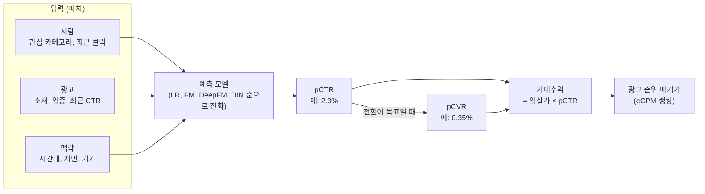

광고 자리 하나가 경매에 나오면 광고를 사는 플랫폼인 DSP(Demand-Side Platform)가 「이 자리에 ₩1,200 내겠다」고 값을 부릅니다. 그 ₩1,200 은 어디서 나왔을까요? 계산을 처음까지 거슬러 올라가면 출발점에 숫자 하나가 있는데, 바로 **“이 사람이 이 광고를 누를 확률”** 입니다. 모델이 이 확률을 미리 추정한 값을 **pCTR** 이라고 부릅니다.

이 글은 먼저 pCTR 이 **무엇인지**, 입찰가와 광고 순위를 정하는 **모든 계산이 왜 이 숫자에서 출발하는지**를 풉니다. 이어서 **순위는 맞는데 확률의 크기가 틀리면 무슨 일이 생기는지**, 모델이 **그 확률을 어떻게 맞히는지**까지 모델 내부의 수식 없이 다룹니다.

> 한 줄 요약: pCTR 은 사람이 광고를 누를 확률을 모델이 미리 예측한 값이고 입찰가와 광고 순위를 모두 좌우합니다. 그런데 AUC 는 클릭된 노출의 예측이 클릭되지 않은 노출의 예측보다 높은지만 세는 점수입니다. 그래서 예측의 순서가 맞으면 확률의 크기가 틀려도 AUC 에는 티가 나지 않습니다. 이 글의 예에서도 모든 예측을 절반으로 줄이자 AUC 는 0.7778 그대로였지만 실제로 클릭된 노출 하나의 입찰가는 ₩350 에서 ₩175 로 절반이 되었습니다. 그래서 확률의 크기를 실제에 맞추는 보정(Calibration)이 따로 필요합니다.

---

## 1. 예측 클릭률 pCTR 과 실제 클릭률 CTR

**pCTR(predicted Click-Through Rate, 예측 클릭률)은 광고가 한 번 보이는 이 노출이 클릭될 확률을 모델이 미리 예측한 숫자입니다. 실제로 몇 번 클릭됐는지 센 CTR 은 이미 지나간 결과이지만 pCTR 은 아직 일어나지 않은 일의 예측입니다.**

광고 요청은 앱이나 웹페이지에 광고 자리가 생겨 그 자리에 넣을 광고를 달라고 보내는 요청입니다. DSP 는 도입의 ₩1,200 같은 값을 광고 요청이 들어온 바로 그 순간에 정하는데 그때는 노출도 클릭도 아직 일어나지 않았습니다. 그래서 값을 정하려면 이미 일어난 클릭을 세는 CTR 이 아니라 앞으로 일어날 클릭을 미리 예측한 pCTR 이 필요합니다.

- **CTR(실제)**: 노출 가운데 실제로 클릭된 비율입니다. 지나간 결과를 센 값이라 캠페인이 끝나야 정확히 알 수 있습니다.
- **pCTR(예측)**: 지금 이 노출이 클릭될 확률입니다. 광고 요청이 들어온 바로 그때, 아무 일도 일어나기 전에 내놓아야 하는 값입니다.

예를 들면 pCTR 은 「민지가 이 운동화 광고를 누를 확률 2.3%」 같은 꼴로 나옵니다. 0 과 1 사이의 확률 한 개에 불과하지만 이 숫자를 내려고 과거 수억 건의 노출 기록과 클릭 기록으로 학습한 모델을 씁니다. 그 모델은 광고 요청이 올 때마다 보통 **0.1초 안에** 이 숫자를 그 자리에서 다시 계산하므로 사람 한 명 한 명마다, 순간순간마다 다른 값이 나옵니다. 이 숫자 하나가 어떻게 입찰가와 광고 순위로 이어지는지는 다음 절의 표 하나로 볼 수 있습니다.

---

## 2. 입찰가와 pCTR 로 매기는 광고 순위, eCPM

**광고 순위는 입찰가가 아니라 노출 한 번에서 기대할 수 있는 수익(기대수익)으로 매깁니다. 기대수익은 입찰가에 pCTR 을 곱한 값이라 곱하는 두 값 가운데 하나인 pCTR 이 기대수익의 절반을 정합니다.**

광고 요청이 오면 매체(앱이나 웹사이트를 운영하며 광고 자리를 파는 회사)는 여러 광고 가운데 하나를 골라 그 자리에 보여 줘야 합니다. 이때 매체의 관심사는 누가 더 비싸게 불렀는지가 아닙니다. 매체가 실제로 파는 상품은 클릭이 아니라 노출 한 번인데 아래 표의 입찰가는 클릭이 일어날 때 내는 클릭당 금액이라, 노출 한 번을 내주고 기대할 수 있는 돈은 입찰가에 클릭될 확률을 곱해야 나옵니다. 그래서 매체는 광고마다 「이 노출을 주면 기대할 수 있는 돈이 얼마인가」를 구해 순위를 매깁니다. 계산은 곱셈 한 번으로 단순합니다.

**기대수익 = 입찰가 × pCTR**

기대수익에 1,000 을 곱해 노출 1,000회 기준으로 바꾼 값을 **eCPM**(effective Cost Per Mille, 노출 1,000회당 예상 수익)이라고 부릅니다. 아래 표는 광고 다섯 개가 같은 자리 하나를 놓고 겨루는 상황입니다. 다섯 광고는 클릭당 입찰가가 모두 다르고 모델이 예측한 pCTR 도 광고마다 다릅니다. 표에서는 입찰가 열의 순서와 마지막 순위 열의 순서가 어떻게 다른지 보면 됩니다.

| 광고 | 클릭당 입찰가 | pCTR | 노출 1회 기대수익 | eCPM(1,000회) | 순위 |
|---|---|---|---|---|---|
| A | ₩1,000 | 1.0% | ₩10.0 | ₩10,000 | 3 |
| B | ₩800 | 2.0% | ₩16.0 | ₩16,000 | 2 |
| C | ₩1,500 | 0.6% | ₩9.0 | ₩9,000 | 4 |
| **D** | ₩600 | 2.8% | **₩16.8** | **₩16,800** | **1** |
| E | ₩2,000 | 0.4% | ₩8.0 | ₩8,000 | 5 |

**입찰가가 가장 높은 E(₩2,000)가 꼴찌이고 입찰가가 가장 낮은 D(₩600)가 1등입니다.** D 는 클릭당 ₩600 으로 다섯 광고 가운데 가장 적게 불렀지만 pCTR 이 2.8% 로 다섯 가운데 가장 높아서 노출 1회 기대수익이 ₩600 × 2.8% = ₩16.8 로 가장 큽니다. 반대로 E 는 ₩2,000 을 불렀어도 pCTR 이 0.4% 라 기대수익이 ₩2,000 × 0.4% = ₩8.0 에 그칩니다. eCPM 은 이 기대수익을 노출 1,000회 기준으로 늘려 쓴 값일 뿐이라(D 의 ₩16.8 은 ₩16,800 이 됩니다) 기대수익으로 매긴 순위와 eCPM 으로 매긴 순위는 똑같습니다. eCPM 자체는 [eCPM 랭킹](post.html?id=ecpm-ranking) 편에서 더 자세히 다룹니다.

pCTR 이 왜 곧 돈인지는 이 표 하나로 다 설명됩니다. 입찰가를 아무리 높게 불러도 pCTR 추정이 낮으면 순위가 뒤로 밀리고 입찰가가 낮아도 pCTR 이 높으면 앞으로 옵니다. 그래서 pCTR 을 0.1%포인트(퍼센트로 적은 두 비율을 뺀 차이)만 더 정확히 맞혀도 어떤 광고가 이기고 지는지가 뒤집혀 매출이 바로 이 지점에서 크게 오르내립니다. 도입에서 DSP 가 부른 입찰가도 같은 공식을 거꾸로 쓴 값입니다. 클릭 한 번의 가치에 그 클릭이 일어날 확률을 곱하면 노출 한 번에서 기대할 수 있는 가치가 나오므로, 「이 클릭(또는 전환)의 가치 × pCTR」이 DSP 가 이 노출에 낼 수 있는 값의 상한이 됩니다.

다만 두 값의 단위는 구분해 둡니다. 표의 입찰가는 **클릭 한 번에** 내는 값이고 DSP 가 정하는 '노출에 낼 수 있는 값'은 **노출 한 번에** 내는 값입니다. 노출 한 번에 내는 이 값이 바로 위 표에서 계산한 노출 1회 기대수익입니다.

---

## 3. 순위는 맞고 크기는 틀린 예측과 보정(Calibration)

**같은 모델이 예측한 하루치 노출 10만 건을 예측 구간(pCTR 값의 범위)별로 나눠 보면 예측이 높은 구간일수록 실제 CTR 도 높아 순위는 흠잡을 데가 없습니다. 그런데 모든 구간에서 예측이 실제보다 낮습니다. 낮게 본 정도는 구간별로 11~17%, 전체로 13% 입니다.**

2절의 기대수익과 DSP 의 입찰가는 모두 pCTR 의 크기를 그대로 곱해 계산하므로 모델이 노출의 순서를 잘 맞혀도 확률의 크기가 틀리면 그 금액이 함께 틀립니다. 예측 확률의 크기를 실제로 일어나는 비율에 맞추는 일을 보정(Calibration)이라고 부릅니다. 크기가 맞는지는 예측과 실제를 구간마다 나란히 놓아 보면 알 수 있습니다.

그래서 실제 서비스 로그를 예측 구간별로 나눠 봅니다. pCTR 을 0~1% 부터 5% 이상까지 다섯 구간으로 나누고 구간마다 모델이 예측한 클릭 수와 실제로 난 클릭 수를 비교합니다. 예측 클릭은 노출 수에 그 구간의 예측 평균을 곱한 값이고 실제 클릭은 노출 수에 실제 CTR 을 곱한 값이라, 0~1% 구간이면 노출 40,000건 × 0.60% = 240건이 예측 클릭이고 40,000건 × 0.70% = 280건이 실제 클릭입니다.

| 예측 구간 | 노출 | 예측 평균 | 실제 CTR | 예측 클릭 | 실제 클릭 | COPC(실제÷예측) |
|---|---|---|---|---|---|---|
| 0~1% | 40,000 | 0.60% | 0.70% | 240 | 280 | 1.17 |
| 1~2% | 30,000 | 1.50% | 1.70% | 450 | 510 | 1.13 |
| 2~3% | 18,000 | 2.40% | 2.70% | 432 | 486 | 1.13 |
| 3~5% | 9,000 | 3.80% | 4.30% | 342 | 387 | 1.13 |
| 5%+ | 3,000 | 6.50% | 7.20% | 195 | 216 | 1.11 |
| **전체** | **100,000** | — | — | **1,659** | **1,879** | **1.13** |

예측 구간이 높아질수록 실제 CTR 도 0.70% → 1.70% → 2.70% → 4.30% → 7.20% 로 한 번도 거꾸로 가지 않고 따라 올라가므로 이 모델이 순위를 매기는 능력은 흠잡을 데가 없습니다. 하지만 확률의 크기(절댓값)는 맞지 않습니다. 다섯 구간 모두 실제 CTR 이 예측 평균보다 높아서 전체로 보면 예측 클릭은 1,659건인데 실제 클릭은 1,879건이 나왔습니다.

실제 클릭을 예측 클릭으로 나눈 값을 **COPC**(Click Over Predicted Click, 실제 클릭 ÷ 예측 클릭)라고 부릅니다. 이 모델의 COPC 는 1,879 ÷ 1,659 = **1.13** 입니다. COPC 가 1 이면 예측 클릭과 실제 클릭이 같다는 뜻이고 1 보다 크면 실제 클릭이 예측보다 많았다는 뜻이라, 1.13 은 모델이 실제보다 낮게 보고 있었다는 신호입니다. 구간별 COPC 도 0~1% 구간의 1.17 부터 5%+ 구간의 1.11 까지 모두 1 보다 큽니다.

입찰가는 pCTR 에 비례해 나가므로(2절) 이 모델처럼 pCTR 이 한꺼번에 13% 낮으면 입찰가도 한꺼번에 13% 낮게 깔립니다. 광고끼리의 순위는 그대로라 「제일 좋은 광고가 이긴다」는 원칙은 깨지지 않지만 입찰가가 모두 낮게 나가는 만큼 **이겼어야 할 경매에서 근소한 차이로 지는 일이 조용히 늘어납니다.**

COPC 는 방향을 헷갈리기 쉬운 지표입니다. 이 블로그의 [Calibration](post.html?id=calibration) 글은 분자와 분모가 반대인 P/O Ratio(예측÷실제)로 설명하므로 이 절의 모델처럼 낮게 본 예측이 그 글의 지표로는 1 보다 작은 값으로 나옵니다. 두 글을 함께 읽을 때는 지금 보는 글이 어느 방향의 지표를 쓰는지 늘 확인해야 합니다. 순위는 맞고 크기만 틀린 이런 모델을 AUC 가 알아채는지는 4절에서 코드로 확인합니다.

아래 미니 데모에서는 보정 기울기와 보정 편향 슬라이더로 예측 확률을 일부러 틀어 보며 입찰가가 어떻게 달라지는지 직접 실험할 수 있습니다.

<div class="demo-embed-wrap">
<iframe class="demo-embed" src="demo-calibration.html?embed=1" height="560" loading="lazy" title="Calibration 미니 데모"></iframe>
<a class="demo-embed-open" href="demo-calibration.html" target="_blank" rel="noopener">↗ 전체 데모로 열기</a>
</div>

---

## 4. 예측을 절반으로 줄인 파이썬 실험과 AUC, LogLoss, 입찰가

**모든 예측에 0.5 를 곱해도 AUC 는 소수점 열 자리까지 똑같지만 LogLoss(예측 확률이 실제 결과와 얼마나 다른지 측정하는 손실)는 확실히 나빠집니다.** 그래서 pCTR 을 평가할 때 AUC 하나만 보면 확률의 크기가 틀어지는 사고를 절대 잡지 못합니다.

3절의 모델은 순서는 맞히면서 확률의 크기만 낮게 보고 있었습니다. 모델 리뷰에서 보는 AUC 로 이런 모델을 채점하면 무엇이 보일까요?

**AUC**(Area Under the ROC Curve)는 「클릭한 노출의 예측이 안 클릭한 노출의 예측보다 높았나」만 세는 지표입니다. 클릭된 노출 하나와 클릭되지 않은 노출(아래 코드의 무클릭) 하나로 만들 수 있는 모든 쌍에서 클릭된 노출의 예측이 더 높으면 1점, 같으면 0.5점을 주고 점수의 합을 쌍의 수로 나눈 값입니다. 따라서 AUC 가 1 에 가까울수록 순서를 잘 맞힌 모델입니다. 이 계산은 어느 예측이 더 높은지만 보고 예측값 자체가 얼마인지는 보지 않습니다. 그런데 입찰가는 2절의 `입찰가 × pCTR` 처럼 예측값 그 자체에 곱해지므로, 예측이 전부 낮게 눌리면 AUC 가 눈치채지 못하는 사이에 돈만 샙니다.

**LogLoss** 는 모델이 낸 확률이 실제 결과와 얼마나 다른지를 측정하는 지표이며 binary cross-entropy 라고도 부릅니다. 노출마다 클릭된 노출이면 `-log(p)`, 클릭되지 않은 노출이면 `-log(1 - p)` 를 손실로 매겨 평균을 내므로, 클릭된 노출에 높은 확률을 주고 클릭되지 않은 노출에 낮은 확률을 줄수록 LogLoss 는 0 에 가까워집니다. AUC 와 달리 LogLoss 는 예측의 절댓값을 그대로 봅니다. 정말 그런지 코드로 직접 확인해 봅니다.

아래 코드를 돌려 예측을 전부 절반으로 줄였을 때 AUC 와 LogLoss, 입찰가가 각각 어떻게 달라지는지 봅니다. 노출 12건(클릭 3건)짜리 작은 예측 결과를 두고 `auc()` 와 `logloss()` 를 라이브러리 없이 직접 구현해 비교합니다. 원본 예측 `p` 와 그 값에 전부 0.5 를 곱한 `p_half` 를 나란히 넣고 마지막 단계에서는 실제로 클릭된 노출 #3 의 입찰가도 두 예측으로 계산합니다. 데이터에는 예측이 낮은데 클릭된 노출 #2(0.12)와 예측이 높은데 클릭되지 않은 노출 #6(0.30)을 일부러 하나씩 섞어 AUC 가 1.0 이 되지 않게 했습니다.

```python
# 하는 일: 노출 12건(클릭 3건)의 pCTR 예측과 그 예측에 전부 0.5 를 곱한 예측으로, AUC 는 그대로인데 LogLoss 와 입찰가가 달라지는 것을 직접 확인한다.
import math

# 1단계: 노출 12건의 예측을 둔다
# (노출 번호, 실제 클릭 여부 y, 모델이 낸 pCTR 예측 p) — 클릭 3건, 무클릭 9건.
# 일부러 "낮은 p인데 클릭"(#2), "높은 p인데 무클릭"(#6)을 하나씩 섞어
# AUC가 1.0(완벽)이 아니게 만들었다 — 실제 모델도 이 정도 노이즈는 흔하다.
# 표준 라이브러리만 쓰고, 값은 하드코딩해 실행할 때마다 같은 결과가 나오게 한다.
data = [
    (1,  0, 0.05), (2,  1, 0.12), (3,  1, 0.35), (4,  0, 0.08),
    (5,  0, 0.20), (6,  0, 0.30), (7,  0, 0.15), (8,  1, 0.45),
    (9,  0, 0.10), (10, 0, 0.25), (11, 0, 0.18), (12, 0, 0.22),
]


# 2단계: AUC 와 LogLoss 를 직접 구하는 함수를 만든다
# AUC(순위 매기기 점수)는 예측값의 순위만 보고, LogLoss 는 예측 확률의 절댓값까지 본다.
def auc(rows):
    """순위 기반 AUC를 직접 센다 (사이킷런 없이).
    모든 (클릭, 무클릭) 쌍을 하나씩 비교해, 클릭 쪽 예측이 더 높으면 1점,
    같으면 0.5점을 주고, 전체 쌍 수로 나눈다. 이게 AUC의 원래 정의(Mann-Whitney)다."""
    pos = [p for _, y, p in rows if y == 1]   # 클릭 3건의 예측
    neg = [p for _, y, p in rows if y == 0]   # 무클릭 9건의 예측
    win = 0.0
    for pp in pos:
        for pn in neg:
            if pp > pn:
                win += 1.0
            elif pp == pn:
                win += 0.5
    return win / (len(pos) * len(neg))        # 3*9 = 27쌍


def logloss(rows):
    """binary cross-entropy(로그 손실). row는 (id, y, p) 형태."""
    eps = 1e-12  # p가 0이나 1에 붙어 log(0)이 나는 사고 방지
    total = 0.0
    for _, y, p in rows:
        p = min(max(p, eps), 1 - eps)
        total += -(y * math.log(p) + (1 - y) * math.log(1 - p))
    return total / len(rows)


# 3단계: 예측을 절반으로 깎아 두 지표를 비교한다
# half 는 원래 예측 p 에 전부 0.5 를 곱한 버전(p_half)이다. 보정이 어긋나 예측이 전부 눌린 상황이다.
half = [(i, y, 0.5 * p) for i, y, p in data]   # 모든 예측에 0.5를 곱한 버전

auc_orig, auc_half = auc(data), auc(half)
ll_orig, ll_half = logloss(data), logloss(half)

print(f"AUC       원본 {auc_orig:.4f}  ->  절반 {auc_half:.4f}   (차이 {auc_orig - auc_half:.10f})")
print(f"LogLoss   원본 {ll_orig:.4f}  ->  절반 {ll_half:.4f}   ({ll_half - ll_orig:+.4f})")

# 4단계: 노출 #3 의 입찰가를 비교한다
# 입찰가는 관례상 '가치 × pCTR'에 비례한다. 예측을 절반으로 깎으면
# 이 12건 전부에서 입찰가도 정확히 절반이 된다 — 경매에서 조용히 밀린다.
CLICK_VALUE = 1_000  # 클릭 1회의 가치를 편의상 ₩1,000이라 두면
i, y, p = data[2]     # 노출 #3 (p=0.35, 실제로 클릭까지 된 건)
print(f"노출 #{i} 입찰가   원본 ₩{CLICK_VALUE * p:.0f}  ->  절반 ₩{CLICK_VALUE * 0.5 * p:.0f}")

# 출력:
# 3단계 뜻: 모든 예측을 절반으로 줄여도 순서는 그대로라 AUC 는 0.7778 로 소수점 열 자리까지 같다. LogLoss 는 0.4738 에서 0.5713 으로 +0.0975 나빠진다.
# AUC       원본 0.7778  ->  절반 0.7778   (차이 0.0000000000)
# LogLoss   원본 0.4738  ->  절반 0.5713   (+0.0975)
# 4단계 뜻: 실제로 클릭된 노출 #3 의 입찰가가 ₩350 에서 ₩175 로 절반이 된다. AUC 는 그대로인데 경매에서는 조용히 밀린다.
# 노출 #3 입찰가   원본 ₩350  ->  절반 ₩175
```

출력의 첫 줄에서 AUC 는 원본과 절반이 모두 0.7778 이고 차이가 0.0000000000 이라 소수점 열 자리까지 같습니다. 0.7778 은 클릭 3건과 무클릭 9건으로 만든 27쌍 가운데 클릭된 노출의 예측이 더 높은 쌍의 비율입니다. 노출 #2 의 예측 0.12 가 무클릭 노출 6건(0.15, 0.18, 0.20, 0.22, 0.25, 0.30)보다 낮아 그 6쌍에서 점수를 받지 못했으므로 AUC 는 1.0 에 못 미칩니다. 둘째 줄의 LogLoss 는 0.4738 에서 0.5713 으로 +0.0975 나빠졌습니다. 마지막 줄에서는 노출 #3 의 입찰가가 ₩350 에서 ₩175 로 절반이 되었습니다.

AUC 가 그대로인 까닭은 수식 없이도 설명됩니다. `p_half = 0.5 * p` 는 원래 값에 양수 0.5 를 곱하기만 하므로 **단조증가 변환**에 해당합니다. 단조증가 변환은 더 큰 값이 변환 뒤에도 늘 더 큰 값으로 남는 변환입니다. A 가 B 보다 크면 0.5A 도 0.5B 보다 항상 크므로 순서가 바뀔 방법이 없습니다. 클릭된 노출 #3(0.35)과 클릭되지 않은 노출 #6(0.30)도 둘 다 절반이 된 뒤에 여전히 #3 이 크므로, 쌍마다 어느 예측이 큰지만 세는 AUC 는 소수점 열 자리까지 완전히 그대로입니다.

LogLoss 는 반대로 예측값의 크기를 그대로 씁니다. 클릭된 노출을 양성, 클릭되지 않은 노출을 음성이라고 부릅니다. 양성 하나가 LogLoss 에 더하는 기여분은 `-log(0.5p) = log(2) - log(p)` 라서 예측을 절반으로 깎을 때마다 원래 기여분 `-log(p)` 보다 정확히 `log(2) ≈ 0.693` 만큼 손해를 보고 시작합니다. 음성은 예측이 낮아진 만큼 살짝 이득을 보지만 그 이득은 양성의 손해보다 작아서 **원래 확률이 대체로 맞던 모델이라면** 전체 LogLoss 는 결국 나빠집니다. 이 코드에서도 클릭 3건이 각각 0.693 씩 손해를 보고 무클릭 9건이 조금씩 이득을 본 결과 평균이 0.4738 에서 0.5713 으로 커졌습니다.

예측이 틀어진 만큼 입찰가도 그대로 틀어집니다. 코드의 4단계는 클릭 1회의 가치를 편의상 ₩1,000 으로 두는데, 2절처럼 입찰가가 pCTR 에 비례한다면 예측이 반토막 나는 순간 입찰가도 반토막 나서 노출 #3 의 입찰가 ₩1,000 × 0.35 = ₩350 이 ₩175 로 줄어듭니다. 이때도 AUC 대시보드는 여전히 정상으로 표시되고 모델 리뷰 회의에서는 「성능 그대로」라고 보고되지만 실제로는 모든 경매에서 절반 가격으로 싸우고 있습니다. 그래서 실무에서는 AUC 하나만으로 배포를 승인하지 않고 LogLoss 나 COPC 처럼 확률의 절댓값을 보는 지표를 반드시 같이 봅니다.

---

## 5. 모델이 pCTR 을 맞히는 방식 (직관)

**모델은 사람, 광고, 맥락 세 가지 입력을 받아 pCTR 하나를 내놓습니다. 모델 안의 계산 방식은 입력끼리의 점점 더 복잡한 조합을 사람 대신 자동으로 찾는 방향으로 발전해 왔습니다.**

pCTR 을 맞히려면 누가, 어떤 광고를, 어떤 상황에서 보는지를 함께 봐야 하는데 모델에 넣는 입력은 수만 종류라 그 조합을 사람이 다 적을 수 없습니다. 아래 그림은 세 가지 입력이 예측 모델을 거쳐 pCTR 이 되고 그 pCTR 이 입찰가와 곱해져 기대수익이 된 뒤 광고 순위(eCPM 랭킹)로 이어지는 흐름입니다. 전환이 목표일 때는 6절에서 다룰 pCVR 을 한 번 더 거칩니다.



모델에 넣는 입력값을 피처(feature)라고 부릅니다. '사람' 피처에는 최근 본 상품 카테고리, 추정 연령대, 성별, 최근 7일 동안의 클릭, 구매 이력 같은 값이 들어갑니다. '광고' 피처는 소재 이미지와 문구, 업종, 그 광고 자체의 최근 평균 CTR 입니다. 소재는 광고로 보여 주는 이미지와 문구 같은 내용물을 가리킵니다. '맥락' 피처는 지금이 몇 시인지, 광고가 피드에 나오는지 배너로 나오는지, 기기가 모바일인지 PC 인지처럼 노출이 일어나는 바로 그 순간의 상황입니다. 세 가지 입력이 클릭에 어떻게 작용하는지는 사람이 하나하나 정한 규칙이 아니라 과거 로그에서 「이런 조합일 때 몇 %가 눌렀나」를 모델이 스스로 찾아낸 패턴입니다.

모델의 계보는 **「조합을 사람이 다 적을 수 없으니 기계가 대신 찾게 한다」** 는 방향으로 이어져 왔습니다.

- **로지스틱 회귀(LR, Logistic Regression)** 는 피처를 하나씩 넣고 피처마다 가중치(그 피처가 클릭 확률을 얼마나 올리거나 내리는지 나타내는 숫자)만 학습합니다. 「20대이면서 운동화 광고」처럼 두 피처를 곱한 조합까지 쓰려면 LR 에서는 사람이 그 조합 피처를 미리 만들어 넣어야 하는데, 실제 피처는 수만 종류라 사람이 짝지어 볼 수 있는 조합에는 한계가 있습니다.
- **FM(Factorization Machine)** 은 이 조합을 벡터 내적으로 자동 계산합니다. 피처마다 숫자 여러 개로 된 벡터를 학습해 두고 두 피처의 조합 효과를 두 벡터의 내적(같은 자리의 값끼리 곱해 모두 더한 값)으로 구하므로, 사람이 일일이 짝짓지 않아도 함께 나타나면 의미가 있는 피처 쌍을 찾아냅니다.
- **DeepFM** 은 FM 에 딥러닝(여러 층으로 쌓은 신경망)을 결합해 FM 이 보지 못하는 더 복잡한 고차 조합, 다시 말해 피처 3개 이상이 함께 얽힌 조합까지 잡습니다.
- **DIN(Deep Interest Network)** 은 한 걸음 더 나가 같은 사람이라도 「지금 이 광고와 관련 있는 과거 행동」에만 가중치를 더 줍니다. 운동화 광고가 뜨면 그 사람의 과거 이력 가운데 신발 관련 클릭에 더 주의를 기울이는 식입니다. DIN 은 사람마다 관심사가 다르다는 사실을 이렇게 모델 구조 안에 넣었습니다.

그렇다고 정확도만 좇을 수는 없습니다. 이 모델은 광고 요청이 올 때마다 **0.1초 안에** 답해야 하는데 DIN 처럼 무거운 모델을 후보 광고 전부에 돌리면 시간이 모자랍니다. 그래서 실무에서는 가벼운 모델로 후보를 빠르게 줄이고 마지막에 남은 소수의 후보에만 무거운 모델을 돌리는 **랭킹 캐스케이드** 구조를 씁니다. 무거운 모델로 정확도를 올리면 그만큼 답이 늦어지므로 정확도와 지연(latency, 요청을 받고 답을 내기까지 걸리는 시간)은 서로 맞바꿔야 하는 설계 변수입니다.

> 모델 구조는 [Deep CTR 모델](post.html?id=deep-ctr-models) 편에서, 캐스케이드 구조는 [모델 서빙 아키텍처](post.html?id=model-serving-architecture) 편에서 더 자세히 다룹니다.

---

## 6. 클릭 다음에 살 확률, pCVR

**광고의 목표가 클릭이 아니라 구매 같은 전환이라면 누를 확률만으로는 부족하며 누른 다음 실제로 살 확률까지 곱해야 합니다.**

클릭이 목표인 캠페인은 2절에서처럼 `입찰가 ≈ 가치 × pCTR` 로 충분하지만 전환이 목표인 캠페인에서는 클릭까지 갔다가 사지 않는 사람도 많아서 한 단계를 더 곱해야 합니다. 전환은 구매, 설치, 가입처럼 광고주가 광고로 얻으려는 행동을 가리킵니다. 이때 더 곱하는 값이 **pCVR**(predicted Conversion Rate, 예측 전환율)입니다. pCVR 은 클릭한 사람이 그다음 실제로 전환할 확률을 예측한 값입니다.

**입찰가 ≈ 가치 × pCTR × pCVR**

2절에서 1등이던 D 광고를 그대로 가져와 목표만 클릭에서 전환으로 바꿔 봅니다. D 의 pCTR 은 2.8% 로 그대로 두고 전환 한 건의 가치를 ₩30,000, pCVR 을 0.35% 라고 하면 노출 1회 기대수익은 ₩30,000 × 2.8% × 0.35% = **₩2.94** 이고 노출 1,000회 기준인 eCPM 으로는 **₩2,940** 입니다.

클릭이 목표였던 2절에서 D 의 eCPM 은 ₩16,800 이었습니다. **같은 광고에 같은 pCTR 이어도 목표를 클릭에서 전환으로 바꾸는 것만으로 순위표가 전부 다시 계산됩니다.** 클릭보다 구매가 훨씬 드물어서 pCVR 은 pCTR 보다 훨씬 작은 숫자이지만 대신 전환 한 건의 가치가 클릭 한 번의 가치보다 훨씬 크므로 실제로는 **작아진 확률을 커진 가치가 상쇄**합니다. 이 예의 ₩2,940 은 전환 목표가 늘 불리해서가 아니라 전환 가치를 ₩30,000 으로 낮게 잡아서 나온 값입니다.

---

## 7. 담장 안의 pCTR [무대: 닫힌 생태계]

**로그인한 사용자를 두고 시작하므로 피처가 넉넉하고 로그 조인(로그끼리 이어 붙이는 일)이 깨끗합니다. 대신 자기 트래픽 바깥의 분포는 알 방법이 없습니다.**

네이버, 카카오 같은 닫힌 생태계(walled garden)에서는 지면(앱이나 웹페이지에서 광고가 보이는 자리)도, 소재도, 사용자도 전부 한 회사에 속합니다. 이 블로그는 이런 곳을 담장 안이라고 부릅니다. 사용자가 로그인해 있으므로 「이 사람이 최근 뭘 봤는지」부터 시작해 5절의 '사람' 피처를 훨씬 풍부하게 채울 수 있습니다. 노출 로그, 클릭 로그, 구매 로그가 한 곳에 쌓여서 같은 노출과 같은 사용자의 기록끼리 이어 붙이는 조인(join)도 깨끗하므로, pCTR 모델을 학습시킬 때 데이터를 이어 붙이느라 씨름할 일이 상대적으로 적습니다.

이 깨끗함은 pCVR 에서 특히 두드러집니다. 클릭한 뒤의 구매까지 같은 로그인 계정으로 이어지므로 6절의 pCVR 도 다른 회사의 데이터에 기대지 않고 자체 로그로 학습할 수 있습니다.

대신 이 모델은 **자기 트래픽 안에서만** 배운다는 결정적인 한계가 있습니다. 플랫폼에 아직 들어온 적 없는 새 광고주, 새 소재 유형, 새 지면이 나타나면 모델은 비슷한 사례를 한 번도 본 적 없는 상태에서 첫 pCTR 을 내야 합니다. 담장 밖 세상의 트렌드가 아무리 바뀌어도 그 변화가 담장 안으로 들어오기 전까지 모델은 알지 못합니다. 담장 안은 정확도를 올리기 쉬운 환경이지만 그 정확도에는 항상 「우리 안에서는」이라는 단서가 붙습니다.

---

## 8. 열린 RTB의 pCTR [무대: 열린 RTB]

**다른 회사의 지면에서 다른 회사의 쿠키 신호만으로 pCTR 을 맞혀야 합니다. 게다가 경매에서 지고 나면 그 노출의 결과조차 못 볼 때가 있습니다.**

RTB(Real-Time Bidding)는 노출 한 번이 생길 때마다 실시간 경매로 광고를 고르는 방식입니다. 열린 RTB 에서는 여러 회사의 지면을 놓고 여러 DSP 가 이 경매에 참여합니다. DSP 는 자기 지면이 없어서 광고 요청이 올 때마다 지면도 사용자도 다른 회사의 것이라 매번 낯선 조합을 마주합니다. 서드파티 쿠키는 사용자가 방문한 사이트가 아닌 다른 회사가 브라우저에 남겨 여러 사이트에서 같은 사용자를 알아보는 데 쓰는 쿠키입니다. 사용자마다 로그인 여부가 제각각이고 서드파티 쿠키까지 줄어드는 중이라, DSP 는 5절의 '사람' 피처를 닫힌 생태계만큼 풍부하게 채우지 못한 채로 pCTR 을 내야 합니다.

여기에 구조에서 오는 맹점이 하나 더 있습니다. 경매에서 지는 일을 **패찰**이라고 합니다. 패찰하면 그 노출의 로그 자체가 남지 않아서 그 노출이 클릭됐는지 안 됐는지조차 알 수 없습니다. 그래서 새 지면이나 새 사용자 구간에 처음 들어가는 DSP 는 그 구간에 대한 정보가 하나도 없는 채로 입찰해야 하고 몇 번 패찰하고 나서야 감을 잡기 시작합니다. 이 시장에서는 정보가 없는 상태에서 예측을 시작해야 하는 **콜드 스타트(cold start)** 가 상수처럼 따라붙는 기본 조건입니다.

이 맹점은 9절의 「보여준 광고만 배운다」는 함정과 뿌리가 같습니다. 두 문제 모두 결과가 로그에 남은 노출로만 배운다는 데서 생기지만 열린 RTB 에서는 같은 일이 매 순간, 매 경매마다 되풀이된다는 점이 다릅니다.

---

## 9. 보여준 광고만 배우는 함정, 선택 편향

**클릭과 무클릭이 로그에 남는 광고는 노출된 광고뿐입니다. 보여 주지 않은 광고는 예측이 맞았는지 틀렸는지조차 영원히 알 수 없습니다.**

pCTR 모델은 실제로 노출된 기록으로만 학습하는데, 어떤 광고를 보여 줄지도 애초에 지금의 이 모델(또는 그 이전 버전)이 정합니다. 그러니 모델이 「이 사람에게는 안 맞을 것」이라며 낮게 예측해 한 번도 보여 주지 않은 조합은 그 판단이 맞았는지 확인할 기회 자체가 없습니다. 결국 데이터는 모델 스스로의 판단만 강화합니다. 이 현상을 **선택 편향(selection bias)** 이라고 부릅니다.

당장의 기대수익은 조금 손해 보더라도 보여 주지 않았다면 영원히 몰랐을 조합의 진짜 클릭률을 확인해야 모델이 계속 정확해지므로, 실무에서는 확률이 높은 후보만 보여 주지 않고 낮은 순위의 광고를 적은 비율로 일부러 섞어 보여 주는 **탐색(exploration)** 을 설계해 넣습니다.

이 함정은 담장 안과 밖에 모두 있지만 양상이 다릅니다. 담장 안에서는 지면도 사용자도 플랫폼 한 회사의 것이라 플랫폼이 탐색 비율을 스스로 설계할 수 있습니다(7절). 반면 열린 RTB 의 개별 DSP 는 경매 결과가 다른 회사의 것이라 패찰한 노출의 데이터를 아예 만들 수조차 없고(8절) 탐색의 여지 자체가 담장 안보다 좁습니다. 이 편향은 [Negative Sampling & Bias](post.html?id=negative-sampling-bias) 편에서 더 다룹니다.

:::deep 더 깊이 — 다운샘플링으로 커진 확률과 되돌리는 식
클릭은 원래 노출의 1~2% 도 안 될 만큼 드물어서 무클릭 로그를 전부 쓰면 학습 데이터가 쓸데없이 무거워지므로, 실무에서는 무클릭(음성) 샘플을 비율 $r$ 만 남기고 나머지는 버린 뒤 학습합니다. 한쪽 샘플을 이렇게 덜어 내는 일을 다운샘플링(downsampling)이라고 부릅니다. 예를 들어 $r=0.1$ 이면 무클릭 10건 가운데 1건만 남깁니다.

이렇게 학습한 모델은 「무클릭이 원래보다 훨씬 적은 세상」을 보고 배워 클릭의 비중을 실제보다 높게 여기므로 모델이 내놓는 예측 $p'$ 는 실제 확률보다 크게 잡힙니다. 이 과대 추정은 아래 식으로 정확히 되돌릴 수 있습니다.

$$p = \frac{p'}{p' + \dfrac{1 - p'}{r}}$$

식에서 $p'$ 는 다운샘플링된 데이터로 학습한 모델의 원 출력, $r$ 은 무클릭 샘플을 남긴 비율(0 과 1 사이), $p$ 는 되돌린 실제 확률입니다. 분모의 $(1 - p')/r$ 은 남긴 무클릭의 몫을 $r$ 로 나눠서 다운샘플링 전 무클릭 전체의 몫으로 되돌리는 항입니다. $r=0.1$ 이면 $(1 - p')$ 를 0.1 로 나눠 10배가 되므로 남긴 1건의 몫이 버린 9건까지 합친 10건의 몫으로 돌아갑니다.

보정 식을 적용하지 않으면 모델이 보고하는 확률은 계통적으로(무작위가 아니라 항상 같은 방향으로) 틀립니다. 그 오차는 입찰가에 그대로 반영되는데 방향은 예측이 전부 위로 커져 COPC 가 1 보다 **작아지는** 과대예측 쪽입니다. 3절의 COPC 1.13 은 반대로 예측이 낮게 깔린 경우였습니다. 실서비스의 트래픽 분포가 학습 때와 달라지면 이런 방향으로도 틀어집니다.
:::

:::deep 더 깊이 — 확률에 정직한 지표 LogLoss 와 proper scoring rule
LogLoss(binary cross-entropy)는 **proper scoring rule** 이라고 부르는 성질을 만족합니다. proper scoring rule 은 모델이 자기가 진짜로 믿는 확률을 그대로 보고할 때 기대 손실이 가장 작아지도록 지표 자체가 설계된 채점 규칙입니다. 그래서 확률을 실제보다 키우거나 낮춰 둥글게 말해도 손해만 커질 뿐 이득을 볼 방법이 없습니다. 이 성질 덕분에 LogLoss 가 나빠졌다는 신호는 곧이곧대로 믿을 수 있습니다.

반면 AUC 같은 순위 지표는 예측값의 절댓값 자체에는 관심이 없어서 순서만 지키면 어떤 크기를 불러도 점수가 똑같이 나옵니다. 4절의 코드에서 예측을 절반으로 깎았을 때 LogLoss 는 나빠졌는데 AUC 는 눈치채지 못한 까닭도 이 차이에 있습니다.
:::

---

## 10. 한눈 정리

| 개념 | 뜻 | 이 글에서 본 숫자 | 핵심 |
|---|---|---|---|
| **CTR** | 실제 클릭률(결과) | — | 지나간 성과를 측정하는 사후 지표 |
| **pCTR** | 예측 클릭률 | eCPM 1위 D(₩16,800) vs 꼴찌 E(₩8,000) | 입찰가, 광고 랭킹을 결정 |
| **pCVR** | 예측 전환율 | D를 전환 목표로 재계산 → eCPM ₩2,940 | 목표가 구매일 때 한 번 더 곱하는 값 |
| **Calibration** | 예측 확률 보정 | COPC 1.13 (구간별 11~17%, 전체 13% 낮게) | 순위는 맞아도 절댓값이 틀리면 입찰가가 왜곡 |

---

## 11. 헷갈리기 쉬운 점

- **pCTR 은 '점수'가 아니라 '확률'입니다.** 입찰가와 기대수익에 pCTR 의 크기가 그대로 곱해지므로 순위만 맞아서는 안 되고 절댓값 자체가 맞아야 합니다. 그래서 Calibration 이 따로 필요합니다.
- **AUC 가 높다고 확률이 정확하지는 않습니다.** 4절에서 예측을 절반으로 깎아도 AUC 는 0.7778 로 소수점까지 그대로였으므로, 순위 지표만 보고 배포를 승인하면 이런 사고를 잡지 못합니다.
- **eCPM 순위는 입찰가 순위와 다릅니다.** 2절에서 가장 비싸게 부른 E(₩2,000)는 pCTR 이 0.4% 로 낮아 꼴찌였으므로 「비싸게 부른 광고가 이긴다」는 가정부터가 틀렸습니다.
- **COPC 의 방향은 헷갈리기 쉽습니다.** COPC 는 실제÷예측이라 1 보다 크면 모델이 실제보다 낮게 예측했다는 뜻입니다. 이 블로그의 [Calibration](post.html?id=calibration) 글은 분자와 분모가 반대인 P/O Ratio(예측÷실제)로 설명하므로 어느 글을 보고 있는지 확인하고 읽어야 합니다.
- **학습 데이터부터 편향되어 있습니다.** 보여준 광고에만 클릭 기록이 남으므로 보여 주지 않은 조합은 모델이 영원히 배울 기회가 없습니다(9절의 선택 편향).

---

## 더 깊이 보기

- eCPM과 세 시장의 랭킹 방식 → [eCPM 랭킹](post.html?id=ecpm-ranking)
- 모델 아키텍처의 진화(LR→DeepFM→DIN) → [Deep CTR 모델](post.html?id=deep-ctr-models)
- 캐스케이드로 지연과 정확도를 맞바꾸는 법 → [모델 서빙 아키텍처](post.html?id=model-serving-architecture)
- 예측 확률을 실제에 맞추기 → [Calibration(확률 보정): AUC가 높아도 돈을 잃는 이유](post.html?id=calibration)
- pCTR이 입찰가가 되는 과정 → [Bid Shading](post.html?id=bid-shading-censored)
- 노출 편향과 탐색 설계 → [Negative Sampling & Bias](post.html?id=negative-sampling-bias)
- pCTR 정확도가 매출에 주는 영향(데모) → [pCTR Impact](demo-pctr-impact.html)
- 보정을 슬라이더로 직접 실험 → [Calibration 데모](demo-calibration.html)
- 광고 ML 전체 지도에서 이 글의 위치 → [ML 엔지니어 트랙](ml-track.html)
- 처음이라면, 그림으로 → [쉬운 버전 ‘모델이 배우는 법’](ecosystem-easy.html#modeling)
- 약어가 헷갈리면 → [쉬운 용어 사전](ecosystem-terms.html#pctr-cvr)
