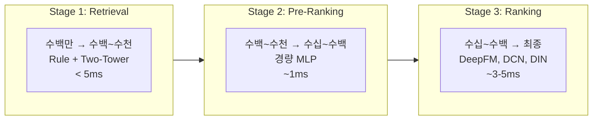
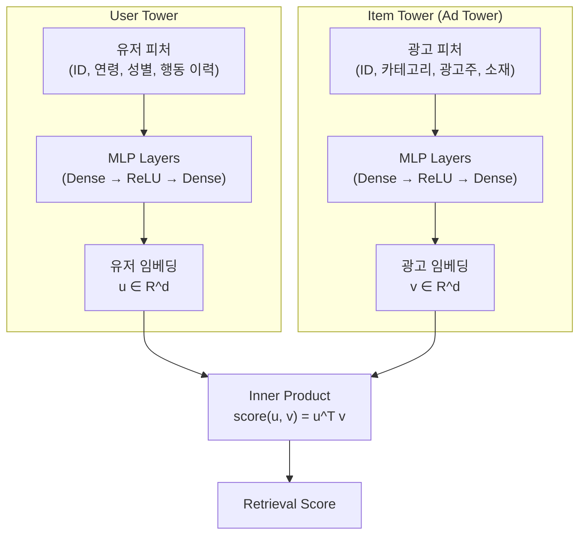
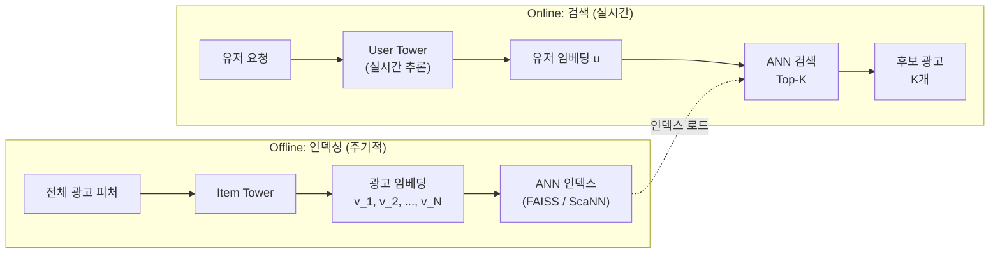

프로덕션 광고 시스템(실제 서비스에서 돌아가는 광고 시스템)에는 광고 후보가 수백만 개 있지만 유저 한 명에게 실제로 보여 줄 수 있는 광고는 1~3개뿐입니다. DeepFM 이나 DCN 같은 pCTR 모델(광고마다 클릭 확률을 예측하는 무거운 신경망)을 요청이 들어올 때마다 수백만 개 모두에 돌리는 일은 물리적으로 불가능하므로, 먼저 후보의 범위를 크게 좁힌 다음 남은 수백 개만 정밀하게 채점합니다.

> 한 줄 요약: 광고가 100만 개면 클릭 확률을 정밀하게 예측하는 무거운 모델로 하나씩 다 채점할 시간이 없습니다. 그래서 유저와 광고를 각각 숫자 목록(벡터)으로 바꿔 두고 두 벡터의 같은 자리끼리 곱해 더하는 계산 몇 번으로 후보를 수백 개까지 먼저 좁힙니다. 이 글의 계산에서 광고 10만 개를 정밀 모델로 모두 채점하면 30초가 걸리지만 이 벡터 계산으로는 13.6ms 면 끝납니다.

이렇게 수백만 개를 수백~수천 개로 줄이는 첫 관문을 **후보 생성(Retrieval)** 이라고 부릅니다. 후보 생성에서 빠진 광고는 다음 단계로 넘어가지 못하므로 뒤에 아무리 정교한 랭킹 모델(남은 후보의 순서를 정밀하게 매기는 모델)이 있어도 복구할 수 없습니다. 이 글은 후보 생성의 표준 방법인 **Two-Tower Model** 의 구조와 학습, 서빙, 한계, 평가를 살펴보며 ANN 인덱스(가장 가까운 벡터를 정확히 찾는 대신 근사로 빠르게 찾는 검색 구조)로 10ms 이내에 후보를 추리는 실무 아키텍처까지 다룹니다.

> 이 글의 자리: 광고 파이프라인에서 후보 생성은 첫 단계입니다. 그 앞뒤에서 일어나는 일은 아래 글에서 다룹니다.

- 단계별 랭킹(Multi-Stage Ranking)으로 이루어진 파이프라인 전체 구조 → [모델 서빙 아키텍처](post.html?id=model-serving-architecture)
- 피처(모델에 넣는 입력 값)가 모델까지 오는 과정 → [피처 스토어(Feature Store)](post.html?id=feature-store-serving)
- 랭킹 단계에서 모델이 발전해 온 과정 → [Deep CTR Models](post.html?id=deep-ctr-models)

---

## 1. 후보 생성 방법 비교 (Executive Summary)

**후보 생성 방법 5가지는 모두 수백만 개를 수백~수천 개로 줄이지만 무엇을 기준으로 줄이느냐가 달라 개인화 수준(유저마다 다른 후보를 고르는 정도)이 다릅니다. 사람이 적은 조건으로 고르는 규칙 기반과 역색인은 빠르고 단순하지만 개인화에 한계가 있습니다. Two-Tower 는 개인화와 레이턴시(응답에 걸리는 시간, 짧을수록 좋음)의 균형이 가장 좋은 방법으로 대부분의 프로덕션 광고 시스템에서 후보 생성의 중심 엔진입니다.**

후보 생성 방법은 여러 가지가 있지만 프로덕션에서 실제로 쓰는 선택지는 몇 개뿐입니다. 아래 표는 그 5가지가 후보를 몇 개에서 몇 개로 줄이는지와 레이턴시, 개인화 수준, 구현 복잡도를 나란히 보여 줍니다.

| 방법 | 후보 수 처리 | 레이턴시 | 개인화 수준 | 구현 복잡도 |
|------|------------|---------|-----------|-----------|
| **규칙 기반(Rule-based)** | 수백만 → 수천 | < 1ms | 없음 (세그먼트 단위) | 매우 낮음 |
| **Inverted Index** | 수백만 → 수천 | < 1ms | 낮음 (속성 매칭) | 낮음 |
| **Two-Tower (DSSM)** | 수백만 → 수백~수천 | 1~5ms | 높음 (유저별 임베딩) | 중간 |
| **Multi-Interest** | 수백만 → 수백~수천 | 3~10ms | 매우 높음 (관심사별) | 높음 |
| **Graph-based** | 수백만 → 수백~수천 | 5~15ms | 매우 높음 (관계 기반) | 매우 높음 |

규칙 기반(Rule-based)은 사람이 「20~34세 여성」처럼 조건을 손으로 적어 두고 그 조건에 맞는 광고만 남기는 방식입니다. 역색인(Inverted Index)은 그 조건 매칭을 빠르게 하려고 속성 값마다 광고 목록을 미리 만들어 둔 구조입니다. 둘 다 3절에서 다룹니다. Two-Tower (DSSM) 는 유저와 광고를 각각 벡터로 바꿔 비교하는 방법으로 4절에서, Multi-Interest 는 유저 한 명을 관심사별 벡터 여러 개로 나타내는 방법으로 5-2절에서 봅니다. Graph-based 는 개인화 칸에 적힌 대로 관계를 기준으로 삼는 방법이고 이 글에서 더 다루지 않습니다.

표의 '후보 수 처리' 열을 보면 5가지 방법 모두 결국 수백~수천 개로 줄이므로 방법 사이의 차이는 몇 개로 줄이느냐가 아니라 **무엇을 기준으로 줄이느냐**에 있습니다. 규칙 기반은 광고주가 미리 적어 둔 타겟 조건으로 줄이므로 같은 세그먼트(같은 조건에 드는 유저 그룹)의 유저는 모두 같은 후보를 받습니다. Two-Tower 는 유저 벡터와 방향이 비슷한 광고를 남기므로 유저마다 후보가 달라집니다. 이 기준의 차이가 개인화 수준 칸에서 규칙 기반의 「없음 (세그먼트 단위)」과 Two-Tower 의 「높음 (유저별 임베딩)」의 차이로 그대로 이어집니다. 임베딩은 유저나 광고를 나타내도록 학습한 숫자 벡터이고 4-1절에서 자세히 봅니다.

레이턴시 열에서는 Two-Tower 의 1~5ms 를 시간 예산과 함께 봅니다. 광고 요청 하나에 허용된 시간은 보통 100ms 안쪽이라 후보 생성이 그중 5ms 를 쓰면 뒤 단계들이 남은 95ms 를 나눠 씁니다. 그래서 후보 생성에 주는 시간 예산은 늘 한 자리 ms 로 잡힙니다.

표의 숫자는 측정한 값이 아니라 실무에서 흔히 보는 대략치이므로 값 하나하나보다 어느 방법이 더 빠르고 더 개인화되는지 그 순서를 읽으면 됩니다.

---

## 2. 후보 생성의 필요성과 단계별 랭킹(Multi-Stage Ranking) 복습

**정밀 모델이 광고 하나를 채점하는 데 0.1ms 만 걸려도 100만 개면 100초가 걸려 요청 하나에 주어진 100ms 를 크게 넘습니다. 그래서 단계마다 후보를 줄이면서 모델을 점점 무겁게 바꾸는 깔때기 구조를 둡니다. 그 첫 단계인 후보 생성은 좋은 광고를 놓치지 않는 것(재현율)을 가장 먼저 봅니다.**

### 깔때기의 물리적 제약

DeepFM 같은 복잡한 모델로 광고 후보 수백만 개를 모두 채점한다고 해 봅시다. 광고 하나를 추론(학습한 모델에 입력을 넣어 점수를 계산하는 일)하는 데 0.1ms 가 걸린다고 가정하면 100만 개에는 100만 × 0.1ms = 100초가 필요합니다. RTB(Real-Time Bidding)는 광고 지면이 열릴 때마다 실시간 경매로 광고를 고르는 방식이고 요청마다 100ms 타임아웃(응답을 기다리는 최대 시간)이 있습니다. 100초짜리 계산은 이 시간 안에 애초에 끝날 수 없으므로 깔때기 구조가 필수입니다. 깔때기 구조는 **단계마다 후보를 줄이면서 모델의 복잡도를 올리는** 방식이라 가장 무거운 모델은 후보가 충분히 줄어든 마지막 단계에서만 돌아갑니다.

아래 카드에서는 광고 10만 개가 후보 생성을 거쳐 수백 개로 추려지는 과정을 보면 됩니다.

<div class="demo-embed-wrap">
<iframe class="demo-embed" src="demo-serving-cards.html?embed=1&card=retrieval" height="480" loading="lazy" title="10만 개에서 수백 개로 추린다"></iframe>
<a class="demo-embed-open" href="demo-serving-cards.html" target="_blank" rel="noopener">↗ 카드 다섯 장 전체로 열기</a>
</div>

그림은 깔때기의 세 단계가 후보를 몇 개에서 몇 개로 줄이고 단계마다 어떤 모델로 몇 ms 를 쓰는지 보여 줍니다.



### 단계별 비교

| | 후보 생성 | Pre-Ranking | Ranking |
|---|---|---|---|
| **입력 후보** | 수백만 | 수백~수천 | 수십~수백 |
| **출력 후보** | 수백~수천 | 수십~수백 | 최종 1~10개 |
| **모델** | Rule / Two-Tower / ANN | 경량 MLP, LR | DeepFM, DCN, DIN |
| **레이턴시** | < 5ms | ~1ms | ~3-5ms |
| **최적화 목표** | **Recall** (누락 방지) | Recall + 경량성 | **Precision** (정확도) |

표의 가운데 열인 Pre-Ranking 은 후보 생성이 넘긴 수백~수천 개를 경량 MLP(층이 몇 개뿐인 작은 신경망)나 LR(로지스틱 회귀)로 수십~수백 개까지 한 번 더 줄이는 단계입니다. 마지막 열인 Ranking 은 남은 수십~수백 개에 DeepFM, DCN, DIN 같은 무거운 모델을 돌려 최종 1~10개를 고르는 단계입니다.

마지막 행의 최적화 목표는 양 끝 단계에서 서로 다릅니다. Recall(재현율)은 유저가 실제로 클릭한 광고 가운데 후보에 들어 있는 광고의 비율로, 높을수록 덜 놓쳤다는 뜻입니다. Precision 은 고른 광고 가운데 실제로 맞는 광고의 비율이며 표에는 정확도라고 적었습니다. 후보 생성은 재현율을, 중간의 Pre-Ranking 은 재현율과 경량성(가벼운 계산)을, Ranking 은 Precision 을 목표로 둡니다.

### 후보 생성(Retrieval)의 제약: Recall 최우선

Pre-Ranking 과 Ranking 은 후보 생성이 넘긴 후보 풀(다음 단계로 넘어간 광고 목록) 안에서만 고르므로, 후보 생성 단계에서 탈락한 광고는 뒤 단계가 아무리 정교해도 유저에게 도달하지 못하고 이후 어떤 단계에서도 복구되지 않습니다. 반면 후보에 섞인 나쁜 광고 몇 개는 Ranking 이 후보 안에서 정밀하게 순위를 매기며 뒤로 밀어낼 수 있습니다. 좋은 광고 하나를 놓치는 손해가 나쁜 광고 몇 개를 포함하는 손해보다 훨씬 크므로 후보 생성은 **Precision 보다 재현율을 극대화**해야 합니다.

> 그래서 후보 생성이 전체 파이프라인 성능의 상한선(upper bound)을 정합니다. Ranking 모델이 아무리 좋아도 파이프라인 성능은 이 상한선 위로 올라가지 못합니다.

### 정밀 모델 전수 채점의 시간 계산

「불가능하다」는 말만으로는 얼마나 불가능한지 감이 오지 않으므로 곱셈 횟수를 직접 세어 시간으로 바꿔 봅니다. 정밀 랭킹 모델(이하 정밀 모델)은 광고 하나를 채점할 때마다 층을 여러 개 통과하므로 걸리는 시간이 **후보 수에 정비례**해 늘어납니다. 반면 Two-Tower 는 요청마다 유저 타워(유저 피처를 유저 벡터로 바꾸는 신경망, 4-1절)를 한 번만 돌리고 광고마다 유저 벡터와의 내적만 구합니다. 내적은 두 벡터의 같은 자리 숫자끼리 곱해 모두 더한 값이라 광고 하나에 드는 계산은 임베딩 차원(벡터에 든 숫자의 개수)만큼인 곱셈 64번과 덧셈뿐입니다. 광고 벡터는 요청 전에 미리 계산해 두므로(4-3절) 두 방법의 계산량이 이렇게 크게 다릅니다. 이 비대칭이 아래 결과를 전부 설명합니다.

앞의 깔때기 계산에서는 광고 1건 추론을 0.1ms 로 잡았지만 아래 코드는 실무 DeepFM 에 더 가까운 0.3ms 를 씁니다. 코드는 후보 1만, 10만, 100만 개를 정밀 모델로 다 채점할 때, Two-Tower 내적으로 모두 스캔할 때, ANN 으로 2% 만 스캔할 때의 시간을 구해 100ms 예산과 비교하려고 돌립니다. 유저 타워 한 번은 0.8ms, 곱셈-덧셈은 1초에 5억 쌍(5e8)을 처리한다고 두었으며 모두 가상의 값입니다.

```python
# 하는 일: 후보 1만, 10만, 100만 개를 정밀 모델로 다 채점할 때와 투 타워 내적으로 스캔할 때, ANN 으로 2% 만 스캔할 때의 시간을 구해 100ms 예산과 비교한다.

# 1단계: 예산과 방식별 시간을 둔다
# 왜 후보 전체에 정밀 모델을 못 돌리는지 곱셈 횟수를 직접 세어 본다. 숫자는 가상이지만 실제 범위에서 크게 벗어나지 않게 잡았다. 표준 라이브러리만 쓴다.
BUDGET_MS      = 100.0   # 광고 요청 하나에 허용된 전체 시간 (가상)
RANK_MS_PER_AD = 0.3     # 정밀 랭킹 모델이 광고 1건을 채점하는 시간 (가상)
USER_TOWER_MS  = 0.8     # 유저 타워(경량 MLP) 1회 추론 시간 (가상)
DIM            = 64      # 임베딩 차원 = 내적 1건에 필요한 곱셈 횟수
MULADD_PER_SEC = 5e8     # 최적화된 C 라이브러리가 1초에 처리하는 곱셈-덧셈 쌍 (가상)


# 2단계: 표의 칸을 맞추는 함수와 두 방식의 시간을 구하는 함수를 만든다
# 정밀 모델은 후보 수에 정비례한다. 투 타워는 유저 타워를 한 번 돌리고, 후보마다 내적 곱셈만 더한다.
def cell(s, width, right=True):
    """한글은 화면에서 두 칸을 차지한다. 그만큼 빼서 표 자리를 맞춘다."""
    gap = " " * max(0, width - len(s) - sum(1 for c in s if ord(c) > 0x2000))
    return gap + s if right else s + gap


def rank_all_ms(n_ads):
    """후보 n_ads개를 전부 정밀 랭킹 모델로 채점할 때 걸리는 시간(ms).
    후보 수에 정비례한다. 이 정비례가 문제의 핵심이다."""
    return n_ads * RANK_MS_PER_AD


def two_tower_ms(n_ads, scan_ratio=1.0):
    """투 타워로 n_ads개를 스캔할 때 걸리는 시간(ms).

    scan_ratio=1.0  → 후보 전체와 내적을 다 해보는 경우 (brute force)
    scan_ratio=0.02 → ANN 인덱스가 전체의 2%만 골라 스캔하는 경우
    """
    muladds = n_ads * scan_ratio * DIM        # 내적 1건 = 곱셈-덧셈 DIM쌍
    dot_ms = muladds / MULADD_PER_SEC * 1000  # 초 단위를 ms로 바꾼다
    return USER_TOWER_MS + dot_ms             # 유저 타워는 후보 수와 무관하게 딱 1회


# 3단계: 후보 수마다 세 방식의 시간을 비교한다
print(cell("후보 수", 12) + cell("정밀모델 전수", 16)
      + cell("투타워 전수내적", 17) + cell("투타워+ANN 2%", 16) + cell("절감 배수", 11))
for n in (10_000, 100_000, 1_000_000):
    full = rank_all_ms(n)          # 정밀 모델을 후보 전체에 돌리는 경우
    brute = two_tower_ms(n)        # 내적만 전수로 도는 경우
    ann = two_tower_ms(n, 0.02)    # ANN으로 2%만 스캔하는 경우
    print(f"{n:>12,}{full:>14,.0f}ms{brute:>15.1f}ms{ann:>14.1f}ms"
          f"{full / brute:>10,.0f}배")

# 4단계: 100ms 예산을 넘는지 하나씩 확인한다
# 넘으면 그 방식은 애초에 못 쓴다.
print()
for label, ms in (("정밀모델 전수 (10만 개)", rank_all_ms(100_000)),
                  ("투타워 전수내적 (10만 개)", two_tower_ms(100_000)),
                  ("투타워 전수내적 (100만 개)", two_tower_ms(1_000_000)),
                  ("투타워+ANN 2% (100만 개)", two_tower_ms(1_000_000, 0.02))):
    verdict = "예산 초과" if ms > BUDGET_MS else "통과"
    print(cell(label, 27, right=False)
          + f"{ms:>10,.1f}ms   예산의 {ms / BUDGET_MS:>8.1%}  → {verdict}")

# 출력:
# 3단계 뜻: 정밀 모델은 후보 수에 정비례해 1,000,000개면 300,000ms 가 든다. 같은 후보를 투 타워 내적으로 다 스캔하면 128.8ms, ANN 으로 2% 만 스캔하면 3.4ms 다.
#      후보 수   정밀모델 전수  투타워 전수내적   투타워+ANN 2%  절감 배수
#       10,000         3,000ms            2.1ms           0.8ms     1,442배
#      100,000        30,000ms           13.6ms           1.1ms     2,206배
#    1,000,000       300,000ms          128.8ms           3.4ms     2,329배
# 4단계 뜻: 예산 안에 드는 것은 10만 개를 내적으로 다 스캔할 때(13.6ms)와 100만 개를 ANN 으로 2% 만 스캔할 때(3.4ms)뿐이다. 10만 개를 정밀 모델로 다 채점하면 예산의 30000.0% 다.
#
# 정밀모델 전수 (10만 개)      30,000.0ms   예산의 30000.0%  → 예산 초과
# 투타워 전수내적 (10만 개)        13.6ms   예산의    13.6%  → 통과
# 투타워 전수내적 (100만 개)      128.8ms   예산의   128.8%  → 예산 초과
# 투타워+ANN 2% (100만 개)          3.4ms   예산의     3.4%  → 통과
```

3단계 표에서 정밀 모델의 시간은 후보 수에 0.3ms 를 곱한 값이라 1만 개면 3,000ms, 10만 개면 30,000ms, 100만 개면 300,000ms 로 후보가 10배 늘 때마다 정확히 10배가 됩니다. 같은 10만 개를 Two-Tower 내적으로 모두 스캔한 13.6ms 가운데 0.8ms 는 유저 타워 한 번이고 나머지가 내적 10만 번의 몫입니다. 정밀 모델의 30,000ms 를 13.6ms 로 나누면 표의 절감 배수와 같은 2,206배가 나옵니다.

4단계는 이 시간들이 100ms 예산 안에 드는지 판정합니다. 10만 개를 정밀 모델로 다 채점한 30,000ms(**30초**)는 예산의 300배(30000.0%)라 「예산 초과」이고 같은 10만 개를 내적으로 스캔한 **13.6ms** 는 예산의 13.6% 라 「통과」입니다. 후보가 100만 개가 되면 Two-Tower 내적조차 128.8ms 로 예산을 넘는데, 여기서 ANN 이 등장합니다. ANN 으로 전체의 2% 만 골라 스캔하면 시간이 **3.4ms** 로 떨어집니다.

30초, 13.6ms, 3.4ms 세 숫자만 기억하면 4절에서 볼 구조가 모두 설명됩니다. 정밀 모델은 후보가 적은 뒤 단계로 보내고 수백만 개를 다루는 앞 단계에서는 벡터 내적을 쓰되, 그마저 예산을 넘는 규모에서는 ANN 으로 스캔 범위를 줄입니다.

---

## 3. 규칙 기반 후보 생성(Rule-Based Retrieval) (Baseline)

**규칙 기반 후보 생성은 광고주가 정한 타겟 조건에 맞는 광고만 역색인으로 1ms 안에 골라내는 가장 전통적인 방법입니다. 빠르고 단순하지만 같은 조건에 드는 유저를 서로 구분하지 못해 그 자체로는 개인화된 후보를 만들 수 없습니다. 이 글에서 규칙 기반은 Two-Tower 에 앞서 보는 출발점(Baseline)입니다.**

### 타겟팅 규칙 매칭

광고주는 캠페인(같은 목표로 집행하는 광고 단위)마다 어떤 유저에게 광고를 보여 줄지 타겟 조건을 정해 둡니다. 가장 전통적인 후보 생성은 이 조건으로 광고를 걸러 냅니다. 예를 들어 한 캠페인에는 아래 조건이 붙어 있습니다.

- **연령**: 20~34세
- **성별**: 여성
- **지역**: 서울, 경기
- **관심사 카테고리**: 러닝, 아웃도어
- **디바이스**: iOS

요청이 들어오면 그 유저의 속성(연령, 성별, 지역, 관심사, 디바이스 같은 정보)을 캠페인마다 붙은 타겟 조건과 맞춰 보고 조건에 맞는 캠페인의 광고만 후보로 통과시킵니다.

### 역색인(Inverted Index)

실무에서는 이 매칭을 빠르게 하려고 **역색인(Inverted Index)** 을 미리 만들어 둡니다. 역색인은 아래처럼 속성 값마다 그 값을 타겟으로 정한 광고 목록을 적어 둔 표라서 캠페인의 조건을 하나씩 확인하지 않고 유저의 속성 값으로 목록을 바로 찾아갈 수 있습니다.

```
유저 속성 → 해당 속성을 타겟하는 광고 목록

gender=female   → [ad_001, ad_045, ad_112, ad_389, ...]
age=25-34       → [ad_001, ad_023, ad_045, ad_078, ...]
region=seoul    → [ad_001, ad_045, ad_200, ad_567, ...]

최종 후보 = intersection(gender, age, region)
         = [ad_001, ad_045, ...]
```

요청이 오면 유저의 속성 값을 키로 목록을 꺼내 교집합만 구하면 됩니다. 위 예에서는 `gender=female`, `age=25-34`, `region=seoul` 세 목록에 모두 들어 있는 `ad_001`, `ad_045` 등이 최종 후보가 됩니다. 검색 엔진이 낱말마다 그 낱말이 든 문서 목록을 두는 역색인과 같은 원리입니다. 수백만 광고에서 수천 개를 뽑는 데 1ms 이내면 충분합니다.

### 장점과 한계

| 장점 | 한계 |
|------|------|
| 매우 빠름 (< 1ms) | 타겟 조건 바깥의 잠재 고객을 발견하지 못함 |
| 구현이 단순하고 디버깅이 쉬움 | 타겟 조건이 넓으면 후보가 너무 많고, 좁으면 너무 적음 |
| 광고주 의도를 정확히 반영 | 개인화 불가 (동일 세그먼트 내 유저를 구분 못함) |
| 비즈니스 로직 준수 보장 | 새로운 유저-광고 매칭 탐색 불가 |

장점 칸에 적힌 대로 규칙 기반 후보 생성은 광고주 의도를 정확히 반영하고 비즈니스 로직 준수를 보장하므로 **필수 필터**로는 계속 쓰입니다. 그러나 한계 칸의 「개인화 불가」처럼 같은 세그먼트 안의 유저를 서로 구분하지 못해 그 자체로는 개인화된 후보를 만들 수 없으므로, 유저마다 다른 후보를 고르는 Two-Tower Model 이 필요합니다.

---

## 4. Two-Tower Model (DSSM)

**Two-Tower 는 유저와 광고를 같은 벡터 공간에 올려 두고 유저 벡터와 가까운 광고를 후보로 고릅니다.**

Two-Tower Model 의 출발점은 2013년 Microsoft 가 내놓은 DSSM(Deep Structured Semantic Model)입니다. 지금은 대규모 추천과 광고 시스템 대부분이 이 구조를 후보 생성 엔진으로 씁니다. 같은 벡터 공간에 올린다는 말은 유저와 광고를 모두 같은 개수($d$ 개)의 숫자로 된 벡터로 바꿔 서로 곱하고 비교할 수 있게 만든다는 뜻입니다. 가깝다는 말은 4-1절에서 볼 점수(내적이나 코사인)가 높다는 뜻입니다.

### 4-1. 아키텍처

**유저 타워와 광고 타워는 서로의 입력을 보지 않고 각자 $d$ 차원 벡터를 만듭니다. 점수는 두 벡터의 내적이나 코사인입니다. 두 타워가 서로 독립이라는 이 제약 덕분에 서빙이 아주 효율적입니다.**

아래 그림의 두 타워(User Tower, Item Tower)는 따로 계산하다가 맨 아래 내적(Inner Product)에서만 만납니다.



**유저 타워(User Tower)** 는 유저 피처(그림에서는 ID, 연령, 성별, 행동 이력)를 MLP 층에 통과시켜 유저 임베딩 $u$ 를 출력합니다. MLP 층은 입력에 가중치를 곱하는 Dense 층과 ReLU 같은 비선형 함수를 번갈아 쌓은 신경망 층으로, 그림에서는 Dense → ReLU → Dense 입니다. 유저 임베딩은 숫자 $d$ 개로 된 벡터라 유저 벡터라고도 부릅니다. 식으로 쓰면 아래와 같습니다.

$$u = f_{\text{user}}(x_{\text{user}}) \in \mathbb{R}^d$$

**광고 타워(Item Tower)** 는 광고 피처(ID, 카테고리, 광고주, 소재)를 같은 방식으로 받아 같은 $d$ 차원의 광고 임베딩 $v$ 를 출력합니다.

$$v = g_{\text{item}}(x_{\text{item}}) \in \mathbb{R}^d$$

후보 생성 점수는 두 벡터가 얼마나 비슷한지를 나타내는 유사도입니다. 기본은 2절에서 본 내적이며 내적이 클수록 유저와 광고가 잘 맞는다고 봅니다.

$$\text{score}(u, v) = u^T v$$

내적 대신 코사인 유사도(cosine similarity)를 쓰기도 합니다. 코사인 유사도는 내적을 두 벡터의 길이를 곱한 값으로 나눈 값이라 길이의 영향이 빠지고 방향만 남습니다. 코사인 유사도가 1 에 가까울수록 두 벡터가 같은 방향을 가리킵니다.

$$\text{score}(u, v) = \frac{u^T v}{\|u\| \cdot \|v\|}$$

이 구조의 중심에는 두 타워가 **서로 독립적으로** 임베딩을 계산한다는 성질이 있습니다. 교차 피처(cross feature)는 「이 유저의 이 속성이 이 광고의 이 속성과 만났을 때」처럼 유저와 광고를 함께 봐야 만들어지는 피처입니다. 유저 타워는 광고 피처를 보지 않고 광고 타워는 유저 피처를 보지 않으므로 Two-Tower 는 교차 피처를 쓰지 않습니다. 대신 광고 벡터를 어떤 유저가 올지 모르는 채로 미리 계산해 둘 수 있어서 이 제약이 서빙을 크게 효율적으로 만듭니다(4-3절).

#### 직접 구현 — 내적 기준과 코사인 기준의 상위 5개

벡터 내적으로 후보를 뽑는 일은 코드로 쓰면 정말 짧습니다. 광고마다 유저 벡터와 곱해 더한 점수를 구하고 점수 순으로 정렬해 위에서 몇 개만 자르면 끝납니다. 다만 내적은 벡터의 **길이**(숫자마다 제곱해 더한 뒤 제곱근을 취한 값)에도 영향을 받는 반면 코사인은 **방향**만 보므로, 같은 후보 풀에서도 두 기준이 서로 다른 상위 5개를 뽑습니다.

아래 코드는 손으로 따라갈 수 있게 차원을 4로 줄인(실무는 64~128) 유저 벡터 1개로 광고 벡터 20개를 내적과 코사인으로 각각 채점해 상위 5개를 뽑은 뒤, 두 기준이 다르게 뽑은 광고의 벡터 길이를 비교합니다.

```python
# 하는 일: 4차원 유저 벡터 1개로 광고 벡터 20개를 내적과 코사인으로 각각 채점해 상위 5개를 뽑고, 두 기준이 다르게 뽑은 광고의 벡터 길이를 비교한다.
import math
import random

# 1단계: 유저 벡터 1개와 광고 벡터 20개를 만든다
# 투 타워의 '검색' 부분을 직접 구현해 본다. 차원은 눈으로 볼 수 있게 4 로 줄였다(실무는 64~128).
random.seed(42)                      # 돌릴 때마다 같은 결과가 나오게 고정
DIM = 4
N_ADS = 20

# 유저 타워가 뽑아낸 유저 임베딩 (가상). 실제로는 MLP의 마지막 층 출력이다.
user_vec = [round(random.uniform(-1, 1), 3) for _ in range(DIM)]

# 광고 타워가 미리 계산해 둔 광고 임베딩 20개 (가상).
# 벡터 길이가 광고마다 다르다는 점을 눈여겨보자. 실제 학습에서도 자주 등장한 광고일수록
# 벡터가 길어지는 경향이 있고, 그 길이가 내적 점수에 그대로 반영된다.
ads = {}
for i in range(N_ADS):
    ads[f"ad_{i:02d}"] = [round(random.uniform(-1, 1), 3) for _ in range(DIM)]


# 2단계: 내적, 길이, 코사인, 상위 k개를 구하는 함수를 만든다
# 내적은 벡터의 길이에도 영향을 받고, 코사인은 길이를 나눠 버려 방향만 본다.
def dot(a, b):
    """내적 = 같은 자리끼리 곱해서 전부 더한다. 투 타워의 점수 계산은 이게 전부다."""
    return sum(x * y for x, y in zip(a, b))


def norm(a):
    """벡터의 길이. 각 원소를 제곱해 더한 뒤 제곱근을 씌운다."""
    return math.sqrt(sum(x * x for x in a))


def cosine(a, b):
    """코사인 유사도 = 내적을 두 벡터의 길이로 나눈 값. 길이를 지우고 '방향'만 본다."""
    return dot(a, b) / (norm(a) * norm(b))


def top_k(score_fn, k=5):
    """광고 전부를 점수 매겨 상위 k개만 남긴다. 이게 가장 단순한 전수 검색이다."""
    scored = [(name, score_fn(user_vec, v)) for name, v in ads.items()]
    scored.sort(key=lambda pair: pair[1], reverse=True)
    return scored[:k]


# 3단계: 두 기준으로 상위 5개를 뽑아 나란히 찍는다
print(f"유저 임베딩 u = {user_vec}  (길이 {norm(user_vec):.3f})")
print(f"광고 후보 {N_ADS}개, 차원 {DIM} → 곱셈 {N_ADS * DIM}번으로 검색이 끝난다\n")

by_dot = top_k(dot)
by_cos = top_k(cosine)

print("순위  내적 기준          코사인 기준")
for rank, (d, c) in enumerate(zip(by_dot, by_cos), start=1):
    print(f" {rank}    {d[0]}  {d[1]:+.3f}     {c[0]}  {c[1]:+.3f}")

# 4단계: 두 기준이 다르게 뽑은 광고를 들여다본다
# 두 방식이 고른 상위 5개 집합이 같은지 확인하고, 다르면 어디서 달라졌는지 본다.
set_dot, set_cos = {n for n, _ in by_dot}, {n for n, _ in by_cos}
print(f"\n내적만 뽑은 광고   : {sorted(set_dot - set_cos)}")
print(f"코사인만 뽑은 광고 : {sorted(set_cos - set_dot)}")
for name in sorted(set_dot ^ set_cos):
    print(f"  {name}: 벡터 길이 {norm(ads[name]):.3f}, "
          f"내적 {dot(user_vec, ads[name]):+.3f}, 코사인 {cosine(user_vec, ads[name]):+.3f}")

# 출력:
# 3단계 뜻: 광고 20개를 곱셈 80번으로 채점해 검색이 끝난다. 두 기준 모두 ad_09 가 1위지만, 2위와 4위는 두 기준이 서로 다른 광고를 고른다.
# 유저 임베딩 u = [0.279, -0.95, -0.45, -0.554]  (길이 1.221)
# 광고 후보 20개, 차원 4 → 곱셈 80번으로 검색이 끝난다
#
# 순위  내적 기준          코사인 기준
#  1    ad_09  +1.455     ad_09  +0.985
#  2    ad_05  +1.379     ad_11  +0.851
#  3    ad_01  +1.097     ad_01  +0.812
#  4    ad_10  +0.878     ad_05  +0.752
#  5    ad_18  +0.802     ad_18  +0.607
# 4단계 뜻: 내적만 뽑은 ad_10 은 벡터 길이가 1.351 로 길어, 코사인이 +0.533 인데도 내적 +0.878 로 내적 기준 상위에 든다. 코사인만 뽑은 ad_11 은 길이가 0.743 으로 짧아, 방향이 잘 맞는데도(코사인 +0.851) 내적은 +0.771 에 그친다.
#
# 내적만 뽑은 광고   : ['ad_10']
# 코사인만 뽑은 광고 : ['ad_11']
#   ad_10: 벡터 길이 1.351, 내적 +0.878, 코사인 +0.533
#   ad_11: 벡터 길이 0.743, 내적 +0.771, 코사인 +0.851
```

3단계 출력에서 광고 20개를 곱셈 80번(광고 20개 × 차원 4)으로 채점해 검색이 끝났습니다. 두 기준 모두 `ad_09` 가 1위(내적 +1.455, 코사인 +0.985)지만 2위와 4위에서는 서로 다른 광고를 골랐습니다. 4단계는 두 상위 5개 집합이 `ad_10` 과 `ad_11` 에서만 다르다고 찍었습니다.

`ad_10` 은 벡터 길이가 1.351 로 길지만 방향은 유저와 별로 맞지 않아 코사인이 0.533 에 그칩니다. 그래도 내적은 길이를 그대로 반영하므로 +0.878 까지 올라가 내적 기준 4위로 상위 5개에 듭니다. 두 벡터 길이(유저 1.221, `ad_10` 1.351)의 곱이 1 보다 커서 그 곱으로 나눈 코사인은 내적보다 작아집니다.

`ad_11` 은 반대로 길이가 0.743 으로 짧고 방향은 유저와 잘 맞아 코사인이 0.851 로 코사인 기준 2위입니다. 그런데 내적으로 측정하면 짧은 길이 때문에 +0.771 에 그쳐 내적 기준 5위 `ad_18` 의 +0.802 보다 낮은 6위로 밀립니다.

실무에서 내적과 코사인 가운데 무엇을 쓸지는 취향으로 정할 일이 아닙니다. 학습에서 자주 등장한 광고일수록 벡터가 길어지는 경향이 있어서 내적을 쓰면 **자주 학습된 인기 광고가 유리**해집니다. 인기 광고가 유리한 이 성향을 그대로 두고 싶으면 내적을, 지우고 싶으면 코사인을 고릅니다. 이때 쓰려는 ANN 인덱스가 어느 쪽 거리를 지원하는지도 함께 확인해야 합니다.

### 4-2. 학습

**Two-Tower 는 유저가 클릭한 광고와의 내적은 높이고 관심 없는 광고와의 내적은 낮추도록 학습합니다. 어떤 광고를 「관심 없는 광고」로 삼느냐가 성능의 대부분을 정합니다. 실무에서는 같은 배치(한 번에 함께 학습하는 데이터)에 든 다른 유저의 클릭 광고를 「관심 없는 광고」로 가장 많이 쓰는데, 그대로 쓰면 인기 광고의 점수가 깎이므로 광고가 배치에 뽑힐 확률로 보정합니다.**

> 이 절의 학습을 배치 4줄짜리 예로 손으로 따라가는 글이 따로 있습니다. 점수표, 손실, 온도, 꼭 넣어야 하는 보정 2가지, 평가와 배포를 그림 8장으로 보여 주는 [Two-Tower 학습](post.html?id=two-tower-training) 편입니다.

#### 양성 쌍(Positive Pair)

학습 데이터에서 양성 쌍(positive pair)은 (유저, 그 유저가 클릭한 광고)입니다. 유저가 광고를 클릭했다면 그 광고에 관심이 있다고 보므로, 학습은 그 유저의 임베딩과 그 광고의 임베딩이 이루는 내적이 높아지도록 두 타워의 가중치를 조정합니다.

#### 음성(Negative) Pair 선택 전략

음성 쌍(negative pair)은 유저와 그 유저가 관심 없는 광고의 짝입니다. 어떤 광고를 「유저가 관심 없는 광고」로 정할지가 음성 sampling(음성으로 쓸 광고를 뽑는 일) 전략입니다. Two-Tower 학습에서는 **이 전략이 모델 성능의 대부분을 결정**합니다. 흔히 쓰는 전략은 아래 3가지입니다.

| 전략 | 방법 | 장점 | 단점 |
|------|------|------|------|
| **Random 음성** | 전체 광고 풀에서 랜덤 샘플링 | 구현 단순, 계산 효율적 | 대부분 too easy, 학습 신호 약함 |
| **같은 배치 안 음성(In-batch Negative)** | 같은 배치 내 다른 유저의 양성을 음성으로 사용 | 추가 계산 없이 효율적, 적절한 난이도 | 인기 광고에 대한 sampling bias |
| **헷갈리는 음성(Hard Negative)** | 지금 모델이 높은 순위(예: 101~500위)로 올린 비정답 광고 | 쉬운 음성이 못 주는 세밀한 구분을 배운다 | 이것만 쓰면 무작위 음성을 못 이긴다. 노출 후 안 누른 광고만 쓰면 재현율이 크게 떨어진다 |

무작위 음성(Random 음성)으로 뽑힌 광고는 대부분 모델이 이미 쉽게 구분하는 쉬운 음성(too easy)이라 학습 신호가 약합니다. 헷갈리는 음성은 지금 모델이 높은 순위로 올린 비정답이라 모델이 쉬운 음성으로는 얻지 못하는 세밀한 구분을 배웁니다. 같은 배치 안 음성은 아래에서 따로 봅니다.

후보 생성에서는 헷갈리는 음성을 「노출됐는데 클릭하지 않은 광고」로 정하면 결과가 오히려 나빠집니다. Facebook 검색 팀은 노출 후 안 누른 것만 음성으로 써 보았고(Huang 외, 2020) 사람 검색 모델(사람을 찾는 검색에 쓰는 임베딩 모델)의 재현율이 절대값으로 55% 떨어졌다고 보고했습니다. 「절대값으로」는 원래 재현율에서 55% 의 비율만큼 줄었다는 뜻이 아니라 재현율 값 자체가 55% 포인트 내려갔다는 뜻입니다. 노출된 광고는 이미 앞 단계를 통과한 그럴듯한 광고라서 노출된 광고만 보는 모델은 전혀 상관없는 광고를 밀어내는 법을 배우지 못하는데, 후보 생성은 수백만 개 전부에서 후보를 고르므로 그 구분부터 배워야 합니다.

같은 논문에서 헷갈리는 음성만으로 학습한 모델은 무작위 음성으로 학습한 모델을 이기지 못했습니다. 가장 좋았던 방법은 지금 모델이 101~500위로 올린 비정답을 뽑아 쉬운 음성에 섞는 방식이었는데, 쉬운 음성을 늘릴수록 재현율이 오르다가 쉬운 음성 100개당 헷갈리는 음성 1개 정도에서 더 오르지 않았습니다.

실무에서는 **같은 배치 안 음성(In-batch Negative)** 을 가장 널리 씁니다. 배치(batch)는 학습 스텝 한 번에 함께 넣는 양성 쌍들입니다. 배치 크기가 $B$ 면 각 유저의 양성 1개를 뺀 나머지 $B-1$개 광고가 자동으로 그 유저의 음성이 됩니다. 이 $B-1$개는 같은 배치의 다른 유저들이 클릭한 광고라 음성을 따로 뽑는 비용 없이 많은 음성을 얻을 수 있습니다.

다만 같은 배치 안 음성에서는 인기 광고가 음성으로 더 자주 나오는 **표본 편향(sampling bias)** 이 생깁니다. 인기 광고는 많은 유저의 양성에 들어 있어 배치에 자주 들어오는데, 배치에 들어온 만큼 다른 유저의 음성으로도 쓰이므로 음성 자리에 훨씬 자주 들어갑니다. 이 현상을 과대 표집이라고 부릅니다. 이 편향을 보정하지 않으면 모델은 인기 광고의 점수를 진짜 적합도보다 낮게 평가(과소평가)합니다.

#### 직접 구현 — 같은 배치 안 음성과 인기 광고의 순위

과대 표집을 숫자로 세어 봅니다. 배치 크기가 8이면 한 행(유저 한 명과 그 유저가 클릭한 광고)의 음성은 나머지 7개입니다. 배치는 클릭 로그에서 뽑으므로 클릭이 많은 광고일수록 배치에 자주 들어가는데 한 번 들어갈 때마다 그 배치의 다른 7개 행에서 음성으로 쓰입니다.

보정을 빼먹은 채 학습이 수렴하면(더 학습해도 점수가 거의 바뀌지 않는 상태가 되면) 모델이 내는 점수(아래 코드의 보정 전 점수)는 진짜 점수와 $-\log q$ 만큼 달라집니다. $q$ 는 그 광고가 배치에 뽑힐 확률입니다. $q$ 는 1 보다 작아 $\log q$ 가 음수이므로 점수에는 양수인 $-\log q$ 가 더해집니다. 이 값은 $q$ 가 큰 인기 광고에서는 작고 $q$ 가 작은 롱테일(클릭이 드문 수많은 광고)에서는 크므로 **인기 광고가 상대적으로 깎입니다**.

아래 코드는 크기 8 인 배치 2,000개를 광고 8개의 클릭 점유율대로 뽑아 광고마다 음성으로 쓰인 횟수를 센 뒤 log-Q 보정 전과 후의 점수와 순위를 비교합니다. 진짜 점수는 편향이 하나도 없다면 모델이 배웠어야 할 적합도로 둔 가상의 값입니다. log-Q 보정은 학습 손실의 logit(소프트맥스에 넣기 전의 점수)에 $-\log q$ 를 미리 더해 보정 전 점수와 진짜 점수의 차이를 상쇄하므로 보정 후 점수는 진짜 점수와 같습니다.

```python
# 하는 일: 크기 8 인 배치 2,000개를 클릭 점유율대로 뽑아 광고마다 negative 로 쓰인 횟수를 세고, log-Q 보정 전과 후의 점수와 순위를 비교한다.
import math
import random

# 1단계: 배치 크기와 배치 수, 광고 8개의 점유율, 진짜 적합도를 둔다
# in-batch negative 의 함정을 숫자로 확인한다. 배치 안의 '남의 정답'을 negative 로 쓰면, 인기 광고가 negative 자리에 훨씬 자주 들어간다.
random.seed(42)
BATCH = 8            # 배치 크기. 한 행의 negative는 나머지 BATCH-1개다.
N_BATCH = 2_000      # 학습 배치 수

# 가상 데이터: 광고 8개의 클릭 점유율과, 이 유저에게 매긴 '진짜 적합도' 점수.
# 진짜 적합도는 편향이 하나도 없다면 모델이 배웠어야 할 값이다.
share = {"ad_A": 0.35, "ad_B": 0.20, "ad_C": 0.14, "ad_D": 0.10,
         "ad_E": 0.08, "ad_F": 0.06, "ad_G": 0.04, "ad_H": 0.03}
true_score = {"ad_A": 3.0, "ad_B": 2.2, "ad_C": 1.6, "ad_D": 1.5,
              "ad_E": 1.4, "ad_F": 1.3, "ad_G": 1.2, "ad_H": 2.4}

names = list(share)
weights = [share[n] for n in names]

# 2단계: 클릭 로그를 점유율대로 뽑아 배치를 만들고, negative 로 쓰인 횟수를 세고 표집 확률 q 를 추정한다
# 배치 안에 몇 번 들어갔는지만 세고, negative 로 쓰인 횟수와 q 는 그 수로 구한다.
seen = {n: 0 for n in names}
for _ in range(N_BATCH):
    for pick in random.choices(names, weights=weights, k=BATCH):
        seen[pick] += 1

total_rows = N_BATCH * BATCH
# 한 배치에 한 번 들어가면, 그 배치의 다른 BATCH-1개 행에 대해 negative로 쓰인다.
neg_count = {n: seen[n] * (BATCH - 1) for n in names}
# 표집 확률 q는 관측된 등장 비율로 추정한다. 실무에서도 이렇게 스트리밍 카운트로 센다.
q_hat = {n: seen[n] / total_rows for n in names}

# 3단계: 보정 전과 보정 후의 점수를 구한다
# 보정을 안 하면, 학습이 수렴한 모델의 점수는 진짜 점수에서 log q 만큼 밀린다(보정 전 점수 = 진짜 점수 - log q). log q 는 음수라 점수에는 -log q 가 더해진다. q 가 큰 인기 광고는 더해지는 값이 작고, q 가 작은 롱테일은 크게 늘어난다. 결과는 순위 왜곡이다.
biased = {n: true_score[n] - math.log(q_hat[n]) for n in names}
# log-Q 보정은 학습 loss의 logit에 -log(q)를 미리 더해 이 밀림을 상쇄한다.
#   보정 후 점수 = 진짜 점수
fixed = dict(true_score)


# 4단계: 점수 높은 순으로 등수를 매기는 함수를 만든다
def rank_of(scores):
    """점수 높은 순으로 1위부터 등수를 매긴다."""
    order = sorted(scores, key=lambda n: scores[n], reverse=True)
    return {n: i + 1 for i, n in enumerate(order)}


# 5단계: 광고마다 negative 등장 횟수와 두 점수의 순위를 찍는다
r_biased, r_fixed = rank_of(biased), rank_of(fixed)

print(f"배치 {N_BATCH}개 × 크기 {BATCH} = 학습 행 {total_rows:,}개\n")
print("광고   점유율 negative등장 진짜점수 보정전점수(순위) 보정후점수(순위)")
for n in names:
    print(f"{n}   {q_hat[n]:>6.1%} {neg_count[n]:>12,}  "
          f"{true_score[n]:>7.2f}   {biased[n]:>8.2f} ({r_biased[n]}위)   "
          f"{fixed[n]:>8.2f} ({r_fixed[n]}위)")

# 6단계: 두 Top-3 를 비교하고, 인기 광고가 밀린 폭을 찍는다
top3_biased = sorted(biased, key=lambda n: biased[n], reverse=True)[:3]
top3_fixed = sorted(fixed, key=lambda n: fixed[n], reverse=True)[:3]
print(f"\n보정 전 Top-3 : {top3_biased}")
print(f"보정 후 Top-3 : {top3_fixed}")
print(f"겹치는 광고   : {sorted(set(top3_biased) & set(top3_fixed))}")

gap = neg_count["ad_A"] / neg_count["ad_H"]
print(f"\nad_A는 ad_H보다 negative로 {gap:.1f}배 자주 등장 → "
      f"보정 후 {r_fixed['ad_A']}위인데 보정 전에는 {r_biased['ad_A']}위로 밀렸다")

# 출력:
# 5단계 뜻: 점유율 35.0% 인 ad_A 는 negative 로 39,207번 쓰이고, 3.1% 인 ad_H 는 3,430번 쓰인다. 보정 전에는 ad_A 가 4위로 밀리고, 진짜 점수가 가장 낮은 ad_G(1.20)가 2위로 오른다.
# 배치 2000개 × 크기 8 = 학습 행 16,000개
#
# 광고   점유율 negative등장 진짜점수 보정전점수(순위) 보정후점수(순위)
# ad_A    35.0%       39,207     3.00       4.05 (4위)       3.00 (1위)
# ad_B    19.6%       21,952     2.20       3.83 (6위)       2.20 (3위)
# ad_C    14.3%       15,981     1.60       3.55 (8위)       1.60 (4위)
# ad_D    10.1%       11,354     1.50       3.79 (7위)       1.50 (5위)
# ad_E     8.3%        9,338     1.40       3.88 (5위)       1.40 (6위)
# ad_F     5.5%        6,209     1.30       4.19 (3위)       1.30 (7위)
# ad_G     4.0%        4,529     1.20       4.41 (2위)       1.20 (8위)
# ad_H     3.1%        3,430     2.40       5.89 (1위)       2.40 (2위)
# 6단계 뜻: 보정 전과 보정 후의 Top-3 가 겹치는 광고는 ad_H 하나다. ad_A 는 ad_H 보다 negative 로 11.4배 자주 쓰여, 보정 후에는 1위인데 보정 전에는 4위로 밀렸다.
#
# 보정 전 Top-3 : ['ad_H', 'ad_G', 'ad_F']
# 보정 후 Top-3 : ['ad_A', 'ad_H', 'ad_B']
# 겹치는 광고   : ['ad_H']
#
# ad_A는 ad_H보다 negative로 11.4배 자주 등장 → 보정 후 1위인데 보정 전에는 4위로 밀렸다
```

5단계 표에서 점유율 35.0% 인 `ad_A` 는 음성으로 39,207번 쓰였고 점유율 3.1% 인 롱테일 `ad_H` 는 3,430번 쓰였으므로 6단계가 찍은 대로 `ad_A` 가 11.4배 자주 음성 자리에 들어갔습니다. 음성 등장 횟수는 그 광고가 배치에 들어간 횟수에 다른 행 수 7을 곱한 값입니다.

이 차이는 순위에 그대로 나타납니다. 점유율이 큰 `ad_A` 는 더해지는 $-\log q$ 가 작아 진짜 점수 3.00 이 보정 전 4.05 로 조금만 오르는 반면, 점유율이 작은 `ad_H` 는 2.40 이 5.89 로, 진짜 점수가 가장 낮은 `ad_G` 는 1.20 이 4.41 로 크게 오릅니다. 그래서 진짜 적합도 1위인 `ad_A` 가 보정 전에는 4위로 밀리고 적합도 꼴찌인 `ad_G` 가 2위까지 올라옵니다.

후보를 3개만 뽑는다면 보정 전 Top-3 는 `ad_H`, `ad_G`, `ad_F` 라서 **진짜 1위 광고 `ad_A` 가 아예 빠집니다**. 보정 후 Top-3 인 `ad_A`, `ad_H`, `ad_B` 와 겹치는 광고는 `ad_H` 하나뿐입니다.

이 편향이 순위를 얼마나 흔드는지는 진짜 점수들이 서로 얼마나 벌어져 있는지에 달려 있습니다. 이 예처럼 진짜 점수가 1.20~3.00 사이에 촘촘히 모여 있으면 순위가 크게 흔들립니다. 노출 편향은 노출된 광고만 데이터에 남는 편향이고 다운샘플링 보정은 음성을 일부만 남겨 학습할 때 줄인 비율을 되돌리는 보정입니다. 이 두 가지까지 함께 본 전체 그림은 [음성 표본 뽑기(Negative Sampling)](post.html?id=negative-sampling-bias) 편에서 이어서 읽을 수 있습니다.

#### 손실 함수(Loss Function)

손실(loss)은 모델의 예측이 정답에서 얼마나 먼지를 나타내는 값입니다. 학습은 이 값을 줄이는 쪽으로 두 타워의 가중치를 조정합니다. Two-Tower 에서 가장 일반적인 손실은 **Softmax Cross-Entropy** 입니다. 배치 안의 양성 쌍 $(u_i, v_i^+)$ 마다 아래 식의 값을 최소화합니다.

$$\mathcal{L} = -\sum_{i=1}^{B} \log \frac{\exp(u_i^T v_i^+ / \tau)}{\sum_{j=1}^{B} \exp(u_i^T v_j / \tau)}$$

식의 분자는 유저 $i$ 와 그 유저의 양성 광고 $v_i^+$ 의 내적을 $\tau$ 로 나눈 뒤 exp(지수 함수)를 취한 값이고 분모는 같은 배치의 광고 $B$개마다 같은 값을 구해 더한 값이라, 분수는 배치의 광고 $B$개 가운데 양성 광고를 고를 확률이 됩니다. 이 확률이 1 에 가까울수록 손실이 작아지므로 학습은 양성 광고와의 내적을 키우고 같은 배치 안 음성과의 내적을 줄입니다. $\tau$ 는 temperature(온도) 파라미터로 유사도 분포가 얼마나 뾰족한지(sharpness)를 조절합니다. $\tau$ 가 작을수록 분포가 뾰족해져 hard 음성(헷갈리는 음성)에 더 집중합니다.

이 식의 분모에 든 음성은 같은 배치에서 오므로 앞 코드에서 본 과대 표집이 그대로 생깁니다. **표본 편향 보정(Sampling Bias Correction)** 은 각 광고가 뽑힐 확률 $p_j$ 의 로그를 점수에서 빼서 이 편향을 보정합니다(Yi et al., 2019). 식의 $p_j$ 는 앞 코드의 $q$ 와 같은 뜻이라 아래 식이 바로 그 $\log q$ 보정입니다.

$$\mathcal{L} = -\sum_{i=1}^{B} \log \frac{\exp(u_i^T v_i^+ / \tau - \log p_{i}^+)}{\sum_{j=1}^{B} \exp(u_i^T v_j / \tau - \log p_j)}$$

이 보정이 없으면 앞 코드의 `ad_A` 처럼 인기 광고를 계통적으로(systematic, 우연이 아니라 늘 같은 방향으로) 과소평가합니다.

### 4-3. 서빙: ANN (가까운 것 근사 검색(Approximate Nearest Neighbor))

**두 타워가 독립이라 모든 광고의 임베딩을 미리 계산해 ANN 인덱스에 넣어 둘 수 있습니다. 요청이 오면 유저 타워만 한 번 돌려 인덱스에서 가까운 광고 K개를 찾으므로 수백만 후보에서도 5ms 이내에 끝낼 수 있습니다.**

Two-Tower 의 진짜 강점은 서빙 효율입니다. 4-1절에서 본 대로 광고 타워는 유저 피처를 보지 않으므로 광고 임베딩을 요청이 오기 전에 미리 계산해 인덱스(빨리 찾으려고 정리해 둔 저장 구조)에 넣어 둘 수 있습니다.

아래 카드에서는 광고 전부와 하나씩 비교하는 전수 비교와 일부만 스캔하는 근사 검색의 시간을 나란히 보면 됩니다.

<div class="demo-embed-wrap">
<iframe class="demo-embed" src="demo-data-model-cards.html?embed=1&card=ann" height="480" loading="lazy" title="전수 비교 대 근사 검색"></iframe>
<a class="demo-embed-open" href="demo-data-model-cards.html" target="_blank" rel="noopener">↗ 카드 여덟 장 전체로 열기</a>
</div>

그림의 Offline 부분은 요청과 상관없이 주기적으로 도는 인덱싱이고 Online 부분은 요청마다 실시간으로 도는 검색입니다. 점선은 Offline 에서 만든 인덱스를 Online 검색이 불러와 쓴다는 뜻입니다.



**Offline 단계:**

1. 광고 타워에 모든 광고의 피처를 넣어 광고 임베딩 $v_i$ 를 미리 계산합니다.
2. 계산한 임베딩 전체(수백만 개 벡터)를 ANN 인덱스에 저장합니다.
3. 새 캠페인을 반영하려고 인덱스를 주기적으로(hourly 또는 daily) 다시 만듭니다.

**Online 단계:**

1. 유저 요청이 들어오면 유저 타워로 그 유저의 임베딩 $u$ 를 실시간으로 계산합니다.
2. ANN 인덱스에서 $u$ 와 가장 비슷한 광고 top-K 개(점수 상위 K개)를 찾습니다.
3. 찾은 결과를 다음 단계인 Pre-Ranking 에 넘깁니다.

이 구조에서는 **서빙 시점에 광고 타워를 실행하지 않습니다**. 수백만 광고마다 모델 추론을 하는 대신 미리 계산해 둔 벡터 가운데 유저 벡터와 가장 가까운 것(nearest neighbor)을 찾는 검색만 하므로 수백만 후보에서도 5ms 이내에 top-K 를 뽑아낼 수 있습니다.

### 4-4. ANN 인덱스 비교

**ANN 인덱스는 가장 가까운 벡터를 정확히 찾는 대신 근사 결과를 빠르게 돌려줍니다. 재현율이 최우선이면 FAISS-HNSW, 레이턴시가 최우선이면 ScaNN, 메모리 제약이 있으면 FAISS-IVF + PQ, 빠른 프로토타이핑에는 Annoy 를 권합니다.**

ANN 의 정확도(재현율)와 속도 사이의 균형은 설정값으로 조절할 수 있습니다. 아래 첫 표는 벡터 100만 개(1M), 차원 128(d=128)에서 인덱스 4가지의 검색 시간과 빌드 시간(인덱스를 만드는 데 걸리는 시간), 메모리, 재현율@100 을 나란히 적었습니다. 여기서 재현율@100 은 정확한 검색의 상위 100개 가운데 ANN 이 찾아낸 비율이라 높을수록 덜 놓칩니다. 둘째 표는 상황별 권장 인덱스입니다. 알고리즘 칸의 IVF, PQ, HNSW 는 아래 「더 깊이」 블록에서 풉니다.

| 인덱스 | 알고리즘 | 검색 시간 (1M 벡터, d=128) | 재현율(Recall)@100 | 빌드 시간 | 메모리 |
|--------|---------|--------------------------|-----------|----------|-------|
| **FAISS-IVF** | Inverted File Index + PQ | ~0.5ms | 90~95% | 수 분 | 낮음 (PQ 압축) |
| **FAISS-HNSW** | Hierarchical NSW 그래프 | ~0.3ms | 95~99% | 수십 분 | 높음 (그래프 저장) |
| **ScaNN** | Anisotropic Vector Quantization | ~0.2ms | 95~98% | 수 분 | 중간 |
| **Annoy** | Random Projection Trees | ~1ms | 85~92% | 수 분 | 중간 |

| 선택 기준 | 권장 인덱스 |
|----------|-----------|
| 재현율 최우선 | FAISS-HNSW |
| 레이턴시 최우선 | ScaNN |
| 메모리 제약 | FAISS-IVF + PQ |
| 빠른 프로토타이핑 | Annoy |

두 표의 시간과 재현율도 1절 표처럼 대략치라 하드웨어와 파라미터 설정에 따라 크게 달라집니다.

FAISS-HNSW 는 그래프를 저장해야 해서 메모리를 많이 쓰지만 재현율이 95~99% 로 가장 높습니다. ScaNN 은 Google 이 만든 라이브러리로 anisotropic vector quantization(벡터를 짧은 코드로 압축하는 양자화의 한 방식)을 써서 재현율(95~98%)과 속도(~0.2ms)가 모두 좋습니다. 실무에서는 FAISS-IVF 와 HNSW 를 조합하거나 ScaNN 을 고르는 경우가 가장 많습니다.

:::deep 더 깊이 — 근사 검색과 정확한 탐색의 차이
2절 계산에서 광고 100만 개를 전부 내적하면 128.8ms 로 예산을 넘었습니다. ANN 은 전부 보지 않고 **일부만 보고 답하므로** 전체의 2% 만 스캔하면 3.4ms 로 줄어드는 대신 진짜 1위를 놓칠 확률이 생깁니다. 표의 재현율@100 90~99% 는 찾아낸 비율이라 100% 에서 이 값을 뺀 나머지가 그 「놓치는 비율」입니다.

스캔할 범위를 줄이는 방법은 2가지입니다. **IVF**(Inverted File)는 벡터를 미리 수천 개 군집(서로 가까운 벡터끼리 모은 그룹)으로 나눠 두고 검색할 때 유저 벡터와 가까운 군집 몇 개만 열어 봅니다. 열어 보는 군집 수가 설정값 `nprobe` 인데 1로 두면 빠르지만 부정확하고 32로 올리면 느리지만 정확해집니다. 여기에 PQ(Product Quantization)를 붙이면 벡터를 짧은 코드로 압축해 메모리를 줄이는 대신 압축한 만큼 거리 계산이 부정확해집니다.

**HNSW** 는 군집으로 나누지 않고 벡터 사이에 그래프를 만듭니다. 벡터마다 가까운 이웃 몇 개와 링크를 걸고 그 그래프를 여러 층으로 쌓는데, 위층은 링크가 드문드문해 멀리 건너뛰고 아래층은 촘촘해 가까운 범위를 세밀하게 좁힙니다. 검색은 위층에서 대략 방향을 잡은 뒤 아래층으로 내려오며 결과를 다듬습니다. 설정값은 탐색 중에 유지하는 후보 큐의 크기인 `efSearch` 입니다. 그래프 링크를 전부 저장해야 하므로 HNSW 는 IVF 보다 메모리가 많이 듭니다.

정확한 탐색(brute force, 모든 벡터와 하나씩 비교하는 방식)은 걸리는 시간이 후보 수에 정비례하지만 ANN 은 대략 로그에 가깝게 늘어나므로 광고가 10배 늘어도 검색 시간은 10배가 되지 않습니다. 다만 후보 생성은 재현율이 최우선인 단계라 여기서 몇 % 를 잃는 것도 아깝습니다. 그래서 실무에서는 설정값을 재현율 쪽으로 맞추고 그래도 부족하면 규칙 기반 후보를 합집합으로 추가해 메웁니다.
:::

---

## 5. Two-Tower의 한계와 개선

**Two-Tower 에는 한계가 3가지 있습니다. 교차 피처를 쓰지 못하는 표현력 한계(5-1), 유저 한 명의 여러 관심사를 벡터 하나에 담기 어려운 문제(5-2), 오프라인에서 계산한 유저 임베딩에 방금 한 행동이 빠지는 문제(5-3)입니다. 각 절에서 개선 방법을 함께 봅니다.**

### 5-1. 표현력 한계: User-Item Interaction 불가

**두 타워를 따로 계산하는 Two-Tower 는 유저와 광고의 교차 피처를 쓰지 못합니다. 교차 피처를 직접 학습하는 랭킹 모델이 항상 더 정확하므로 후보 생성은 재현율을, Ranking 은 precision 을 맡습니다.**

유저와 광고의 **교차 피처를 포착하지 못하는 점**이 Two-Tower 의 가장 근본적인 한계입니다. 두 타워가 서로의 입력을 보지 않고 임베딩을 따로 계산하므로 「이 유저의 이 속성이 이 광고의 이 속성과 만났을 때」 같은 세밀한 상호작용(interaction)을 모델링할 수 없습니다.

두 모델의 점수 식을 나란히 놓으면 차이가 보입니다.

$$\text{Two-Tower: } \text{score} = f(x_{\text{user}})^T g(x_{\text{item}})$$

$$\text{Ranking Model: } \text{score} = h(x_{\text{user}}, x_{\text{item}}, x_{\text{user} \times \text{item}})$$

Two-Tower 의 점수는 유저 피처만 받은 $f$ 의 출력과 광고 피처만 받은 $g$ 의 출력을 내적한 값이라 두 쪽 정보가 마지막 내적에서야 처음 만납니다. 랭킹 모델은 점수 함수 $h$ 에 유저 피처와 광고 피처, 두 피처를 조합한 교차 피처까지 한꺼번에 넣고 cross network 나 FM layer(피처 쌍의 상호작용을 따로 계산하는 층)에서 상호작용을 명시적으로 학습하므로 항상 Two-Tower 보다 정확합니다. 랭킹 모델의 구조는 [Deep CTR Models](post.html?id=deep-ctr-models)에서 다룹니다.

이 표현력 한계가 「후보 생성은 재현율, Ranking 은 precision」이라는 역할 분담의 근본적인 근거입니다. 후보 생성은 정확도를 다소 희생하더라도 넓은 후보를 빠르게 확보하고 Ranking 이 그 후보 안에서 정밀하게 순위를 매깁니다.

### 5-2. Multi-Interest Model

**유저를 벡터 하나로 나타내면 여러 관심사를 동시에 담기 어렵고 그 벡터가 관심사들의 평균 방향을 가리키면 어느 관심사에도 정확히 맞지 않습니다. 그래서 MIND 는 관심사마다 벡터를 하나씩 모두 $K$개 만들고 벡터마다 ANN 검색을 따로 돌려 결과를 합칩니다.**

#### 문제: 유저 한 명의 여러 관심사

유저 A 는 패션, 전자제품, 여행 세 가지에 모두 관심이 있다고 해 봅시다. 벡터 하나는 한 방향만 가리키므로 단일 벡터 $u$ 로는 세 관심사를 동시에 표현하기 어렵습니다. 벡터 하나가 아래 식처럼 세 관심사 벡터의 평균 방향을 가리키면 그 방향은 어떤 관심사에도 정확히 맞지 않습니다.

$$u_{\text{평균}} = \frac{1}{3}(u_{\text{패션}} + u_{\text{전자}} + u_{\text{여행}})$$

이 평균 벡터는 패션 광고와도, 전자제품 광고와도, 여행 광고와도 가장 잘 맞는 자리가 아닌 그 사이의 중간 지점에 놓입니다.

#### 해법: K개의 관심사 벡터

**MIND**(Multi-Interest Network with Dynamic Routing, Alibaba, 2019)는 유저를 벡터 하나가 아니라 관심사 벡터 $K$개로 나타냅니다. 아래 식처럼 유저 행동 시퀀스(유저가 클릭하거나 본 것을 시간 순서로 늘어놓은 기록)를 넣으면 관심사 벡터 $K$개가 나옵니다.

$$u_1, u_2, \ldots, u_K = \text{CapsuleRouting}(\text{유저 행동 시퀀스})$$

관심사 벡터 $u_k$ 하나는 그 유저의 관심사 클러스터(비슷한 행동이 모인 그룹) 하나를 대표합니다. 행동 시퀀스에서 관심사를 나누는 일은 Capsule Network 의 dynamic routing(입력마다 어느 출력 벡터에 얼마나 보낼지를 반복해서 조정하는 방법)이 자동으로 맡습니다.

서빙할 때는 관심사 벡터 $u_k$ 마다 ANN 검색을 따로 돌린 뒤 그 결과의 합집합을 후보로 씁니다.

$$\text{후보} = \bigcup_{k=1}^{K} \text{TopK}(u_k, \text{ANN Index})$$

그래서 $K$ 가 3~5 면 ANN 검색도 3~5번 해야 하고 그만큼 레이턴시가 늘어나지만 여러 관심사를 함께 커버해 재현율이 크게 오릅니다. 1절 표에서도 Multi-Interest 의 레이턴시는 3~10ms 로 Two-Tower 의 1~5ms 보다 길고 개인화 수준은 「매우 높음 (관심사별)」으로 적혀 있습니다.

### 5-3. User-side Real-time Update

**유저 임베딩을 오프라인에서 미리 계산해 두면 방금 한 검색이 빠지므로 유저 타워는 요청 때마다 실시간으로 돌리고 광고 타워만 오프라인에서 계산하는 비대칭 아키텍처를 씁니다. 요청마다 도는 유저 타워는 가능한 한 가볍게 만듭니다.**

#### 문제: 실시간 행동이 빠진 오프라인 유저 임베딩

오프라인 배치 작업은 요청과 상관없이 정해진 주기마다 한꺼번에 계산하는 방식입니다. 여기서 배치는 4-2절의 학습 배치와 다른 뜻입니다. 유저 임베딩을 이렇게 계산하면 유저가 방금 검색한 「제주 호텔」은 다음 배치 업데이트(hourly 또는 daily) 때까지 임베딩에 들어가지 않고 그동안 유저의 최신 관심사는 무시됩니다.

#### 해법: 비대칭 아키텍처

실무에서는 **유저 타워를 온라인(요청이 들어온 그 순간)에서 실시간으로 추론**해 이 문제를 풉니다. 두 타워의 갱신 주기는 아래처럼 서로 다르게 잡습니다.

- **유저 타워**: 서빙 시점에 실시간으로 추론하므로 경량 MLP 로 설계합니다. 최근 클릭한 광고와 최근 검색어 같은 유저의 최근 행동을 피처로 넣습니다.
- **광고 타워**: 광고 피처는 자주 바뀌지 않아 주기적으로 갱신해도 충분하므로 오프라인에서 배치로 임베딩을 계산해 ANN 인덱스에 저장합니다.

두 타워의 갱신 주기가 이렇게 다른 구조를 **비대칭 아키텍처**라고 부릅니다. 비대칭 아키텍처에서는 요청마다 유저 타워를 돌리므로 유저 타워의 추론 레이턴시가 전체 후보 생성 레이턴시에 그대로 더해집니다. 그래서 유저 타워는 가능한 한 가볍게 설계해야 합니다. 일반적으로 2~3층 MLP 에 임베딩 차원 64~128 이면 1ms 이내에 추론할 수 있습니다. 2절 계산이 유저 타워 한 번에 잡은 0.8ms 도 이 1ms 안에 듭니다.

---

## 6. 실무 설계 가이드

**아래 표는 Two-Tower 후보 생성(Two-Tower Retrieval) 시스템을 만들 때 내려야 하는 결정 7가지와 실무에서 흔히 쓰는 출발점을 모았습니다. 실제 시스템은 규칙 기반 필터와 Two-Tower 를 함께 써서 두 결과의 합집합을 다음 단계로 넘깁니다.**

| 결정 사항 | 선택지 | 권장 |
|----------|--------|------|
| **임베딩 차원** | 64 / 128 / 256 | 128이 recall-레이턴시 균형점. 광고 수 1,000만 이하면 64도 충분 |
| **업데이트 주기** | Real-time / Hourly / Daily | 유저 타워: 실시간 추론. Item Index: hourly (새 캠페인 반영) |
| **음성 표본 뽑기** | Random / In-batch / Hard | In-batch + 표본 편향 보정이 표준. Hard 음성은 소량만 혼합(쉬운 음성 100개에 1개꼴) |
| **ANN 인덱스** | FAISS-IVF / HNSW / ScaNN | 1,000만 이하: HNSW (재현율 최우선). 1억 이상: IVF+PQ (메모리 제약) |
| **후보 생성 Top-K** | 100 / 500 / 1,000 / 5,000 | 500~1,000이 일반적. 재현율@K와 다음 단계 처리량의 균형 |
| **Temperature $\tau$** | 0.05 / 0.1 / 0.2 | 0.05~0.1. 너무 작으면 학습 불안정, 너무 크면 학습 신호 약화 |
| **Serving Infra** | CPU / GPU | 유저 타워: CPU로 충분 (경량 MLP). ANN 검색: CPU (FAISS) |

표의 몇 줄은 앞 절과 이어집니다. 임베딩 차원은 2절에서 본 대로 내적 한 번에 드는 곱셈 횟수입니다. 업데이트 주기는 5-3절의 비대칭 아키텍처를 따라 유저 타워는 요청마다 실시간으로 추론하고 광고 인덱스(Item Index)는 새 캠페인을 반영하려고 hourly 로 다시 만듭니다. Temperature $\tau$ 는 4-2절에서 본 대로 작을수록 헷갈리는 음성에 더 집중하지만 너무 작으면 학습이 불안정해지고 너무 크면 학습 신호가 약해지므로 0.05~0.1 을 권합니다. Top-K 칸의 재현율@K 는 상위 K개 후보에 클릭한 광고가 든 비율이며 7절에서 자세히 봅니다.

### 규칙 기반 + Two-Tower 하이브리드

실무 시스템은 규칙 기반 후보 생성과 Two-Tower 가운데 하나를 고르지 않고 두 방법을 **함께** 돌립니다. 순서는 다음과 같습니다.

1. **규칙 기반 필터**: 예산을 다 쓴 캠페인, 타겟 조건이 맞지 않는 광고, frequency cap(한 유저에게 같은 광고를 보여 주는 횟수의 상한)에 걸린 광고처럼 비즈니스 로직으로 보아 명백히 후보가 아닌 광고를 먼저 뺍니다.
2. **Two-Tower 후보 생성**: 필터를 통과한 후보 풀(또는 전체 풀)에서 유저에게 맞춘 top-K 를 뽑습니다.
3. **합집합**: 규칙 기반이 남긴 후보와 Two-Tower 가 뽑은 top-K 를 합쳐 Pre-Ranking 에 넘깁니다.

두 방법은 하나가 다른 하나를 대신하는 대체 관계가 아니라 서로 모자란 곳을 채우는 보완 관계입니다. 규칙 기반은 비즈니스 제약이 지켜지도록 보장하고 Two-Tower 는 유저마다 맞는 광고를 찾는 개인화된 탐색을 맡습니다.

---

## 7. 후보 생성 평가 지표

**후보 생성은 유저가 실제로 클릭한 광고가 상위 K개 후보에 얼마나 들어 있는지(재현율@K)로 평가합니다. 다만 오프라인 재현율@K 는 기존 시스템이 노출한 광고 안에서만 측정되므로 최종 검증은 온라인 A/B 테스트로 해야 합니다.**

### 재현율@K: 가장 중요한 지표

후보 생성을 평가하는 가장 중요한 지표는 **재현율@K**(Recall@K)로, 유저가 실제로 클릭한 광고 가운데 Top-K 후보(점수 상위 K개)에 들어 있는 광고의 비율입니다. 식의 분자는 클릭한 광고와 Top-K 후보에 함께 든 광고의 수이고 분모는 클릭한 광고의 수입니다.

$$\text{Recall@K} = \frac{|\{\text{클릭 광고}\} \cap \{\text{Top-K 후보}\}|}{|\{\text{클릭 광고}\}|}$$

예를 들어 유저가 클릭한 광고가 10개이고 Top-500 후보에 그중 9개가 들어 있다면 분자 9 를 분모 10 으로 나눈 재현율@500 은 90% 입니다.

### 지표 비교

| 지표 | 정의 | 후보 생성 적합성 |
|------|------|----------------|
| **재현율@K** | Top-K에 양성이 포함된 비율 | 가장 중요. 후보 생성의 핵심 목표 |
| **Hit Rate@K** | Top-K에 양성이 1개 이상 포함된 쿼리의 비율 | 재현율@K와 유사하나 binary |
| **NDCG@K** | Top-K 내 순위까지 고려한 지표 | 후보 생성보다 **Ranking 평가**에 적합 |
| **MRR** | 첫 양성의 역순위 평균 | 후보 생성보다 **Ranking 평가**에 적합 |

Hit Rate@K 는 Top-K 에 양성이 1개 이상 든 쿼리(요청)의 비율이라 재현율@K 와 비슷하지만 쿼리마다 양성이 몇 개 들었는지는 보지 않고 들었는지 아닌지만 이진(binary)으로 봅니다. NDCG@K 는 Top-K 안의 순위까지 따지는 지표이고 MRR 은 첫 양성이 나온 순위의 역수(1/순위)를 평균한 값이라 둘 다 후보 생성보다 Ranking 평가에 알맞습니다.

Top-500 안에서 1위든 500위든 후보에 들어가기만 하면 Ranking 단계가 정확한 순위를 다시 매길 수 있으므로, 후보 생성 단계에서는 **순위보다 후보에 들었는지**를 봅니다.

### 오프라인 평가의 한계: Serving Bias

오프라인 평가(이미 쌓인 로그로 하는 평가)의 재현율@K 에는 근본적인 한계가 있습니다. 학습 데이터에 남은 클릭은 모두 **기존 시스템이 노출한 광고**에서 나왔습니다. 기존 시스템이 노출하지 않은 광고 가운데에도 유저가 클릭했을 광고가 있지만 그 광고는 노출된 적이 없어 클릭 기록도 없으므로 평가할 방법이 없습니다. 이렇게 지금까지의 서빙이 보여 준 광고로만 데이터가 쌓이는 편향을 Serving Bias 라고 부릅니다.

그래서 오프라인 재현율@K 가 높다고 반드시 좋은 후보 생성 모델은 아닙니다. 최종 검증은 **온라인 A/B 테스트**(유저를 나눠 기존 모델과 새 모델을 실제로 서빙해 비교하는 실험)에서 CTR(클릭률), 전환율, 매출 같은 비즈니스 지표로 해야 합니다.

---

## 8. 담장 안: 미리 계산해 둘 수 있는 유저 벡터 [무대: 닫힌 생태계]

**자기 서비스에 로그인한 유저에게 광고를 보여 주는 담장 안에서는 유저를 알아보는 로그인 ID 가 어제도 오늘도 같아서 유저 임베딩까지 미리 계산해 캐시(빨리 꺼내 쓰려고 따로 둔 저장소)에 올려 둘 수 있습니다. 요청 때는 캐시에서 꺼내 쓰기만 합니다.**

담장 안은 닫힌 생태계라고도 부르며 자기 서비스의 지면과 유저, 광고 인덱스를 모두 자기가 가진 환경입니다. 네이버, 카카오처럼 담장 안에서 광고를 파는 회사는 유저를 로그인 ID 로 알아보는데 그 ID 는 어제와 오늘이 같습니다. ID 가 이렇게 안정적이라 5-3절에서 본 비대칭 구조가 달라집니다. 광고 벡터만 미리 계산하던 것과 달리 **유저 벡터도 미리 계산해** 둘 수 있습니다.

효과는 2절 계산으로 바로 읽을 수 있습니다. 10만 후보를 전부 스캔하는 데 든 13.6ms 가운데 0.8ms 가 유저 타워 추론 몫이었으므로 유저 벡터를 미리 계산해 두면 이 0.8ms 가 사라지고 대신 캐시 조회 한 번이 들어가 예산이 조금 더 넉넉해집니다. 이 벡터를 어디에 저장하고 어떻게 꺼내 오는지는 따로 볼 주제라 [피처 스토어](post.html?id=feature-store-serving) 편에서 다룹니다.

그런데 미리 계산해 둔 벡터에는 **방금 전 행동**이 들어 있지 않습니다. 유저가 5분 전에 「제주 호텔」을 검색했어도 어제 계산한 벡터에는 그 검색이 있을 수 없으므로, 실무에서는 유저 벡터를 두 부분으로 나눠 장기 취향처럼 잘 바뀌지 않는 부분은 미리 계산하고 최근 클릭 몇 개처럼 자주 바뀌는 부분만 요청 때 추가합니다. 그러면 유저 타워 전체를 실시간으로 돌리지 않고도 최신 신호를 반영할 수 있습니다.

광고 쪽 사정도 좋습니다. 광고 인덱스가 전부 자기 것이라 새 캠페인이 언제 들어왔는지 정확히 알고 인덱스를 다시 만드는 주기(예를 들어 1시간마다)도 스스로 정합니다. 대신 4-2절에서 본 인기 광고 편향이 여기서 특히 크게 나타납니다. 담장 안 트래픽은 소수의 대형 광고주에 쏠려 있어 그 절의 코드에서 `ad_A` 가 음성으로 39,207번 쓰인 것과 같은 쏠림이 실제로 일어납니다. log-Q 보정을 빼먹으면 이 대형 광고주들의 점수가 계통적으로 깎입니다.

---

## 9. 열린 RTB: 요청마다 실시간으로 돌리는 유저 타워 [무대: 열린 RTB]

**열린 RTB 에서는 미리 계산해 둔 유저 벡터를 찾아올 키가 없는 경우가 많아 요청마다 유저 타워를 돌려야 합니다. 그 시간은 입찰마다 예산에 그대로 더해집니다.**

열린 RTB 는 여러 회사의 지면이 실시간 경매로 나오고 여러 구매자가 입찰하는 시장입니다. 이 시장에서 광고를 사는 DSP(Demand-Side Platform, 광고주를 대신해 입찰하는 시스템)는 남의 지면에서 남의 쿠키(브라우저에 저장되는 식별 값)로 유저를 봅니다. 그 쿠키는 브라우저마다 다르고 수명도 짧아 어제 계산해 둔 유저 벡터를 찾아올 **키 자체가 없는 경우가 많으므로** 8절과 달리 유저 타워를 요청마다 실시간으로 돌립니다. 그러면 2절에서 유저 타워 한 번에 잡아 둔 0.8ms 가 요청마다 예산에 더해집니다.

입찰 요청 하나는 노출 한 자리에 대한 요청이라 뽑아야 하는 후보 수 자체가 작습니다. 담장 안이 한 화면에 들어갈 여러 광고의 순위를 매기려고 top-500 을 뽑는다면 DSP 는 자기 캠페인 수만 개에서 top-수십 개를 뽑습니다. 후보 풀이 수만 개면 2절 계산의 전수 내적 시간인 1만 개 2.1ms 와 10만 개 13.6ms 사이에 들어 100ms 예산 안이므로 전수 내적으로도 충분한 경우가 흔합니다. 그래서 ANN 인덱스를 새로 붙이기보다 캠페인 풀을 잘 관리하는 편이 이득일 수 있습니다.

더 성가신 문제는 **콜드 유저**(처음 보는 유저)입니다. 처음 보는 쿠키는 행동 이력이 0 이라 유저 타워에 넣을 유저 입력이 거의 비어 있으므로 지면, 시간, 디바이스 같은 컨텍스트 피처(요청이 들어온 상황에 대한 정보)가 입력의 큰 비중을 차지합니다. 그래서 이름은 유저 타워지만 실제로는 컨텍스트 타워에 가까워집니다.

학습 데이터에도 문제가 있습니다. 경매에서 패찰하면(다른 입찰자가 이기면) 그 노출에는 자기 광고가 나가지 않아 클릭 여부를 볼 수 없으므로 학습 데이터가 자기가 이긴 노출로 편향됩니다. 이 편향은 4-2절의 인기 광고 편향과 겹칩니다. 패찰 데이터 문제는 [Bid Shading 과 censored data](post.html?id=bid-shading-censored)에서, 요청이 들어와 응답이 나가기까지의 전체 흐름은 [광고 서빙 흐름](post.html?id=ad-serving-flow)에서 다룹니다.

두 무대에서 내리는 설계 결정을 나란히 놓으면 아래와 같습니다.

| 결정 | 닫힌 생태계 | 열린 RTB |
|---|---|---|
| **유저 벡터** | 미리 계산해 캐시 (로그인 ID가 안정적) | 요청마다 실시간 추론 (쿠키가 매번 다름) |
| **유저 타워 비용** | 캐시 조회로 대체 가능 | 0.8ms가 매 요청 예산에 실림 |
| **후보 풀 크기** | 수백만 (자기 광고 전체) | 수만 (내 캠페인만) |
| **Top-K** | 수백~수천 (한 화면에 여러 자리) | 수십 (노출 한 자리) |
| **ANN 필요성** | 거의 필수 | 전수 내적으로 충분한 경우 많음 |
| **주된 편향** | 인기 광고 쏠림 (log-Q 보정) | 콜드 유저 + 패찰 데이터 소실 |

(이 표에는 가상 데이터가 아니라 닫힌 생태계와 열린 RTB 의 설계 차이를 모아 두었습니다.)

---

## 10. 헷갈리기 쉬운 점

- **Two-Tower 는 랭킹 모델을 작게 줄인 모델이 아닙니다.** 두 모델은 목표부터 달라서 Two-Tower 는 놓치지 않는 것(recall)을, 랭킹 모델은 순위를 정확히 매기는 것(precision)을 노립니다. 그래서 Two-Tower 점수를 그대로 입찰가에 쓰면 안 됩니다.
- **내적 기준과 코사인 기준은 같은 답을 내지 않습니다.** 4-1절 코드에서도 두 기준의 상위 5개가 `ad_10` 과 `ad_11` 에서 달라졌습니다. 내적은 벡터 길이를 점수에 반영하고 코사인은 길이를 지우므로 둘 가운데 하나를 고르면 인기 쏠림을 그대로 둘지 지울지도 함께 정해집니다.
- **유사 유저 찾기(lookalike)와 뼈대는 같지만 찾는 방향이 반대입니다.** Two-Tower 는 유저 벡터로 광고를 찾고 [Lookalike 모델링](post.html?id=lookalike-modeling)은 시드 유저(출발점으로 고른 유저) 벡터로 닮은 **유저**를 찾습니다. 두 방법은 임베딩 유사도로 찾는다는 점에서만 같습니다.
- **ANN 의 「근사」는 버그가 아닙니다.** 재현율@100 이 95% 면 정확한 검색이 찾을 100개 가운데 5개를 놓친다는 뜻입니다. 그만큼의 손실을 감수하는 대신 2절 계산에서는 광고 100만 개를 전부 내적하던 128.8ms 가 3.4ms 로 줄었습니다. 놓친 만큼은 규칙 기반 후보를 합집합으로 추가해 메웁니다.
- **오프라인 재현율@K 가 오른 모델이 늘 더 좋은 모델은 아닙니다.** 이 지표는 기존 시스템이 보여 준 광고 안에서만 측정하므로 7절의 serving bias 가 그대로 들어 있습니다. 그래서 최종 판단은 온라인 A/B 테스트로 합니다.

---

## 마무리

1. **후보 생성이 전체 파이프라인의 상한선을 정합니다.** 수백만 후보를 수백~수천 개로 추리는 첫 관문이고 여기서 놓친 광고는 복구할 수 없으므로 재현율 극대화가 최우선 목표입니다.

2. **지금 표준은 Two-Tower Model 입니다.** 유저와 광고를 서로 독립적으로 임베딩하고 ANN 인덱스로 5ms 이내에 검색하는데, 독립 계산이라는 제약이 오히려 이 서빙 효율을 가능하게 합니다.

3. **음성 표본 뽑기가 성능을 결정합니다.** 실무 표준은 같은 배치 안 음성에 표본 편향 보정을 함께 쓰는 조합입니다. 헷갈리는 음성을 알맞게 섞으면 재현율이 더 오릅니다.

4. **ANN 인덱스는 규모에 따라 고릅니다.** 광고가 1,000만 개 이하면 HNSW 로 재현율을 극대화하고 1억 개 이상이면 IVF+PQ 로 메모리와 속도의 균형을 잡습니다.

5. **규칙 기반과 Two-Tower 는 서로 보완하는 관계입니다.** 규칙 기반은 비즈니스 제약 준수를, Two-Tower 는 개인화된 탐색을 맡습니다. 실무에서는 늘 두 방법을 함께 씁니다.

> 후보 생성은 파이프라인의 첫 단계이고 그 뒤의 Ranking 단계에서 DeepFM, DCN, DIN 이 정밀한 점수 계산을 맡습니다. 후보 생성에 필요한 피처는 피처 스토어에서 받아 옵니다.

---

## 더 깊이 보기

- 파이프라인 전체(Multi-Stage Ranking)와 서빙 인프라 → [모델 서빙 아키텍처](post.html?id=model-serving-architecture)
- 뒤따르는 랭킹 모델의 구조(DeepFM, DCN, DIN) → [Deep CTR Models](post.html?id=deep-ctr-models)
- 뒤따르는 랭킹 모델이 행동 시퀀스를 광고마다 다른 벡터로 줄이는 계산 → [행동 시퀀스 Attention](post.html?id=behavior-sequence-attention)
- 임베딩을 어디에 저장하고 어떻게 꺼내오나 → [Feature Store](post.html?id=feature-store-serving)
- 이 글의 학습을 배치 네 줄로 따라가는 그림 글 → [Two-Tower 학습](post.html?id=two-tower-training)
- in-batch negative가 만드는 편향의 전체 그림 → [Negative Sampling & Bias](post.html?id=negative-sampling-bias)
- 같은 임베딩 유사도로 '유저'를 찾는 쪽 → [Lookalike 모델링](post.html?id=lookalike-modeling)
- 요청이 들어와 응답이 나가기까지 → [광고 서빙 흐름](post.html?id=ad-serving-flow)
- 패찰하면 데이터가 사라지는 문제 → [Bid Shading 과 censored data](post.html?id=bid-shading-censored)
- 광고 ML 전체 지도에서 이 글의 위치 → [ML 엔지니어 트랙](ml-track.html)

---

## 참고문헌

- Huang, P.-S., He, X., Gao, J., Deng, L., Acero, A., & Heck, L. (2013). Learning Deep Structured Semantic Models for Web Search using Clickthrough Data. *CIKM*.
- Yi, X., Yang, J., Hong, L., Cheng, D. Z., Heldt, L., Kumthekar, A., ... & Chi, E. (2019). Sampling-Bias-Corrected Neural Modeling for Large Corpus Item Recommendations. *RecSys*.
- Huang, J.-T., Sharma, A., Sun, S., Xia, L., Zhang, D., Pronin, P., ... & Yang, L. (2020). Embedding-based Retrieval in Facebook Search. *KDD*.
- Li, C., Liu, Z., Wu, M., Xu, Y., Zhao, H., Huang, P., ... & Lee, D. (2019). Multi-Interest Network with Dynamic Routing for Recommendation at Tmall. *CIKM*.
- Guo, R., Sun, P., Lindgren, E., Geng, Q., Simcha, D., Chern, F., & Kumar, S. (2020). Accelerating Large-Scale Inference with Anisotropic Vector Quantization. *ICML*.