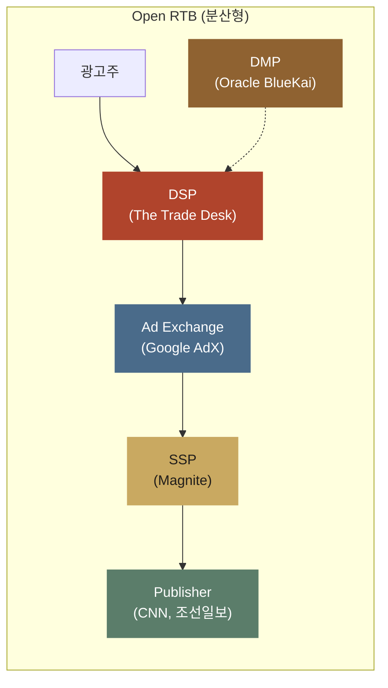
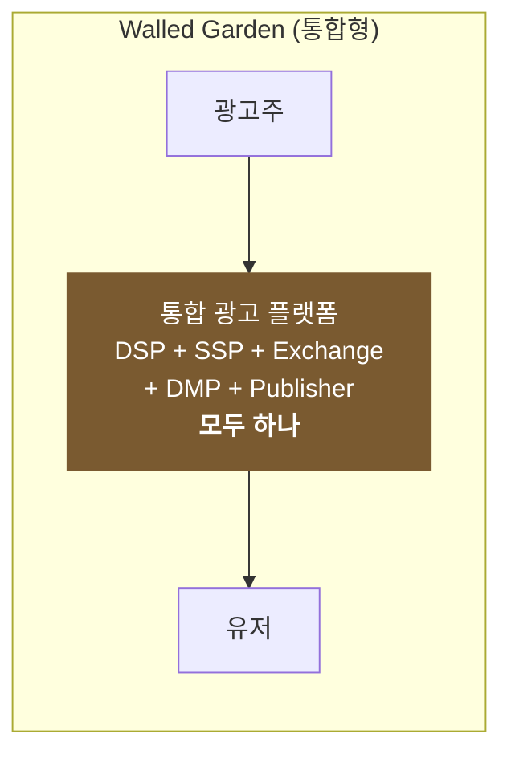
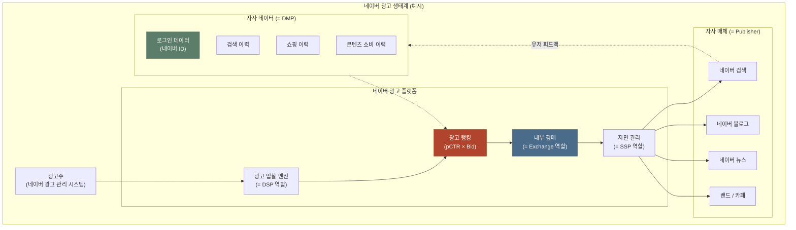
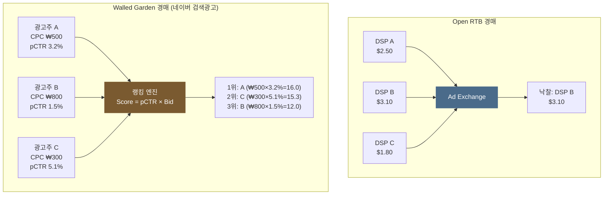
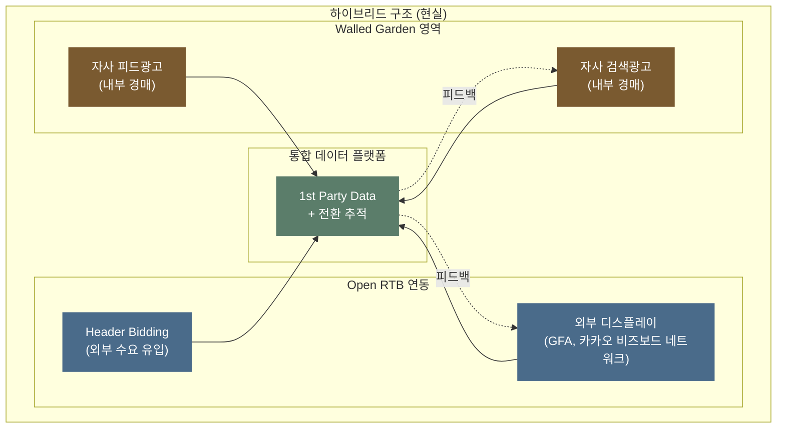

네이버 검색광고와 카카오 비즈보드, 쿠팡 리테일 미디어는 한국 디지털 광고 시장에서 가장 큰 매출을 내는 플랫폼입니다. 세 플랫폼은 광고를 사고파는 데 드는 역할 다섯 가지를 하나같이 **모두 자사 안에** 두고 있습니다. 광고주 대신 경매에 입찰하는 DSP(Demand-Side Platform), 매체 대신 광고 자리를 파는 SSP(Supply-Side Platform), 두 쪽의 주문을 모아 경매로 그 자리를 사 갈 쪽(낙찰자)을 정하는 광고 거래소(Ad Exchange), 광고 자리를 가진 매체인 Publisher, 유저 데이터를 모아 광고에 쓰게 해 주는 DMP(Data Management Platform)가 그 다섯 가지입니다. 업계는 이렇게 다섯 역할을 한 회사가 모두 맡는 구조를 **닫힌 생태계(Walled Garden)**라고 부릅니다. Walled Garden 은 담장을 두른 정원이라는 뜻이라 이 글은 닫힌 생태계의 안쪽을 「담장 안」이라고도 적습니다.

반대로 이 역할들을 서로 다른 회사가 나눠 맡고 광고가 뜰 때마다 실시간 입찰(RTB, Real-Time Bidding)로 광고 자리를 사고파는 구조는 열린 RTB(Open RTB) 생태계라고 부릅니다. 이 글은 두 생태계의 구조가 어떻게 다른지 먼저 비교한 뒤, 그 차이가 pCTR(광고가 클릭될 확률을 모델이 예측한 값) 모델링과 입찰 전략, 데이터 활용에 각각 어떤 영향을 주는지 엔지니어의 관점에서 살펴봅니다.

---

## 1. 열린 RTB 와 닫힌 생태계의 구조 비교

**같은 배너 광고 한 건이 뜰 때 열린 RTB 에서는 회사 네 곳을 거치지만 닫힌 생태계에서는 한 회사 안에서 거래가 끝납니다.** 광고가 회사를 몇 곳 거치느냐에 따라 계약과 수수료가 몇 번 붙는지, 거래 전체를 보는 회사가 있는지가 달라집니다. 이 글의 나머지 절은 모두 이 구조 차이에서 출발합니다.

### 열린 RTB 생태계 (분산형)

열린 RTB 에서는 이 역할들을 **독립 사업자**, 다시 말해 서로 다른 회사가 하나씩 따로 맡습니다. 세 중개 역할이 각각 하는 일은 [DSP, SSP, 광고 거래소](post.html?id=dsp-ssp-exchange)에서 이미 다뤘습니다. 이 역할들이 광고 시장 전체에서 어디에 놓이는지는 [광고 기술 생태계 전체 지도](post.html?id=adtech-ecosystem-map)에서 함께 볼 수 있습니다.

조선일보 지면(광고가 들어가는 화면 속 자리)에 배너 한 건이 뜨는 과정을 따라가 보면 광고주 → DSP(The Trade Desk) → 광고 거래소(Google AdX) → SSP(Magnite) → Publisher(조선일보) 순서로 여러 회사를 거칩니다. 광고주와 DSP 사이, DSP 와 거래소 사이, 거래소와 SSP 사이, SSP 와 조선일보 사이에서 매번 다른 회사로 넘어가므로 이 길에는 **네 번의 회사 경계**가 있습니다. 회사가 바뀌는 경계마다 계약과 수수료가 따로 붙습니다. 이 수수료가 단계를 지나며 실제로 얼마나 쌓이는지는 [DSP, SSP, 광고 거래소 글](post.html?id=dsp-ssp-exchange)에서 단계별로 계산했습니다.

각 회사가 한 가지 일에 전문화하는 편이 유리해서 역할이 이렇게 나뉘었습니다. DSP 는 입찰 알고리즘에, SSP 는 지면 확보에, 광고 거래소는 매칭(광고 자리와 입찰을 짝짓는 일) 속도에 집중합니다. 그 대가로 광고주가 낸 돈의 상당 부분이 중간에서 사라집니다. 거래 전체를 처음부터 끝까지 보는 회사도 없습니다.

아래 그림에서 실선 화살표는 광고주에서 매체까지 이어지는 이 길입니다. 점선 화살표는 DMP(Oracle BlueKai)가 DSP 에 데이터를 공급하는 연결입니다. 그림과 표에서는 광고 거래소를 Ad Exchange 나 Exchange 로 줄여 적습니다.



### 닫힌 생태계 (통합형)

네이버, 카카오, 구글, 메타 같은 회사에서는 이 역할들을 전부 **하나의 회사**가 맡습니다. 네이버를 예로 들면 광고가 뜨는 지면, 낙찰을 정하는 경매, 결제 데이터, 회원 데이터가 모두 네이버 안에 있어서 다른 회사의 지면을 빌리거나 다른 회사의 데이터를 사 올 필요가 없습니다.

회사 경계가 없으니 회사끼리 맺는 계약도 없고 그 사이에서 빠져나가는 수수료도 없습니다. 부서끼리 데이터를 나눌 때도 계약서를 쓰는 대신 **내부 API 호출 한 번**이면 끝납니다. API 는 프로그램끼리 데이터를 주고받도록 정해 둔 인터페이스입니다. pCTR 모델을 만드는 엔지니어에게 이 구조는 DSP, SSP, Exchange 가 따로 쌓던 로그(시스템이 남기는 기록)를 하나의 파이프라인(데이터를 모으고 가공해 모델까지 넘기는 처리 흐름)에서 그대로 이어받는다는 뜻입니다. 이 데이터 통합이 실제로 돈과 어떻게 연결되는지는 8절에서 숫자로 계산합니다.

아래 첫째 그림은 광고주와 유저 사이에 통합 광고 플랫폼 하나만 있는 모습입니다. 둘째 그림은 네이버를 예로 들어 그 플랫폼 안을 펼친 모습인데, 광고 입찰 엔진이 DSP 역할을, 내부 경매가 Exchange 역할을, 지면 관리가 SSP 역할을 맡습니다. 네이버 검색, 블로그, 뉴스 같은 자사 매체는 Publisher 역할을, 로그인 데이터와 검색, 쇼핑, 콘텐츠 소비 이력 같은 자사 데이터는 DMP 역할을 맡습니다. 자사 데이터는 점선을 따라 광고 랭킹(pCTR 과 입찰가 Bid 를 곱해 순위를 매기는 단계)으로 들어갑니다. 검색 지면에서 나온 유저 피드백은 다시 자사 데이터로 돌아옵니다.





---

## 2. 두 구조의 차이: 데이터, 경매, 정보 비대칭

**두 생태계는 쓸 수 있는 데이터와 경매에서 겨루는 상대가 다르고 거래 당사자들이 보는 정보의 양도 다릅니다.** 아래 ①~③에서 이 차이를 하나씩 봅니다.

### ① 데이터 통합: 가장 큰 구조적 우위 [무대: 닫힌 생태계]

**담장 안 플랫폼은 로그인 ID 하나로 한 유저의 검색, 클릭, 구매, 콘텐츠 소비 데이터를 통합해 쓸 수 있는데, 이 데이터 통합이 닫힌 생태계의 가장 큰 구조적 우위입니다.** 아래 표는 유저를 알아보는 방법부터 전환을 확인하는 방법까지 네 가지를 나란히 놓습니다.

| 구분 | 열린 RTB | 닫힌 생태계 |
|------|----------|---------------|
| 유저 식별 | 3rd 자사 쿠키(Party Cookie) (브라우저마다 차단이 늘어남) | **1st Party 로그인 ID** |
| 데이터 범위 | DSP가 보는 데이터 ≠ Publisher 데이터 | **검색 + 클릭 + 구매 + 콘텐츠 소비 = 통합** |
| Cross-device | 확률적 매칭 (부정확) | **로그인 기반 확정 매칭** |
| 전환 추적 | Pixel/Postback (지연, 누락) | **자사 결제 데이터 직접 연동 가능** |

표의 첫 줄은 유저를 알아보는 방법입니다. 열린 RTB 는 서드파티 쿠키(유저가 방문한 사이트가 아닌 다른 회사가 브라우저에 남기는 식별 기록)로 유저를 알아보는데 브라우저마다 이 쿠키를 막는 경우가 늘고 있습니다. 닫힌 생태계는 플랫폼이 회원에게 직접 발급한 1st Party 로그인 ID 로 유저를 알아봅니다. 1st Party 는 다른 회사를 거치지 않고 플랫폼이 직접 얻었다는 뜻입니다. 둘째 줄의 데이터 범위에서 열린 RTB 는 DSP 가 보는 데이터와 Publisher 가 가진 데이터가 서로 다른 반면, 닫힌 생태계는 검색, 클릭, 구매, 콘텐츠 소비 데이터가 하나로 통합되어 있습니다.

Cross-device 는 같은 사람이 폰과 PC 처럼 여러 기기를 쓸 때 그 기기들을 한 사람으로 연결하는 일입니다. 열린 RTB 는 비슷한 신호로 같은 사람일 가능성을 추정하는 확률적 매칭에 기대서 부정확한 반면, 닫힌 생태계는 로그인 기록으로 같은 사람을 확정합니다. 전환 추적은 광고를 본 사람이 구매 같은 목표 행동(전환)을 했는지 확인하는 일입니다. 열린 RTB 는 광고주 웹페이지에 심은 추적 코드(Pixel)나 광고주 또는 측정 회사의 서버가 전환을 알려 오는 호출(Postback)에 기대서 기록이 늦게 오거나 빠지는 반면, 닫힌 생태계는 자사 결제 데이터를 직접 연결할 수 있습니다.

표 첫 줄의 유저 식별이 두 무대(이 블로그가 열린 RTB 와 닫힌 생태계를 부르는 이름)에서 어떻게 다른지는 아래 카드에 있습니다. 담장 안은 로그인한 회원 ID 로 그 사람을 바로 찾고 열린 RTB 는 쿠키로 찾다가 못 찾는 사람이 생기는 차이를 보면 됩니다.

<div class="demo-embed-wrap">
<iframe class="demo-embed" src="demo-targeting-cards.html?embed=1&card=signal" height="480" loading="lazy" title="유저 정보가 오는 길 두 가지"></iframe>
<a class="demo-embed-open" href="demo-targeting-cards.html" target="_blank" rel="noopener">↗ 카드 아홉 장 전체로 열기</a>
</div>

열린 RTB 에서 DSP 가 볼 수 있는 정보는 입찰 요청(Bid Request)에 담긴 내용뿐입니다. 입찰 요청은 광고 자리가 열릴 때 거래소가 DSP 들에게 이 자리에 얼마를 내겠느냐고 묻는 메시지인데, 여기에는 유저 ID, 지면, 디바이스 같은 제한된 정보만 들어 있습니다. 반면 네이버 광고 플랫폼은 **같은 유저의 검색 쿼리, 쇼핑 행동, 콘텐츠 소비 패턴, 결제 내역**까지 하나의 파이프라인에서 꺼내 쓸 수 있습니다.

데이터가 이만큼 다르면 pCTR 모델에서는 네 가지가 달라집니다.

- **Feature 풍부도**: 피처(모델이 예측할 때 보는 입력 값)를 얼마나 많이 쓸 수 있는지입니다. 열린 RTB 의 DSP 가 쓰는 피처가 수십 개라면 닫힌 생태계는 플랫폼이 자기 서비스에서 직접 모은 1st party 피처를 수백~수천 개 쓸 수 있습니다.
- **라벨 정확도**: 라벨은 클릭했는가, 전환했는가처럼 모델이 맞혀야 하는 정답입니다. 지연 피드백(Delayed Feedback)은 전환 라벨이 늦게 도착하는 문제입니다. Attribution 은 전환 한 건을 어느 광고 덕분으로 볼지 정하는 일입니다. 담장 안은 전환 추적이 자사 시스템 안에서 끝나므로 이 두 문제가 크게 줄어듭니다.
- **Privacy 내성**: 프라이버시 보호 조치가 늘어도 영향을 덜 받는 정도입니다. Safari, Firefox 의 3rd 자사 쿠키 차단과 ATT(앱이 다른 앱이나 웹사이트에서 유저를 추적하려면 먼저 동의를 받게 한 애플의 정책)의 영향을 담장 안은 거의 받지 않습니다.
- **실험 속도**: 홀드아웃(A/B 테스트)은 일부 유저를 떼어 두고 나머지와 결과를 비교하는 실험입니다. 담장 안은 이 실험을 자사 트래픽(자기 서비스에 들어오는 유저와 요청)에 바로 걸 수 있어서 효과를 실험으로 직접 확인하는 주기가 짧습니다([어트리뷰션 입문](post.html?id=attribution-basics)의 담장 안 측정 참고).

### ② 경매 구조: 같은 플랫폼 광고주끼리의 내부 경매

**열린 RTB 에서는 여러 DSP 가 광고 거래소에서 겨루지만 닫힌 생태계에서는 같은 플랫폼 안의 광고주끼리만 겨룹니다.** 누가 이기는지 정하는 기준도 달라서 아래 그림의 네이버 검색광고에서는 입찰가가 가장 높은 광고가 아니라 pCTR 과 입찰가를 곱한 점수가 가장 높은 광고가 1위에 오릅니다.

그림의 두 상자 가운데 「Open RTB 경매」는 DSP 세 곳이 거래소에 값을 부르는 경매입니다. 「Walled Garden 경매 (네이버 검색광고)」는 광고주 세 곳이 랭킹 엔진의 점수로 순위를 정하는 경매입니다.



Open RTB 쪽에서는 DSP A, B, C 가 각각 `$2.50`, `$3.10`, `$1.80` 을 불렀고 가장 높이 부른 DSP B 가 `$3.10` 으로 낙찰됩니다. 네이버 검색광고 쪽은 입찰가만 보지 않고 Score = pCTR × Bid 로 점수를 매기는데, 여기서 Bid 는 광고주가 클릭 한 번에 내겠다고 부른 입찰가(CPC, Cost Per Click)입니다. 광고주 A 의 점수는 CPC ₩500 에 pCTR 3.2% 를 곱한 16.0 입니다. 같은 식으로 C 는 ₩300 × 5.1% = 15.3, B 는 ₩800 × 1.5% = 12.0 입니다. 그래서 입찰가가 가장 높은 B(₩800)는 3위로 내려갑니다. 입찰가가 가장 낮은 C(₩300)는 pCTR 이 5.1% 로 가장 높아 2위에 오릅니다.

**닫힌 생태계 경매의 세 가지 특징**

- **Bid Shading 불필요**: Bid Shading 은 낙찰자가 부른 값을 그대로 내는 경매에서 입찰가를 자기가 매긴 가치보다 낮춰 부르는 일입니다. 담장 안 경매는 대부분 GSP(Generalized Second-Price)나 VCG 로 과금하는데, GSP 는 순위마다 바로 아래 순위의 입찰을 기준으로, VCG 는 그 광고주가 참여해서 다른 광고주들이 잃은 가치만큼 값을 정합니다. 두 방식 모두 부른 값을 그대로 받지 않으므로 이렇게 낮춰 부를 필요가 없습니다. 네이버 검색광고도 바로 아래 순위의 광고주를 이기는 데 필요한 최소 금액에 조금만 더한 값을 받습니다.
- **pCTR 의 역할 변화**: 열린 RTB 에서 pCTR 은 참 가치(True Value, 노출 한 번이 광고주에게 주는 값어치를 DSP 가 추정한 값)를 계산할 때 넣는 입력입니다. 닫힌 생태계에서는 pCTR 이 **랭킹 점수 자체를 이루는 주요 요소**라서 위 그림의 C 처럼 pCTR 이 높으면 낮은 CPC 로도 위쪽에 노출될 수 있습니다.
- **경쟁 범위 제한**: 같은 키워드나 타겟팅을 설정한 광고주끼리만 겨루므로 열린 RTB 처럼 수백 개 DSP 가 동시에 입찰하는 상황이 아닙니다.

### ③ 정보 비대칭의 해소

**열린 RTB 의 DSP 엔지니어가 겪는 난관 다섯 가지가 닫힌 생태계에서는 구조 덕분에 풀립니다.** 정보 비대칭은 거래 당사자들이 가진 정보의 양이 서로 다른 상태입니다. 열린 RTB 의 DSP 는 경매를 직접 열지 않고 입찰만 넣기 때문에 경매 결과와 유저 정보의 일부만 봅니다. 반면 담장 안에서는 경매와 데이터가 모두 플랫폼 안에 있으므로 이 비대칭이 생기지 않습니다.

| 열린 RTB의 난관 | 원인 | 닫힌 생태계에서의 해결 |
|----------------|------|------------------------|
| **숨겨진 데이터(Censored Data)** | 패찰 시 시장가 미관측 | 내부 경매이므로 **모든 입찰가 관측 가능** |
| **Selection Bias** | 낙찰한 광고만 피드백 수집 | 노출 순위별 클릭 데이터 수집 → **자리 편향(Position Bias) 보정**으로 전환 |
| **지연 피드백** | 3rd party 전환 추적 지연 | 자사 결제 시스템과 직접 연동 → **실시간 전환 확인** |
| **Cross-device 추적** | Cookie 기반 확률 매칭 | 로그인 ID 기반 → **로그인한 기기끼리는 확정 매칭** |
| **Feature 제한** | 입찰 요청의 제한된 정보 | **검색 쿼리 + 행동 이력 + 구매 데이터 통합** |

표의 첫 줄인 **숨겨진 데이터(Censored Data)**는 패찰(경매에서 지는 일)하면 그 자리가 얼마에 팔렸는지 시장가를 볼 수 없어서 값이 비어 있는 데이터입니다. 담장 안은 경매를 직접 열기 때문에 모든 입찰가를 관측합니다. Selection Bias(선택 편향)는 낙찰한 광고에서만 클릭 피드백이 모여 데이터가 한쪽으로 치우치는 문제입니다. 담장 안에서는 노출 순위마다 클릭 데이터를 모을 수 있어서 이 문제가 자리 편향(Position Bias)을 보정하는 문제로 바뀝니다. 자리 편향은 위쪽에 놓인 광고가 품질과 상관없이 클릭을 더 받는 효과입니다.

지연 피드백은 3rd party(거래 당사자가 아닌 다른 회사)의 전환 추적이 늦게 알려 와서 생기는데, 담장 안은 자사 결제 시스템과 직접 연결해 전환을 실시간으로 확인합니다. Cross-device 추적은 쿠키에 기댄 확률 매칭 대신 로그인 ID 를 써서 로그인한 기기끼리 확정 매칭합니다. Feature 제한은 담장 안이 입찰 요청 한 건의 정보 대신 검색 쿼리, 행동 이력, 구매 데이터를 한데 모아 쓰므로 풀립니다.

---

## 3. 닫힌 생태계 안의 pCTR 모델링

**같은 pCTR 모델이라도 담장 안에서는 가장 강한 피처, 모델 구조, 오프라인 평가에서 열린 RTB 와 다른 점이 있습니다.** ①은 검색 의도를 중심에 둔 피처 설계, ②는 자리 편향을 떼어 내는 모델 구조, ③은 노출되지 않은 광고의 평가입니다.

### ① 피처 설계: 가장 강한 피처인 검색 의도

열린 RTB 의 디스플레이 광고(배너처럼 지면에 그림이나 영상을 띄우는 광고)는 유저 프로필(나이, 성별, 관심사)과 지면 정보를 주요 피처로 씁니다. 반면 네이버, 카카오처럼 검색 광고를 기반으로 하는 닫힌 생태계에서는 **검색 쿼리에 담긴 의도(intent)**가 가장 강한 피처인데, 아래 표의 맨 윗줄처럼 검색 쿼리에는 유저의 구매 의도가 직접 반영되기 때문입니다.

| 피처 카테고리 | 열린 RTB (디스플레이) | 닫힌 생태계 (검색 광고) |
|-------------|---------------------|-------------------------|
| **최강 피처** | 유저 세그먼트, 지면 도메인 | **검색 쿼리** (구매 의도 직접 반영) |
| 유저 피처 | 3rd party 세그먼트 (부정확) | 1st party 행동 이력 (정확) |
| 컨텍스트 | 지면 URL, 광고 사이즈 | 검색 결과 페이지 위치, 시간대 |
| 광고 피처 | Creative 사이즈, 포맷 | 키워드 매칭 타입, 광고 품질 점수 |
| 이력 피처 | 제한적 (Cookie 기반) | **최근 검색/클릭/구매 시퀀스** |

표의 나머지 줄도 같은 방향입니다. 유저 피처에서 열린 RTB 는 3rd party 세그먼트(다른 회사가 비슷한 유저끼리 나눠 만든 그룹 정보)라 부정확한 반면, 담장 안은 자사 서비스에서 쌓은 1st party 행동 이력이라 정확합니다. 광고 피처에서 열린 RTB 는 Creative(광고 소재)의 사이즈와 포맷을 보지만 담장 안은 키워드 매칭 타입과 광고 품질 점수를 씁니다. 키워드 매칭 타입은 검색어와 광고 키워드를 얼마나 엄격하게 맞출지 정한 방식입니다. 광고 품질 점수는 플랫폼이 광고의 관련성과 예상 성과를 평가해 매긴 점수입니다. 이력 피처도 열린 RTB 는 쿠키에 기대 제한적이지만 담장 안은 최근 검색, 클릭, 구매 시퀀스(시간 순서대로 이어진 행동 기록)를 씁니다.

### ② 모델 아키텍처: 자리 편향 보정

**검색 광고의 CTR(노출 대비 클릭 비율)은 광고 품질뿐 아니라 노출 위치(Position)에도 크게 좌우되므로, 담장 안의 pCTR 모델은 보통 위치의 효과와 광고 품질을 두 확률로 나눠 곱합니다.** 1위 광고는 위치 자체의 이점 덕분에 CTR 이 높게 나오고 5위 광고는 품질이 같아도 CTR 이 낮게 나오기 때문에, 관측한 CTR 을 그대로 학습하면 위치의 효과와 광고 품질이 한 숫자에 섞입니다.

두 효과를 나눈 식은 아래와 같습니다.

$$pCTR(ad, user, query, position) = \underbrace{P(\text{examine} | position)}_{\text{Position Bias}} \times \underbrace{P(\text{click} | \text{examine}, ad, user, query)}_{\text{진짜 광고 품질}}$$

- **Examination Probability**: 유저가 그 위치까지 시선을 보낼 확률입니다. 위치에만 달려 있어서 식에서 Position Bias 부분을 맡습니다.
- **Click Probability given Examination**: 유저가 광고를 실제로 봤다는 조건에서 클릭할 확률입니다. 광고 품질을 나타내므로 식에서 진짜 광고 품질 부분을 맡습니다.

위 식은 유저가 광고를 먼저 봐야 클릭할 수 있다고 전제하는데, 이 전제를 Examination Hypothesis 라고 부릅니다. 순위를 매길 때는 자리 편향을 뺀 **순수 광고 품질 점수**를 써야 하므로 두 확률을 나눕니다. 위치 효과를 빼지 않으면 「1위라서 클릭이 많았고, 클릭이 많으니까 1위를 유지하는」 강화 루프(rich-get-richer, 이미 앞선 광고가 계속 더 앞서 가는 악순환)가 생깁니다.

### ③ 학습 데이터: 노출되지 않은 광고의 평가

**담장 안이라도 오프라인 모델 평가는 쉽지 않습니다.** 오프라인 모델 평가는 새 모델을 서비스에 내보내기 전에 쌓여 있는 로그로 성능을 미리 확인하는 일입니다.

담장 안에서는 **모델이 노출할 광고를 결정**하므로 모델이 고르지 않은 광고는 노출되지 않아 그 광고의 잠재 CTR 을 알 수 없습니다. 열린 RTB 의 DSP 가 패찰한 경매의 결과를 보지 못하는 것과 같은 구조의 문제가 담장 안에서는 「내 모델이 고르지 않은 광고」에서 생깁니다. 새 모델이 지금 모델과 다른 광고를 고르면 그 광고가 노출됐을 때의 결과는 로그에 없어서 실제로 일어나지 않은 경우의 성적을 추정해 매겨야 하는데, 이 문제를 **반사실 채점(Counterfactual Evaluation)** 문제라고 부릅니다. 이 문제를 풀 때는 아래 세 가지 방법을 씁니다.

- **IPS (Inverse Propensity Scoring)**: 광고가 노출될 확률(propensity)의 역수로 가중치를 줘서 편향을 보정합니다. 지금 모델이 드물게 고른 광고의 기록일수록 큰 가중치를 받으므로 자주 고른 광고에 몰린 데이터의 치우침이 줄어듭니다.
- **Randomized Exploration**: 트래픽의 일부(보통 1~5%)를 무작위 노출에 배정해서 모델의 선택과 상관없이 노출된 광고의 탐색 데이터를 모읍니다.
- **Replay Method**: 과거 로그에서 지금 평가하려는 모델의 선택과 실제로 노출된 광고가 일치하는 샘플만 골라 평가합니다.

---

## 4. 주요 플랫폼별 비교

**닫힌 생태계라는 이름은 같아도 안을 들여다보면 플랫폼마다 강점으로 쓰는 데이터의 종류가 다릅니다.** 한국 회사 3곳과 글로벌 회사 4곳을 나란히 놓고 각자 어떤 데이터를 쥐고 있는지 비교합니다.

### 한국 시장

표의 과금 모델은 광고주가 무엇을 기준으로 광고비를 내는지를 나타냅니다. CPC 는 클릭 한 번마다, CPM 은 노출 수에 따라, CPA 는 구매나 가입 같은 행동(Action) 한 건마다 광고비를 내는 방식입니다.

| 플랫폼 | 핵심 매체 | 주요 광고 상품 | 과금 모델 | 특징 |
|--------|---------|-------------|---------|------|
| **네이버** | 검색, 블로그, 뉴스, 쇼핑 | 파워링크, 쇼핑검색광고, 성과형 디스플레이 | CPC, CPM | 검색 쿼리 + 쇼핑 데이터 통합 |
| **카카오** | 카카오톡, 다음, 카카오맵 | 비즈보드, 키워드광고, 카카오모먼트 | CPC, CPM, CPA | 메신저 기반 소셜 데이터 |
| **쿠팡** | 쿠팡 앱/웹 | 쿠팡 애즈 (Retail Media) | CPC | **구매 데이터 직접 보유** → ROAS 최적화에 가장 유리 |

세 회사는 손에 쥔 **데이터의 종류**부터 다릅니다. 네이버는 유저의 구매 의도가 가장 직접적으로 나타나는 신호인 검색 쿼리를 갖고 있습니다. 카카오는 수천만 명이 쓰는 메신저에서 나온 소셜 그래프(누가 누구와 연결되어 있는지 보여 주는 관계망)를 갖고 있습니다. 쿠팡에서는 검색과 구매가 같은 화면, 같은 세션(유저가 앱을 한 번 이용하는 동안) 안에서 일어납니다.

이 가운데 **쿠팡이 pCTR, pCVR(클릭한 유저가 구매 같은 전환을 할 확률의 예측값) 모델링에 가장 유리한 위치**에 있다는 평가가 많은데, 검색부터 클릭, 구매까지 전 과정이 앱 하나 안에서 끊기지 않기 때문입니다. 표에서 쿠팡의 특징으로 적힌 ROAS(Return On Ad Spend)는 쓴 광고비 대비 광고로 생긴 매출입니다. 네이버와 카카오도 통합 데이터를 갖고 있지만 구매 데이터가 얼마나 빠짐없이 모이는지는 네이버페이, 카카오페이와 연동되었는지에 따라 달라집니다.

### 글로벌 닫힌 생태계

| 플랫폼 | 핵심 데이터 | 광고 수익 (2024) | 특징 |
|--------|-----------|----------------|------|
| **Google** | 검색 쿼리 + YouTube 시청 + Gmail + Android | ~$265B | 검색 + 디스플레이 + 비디오 통합 |
| **Meta** | 소셜 그래프 + Instagram + WhatsApp | ~$160B | 소셜 시그널 기반 관심사 타겟팅 |
| **Amazon** | 구매 이력 + 검색 + 리뷰 | ~$56B | 구매 의도 데이터 = 가장 직접적 전환 신호 |
| **Apple** | App Store + Apple ID + 디바이스 센서 | ~$10B | ATT로 경쟁사 데이터 제한 + 자사 광고 확대 |

글로벌 회사 네 곳도 **강점으로 쓰는 데이터가 뚜렷하게 다릅니다.** Google 은 사람들이 무엇을 찾는지 알려 주는 검색 의도를 가장 강하게 쥐고 있습니다. Meta 는 누가 누구와 연결되어 있는지 보여 주는 관계망을, Amazon 은 사람들이 실제로 무엇을 사는지 보여 주는 구매 이력을 쥐고 있습니다.

Amazon 의 광고 수익(`~$56B`)은 검색 광고의 강자인 Google(`~$265B`)보다 작습니다. 그래도 구매 이력은 실제로 결제하는 순간과 가장 가까운 신호라서 **구매 직전 데이터**라는 면에서는 Amazon 이 오히려 더 유리하다는 평가를 받습니다.

Apple 은 광고 매출을 따로 공개하지 않으므로 표의 ~$10B 는 공식 공시 숫자가 아니라 업계 추정치입니다. 다만 ATT 를 도입한 뒤로 Apple 이 **경쟁사의 데이터는 제한하면서 자사 광고 사업은 키우는** 움직임은 뚜렷합니다. 이 배경은 8절 끝의 「더 깊이」 상자에서 더 다룹니다.

---

## 5. 닫힌 생태계의 한계와 트레이드오프

**닫힌 생태계라고 모든 면에서 앞서지는 않습니다.** 트레이드오프는 하나를 얻으면 다른 하나를 내줘야 하는 관계입니다. 담장 안 구조는 데이터와 수수료에서 앞서는 대신 아래 네 가지 한계가 있습니다.

### ① 수요 경쟁의 부재

수요는 광고 자리를 사려는 광고주들의 입찰입니다. 열린 RTB 에서는 수백 개 DSP 가 같은 자리에 동시에 입찰해서 매체 수익을 최대한 끌어올립니다. 닫힌 생태계에는 자사 광고주만 참여하므로 **매체 입장에서는 경쟁 입찰가가 낮을 수 있습니다**. 네이버가 외부 광고 네트워크(GFA 등)를 따로 운영하는 이유 가운데 하나가 바로 이 점입니다. 광고 네트워크는 여러 매체의 광고 자리를 모아 광고주에게 파는 사업자입니다. GFA 는 6절에 다시 나오는 네이버의 성과형 디스플레이 광고입니다.

### ② 광고주 Lock-in

Lock-in 은 광고주가 한 플랫폼에 묶여 다른 곳으로 옮기기 어려운 상태입니다. 닫힌 생태계에서 광고주는 **데이터를 다른 플랫폼으로 옮길 수 없습니다.** 네이버에서 쌓은 캠페인(광고주가 예산과 목표를 정해 집행하는 광고 단위) 데이터와 최적화 결과를 카카오로 가져갈 수 없어서 두 가지 문제가 생깁니다.

- 플랫폼마다 다른 기준으로 성과를 리포트하므로 플랫폼끼리 성과를 비교하기 어렵습니다.
- **Attribution 전쟁**: 플랫폼마다 전환을 자기에게 유리하게 집계하려는 동기가 생깁니다.

### ③ 투명성 문제

열린 RTB 에서는 DSP 가 입찰 요청과 응답(Response)을 직접 제어하고 경매 결과를 검증할 수 있습니다. 닫힌 생태계에서는 플랫폼이 **경매 알고리즘, 품질 점수, 과금 로직**을 모두 통제하면서 밖에 공개하지 않습니다.

그래서 광고주는 「왜 내 광고가 3위인지」, 「품질 점수가 어떻게 계산되는지」를 정확히 알 수 없습니다. 안에서 무슨 계산을 하는지 밖에서 보이지 않는 이런 블랙박스 구조는 플랫폼을 믿지 못하는 신뢰 문제로 이어질 수 있습니다.

### ④ 지면 선택의 폭과 담장의 잠식 [무대: 열린 RTB]

열린 RTB 는 DSP 하나만 연결하면 수만 개 매체의 지면에 광고를 낼 수 있어서 **선택의 폭**이 넓다는 근본적인 강점이 있습니다. 반면 닫힌 생태계의 광고주는 그 회사의 자사 매체 안에서만 광고를 집행할 수 있습니다.

그런데 담장 안 플랫폼들도 열린 RTB 의 이 넓은 지면 안으로 들어오고 있습니다. Google 은 검색이라는 자기 담장을 가진 채로 Google Display Network(구글이 여러 사이트와 앱의 광고 자리를 모아 파는 디스플레이 광고 네트워크)와 자기 광고 거래소인 AdX 로 열린 RTB 시장에서도 거래합니다. Amazon DSP 는 아마존 바깥의 지면까지 사들입니다. 네이버 GFA 도 자사 매체 밖의 네트워크 지면을 함께 팝니다.

이렇게 열린 시장으로 나올 때 담장 안 플랫폼은 **자기 데이터의 우위를 그대로 지닌 채 나옵니다.** 독립 DSP(담장 안 플랫폼에 속하지 않은 DSP)는 쿠키와 확률적 매칭에 기대 pCTR 을 추정하지만 Google 과 Amazon 은 로그인 기반 1st-party 신호로 같은 유저의 pCTR 을 더 정확히 추정한 상태로 같은 경매에 참여합니다.

그 결과 열린 RTB 경매에서조차 데이터가 가장 많은 담장 안 플랫폼이 유리해지는 경우가 늘고 있습니다. 누구나 참여하는 열린 시장이라는 형식은 그대로인데 그 안에서 이기는 경쟁력은 점점 더 담장 안으로 쏠립니다.

---

## 6. 하이브리드 모델: 현실의 진화 방향

**실제로는 순수한 열린 RTB 나 순수한 닫힌 생태계보다 두 방식을 섞은 하이브리드 구조가 주류입니다.** 한 플랫폼이 자사 매체를 파는 담장 안 영역과 외부 매체로 이어지는 열린 RTB 영역을 함께 운영하면서 두 영역의 데이터를 한곳에 모읍니다.

그림의 「Walled Garden 영역」에는 내부 경매로 파는 자사 검색광고와 자사 피드광고(콘텐츠 목록 사이에 끼워 넣는 광고)가 있습니다. 「Open RTB 연동」에는 외부 디스플레이(GFA, 카카오 비즈보드 네트워크)와 외부 수요를 들이는 Header Bidding(매체 페이지가 여러 SSP 에 한꺼번에 값을 묻는 방식)이 있습니다. 두 영역의 데이터는 모두 「통합 데이터 플랫폼」의 1st Party Data 와 전환 추적으로 모이고 점선을 따라 다시 검색광고와 GFA 로 피드백됩니다.



- **네이버**: 파워링크(네이버 검색 결과에 뜨는 검색광고)는 담장 안(Walled Garden), GFA 성과형 디스플레이는 외부 매체 네트워크입니다.
- **카카오**: 비즈보드(카카오톡 채팅 목록 맨 위에 뜨는 배너)는 담장 안, 카카오모먼트 네트워크는 외부 매체까지 포함하는 영역입니다.
- **구글**: Google Ads 검색은 담장 안, Google Display Network 와 열린 RTB 거래소인 AdX 는 바깥 시장입니다.

인벤토리는 팔 수 있는 광고 자리 전체를 말하며 그중 값이 높은 자리가 프리미엄 인벤토리입니다. 두 영역을 함께 운영하는 플랫폼은 **자사 매체의 프리미엄 인벤토리**를 내부 경매로 팔아 수익을 최대로 끌어올리는 동시에 **외부 매체 네트워크**에서는 열린 RTB 로 광고를 낼 수 있는 지면의 규모를 넓힙니다.

---

## 7. 닫힌 생태계의 Bid Shading: 정보를 다 가진 플랫폼이 입찰가를 깎는 이유

**담장 안 플랫폼은 경쟁 입찰가를 모두 보면서도 「스마트 입찰」, 「자동 입찰」 같은 기능으로 광고주 대신 입찰가를 깎아 줍니다. 이 기능은 본질적으로 플랫폼이 하는 Bid Shading 입니다.**

2절에서 본 것처럼 닫힌 생태계는 시장 가격 정보를 내부에 갖고 있으므로 [Bid Shading](post.html?id=bid-shading-censored)이 필요 없습니다. 그렇다면 정보를 다 가진 플랫폼이 왜 카카오모먼트의 「스마트 입찰」이나 네이버의 「자동 입찰」 같은 Bid Shading 기능을 들여왔을까요? 이유는 두 가지입니다.

### 이유 1: 통합 경매(Unified Auction), 외부 DSP 와의 공정한 경쟁

첫째 이유는 6절에서 본 하이브리드 구조에서 곧바로 나옵니다. 카카오톡 비즈보드처럼 외부 DSP(Moloco, The Trade Desk 등)가 내부 광고주와 같은 지면을 놓고 경쟁하는 상황을 생각해 보겠습니다. 이렇게 내부 광고주와 외부 DSP 를 한 경매에서 함께 겨루게 하는 방식이 통합 경매입니다.

| 참가자 | 경매 방식 | 입찰가 | 실제 지불 | 플랫폼 수익 |
|--------|----------|--------|----------|------------|
| 내부 광고주 (기존) | 2nd Price | 300원 | 201원 (2등+1) | 201원 |
| 외부 DSP (Moloco) | 1st Price | 200원 | 200원 | 200원 |

표에서 내부 광고주는 2nd Price(낙찰자가 2등이 부른 값을 내는 규칙)를 따르므로 300원을 불러도 2등 입찰가보다 1원 많은 201원만 냅니다. 외부 DSP 는 1st Price(낙찰자가 자기가 부른 값을 그대로 내는 규칙)를 따르므로 200원을 부르면 200원을 그대로 냅니다. 같은 1등인데 지불 규칙이 이렇게 다르면 참가자 사이에 형평성 문제가 생깁니다. 플랫폼으로서도 같은 지면에서 얼마를 벌지 예측하기 어려워집니다.

이 문제는 **모두 1st Price 로 통일**하면 풀립니다. 그런데 1st Price 로 바꾸면 이전에는 201원만 내던 내부 광고주가 부른 값 300원을 그대로 내야 해서 부담이 갑자기 커집니다. 그래서 플랫폼이 **「경쟁 상황을 보니 201원이면 이깁니다」**라고 판단해 그 광고주의 입찰가를 자동으로 깎아 줍니다. 통합 경매 환경의 Bid Shading 은 바로 이 동작입니다.

### 이유 2: Winner's Curse 방지와 광고주 이탈 차단

외부 DSP 가 없더라도 1st Price 환경에서는 Winner's Curse(승자의 저주)를 막으려면 Bid Shading 이 필요합니다. Winner's Curse 는 경매에서 이기고도 필요한 값보다 훨씬 많이 내서 오히려 손해를 보는 상황입니다.

소상공인(SMB, 규모가 작은 사업자) 광고주가 「무조건 노출하고 싶다」며 10,000원을 입찰했다고 해 보겠습니다. 실제 경쟁 수준은 3,000원 정도인데 1st Price 라서 10,000원이 그대로 과금되면 세 가지 문제가 생깁니다.

- 3,000원 정도면 될 자리에 10,000원씩 나가서 예산이 3배 빠르게 소진됩니다.
- 같은 광고비로 얻는 성과가 줄어 광고 효율(ROAS)이 크게 떨어집니다.
- 광고주가 「이 플랫폼은 너무 비싸다」며 떠납니다.

플랫폼은 광고주가 오래 남아 예산을 꾸준히 집행하기를 바랍니다. 그래서 **「10,000원 내셨지만, 3,500원이면 1등입니다」**라며 입찰가를 자동으로 깎아 줍니다. 「자동 입찰」, 「스마트 입찰」 기능의 본질이 바로 이 동작입니다.

### 열린 RTB 의 Bid Shading 과의 차이

두 Bid Shading 은 누가 하는지, 경쟁자의 가격을 아는지, 무엇이 어려운지, 무엇을 위해 하는지가 다릅니다.

| 비교 항목 | 열린 RTB Bid Shading | 닫힌 생태계 Bid Shading |
|-----------|---------------------|--------------------------|
| 수행 주체 | DSP (외부) | 플랫폼 (내부) |
| 정보 수준 | 경쟁자 가격 모름 (Censored Data) | 경쟁자 가격을 알고 있음 |
| 핵심 난이도 | 시장 분포 추정 (통계적 추론) | 광고주별 최적 깎기 비율 결정 |
| 목적 | DSP의 마진 확보 | 광고주 보호 + 경매 공정성 |

열린 RTB 의 DSP 는 패찰한 경매의 가격을 볼 수 없으므로 그 Bid Shading 은 보이지 않는 경쟁가를 추정하는 통계 문제입니다. 반면 닫힌 생태계의 Bid Shading 은 플랫폼이 **모든 입찰가를 보면서 광고주에게 최적가를 제시하는** 최적화 문제에 가깝습니다. 이처럼 기술적인 난이도는 다르지만 「1st Price 환경에서 너무 많이 내지 않게 막는다」는 목적은 두 방식이 같습니다.

> PID Controller(목표와 현재 값의 차이를 보고 입찰가를 계속 고치는 제어 방법)와 Lagrangian Dual(예산 같은 제약을 가격처럼 바꿔 최적 입찰가를 구하는 방법) 같은 자동 입찰 알고리즘은 [Auto-Bidding 포스트](post.html?id=auto-bidding-pacing)에서 다룹니다. 닫힌 생태계의 「스마트 입찰」은 이 알고리즘들을 단순하게 줄인 버전으로 이해할 수 있습니다.

---

## 8. 같은 광고비, 다른 실수령액: 담장 안이 돈이 되는 구조

**같은 광고비 ₩10,000,000 이 들어와도 열린 RTB 와 담장 안에서 남는 돈이 다른데, 중간에 회사를 몇 곳 거치는지와 그 돈이 얼마나 정확한 곳에 쓰이는지가 다르기 때문입니다.** 1절에서 회사 경계마다 수수료가 붙는다고 했고 2절에서는 담장 안의 데이터가 pCTR 모델을 바꾼다고 했는데, 이 절은 두 효과를 같은 예산에 적용해 숫자로 계산합니다.

한 달 예산으로 ₩10,000,000 을 쓰는 광고주를 예로 들어 보겠습니다. 열린 RTB 에서는 이 돈이 DSP, 광고 거래소, SSP 를 차례로 거친 뒤에야 매체에 도착합니다. 담장 안에서는 광고주가 플랫폼 한 곳에만 곧바로 돈을 냅니다.

| 단계 | 열린 RTB 잔액 | 담장 안 잔액 |
|---|---|---|
| 광고주 월 예산 | ₩10,000,000 | ₩10,000,000 |
| DSP 수수료 -15% | ₩8,500,000 | 해당 없음(회사가 하나) |
| 광고 거래소 수수료 -10% | ₩7,650,000 | 해당 없음 |
| SSP 수수료 -15% | ₩6,502,500 | 해당 없음 |
| 내부 운영비 -3% | 해당 없음 | ₩9,700,000 |
| **최종 실수령** | **₩6,502,500 (65.0%)** | **₩9,700,000 (97.0%)** |

표는 가상의 요율(DSP 15%, Exchange 10%, SSP 15%)로 계산했습니다. 열린 RTB 쪽을 한 단계씩 따라가 보면 먼저 DSP 가 ₩10,000,000 의 15% 를 떼어 ₩8,500,000 이 남습니다. 광고 거래소가 그 남은 돈의 10% 를 떼면 ₩7,650,000 이 되고 SSP 가 다시 15% 를 떼면 매체에는 ₩6,502,500(65.0%)만 도착합니다. 수수료가 매번 앞 단계에서 남은 돈에 붙기 때문에 경유하는 회사 수만큼 곱으로 쌓입니다. 담장 안에서는 회사가 하나뿐이라 수수료 대신 내부 운영비 3% 만 나가므로 플랫폼이 ₩9,700,000(97.0%)을 그대로 갖습니다. ₩9,700,000 을 ₩6,502,500 으로 나누면 1.49 라서 중개 회사 세 곳을 거치지 않는다는 구조 하나만으로 담장 안이 받는 돈이 열린 RTB 매체의 **1.49배**가 됩니다.

격차는 수수료에서 끝나지 않습니다. 담장 안 플랫폼은 같은 유저의 1st-party 데이터를 훨씬 많이 갖고 있습니다. 2절에서 본 것처럼 이 데이터가 pCTR 예측을 더 정확하게 만듭니다. 예측이 정확할수록 광고와 유저를 더 잘 맞추므로 같은 예산으로도 실제 클릭과 전환이 더 많이 나옵니다.

아래 코드는 이 두 효과, 곧 수수료 구조와 예측 정확도를 따로 계산한 뒤 마지막에 곱해서 같은 예산 1원이 두 구조에서 얼마나 다른 효율을 내는지 보려고 돌립니다. 2단계는 수수료 구조를, 3단계는 예측 정확도를 계산합니다. 3단계는 경매를 5만 번 열고 경매마다 후보 광고 5개의 진짜 CTR 을 0.01 과 0.05 사이에서 무작위로 정한 뒤, 진짜 CTR 에 (1 + 노이즈)를 곱한 예측치가 가장 높은 광고를 낙찰시켜 그 광고의 진짜 CTR 을 평균합니다. 코드의 모든 요율과 숫자는 예시를 위한 가상값입니다.

```python
# 하는 일: 같은 광고 예산이 담장 안(Walled Garden)과 열린 RTB 에서 얼마나 다르게 쓰이는지, 수수료 구조와 예측 정확도 두 효과로 나눠 구하고 곱한다.
# 1단계: 예산을 둔다
# 모든 요율과 숫자는 예시를 위한 가상값이다. 표준 라이브러리만 쓴다.
import random

random.seed(7)

BUDGET = 10_000_000  # 광고주가 한 달에 쓰는 예산(원) — 가상값

# 2단계: 효과 1, 중개 수수료 구조를 구한다
# 열린 RTB 는 광고주 지출 -> DSP -> Ad Exchange -> SSP -> 매체로 가며 단계마다 수수료를 뗀다. 경유하는 회사 수만큼 수수료가 곱으로 쌓인다.
OPEN_RTB_FEES = [0.15, 0.10, 0.15]  # DSP, Ad Exchange, SSP 수수료율(가상)
# 담장 안: 회사가 하나뿐이라 '수수료'가 아니라 내부 운영비만 나간다(가상).
WALLED_GARDEN_COST = 0.03

def take_home(budget, rates):
    remaining = budget
    for rate in rates:
        remaining *= (1 - rate)
    return remaining

open_rtb_revenue = take_home(BUDGET, OPEN_RTB_FEES)
walled_garden_revenue = take_home(BUDGET, [WALLED_GARDEN_COST])
structural_ratio = walled_garden_revenue / open_rtb_revenue

# 3단계: 효과 2, 예측 정확도 차이를 구한다
# 경매마다 후보 광고 5개를 pCTR 예측치로 정렬해 1등을 노출한다. 진짜 클릭 확률은 아무도 모르니, 예측이 정확할수록 더 좋은 광고를 고른다.
# 예측치는 진짜값 x (1 + 노이즈)다. 담장 안은 1st-party 데이터가 풍부해 노이즈가 더 작다(가상).
N_AUCTIONS = 50_000
N_CANDIDATES = 5
NOISE_OPEN_RTB = 0.40       # 예측 오차의 상대 표준편차 — 데이터가 부족할수록 큼(가상)
NOISE_WALLED_GARDEN = 0.15  # 1st-party 데이터가 풍부해 오차가 작음(가상)

def avg_true_ctr_of_winners(noise_sd):
    total = 0.0
    for _ in range(N_AUCTIONS):
        true_ctrs = [random.uniform(0.01, 0.05) for _ in range(N_CANDIDATES)]
        predicted = [t * (1 + random.gauss(0, noise_sd)) for t in true_ctrs]
        winner = predicted.index(max(predicted))  # 예측 1등을 낙찰시켜 노출
        total += true_ctrs[winner]                # 실제 클릭은 '진짜' CTR을 따른다
    return total / N_AUCTIONS

avg_ctr_open = avg_true_ctr_of_winners(NOISE_OPEN_RTB)
avg_ctr_walled = avg_true_ctr_of_winners(NOISE_WALLED_GARDEN)
prediction_ratio = avg_ctr_walled / avg_ctr_open

# 4단계: 두 효과를 곱해 찍는다
# 같은 예산 1원의 최종 효율 격차를 본다.
combined_ratio = structural_ratio * prediction_ratio

print(f"열린 RTB 매체 실수령      {open_rtb_revenue:>12,.0f}원  ({open_rtb_revenue/BUDGET:.1%})")
print(f"담장 안 플랫폼 실수령     {walled_garden_revenue:>12,.0f}원  ({walled_garden_revenue/BUDGET:.1%})")
print(f"효과1: 구조적 격차        {structural_ratio:.2f}배")
print(f"열린 RTB 평균 진짜 CTR    {avg_ctr_open:.4%}")
print(f"담장 안 평균 진짜 CTR     {avg_ctr_walled:.4%}")
print(f"효과2: 예측 정확도 격차   {prediction_ratio:.2f}배")
print(f"두 효과를 곱한 최종 격차  {combined_ratio:.2f}배")

# 출력:
# 4단계 뜻: 열린 RTB 는 매체에 65.0% 만 닿고 담장 안은 97.0% 가 닿아 구조 격차가 1.49배다. 예측도 정확해 고른 광고의 진짜 CTR 이 4.2076% 로 1.06배 높고, 둘을 곱하면 1.59배다.
# 열린 RTB 매체 실수령         6,502,500원  (65.0%)
# 담장 안 플랫폼 실수령        9,700,000원  (97.0%)
# 효과1: 구조적 격차        1.49배
# 열린 RTB 평균 진짜 CTR    3.9513%
# 담장 안 평균 진짜 CTR     4.2076%
# 효과2: 예측 정확도 격차   1.06배
# 두 효과를 곱한 최종 격차  1.59배
```

찍힌 줄 가운데 처음 세 줄은 2단계 결과입니다. 열린 RTB 매체 실수령이 6,502,500원(65.0%), 담장 안 플랫폼 실수령이 9,700,000원(97.0%)이라 효과1(구조적 격차)은 위 표와 같은 1.49배입니다. 다음 세 줄은 3단계 결과인데, 낙찰된 광고들의 평균 진짜 CTR 은 담장 안이 4.21%(출력 4.2076%)로 열린 RTB 의 3.95%(출력 3.9513%)보다 높아서 효과2(예측 정확도 격차)가 1.06배입니다.

담장 안의 CTR 이 더 높은 까닭은 `avg_true_ctr_of_winners` 가 예측치를 만드는 방식에 있습니다. 이 함수는 진짜 CTR 에 (1 + 노이즈)를 곱해 예측치를 만들므로 노이즈(예측 오차)가 클수록 예측 순위가 진짜 순위와 더 자주 달라집니다. 그래서 노이즈의 상대 표준편차(진짜 값 대비 오차의 표준편차)가 0.40 인 열린 RTB 에서는 후보 5개 가운데 진짜 1등이 아닌 광고가 낙찰되는 일이 잦은 반면, 0.15 인 담장 안에서는 진짜 1등에 가까운 광고가 더 자주 낙찰됩니다.

1.06배라는 격차는 커 보이지 않지만 이 차이는 노출되는 모든 광고에 되풀이해 곱해집니다. 또 2절의 랭킹 공식이 Score = pCTR × Bid 라서 pCTR 이 정확할수록 실현 eCPM(실제로 광고를 노출해 거둔 수익을 노출 수 기준으로 환산한 값)도 최적점에 더 가까워집니다.

마지막 줄은 두 효과를 곱한 최종 격차 **1.59배**입니다. 1.49 와 1.06 을 그대로 곱하면 끝자리가 조금 다른데, 코드가 반올림하기 전의 두 값을 곱하기 때문입니다. 수수료 구조만으로 이미 1.49배 유리한 상태에서 데이터 우위가 그 위에 다시 곱해져 격차가 1.59배로 벌어집니다.

다만 이 숫자들은 모두 가상값입니다. 회사마다 실제로 쓰는 수수료율과 노이즈 크기는 서로 다르고 밖에 공개되지도 않습니다. 그래도 두 효과가 가리키는 방향은 분명합니다. **회사 경계가 없어지면 중간에서 빠지는 돈이 줄어듭니다. 그리고 데이터가 모이면 그 돈이 더 정확하게 쓰입니다.**

:::deep 더 깊이 — 프라이버시 규제가 오히려 담장을 더 강하게 만드는 역설

열린 RTB 는 유저를 추적할 때 서드파티 쿠키와 모바일 광고 식별자(애플 기기의 IDFA, 안드로이드 기기의 GAID) 같은 「남의 신호」에 기댑니다. 이 신호들은 최근 몇 년 사이 계속 줄어들고 있습니다.

브라우저에서는 Safari 의 ITP 와 Firefox 의 ETP 같은 추적 방지 기능이 오래전부터 서드파티 쿠키를 기본으로 막고 있습니다. Chrome 은 서드파티 쿠키를 없애겠다는 계획을 냈다가 2025년에 그대로 두기로 했습니다. 앱에서는 Apple 이 2021년 4월 iOS 14.5 부터 ATT(App Tracking Transparency)를 도입해서 앱이 다른 앱이나 웹사이트에서 유저를 추적하려면 먼저 사용자 동의를 받아야 합니다.

추적에 동의한 유저의 비율이 낮아서 서드파티 데이터에 기대던 광고 네트워크가 타격을 입었습니다. Meta 는 2022년 한 해 ATT 가 매출에 미친 영향을 약 100억 달러 규모로 추정했습니다.

역설은 여기서 나옵니다. **서드파티 신호가 약해질수록 로그인 기반 1st-party 데이터의 상대적 가치는 오히려 올라갑니다.** 열린 RTB 의 DSP 에게는 잃은 신호를 대신할 마땅한 신호가 없습니다. 반면 담장 안 플랫폼은 유저가 로그인만 하면 검색, 구매, 콘텐츠 소비를 이미 자기 데이터로 갖고 있었기 때문에 원래부터 서드파티 신호에 크게 기대지 않았습니다.

규제의 원래 취지는 유저의 프라이버시 보호였지만 결과적으로는 「이미 로그인 데이터를 가진 소수의 대형 플랫폼」에 유리하게 작동한다는 지적이 있습니다. EU 의 디지털시장법(DMA)이 구글, 메타 같은 「게이트키퍼」(DMA 가 지정한 거대 플랫폼)를 따로 규제하는 이유 가운데 하나도 여기에 있습니다.

담장끼리의 경쟁도 같은 원리를 따릅니다. 구글, 메타, 아마존은 서로에게 「열린」 상대가 아니라 각자 다른 데이터를 강점으로 쓰는 별개의 담장입니다. Amazon Ads 가 짧은 시간에 커진 까닭도 같습니다. 검색이나 소셜이 아닌 **구매 데이터**라는 자기만의 1st-party 자산으로 새 담장을 만들었습니다.
:::

---

## 마무리

1. **닫힌 생태계는 데이터를 한곳에 모아서 앞섭니다.** 데이터 통합 덕분에 열린 RTB 보다 정확한 타겟팅과 전환 추적을 할 수 있습니다. 서드파티 신호가 줄어들수록 담장 안의 데이터 우위는 더 커집니다.

2. **pCTR 모델링의 관점이 다릅니다.** 열린 RTB 의 pCTR 모델링은 「제한된 정보로 참 가치를 추정」하는 일이 중심입니다. 반면 닫힌 생태계에서는 「풍부한 데이터로 자리 편향을 분리하고 순수 품질을 평가」하는 일이 중심입니다.

3. **경매 구조는 달라도 Bid Shading 은 두 무대의 공통 과제입니다.** 숨겨진 데이터 문제는 닫힌 생태계에서 생기지 않지만 통합 경매와 광고주 보호를 위해 닫힌 생태계에서도 Bid Shading 자체가 필수 기술이 되었습니다. 다만 그 성격은 「모르는 가격을 추정하는 문제」에서 「아는 가격에서 최적 깎기를 결정하는 문제」로 바뀝니다.

4. **현실의 구조는 하이브리드입니다.** 순수한 닫힌 생태계는 없습니다. 모든 주요 플랫폼이 자사 매체에서는 내부 경매를, 외부 네트워크에서는 열린 RTB(Open RTB)를 동시에 운영합니다. 두 영역을 연결하는 통합 데이터 플랫폼이 경쟁력을 좌우합니다.

5. **광고 기술 엔지니어는 두 무대의 기술을 함께 이해해야 합니다.** 열린 RTB 의 기술인 Bid Shading, MAB(Multi-Armed Bandit, 여러 선택지를 번갈아 시험하며 보상이 큰 선택지를 찾아가는 방법), Censored Regression(보이지 않는 절반까지 감안해서 맞추는 회귀)을 이해하고 닫힌 생태계의 기술인 자리 편향 보정, IPS, 반사실 채점도 함께 이해해야 지금 광고 시스템의 전체 그림이 그려집니다.

6. **담장 안이 돈이 되는 데에는 구조와 데이터가 함께 작용합니다.** 중개 회사가 없어 수수료로 빠지는 돈이 적습니다(8절 가상 계산에서 1.49배). 여기에 데이터가 모여 pCTR 예측이 더 정확해지는 효과까지 곱하면 격차는 더 벌어집니다(1.59배). 또 프라이버시 규제가 서드파티 신호를 약하게 만들수록 이 격차가 오히려 커진다는 역설도 기억해야 합니다.

---

## 더 깊이 보기

- 열린 RTB의 3자 구조와 수수료가 실제로 얼마나 쌓이는지 → [DSP, SSP, Ad Exchange](post.html?id=dsp-ssp-exchange)
- 담장 안 실제 광고 상품이 궁금하면 → [카카오 광고 상품 지도](post.html?id=kakao-ads-products)
- 담장 안/열린 RTB에서 측정(어트리뷰션)이 어떻게 다른지 → [어트리뷰션 입문](post.html?id=attribution-basics)
- 정직한 입찰이 왜 손해가 되는지(Bid Shading) → [Bid Shading](post.html?id=bid-shading-censored)
- 자동입찰 알고리즘의 실제 구현 → [Auto-Bidding & Pacing](post.html?id=auto-bidding-pacing)
- 광고 ML 전체 지도에서 이 글의 위치 → [ML 엔지니어 트랙](ml-track.html)
